# SUB_prototyp — subwoofer DIY od teorii do prototypu

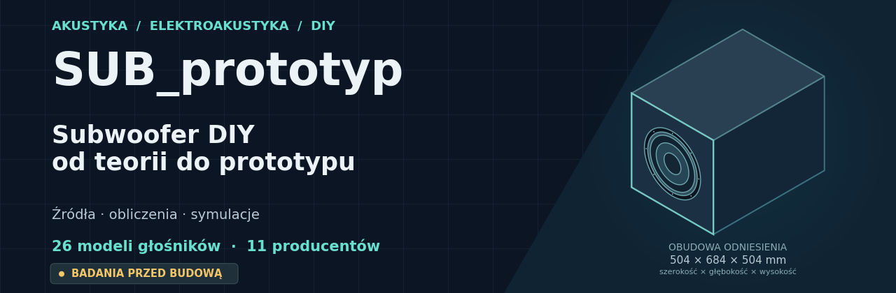

*Na banerze: historyczna obudowa odniesienia 504 × 684 × 504 mm
(szerokość × głębokość × wysokość). Jej głębokość przekracza nowy limit;
nie jest kandydatem na konstrukcję końcową.*

> **Aktualne wymaganie: maksymalnie 50 cm głębokości zewnętrznej.**
> Badamy płytszą skrzynię, którą można ustawić pionowo lub poziomo w zabudowie.
> Głośnik może być przesunięty; preferowany jest środek lewej lub prawej
> połowy frontu. Nowe wymiary i rozmieszczenie będą wynikiem obliczeń.

**34 modele głośników · 35 konfiguracji elektrycznych · 19 producentów · 102 raporty · Python/JavaScript**

Publiczny projekt dla osób, które chcą zrozumieć, co decyduje o dobrym basie. Aktualna pula obejmuje także dwa przypadki wstrzymane w nowym audycie źródeł (EMS i SUPRAVOX), a ponadto nie każda konfiguracja ma jeszcze pełny komplet badań nieliniowych i termicznych.
Porównujemy głośniki, liczymy obudowę i sprawdzamy, jak wpływają na nią
wypełnienie, wzmocnienia, klej, wzmacniacz i ustawienie w pokoju.
Celem jest **jeden konkretny głośnik i jedna konstrukcja prototypu**
subwoofera zamkniętego z regulacją objętości. Szukamy możliwie
**najtańszego przetwornika spełniającego wszystkie wymagania jednocześnie**,
a nie „najlepszego głośnika w ogóle”. Koszt będzie kryterium końcowego
porównania, a dane cenowe obejmują obecnie tylko część modeli; nadal brakuje pełnego kosztorysu dwóch gotowych urządzeń.

> **Uwaga P33C (31.10.2026):** Audyt elementu powłokowego wykazał dwa nadmiarowe mechanizmy numeryczne (*hourglass*) w P33B. Liczb z raportu 084 nie traktujemy jako potwierdzonych ugięć i częstotliwości skrzyni. [Sprostowanie i 26 testów](raporty/085_P33C_audyt_hourglass_elementu_Q4.md).

**Stan projektu: badania przed budową.** Pokazane wykresy to obliczenia
> i symulacje. Nie ma jeszcze pomiarów gotowego prototypu ani ostatecznego
> zwycięzcy. Każdy przykład ma opisane warunki i ograniczenia.

## Wybierz temat

| Interesuje Cię… | Zacznij tutaj |
|---|---|
| Głośnik do subwoofera | [Porównanie kandydatów, w tym STX i SB Acoustics](#glosniki) |
| Litry i materiał wewnątrz skrzyni | [Objętość i wypełnienie](#akustyka) |
| Bas w konkretnym pokoju | [Pomieszczenie i ustawienie](#pokoj) |
| Ścianki, wzmocnienia i klej | [Konstrukcja obudowy](#mechanika) |
| Zmienianie objętości jednej skrzyni | [Wkłady i ruchoma przegroda](#regulacja) |
| Korekcja cyfrowa i zapas poziomu | [Filtry DSP](#filtry) |
| Źródła, szczegóły i własne obliczenia | [Mapa raportów](#mapa) · [Kod i odtwarzanie](#odtwarzanie) |

Skróty wyjaśniamy w [krótkim słowniku](#slownik).

## Co już wynika z badań

- **Sam rozmiar głośnika nie rozstrzyga wyboru.** Liczy się także możliwy ruch
  membrany oraz dostępne napięcie i prąd wzmacniacza.
- **Włóknina to część projektu.** Jej ilość i położenie zmieniają zachowanie
  powietrza; nie zastępujemy jej jednym stałym „bonusem litrów”.
- **Obudowa też pracuje.** Wzmocnienie może pomóc bardziej niż samo
  pogrubienie płyty. Sposób połączenia i sztywność kleju mają znaczenie.
- **Pokój jest częścią układu.** Wymiary pozwalają obliczyć częstotliwości
  możliwych rezonansów, ale ich poziom zależy też od ustawienia i tłumienia.

## P38 — znamy już rozstaw śrub i błąd układu współrzędnych

### Jak ma wyglądać front z Dayton RSS390HF-4?

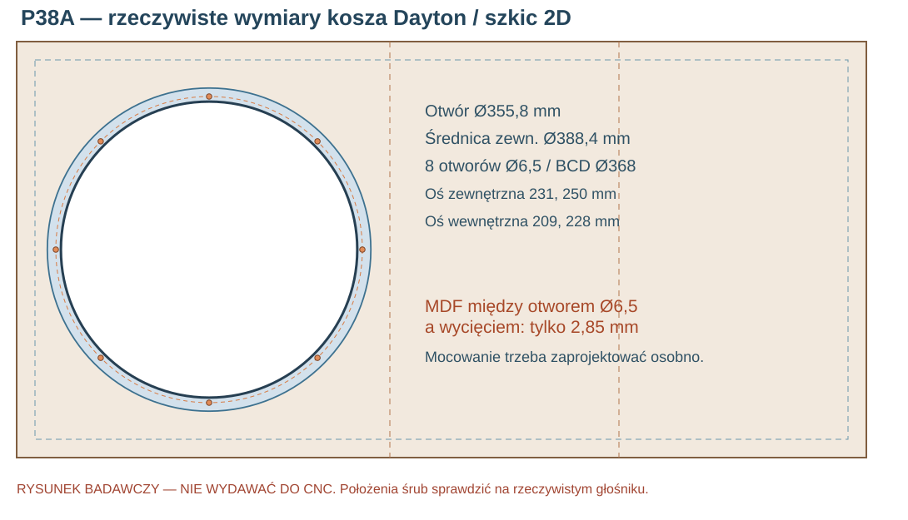

*Według rysunku producenta kosz ma Ø388,4mm, wycięcie Ø355,8mm, a osiem otworów Ø6,5mm leży na okręgu Ø368mm. Po odjęciu promienia otworu kołnierza od odległości do wycięcia zostaje tylko **2,85mm MDF**. To istotny problem dla projektowania mocowania, nie pozwolenie na frezowanie. [Raport 096](raporty/096_P38A_front_Dayton_otwory_i_mocowania.md) · [szkic DXF — NIE CNC](wyniki/p38a_front_NIE_CNC.dxf).*

### W którym miejscu naprawdę jest głośnik we wnętrzu?

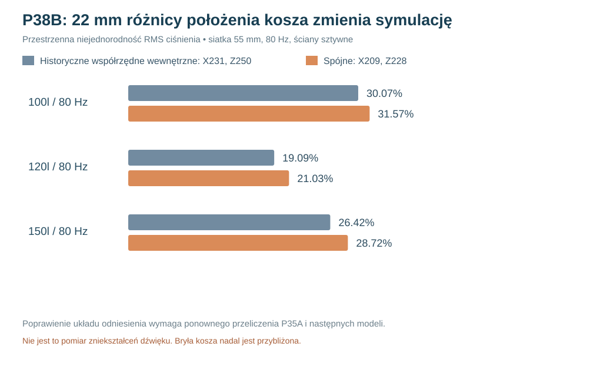

*Oś x231/z250mm w P31C jest określona **od zewnętrznych krawędzi obudowy**. Po odjęciu grubości MDF22mm właściwe współrzędne wewnętrzne to **x209/z228mm**. Historyczny model P34B używał x231/z250mm także wewnątrz. W 120l na siatce55mm model RMS przy 80Hz zmienia się z 19,09% do 21,03%. **Oba wyniki to symulacje, nie THD**. [Raport 097](raporty/097_P38B_audyt_wspolrzednych_FV.md).*

## P40 — czy osiem śrub utrzyma głośnik i czy pierścień daje miejsce na montaż?

### Sam ciężar dzielony przez 8 to za mało

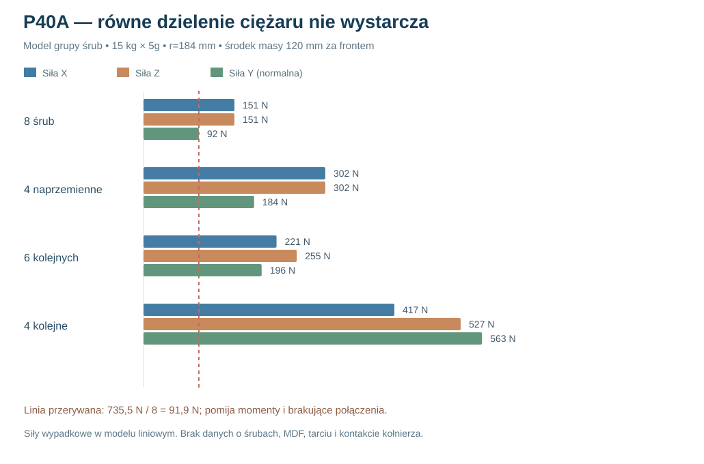

*Dla 15 kg, hipotetycznego obciążenia 5g i środka masy 120mm za frontem w modelu reakcji ośmiu śrub największe obciążenie pojedynczego punktu przy bocznym działaniu siły wynosi **151 N**, a nie **92 N** z uproszczenia F/8. Jeśli część śrub przestaje pracować, obciążenia mogą wzrosnąć kilkukrotnie. **To nie jest pomiar wytrzymałości śrub ani MDF.** [Raport 101](raporty/101_P40A_reakcje_8_mocowan.md).*

### Ile naprawdę miejsca jest w pierścieniu wzmacniającym?

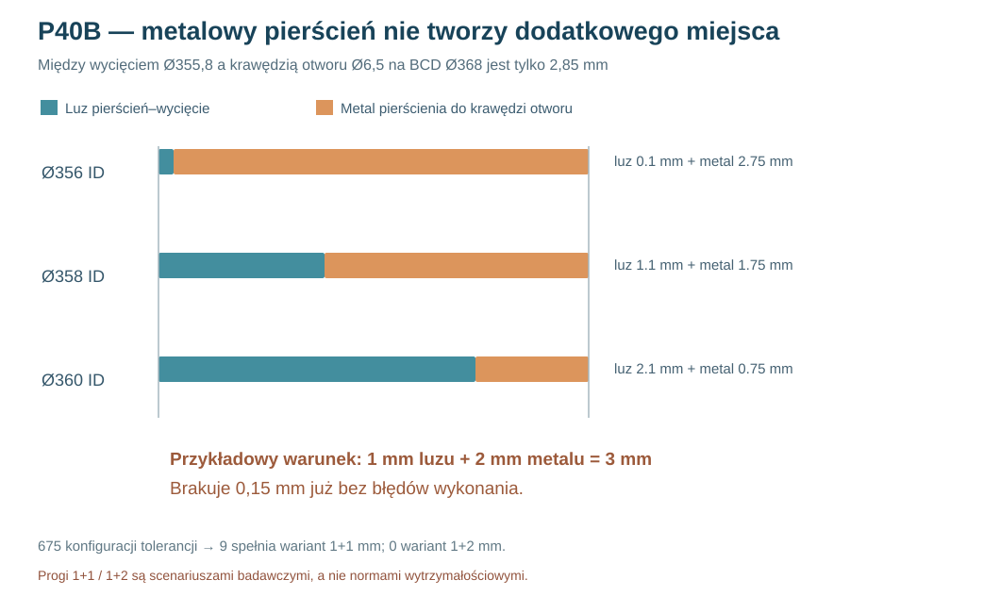

*Wycięcie Ø355,8mm i śruby na Ø368mm przy otworze kołnierza Ø6,5mm dają **tylko 2,85mm przestrzeni promieniowej łącznie**. Zbadano **675 wariantów** średnic i przesunięć pierścienia: 171 przechodzi podstawowe warunki geometryczne, ale przy przyjętych *przykładowych* rezerwach **1mm luzu + 2mm metalu żadna zwykła obręcz nie przechodzi**. To warunki badawcze, a nie normy. [Raport 102](raporty/102_P40B_tolerancje_pierscienia_675.md).*

## Nowe badania P39 — ciśnienie, mocowania i edytowalny model 3D

### Co zmieniło się po przeliczeniu nacisków na ściany?

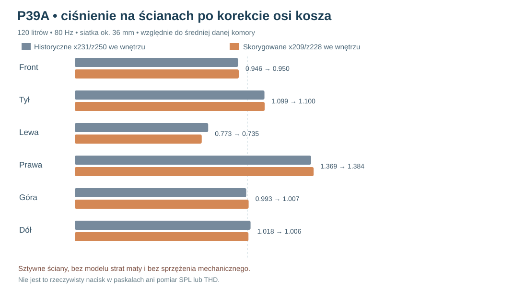

*W 36 nowych symulacjach powietrza w komorze zastosowano właściwą oś głośnika **x209/z228 mm w układzie wnętrza**, a wyniki porównano z historycznym P35A. Dla 120l / 80Hz, na siatce 36mm średnie ciśnienie względne na lewej ścianie zmieniło się z 0,773 na **0,735**, na prawej z 1,369 na **1,384**. To **względne pole modelowe**, nie fizyczne SPL ani obciążenie zweryfikowanego MDF. [Raport 098](raporty/098_P39A_naciski_scian_korekta_FV.md).*

### Czy pierścień wzmacniający pod Daytonem zmieści się wewnątrz?

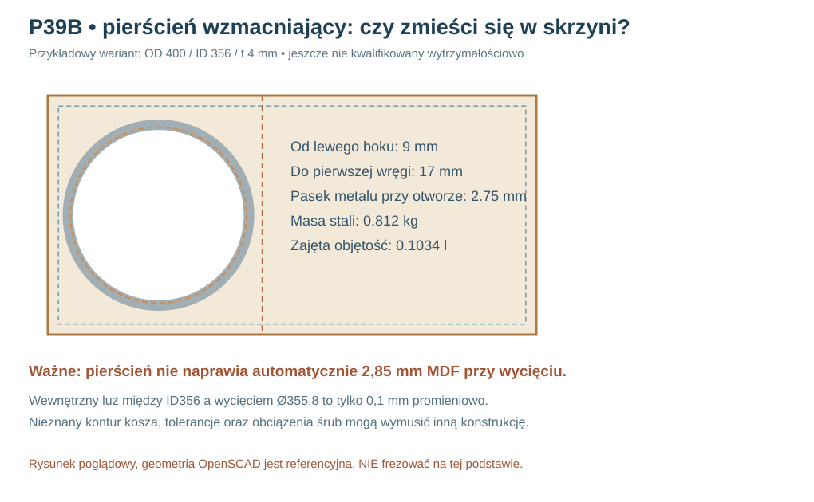

*54 zestawienia średnic i grubości pokazują, że pierścień przykładowy Ø400/Ø356/t4mm geometrycznie pozostawia 9mm do lewego boku oraz 17mm do pierwszej wręgi w projekcji X. Ale **luz promieniowy od wycięcia wynosi zaledwie 0,1mm**, a cienki pasek MDF przy śrubie pozostaje. Taki pierścień **nie jest zatwierdzony wytrzymałościowo**. [Raport 099](raporty/099_P39B_geometria_pierscienia_i_glebokosc.md).*

### Jak wygląda obudowa w edytowalnym modelu trójwymiarowym?

[Model 3D OpenSCAD — **REFERENCYJNY, NIE DO CNC**](dokumentacja/P39C_front_korpus_pierscien_REFERENCYJNY_NIE_CNC.scad) jest parametrycznym złożeniem paneli, wręg, frontu z otworem i pierścienia. Umożliwia dalsze opracowywanie pełnego CAD; **nie jest jeszcze dokładną bryłą kosza Dayton z terminalami, zamkami i realnymi łącznikami**. [Raport 100](raporty/100_P39C_edytowalny_model_3D_OpenSCAD.md).

## Konstrukcja w obrazach — od pomysłu do sprawdzalnego prototypu

**Zamiast od razu ciąć płyty, najpierw pytamy: czy skrzynia się zmieści, czy da się ją zmontować i czy nie będzie sama grała?** Poniższe ilustracje pokazują etapy symulacji. Kliknięcie obrazu otwiera źródło z wyjaśnieniem. **Żadna ilustracja nie jest dokumentacją CNC** — obciążenia, materiały i wybrane uproszczenia są wyraźnie opisane w raportach.

### 1. Najpierw ustawiamy wymiary i litraż

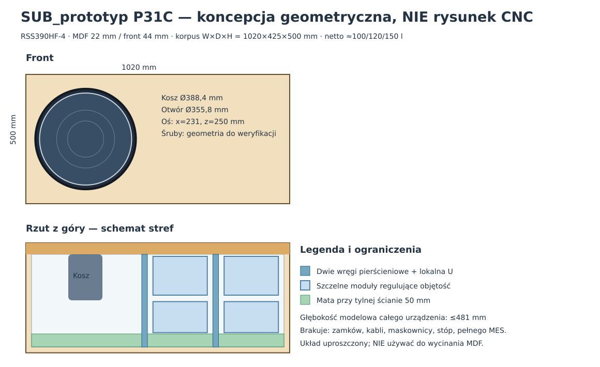

*Obecny kierunek: zamknięta obudowa 1020 × 425 × 500 mm, tylna mata 50 mm i regulacja około 100 / 120 / 150 l. To **schemat koncepcyjny** — brakuje rzeczywistych śrub, zamków, stopek i maskownicy. [Dlaczego ten wariant?](raporty/078_P30E_mata50_montaz_robustnosc.md)*

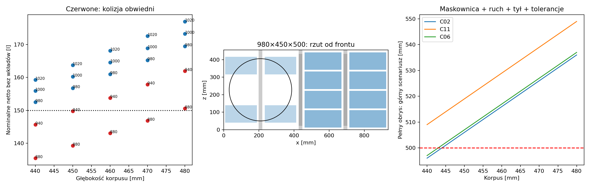

*Symulacja starszego wariantu P20D pozwoliła opracować sposób badania dojścia modułów przez otwór po głośniku. Dla nowego P30E sprawdzono obwiednię przejścia do 6 mm, lecz montaż narzędziem wciąż nie jest zatwierdzony. [Raport geometrii](raporty/057_P20D_geometria_dostep_i_pelna_glebokosc.md).*

### 2. Jak wzmocnienia zmieniają zachowanie ścian?

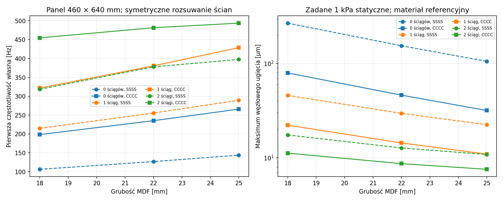

*Grubsza płyta może pomóc, ale kosztuje więcej i zwiększa masę. O skuteczności decydują również podpory i sposób ich połączenia. [Omówienie badań paneli](raporty/059_podatne_wregi_i_panele.md).*

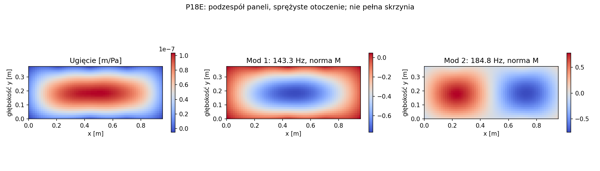

*To nie fotografia rzeczywistej ścianki, lecz model mechaniczny. Pokazuje, dlaczego idealne unieruchomienie wręgi może dawać zbyt optymistyczny wynik. Dla nowego korpusu przeprowadzono osobną analizę P31B.*

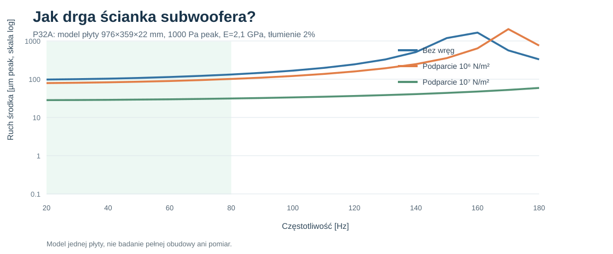

*Nowy przebieg wymuszenia 20–180 Hz na poprawnie zwymiarowanej płycie. Ważny jest nie tylko rezonans, lecz **amplituda ruchu** przy danej częstotliwości. Zasymulowano ciśnienie 1000 Pa peak i hipotetyczne tłumienie; nie jest to pełny MES obudowy. [Raport 082](raporty/082_P32A_dynamika_panelu_wreg_i_tlumienia.md).*

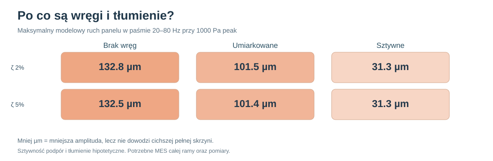

*Dlaczego wzmocnienie nie jest po prostu „mocniejsze/słabsze”? Odpowiedź zależy jednocześnie od podatności podparcia i tłumienia materiału. [Kod badania](skrypty/p32a_dynamika_panelu.js).*

### 3. Front, mocowanie głośnika i trwałość połączeń

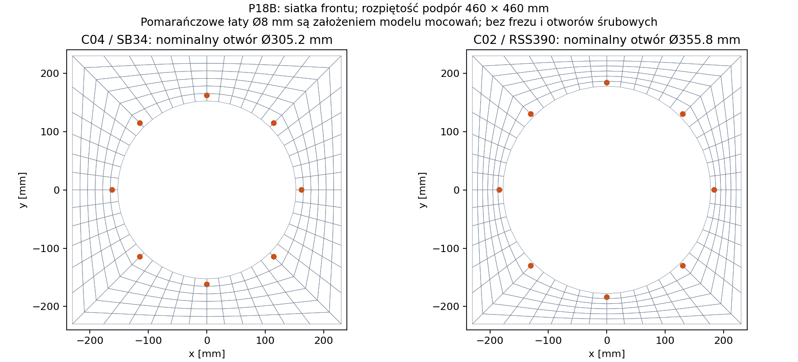

*Wycięcie dużego otworu osłabia front; rama musi przenosić ciężar kosza oraz siły okresowe. Przed wykonaniem potrzebny jest dokładny szablon rzeczywistego głośnika.*

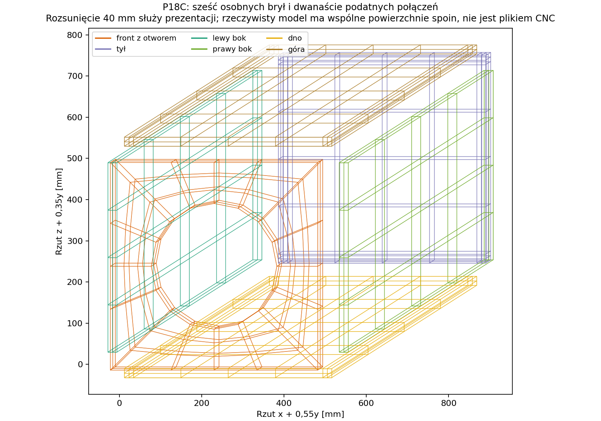

*Model całej ramy pozwala wyszukiwać słabe miejsca i kierunki pracy spoin. Po zmianie geometrii na 1020 × 425 mm wymaga ponownego przeliczenia.*

### 3a. Co się zmienia, gdy liczymy całą skrzynię jednocześnie?

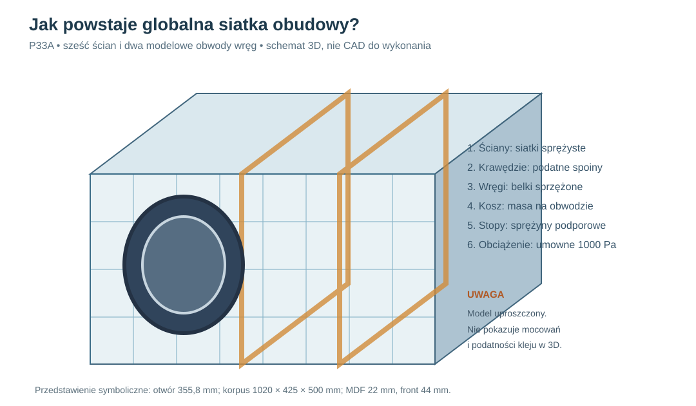

*Połączono w jednym modelu sześć ścian, naroża, dwa obwody wręg, otwór frontowy, masę kosza i wkładów. **To uproszczony model energetyczny**, a nie jeszcze poprawny pełny MES powłokowy. [Raport 083](raporty/083_P33A_globalna_siatka_obudowy_i_spoin.md).*

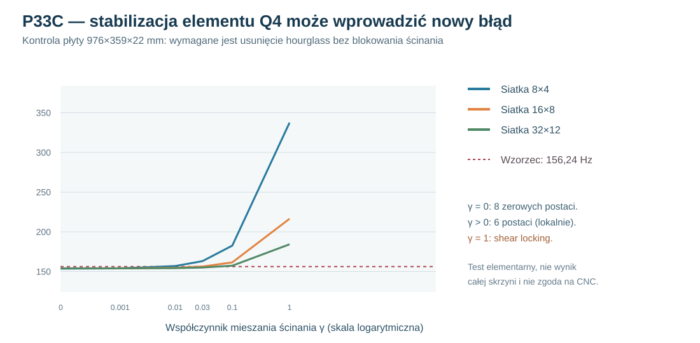

*Dlaczego w obliczeniach konstrukcji równie ważny jak liczba elementów jest ich rodzaj? Model ze zbyt słabą stabilizacją ma dodatkowe mechanizmy zerowe, a model ze zbyt silną bywa sztucznie sztywny. **Żaden z tych wariantów nie zastępuje pomiaru.** [Raport 085](raporty/085_P33C_audyt_hourglass_elementu_Q4.md).*

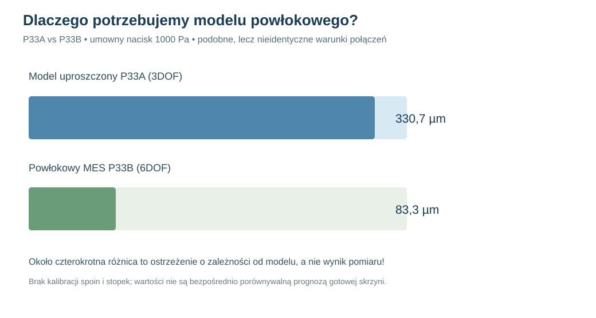

*Po dodaniu obrotów węzłów i momentów połączeń model P33B dał znacznie inne ugięcie niż P33A. **To sygnał niepewności modelu, nie wskazanie „prawdziwej” liczby.** [Raport 084 — powłokowy MES Q4](raporty/084_P33B_globalny_MES_powlokowy_Q4.md).*

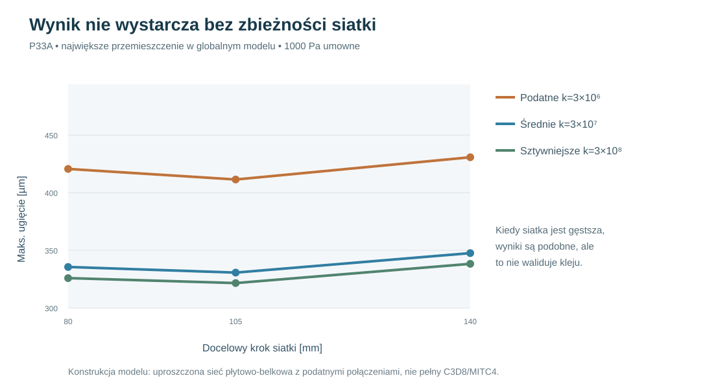

*Im sztywniejsze przyjęte naroża, tym mniejsze ugięcie w tym modelu. Sprawdzono trzy rozmiary siatki i trzy sztywności połączeń, ale nie zmierzono rzeczywistych własności spoin. **Nie jest to zatwierdzenie do CNC**. [Kod do odtworzenia](skrypty/p33a_global_shell_network.py).*

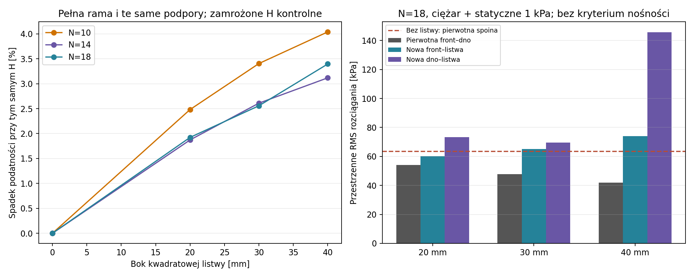

*Usztywnienie może zmniejszyć ugięcie, jednocześnie przenosząc obciążenie na inny fragment połączenia. [Badania spoin](raporty/030_P19A_obliczenia_spoin_i_material_kleju.md).*

### 4. Wkłady i powietrze wewnątrz skrzyni

### 4c. Jak przekazać ciśnienie ze skrzyni do obliczeń jej ścian?

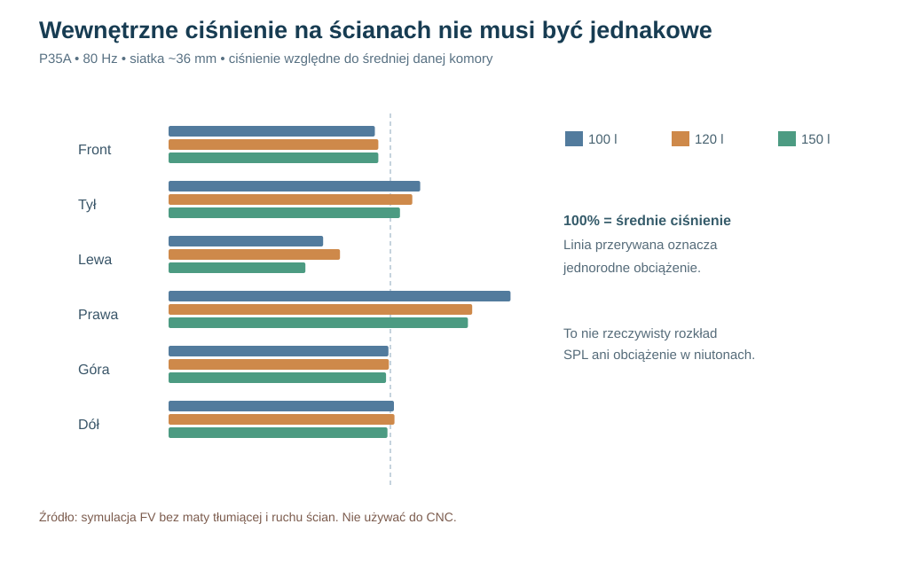

*Poprzednio liczyliśmy rozkład powietrza wewnątrz komory. Teraz obliczamy również jego nacisk na poszczególne ściany. Przy 80 Hz prawa strona ma w tym modelu inne ciśnienie niż lewa. **To nie są jeszcze siły przy realnej mocy** — potrzebny rzeczywisty poziom ciśnienia, maty i kosza. [Raport 089](raporty/089_P35A_rozklad_cisnienia_na_scianach.md).*

### 4d. Kontrola jakości MES: nie tylko liczba w hercach

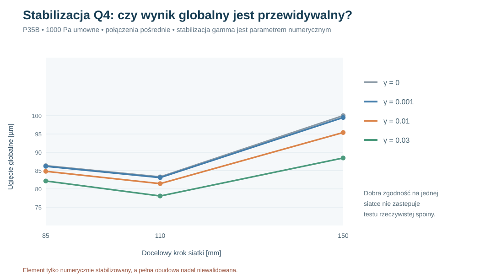

*Audyt P33C ujawnił sztuczne drgania pojedynczego elementu Q4. Powtórzyliśmy 16 symulacji całej skrzyni po dodaniu różnych wariantów stabilizacji. Problem lokalny można ograniczyć numerycznie, ale **nie da się jeszcze uznać konstrukcji za zweryfikowaną** bez dobrego opisu spoin i pełnej geometrii. [Raport 090](raporty/090_P35B_globalna_stabilizacja_hourglass.md).*

### 4b. Liczymy już rzeczywiste rozmieszczenie przeszkód, nie tylko pusty prostopadłościan


*Na planie pokazano przykładowy poziom ułożenia zamkniętych modułów. Cała konstrukcja jest trójwymiarowa. **To schemat wyjaśniający, nie geometria do cięcia CNC.** [Raport 087](raporty/087_P34B_przestrzenne_cisnienie_100_120_150.md).*

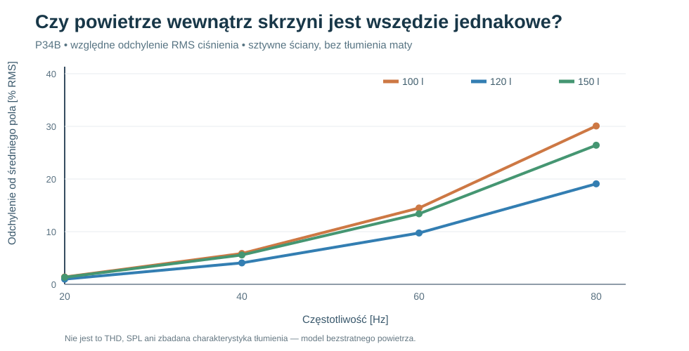

*Przy 20 Hz rozkład ciśnienia jest w modelu stosunkowo równomierny, przy 80 Hz wpływ geometrii rośnie. Model ma sztywne ściany i **nie oblicza tłumienia porowatej maty** — to nie wykres THD ani SPL. [46 przypadków FV](wyniki/p34b_przestrzenne_pole_p30e_20261031.json).*

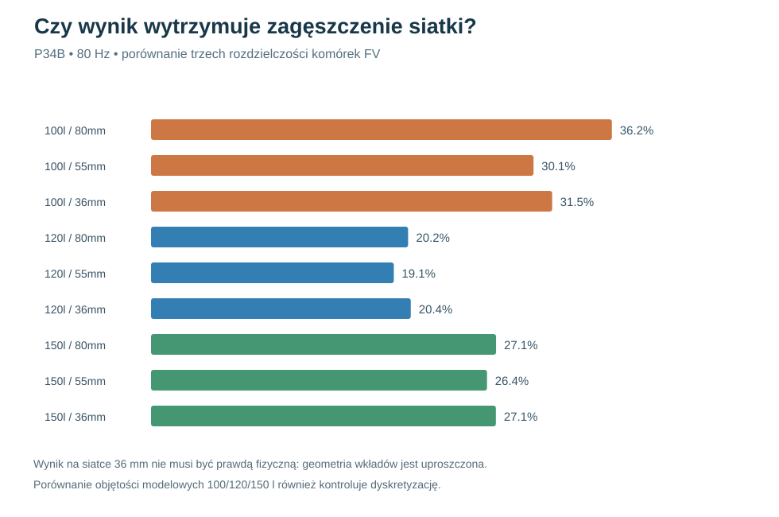

*Dzielimy powietrze na coraz mniejsze komórki i sprawdzamy, jak zmienia się wynik. Modelowe 120 l mieści się blisko celu, ale uproszczony kosz 5 l i własności maty wymagają pomiarów. [Skrypt do powtórzenia](skrypty/p34b_przestrzenne_pole_p30e.js).*

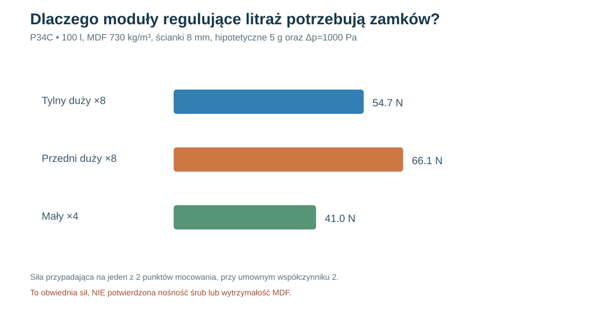

*Wyjmowane wkłady muszą mieć dodatnią blokadę mechaniczną. Liczby pokazują umowne obciążenia mocowań przy przyspieszeniu i różnicy ciśnienia; **nie zastępują prób wyrywania śrub ani zmęczenia MDF**. [Raport 088](raporty/088_P34C_obciazenia_i_blokowanie_wkladow.md).*


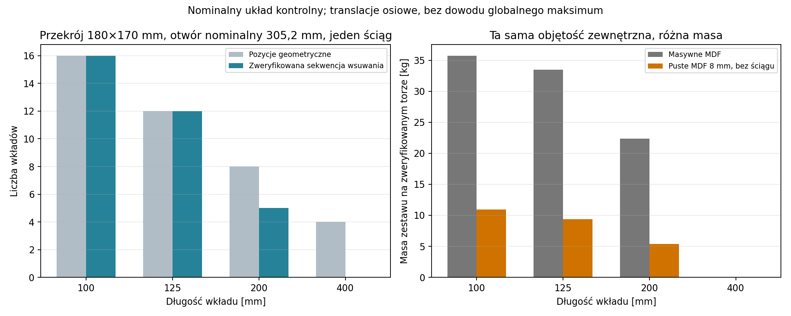

*Regulacja litrażu ma sens tylko wtedy, gdy wkłady można faktycznie włożyć, bezpiecznie zamocować i wyjąć. Ich masa i szczelność są częścią konstrukcji.*

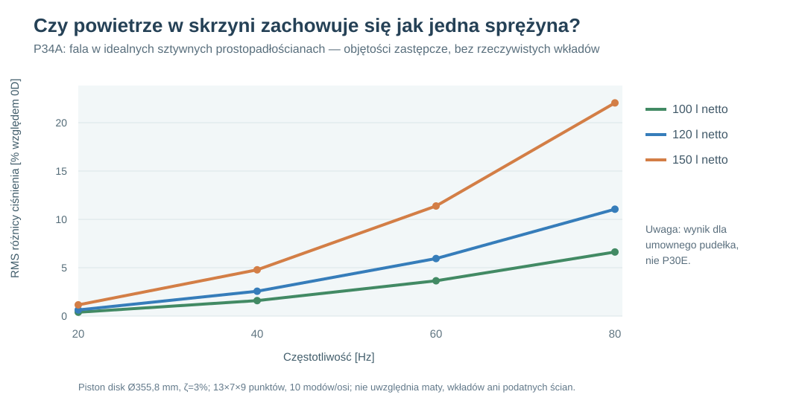

*Model sztywnej komory pokazuje, jak nawet poniżej pierwszej fali stojącej lokalne ciśnienie może odróżniać się od prostego modelu T/S. Zbadano 90 przypadków dla trzech objętości. **To prostopadłościany zastępcze, nie rzeczywiste wkłady P30E.** [Raport 086](raporty/086_P34A_gaz_3D_komora_zastepcza_i_niejednorodnosc.md).*

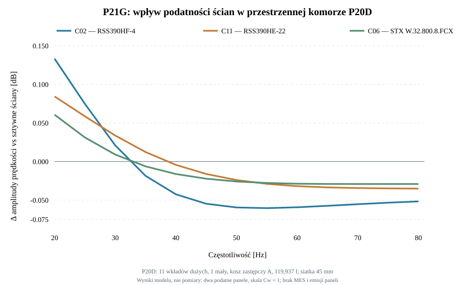

*Powietrze w skrzyni nie zawsze jest idealnie jednorodne. Zmiana wręg i wkładów zmienia przeszkody, dlatego **akustyka nowej geometrii nie jest jeszcze zweryfikowana**. [Raport o komorze](raporty/066_P21G_FV_podatne_sciany_rzeczywiste_przeszkody.md).*

**Co dalej?** Pełny CAD połączony z MES ramy i spoin, nowe obliczenia przestrzenne komory 100/120/150 l, a następnie pomiary pierwszego prototypu. [Plan konstrukcyjny i bramki przed wykonaniem](dokumentacja/P31C_koncepcja_konstrukcyjna_i_bramki.md) · [Ostatni raport 082](raporty/082_P32A_dynamika_panelu_wreg_i_tlumienia.md).

---

<a id="wykresy"></a>
<a id="glosniki"></a>
## Głośniki: porównanie w tych samych warunkach

**Rozszerzenie warunków badawczych (31.10.2026):** Dayton RSS390HF-4 jest
**wstępnym faworytem, a nie ostatecznym wyborem**. Do aktualnej puli
26 modeli dołączono audyt dokumentacji dziewięciu kolejnych marek:
GPA, VOLT, SUPRAVOX, EMS, PURIFI, Kartesian, PHL, ETON i Davis.
Modele nie przechodzą automatycznie do rankingu tylko dlatego, że
występują w katalogu: sprawdzamy Xmax, Sd, Vd, zgodność montażu
i kompletność fabrycznych T/S. **EMS B15EX oczekuje na kompletną
kartę producenta.**

[Zweryfikowany rejestr parametrów i źródeł](dane/karty_producentow/2026-10-31_9_marek_weryfikacja.json)
· [pełny raport briefu](raporty/BRIEF_2026-10-31_wzmacniacz_DSP_i_9_marek.md)
· [odtwarzanie dokumentacji i SHA-256](skrypty/odtworz_dokumentacje_producentow.py).
Oryginalnych PDF producentów bez potwierdzonych praw do redystrybucji
nie kopiujemy do repo; zapisujemy weryfikowalne parametry i odnośniki.

**Przeprowadzono 274 725 nowych obliczeń przesiewowych** dla
35 konfiguracji elektrycznych (34 unikalne produkty), z których
33 miały komplet spójnych danych. EMS i SUPRAVOX pozostają
zablokowane z wyjaśnionych w audycie przyczyn.
[Agregaty i świadkowie dla całej puli](wyniki/brief20261031_pelna_pula_35_wstepna_analiza.json).
To liniowa wstępna analiza, nie pełne badania nieliniowości, THD,
termiki i mechaniki gotowej skrzyni dla wszystkich 34 produktów.


Badamy modele firm BMS, Dayton Audio, Eminence, FaitalPRO, LaVoce,
PURIFI, Peerless, SB Acoustics, SEAS, STX i Scan-Speak. W puli są także
mniejsze modele kontrolne — obecność w zestawieniu nie oznacza spełnienia briefu.

Pierwszy wykres obejmuje **pierwotne 24 modele**. Pokazuje granice liniowego
modelu dla osobnych ustalonych sinusów 10–100 Hz, w geometrii 2π / 1 m,
przy wspólnych 100 l i napędzie 40 V RMS / 12 A RMS, oraz katalogowy
zapas ruchu membrany. Warunki poszczególnych porównań są na osiach i w
[raporcie 010](raporty/010_szeroka_pula_i_kwalifikacja.md).
Wyższy słupek nie potwierdza jeszcze mniejszych zniekształceń.

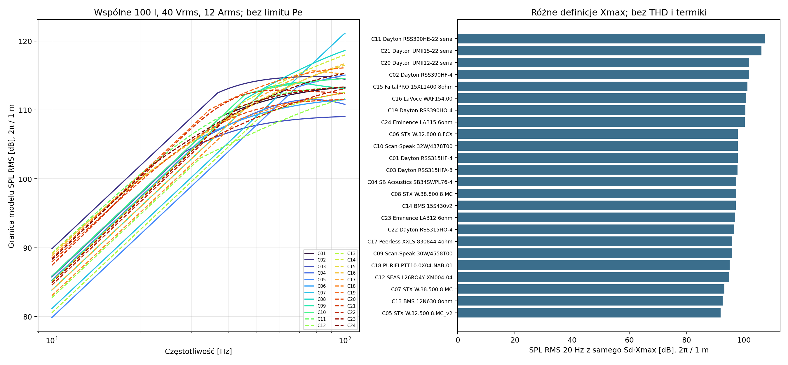

Później dodaliśmy **SB34SWNRX-S75-6** i **SB34SWPL76-3-DV**.
To razem 26 produktów i 27 połączeń elektrycznych: model dwucewkowy
liczymy osobno przy połączeniu szeregowym i równoległym.

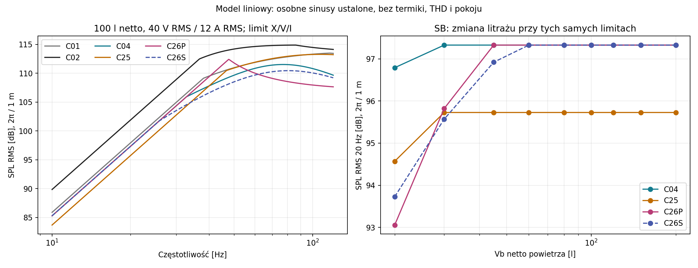

Przykład: przy 100 l, 40 V RMS / 12 A RMS i 80 Hz równoległe połączenie
SB ogranicza prąd, a szeregowe — napięcie. To oddzielne ustalone sinusy,
bez kwalifikacji czasu pracy. Nowe modele mają własne dane i obliczenia;
nie przypisujemy im starszych badań nieliniowości i temperatury.

[Raport 038: dane, oryginalne wykresy, opinie i braki](raporty/038_SB_Acoustics_rozszerzenie_i_porownanie.md).

<details>
<summary><strong>Rozwiń: jak niepewność parametrów zmienia porównanie głośników</strong></summary>

Parametry z katalogu nie opisują idealnie każdego egzemplarza. Sprawdzamy,
czy wnioski utrzymają się po zmianie założeń. Przyjęte zakresy są próbą
odporności modelu, a nie zmierzoną statystyką produkcji.

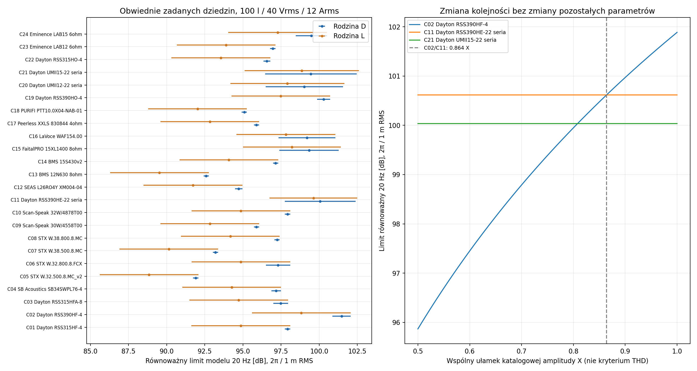

[Raport 015: zakresy, czułość i przykłady zmiany kolejności](raporty/015_niepewnosc_globalna_i_odpornosc.md).

</details>

### Który głośnik wybrać do pierwszego prototypu?

O wyborze decyduje kilka ograniczeń jednocześnie: **grzanie cewki**
(wzrost rezystancji i kompresja mocy), **powierzchnia membrany i użyteczne
wychylenie** (`Sd·Xmax` jako wskaźnik katalogowy, nie gwarancja liniowości),
**napięcie i prąd wzmacniacza**, objętość i całkowita głębokość obudowy
**do 500 mm**, wymagany zakres **20–40 Hz** oraz **nieliniowość
sprężyny powietrznej** w zamkniętej komorze. Trzeba badać ich wspólne
oddziaływanie, a nie ranking pojedynczego parametru. Celem jest wybór
najtańszego spośród wariantów spełniających zaakceptowane progi jakości
i wydajności; dopóki progi i ceny nie są ustalone, wybór jest warunkowy.

W porównaniu **26 przetworników / 27 konfiguracji elektrycznych**
wstępnym faworytem jest **Dayton Audio RSS390HF-4 (15″, 4 Ω)**.
W modelu osobnych sinusów 20–80 Hz, przy 120 l, napędzie 40 V RMS /
12 A RMS i założonym limicie strat miedzi 50 W, uzyskał najwyższe
minimum w badanej próbie stresowej. To wynik częściowej optymalizacji,
**bez kosztów zakupu i bez pomiarowego porównania THD**. Nie jest to
ranking zmierzonych zniekształceń ani prognoza poziomu w konkretnym pokoju.
Po uwzględnieniu ceny oraz pełnego zestawu kryteriów faworyt może się zmienić.

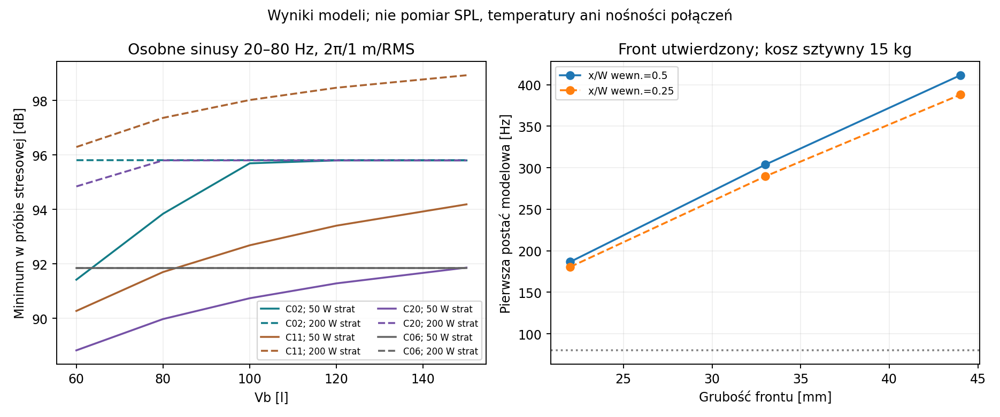

**Wybór jest warunkowy.** Przy modelowych limitach strat miedzi
27–86 W na siatce wygrywa C02, a przy 87–200 W — **RSS390HE-22 (C11)**.
To zakresy przyjętego modelu, a nie zmierzone dopuszczalne moce
poszczególnych produktów. STX W.32.800.8.FCX pozostaje wariantem
porównawczym 12″.

[Porównanie wariantów — 053](raporty/053_porownanie_i_odpornosc_rekomendacji.md)
· [projekt eksperymentu — 054](raporty/054_rekomendowana_konfiguracja_prototypu.md)
· [wrażliwość rekomendacji — 055](raporty/055_wrazliwosc_wyboru_i_margines_glebokosci.md).

<a id="akustyka"></a>
## Objętość i wypełnienie: więcej litrów nie rozwiązuje wszystkiego

Większa skrzynia zmienia obciążenie membrany, ale nie zwiększa jej własnego
zapasu ruchu. Trzeba sprawdzić równocześnie ruch, napięcie, prąd i chłodzenie.
Na wykresie niżej szukamy objętości pasujących do sześciu osobnych sinusów
20–80 Hz. Przykład używa 90 dB RMS, 4π / 1 m i 40 V / 12 A oraz założonych
warunków chłodzenia. To cel obliczenia, nie zatwierdzone kryterium projektowe
lub wynik w pokoju.

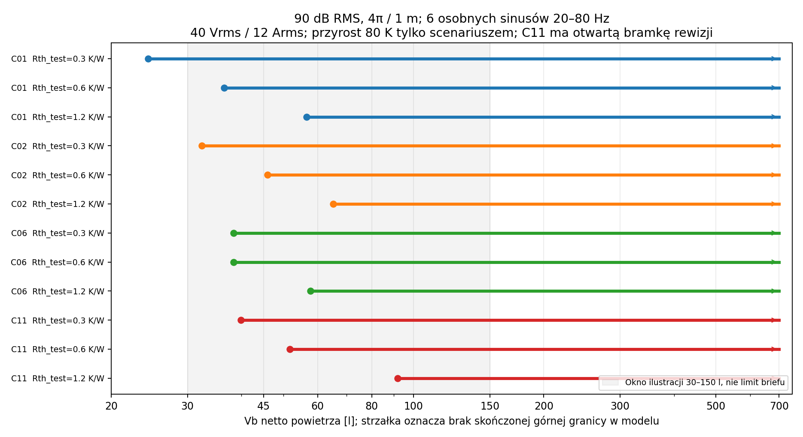

[Raport 028: wspólne ograniczenia objętości i napędu](raporty/028_P17_synteza_napedu_objetosci_i_ciepla.md).

**Ilość wypełnienia też jest liczona.** Przykładowe wyklejenie pięciu ścian
warstwą 50 mm waży około 1,18 kg przy założonej gęstości 20 kg/m³.
Dotyczy to kontrolnego wnętrza 460 × 640 × 460 mm, przed odjęciem kosza
oraz wzmocnień. To nie jest jeszcze ilość do zakupu.

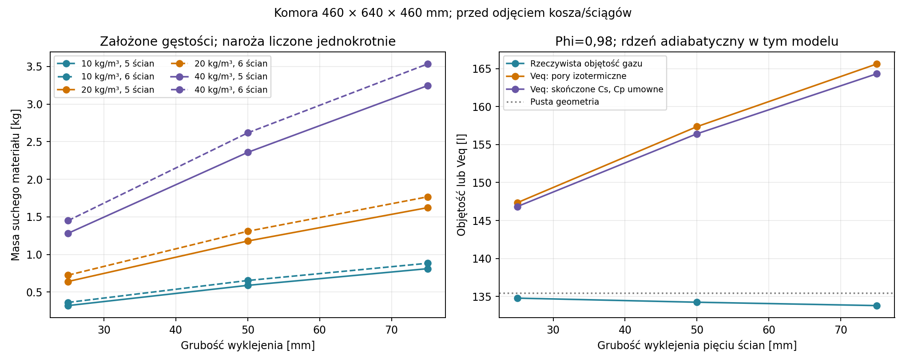

<details>
<summary><strong>Rozwiń: co robią powietrze i położenie materiału tłumiącego</strong></summary>

Włókna zajmują część miejsca, a wymiana ciepła i opory przepływu zmieniają
odpowiedź powietrza. To dwa różne efekty. Nie zakładamy, że każda włóknina
zawsze dodaje ten sam procent objętości.

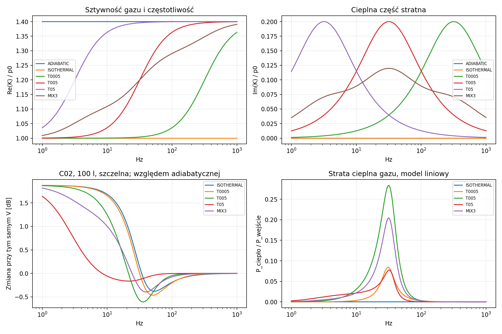

Niżej ten sam materiał ma tę samą masę, a zmieniamy jego położenie.
Jest to prostszy model warstwy w jednym wymiarze; nie utożsamiamy go
z wyklejeniem wszystkich ścian rzeczywistej skrzyni.

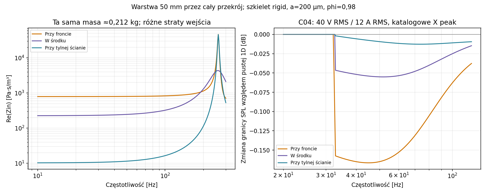

[Raport 016: gaz i materiały porowate](raporty/016_gaz_wypelnienie_i_granice.md)
· [raport 039: ilość i rozmieszczenie wypełnienia](raporty/039_wypelnienie_ilosc_polozenie_i_straty.md).

</details>

<a id="ochrona"></a>
<details>
<summary><strong>Rozwiń: zniekształcenia, ruch poza pasmem i nagrzewanie cewki</strong></summary>

Dwa tony mogą w modelu nieliniowym wytworzyć dodatkowy ruch przy innej
częstotliwości. W przykładzie 45 + 95 Hz pojawia się składnik przy 5 Hz.
Dlatego filtr na wejściu nie rozwiązuje sam wszystkich problemów ochrony.
Krzywe opisują przyjęty model, nie zmierzony konkretny głośnik.

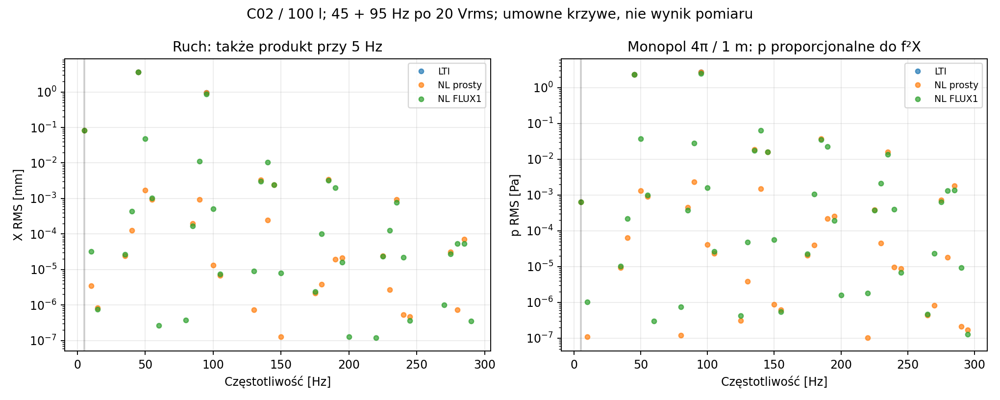

[Raport 024: wyjaśnienie przykładu](raporty/024_P14B_emisja_i_swiadkowie.md)
· [raport 026: pełny zakres kampanii dwutonowej](raporty/026_P14B_pelna_kampania_dwutonowa.md).

Cewka po nagrzaniu zmienia opór. Wpływa to na prąd, ruch i dalsze grzanie.
Ochrona powinna uwzględniać także wcześniejsze obciążenie i chłodzenie.
Temperatury i współczynniki w tym badaniu są założeniami modelu.

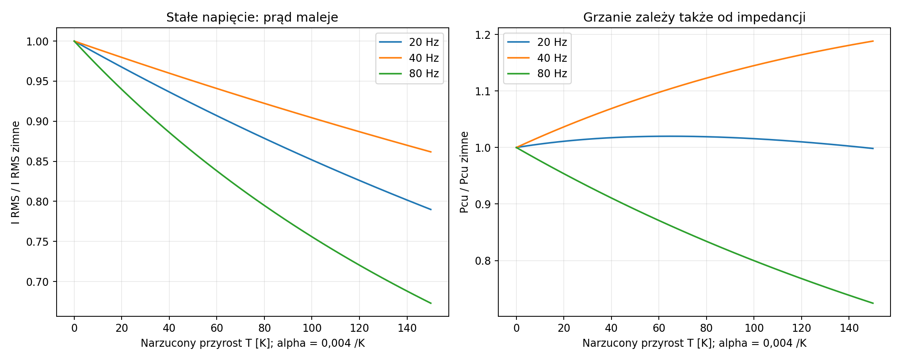

[Raport 027: sprzężenie temperatury i napędu](raporty/027_P15B_sprzezenie_grzania_i_napedu.md).

</details>

<a id="filtry"></a>
## DSP: dobry wzór filtru to początek

**P24F — obserwator U/I w pętli zabezpieczenia (raport 071).**
W 192 deterministycznych trajektoriach porównano cztery strategie termiczne
z syntetycznymi pomiarami Z(f) przy 80/150/300 Hz, trzema hipotetycznymi
sieciami cieplnymi, utratą pomiarów i dryftem rezystancji połączeń.
Kontur wzrostu temperatury **+80 K jest tylko punktem diagnostycznym**,
a nie limitem pracy Daytona. Mimo założonego marginesu estymacji 15 K i tempa
5 K/s strategia predykcyjna przekroczyła ten kontur w 7/48 przypadków.
Strategia z wcześniejszym progiem 55 K przekroczyła go w 3/48 przypadków,
co **nie potwierdza jej bezpieczeństwa w rzeczywistym urządzeniu**.
Nie potwierdzono praktycznej dostępności sygnału diagnostycznego, czujników
U/I, API miniDSP ani fizycznej skuteczności toru wyciszenia.

[Raport 071 — P24F](raporty/071_P24F_obserwator_w_petli_i_brak_pobudzenia.md)
· [Kod odtwarzający 192 przebiegi](skrypty/p24f_obserwator_i_ochrona.py)
· [Wyniki CSV](wyniki/p24f_192_przypadkow.csv)
· [Pełne trajektorie JSON](wyniki/p24f_192_trajektorii_20261031.json)
· [Podsumowanie JSON](wyniki/p24f_podsumowanie_20261031.json).


**Czasowe nagrzewanie cewki (P24B) i dwie niezależne ochrony.**
W 729 hipotetycznych trajektoriach sprzęgliśmy zespolone Z(f),
zmienną `Re(T)`, dwie pojemności i opory cieplne, prąd końcówki
oraz ograniczenie szczytowego wychylenia. Zależy to silnie od
częstotliwości i czasu trwania sygnału: ogranicznik Xmax nie
zastępuje temperatury cewki.

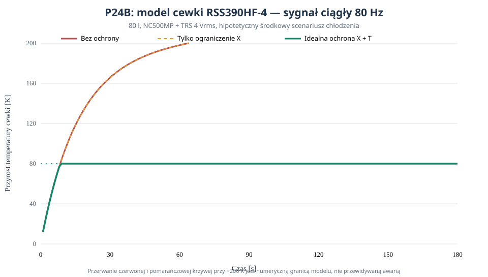

[Raport 067 — P24B: cewka, DSP i termika](raporty/067_P24B_czasowa_termika_i_dwie_ochrony.md)
· [729 trajektorii CSV](wyniki/p24b_kampania_729.csv)
· [skrypt odtwarzania](skrypty/p24b_czasowa_termika_cewki.py)
· [założenia cieplne](dane/konfiguracje/p24b_czasowa_termika_20261031.json).

**P24C: obserwowalność temperatury z U/I i audyt miniDSP.** Dla modelu C02
wykonano 50 000 prób Monte Carlo: błąd estymacji zależy silnie od
częstotliwości, błędów fazy i zmian BL. Przy 40 Hz w modelu 80 l
hipotetyczny spadek BL o 3% daje błąd oceny przyrostu T o −53,62 K;
nie jest to pomiar. Instrukcje Flex Eight/HTx potwierdzają zwrotnice,
PEQ i kompresor poziomu sygnału, **ale nie potwierdzają** wbudowanego
pomiaru U/I na zaciskach ani regulacji temperatury cewki.

[Raport 068 — P24C: obserwowalność i wykonalność ochrony](raporty/068_P24C_obserwowalnosc_temperatury_i_wykonalnosc_DSP.md)
· [wyniki 50 000 prób](wyniki/p24c_obserwowalnosc_20261031.json)
· [skrypt](skrypty/p24c_obserwowalnosc_ui.py).

**P24D: opóźnienia i awarie ochrony dwóch subwooferów.** Wykonano
88 modelowych prób (16 scenariuszy podstawowych i 72 kombinacje opóźnienia
oraz błędu obserwacji) przy 20 i 80 Hz. W 36/72 wariantach siatki
naruszono **umowny** kontur +80 K. Przy 80 Hz, błędzie −20 K, progu
testowym 45 K i zwłoce 0,25 s obliczono szczyt +75,095 K; przy zwłoce
5 s +105,630 K. Awaria aktuatora potrafi pozbawić ochronę skuteczności.
**To nie są limity bezpieczne, pomiary ani gwarancja implementacji miniDSP.**

[Raport 069 — P24D: opóźnienia, watchdog i awarie](raporty/069_P24D_opoznienia_ochrony_faulty_dwa_kanaly.md)
· [skrypt odtwarzający](skrypty/p24d_opoznienia_ochrony_dwoch_kanalow.py)
· [wyniki skrótowe](wyniki/p24d_podsumowanie_20261031.json).

**P24E: kilka częstotliwości zamiast jednego odczytu U/I.** W 120 000
prób syntetycznych porównano identyfikację Re(T), BL² i Le. Przy modelowym
spadku BL o 3% pojedynczy pomiar 40 Hz obciążał estymację T błędem
−53,62 K; dopasowanie parametrów z 80/150/300 Hz uzyskało przy przyjętym
szumie RMSE 1,241 K, ale tylko gdy struktura modelu jest prawidłowa.
**Zasadnicza granica:** dodatkowe 0,1 Ω w przewodach jest nieodróżnialne
od przyrostu Re i odpowiada błędowi +8,48 K nawet przy wielu punktach.
Nie jest to walidacja hardware, dostępności pasma ani ochrony DSP.

[Raport 070 — P24E: identyfikowalność Re/BL/Le](raporty/070_P24E_wieloczestotliwosciowa_ident_Re_BL_Le.md)
· [skrypt](skrypty/p24e_wieloczestotliwosciowa_ident.py)
· [wyniki kontrolne](wyniki/p24e_podsumowanie_20261031.json).


**Nie wyznaczono temperatury granicznej prawdziwego głośnika.**
Przyjęte parametry cieplne i kontur przyrostu +80 K to wyłącznie
warianty badawcze; żaden finalny limiter nie został zatwierdzony.


Nowy brief porównuje centralny **Flex Eight (RCA 2 Vrms)**
z **Flex HTx (RCA 2 Vrms, TRS symetryczne 4 Vrms)** oraz
modułami ICEpower/Hypex. Dla NC500MP przy wzmocnieniu
25,5 dB wejście 2 Vrms daje modelowo tylko około **355 W/4 Ω**;
pełne 500 W/4 Ω wymaga około 2,37 Vrms. Ostateczny wzmacniacz
musi być wybrany na podstawie realnego zespolonego obciążenia,
temperatury, prądu, zgodności wejścia i kompletnego kosztorysu.

[Porównanie elektroniki i zabezpieczeń](raporty/BRIEF_2026-10-31_wzmacniacz_DSP_i_9_marek.md)
· [180 kontrolnych obliczeń Dayton](wyniki/brief20261031_180_swiadkow_Dayton.csv)
· [analiza rzeczywistego napędu i DSP](raporty/P22C_2026-10-31_wzmacniacze_impedancja_DSP_Xpeak.md).

**P22C: policzono zespoloną impedancję i ograniczenia rzeczywistego toru DSP–wzmacniacz.**
Dla pięciu kandydatów, pięciu objętości, czterech modułów, trzech
ścieżek DSP i trzech hipotetycznych budżetów strat cewki wykonano
**99 900 obliczeń**, niezależnie odtworzonych w Pythonie.

**Ważna korekta:** katalogowe Xmax to wychylenie **szczytowe**.
W poprzednich tabelach 180 i 274 725 przypadków porównano je
omyłkowo z wychyleniem RMS; oba zbiory **przeliczono ponownie**
(bez przyznawania zmian w THD, których nie mierzono).

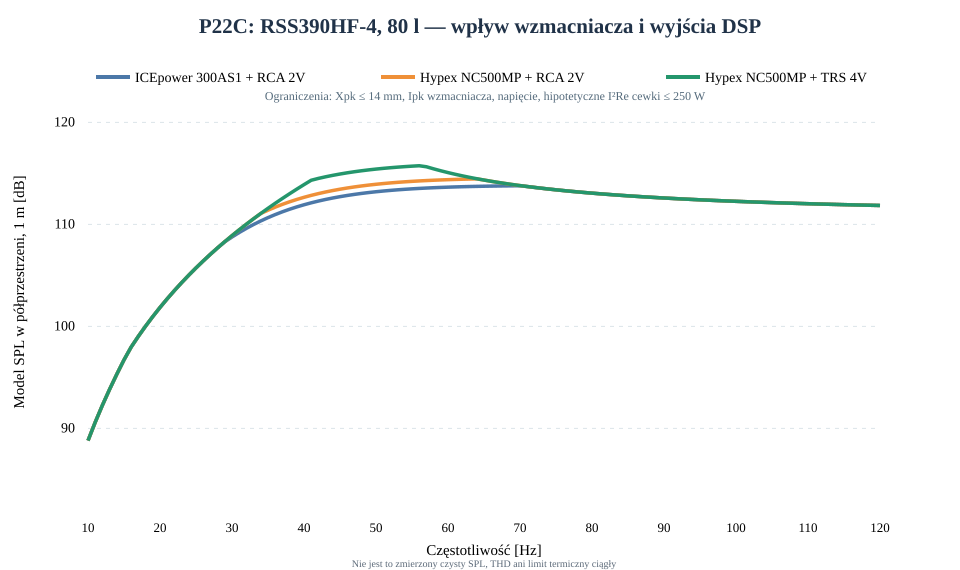

W modelu 80l, C02, 40Hz, przy scenariuszu strat miedzianych
250W, NC500MP z RCA 2Vrms osiąga modelowo 112,66dB,
a z TRS 4Vrms 113,90dB (+1,24dB); przy 20Hz **zysk wynosi 0dB**,
ponieważ ogranicza mechanika. To liniowe wyliczenia półprzestrzeni,
nie czysty SPL w pokoju i nie końcowy limiter.

[Raport P22C — impedancja, DSP, wzmacniacze i erratum RMS](raporty/P22C_2026-10-31_wzmacniacze_impedancja_DSP_Xpeak.md)
· [900 grup wyników](wyniki/p22c_napiecie_prad_wychylenie_analiza.json)
· [świadkowie](wyniki/p22c_swiadkowie_36.csv)
· [skrypt](skrypty/p22c_naped_dsp_zespolona_impedancja.py)
· [niezależny audyt](skrypty/p22c_niezalezna_kontrola.py).


Filtr cyfrowy trzeba zaprojektować dla właściwej częstotliwości próbkowania
i zapisać z odpowiednią precyzją. Zaokrąglanie może zmienić bas nawet wtedy,
gdy filtr pozostaje stabilny. W badaniu 27 konfiguracji głośników porównano
972 projekty i 4860 wariantów zapisu współczynników.

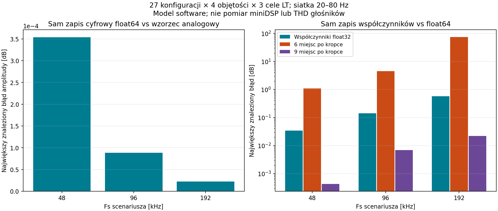

To badanie programu, a nie pomiar konkretnego miniDSP. Scenariusze używają
48, 96 i 192 kHz; dokumentacja Flex Eight wymaga projektu dla 96 kHz.
Zaokrąglenie współczynników do `float32` i do sześciu miejsc po kropce
to osobne eksperymenty, nie opis wnętrza tego urządzenia.

**Zapas dla muzyki i impulsów wymaga osobnego rachunku.** W jednym
przykładzie filtr wzmacnia najlepszy znaleziony sinus o około 3,72 dB,
lecz specjalnie skonstruowany sygnał o ograniczonej amplitudzie daje
7,44 dB. Taki sygnał nie reprezentuje typowej muzyki; pokazuje, dlaczego
kontrola samych sinusów nie wystarcza do pełnej ochrony przed przesterowaniem.

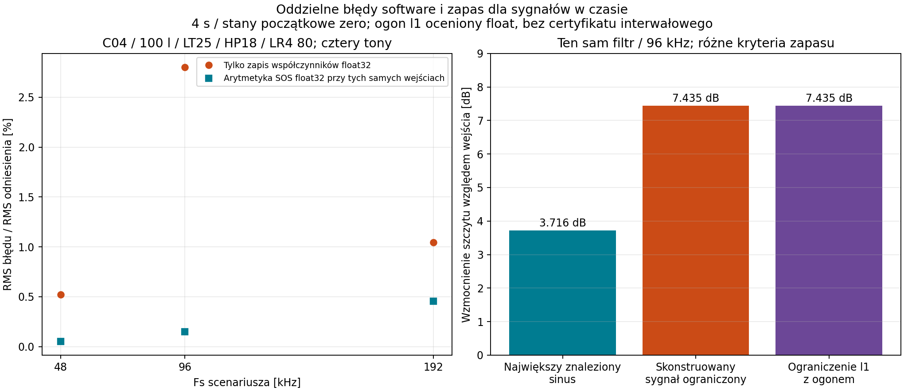

<details>
<summary><strong>Rozwiń: jak sprawdzamy bardzo niskie filtry i ich stabilność</strong></summary>

Dodatkowe 300 filtrów kontrolnych obejmuje graniczne częstotliwości
0,5–80 Hz. Decyzję o stabilności oparto na dokładnych ułamkach zapisanych
współczynników. Część hipotetycznych reprezentacji traci ścisłą stabilność.
Nie jest to diagnoza sprzętu, którego arytmetyki nie zidentyfikowaliśmy.

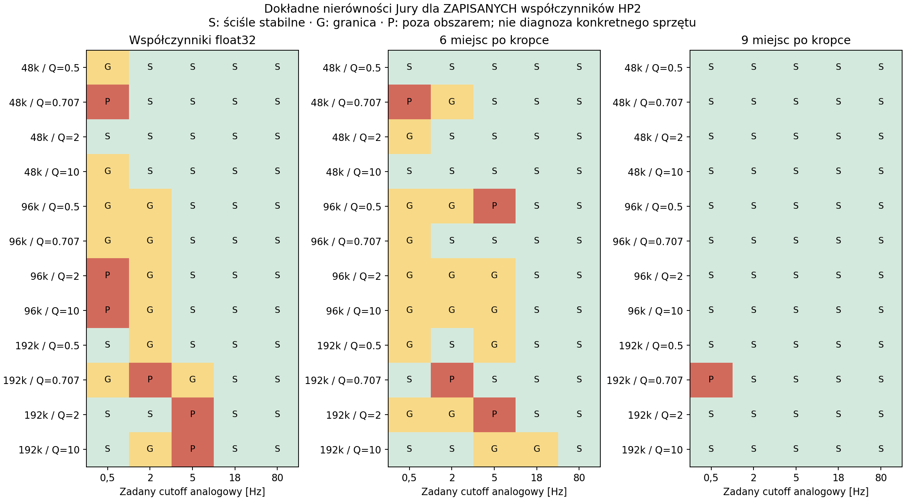

[Raport 046: modele, faza, opóźnienie, sygnały czasowe i ograniczenia](raporty/046_filtry_cyfrowe_stabilnosc_i_zapas.md)
· [Wyprowadzenia: stabilność i zapas poziomu](baza_wiedzy/34_cyfrowe_filtry_stabilnosc_i_normy.md).
Ochrona wychylenia i temperatury oraz integracja z fizycznym modelem
głośnika pozostają kolejnym etapem.

</details>

### Wzmacniacz i przewody też zmieniają wynik

Rezystancja między źródłem a głośnikiem zmniejsza jego elektryczne
tłumienie i zużywa część budżetu napięcia. Dla niskiej impedancji głośnika
ta sama dodatkowa rezystancja ma większe znaczenie względne.
Porównaliśmy 3240 pasywnych obwodów i 19 440 punktów napędu.

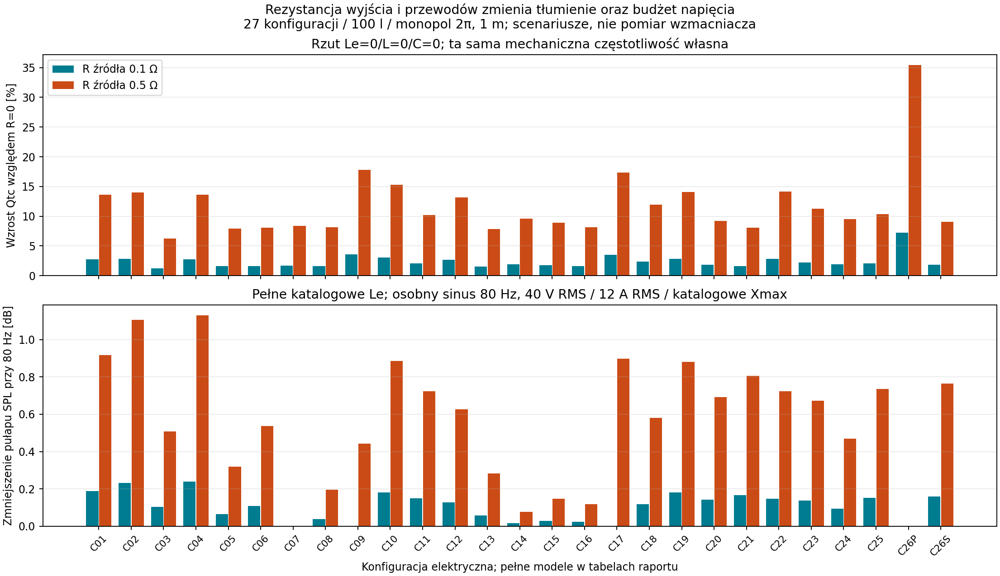

To obwody przyjęte do badania. Nie opisują konkretnego wzmacniacza.
Górny wykres upraszcza indukcyjność cewki do zera; dolny zachowuje jej
dane katalogowe. Osobne sinusy i limity 40 V RMS / 12 A RMS oraz
katalogowe Xmax nie określają bezpiecznego czasu pracy.

<details>
<summary><strong>Rozwiń: dlaczego prąd wzmacniacza i cewki mogą być różne</strong></summary>

W modelu z filtrem wyjściowym część prądu płynie przez kondensator.
Prąd źródła może wtedy różnić się od prądu cewki. Sprawdzamy oba porty
oraz bilans energii, żeby poprawnie przypisać ograniczenie prądu.

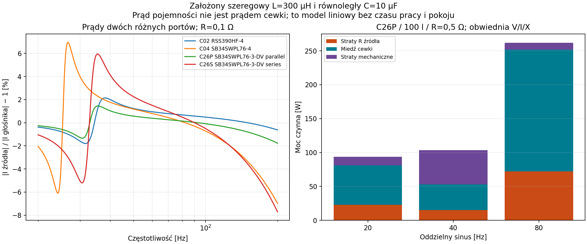

[Raport 047: równania obwodu, tłumienie, limity i sprawdzenia](raporty/047_port_zrodla_tlumienie_i_bilans.md)
· [Baza wiedzy: port źródła i wykonalność ochrony](baza_wiedzy/35_port_zrodla_i_wykonalnosc_ochrony.md).
Clipping i zachowanie pętli prądowej w czasie opisuje kolejny etap poniżej.

</details>

### Ograniczanie prądu nie zastępuje kontroli ruchu

Przeprowadziliśmy także 648 symulacji w czasie z nasyceniem napięcia
i hipotetyczną pętlą prądową. Zachowaliśmy energię cewki i SEM od ruchu.
W badanych warunkach pętla zmniejsza największe przekroczenie prądu,
lecz nie zapewnia twardego limitu ani samodzielnej ochrony wychylenia.

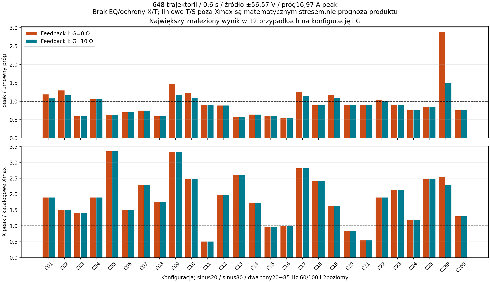

Wyniki poza katalogowym Xmax są próbami granic matematycznego modelu.
Nie opisują dokładnie fizycznego głośnika po wyjściu poza zakres liniowy.
To argument za ochroną opartą także na ruchu i temperaturze,
a nie ranking zniekształceń produktów.

<details>
<summary><strong>Rozwiń: napięcie, prąd i ruch w jednym przebiegu</strong></summary>

Przykład pokazuje oddzielnie napięcie zadane, napięcie po ograniczeniach,
prąd i wychylenie. Próg pętli prądowej nie jest twardym limitem jej wyniku.

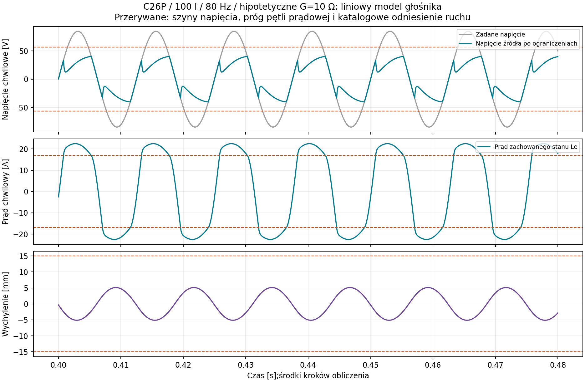

Siedem świadków sprawdzono niezależnymi ciągłymi równaniami i czterema
krokami czasu. [Raport 048](raporty/048_nasycenie_SEM_i_stan_pradu.md)
opisuje też bilans energii, ograniczenie metody przy Le→0 i przypadki,
w których SEM utrudnia jednoczesne dotrzymanie granicy napięcia i prądu.
To badanie hipotetycznego sterownika. Kolejny etap wyznacza wspólny zapas
także dla zmieniającej się temperatury.

</details>

### Ile kosztuje bardzo konserwatywny zapas

Można też postawić mocniejsze pytanie: jaki stały poziom napięcia utrzyma
model w granicach ruchu, prądu i temperatury dla dowolnego sygnału
o ograniczonej amplitudzie? Dla 972 rodzin modeli znaleźliśmy takie
warunki i sprawdziliśmy je dokładnymi nierównościami.

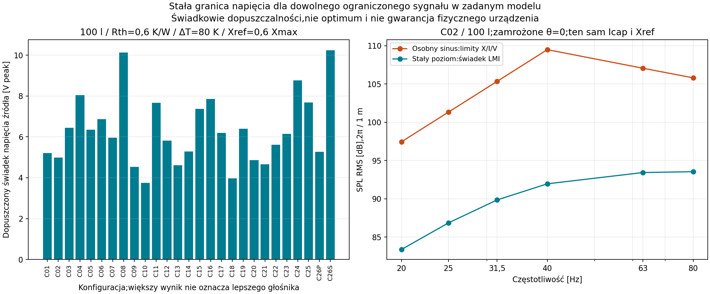

To punkt odniesienia do dalszego projektu. W przykładzie C02 / 100 l
stała granica wynosi około 4,99 V peak; osobny sinus w paśmie może
wykorzystać większą amplitudę. Różnica pokazuje cenę wybranego warunku.
Nie określa nieuniknionej straty każdego innego zabezpieczenia.
Założone chłodzenie i granice temperatury wymagają późniejszej identyfikacji.

<details>
<summary><strong>Rozwiń: co zostało udowodnione w modelu i co pokazują symulacje</strong></summary>

W każdym przypadku znaleziono obszar ruchu i prądu, którego zadany model
nie opuszcza przy ograniczonym napięciu. Warunki obejmują cały przedział
temperatury. Sprawdzono 1944 macierze końców przedziałów, a osobne
36 przebiegów pokazuje przykładowe zachowanie w czasie.

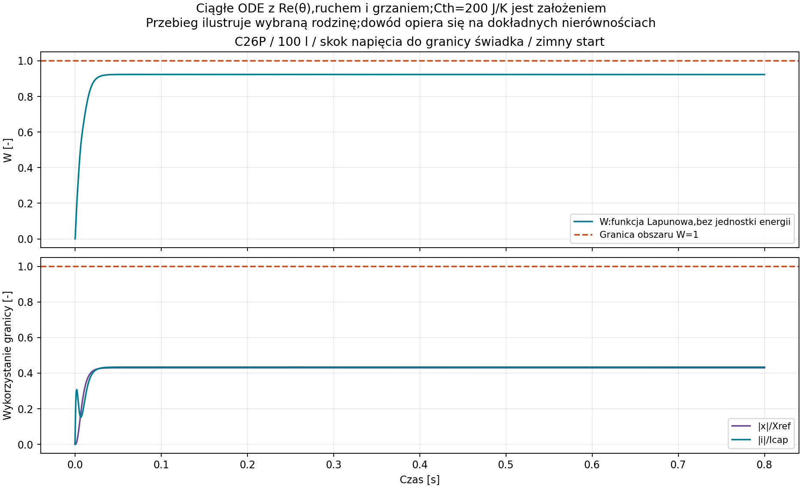

Obwiednia temperatury jest górnym porównaniem dla tego modelu grzania.
Pokazuje także różnicę między oszacowaniem a wybraną krótką symulacją.

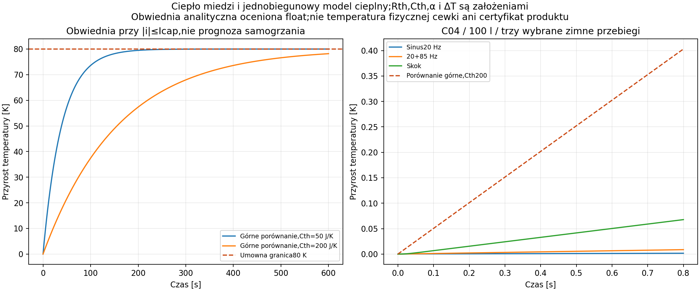

Model ma stałe parametry mechaniczne i indukcyjność oraz zmienne Re(T).
Nie obejmuje jeszcze wszystkich nieliniowości, wypełnienia, podatnych ścian
i realnego toru po DSP. Własność matematyczna nie potwierdza przez to
dokładności danych rzeczywistego produktu.

**Nowa kontrola z sygnałami wielotonowymi:** w 216 scenariuszowych
przebiegach P25C sam filtr HP 20 Hz i ograniczanie napięcia nie
utrzymywały zawsze zadanego zapasu ruchu. W jednym teście C02
model wyznaczył ruch 24,427 mm wobec przyjętego progu 8,4 mm —
**nie jest to prognoza rzeczywistego wychylenia lub uszkodzenia**,
gdyż model liniowy opuścił domenę katalogową. Zbadano także
energetyczną barierę ochronną, której gwarancja dotyczy wyłącznie
idealnego modelu z obserwacją stanu, nie gotowego miniDSP.


[Raport 058 — sygnały czasowe i bariera energii](raporty/058_P25C_sygnaly_czasowe_i_bariera_energii.md).

**Co się zmienia, kiedy limiter działa tylko co kilka milisekund?**
Bariera z poprzedniego badania zakładała znajomość ruchu, prądu i
temperatury w każdej chwili. Przy rzeczywistym próbkowaniu napięcie
jest przez pewien czas utrzymywane bez korekty. W modelu 0D
**zwykłe próbkowanie bariery punktowej nie gwarantuje ochrony**.
Nowe wyprowadzenie ogranicza możliwy dopływ energii *między*
próbkami — również w wariancie z jedną opóźnioną próbką stanu.
Ceną jest dużo mniejsza dopuszczalna amplituda.


W 144 symulacjach bezpieczna modelowo granica nie przekroczyła
progu w żadnym z badanych przypadków. Wykres pokazuje maksimum
w grupie 12 trajektorii i ma logarytmiczną oś energii.
**Nie potwierdza to bezpieczeństwa miniDSP ani fizycznego głośnika**:
brak tu błędów czujników, modelu wzmacniacza i rzeczywistych nieliniowości.

[Raport 062 — dowód granicy ZOH i kontrola zagęszczenia](raporty/062_P25D_probkowana_bariera_energetyczna.md)

**A co, jeśli DSP nie zna dokładnie parametrów głośnika ani jego ruchu?**
W badaniu P25E przeprowadzono **288 symulacji** z hipotetycznym
rozrzutem parametrów i ograniczonym błędem odczytu prądu, położenia
i prędkości membrany. Samo wykorzystanie nominalnej energii nie
gwarantuje zachowania przyjętego limitu. Konserwatywne oszacowanie
energii z górnych granic parametrów pozwala wyprowadzić matematyczny
warunek ochrony zarówno dla bieżącego, jak i opóźnionego o próbkę
odczytu.


W obliczonej próbie naiwna strategia przekroczyła przyjęty limit
energii w **72/72** przypadków, natomiast dwie wersje z marginesem
nie przekroczyły go w **0/144**. Nie oznacza to automatycznie
przekroczenia dopuszczalnego wychylenia — granica energii jest
celowo zachowawcza. Kosztem odporności jest mniejszy modelowy RMS
ruchu membrany; nie jest to prognoza utraty głośności w pokoju.

[Raport 063 — model, ścisły warunek ZOH i niepewność](raporty/063_P25E_odporna_bariera_bledy_obserwacji.md)
· [pełne 288 prób](wyniki/p25e_kampania.csv)
· [kod i założenia](skrypty/p25e_robustna_bariera.py).

· [agregaty 144 prób](wyniki/p25d_agregaty.csv)
· [kod odtwarzający eksperyment](skrypty/p25d_probkowana_bariera.py).

[Raport 049: założenia, dowód, koszt i ograniczenia](raporty/049_obszar_niezmienniczy_i_koszt_ochrony.md)
· [Baza wiedzy: wspólny obszar i granica wejścia](baza_wiedzy/37_wspolny_obszar_i_granica_wejscia.md).

</details>

<a id="pokoj"></a>
## Pokój: skąd bierze się dudnienie i nierówny bas

Dla idealnego pokoju 4,6 × 3,7 × 2,5 m pierwsze rezonanse wzdłuż trzech osi
wypadają około 37,3 / 46,4 / 68,6 Hz. Sam wykres częstotliwości nie mówi,
jak mocno będzie słychać każdy z nich. Znaczenie mają pozycje głośników
i słuchacza, drzwi, okna oraz straty w pomieszczeniu.


Badamy dwa subwoofery w realnych miejscach przy monitorach. Dokładne
pozycje nie są jeszcze znane. Wariant rozpatrywany w badaniach zakłada RTV po lewej
i kanapę po prawej oryginalnego rzutu; dawne scenariusze ustawienia pozostają
przykładami obliczeń.

W kolejnym modelu P26D/P27D uwzględniono także rzeczywisty
przesunięty otwór głośnika w dwóch możliwych orientacjach skrzyni
oraz **wspólny budżet obu źródeł**, zamiast przypisywania każdemu
pełnej mocy bez ograniczeń. Dla jednego scenariusza poprawa
nierównomierności w punkcie odsłuchu **33,51 → 31,49 dB** po
dobraniu gain/delay pogorszyła najgorszy wariant niepewności
**36,39 → 43,71 dB**. To ostrzeżenie przed dostrajaniem
do jednego niezmierzonego pokoju, nie prognoza rzeczywistych
głębokich dołków w pomieszczeniu.


[Raport 061 — obudowy, przesunięte źródła i dwa subwoofery](raporty/061_bryly_offset_i_dwa_subwoofery.md)
· [raport 013 — pomieszczenie](raporty/013_pokoj_i_realne_gabaryty.md)
· [raport 019 — orientacja pokoju](raporty/019_zamiana_kanapy_i_RTV.md).

<a id="mechanika"></a>
## Konstrukcja obudowy: od ścianek do kleju

**Projekt geometryczny jest teraz badany także jako całość.** W scenariuszu
P20D sprawdzono korpus **1000 × 440 × 500 mm (W × D × H)** oraz dostęp
do wkładów regulacyjnych; model przewiduje nominalne stany
około **100 / 120 / 150 l**. To wariant obliczeniowy, nie gotowe
rysunki wykonawcze ani potwierdzone wyporności kosza czy maskownicy.


[Raport P20D — geometria, dostęp i pełny limit głębokości](raporty/057_P20D_geometria_dostep_i_pelna_glebokosc.md).

**Podatne wręgi nie są idealnymi podporami.** W modelu P18E uzyskano
częstotliwość około **143 Hz** dla jednego z wariantów konstrukcyjnych;
wartości około 395 Hz z idealnie podpartego małego pola nie należy
przypisywać całej rzeczywistej skrzyni. Wynik zależy od założonych
sztywności i nie jest pomiarem obudowy.


[Raport P18E — podatne wręgi i panele](raporty/059_podatne_wregi_i_panele.md).


Skrzynia nie jest idealnie sztywna. Jej ścianki się uginają, a połączenia
przenoszą nierówne obciążenia. Poniższe części można rozwinąć niezależnie.
Wykresy przedstawiają modele, nie rysunki wykonawcze.

**Wcześniejszy wariant porównawczy:** korpus 880 × 480 × 500 mm
(W × D × H), MDF 22 mm i stały front 44 mm. Pozostawia on tylko
20 mm z dopuszczalnych 500 mm całkowitej głębokości na wystające
elementy i tolerancje. Wariant ten pozostaje udokumentowany
w raportach 054–055, ale **nie należy go mylić z nowszą
geometrią P20D (1000 × 440 × 500 mm)**. Oba są koncepcjami
badawczymi, nie zatwierdzoną dokumentacją produkcyjną.

[Wstępna geometria i bilans netto — 054](raporty/054_rekomendowana_konfiguracja_prototypu.md)
· [margines głębokości — 055](raporty/055_wrazliwosc_wyboru_i_margines_glebokosci.md).

<details>
<summary><strong>Ścianki, wzmocnienia i rozprowadzanie sił</strong></summary>

### 8. Ścianki: usztywnienie może dać więcej niż sama grubość

W referencyjnej parze ścian 460 × 640 × 22 mm przy 1 kPa statycznym
jeden ściąg zmniejsza ugięcie z około 154,7 do 29,7 µm, a dwa do 12,7 µm
w wariancie SSSS. Trzeba równocześnie sprawdzić masę, nakładki,
połączenia i postacie, których ściąg nie usztywnia.


[Raport 029: model MES, kontrole i granice wniosku](raporty/029_P18A_plyty_sciagi_i_dynamika.md).

### 9. Klej i nakładki: średnie F/A nie wystarcza

Rozmiar nakładki, jej grubość i podatność MDF zmieniają koncentrację
naprężeń. Większe pole nie zapewnia proporcjonalnego spadku szczytu.
Obliczone pole modelu spoiny nie jest rzeczywistym maksimum 3D;
klasa D3/D4 nie zastępuje nośności, pełzania ani zmęczenia połączenia.


[Raport 030: obliczenia spoin, referencja kleju i brakujące dane trwałości](raporty/030_P19A_obliczenia_spoin_i_material_kleju.md).

</details>

<details>
<summary><strong>Front, uszczelka, śruby i połączenia całej skrzyni</strong></summary>

**W skrócie:** duży otwór osłabia front, śruby i uszczelka pracują inaczej,
a mocniejsze połączenie trzeba sprawdzić również w sąsiednich fragmentach płyty.
„Siatka” w opisach oznacza podział konstrukcji na małe elementy do obliczeń.

### 10. Front: otwór i kosz zmieniają konstrukcję

Siatka odwzorowuje otwór główny i skończone obszary przekazywania sił.
Pokazane średnice pochodzą z rysunków producentów; nie jest to dokumentacja
CNC. Luz, frez i lokalne otwory śrubowe wymagają osobnego dopracowania.


Porównanie niżej izoluje wpływ geometrii przy **wspólnym umownym ładunku
10 kg**. Nie przypisuje tej masy wszystkim głośnikom. Miękkie mocowanie
może ograniczać korzyść z pogrubienia frontu, a pierwszy mod może być przechyłem kosza.


[Raport 033: front, masa, mocowania i niezależne odniesienia](raporty/033_front_otwor_kosz_i_styk_jednostronny.md).

### 11. Docisk: uszczelka i śruby mają różne warunki pracy

Uszczelka przenosi ściskanie, a śruby w modelowanej drodze siły —
rozciąganie. Parametr T₀ oznacza zadane skrócenie sprężyny pomnożone
przez jej sztywność; nie jest momentem dokręcania ani zachowaną siłą.
W P19B 20 z 72 scenariuszy wskazało możliwą zmianę styku.


[Raport 033: jednostronny docisk i jawne flagi](raporty/033_front_otwor_kosz_i_styk_jednostronny.md).

### 12. Styk w czasie: rozstrzygnięcie konkretnego przypadku przy 80 Hz

Dla wskazanego C04 z hipotetyczną uszczelką obliczono okresowe otwieranie
styku przy zadanym względnym ruchu stożka 1 mm RMS. Sprawdzono redukcję,
energię, inny integrator i pełne 2959 współrzędnych MES. Jest to jeden
warunkowy przypadek; nie potwierdzenie hałasu, przecieku lub THD produktu.


[Raport 034: wynik, zbieżność i ograniczenia](raporty/034_czasowy_styk_i_pelny_MES.md)
· [dodatkowy wykres zbieżności](wyniki/54_P19C_zbieznosc_i_pelny_MES.png).

### 13. Cała rama: połączenia ścian, masa i podparcie


To geometria kontrolna, **nie gotowa skrzynia do zamówienia**:
460 × 640 × 460 mm wewnątrz, ścianki 22 mm. Rozsunięcie ścian na rysunku
służy czytelności; nie jest szczeliną konstrukcyjną. Geometria brutto
nie jest finalnym Vb netto po odjęciu głośnika, usztywnień i regulacji.

Model obejmuje sześć brył i dwanaście podatnych spoin. Wariant z jednym
ściągiem zmniejsza obliczoną podatność o około 18% przy dodatkowych 0,464 kg.
Ruch przy osobnej sile 1 N RMS zależy także od podparcia. Głośnik jest tu
sztywną masą odniesienia. Zgodnie z U-021 rozwijamy stałe połączenie
frontu z korpusem; wykres nie jest odpowiedzią całego napędu elektroakustycznego.


[Raport 035: siatki do 36 771 współrzędnych, równowaga i ograniczenia](raporty/035_pelna_rama_3D_spoiny_i_podparcie.md)
· [raport 036: energia wirtualnego odspojenia nie jest jeszcze zbieżna](raporty/036_spoiny_3D_i_wirtualne_odspojenie.md).


**Co wymaga dalszego sprawdzenia:** wynik energii dla defektu 10 mm różni się o około
27% dla ciężaru i 41% dla ciężaru z ciśnieniem statycznym 1 kPa między
N=10 i N=14. Gδ z tego eksperymentu nie jest odpornością materiałową Gc,
trwałością spoiny lub potwierdzeniem doboru kleju. Stały front pozostaje
decyzją projektu; dopracowania wymaga lokalna droga przenoszenia sił.

**Listwa przy stałym froncie:** dodatkowa bryła łączy front z dnem przez
dwie nowe spoiny. Wariant 30 × 30 mm/440 mm dodaje około 0,289 kg
i zajmuje 0,396 l. Kontrolna podatność przy tym samym H spada około
2,6%; rzeczywisty port ciśnienia zmienia się po zasłonięciu powierzchni.


**Wynik wymagający dalszej analizy:** dla 30 mm lokalne RMS naprężeń
zmienia się o 17–27% między N=14 i 18. Nowa spoina może przejąć większą
koncentrację, mimo poprawy globalnej sztywności. Nie zatwierdzamy z tego
kleju lub trwałości. Obciążenie: ciężar i statyczne 1 kPa, model C04.


[Raport 040: geometria, tensor masy/ciśnienia, kontrola Schura i pole do podmodelu](raporty/040_listwa_stalego_frontu_i_droga_sily.md).

**Podmodel P19G:** w stałym fragmencie pierwotnej spoiny dalsze zagęszczenie
przekroju zmienia RMS rozciągania o około 0,45%, a ścinania o 0,10%.
Osobne zagęszczenie wzdłuż listwy daje około 0,043/0,081%.
To skończone kontrole dwóch kierunków. Ocena całych spoin z 040 pozostaje
otwarta; okno z odcięciem 5 mm nie jest materiałową strefą kohezji.


**Dane brzegowe też ograniczają wynik:** zmiana źródłowego pola N14→N18
daje około +19,4% rozciągania i +14,6% ścinania w tym samym oknie.
Nie uznajemy zera dodatniej części w pojedynczej siatce za dowód nośności.
Zachowano wpływ odległości granicy i częściowo wyciętej podpory.


[Raport 041: 24 podmodele, 144 oceny okien, transfer stóp i kontrole obciążeń](raporty/041_lokalny_podmodel_i_granice_wiarygodnosci.md).

### 14. Stały front: wymagany moduł spoiny

Wyznaczono progi efektywnego E dla zadanego przyrostu podatności, osobno
dla samego frontu i wszystkich spoin. Przykładowo dla +10% C i warstwy
0,2 mm na N=14 wynoszą około 9,09 i 72,14 MPa. Są to wyniki modelu
sztywności; nie gwarancja nośności, adhezji, pełzania lub zmęczenia.
Scenariusze 5/10/20% nie są zatwierdzonymi progami briefu.


[Raport 037: metoda monotoniczna, dane i ograniczenia siatki](raporty/037_staly_front_wymagany_modul_spoin.md).

</details>

<a id="regulacja"></a>
## Regulacja objętości: jedna skrzynia, kilka wariantów

Badana skrzynia ma umożliwiać eksperymenty przy około **100, 120
i 150 l netto** bez zmieniania stałego frontu. W przyjętym kryterium
różnicy 0,2 dB od plateau wystarcza już około **100 l** (99 l na siatce
co 1 l). Objętość **120 l jest punktem startowym próby**, a nie
udowodnionym optimum. Wkłady zajmują miejsce i zmieniają przestrzenny
rozkład ciśnienia; objętość netto musi też uwzględniać kosz,
usztywnienia, osprzęt i ciało stałe maty tłumiącej.

[Bilans litrów i wariant doświadczenia — 054](raporty/054_rekomendowana_konfiguracja_prototypu.md)
· [korekta kryterium objętości — 055](raporty/055_wrazliwosc_wyboru_i_margines_glebokosci.md).

Porównujemy szczelne wkłady wkładane przez otwór po zdjęciu głośnika
oraz przesuwaną przegrodę. Front pozostaje stały. Ważne są masa, szczelność,
sztywność i możliwość zmiany ustawienia po złożeniu skrzyni.

<details>
<summary><strong>Wkłady, przegroda, MDF i sklejka — wyniki kolejnych porównań</strong></summary>

### 15. Regulacja Vb: dostęp, masa i własna akustyka wkładu

W kontrolnym układzie można wsunąć i wyjąć **16 modułów 180 × 100 × 170 mm**,
co zajmuje 48,96 l. Front pozostaje stały; dostęp zakłada wyjęty głośnik.
Tory są sprawdzone w konkretnej klasie translacji osiowych. Nie obejmują
dowolnych obrotów, mocowań i dostępu narzędzia ani globalnego maksimum pakowania.


Do porównania z przegrodą przyjęto **szczelny moduł MDF 8 mm ze ściągiem**.
Suchy zestaw 16 modułów waży nominalnie około 11,21 kg; masywny MDF
o tym samym obrysie około 35,74 kg. Gęstość i geometria są założeniami.
To wybór przypadku badawczego; nie gotowa dokumentacja wykonawcza.

**Powietrze wewnątrz i ściany są liczone osobno.** Przeciek może oddawać
znaczną podatność, mimo tego samego fizycznego obrysu. Pokazane fc_ref
parametryzują umowny opór; nie są pomiarem szczeliny lub tolerancją wyrobu.


**Przypadek graniczny:** po uwzględnieniu masy powietrza w kanale pojawiają
się formalne rezonanse. Poza ekranami małej amplitudy odpowiedź liniowa
nie daje prognozy rzeczywistego przepływu, hałasu lub SPL. Rzeczywiste
mocowanie również wymaga sprawdzenia — wkład nie może być uznany za
nieruchomy wyłącznie dlatego, że opiera się na włókninie.


[Raport 042: 78 modeli modułów, bilanse, montaż, mocowanie i ograniczenia przestrzenne](raporty/042_regulacja_Vb_i_wklady_wypornosciowe.md)
· [dynamika mocowania](wyniki/73_P20A_dynamika_mocowania_wkladu.png).

### 16. Przegroda: mniej masy, ale potrzebne sztywne blokowanie

Przegroda 18 mm z modelowym uszczelnieniem i założonym wózkiem ma około
**3,05 kg**, wobec **11,21 kg samych 16 modułów**. Obie liczby wymagają
uzupełnienia osprzętu. Przy tej samej ilości gazu z przodu miękka rama
wprowadza silną odpowiedź w paśmie basowym. Ujemna część reaktywna na
wykresie nie jest ujemną objętością fizyczną. Wykres przedstawia liniowy
port; poziom pracy wymaga osobnego sprawdzenia amplitudy i prześwitów.


Cała sztywna płyta 458×458 mm nie przejdzie przez badane otwory do 355,8 mm,
także przy obrocie: ograniczenie wynika z jej środkowego wpisanego dysku.
Wymaga wcześniejszego montażu lub innego dostępu. Front pozostaje stały.


[Raport 043: dwie komory, przeciek, odpowietrzenie, statyka i kontrole](raporty/043_przegroda_dwie_komory_i_materialy.md).
Są to scenariusze przy niezmierzonych mocowaniach/uszczelce; nie końcowa
rekomendacja konstrukcji lub poziomu SPL w pokoju.

### 17. MDF i sklejka: sprawdzaj oba kierunki

Dane Metsä odczytano także z oryginalnych tabel PDF. **Form/FormPLUS12**
ma w obliczeniu około 38% mniejszą masę samej płyty niż kontrolne MDF18,
a wskaźnik sztywności słabszego kierunku pasa wynosi około 0,96 wartości MDF.
**Spruce12** ma słabszy kierunek około 0,19, mimo dobrego wyniku wzdłuż.
Nie wolno z jednego modułu wywnioskować drgań całej obudowy.


Wskaźnik Em·t³ nie identyfikuje skręcania, tłumienia i adhezji. Producent
podaje odmienne wilgotności dla tych dwóch sklejek, a MDF jest założeniem
modelowym. [Raport043](raporty/043_przegroda_dwie_komory_i_materialy.md)
wyjaśnia granice porównania i rozróżnienie surowej/powlekanej powierzchni.

### 18. Pełny moduł 3D: krawędzie płyt i klej mają znaczenie

Ściany, naroża, nakładki, pręt i warstwy kleju policzono jako bryły.
Gaz wewnętrzny i obrys zewnętrzny mają **osobne porty pracy**. Referencyjny
moduł ze ściągiem ma nominalnie 0,7023 kg i 2,099984 l gazu, przy
niezmiennym obrysie 3,06 l. Objętość kleju jest policzona osobno.

Przy 20 Hz otrzymujemy około **11,705 ml odtwarzanej podatności na moduł**,
wobec 8,816 ml w modelu płyt CCCC. Ta korekta o około 33% dotyczy modułu,
a jej wpływ na napęd zależy od udziału w całej podatności skrzyni.


### 19. Klej: ciągłe wymaganie sztywności i osobna ocena naprężeń

Wyprowadzono monotoniczną zależność statycznej podatności od E kleju.
W zadanej rodzinie kryterium **najwyżej 5% większej podatności względem
Eref=1718 MPa** daje około **321 MPa** na drobniejszej siatce. To kryterium
porównania, bez zatwierdzenia go jako wymogu briefu. Moduł nie potwierdza
wytrzymałości, adhezji do MDF, pełzania lub zmęczenia produktu.


W 11 664 punktach napędu największa zmiana obwiedni przy zachowanych
umownych ekranach amplitudy wyniosła około **0,0046 dB**. Badanie dotyczy
osobnych sinusów 20–80 Hz, RMS 2π/1 m i ograniczeń V/I/katalogowego X;
nie ustala THD lub bezpiecznego czasu pracy. Z kolei formalne postacie
przy wyższych częstotliwościach wymagają przestrzennego modelu gazu.


[Raport 044: równania, kontrola hydrostatyczna, osiem flag i dalsze siatki](raporty/044_modul_3D_dwa_porty_i_wymagania_kleju.md)
· [11 664 punkty napędu](wyniki/p20c_naped_27_konfiguracji.csv).

</details>

## Powietrze w skrzyni: moduł, komora i membrana

Dla małego modułu przy równomiernym nacisku korekta gazu 3D względem
0D jest mała w zbadanych punktach 20–80 Hz. Pole z gradientem wymaga
osobnego bilansu pędu i mocowania. Nie przenosimy tego wyniku automatycznie
na większą komorę z lokalnie poruszającą się membraną.


Nowy pilot głównej komory sprawdza głębokości 350/425/500 mm oraz
źródło centralne i przesunięte. Zmiana nacisku zwrotnego przy zadanym
ruchu nie jest zmianą SPL lub THD. Objętości dotyczą pustego wnętrza,
a źródło kwadratowe jest kontrolne, bez przypisania do produktu.


W rzeczywistym głośniku powietrze poruszane jest przez membranę
o skończonej powierzchni. Model P21C1 porównuje kołowe tłoki
o powierzchni odpowiadającej katalogowemu `Sd` oraz różne położenia
źródła. Lokalnej masy akustycznej nie wolno doliczać ponownie do `Mms`.


**P21D uwzględnia wspólną geometrię i port napędu.** Sprawdzono
45 pól, 12 zagęszczeń i 54 odpowiedzi napędu w zdefiniowanych
warunkach modelowych. W sześciu kontrolowanych przypadkach ostatnia
zmiana amplitudy ruchu C02 była nie większa niż 0,00858 dB;
nie jest to dowód dokładności całego pasma ani rzeczywistego THD.


[Raport P21D — wspólna geometria i port napędu](raporty/060_P21D_wspolna_geometria_i_port_napedu.md).

**Czy uginające się ścianki zmieniają pracę membrany?** W modelu P21E
połączono sprężynę powietrzną skrzyni z jednym równoważnym trybem
uginania dwóch paneli. Przy modelowych 120 l dodatkowa podatność paneli
odpowiada około **5,37 l podatności powietrza w granicy statycznej**
— *nie* dodatkowej fizycznej objętości komory. Dla C02 zmiana
amplitudy ruchu w próbie nominalnej 20–80 Hz wyniosła od
**−0,058 do +0,132 dB**.


To symulacja liniowa o **jednorodnym ciśnieniu**, nie połączone
przestrzenne obliczenie FEM–FV z P18E i P21D. Nie wyznaczono
rzeczywistych postaci drgań, promieniowania paneli ani THD.

[Raport 064 — P21E: sprzężenie gazu i podatnych ścian](raporty/064_P21E_gaz_podatne_sciany_i_naped.md)
· [39 punktów kontrolnych](wyniki/p21e_nominal.csv)
· [podsumowanie 9801 przypadków](wyniki/p21e_podsumowanie.json).

**Czy przestrzenne ciśnienie może zmienić napęd mocniej niż same ugięcia ścian?**
Badanie P21F łączy jeden dysk membrany z przestrzennymi modami
akustycznymi i trzema **modelowymi** podatnymi polami ścian.
W przeanalizowanej rodzinie, przy 120 l i przesuniętej membranie C02,
zmiana amplitudy prędkości 20–80 Hz względem sztywnego modelu 0D
wynosi **−0,500 do +0,230 dB**. Dla samego przestrzennego gazu
ze sztywnymi ścianami: **−0,446 do +0,100 dB**.


To **model zastępczy pustego prostopadłościanu**, a nie rozwiązanie
dla rzeczywistego układu wręg, wkładów i maty P20D/P21D. Wpisanie
100/120/150 l do podatności gazu przy niezmienionej geometrii modów
jest jawnym uproszczeniem. Sprawdziliśmy pasywność i bilans energii,
ale nie uzyskaliśmy jeszcze ścisłej zbieżności całego pasma.

[Raport 065 — P21F: mody gazu i podatne pola](raporty/065_P21F_wielomody_gazu_i_scian.md)
· [podsumowanie 52 272 obliczeń](wyniki/p21f_podsumowanie.json)
· [kod odtwarzania](skrypty/p21f_mody_gaz_panele.py).

**P21G: prawdziwe przestrzenne wręgi i wkłady, dwa podatne porty paneli.**
Połączyliśmy ciśnienie z rozwiązania objętościowego (FV) dla
11 wręg, wkładów i zastępczego kosza P20D z obliczeniami
ruchu dwóch sprężystych ścian oraz trzech finalistów C02/C11/C06.
W wariancie ok. 120 l (rzeczywista *modelowa* objętość 119,937 l)
zmiana prędkości membrany C02 przy tym samym napięciu wynosi
**−0,060 do +0,133 dB** w paśmie 20–80 Hz przy nominalnej
podatności i założonym tłumieniu.


To **nie pełny mechaniczny MES**: postacie uginania ścian są
uproszczone, materiały przyjęto scenariuszowo, a model wyklejenia
jest inny niż w P21D. Badano ruch membrany, **nie bezpośredni dźwięk
promieniowany przez panele**. Przeliczono 348 przypadków napędu,
sprawdzając bilans mocy i trzy rozdzielczości siatki.

[Raport 066 — P21G: komora z przeszkodami i podatnymi panelami](raporty/066_P21G_FV_podatne_sciany_rzeczywiste_przeszkody.md)
· [wyniki i kontrole](wyniki/p21g_podsumowanie.json)
· [skrypt](skrypty/p21g_fv_podatne_panele.py).

[Raport 050 — źródło w komorze](raporty/050_P21C0_plytka_komora_i_polozenie_zrodla.md)
· [raport 051 — kołowa membrana](raporty/051_P21C1_membrana_kolowa_i_bezwladnosc.md)
· [raport 052 — warstwy i wkłady](raporty/052_komora_warstwy_wklady_i_front.md).
Wyniki nie zastępują **pełnego przestrzennego** sprzężenia
rzeczywistych podatnych ścian, wręg, wypełnienia i napędu.

<a id="slownik"></a>
## Krótki słownik do wykresów

| Skrót lub termin | Co oznacza tutaj |
|---|---|
| SPL | Poziom ciśnienia akustycznego. Zawsze sprawdzaj pasmo, odległość i warunki |
| RMS / szczyt | Wartość skuteczna i maksymalna przebiegu; to różne sposoby podawania poziomu |
| 2π / 4π | Modele promieniowania w półprzestrzeni / przestrzeni swobodnej |
| T/S | Parametry opisujące zachowanie głośnika przy małym sygnale |
| Xmax | Katalogowy zakres ruchu membrany; definicja zależy od producenta |
| THD / IMD | Miary zniekształceń; liniowy wykres T/S ich nie wyznacza |
| DSP | Cyfrowe filtry, korekcja, opóźnienia i ochrona |
| Vb / netto | Objętość powietrza po odjęciu zajętego miejsca |
| Podatność | Łatwość ugięcia lub zmiany objętości; większa oznacza mniejszą sztywność |
| Mod | Jedna z postaci drgań lub rezonansu |
| MES / siatka | Metoda obliczeń, w której konstrukcję dzielimy na małe elementy |

Nie porównuj bezpośrednio poziomów opisanych różną geometrią 2π i 4π
ani wartości RMS ze szczytowymi. Liczby z modeli nie są pomiarami urządzenia.

<a id="dalsze-prace"></a>
## Co zostało do zrobienia

Zbadano już wspólną geometrię z wręgami i wkładami (P20D),
przestrzenne pole gazu oraz port napędu (P21D), modele P21E/P21F oraz wspólną przestrzenną komorę z panelami (P21G), podatność paneli
(P18E), krótkie sygnały z ochroną (P25C), próbkowaną barierę (P25D), odporność na błędy stanu (P25E) i warianty ustawienia
dwóch źródeł w pokoju (P26D/P27D). **Nie są to jeszcze jeden
sprzężony model wielofizyczny ani zweryfikowany prototyp.**

Brakuje integracji przestrzennego pola gazu z rzeczywistą
podatnością wszystkich ścian, kalibracji materiału i napędu,
wykonalnej ochrony DSP, danych o monitorach, pomiarów
pokoju i oceny kosztów spełniających wymagania wariantów.
Szczegółowy stan i kryteria znajdują się w
[programie 30 pakietów](PROGRAM_30_BADAN.md).

**Końcowy raport PDF powstanie po ukończeniu badań możliwych bez urządzenia.**
Wtedy zostanie opublikowany jako **Release 1**, z raportem w załącznikach.
Obecnie nie jest to zakończony projekt ani oferta gotowego subwoofera.

## Źródła i pełna dokumentacja

Każdy wniosek powinien prowadzić do raportu, wejść i kodu. Źródła producentów,
opinie z forów i własne symulacje są rozdzielone. Opinie nie zastępują
pomiaru, a wyniku innej obudowy nie przenosimy automatycznie na zamkniętą.

<details>
<summary><strong>Zakres modeli, źródeł i założeń porównawczych</strong></summary>

Pula obejmuje **26 produktów od 11 producentów**,
w tym 4 STX i **3 SB Acoustics**. Liczymy **27 konfiguracji elektrycznych**,
ponieważ nowy dwucewkowy SB ma osobno połączenie szeregowe i równoległe.
Modele regulatora i pola gazu umożliwiają ocenę przybliżeń i konstrukcji.
[Raport 044](raporty/044_modul_3D_dwa_porty_i_wymagania_kleju.md) dodaje
18 modeli ścian, naroży i spoin modułu, dalsze siatki do 40 248 DOF,
ciągłe wymaganie sztywności kleju oraz 11 664 punkty napędu 27 konfiguracji.
Model bryłowy koryguje podatność modułu o około 33% względem idealnego
utwierdzenia płyt; wpływ na liniową obwiednię napędu jest mały w badanej dziedzinie.
[Raport 043](raporty/043_przegroda_dwie_komory_i_materialy.md) zachowuje
porównanie z lżejszą przegrodą oraz dane sklejki. Osiem flag siatki przy
rezonansach rozstrzygnięto dalszym zagęszczeniem, z zachowaniem pierwotnych wyników.
Metoda regulacji, rzeczywisty klej i końcowa konstrukcja pozostają otwarte.
Powiązane wyniki obejmują [dodatkowe SB — 038](raporty/038_SB_Acoustics_rozszerzenie_i_porownanie.md),
[wypełnienie — 039](raporty/039_wypelnienie_ilosc_polozenie_i_straty.md),
[listwę stałego frontu — 040](raporty/040_listwa_stalego_frontu_i_droga_sily.md)
i [lokalny podmodel — 041](raporty/041_lokalny_podmodel_i_granice_wiarygodnosci.md).
Poprzednie etapy obejmują [pełną ramę 3D — raport 035](raporty/035_pelna_rama_3D_spoiny_i_podparcie.md),
[screening spoin/odspojenia — raport 036](raporty/036_spoiny_3D_i_wirtualne_odspojenie.md)
i [wymagania modułu spoin stałego frontu — raport 037](raporty/037_staly_front_wymagany_modul_spoin.md).
Trwa program badań przed budową; ostateczny wybór i końcowy PDF są przed nami.
Przedstawione wyniki są obliczeniami i symulacjami, bez pomiarów fizycznego prototypu.

**Zakresy nie są jednakowe:** duże kampanie niepewności, nieliniowości
i termiki wykonano dla pierwotnych 24 baz. Nowe SB mają dane producenta,
ocenę dostępnych opinii i porównanie liniowe; nie przypisujemy im automatycznie
wyników starszych kampanii. C04 jest referencją części modeli mechanicznych,
nie zatwierdzonym docelowym głośnikiem.

| Ustalenie | Obowiązujący kontekst |
|---|---|
| Wymagania | [Brief v0.6](brief_system_audio_DIY_v0.6.md) i [późniejsze decyzje użytkownika](DECYZJE_I_PYTANIA.md) |
| Referencje | ADAM Sub12 i Sub15; progi liczbowe pozostają otwarte |
| Pokój | Około **4,6 × 3,7 × 2,5 m**, 42,55 m³; docelowo **RTV po lewej, kanapa po prawej** oryginalnego rzutu |
| Docelowy system | Dwa subwoofery przy monitorach, jeden sweet spot 2,5–3 m; przyszła architektura co najmniej 8 wyjść DSP |
| Obecny zakres | Nauka, źródła, obliczenia i symulacje do budowy. Zakupy, CAD i dobór aparatury pozostają odłożone |

</details>

<a id="mapa"></a>
<details>
<summary><strong>Mapa: pytanie → raport → dane</strong></summary>
## Mapa badań — pytanie → raport → dane

| Pytanie | Gdzie czytać | Gdzie sprawdzać wejścia lub wyniki |
|---|---|---|
| Jakie głośniki badamy i co wiadomo z opinii? | [010 — pierwotna szeroka pula](raporty/010_szeroka_pula_i_kwalifikacja.md), [012 — identyfikowalność](raporty/012_identyfikowalnosc_i_dane_publikowane.md), [038 — dodatkowe SB](raporty/038_SB_Acoustics_rozszerzenie_i_porownanie.md) | [24 bazy](dane/przetworniki/pula_rozszerzona.json) + [2 produkty SB](dane/przetworniki/rozszerzenie_SB_20261025.json); [opinie puli](dane/zrodla/opinie_puli_ocena.json) i [nowych SB](dane/zrodla/SB_rozszerzenie_pochodzenie.json) |
| Jak dobrać litraż, wychylenie i napęd łącznie? | [011 — granice objętości](raporty/011_granice_globalne_litrazu.md), [028 — wspólne ograniczenia](raporty/028_P17_synteza_napedu_objetosci_i_ciepla.md) | [Wyniki P17](wyniki/p17_podsumowanie.json) |
| Jak niepewność danych zmienia kolejność kandydatów? | [015 — czułość i odporność](raporty/015_niepewnosc_globalna_i_odpornosc.md) | [Baza wiedzy o niepewności](baza_wiedzy/10_niepewnosc_globalna.md) |
| Co robią gaz, wypełnienie i nieszczelności? | [009 — przecieki](raporty/009_N7_straty_nieszczelnosci.md), [016 — gaz i materiały](raporty/016_gaz_wypelnienie_i_granice.md), [039 — ilość i położenie materiału](raporty/039_wypelnienie_ilosc_polozenie_i_straty.md) | [Geometria, masa i podatność](wyniki/p09c_geometria_masa_i_podatnosc.csv), [17 820 punktów napędu](wyniki/p09c_naped_i_wypelnienie.csv), [konfiguracje](dane/konfiguracje/) |
| Skąd biorą się nieliniowości i IMD? | [020 — nieliniowy napęd](raporty/020_nieliniowy_naped_i_sprzezony_gaz.md), [021 — pamięć cewki](raporty/021_pamiec_cewki_i_definicja_Lgen.md), [026 — dwa tony](raporty/026_P14B_pelna_kampania_dwutonowa.md) | [Podsumowanie P14B](wyniki/p14b_podsumowanie.json) |
| Jak prąd, temperatura i chłodzenie wpływają na pracę? | [025 — topologia termiki](raporty/025_P15A_topologia_i_granice_termiki.md), [027 — grzanie i napęd](raporty/027_P15B_sprzezenie_grzania_i_napedu.md) | [Podsumowanie P15B](wyniki/p15b_podsumowanie.json) |
| Jak policzyć panele, usztywnienia i klej? | [029 — płyty](raporty/029_P18A_plyty_sciagi_i_dynamika.md), [030 — spoiny](raporty/030_P19A_obliczenia_spoin_i_material_kleju.md), [035 — pełna rama](raporty/035_pelna_rama_3D_spoiny_i_podparcie.md), [036 — defekt spoiny](raporty/036_spoiny_3D_i_wirtualne_odspojenie.md) | [Materiał MDF i kleje](dane/materialy/), [wyniki 3D](wyniki/manifest_ramy_i_spoin_3D.json) |
| Jak otwór, kosz i uszczelka zmieniają front? | [033 — front i docisk](raporty/033_front_otwor_kosz_i_styk_jednostronny.md), [034 — styk w czasie](raporty/034_czasowy_styk_i_pelny_MES.md) | [Geometria producentów](dane/zrodla/P18B_geometria_i_ograniczenia.json), [przebiegi P19C](wyniki/p19c_podsumowanie.json) |
| Co oznacza stały front i jak dobrać jego połączenie? | [037 — wymagania modułu](raporty/037_staly_front_wymagany_modul_spoin.md), [040 — listwa i droga siły](raporty/040_listwa_stalego_frontu_i_droga_sily.md), [041 — podmodel i dane brzegowe](raporty/041_lokalny_podmodel_i_granice_wiarygodnosci.md), [U-021](DECYZJE_I_PYTANIA.md) | [12 progów](wyniki/p19e_wymagane_moduly_stalego_frontu.csv), [20 wariantów listwy](wyniki/p19f_geometrie_i_podatnosc.csv), [24 lokalne realizacje](wyniki/p19g_ocena_i_roznice.json) |
| Jak zmieniać objętość przy stałym froncie? | [042 — wkłady wypornościowe](raporty/042_regulacja_Vb_i_wklady_wypornosciowe.md), [043 — przegroda i dwie komory](raporty/043_przegroda_dwie_komory_i_materialy.md), [044 — pełny moduł 3D](raporty/044_modul_3D_dwa_porty_i_wymagania_kleju.md) | [Tory montażu modułów](wyniki/p20a_tory_montazu.json), [80 geometrii przegrody](wyniki/p20b_pozycje_i_dostep.csv), [18 brył](wyniki/p20c_modele_3D.csv), [ciągłe wymaganie kleju](wyniki/p20c_wymagany_modul_kleju.csv) |
| Czy sklejka będzie lepsza od MDF? | [043 — pierwotne dane i ograniczenia](raporty/043_przegroda_dwie_komory_i_materialy.md) | [Dane producenta z hashem oryginałów](dane/materialy/sklejka_pierwotne_P20B.json), [masa i kierunkowa sztywność pasa](wyniki/p20b_materialy_masa_i_pas.csv) |
| Jak uwzględniamy pokój i dwie sztuki? | [013 — dwa źródła i gabaryty](raporty/013_pokoj_i_realne_gabaryty.md), [017 — sprzężenie pola](raporty/017_promieniowanie_i_sprzezenie_pokoju.md), [019 — aktualna orientacja](raporty/019_zamiana_kanapy_i_RTV.md) | [Konwencja pokoju](dane/konfiguracje/pokoj_odsluchowy.json), scenariusze opisane w raportach |

| Jak położenie membrany i przestrzenna komora zmieniają obciążenie? | [050 — geometria](raporty/050_P21C0_plytka_komora_i_polozenie_zrodla.md), [051 — membrana](raporty/051_P21C1_membrana_kolowa_i_bezwladnosc.md), [052 — wypełnienie i wkłady](raporty/052_komora_warstwy_wklady_i_front.md) | [Wykres 95](wyniki/95_P21C0_plytka_komora.png), [wykres 96](wyniki/96_P21C1_membrana_i_przesuniecie.png), [wyniki P21C3](wyniki/p21c3_wyniki.json) |
| Które nowe marki mają zweryfikowane T/S i czym różnią się od Dayton? | [nowy brief i audyt dziewięciu marek](raporty/BRIEF_2026-10-31_wzmacniacz_DSP_i_9_marek.md) | [zamrożone karty](dane/karty_producentow/2026-10-31_9_marek_weryfikacja.json), [audyt danych](skrypty/audyt_danych_9_marek.py), [analiza 26+9](skrypty/brief20261031_pomiarowe_bramki_i_porownanie.py) |
| Dlaczego faworytem jest RSS390HF-4 i kiedy inny przetwornik wygrywa? | [053 — porównanie](raporty/053_porownanie_i_odpornosc_rekomendacji.md), [054 — konstrukcja](raporty/054_rekomendowana_konfiguracja_prototypu.md), [055 — wrażliwość](raporty/055_wrazliwosc_wyboru_i_margines_glebokosci.md) | [Wykres 97](wyniki/97_P29_wybor_i_front.png), [podsumowanie P29C](wyniki/p29c_podsumowanie.json) |

| Co pokazują nowe próby dynamicznego ograniczania wychylenia i temperatury? | [058 — sygnały i energetyczna bariera](raporty/058_P25C_sygnaly_czasowe_i_bariera_energii.md) | [216 przebiegów](wyniki/p25c_kampania.csv), [wykresy](wyniki/p25c_przebiegi.png), [kontrole](wyniki/p25c_weryfikacja_przejsciowa.json) |
| Czy próbkowanie i opóźnienie sterownika unieważniają barierę ruchu/prądu? | [062 — P25D: ograniczenie energii między próbkami](raporty/062_P25D_probkowana_bariera_energetyczna.md) | [wykres](wyniki/102_P25D_bariera_probkowana.svg), [dane zbiorcze](wyniki/p25d_podsumowanie.json), [kod](skrypty/p25d_probkowana_bariera.py) |
| Czy błędy pomiaru i niepewność T/S znoszą matematyczny limit ochrony? | [063 — P25E: odporna bariera ZOH](raporty/063_P25E_odporna_bariera_bledy_obserwacji.md) | [wykres](wyniki/103_P25E_odpornosc_obserwacji.svg), [288 przypadków](wyniki/p25e_kampania.csv), [porównanie kroków](wyniki/p25e_zbieznosc_porownanie.json) |
| Czy skrzynia, wkłady i ich prześwity mieszczą się w obrysie? | [057 — geometria P20D](raporty/057_P20D_geometria_dostep_i_pelna_glebokosc.md) | [warianty](wyniki/p20d_warianty.csv), [wykres geometrii](wyniki/100_P20D_geometria.png) |
| Czy wręgi pracują jak idealnie sztywne podpory? | [059 — model podatnych wręg](raporty/059_podatne_wregi_i_panele.md) | [pola ugięcia](wyniki/p18e_pola.png), [kontrole](wyniki/p18e_kontrole.json) |
| Jak wygląda przestrzenne pole gazu w geometrii P20D? | [060 — P21D](raporty/060_P21D_wspolna_geometria_i_port_napedu.md) | [przebiegi napędu](wyniki/p21d_naped.csv), [przestrzenny wykres](wyniki/101_P21D_komora_i_naped.png) |
| Jak zmienia się napęd po uwzględnieniu podatności dwóch ścian? | [064 — P21E: model sprzężony gaz–panel](raporty/064_P21E_gaz_podatne_sciany_i_naped.md) | [wykres](wyniki/104_P21E_podatne_sciany.svg), [podsumowanie](wyniki/p21e_podsumowanie.json), [skrypt](skrypty/p21e_gaz_podatne_sciany.py) |
| Czy przestrzenne mody gazu i podatne pola zmieniają obciążenie membrany? | [065 — P21F: wielomody i podatne pola](raporty/065_P21F_wielomody_gazu_i_scian.md) | [wykres](wyniki/105_P21F_mody_i_panele.svg), [podsumowanie](wyniki/p21f_podsumowanie.json), [skrypt](skrypty/p21f_mody_gaz_panele.py) |
| Jak wręgi, wkłady i podatne panele współdziałają z powietrzem? | [066 — P21G: porty FV z przeszkodami](raporty/066_P21G_FV_podatne_sciany_rzeczywiste_przeszkody.md) | [wykres](wyniki/106_P21G_komora_i_podatne_panele.svg), [podsumowanie](wyniki/p21g_podsumowanie.json), [skrypt](skrypty/p21g_fv_podatne_panele.py) |
| Czy dwa źródła w orientacji pionowej i poziomej są odporne na nieznane straty pokoju? | [061 — P26D/P27D](raporty/061_bryly_offset_i_dwa_subwoofery.md) | [porównanie](wyniki/p26d_porownanie.csv), [wykres](wyniki/p26d_bryly_i_odpowiedz.png) |

Pełny zakres i otwarte bramki są w [programie 30 pakietów](PROGRAM_30_BADAN.md).
Podstawy fizyczne wyjaśnia [baza wiedzy](baza_wiedzy/README.md), a ślad pracy
zapisujemy w [AGENTS.md](AGENTS.md).

</details>

<a id="odtwarzanie"></a>
## Dane, kod i odtwarzanie

| Katalog lub dokument | Zastosowanie |
|---|---|
| [dane/przetworniki](dane/przetworniki/) | Parametry katalogowe, modele, konflikty i luki |
| [dane/konfiguracje](dane/konfiguracje/) | Jawne wejścia, jednostki i scenariusze |
| [dane/zrodla](dane/zrodla/) i [rejestr źródeł](baza_wiedzy/ZRODLA.md) | Pochodzenie danych, oryginały/odczyty, daty i hashe |
| [skrypty](skrypty/) | Modele Python, niezależne kontrole i generowanie wykresów |
| [wyniki](wyniki/) | CSV, JSON, wykresy PNG/SVG i manifesty przebiegów |
| [raporty](raporty/README.md) | Interpretacja, rekomendacje i ograniczenia wyników |
| [baza_wiedzy](baza_wiedzy/README.md) | Wyjaśnienia fizyki i metod obliczeniowych |
| [dane/pomiary](dane/pomiary/README.md) | Miejsce przyszłych pomiarów; obecnie bez wyników urządzenia |

Obliczenia używają Pythona 3.12, NumPy, SciPy, SymPy i Matplotlib.
[Wymagania środowiska](requirements.txt); dokładne wersje i hashe są
zapisywane w manifestach. Skrypty ustalają katalog projektu z własnej ścieżki.

<details>
<summary><strong>Uruchomienie obliczeń i manifesty etapów</strong></summary>

Pełne odtworzenie archiwizuje poprzedni stan wyników:

```bash
OPENBLAS_NUM_THREADS=1 python3 skrypty/odtworz_wszystko.py
```

Można również uruchomić tylko interesujący etap:

```bash
# Panele, spoiny i reakcja powietrza P18A/P19A/P21A
python3 skrypty/odtworz_mechanike_P18_P19_P21.py

# Front i docisk P18B/P19B
OPENBLAS_NUM_THREADS=1 python3 skrypty/odtworz_front_i_styk_P18B_P19B.py

# Czasowa odpowiedź styku P19C
OPENBLAS_NUM_THREADS=1 python3 skrypty/odtworz_styk_czasowy_P19C.py

# Dodatkowe SB i porównanie liniowe całej rozszerzonej puli
OPENBLAS_NUM_THREADS=1 python3 skrypty/analiza_rozszerzenia_SB.py
python3 skrypty/manifest_rozszerzenia_SB.py

# Ilość i rozmieszczenie wypełnienia P09C
OPENBLAS_NUM_THREADS=1 python3 skrypty/analiza_ilosci_i_rozmieszczenia_wypelnienia.py
python3 skrypty/manifest_wypelnienia_P09C.py

# Listwa stałego frontu P19F, niezależne kontrole i zachowanie pola
OPENBLAS_NUM_THREADS=1 python3 skrypty/odtworz_listwe_P19F.py

# Lokalny podmodel P19G i osobne kontrole kierunków siatki
OPENBLAS_NUM_THREADS=1 python3 skrypty/odtworz_podmodel_P19G.py

# Regulacja Vb: wkłady, masa, porty, napęd, kanały i mocowania P20A
OPENBLAS_NUM_THREADS=1 python3 skrypty/odtworz_regulacje_P20A.py

# Przegroda, dwie komory, niezależny pełny układ i dane sklejki P20B
OPENBLAS_NUM_THREADS=1 python3 skrypty/odtworz_przegrode_P20B.py

# Pełna bryła modułu, spoiny, ciągły moduł kleju i rozstrzygnięcia siatki P20C
OPENBLAS_NUM_THREADS=1 python3 skrypty/odtworz_modul_3D_P20C.py

# Filtry cyfrowe, dokładna stabilność, software i zapas sygnału P23A
OPENBLAS_NUM_THREADS=1 python3 skrypty/odtworz_filtry_P23A.py

# Pasywny port wzmacniacza, prądy, energia i obwiednie P22A
OPENBLAS_NUM_THREADS=1 python3 skrypty/odtworz_port_P22A.py

# Nasycenie napięcia, SEM, stan prądu i odrębne ciągłe ODE P22B
OPENBLAS_NUM_THREADS=1 python3 skrypty/odtworz_nasycenie_P22B.py

# Dokładne sprawdzenie zapisanych świadków P24A, bez CVXPY
python3 skrypty/sprawdz_swiadkow_P24A.py

# Tabele, ciągłe ODE, wykresy i raport P24A z zapisanych świadków
OPENBLAS_NUM_THREADS=1 python3 skrypty/odtworz_obszary_P24A.py
```

Podczas aktywnej kampanii nie uruchamiaj pełnego przebiegu archiwizującego
jej wyniki. Zgodne dzienniki i archiwa przywracają wcześniej policzone
przypadki; ich odczyt nie jest nową niezależną replikacją. P19C jawnie
korzysta z zachowanego zimnego pilota i przygotowanych stanów porównawczych.

Etap ramy i spoin 3D można odtworzyć osobno:

    OPENBLAS_NUM_THREADS=1 python3 skrypty/odtworz_rame_i_spoiny_3D.py

Manifesty wykonanych etapów: [P14B/P15B](wyniki/manifest_P14B_P15B.json),
[P17](wyniki/manifest_P17.json), [panele i spoiny](wyniki/manifest_mechaniki_P18_P19_P21.json),
[front i docisk](wyniki/manifest_frontu_P18B_P19B.json),
[styk w czasie](wyniki/manifest_styku_czasowego_P19C.json),
[rama i spoiny 3D](wyniki/manifest_ramy_i_spoin_3D.json),
[rozszerzenie SB](wyniki/manifest_rozszerzenia_SB.json),
[wypełnienie P09C](wyniki/manifest_wypelnienia_P09C.json),
[listwa P19F](wyniki/manifest_listwy_P19F.json),
[podmodel P19G](wyniki/manifest_podmodelu_P19G.json),
[regulacja P20A](wyniki/manifest_regulacji_P20A.json),
[filtry cyfrowe P23A](wyniki/manifest_filtrow_P23A.json),
[port wzmacniacza P22A](wyniki/manifest_portu_P22A.json),
[nasycenie i SEM P22B](wyniki/manifest_nasycenia_P22B.json),
[wspólny obszar P24A](wyniki/manifest_obszarow_P24A.json).

Nowe wyszukiwanie P24A wymaga opcjonalnego `requirements_p24.txt` i flagi
`--search` w skrypcie etapu. Domyślnie odczytujemy zapisane świadki,
sprawdzamy je niezależnie i odtwarzamy ODE. Odczyt nie jest nowym SDP.
[Nowe SB: wejścia, wersje i kontrole](wyniki/sb_rozszerzenie_weryfikacja.json)
opisują osobny etap 5832 punktów. Surowe oryginały nowych PDF i wyciągi
tekstów zachowujemy prywatnie; publiczny [rejestr](dane/zrodla/SB_rozszerzenie_pochodzenie.json)
zawiera URL, rewizje, hashe i zakres odczytu.
Kontrole sprawdzają opisane modele i ich dziedziny; walidacja urządzenia
nastąpi po budowie, zgodnie z [briefem](brief_system_audio_DIY_v0.6.md).

</details>

## Uwagi i dyskusja

Wskazówki, znalezione błędy i źródła pomiarów można zgłaszać przez
[Issues](https://github.com/StrazPrzyszlosci/SUB_prototyp/issues).
Przy danych głośnika podaj dokładny model, wersję, połączenie cewek i warunki
pomiaru — to pomaga porównać wyniki.

[Informacje o udostępnianiu linku i grafice podglądu](dokumentacja/UDOSTEPNIANIE.md).


## P24G — przedziałowa analiza ograniczenia cewki (31.10.2026)

**72. raport:** wykonano 135 deterministycznych prób numerycznych dla 3 modeli Cauer, 3 częstotliwości, 5 scenariuszy prądu i 3 polityk ochrony. Spośród 108 przebiegów w zadanych granicach błędu czujnika modelowe obwiednie temperatury nie zostały naruszone. Po wymuszeniu −30% błędu kalibracji poza zakresem stwierdzono 3 naruszenia. Warianty przedziałowe są bardzo zachowawcze i nie są gotowym zabezpieczeniem.

[Raport 072](raporty/072_P24G_przedzialowa_ochrona_temperatury.md) · [kod JavaScript bez zależności](skrypty/p24g_przedzialowa_ochrona.js) · [135 pełnych wyników JSON](wyniki/p24g_przedzialowa_ochrona_20261031.json).

**Kontury +35K/+80K i 0,8Xmax są wyłącznie badawcze, NIE zatwierdzone dla rzeczywistego sprzętu.**


## P24H — termika cykliczna i chłodzenie (31.10.2026)

**Raport 073:** rozwiązano 60 stanów okresowych liniowego modelu Cauer dla trzech hipotetycznych parametrów termicznych, wykonano 3 osobne próby chłodzenia po impulsie i 3 porównania z niezależną całką Eulera. Wyniki dotyczą mocy **strat w cewce** i nie są bezpiecznymi nastawami ani mocą wzmacniacza.

[Raport 073](raporty/073_P24H_termika_okresowa_i_recovery.md) · [kod Node.js](skrypty/p24h_cykle_recovery.js) · [pełne 60 wyników](wyniki/p24h_cykle_recovery_20261031.json).


## P24I — rezonans, Re(T) i cykliczna termika (31.10.2026)

**Raport 074:** wykonano 162 modelowe przebiegi sprzężenia termiki cewki z prądem zależnym od częstotliwości i Re(T). Porównano stałą moc zimnej cewki do Pcu(T), w 3 scenariuszach termicznych, na 20/40/80Hz i w trzech poziomach napięcia. Błąd modelu stałej mocy może zmieniać znak: w części punktów przy 40Hz nagrzewanie rośnie, a przy 80Hz maleje. **Wyniki dotyczą nieskalibrowanego modelu; brak limitów bezpiecznej temperatury.**

[Raport 074](raporty/074_P24I_sprzezenie_ReT_i_cykliczne_grzanie.md) · [kod badań](skrypty/p24i_sprzezenie_re_cykle.js) · [162 wyniki JSON](wyniki/p24i_sprzezenie_re_cykle_20261031.json).


## P29D — czy zmienia się rekomendacja głośnika i litrażu? (31.10.2026)

Wykonano 225 nowych warunkowych obliczeń (5 najważniejszych finalistów × 5 pojemności 75–150l × 3 częstotliwości × 3 hipotetyczne budżety strat). **C02 Dayton RSS390HF-4 nadal jest wstępnym faworytem; 120l to punkt startu prototypu, 100l jest atrakcyjnym kompromisem, 80l warunkową opcją wymuszoną gabarytem.** P29C wskazuje praktycznie plateau metryki od około 100l. Nowy model pokazuje mniejsze straty cewki przy osiąganiu Xmax/20Hz w 120l niż w 80l, lecz nie stanowi pomiaru termicznego.

[Raport 075](raporty/075_P29D_rekomendacja_kandydatow_i_objetosc.md) · [kod](skrypty/p29d_5_finalistow_75_150l.js) · [225 obliczeń i F3 JSON](wyniki/p29d_5_finalistow_75_150l_20261031.json).


## P30A–C — konstrukcja prototypu oparta na wielu badaniach (31.10.2026)

**Raport 076:** sprawdzono sześć korpusów 1000–1055 mm szerokości, 420–440 mm głębokości, z 30–50 mm warstwą tylną, 20 wkładami i wariantami objętości około 100/120/150 l. Potwierdzono 20/20 translacyjnych torów wkładania w czterech układach (nie jest to test zamków i narzędzi). Do tego 180 analitycznych testów hipotetycznych płyt SSSS i 486 wariantów małosygnałowej odpowiedzi C02 przy rozrzucie T/S i litrażu.

**Historyczny wariant P30A–C, później zastąpiony przez P30E:** korpus **1040×430×500 mm**, tylna mata **40 mm**, nominalnie **102,47/121,82/151,97 l** z wkładami. Pełny obrys z osłoną ma w rozpatrywanych scenariuszach maks. **486 mm**; nominalna rezerwa 14 mm nie jest fizycznie zweryfikowana. Alternatywa 1050×425×500 mm ma większy zapas głębokości, ale wymaga jeszcze cieńszej maty 35 mm. **Nie zatwierdzono CNC ani granic bezpiecznego wysterowania.** Aktualnym kierunkiem jest P30E: 1020×425×500mm z matą 50mm.

[Raport 076](raporty/076_P30ABC_plytki_korpus_wklady_i_panele.md) · [kod geometrii](skrypty/p30a_robust_geometry.py) · [kod analizy płyt i T/S](skrypty/p30b_struktura_i_akustyka.py) · [warianty geometrii](wyniki/p30a_geometria_przeglad_20261031.json) · [666 wyników](wyniki/p30bc_paneli_ts_20261031.json).


## P30D — stateczność pionowej obudowy (31.10.2026)

**Raport 077:** 324 scenariusze modelu środka masy i quasi-statycznego przewracania: trzy korpusy, trzy układy wkładów, dwie gęstości MDF, trzy hipotetyczne masy i trzy położenia środka masy głośnika, dwie orientacje frontu (głośnik nisko/wysoko). Dla korpusu **1040×430×500 mm** modelowy najmniejszy kąt statycznego wywrócenia w rozważanej rodzinie wynosi **19,68° nisko i 15,39° wysoko**. Analiza pokazuje potrzebę przetestowania stopek i zabezpieczenia przed przewróceniem, **nie stanowi normy bezpieczeństwa ani dopuszczalnej siły pchnięcia**.

[Raport 077](raporty/077_P30D_stabilnosc_pionowa_i_srodek_masy.md) · [kod obliczeń](skrypty/p30d_stabilnosc_pionowa.py) · [324 pełne wyniki](wyniki/p30d_stabilnosc_pionowa_20261031.json).


## P30E — pełna mata 50 mm, roboczy wybór 1020×425×500 mm (31.10.2026)

**Raport 078:** siedem wariantów z matą 50 mm, skróconymi tylnymi wkładami i 9 próbami dodatkowych obwiedni montażowych 3–8 mm. **1020×425×500 mm** uzyskał nominalnie 100,12 / 119,92 / 150,16 l, 19 mm hipotetycznej rezerwy całkowitej głębokości oraz przejście 20/20 dróg wkładania w grafie translacyjnym przy 6 mm. Przy 8 mm występują kolizje. Analizowano masę MDF (ok. 47 kg w stanie 120 l), zakresy niepewności wyporności i wymiarów, idealną pustą komorę oraz analityczny wzorzec jednego pola płyty. Nowe dane nie zastępują P18E (pełniejszy model podatnych wręg) ani P21G (przestrzenna akustyka). **Nie jest to projekt do CNC.**

[Raport 078](raporty/078_P30E_mata50_montaz_robustnosc.md) · [skrypt reprodukcji](skrypty/p30e_mat50_geometria_montaz.py) · [wyniki kontrolne](wyniki/p30e_50mm_weryfikacja_skrot_20261031.json). Skrypt generuje rozszerzony plik wynikowy.


## P30F — stateczność nowego wariantu 1020×425 mm (31.10.2026)

**Raport 079:** 324 hipotetyczne scenariusze quasi-statycznego przewracania wysokiej skrzyni przy faktycznym rozkładzie zmienionych wkładów P30E. Sprawdzono 3 poziomy litrażu, 2 gęstości MDF, 3 masy i 3 położenia środka masy głośnika, dwa ustawienia membrany oraz 3 odległości linii kontaktu stopek od krawędzi. Modelowe minimalne kąty przy stopkach bez cofnięcia: około **19,70° (głośnik nisko)** i **15,27° (wysoko)**. Cofnięcie stopek o 25 mm obniża wynik do około 17,10° i 12,99°. **To nie jest certyfikat bezpieczeństwa ani dopuszczalny kąt/siła użytkowa.**

[Raport 079](raporty/079_P30F_stabilnosc_1020_425.md) · [reprodukcja skryptem](skrypty/p30f_stabilnosc_nowego_korpusu.py) · [wyniki zbiorcze](wyniki/p30f_stabilnosc_podsumowanie_20261031.json).


## P31 — porównanie STX/Dayton i mechanika wręg nowego korpusu (31.10.2026)

**Raport 080 (P31A):** 33 konfiguracje, 1980 wariantów (17 820 punktów częstotliwościowych). Wsparcie decyzji między Dayton RSS390HF-4 (modelowy 20Hz 98,76dB) a STX W.32.800.8.FCX (94,80dB) i W.38.800.8.MC (94,11dB) przy 120l, 0.7Xmax, umownych 50W strat. Modele NIE oceniają rzeczywistego THD/IMD; ceny to weryfikowany snapshot, nie pełny koszt dwóch subwooferów.

**Raport 081 (P31B, sprostowany):** 135 scenariuszy modelu Rayleigha–Ritza panelu i dwóch sprężystych podparć. Po korekcie błędu mm/m przy E=2,1GPa f1≈156–249Hz zależnie od założonej sztywności linii. **Nie jest to MES całej obudowy ani zatwierdzenie projektu.**

[Raport 080](raporty/080_P31A_porownanie_kosztowe_STX_Dayton_33.md) · [skrypt i dane P31A](skrypty/p31a_koszt_i_wspolne_limity_33.js) · [Raport 081](raporty/081_P31B_podatnosc_wreg_obudowy_1020_425.md) · [wyniki P31B](wyniki/p31b_podatnosc_dwoch_linii_135_20261031.json) · [Schemat konstrukcyjny SVG](dokumentacja/P31C_schemat_konstrukcji_1020_425.svg) · [Bramki przed CNC](dokumentacja/P31C_koncepcja_konstrukcyjna_i_bramki.md).


## P32A — dalsze badania drgań (31.10.2026)

Nowy raport 082 zawiera **612 zespolonych obliczeń** wymuszonego ruchu pojedynczej płyty z dwiema sprężystymi liniami podparcia w paśmie 20–180 Hz, w tym kontrolę bilansu mocy i zbieżności bazy. Ważne: to **nie MES całej skrzyni**. Poprawiono również wcześniejszy błąd jednostek w raporcie 081. [Kod i wyniki](skrypty/p32a_dynamika_panelu.js) · [raport 082](raporty/082_P32A_dynamika_panelu_wreg_i_tlumienia.md).


## P33A — pierwsze globalne sprzężenie konstrukcji (31.10.2026)

**Raport 083:** 14 symulacji z sześcioma ścianami, otworem na głośnik, dwoma obwodami wręg, podatnością połączeń oraz hipotetyczną masą kosza i wkładów. Przeprowadzono kontrolę zbieżności siatki (140/105/80 mm) i poprawiono odwzorowanie kołowego otworu frontu za pomocą całkowania na 10×10 podkomórkach. Wyniki wskazują wysoką wrażliwość na sztywność naroży i rozkład masy. **Model jest wstępny i nie jest zwalidowanym MES powłokowym ani dokumentacją wykonawczą.**

[Raport 083](raporty/083_P33A_globalna_siatka_obudowy_i_spoin.md) · [Kod Python](skrypty/p33a_global_shell_network.py) · [Podsumowanie JSON](wyniki/p33a_globalny_model_podsumowanie_20261031.json) · [Model siatki](wyniki/p33a_siatka_calej_skrzyni.svg) · [Wynik zbieżności](wyniki/p33a_zbieznosc_ugiec.svg).


## P33B — globalny model powłokowy z obrotami węzłów (31.10.2026)

**Raport 084:** wykonano 15 scenariuszy **MES Q4 Reissnera–Mindlina** z sześcioma ścianami, podatnymi narożami, uproszczonymi wręgami i masami. Test samej płyty 976×359×22 mm dał f1≈154,0 Hz przy 32×12 elementach wobec wzoru Kirchhoffa 156,24 Hz. Dla całej skrzyni amplitudy zależą silnie od metody modelowania i spoin: P33A i P33B różnią się ok. 4× przy tylko zbliżonych (nie równoważnych!) ustawieniach. **Nie jest to kompletna, pomiarowo zwalidowana analiza wytrzymałości ani zgoda na CNC.**

[Raport 084](raporty/084_P33B_globalny_MES_powlokowy_Q4.md) · [Kod MES](skrypty/p33b_powlokowy_fem.py) · [Test płyty](skrypty/p33b_test_plyty_wzorcowej.py) · [15 wyników](wyniki/p33b_shell_podsumowanie_15_20261031.json) · [Grafika porównawcza](wyniki/p33b_rozbieznosc_modeli.svg).


## P33C — kontrola metody MES, zanim przejdziemy do CNC (31.10.2026)

**Raport 085:** wykonano 8 testów własnych elementu Q4 i 18 testów częstotliwości płyty (łącznie 26) z porównaniem stabilizacji ścinania. Wykryto dwa sztuczne mechanizmy *hourglass* elementu P33B. Pełne całkowanie eliminuje je, ale na grubej siatce zawyża f₁ do 337,5 Hz wobec referencyjnych 156,24 Hz. **Wyniki P33B są wstrzymane jako parametry projektowe** do czasu ponownego testu globalnego modelu. [Raport 085](raporty/085_P33C_audyt_hourglass_elementu_Q4.md) · [skrypt audytu](skrypty/p33c_hourglass_audyt.py) · [dane testów](wyniki/p33c_hourglass_audyt_20261031.json).


## P34A — 90 kontroli przestrzennej akustyki komory (31.10.2026)

**Raport 086:** model Neumanna idealnych sztywnych prostopadłościanów o objętościach 100/120/150 l i źródle na tarczy Ø355,8 mm. Przebadano 6 częstotliwości, 5 obcięć modalnych, łącznie 90 przypadków. Przy 80Hz RMS różnicy modułu ciśnienia względem ciśnienia jednorodnego w **prostopadłościanach zastępczych** to odpowiednio 6,63%, 11,05%, 22,05%. To nie jest model rzeczywistego rozmieszczenia wkładów P30E, nie stanowi wyników pomiarów ani zatwierdzenia jakości basu. Niezbędny P34B ze szczegółową geometrią przeszkód, matą i podatnymi ścianami.

[Raport 086](raporty/086_P34A_gaz_3D_komora_zastepcza_i_niejednorodnosc.md) · [skrypt Python](skrypty/p34a_modalny_gaz_3d.py) · [dane JSON](wyniki/p34a_modalny_gaz_skrot_90_20261031.json) · [wykres](wyniki/p34a_modalny_gaz_100_120_150.svg).


## P34B/C — rzeczywiste przeszkody komory i mocowanie modułów (31.10.2026)

Po badaniu P34A idealnych prostopadłościanów (raport 086) wykonano **P34B, raport 087**: 46 symulacji bezstratnego modelu FV z 11 wręgami i konfiguracjami 20 wkładów z P30E dla 100/120/150 l, trzema gęstościami siatki oraz zmianą położenia źródła. Model 120 l daje odchylenie RMS od średniego ciśnienia 0,98% przy 20 Hz i 19,09% przy 80 Hz (siatka ~55 mm). **Nie utożsamiać tego z THD, realną głośnością ani wynikami przy pochłaniającej macie** — ściany są idealnie sztywne.

**P34C, raport 088:** 324 warianty mas i obciążeń zamkniętych wkładów MDF. Modelowo 20 wkładów w stanie 100 l waży 12,34 kg dla MDF 730 kg/m³ i ścianek 8 mm. Konieczne są blokady i pomiary wytrzymałości połączeń.

**Ważne po audycie P33C:** globalny MES P33B ma niewykluczone mody hourglass. Jego częstotliwości i ugięcia **nie są zatwierdzone do projektowania konstrukcji**. Kolejny mechaniczny krok musi najpierw naprawić i niezależnie zweryfikować element powłokowy, zanim połączy się go z polem gazu.

[Raport 087](raporty/087_P34B_przestrzenne_cisnienie_100_120_150.md) · [Raport 088](raporty/088_P34C_obciazenia_i_blokowanie_wkladow.md) · [kod FV](skrypty/p34b_przestrzenne_pole_p30e.js) · [kod obciążeń](skrypty/p34c_sily_mocowania_wkladow.js) · [dane FV](wyniki/p34b_przestrzenne_pole_p30e_20261031.json) · [dane wkładów](wyniki/p34c_moduly_wklady_324_20261031.json).


## Nowe badania P36 — dlaczego liczymy ściany, a nie tylko litry?

### Czy lepsza jest grubsza płyta MDF, czy poprawnie połączona wręga?


*W modelu analitycznym przy 22 mm MDF dodatkowa podatność ścian odpowiada około 12,26 l gazu bez wręg i 3,59 l przy dwóch idealnych liniach podparcia. **To nie jest dodatkowa wolna objętość skrzyni ani dowód jakości połączeń.** Wykonano 324 scenariusze. [Raport 091](raporty/091_P36A_grubosc_MDF_podatnosc_i_wregi.md).*

### A czy podatność ścian zmieni wybór między Daytonem a STX?


*W obliczeniach małosygnałowych C02 Dayton RSS390HF-4 ma F3 około 32 Hz, STX FCX około 46 Hz, a STX 38.800 MC około 91 Hz przy 120 l bez DSP. **F3 nie jest miarą THD, zniekształceń ani jakości słuchowej.** 972 warianty i właściwe dane T/S z repozytorium. [Raport 092](raporty/092_P36B_podatnosc_i_porownanie_Dayton_STX.md).*

### Czy wszystkie postacie całej skrzyni są tak samo wiarygodne?


*P36C wykazał poprawność algorytmu MAC na pojedynczej płycie. Teraz porównano **18 postaci całego, uproszczonego modelu skrzyni** na wspólnych punktach sześciu ścian. Pierwsze cztery postacie dobrze się dopasowują między siatkami 110 i 85 mm, lecz wiele wyższych postaci ma MAC poniżej 0,90. To **nie jest jeszcze walidacja fizycznego MES**. [Raport 094](raporty/094_P37A_globalny_MAC_18_modow.md).*

### Co naprawdę trzeba zmierzyć w MDF i spoinach?


*Zmiana modułu E wpływa głównie na modelowe ugięcie; gęstość na częstotliwości. Nieznana sztywność naroży może zmienić wyniki nawet kilkakrotnie. To **pochodne modelu**, a nie wyniki pomiarów gotowej skrzyni. Następny krok to pomiary próbek MDF i realnych spoin. [Raport 095](raporty/095_P37B_czulosc_MDF_spoiny.md).*

### Jak sprawdzamy, czy MES rozpoznaje tę samą postać drgań?


*Wykonaliśmy weryfikację metody MAC na niezależnym modelu **jednej** płyty, nie całej skrzyni. 12 modów śledzono przez trzy siatki: zgodność 12/12 i minimalne MAC 0,957 oraz 0,997. **Pierwszy globalny MAC uproszczonej obudowy wykonano w P37A**, ale pełna kwalifikacja MES wymaga jeszcze poprawnej geometrii i weryfikacji eksperymentalnej. [Raport 093](raporty/093_P36C_weryfikacja_MAC_na_plycie.md).*

## P35 — nacisk na ściany i kontrola poprawności MES (31.10.2026)

**Raport 089, P35A:** wykonano 36 analiz rozkładu względnego ciśnienia na powierzchniach sześciu ścian, dla 100/120/150 l, 20/40/60/80 Hz i trzech siatek. W stanie 120 l przy 80 Hz średnie ciśnienie modelowe wynosi względem średniej komory: front 94,6%, tył 109,9%, lewa ściana 77,3%, prawa 136,9%, góra 99,3%, dół 101,8%. **To model bez tłumienia maty i ruchu ścian, nie rzeczywiste siły ani SPL.**

**Raport 090, P35B:** 16 pełnych globalnych przeliczeń Q4 przy stabilizacji gamma=0/0,001/0,01/0,03. Lokalny test elementu dla gamma>0 usuwa 2 sztuczne mody hourglass, ale wyniki globalne wciąż silnie zależą od sztywności spoin i liczby elementów. **MES nie jest jeszcze zatwierdzony do CNC.**

[Raport 089](raporty/089_P35A_rozklad_cisnienia_na_scianach.md) · [36 analiz FV](wyniki/p35a_sily_sciany_36_20261031.json) · [raport 090](raporty/090_P35B_globalna_stabilizacja_hourglass.md) · [16 obliczeń Q4](wyniki/p35b_stabilizacja_globalna_16_20261031.json) · [skrypt numeryczny](skrypty/p35b_globalne_gamma_Q4.py) · [schemat ciśnienia](wyniki/p35a_cisnienie_scian_80hz.svg).

**Następna bramka:** pomiar właściwości MDF i spoin, dokładny CAD kosza/frontu z siatką dopasowaną do obwodu oraz sprzężenie ścian z powietrzem z rzeczywistym tłumieniem maty. Nadal **nie rozpoczynać frezowania na podstawie obecnych modeli**.


## P36 — wyniki wrażliwości MDF i niezależnego testu MAC (31.10.2026)

**Raport 091:** 324 analityczne warianty podatności idealnie podpartych płyt: grubość, E, gęstość, objętość i zero/jedna/dwie *idealne* linie podparcia. Dla 22mm MDF przy 120l: równoważnik podatności 12,26 / 6,29 / 3,59l. Idealne wręgi nie zastępują rzeczywistych spoin; nie ma podstaw, by zmienić grubość na 18mm.

**Raport 092:** 972 małosygnałowe warianty trzech modeli C02/C06/C08. Uwzględnienie podatności P36A pokazuje niewielką zmianę F3 Dayton RSS390HF-4, ale NIE ocenia promieniowania ścian, THD ani odpowiedzi pomieszczenia.

**Raport 093:** 36 rozwiązań 12 postaci pojedynczej płyty w trzech siatkach, dwie macierze MAC i 24 przyporządkowania. Test metody przeszedł kontrolę, **P37A sprawdził wstępny globalny MAC, ale jego kwalifikacja pozostaje otwarta**.

[Raport 091](raporty/091_P36A_grubosc_MDF_podatnosc_i_wregi.md) · [Raport 092](raporty/092_P36B_podatnosc_i_porownanie_Dayton_STX.md) · [Raport 093](raporty/093_P36C_weryfikacja_MAC_na_plycie.md) · [Skrypt analizy MDF](skrypty/p36a_podatnosc_i_grubosc_MDF.js) · [Porównanie Dayton/STX](skrypty/p36b_przetworniki_i_podatnosc.js) · [MAC](skrypty/p36c_test_MAC_plyty.js).

**Bramka przed CNC nadal niezaliczona:** rzeczywista sprężystość i trwałość spoin, pełny CAD frontu i zamków, globalny MAC na zweryfikowanym CAD oraz pomiar po zbudowaniu. Nie zatwierdzono wykonania produkcyjnego.


## P37 — globalne rozpoznawanie drgań i priorytety pomiarów materiałowych (01.11.2026)

**Raport 094:** 6 globalnych przebiegów z 18 postaciami MES oraz 90 przyporządkowań MAC (5 porównań × 18). Między dwiema najdrobniejszymi siatkami pierwsze cztery postacie mają MAC ≥0,9957, ale **5 z 18 dopasowań** ma MAC poniżej 0,90. Przy spoinach dziesięciokrotnie bardziej podatnych aż **15 z 18** spada poniżej 0,90. Mody wyższe mogą mieszać się lub wypadać poza obcięte 18 wartości własnych.

**Raport 095:** 8 dodatkowych wariantów globalnego MES — wpływ E i gęstości MDF (±10%) oraz dwóch składowych sztywności spoin (×0,1–×10). Elastyczności modelowego ugięcia wyniosły: E **−0,774**, gęstość **0**, sprężystość translacyjna spoin **−0,149**, obrotowa **−0,117**. **To nie są mierzone parametry materiału**; wymagane są osobne próby spoin i MDF.

[Raport 094](raporty/094_P37A_globalny_MAC_18_modow.md) · [Raport 095](raporty/095_P37B_czulosc_MDF_spoiny.md) · [Kod odtwarzający 14 modeli](skrypty/p37_mac_globalny_i_wrazliwosc.py) · [Podsumowanie JSON](wyniki/p37_globalny_mac_wrazliwosc_PODSUMOWANIE_20261101.json) · [Wykres MAC](wyniki/p37a_mac_globalny_18_modow.svg) · [Wykres materiałowy](wyniki/p37b_wrazliwosc_material_spoiny.svg).

**Wynik decyzyjny:** aktualny prototyp 1020×425×500mm i 120l pozostaje konstrukcją badawczą. **Nie zatwierdzamy CNC**, dopóki spoiny i MDF nie zostaną zmierzone, front i mocowania dokładnie zamodelowane, a MES powtórnie przetestowany na siatkach dopasowanych do geometrii.


**P38, 1.11.2026 — nowy audyt geometrii przed CNC.** Wykonano pomiary geometryczne z dokumentacji producenta Dayton RSS390HF-4 (osiem śrub, Ø368mm BCD, Ø355,8mm otwór) oraz 15 par obliczeń FV po korekcie zewnętrznego układu współrzędnych do wnętrza. Wykryto bardzo wąski obszar MDF przy śrubach **2,85mm** i potencjalne przesunięcie źródła o **22mm** w P34B/P35A. Zachowano archiwalne wyniki; dalsze obliczenia muszą korzystać ze spójnego układu odniesienia. Dodano parametryczny szkic DXF, **który nie jest jeszcze projektem do CNC**, oraz poprawiono przestarzały test P36 w GitHub Actions.

[Raport 096](raporty/096_P38A_front_Dayton_otwory_i_mocowania.md) · [Raport 097](raporty/097_P38B_audyt_wspolrzednych_FV.md) · [kod frontu](skrypty/p38a_front_Dayton_wymiary.js) · [kod kontroli FV](skrypty/p38b_audyt_ukladu_wspolrzednych.js) · [porównanie 15 par](wyniki/p38b_koordynaty_FV_15_20261101.json).


## P39 — przebudowa modelu po audycie współrzędnych (01.11.2026)

**Raport 098:** 36 nowych obliczeń FV sześciu ścian dla 100/120/150l i 20–80Hz; kompletne porównanie z P35A w archiwalnym układzie odniesienia. Wszystkie naciski to wartości względne w modelu bez strat maty i podatności ścian.

**Raport 099:** 54 warianty pierścienia wzmacniającego i 20 wariantów pełnego obrysu głębokości. **Siedem wariantów z przykładowymi maskownicami/złączami przekracza 500mm**. Wariant Ø400/Ø356/t4 mieści się tylko w modelowej geometrii — nie rozwiązano nośności mocowania ośmiu śrub.

**Raport 100:** plik `.scad` do dalszego modelowania 3D. Kosz i wręgi to wciąż bryły umowne, nie pełny projekt produkcyjny.

[Raport 098](raporty/098_P39A_naciski_scian_korekta_FV.md) · [Raport 099](raporty/099_P39B_geometria_pierscienia_i_glebokosc.md) · [Raport 100](raporty/100_P39C_edytowalny_model_3D_OpenSCAD.md) · [Model OpenSCAD](dokumentacja/P39C_front_korpus_pierscien_REFERENCYJNY_NIE_CNC.scad) · [36 map ciśnienia](wyniki/p39a_pola_na_scianach_36_20261101.json) · [54+20 kontroli geometrii](wyniki/p39b_kolizje_pierscien_glebokosc_20261101.json).

**Bramka CNC pozostaje zamknięta.** Przed budową trzeba sprawdzić rzeczywistą bryłę kosza i narzędzia montażowe, zaprojektować wytrzymałe mocowanie śrub, skontrolować 500mm pełnego obrysu, przeprowadzić próby spoin/MDF i dopiero wtedy walidować siatkę MES oraz sprzężenie akustyczne.


## P40 — rzeczywista bramka doboru mocowania (01.11.2026)

**Raport 101:** wykonano 432 liniowe scenariusze rozkładu sił i momentów na osiem połączeń kosza z frontem, z masami 12/15/18kg, przyspieszeniami 1/3/5/10g, hipotetycznym ramieniem środka masy 60/120/180mm i wzorcami 4/6/8 czynnych połączeń. Analiza nie podaje nośności śrub ani MDF i nie określa wymaganego bezpieczeństwa transportowego. Dla wszystkich 8 śrub w wariancie 15kg/5g/e120mm model maksymalnej reakcji bocznej daje **151,11N**, a zwykłe F/8 tylko 91,94N.

**Raport 102:** wykonano 675 wariantów tolerancji pierścienia metalowego i prowadzenia trzpienia przez dwa otwory. Zwykła współosiowa obręcz ma na promieniu tylko **2,85mm** na sumę luzu od wycięcia i materiału przy otworze. Wymaganie badawcze 1mm+2mm daje **0 przejść** i wykazuje deficyt 0,15mm już w geometrii nominalnej. Nie jest to próg normatywny ani badanie nośności.

[Raport 101](raporty/101_P40A_reakcje_8_mocowan.md) · [432 przypadki reakcji](wyniki/p40a_reakcje_432_20261101.json) · [Raport 102](raporty/102_P40B_tolerancje_pierscienia_675.md) · [675 scenariuszy geometrii](wyniki/p40b_tolerancje_675_20261101.json).

**Następna rekomendacja:** porównać co najmniej dwa alternatywne sposoby przenoszenia sił poza wąską strefę BCD Ø368mm, ustalić geometrię rzeczywistego kosza i połączeń, przeprowadzić wytrzymałościowy FEM kontaktowy oraz próby nośności na prawdziwym MDF 44mm. [Plan badań próbek i dwóch alternatywnych ścieżek sił](dokumentacja/P40_plan_weryfikacji_zlacza_i_dwoch_sciezek_sil.md). **Nie wydawać CNC ani nie dobierać śrub wyłącznie na podstawie tych modeli.**
