# SUB_prototyp — subwoofer DIY od teorii do prototypu

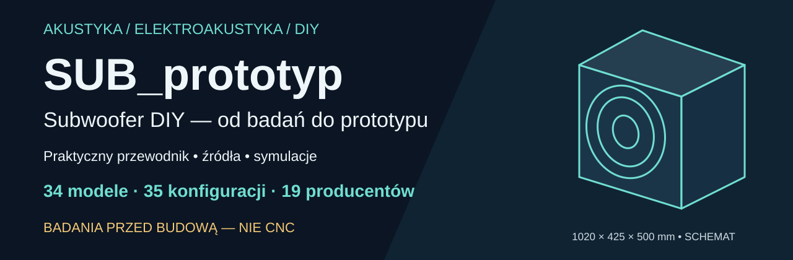

*Grafika przedstawia referencyjny projekt 1020 × 425 × 500 mm — schemat, **nie rysunek do CNC**. Historyczna obudowa 504 × 684 × 504 mm nie spełnia limitu głębokości.*

> **Aktualne wymaganie: maksymalnie 50 cm głębokości zewnętrznej.**
> Badamy płytszą skrzynię, którą można ustawić pionowo lub poziomo w zabudowie.
> Głośnik może być przesunięty; preferowany jest środek lewej lub prawej
> połowy frontu. Nowe wymiary i rozmieszczenie będą wynikiem obliczeń.

**40 modeli głośników · 41 konfiguracji podstawowych · 19 producentów · 114 raportów · Python/JavaScript**

Publiczny projekt dla osób, które chcą zrozumieć, co decyduje o dobrym basie. Aktualna pula obejmuje także dwa przypadki wstrzymane w nowym audycie źródeł (EMS i SUPRAVOX), a ponadto nie każda konfiguracja ma jeszcze pełny komplet badań nieliniowych i termicznych.
Porównujemy głośniki, liczymy obudowę i sprawdzamy, jak wpływają na nią
wypełnienie, wzmocnienia, klej, wzmacniacz i ustawienie w pokoju.
Celem jest **jedna docelowa konfiguracja głośników i jedna konstrukcja prototypu**
subwoofera zamkniętego z regulacją objętości. Szukamy możliwie
**najtańszego przetwornika spełniającego wszystkie wymagania jednocześnie**,
a nie „najlepszego głośnika w ogóle”. Koszt będzie kryterium końcowego
porównania, a dane cenowe obejmują obecnie tylko część modeli; nadal brakuje pełnego kosztorysu dwóch gotowych urządzeń.

> **Stan projektu: badania przed budową; P43 rozszerza porównanie o dwie membrany i układ izobaryczny.** Wykresy przedstawiają obliczenia i symulacje, nie pomiary gotowego prototypu. Nie ma jeszcze ostatecznego zwycięzcy ani projektu zatwierdzonego do CNC.

## Wybierz temat

| Interesuje Cię… | Zacznij tutaj |
|---|---|
| Głośnik do subwoofera | [Porównanie kandydatów, w tym STX i SB Acoustics](#glosniki) |
| Litry i materiał wewnątrz skrzyni | [Objętość i wypełnienie](#akustyka) |
| Bas w konkretnym pokoju | [Pomieszczenie i ustawienie](#pokoj) |
| Ścianki, wzmocnienia i klej | [Konstrukcja obudowy](#mechanika) |
| Zmienianie objętości jednej skrzyni | [Wkłady i ruchoma przegroda](#regulacja) |
| Korekcja cyfrowa i zapas poziomu | [Filtry DSP](#filtry) |
| Źródła, szczegóły i własne obliczenia | [Mapa raportów](#mapa) · [Kod i odtwarzanie](#odtwarzanie) |

Skróty wyjaśniamy w [krótkim słowniku](#slownik). **Najpierw poznaj wyłonienie Daytona spośród 40 kandydatów**, następnie przejdź do [praktycznego przewodnika](#praktyczny-przewodnik) i konstrukcji obudowy. Dopiero niżej znajdziesz [dodatkowe badania dwóch STX, innych wariantów i kosztów](#badania-alternatywne).

<a id="wykresy"></a>
<a id="glosniki"></a>
## Głośniki: porównanie w tych samych warunkach

### Jak spośród 40 kandydatów wyłoniliśmy Dayton RSS390HF-4?

**Najpierw wybór przetwornika, potem projekt dopasowanej obudowy.** W programie badań zebraliśmy **40 modeli głośników różnych producentów (19 producentów, 41 bazowych konfiguracji elektrycznych)**. Porównujemy ich parametry elektromechaniczne, charakterystyki basu i wymagane warunki pracy, wykonujemy obliczenia elektroakustyczne i symulacje fizyczne obejmujące wychylenie membrany, obciążenie elektryczne, ogrzewanie cewki i oddziaływanie zamkniętej komory.

**Aktualnym faworytem do budowy pierwszego prototypu jest Dayton Audio RSS390HF-4 (15″, 4 Ω)**. Wcześniejsze etapy 26, następnie 34 badanych modeli doprowadziły do tej rekomendacji; rozszerzenie puli do 40 kandydatów pozwala ją dalej krytycznie sprawdzać. To **kierunek badań konstrukcyjnych**, a nie ostateczny ranking jakości, ceny czy zmierzonego THD — nie wszystkie modele mają jeszcze pełne, porównywalne wyniki, a fizyczny prototyp nie został zbadany.

[Porównanie i odporność wyboru — 053](raporty/053_porownanie_i_odpornosc_rekomendacji.md) · [konfiguracja prototypu — 054](raporty/054_rekomendowana_konfiguracja_prototypu.md) · [audyt po rozszerzeniu badań B12-08](raporty/B12-08_audyt_wyboru_i_konstrukcja_pierwszego_C02.md).

### Który głośnik wybrać do pierwszego prototypu?

O wyborze decyduje kilka ograniczeń jednocześnie: **grzanie cewki**
(wzrost rezystancji i kompresja mocy), **powierzchnia membrany i użyteczne
wychylenie** (`Sd·Xmax` jako wskaźnik katalogowy, nie gwarancja liniowości),
**napięcie i prąd wzmacniacza**, objętość i całkowita głębokość obudowy
**do 500 mm**, wymagany zakres **20–40 Hz** oraz **nieliniowość
sprężyny powietrznej** w zamkniętej komorze. Trzeba badać ich wspólne
oddziaływanie, a nie ranking pojedynczego parametru. Celem jest wybór
najtańszego spośród wariantów spełniających zaakceptowane progi jakości
i wydajności; dopóki progi i ceny nie są ustalone, wybór jest warunkowy.

We wcześniejszym porównaniu **26 przetworników / 27 konfiguracji elektrycznych**
wstępnym faworytem został **Dayton Audio RSS390HF-4 (15″, 4 Ω)**.
Pula z 31.10.2026 (**34 modele / 35 konfiguracji elektrycznych**) została objęta
szerszą analizą przesiewową, ale nie wszystkie modele mają jeszcze kompletny
zestaw badań nieliniowości, termiki i kosztów.
W modelu osobnych sinusów 20–80 Hz, przy 120 l, napędzie 40 V RMS /
12 A RMS i założonym limicie strat miedzi 50 W, uzyskał najwyższe
minimum w badanej próbie stresowej. To wynik częściowej optymalizacji,
**bez kosztów zakupu i bez pomiarowego porównania THD**. Nie jest to
ranking zmierzonych zniekształceń ani prognoza poziomu w konkretnym pokoju.
Po uwzględnieniu ceny oraz pełnego zestawu kryteriów faworyt może się zmienić.

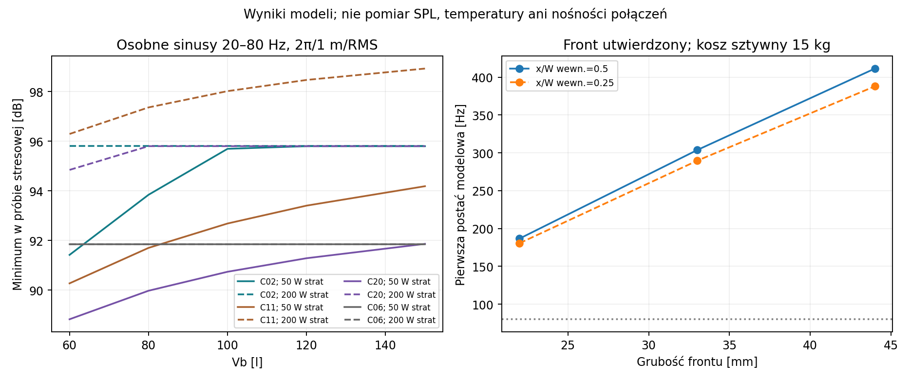

**Wybór jest warunkowy.** Przy modelowych limitach strat miedzi
27–86 W na siatce wygrywa C02, a przy 87–200 W — **RSS390HE-22 (C11)**.
To zakresy przyjętego modelu, a nie zmierzone dopuszczalne moce
poszczególnych produktów. STX W.32.800.8.FCX pozostaje wariantem
porównawczym 12″.

[Porównanie wariantów — 053](raporty/053_porownanie_i_odpornosc_rekomendacji.md)
· [projekt eksperymentu — 054](raporty/054_rekomendowana_konfiguracja_prototypu.md)
· [wrażliwość rekomendacji — 055](raporty/055_wrazliwosc_wyboru_i_margines_glebokosci.md).


## Praktyczny przewodnik — co projektujemy i co z tego wynika?

**Cel:** pierwszy prototyp zamkniętego subwoofera, docelowo **dwa urządzenia** do pokoju około **4,6 × 3,7 × 2,5 m**. Projektujemy dla miejsca odsłuchu, a nie maksymalnej mocy na etykiecie. Na razie niczego nie zamawiamy ani nie frezujemy.

### 1. Wybór przetwornika — od którego głośnika zaczynamy?

Najpierw porównujemy **przetworniki** pod kątem możliwości czystego odtwarzania 20–40 Hz, wychylenia, zapasu napięcia/prądu, termiki, THD/IMD i kosztów. Sama średnica, moc znamionowa czy niska częstotliwość rezonansowa Fs nie rozstrzygają wyboru. Dopiero po ocenie głośnika projektujemy konkretną obudowę.

| Kandydat | Dotychczasowy wniosek | Warunek ostatecznego wyboru |
|---|---|---|
| **Dayton Audio RSS390HF-4 (C02)** | Wstępny faworyt dla części limitów cieplnych i napędu | THD/IMD, realna termika, zapas 20–40 Hz i łączny koszt |
| **Dayton RSS390HE-22 (C11)** | Może uzyskać przewagę przy innym limicie strat | Bezpośredni test tych samych warunków |
| **STX W.32.800.8.FCX (C06)** | Istotny kandydat porównawczy 12″ | Wychylenie i SPL w docelowym pokoju |
| **Pozostałe modele, w tym SB Acoustics** | Pozostają w szerokiej puli badań | Ujednolicenie danych i warunków porównania |

**Decyzja:** RSS390HF-4 jest nadal *faworytem warunkowym*, nie ogłoszonym zwycięzcą. Samo kryterium „najtańszy głośnik” nie zastępuje jakości i wymagań. [Porównanie wszystkich kandydatów](#glosniki) · [Wymagania](WYMAGANIA.md).

### 2. Badania akustyczne i dobór konstrukcji obudowy

Dla badanych przetworników sprawdzamy kolejno typ obudowy, potrzebny litraż, poziom i zniekształcenia basu, a następnie projektujemy gabaryty, tłumienie i wręgi. **Model bazowy** dla Daytona przedstawia poniższa tabela; nie jest to jeszcze zatwierdzony projekt do wykonania.

| Część konstrukcji | Obecnie analizowany wariant | Co musi zostać zweryfikowane |
|---|---|---|
| Korpus | **1020 × 425 × 500 mm** (szer. × gł. × wys.) | Całe urządzenie z grillem, terminalem i przewodami musi mieć **maksymalnie 500 mm głębokości** |
| Objętość | Trzy nastawy ok. **100 / 120 / 150 l netto**, punkt bazowy 120 l | Rzeczywista wyporność, szczelność i dostęp do wkładów |
| Materiały | Roboczo MDF **22 mm**, front laminowany **44 mm**, wkłady MDF **8 mm** | Badania i dobór materiału *każdej* części |
| Usztywnienia | Wręgi i lokalne elementy w modelu P30E | Sztywność, połączenia, drgania, przejścia montażowe |
| Tłumienie | Mata poliestrowa **50 mm** przy tylnej ściance | Parametry faktycznego materiału i bezpieczne mocowanie |
| Napęd i sterowanie | Zewnętrzny moduł klasy D i DSP | Zasilacz, chłodzenie, zabezpieczenia i co najmniej osiem wyjść DSP docelowo |

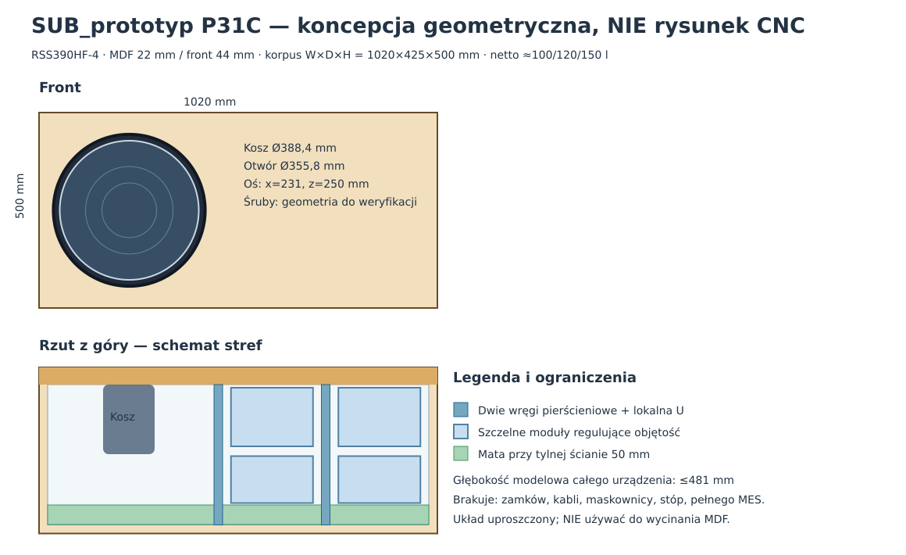

**Po co trzy litraże?** Zmiana pojemności zmienia sprężystość powietrza i pracę membrany. Wyniki P30E: **100,12 / 119,92 / 150,16 l** to wartości nominalne modelu; różne nastawy nie są automatycznie trzema prawidłowymi rozwiązaniami akustycznymi. [P30E](raporty/078_P30E_mata50_montaz_robustnosc.md) · [Regulacja](#regulacja).

**K18 — rzeczywisty krok do CNC:** przygotowano [162 kontury kontrolne](dokumentacja/cnc/README.md), pełne zestawienie płyt i 24 referencyjne gniazda prowadnic. Modele wykazują, że sztywne górne języki K17 nadal nie zapewniają sprawdzonej drogi montażu. [Obliczenia i rekomendacje K18](raporty/K18_projekt_CNC_mocowania_wkladow.md). **DXF to przegląd geometrii, nie zlecenie frezowania (CNC HOLD).**

**K19 — korekta mechaniki przed CNC:** niezależny audyt obliczył rzeczywiste maksymalne wysięgi języków prowadnic w modelu K17: **12 / 19 / 23 mm**. Wcześniejszy test K18 zakładał wszędzie 12 mm, przez co mógł zaniżać obciążenia zginające tylnych podpór. Odtworzono niezależnie 162 kontury DXF i 24 gniazda oraz udokumentowano niezakończone testy montażu i tolerancji. [K19 — raport i wyniki](raporty/K19_audyt_CNC_i_korekta_wysiegu_wspornikow.md). **CNC HOLD.**

**K20 — rozbieralne zabezpieczenia wkładów:** wariant 12 stałych prowadnic, 40 dolnych podpór i **40 zdejmowanych górnych zabezpieczeń**. Weryfikacja statycznej geometrii nie ujawniła kolizji z K15/K17, ale **nie istnieje jeszcze realne zakotwienie ani udowodniona droga montażu 20 wkładów**. Osiem proponowanych kieszeni K18 otwiera się na przednią krawędź płyty. [Raport K20](raporty/K20_serwisowe_rygle_i_analiza_montazu.md) · [Model OpenSCAD K20](dokumentacja/K20_p30e_rozbieralne_zabezpieczenia_NIE_CNC.scad). **K18 DXF pozostają bez dopuszczenia CNC.**

**K21 — kluczowa blokada montażu prowadnic:** osiem pełnowysokościowych tylnych prowadnic pozostawia przejście X najwyżej **130 mm**. Analiza niezbędnego przekroju dowodzi, że **żaden z 12 tylnych wkładów o szerokości 180/210 mm nie przejdzie przy ruchu bez obracania**; dla 8 tylnych dużych wkładów nawet obrót w poziomie z umownym 6-mm luzem z każdej strony nie wystarcza. Nie jest to dowód niemożliwości dowolnego obrotu 3D. [Raport K21](raporty/K21_przesmyk_i_weryfikacja_montazu_wkladow.md) · [schemat przesmyku](wyniki/k21_przesmyk_prowadnic_NIE_CNC.svg). **Obecnego układu K17–K20 nie wolno wysyłać do CNC.**

**K22 — kierunek naprawy gardzieli montażowej:** warunkowe czasowe usunięcie jednej tylnej prowadnicy otwiera w modelu korytarz o szerokości **259 mm**, wystarczający w rzucie X dla wkładu 210 mm + 2×6 mm. Dwa segmenty prowadnicy po 228 mm mogą osobno zmieścić się w rzucie otworu Ø355,8 mm, ale **nie zaprojektowano nośnego złącza i nie sprawdzono drogi montażowej 3D**. [Raport K22](raporty/K22_dzielona_prowadnica_i_przejscie_montazowe.md) · [schemat](wyniki/k22_wariant_szyny_dzielonej_NIE_CNC.svg). **Bez zgody na produkcję CNC.**

**K23 — kontrola ciągłych tras montażu:** w badanym wariancie ze zdjętą jedną prowadnicą **12/20** wkładów przechodzi wyznaczone trasy przy 36 stałych dolnych półkach; **20/20** w jednej sekwencji przy chwilowym braku tych półek — lecz **nie ma jeszcze projektu ich bezpiecznego zamocowania po wsunięciu wkładów**. Pożądana regulacja 150→120→100 l nie działa na sprawdzonych trasach, podobnie jak wyjmowanie małych tylnych wkładów z pełnej konfiguracji. Przesuw przednich wkładów ma nominalnie maksymalnie **2 mm luzu na stronę**. [Raport K23](raporty/K23_analiza_ruchu_wkladow_i_regulacji.md) · [schemat](wyniki/k23_trasa_montazu_modulu_14_NIE_CNC.svg). **CNC HOLD.**

**K24 — ważna korekta projektu regulacji:** pod 16 dużymi wkładami zostaje tylko **6–8 mm** wolnego miejsca po uwzględnieniu starej 4-mm półki. Wstępny test otworu Ø4,5 mm w prowadnicach o głębokości 8/12 mm nie spełnia konserwatywnego warunku brzegowego. Co ważniejsze, przeszukanie wszystkich dopuszczalnych przesunięć XYZ (bez obracania) wykazało, że czterech małych tylnych wkładów **nie da się wyjąć przy pozostawieniu 12 dużych stanu 120 l** — nawet bez półek i jedną prowadnicą mniej. Dokładne 19,8 l zmiany przy obecnych wymiarach wymaga wyjęcia tych czterech wkładów. [Raport K24](raporty/K24_dostep_serwisowy_i_przestrzen_translacji.md). **Obecną architekturę trzeba przeprojektować, CNC HOLD.**

**K24 — droga do realnej regulacji 100/120/150 l:** rozszerzone przeszukiwanie przestrzenne wykazało w **idealnym modelu bez mocowań** sekwencję 8 wyjmowanych wkładów dla 100→120 l po tymczasowym zwolnieniu prowadnicy **02**, a następnie 11 dla 120→150 l po zwolnieniu prowadnicy **10**. Oba przejścia są blokowane przy wszystkich prowadnicach na miejscu. Nie potwierdza to bezpieczeństwa: obecnie brak podtrzymania wkładów podczas zwalniania prowadnic, nośnych złączy, rygli, tolerancji i dostępu narzędzi. [Raport K24](raporty/K24_dwuetapowa_regulacja_i_mocowania_nośne.md) · [schemat](wyniki/k24_dwie_fazy_regulacji_NIE_CNC.svg). **CNC HOLD.**

### 3. Badania materiałów, ścian, wręg i połączeń

Najpierw sprawdzamy **sztywność i masę ścian, wręg oraz frontu**, a także materiał i trwałość klejów. Nie zakładamy, że dodatkowy MDF lub metalowy pierścień zawsze są lepsze niż prawidłowo zaprojektowane wzmocnienie. W K10 utworzono **paszporty materiałowe 35 części**. K11 porównuje przy niezmienionym obrysie: ściany MDF25 zmniejszają modelową *geometryczną objętość wnętrza brutto* o **4,381 l** względem MDF22; sklejka brzozowa21 ją zwiększa o **1,478 l**. **Nie są to jeszcze zmiany pojemności netto ani wyniki całego MES**.

**Praktycznie:** rodzaj płyty wybieramy wspólnie z geometrią wręg i spoin, a nie według samego modułu E. Brakuje fizycznej kwalifikacji spoin oraz klocków przykręcających kosz. [P36 – sztywność MDF](raporty/091_P36A_grubosc_MDF_podatnosc_i_wregi.md) · [K10 – materiały 35 części](raporty/K10_paszport_materialowy_wszystkich_czesci.md) · [K11 – warianty ścian](raporty/K11_realne_wkladki_pasy_drewna_i_materialy_scian.md).

### 4. Dopiero po projekcie skrzyni — mocowanie głośnika i dobór śrub

Dla wybranego przetwornika wracamy do rysunku kosza. Dayton podaje **8 otworów Ø6,5 mm w metalowym kołnierzu**, rozmieszczonych na **PCD Ø368 mm**, oraz wymagane wycięcie **Ø355,8 mm**. Te liczby wyznaczają położenia osi, ale **nie średnicę wiercenia w MDF ani otworu pod metalową wkładkę w klocku**.

| Gdzie jest otwór? | Z jakiego wymiaru korzystamy? | Znaczenie |
|---|---|---|
| **W koszu głośnika** | Fabryczne **Ø6,5 mm** | Jedynie zgodność trzpienia i łba z metalowym kołnierzem |
| **W froncie MDF44** | Średnica przelotowa **pod wybraną śrubę**: przykładowo M4 → Ø4,5; M5 → Ø5,5; M6 → Ø6,6 mm | Dobór jest warunkowy; wynika z trzpienia, luzu i tolerancji, **nie z Ø6,5 kosza** |
| **W klocku za frontem** | Średnica otworu wstępnego pod wkładkę **zależna także od materiału klocka**: np. RAMPA SKD30 M5 → Ø9 mm w MDF, ale **Ø8 mm w drewnie twardym** według odrębnych kart producenta | Osobny otwór do osadzenia wkładki; nie jest przelotem śruby przez front, a karta nie kwalifikuje jeszcze naszej klejonki |

[Karta RAMPA dla MDF](https://www.rampa.com/media/e2/ed/d4/1699524202/RAMPA_Produktdatenblatt_MDF-EN.pdf) i [osobna karta dla drewna twardego](https://www.rampa.com/media/7e/76/df/1699524009/RAMPA_Produktdatenblatt_Laubholz-Hardwood_EN.pdf) mają różne zalecenia dla M5; ostateczny otwór wymaga sprawdzenia gatunku, gęstości i odległości od krawędzi.

Na przykład **M5 z umownym otworem przelotowym Ø5,5 mm we froncie** pozostawia nominalnie `6,1 − 2,75 = 3,35 mm` drewna między otworem a wycięciem — **nie 2,85 mm**, które wyliczono tylko dla hipotetycznego wiercenia Ø6,5 mm także w MDF. Wkładka Ø10 mm ma jednak inną, osobną geometrię za frontem i może kolidować z klockiem. Średnice otworów frontu są **wariantami do dalszego wymiarowania**, a nie dyspozycją CNC.


*Źródło: **Dayton Audio**, [kompletny rysunek producenta z widokiem tylnego kosza](https://www.daytonaudio.com/images/resources/295-468-dayton-audio-rss390hf-4-specifications-46176.pdf), [reprodukcja Speaker&Co](https://www.speakerenco.nl/dayton-rss390hf-4). To nie jest nasz prototyp. Wartości otworów pod śruby i pod wkładki opisano osobno na podstawie wybranego osprzętu. [K11 – tabela wkładek](raporty/K11_realne_wkladki_pasy_drewna_i_materialy_scian.md).*

### 4a. Jak przejść od kosza do rzeczywistego mocowania?

Najpierw ustalamy średnicę i typ **śruby**, potem średnicę przelotu przez MDF, a osobno sposób jej zakotwienia. [Francis](dokumentacja/inspiracje_zewnetrznych_konstruktorow_mocowanie_RSS390HF4.md) stosował w RSS390HF-4 wkładki gwintowane w doklejonych klockach; to **pierwszy wariant do prób**, a nie zatwierdzony projekt.

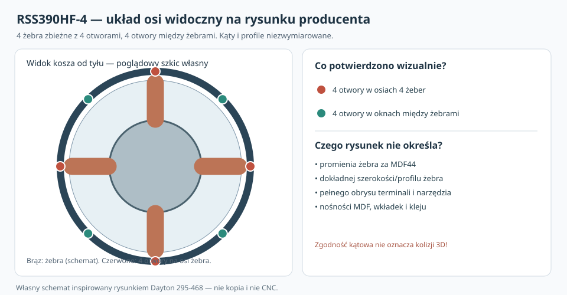

**K03:** oś mocowania jest tylko **6,1 mm** od wycięcia; każdy **klocek** musi przenieść obciążenie przez klej, ale jego nośności nie ocenia się z samego prześwitu. [K03](raporty/K03_wezel_mocowania_waski_pas_MDF_i_sciezka_sily.md).

**K11:** w niezmienionym klocku K01 promień otworu wkładki Ø10 mm (typ M5 RAMPA) zostawia nominalnie tylko **0,1 mm** do jego wewnętrznej krawędzi. Wkładka Ø12 mm (typ M6) wystaje poza nią o **0,9 mm**. To nie są średnice otworów przelotowych MDF. Sam mocniejszy gatunek drewna nie naprawia tego ograniczenia. [K11](raporty/K11_realne_wkladki_pasy_drewna_i_materialy_scian.md).

**K02–K07:** w symulacji wkładania samych klocków 20 mm osiągnięto **20/20 modułów**; dla większej, zastępczej obwiedni mocowań K04/K07 planer zatrzymuje się na **ID16** przed 100 l. Dostęp sondy K06 nie jest dowodem dostępu prawdziwego narzędzia. [K02](raporty/K02_przejscie_20_modulow_obok_8_mocowan.md) · [K04](raporty/K04_pelne_gabaryty_nakretki_podkladki_i_montaz_20_modulow.md) · [Raport K05](raporty/K05_etapowanie_20_modulow_i_dostep_do_mocowan.md) · [K06](raporty/K06_dostep_do_8_mocowan_po_20_wkladach.md) · [K07](raporty/K07_serwis_wkladow_i_audyt_mocowan.md).

[K13 – stalowa płytka M5](raporty/K13_plytka_stalowa_M5_w_klocku20.md).

**Co dalej?** Sprawdzić konkretny osprzęt, prześwity przy ośmiu punktach, przenoszenie sił przez front i klej, próby wyrwania i cykli demontażu. Nic nie zostało zakwalifikowane do wykonania — **CNC HOLD**.

### 5. Co oznaczają wykresy DSP i temperatury?

Przyjęte **40 V RMS / 12 A RMS** to założenia symulacji, **nie parametry zakupionego wzmacniacza**. Model ogranicznika może ujawnić ryzyko wychylenia, grzania i przesterowania, ale nie jest jeszcze sprawdzonym presetem. Potrzebny jest fizyczny napęd, zasilanie, chłodzenie i walidacja zabezpieczeń. [Filtry](#filtry) · [Ochrona](#ochrona).

### 6. Co pokaże pokój, a czego nie odczytamy z wykresu modów?

Przybliżone wymiary pomieszczenia pozwalają wyliczyć częstotliwości *idealnych modów osiowych*. Nie mówią, jak silny będzie rezonans ani jak długo zaniknie w konkretnym punkcie. Ostateczne ustawienie **dwóch subwooferów** będzie wymagało pomiarów po budowie.

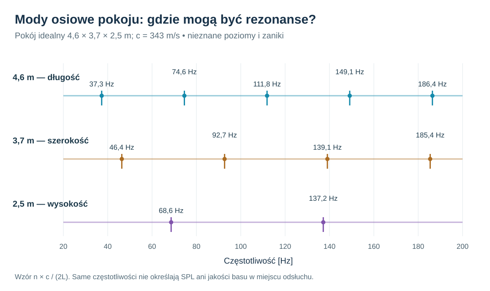

*Każdy wiersz pokazuje inną oś pokoju. Pionowe znaczniki to częstotliwości, **nie amplitudy i nie prognoza jakości basu**. [Przejdź do akustyki pokoju](#pokoj).*

### 7. Lista kontroli przed frezowaniem i pierwszym uruchomieniem

- [ ] **Głębokość:** całe urządzenie z osprzętem nie przekracza **500 mm** w docelowym ustawieniu.
- [ ] **Kosz:** wszystkie osiem mocowań, zaciski, śruby, narzędzia i wręgi mają zweryfikowane prześwity oraz wytrzymałość.
- [ ] **Netto:** objętość dla 100/120/150 l zawiera faktyczne wyporności, a wkłady dają się zamontować, uszczelnić i wyjąć.
- [ ] **Materiały każdej części:** [paszport K10 — 35 pozycji](raporty/K10_paszport_materialowy_wszystkich_czesci.md) ma zweryfikowane karty, mechanikę, masę, szczelność i wytrzymałość połączeń; nie przyjęto hipotetycznej sztywności za pomiar.
- [ ] **Model:** wyniki MES są wolne od problemu *hourglass* P33B i dotyczą aktualnego CAD; akustyka uwzględnia rzeczywistą pozycję źródła.
- [ ] **Elektronika:** dobrano zasilanie, moduł klasy D, chłodzenie i sprawdzono zabezpieczenia DSP.
- [ ] **Odbiór:** istnieje plan pomiarów impedancji, szczelności, wychylenia, drgań paneli, THD/IMD i odpowiedzi w pokoju.

**Bramka CNC nadal zamknięta.** [Pełny plan weryfikacji](dokumentacja/P35_plan_walidacji_przed_CNC.md).

### Jak czytać szczegółowe wyniki?

Dla każdego wykresu sprawdzaj kolejno: **co obliczono**, **co to zmienia w projekcie** i **czego jeszcze nie potwierdzono**. Historyczne modele pozostają dostępne dla kontroli rozwoju badań, ale nie mogą być podstawą wykonania konstrukcji, jeśli wykryto w nich błąd. [Mapa raportów i kod](#mapa).

---
<details>
<summary><strong>Rozwiń szczegółowe badania konstrukcyjne P38–P42 (rysunki i historia decyzji)</strong></summary>

> **Ważne:** P38B wykrył przesunięcie źródła względem wnętrza o 22 mm w obu osiach. Nie traktuj starszych map P34B/P35A jako aktualnych. Warianty mocowań nie są dopuszczone do CNC.

## Konstrukcja w obrazach — od pomysłu do sprawdzalnego prototypu

**Zamiast od razu ciąć płyty, najpierw pytamy: czy skrzynia się zmieści, czy da się ją zmontować i czy nie będzie sama grała?** Poniższe ilustracje pokazują etapy symulacji. Kliknięcie obrazu otwiera źródło z wyjaśnieniem. **Żadna ilustracja nie jest dokumentacją CNC** — obciążenia, materiały i wybrane uproszczenia są wyraźnie opisane w raportach.

### 1. Najpierw ustawiamy wymiary i litraż


*Obecny kierunek: zamknięta obudowa 1020 × 425 × 500 mm, tylna mata 50 mm i regulacja około 100 / 120 / 150 l. To **schemat koncepcyjny** — brakuje rzeczywistych śrub, zamków, stopek i maskownicy. [Dlaczego ten wariant?](raporty/078_P30E_mata50_montaz_robustnosc.md)*

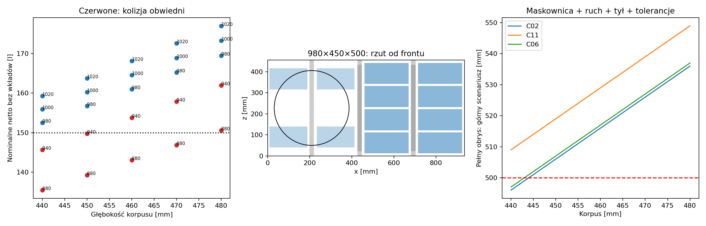

*Symulacja starszego wariantu P20D pozwoliła opracować sposób badania dojścia modułów przez otwór po głośniku. Dla nowego P30E sprawdzono obwiednię przejścia do 6 mm, lecz montaż narzędziem wciąż nie jest zatwierdzony. [Raport geometrii](raporty/057_P20D_geometria_dostep_i_pelna_glebokosc.md).*

### 2. Jak wzmocnienia zmieniają zachowanie ścian?

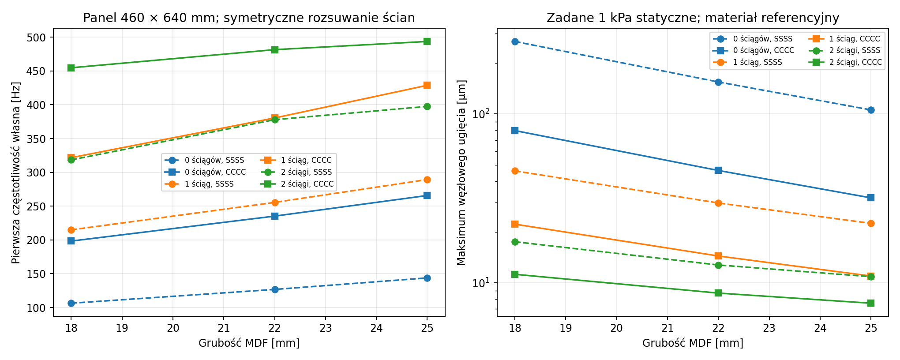

*Grubsza płyta może pomóc, ale kosztuje więcej i zwiększa masę. O skuteczności decydują również podpory i sposób ich połączenia. [Omówienie badań paneli](raporty/059_podatne_wregi_i_panele.md).*

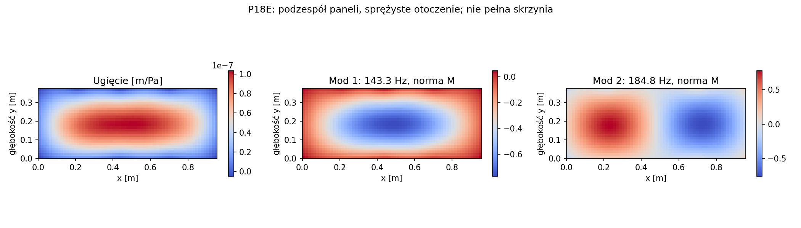

*To nie fotografia rzeczywistej ścianki, lecz model mechaniczny. Pokazuje, dlaczego idealne unieruchomienie wręgi może dawać zbyt optymistyczny wynik. Dla nowego korpusu przeprowadzono osobną analizę P31B.*

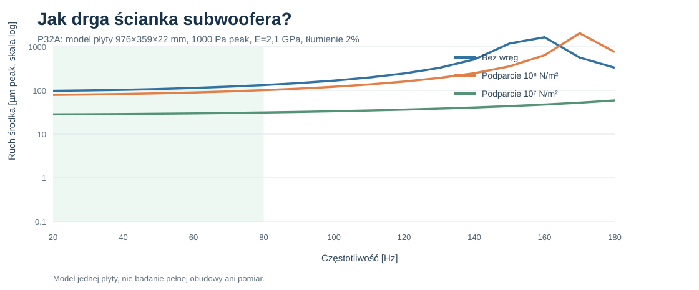

*Nowy przebieg wymuszenia 20–180 Hz na poprawnie zwymiarowanej płycie. Ważny jest nie tylko rezonans, lecz **amplituda ruchu** przy danej częstotliwości. Zasymulowano ciśnienie 1000 Pa peak i hipotetyczne tłumienie; nie jest to pełny MES obudowy. [Raport 082](raporty/082_P32A_dynamika_panelu_wreg_i_tlumienia.md).*

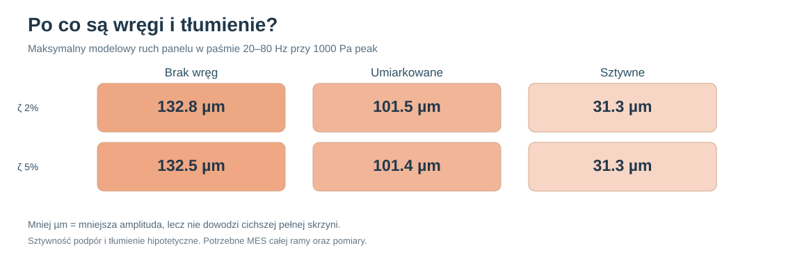

*Dlaczego wzmocnienie nie jest po prostu „mocniejsze/słabsze”? Odpowiedź zależy jednocześnie od podatności podparcia i tłumienia materiału. [Kod badania](skrypty/p32a_dynamika_panelu.js).*

### 3. Front, mocowanie głośnika i trwałość połączeń

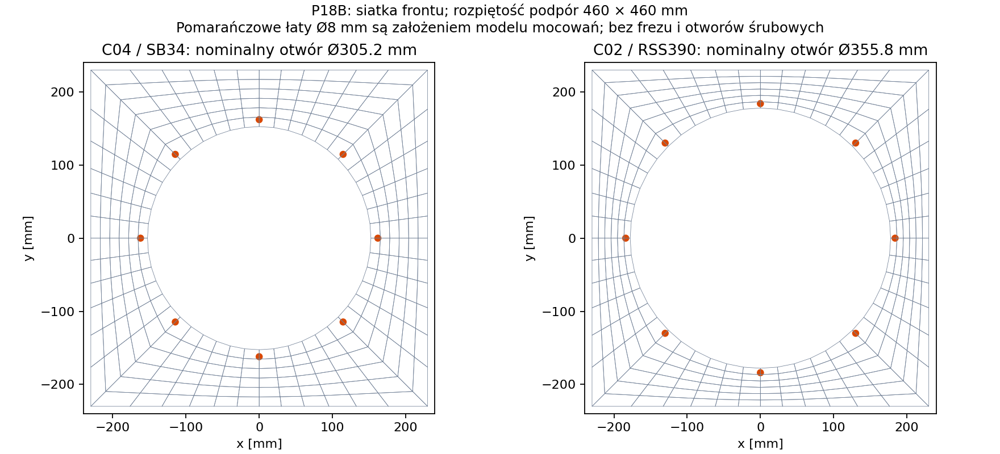

*Wycięcie dużego otworu osłabia front; rama musi przenosić ciężar kosza oraz siły okresowe. Przed wykonaniem potrzebny jest dokładny szablon rzeczywistego głośnika.*

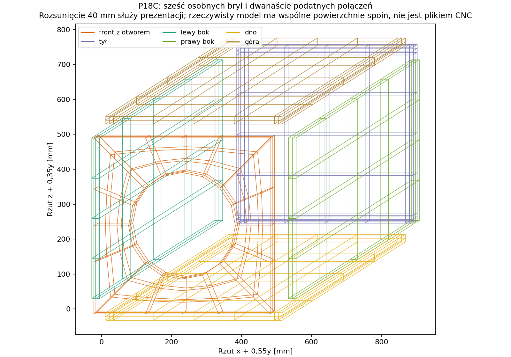

*Model całej ramy pozwala wyszukiwać słabe miejsca i kierunki pracy spoin. Po zmianie geometrii na 1020 × 425 mm wymaga ponownego przeliczenia.*

### 3a. Co się zmienia, gdy liczymy całą skrzynię jednocześnie?

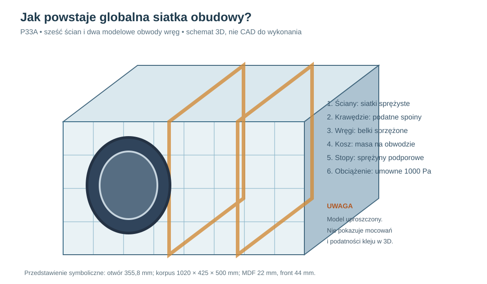

*Połączono w jednym modelu sześć ścian, naroża, dwa obwody wręg, otwór frontowy, masę kosza i wkładów. **To uproszczony model energetyczny**, a nie jeszcze poprawny pełny MES powłokowy. [Raport 083](raporty/083_P33A_globalna_siatka_obudowy_i_spoin.md).*

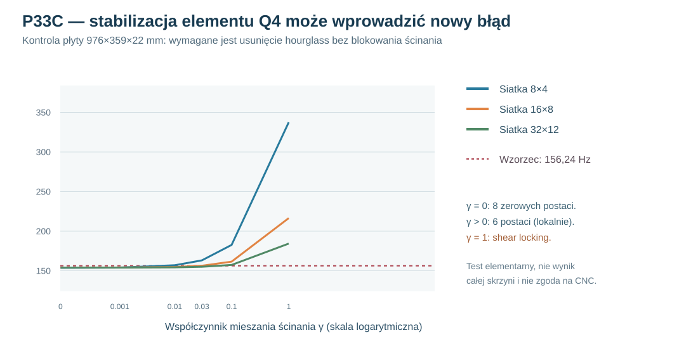

*Dlaczego w obliczeniach konstrukcji równie ważny jak liczba elementów jest ich rodzaj? Model ze zbyt słabą stabilizacją ma dodatkowe mechanizmy zerowe, a model ze zbyt silną bywa sztucznie sztywny. **Żaden z tych wariantów nie zastępuje pomiaru.** [Raport 085](raporty/085_P33C_audyt_hourglass_elementu_Q4.md).*

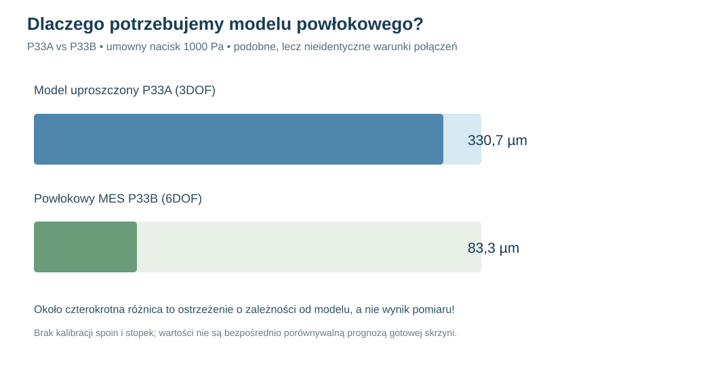

**ARCHIWALNY WYNIK — NIE UŻYWAĆ DO PROJEKTOWANIA.** W P33C wykryto dwa sztuczne mechanizmy *hourglass* elementu P33B. Wykres ilustruje problem numeryczny; nie wyznacza wiarygodnych ugięć ani częstotliwości skrzyni. [Raport 084 — archiwalny](raporty/084_P33B_globalny_MES_powlokowy_Q4.md) · [sprostowanie P33C](raporty/085_P33C_audyt_hourglass_elementu_Q4.md).

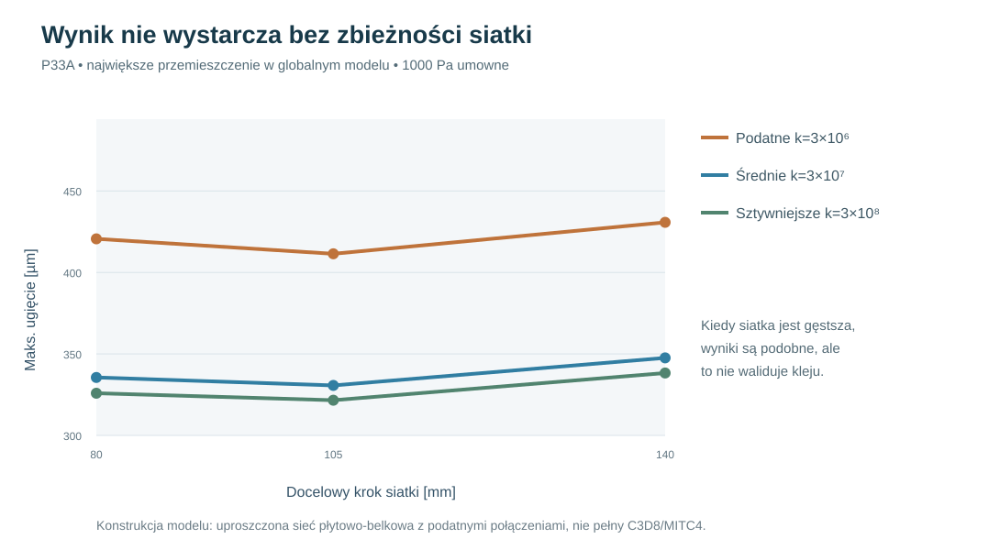

*Im sztywniejsze przyjęte naroża, tym mniejsze ugięcie w tym modelu. Sprawdzono trzy rozmiary siatki i trzy sztywności połączeń, ale nie zmierzono rzeczywistych własności spoin. **Nie jest to zatwierdzenie do CNC**. [Kod do odtworzenia](skrypty/p33a_global_shell_network.py).*

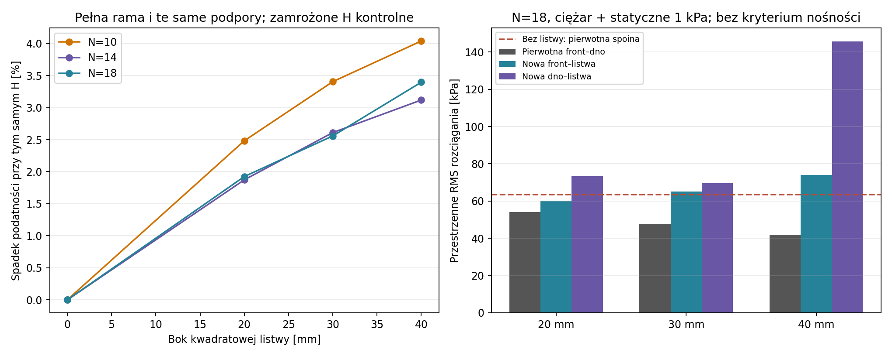

*Usztywnienie może zmniejszyć ugięcie, jednocześnie przenosząc obciążenie na inny fragment połączenia. [Badania spoin](raporty/030_P19A_obliczenia_spoin_i_material_kleju.md).*

### 4. Wkłady i powietrze wewnątrz skrzyni

### 4b. Liczymy już rzeczywiste rozmieszczenie przeszkód, nie tylko pusty prostopadłościan

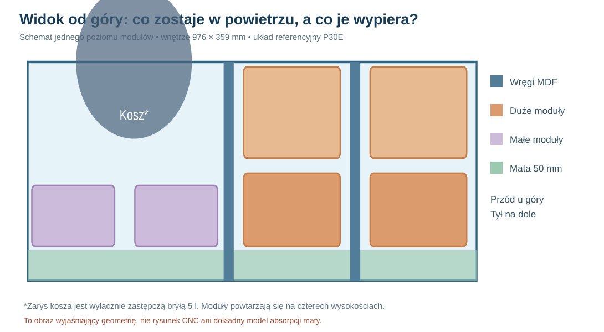

**ARCHIWALNY SCHEMAT P34B:** pokazuje rozmieszczenie przeszkód, a nie geometrię do CNC. Po audycie P38B ujawniono przesunięcie źródła o 22 mm w obu osiach. Nie przenosić wyniku na obecny model. [Raport 087](raporty/087_P34B_przestrzenne_cisnienie_100_120_150.md) · [audyt 097](raporty/097_P38B_audyt_wspolrzednych_FV.md).

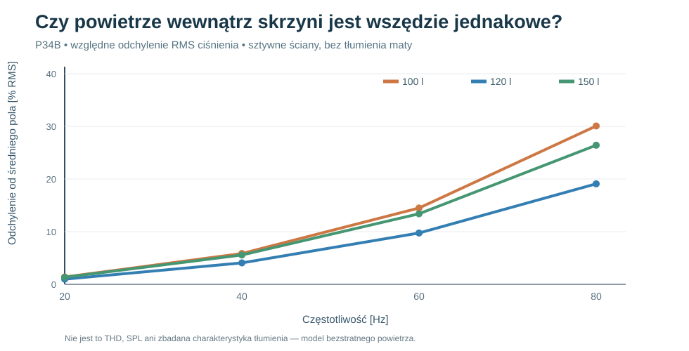

**ARCHIWALNE DANE P34B:** mapa względnego ciśnienia została policzona w starszym układzie źródła i nie jest wynikiem dla bieżącej geometrii. Nie opisuje THD, SPL ani tłumienia maty. [Dane historyczne](wyniki/p34b_przestrzenne_pole_p30e_20261031.json) · [ponowne obliczenia P39A](raporty/098_P39A_naciski_scian_korekta_FV.md).

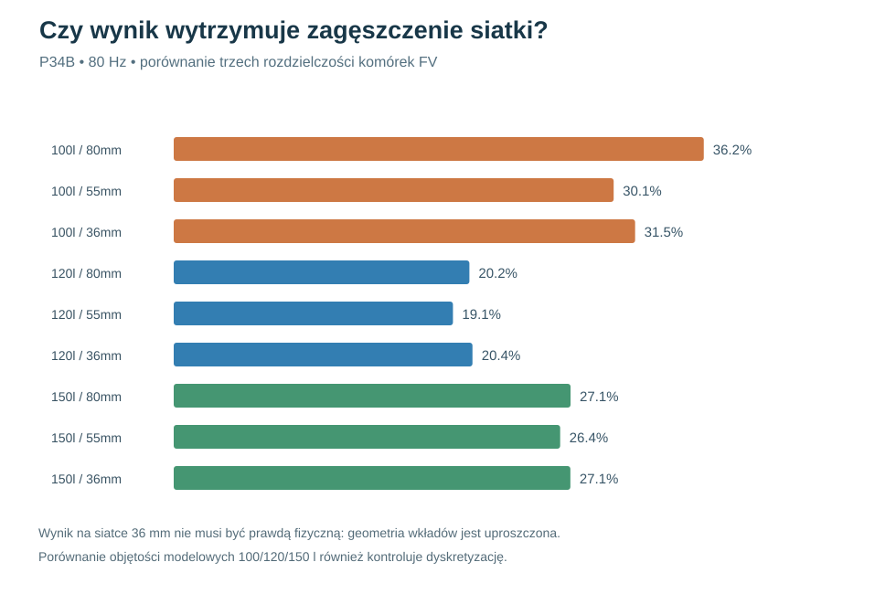

**KONTROLA SIATKI W ARCHIWALNYM MODELU P34B:** zagęszczenie komórek nie usuwa błędu współrzędnych. Zachowujemy wykres dla zrozumienia metody, a nie jako potwierdzenie nowej konstrukcji. [Historyczny kod](skrypty/p34b_przestrzenne_pole_p30e.js) · [korekta P38B](raporty/097_P38B_audyt_wspolrzednych_FV.md).

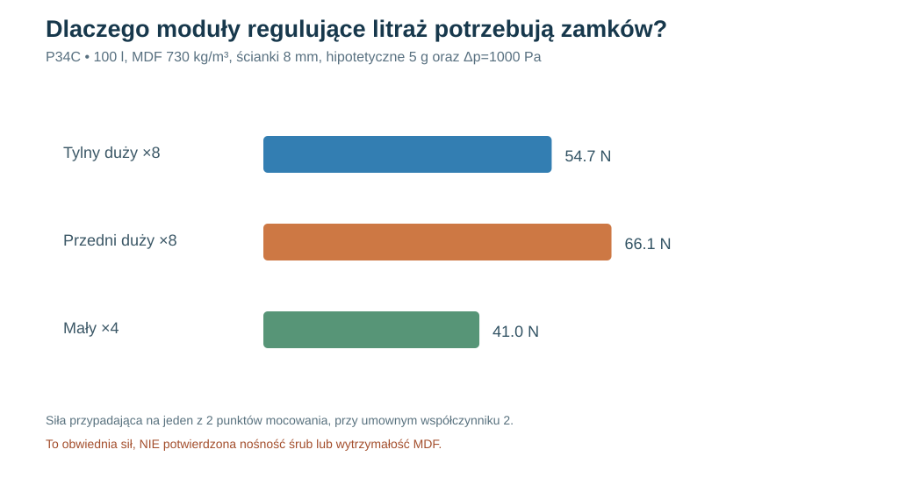

*Wyjmowane wkłady muszą mieć dodatnią blokadę mechaniczną. Liczby pokazują umowne obciążenia mocowań przy przyspieszeniu i różnicy ciśnienia; **nie zastępują prób wyrywania śrub ani zmęczenia MDF**. [Raport 088](raporty/088_P34C_obciazenia_i_blokowanie_wkladow.md).*


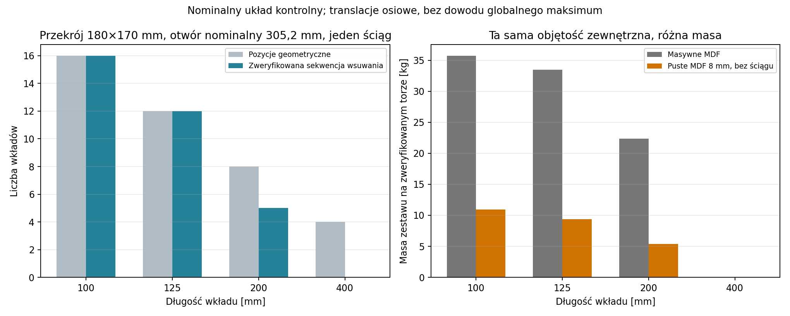

*Regulacja litrażu ma sens tylko wtedy, gdy wkłady można faktycznie włożyć, bezpiecznie zamocować i wyjąć. Ich masa i szczelność są częścią konstrukcji.*

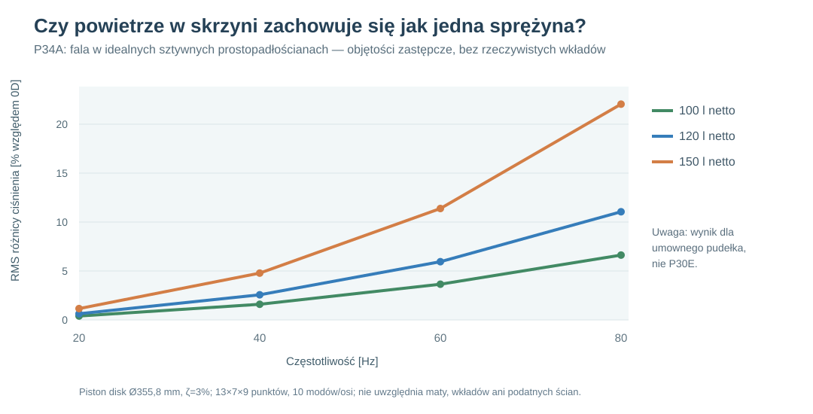

*Model sztywnej komory pokazuje, jak nawet poniżej pierwszej fali stojącej lokalne ciśnienie może odróżniać się od prostego modelu T/S. Zbadano 90 przypadków dla trzech objętości. **To prostopadłościany zastępcze, nie rzeczywiste wkłady P30E.** [Raport 086](raporty/086_P34A_gaz_3D_komora_zastepcza_i_niejednorodnosc.md).*

> **P21G — brak dowodów do weryfikacji:** w obecnym repo nie ma raportu 066, skryptu, JSON ani rysunku. Nie można więc traktować tej kampanii jako potwierdzonej. Dostępne częściowe modele: [P21D](raporty/060_P21D_wspolna_geometria_i_port_napedu.md), [P21E](raporty/064_P21E_gaz_podatne_sciany_i_naped.md), [P21F](raporty/065_P21F_wielomody_gazu_i_scian.md).

### 4c. Jak przekazać ciśnienie ze skrzyni do obliczeń jej ścian?

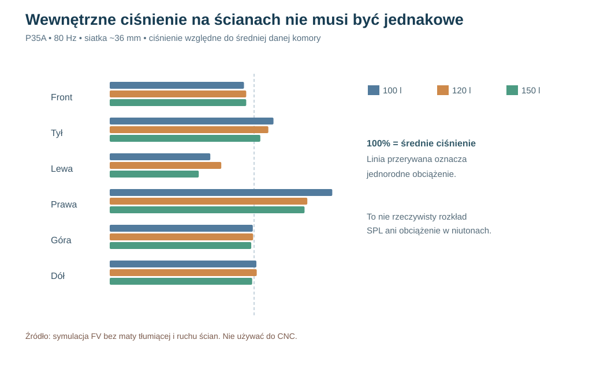

**ARCHIWALNA MAPA P35A (błąd położenia źródła wykryty w P38B):** wartości względne służą jedynie za przykład metody. Do interpretacji bieżącej geometrii używaj poprawionego [P39A, raport 098](raporty/098_P39A_naciski_scian_korekta_FV.md). To nie są zmierzone siły ani SPL.

### 4d. Kontrola jakości MES: nie tylko liczba w hercach

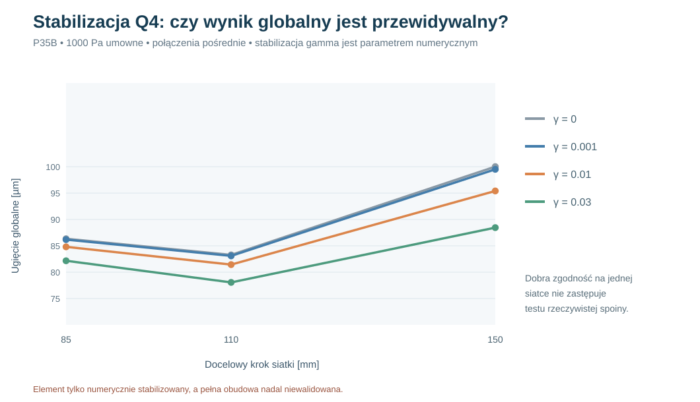

*Audyt P33C ujawnił sztuczne drgania pojedynczego elementu Q4. Powtórzyliśmy 16 symulacji całej skrzyni po dodaniu różnych wariantów stabilizacji. Problem lokalny można ograniczyć numerycznie, ale **nie da się jeszcze uznać konstrukcji za zweryfikowaną** bez dobrego opisu spoin i pełnej geometrii. [Raport 090](raporty/090_P35B_globalna_stabilizacja_hourglass.md).*

**Co dalej?** Pełny CAD kosza, sprawdzenie mocowań, przestrzenna akustyka 100/120/150 l z aktualnym źródłem i podatnością ścian, a potem pomiary pierwszej sztuki. [Bramki przed CNC](dokumentacja/P35_plan_walidacji_przed_CNC.md) · [najnowszy raport 108](raporty/108_P42C_laczniki_i_koncepcje_3D.md).

---

<a id="akustyka"></a>
## Objętość i wypełnienie: więcej litrów nie rozwiązuje wszystkiego

Większa skrzynia zmienia obciążenie membrany, ale nie zwiększa jej własnego
zapasu ruchu. Trzeba sprawdzić równocześnie ruch, napięcie, prąd i chłodzenie.
Na wykresie niżej szukamy objętości pasujących do sześciu osobnych sinusów
20–80 Hz. Przykład używa 90 dB RMS, 4π / 1 m i 40 V / 12 A oraz założonych
warunków chłodzenia. To cel obliczenia, nie zatwierdzone kryterium projektowe
lub wynik w pokoju.

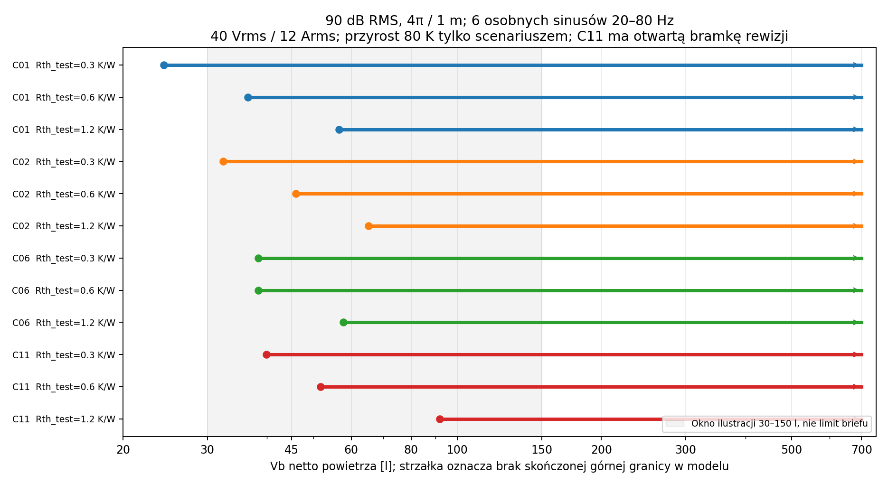

[Raport 028: wspólne ograniczenia objętości i napędu](raporty/028_P17_synteza_napedu_objetosci_i_ciepla.md).

**Ilość wypełnienia też jest liczona.** Przykładowe wyklejenie pięciu ścian
warstwą 50 mm waży około 1,18 kg przy założonej gęstości 20 kg/m³.
Dotyczy to kontrolnego wnętrza 460 × 640 × 460 mm, przed odjęciem kosza
oraz wzmocnień. To nie jest jeszcze ilość do zakupu.

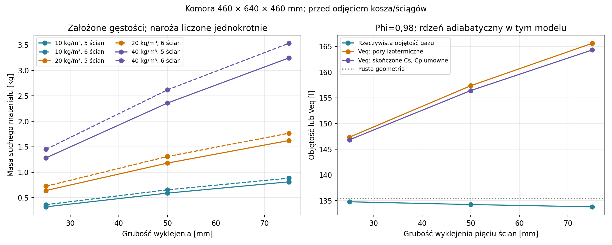

<details>
<summary><strong>Rozwiń: co robią powietrze i położenie materiału tłumiącego</strong></summary>

Włókna zajmują część miejsca, a wymiana ciepła i opory przepływu zmieniają
odpowiedź powietrza. To dwa różne efekty. Nie zakładamy, że każda włóknina
zawsze dodaje ten sam procent objętości.

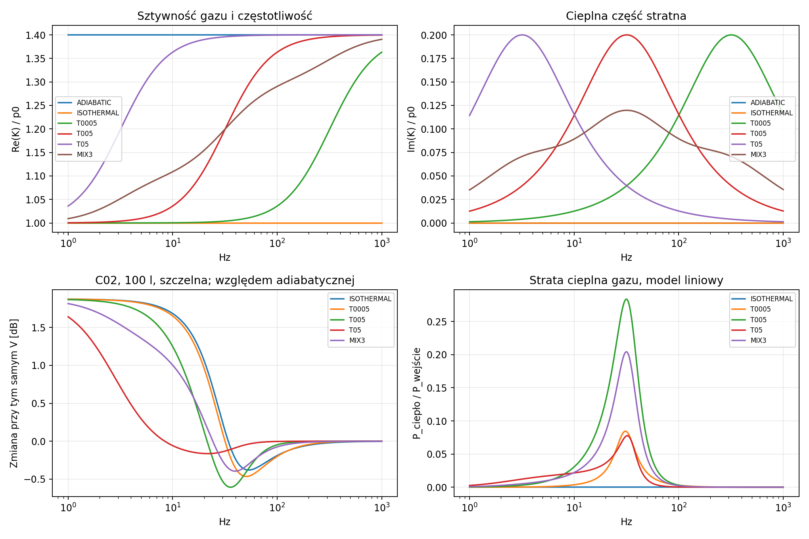

Niżej ten sam materiał ma tę samą masę, a zmieniamy jego położenie.
Jest to prostszy model warstwy w jednym wymiarze; nie utożsamiamy go
z wyklejeniem wszystkich ścian rzeczywistej skrzyni.

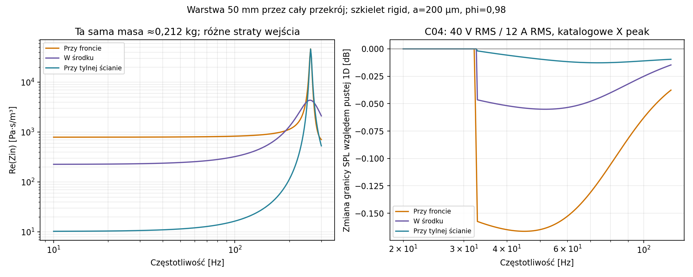

[Raport 016: gaz i materiały porowate](raporty/016_gaz_wypelnienie_i_granice.md)
· [raport 039: ilość i rozmieszczenie wypełnienia](raporty/039_wypelnienie_ilosc_polozenie_i_straty.md).

</details>

<a id="ochrona"></a>
<details>
<summary><strong>Rozwiń: zniekształcenia, ruch poza pasmem i nagrzewanie cewki</strong></summary>

Dwa tony mogą w modelu nieliniowym wytworzyć dodatkowy ruch przy innej
częstotliwości. W przykładzie 45 + 95 Hz pojawia się składnik przy 5 Hz.
Dlatego filtr na wejściu nie rozwiązuje sam wszystkich problemów ochrony.
Krzywe opisują przyjęty model, nie zmierzony konkretny głośnik.

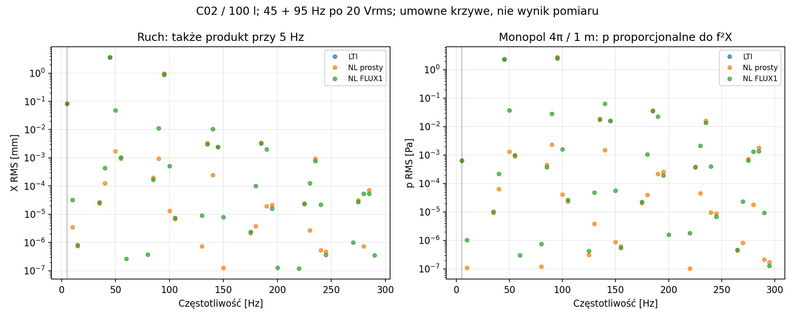

[Raport 024: wyjaśnienie przykładu](raporty/024_P14B_emisja_i_swiadkowie.md)
· [raport 026: pełny zakres kampanii dwutonowej](raporty/026_P14B_pelna_kampania_dwutonowa.md).

Cewka po nagrzaniu zmienia opór. Wpływa to na prąd, ruch i dalsze grzanie.
Ochrona powinna uwzględniać także wcześniejsze obciążenie i chłodzenie.
Temperatury i współczynniki w tym badaniu są założeniami modelu.

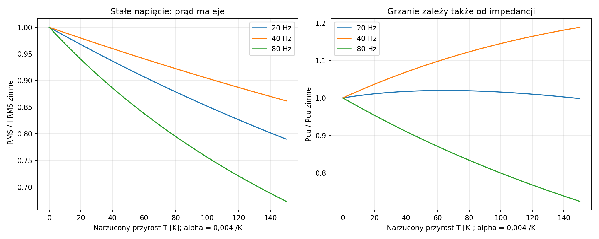

[Raport 027: sprzężenie temperatury i napędu](raporty/027_P15B_sprzezenie_grzania_i_napedu.md).

</details>

<a id="filtry"></a>
## Konstrukcja obudowy: od ścianek do kleju

**Projekt geometryczny jest teraz badany także jako całość.** W scenariuszu
P20D sprawdzono korpus **1000 × 440 × 500 mm (W × D × H)** oraz dostęp
do wkładów regulacyjnych; model przewiduje nominalne stany
około **100 / 120 / 150 l**. To wariant obliczeniowy, nie gotowe
rysunki wykonawcze ani potwierdzone wyporności kosza czy maskownicy.


[Raport P20D — geometria, dostęp i pełny limit głębokości](raporty/057_P20D_geometria_dostep_i_pelna_glebokosc.md).

**Podatne wręgi nie są idealnymi podporami.** W modelu P18E uzyskano
częstotliwość około **143 Hz** dla jednego z wariantów konstrukcyjnych;
wartości około 395 Hz z idealnie podpartego małego pola nie należy
przypisywać całej rzeczywistej skrzyni. Wynik zależy od założonych
sztywności i nie jest pomiarem obudowy.


[Raport P18E — podatne wręgi i panele](raporty/059_podatne_wregi_i_panele.md).


Skrzynia nie jest idealnie sztywna. Jej ścianki się uginają, a połączenia
przenoszą nierówne obciążenia. Poniższe części można rozwinąć niezależnie.
Wykresy przedstawiają modele, nie rysunki wykonawcze.

**Wcześniejszy wariant porównawczy:** korpus 880 × 480 × 500 mm
(W × D × H), MDF 22 mm i stały front 44 mm. Pozostawia on tylko
20 mm z dopuszczalnych 500 mm całkowitej głębokości na wystające
elementy i tolerancje. Wariant ten pozostaje udokumentowany
w raportach 054–055, ale **nie należy go mylić z nowszą
geometrią P20D (1000 × 440 × 500 mm)**. Oba są koncepcjami
badawczymi, nie zatwierdzoną dokumentacją produkcyjną.

[Wstępna geometria i bilans netto — 054](raporty/054_rekomendowana_konfiguracja_prototypu.md)
· [margines głębokości — 055](raporty/055_wrazliwosc_wyboru_i_margines_glebokosci.md).

<details>
<summary><strong>Ścianki, wzmocnienia i rozprowadzanie sił</strong></summary>

### 8. Ścianki: usztywnienie może dać więcej niż sama grubość

W referencyjnej parze ścian 460 × 640 × 22 mm przy 1 kPa statycznym
jeden ściąg zmniejsza ugięcie z około 154,7 do 29,7 µm, a dwa do 12,7 µm
w wariancie SSSS. Trzeba równocześnie sprawdzić masę, nakładki,
połączenia i postacie, których ściąg nie usztywnia.


[Raport 029: model MES, kontrole i granice wniosku](raporty/029_P18A_plyty_sciagi_i_dynamika.md).

### 9. Klej i nakładki: średnie F/A nie wystarcza

Rozmiar nakładki, jej grubość i podatność MDF zmieniają koncentrację
naprężeń. Większe pole nie zapewnia proporcjonalnego spadku szczytu.
Obliczone pole modelu spoiny nie jest rzeczywistym maksimum 3D;
klasa D3/D4 nie zastępuje nośności, pełzania ani zmęczenia połączenia.

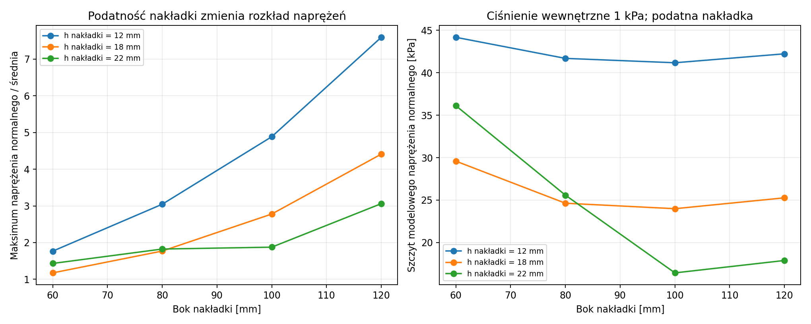

[Raport 030: obliczenia spoin, referencja kleju i brakujące dane trwałości](raporty/030_P19A_obliczenia_spoin_i_material_kleju.md).

</details>

<details>
<summary><strong>Front, uszczelka, śruby i połączenia całej skrzyni</strong></summary>

**W skrócie:** duży otwór osłabia front, śruby i uszczelka pracują inaczej,
a mocniejsze połączenie trzeba sprawdzić również w sąsiednich fragmentach płyty.
„Siatka” w opisach oznacza podział konstrukcji na małe elementy do obliczeń.

### 10. Front: otwór i kosz zmieniają konstrukcję

Siatka odwzorowuje otwór główny i skończone obszary przekazywania sił.
Pokazane średnice pochodzą z rysunków producentów; nie jest to dokumentacja
CNC. Luz, frez i lokalne otwory śrubowe wymagają osobnego dopracowania.


Porównanie niżej izoluje wpływ geometrii przy **wspólnym umownym ładunku
10 kg**. Nie przypisuje tej masy wszystkim głośnikom. Miękkie mocowanie
może ograniczać korzyść z pogrubienia frontu, a pierwszy mod może być przechyłem kosza.

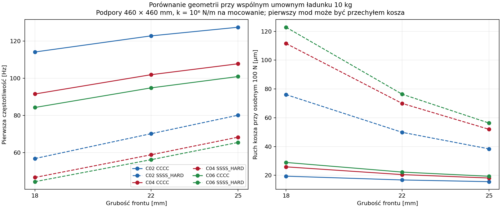

[Raport 033: front, masa, mocowania i niezależne odniesienia](raporty/033_front_otwor_kosz_i_styk_jednostronny.md).

### 11. Docisk: uszczelka i śruby mają różne warunki pracy

Uszczelka przenosi ściskanie, a śruby w modelowanej drodze siły —
rozciąganie. Parametr T₀ oznacza zadane skrócenie sprężyny pomnożone
przez jej sztywność; nie jest momentem dokręcania ani zachowaną siłą.
W P19B 20 z 72 scenariuszy wskazało możliwą zmianę styku.

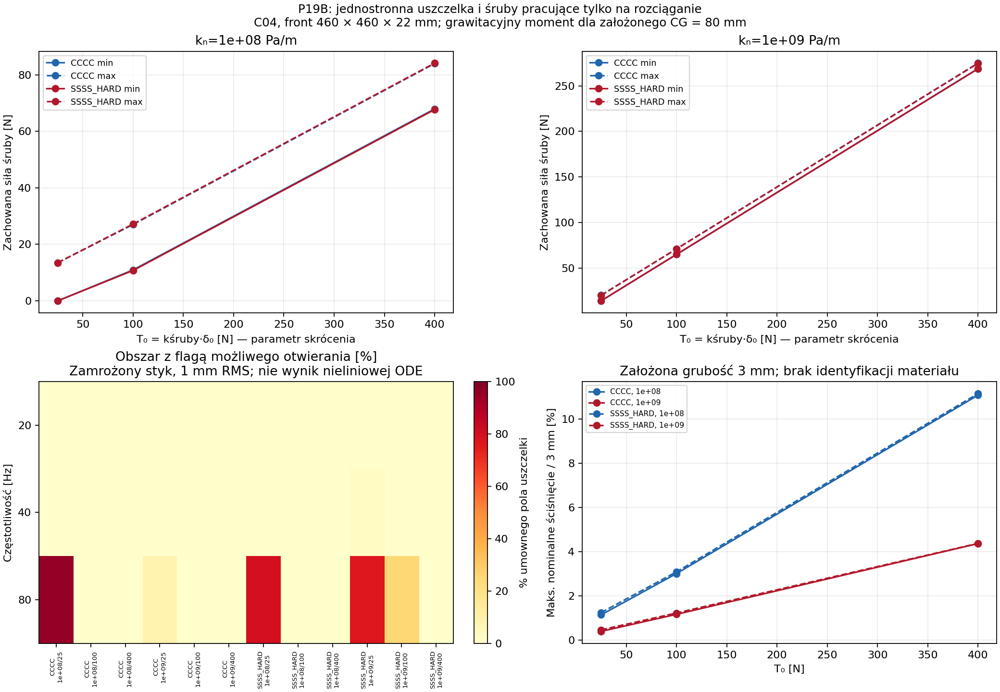

[Raport 033: jednostronny docisk i jawne flagi](raporty/033_front_otwor_kosz_i_styk_jednostronny.md).

### 12. Styk w czasie: rozstrzygnięcie konkretnego przypadku przy 80 Hz

Dla wskazanego C04 z hipotetyczną uszczelką obliczono okresowe otwieranie
styku przy zadanym względnym ruchu stożka 1 mm RMS. Sprawdzono redukcję,
energię, inny integrator i pełne 2959 współrzędnych MES. Jest to jeden
warunkowy przypadek; nie potwierdzenie hałasu, przecieku lub THD produktu.

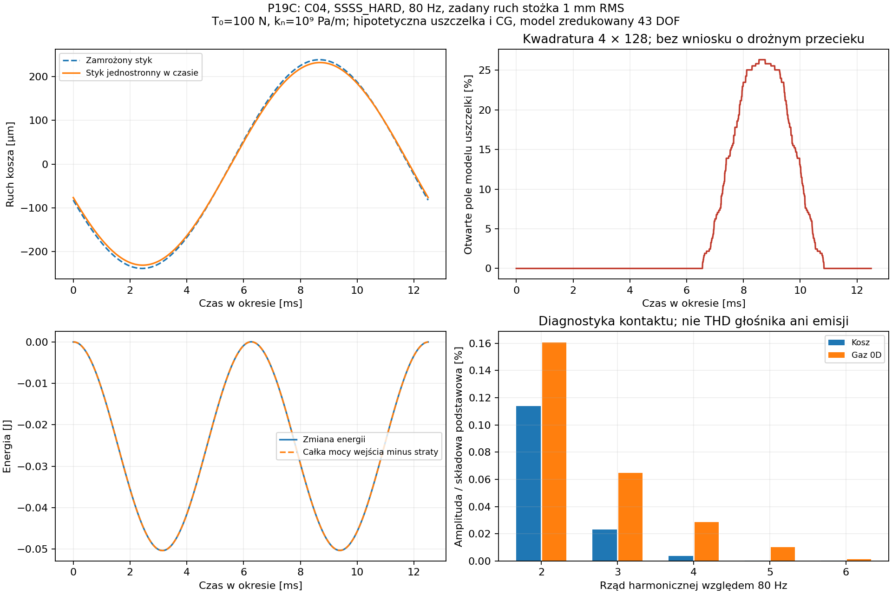

[Raport 034: wynik, zbieżność i ograniczenia](raporty/034_czasowy_styk_i_pelny_MES.md)
· [dodatkowy wykres zbieżności](wyniki/54_P19C_zbieznosc_i_pelny_MES.png).

### 13. Cała rama: połączenia ścian, masa i podparcie


To geometria kontrolna, **nie gotowa skrzynia do zamówienia**:
460 × 640 × 460 mm wewnątrz, ścianki 22 mm. Rozsunięcie ścian na rysunku
służy czytelności; nie jest szczeliną konstrukcyjną. Geometria brutto
nie jest finalnym Vb netto po odjęciu głośnika, usztywnień i regulacji.

Model obejmuje sześć brył i dwanaście podatnych spoin. Wariant z jednym
ściągiem zmniejsza obliczoną podatność o około 18% przy dodatkowych 0,464 kg.
Ruch przy osobnej sile 1 N RMS zależy także od podparcia. Głośnik jest tu
sztywną masą odniesienia. Zgodnie z U-021 rozwijamy stałe połączenie
frontu z korpusem; wykres nie jest odpowiedzią całego napędu elektroakustycznego.

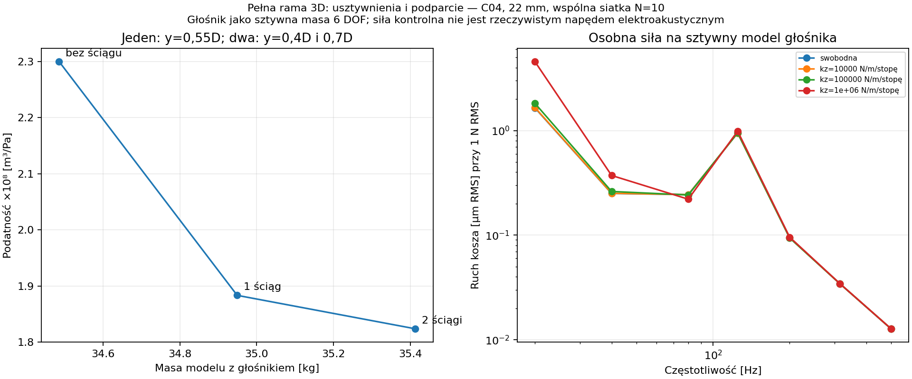

[Raport 035: siatki do 36 771 współrzędnych, równowaga i ograniczenia](raporty/035_pelna_rama_3D_spoiny_i_podparcie.md)
· [raport 036: energia wirtualnego odspojenia nie jest jeszcze zbieżna](raporty/036_spoiny_3D_i_wirtualne_odspojenie.md).

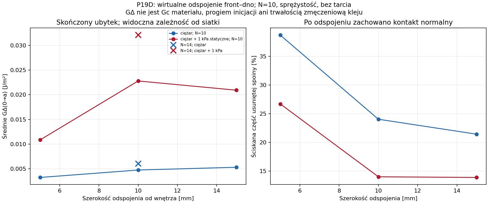

**Co wymaga dalszego sprawdzenia:** wynik energii dla defektu 10 mm różni się o około
27% dla ciężaru i 41% dla ciężaru z ciśnieniem statycznym 1 kPa między
N=10 i N=14. Gδ z tego eksperymentu nie jest odpornością materiałową Gc,
trwałością spoiny lub potwierdzeniem doboru kleju. Stały front pozostaje
decyzją projektu; dopracowania wymaga lokalna droga przenoszenia sił.

**Listwa przy stałym froncie:** dodatkowa bryła łączy front z dnem przez
dwie nowe spoiny. Wariant 30 × 30 mm/440 mm dodaje około 0,289 kg
i zajmuje 0,396 l. Kontrolna podatność przy tym samym H spada około
2,6%; rzeczywisty port ciśnienia zmienia się po zasłonięciu powierzchni.


**Wynik wymagający dalszej analizy:** dla 30 mm lokalne RMS naprężeń
zmienia się o 17–27% między N=14 i 18. Nowa spoina może przejąć większą
koncentrację, mimo poprawy globalnej sztywności. Nie zatwierdzamy z tego
kleju lub trwałości. Obciążenie: ciężar i statyczne 1 kPa, model C04.

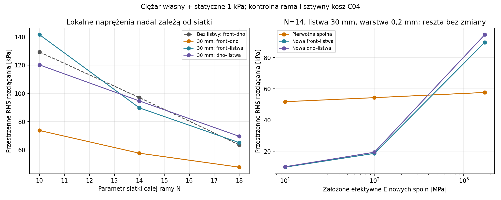

[Raport 040: geometria, tensor masy/ciśnienia, kontrola Schura i pole do podmodelu](raporty/040_listwa_stalego_frontu_i_droga_sily.md).

**Podmodel P19G:** w stałym fragmencie pierwotnej spoiny dalsze zagęszczenie
przekroju zmienia RMS rozciągania o około 0,45%, a ścinania o 0,10%.
Osobne zagęszczenie wzdłuż listwy daje około 0,043/0,081%.
To skończone kontrole dwóch kierunków. Ocena całych spoin z 040 pozostaje
otwarta; okno z odcięciem 5 mm nie jest materiałową strefą kohezji.

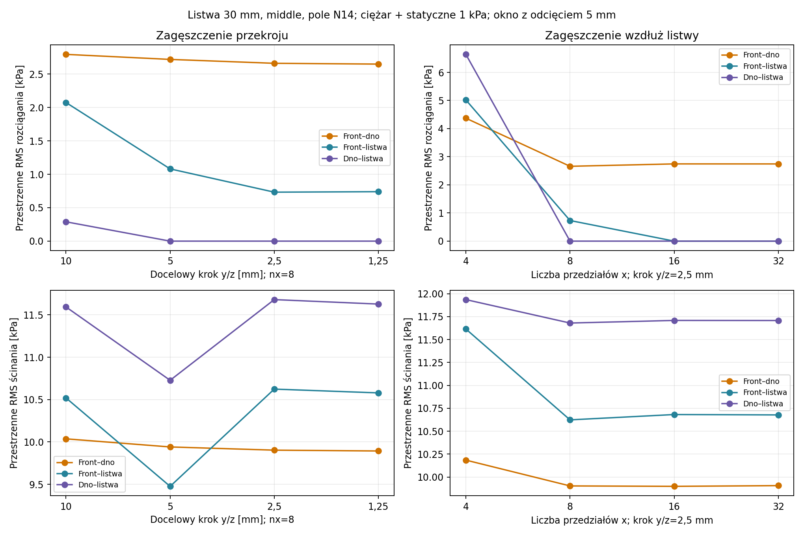

**Dane brzegowe też ograniczają wynik:** zmiana źródłowego pola N14→N18
daje około +19,4% rozciągania i +14,6% ścinania w tym samym oknie.
Nie uznajemy zera dodatniej części w pojedynczej siatce za dowód nośności.
Zachowano wpływ odległości granicy i częściowo wyciętej podpory.

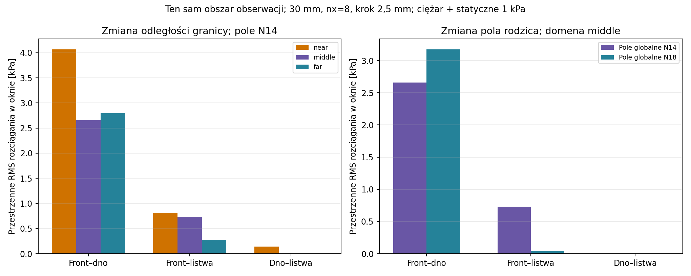

[Raport 041: 24 podmodele, 144 oceny okien, transfer stóp i kontrole obciążeń](raporty/041_lokalny_podmodel_i_granice_wiarygodnosci.md).

### 14. Stały front: wymagany moduł spoiny

Wyznaczono progi efektywnego E dla zadanego przyrostu podatności, osobno
dla samego frontu i wszystkich spoin. Przykładowo dla +10% C i warstwy
0,2 mm na N=14 wynoszą około 9,09 i 72,14 MPa. Są to wyniki modelu
sztywności; nie gwarancja nośności, adhezji, pełzania lub zmęczenia.
Scenariusze 5/10/20% nie są zatwierdzonymi progami briefu.

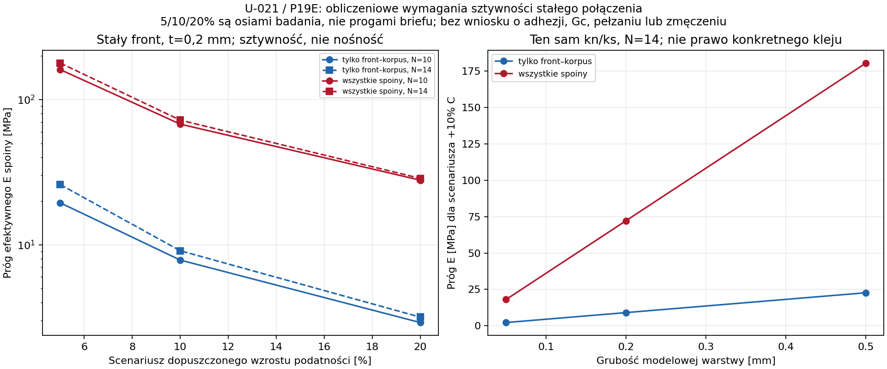

[Raport 037: metoda monotoniczna, dane i ograniczenia siatki](raporty/037_staly_front_wymagany_modul_spoin.md).

</details>

<a id="regulacja"></a>
## Regulacja objętości: jedna skrzynia, kilka wariantów

Badana skrzynia ma umożliwiać eksperymenty przy około **100, 120
i 150 l netto** bez zmieniania stałego frontu. W przyjętym kryterium
różnicy 0,2 dB od plateau wystarcza już około **100 l** (99 l na siatce
co 1 l). Objętość **120 l jest punktem startowym próby**, a nie
udowodnionym optimum. Wkłady zajmują miejsce i zmieniają przestrzenny
rozkład ciśnienia; objętość netto musi też uwzględniać kosz,
usztywnienia, osprzęt i ciało stałe maty tłumiącej.

[Bilans litrów i wariant doświadczenia — 054](raporty/054_rekomendowana_konfiguracja_prototypu.md)
· [korekta kryterium objętości — 055](raporty/055_wrazliwosc_wyboru_i_margines_glebokosci.md).

Porównujemy szczelne wkłady wkładane przez otwór po zdjęciu głośnika
oraz przesuwaną przegrodę. Front pozostaje stały. Ważne są masa, szczelność,
sztywność i możliwość zmiany ustawienia po złożeniu skrzyni.

<details>
<summary><strong>Wkłady, przegroda, MDF i sklejka — wyniki kolejnych porównań</strong></summary>

### 15. Regulacja Vb: dostęp, masa i własna akustyka wkładu

W kontrolnym układzie można wsunąć i wyjąć **16 modułów 180 × 100 × 170 mm**,
co zajmuje 48,96 l. Front pozostaje stały; dostęp zakłada wyjęty głośnik.
Tory są sprawdzone w konkretnej klasie translacji osiowych. Nie obejmują
dowolnych obrotów, mocowań i dostępu narzędzia ani globalnego maksimum pakowania.


Do porównania z przegrodą przyjęto **szczelny moduł MDF 8 mm ze ściągiem**.
Suchy zestaw 16 modułów waży nominalnie około 11,21 kg; masywny MDF
o tym samym obrysie około 35,74 kg. Gęstość i geometria są założeniami.
To wybór przypadku badawczego; nie gotowa dokumentacja wykonawcza.

**Powietrze wewnątrz i ściany są liczone osobno.** Przeciek może oddawać
znaczną podatność, mimo tego samego fizycznego obrysu. Pokazane fc_ref
parametryzują umowny opór; nie są pomiarem szczeliny lub tolerancją wyrobu.

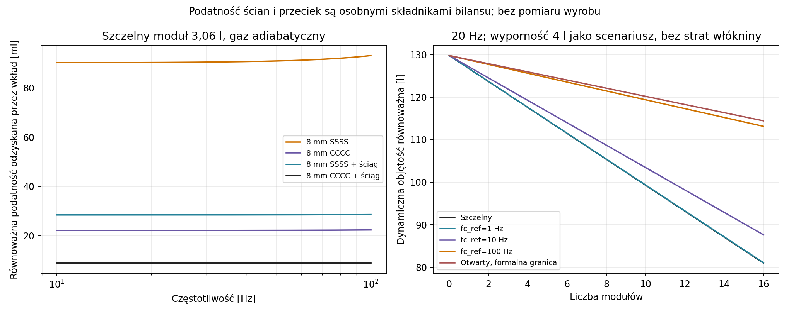

**Przypadek graniczny:** po uwzględnieniu masy powietrza w kanale pojawiają
się formalne rezonanse. Poza ekranami małej amplitudy odpowiedź liniowa
nie daje prognozy rzeczywistego przepływu, hałasu lub SPL. Rzeczywiste
mocowanie również wymaga sprawdzenia — wkład nie może być uznany za
nieruchomy wyłącznie dlatego, że opiera się na włókninie.

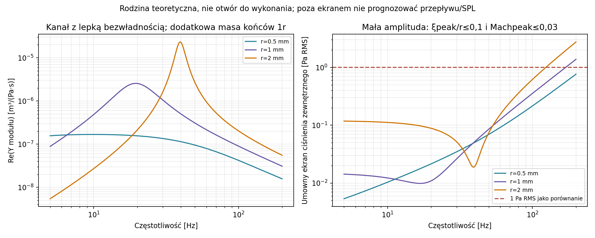

[Raport 042: 78 modeli modułów, bilanse, montaż, mocowanie i ograniczenia przestrzenne](raporty/042_regulacja_Vb_i_wklady_wypornosciowe.md)
· [dynamika mocowania](wyniki/73_P20A_dynamika_mocowania_wkladu.png).

### 16. Przegroda: mniej masy, ale potrzebne sztywne blokowanie

Przegroda 18 mm z modelowym uszczelnieniem i założonym wózkiem ma około
**3,05 kg**, wobec **11,21 kg samych 16 modułów**. Obie liczby wymagają
uzupełnienia osprzętu. Przy tej samej ilości gazu z przodu miękka rama
wprowadza silną odpowiedź w paśmie basowym. Ujemna część reaktywna na
wykresie nie jest ujemną objętością fizyczną. Wykres przedstawia liniowy
port; poziom pracy wymaga osobnego sprawdzenia amplitudy i prześwitów.

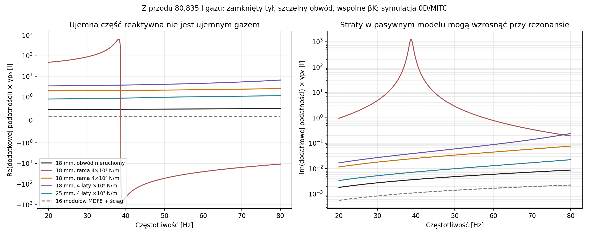

Cała sztywna płyta 458×458 mm nie przejdzie przez badane otwory do 355,8 mm,
także przy obrocie: ograniczenie wynika z jej środkowego wpisanego dysku.
Wymaga wcześniejszego montażu lub innego dostępu. Front pozostaje stały.

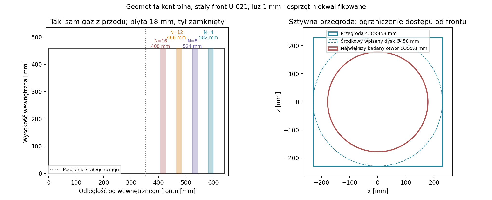

[Raport 043: dwie komory, przeciek, odpowietrzenie, statyka i kontrole](raporty/043_przegroda_dwie_komory_i_materialy.md).
Są to scenariusze przy niezmierzonych mocowaniach/uszczelce; nie końcowa
rekomendacja konstrukcji lub poziomu SPL w pokoju.

### 17. MDF i sklejka: sprawdzaj oba kierunki

Dane Metsä odczytano także z oryginalnych tabel PDF. **Form/FormPLUS12**
ma w obliczeniu około 38% mniejszą masę samej płyty niż kontrolne MDF18,
a wskaźnik sztywności słabszego kierunku pasa wynosi około 0,96 wartości MDF.
**Spruce12** ma słabszy kierunek około 0,19, mimo dobrego wyniku wzdłuż.
Nie wolno z jednego modułu wywnioskować drgań całej obudowy.

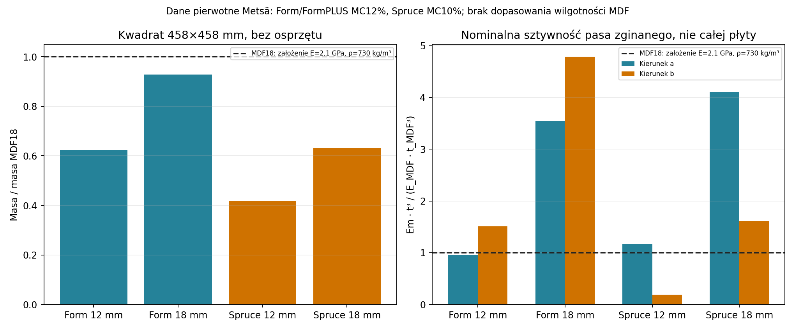

Wskaźnik Em·t³ nie identyfikuje skręcania, tłumienia i adhezji. Producent
podaje odmienne wilgotności dla tych dwóch sklejek, a MDF jest założeniem
modelowym. [Raport043](raporty/043_przegroda_dwie_komory_i_materialy.md)
wyjaśnia granice porównania i rozróżnienie surowej/powlekanej powierzchni.

### 18. Pełny moduł 3D: krawędzie płyt i klej mają znaczenie

Ściany, naroża, nakładki, pręt i warstwy kleju policzono jako bryły.
Gaz wewnętrzny i obrys zewnętrzny mają **osobne porty pracy**. Referencyjny
moduł ze ściągiem ma nominalnie 0,7023 kg i 2,099984 l gazu, przy
niezmiennym obrysie 3,06 l. Objętość kleju jest policzona osobno.

Przy 20 Hz otrzymujemy około **11,705 ml odtwarzanej podatności na moduł**,
wobec 8,816 ml w modelu płyt CCCC. Ta korekta o około 33% dotyczy modułu,
a jej wpływ na napęd zależy od udziału w całej podatności skrzyni.

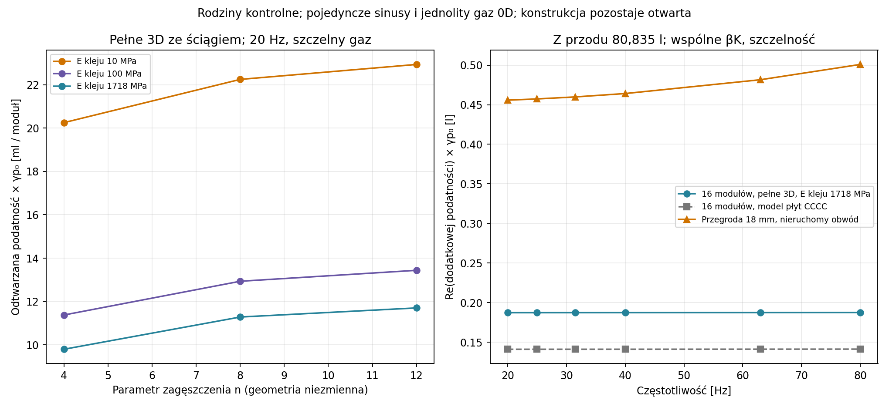

### 19. Klej: ciągłe wymaganie sztywności i osobna ocena naprężeń

Wyprowadzono monotoniczną zależność statycznej podatności od E kleju.
W zadanej rodzinie kryterium **najwyżej 5% większej podatności względem
Eref=1718 MPa** daje około **321 MPa** na drobniejszej siatce. To kryterium
porównania, bez zatwierdzenia go jako wymogu briefu. Moduł nie potwierdza
wytrzymałości, adhezji do MDF, pełzania lub zmęczenia produktu.

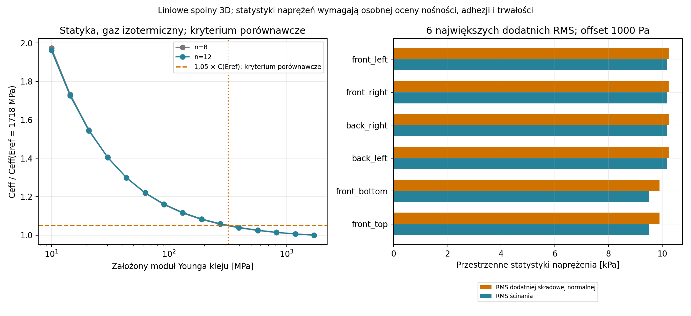

W 11 664 punktach napędu największa zmiana obwiedni przy zachowanych
umownych ekranach amplitudy wyniosła około **0,0046 dB**. Badanie dotyczy
osobnych sinusów 20–80 Hz, RMS 2π/1 m i ograniczeń V/I/katalogowego X;
nie ustala THD lub bezpiecznego czasu pracy. Z kolei formalne postacie
przy wyższych częstotliwościach wymagają przestrzennego modelu gazu.

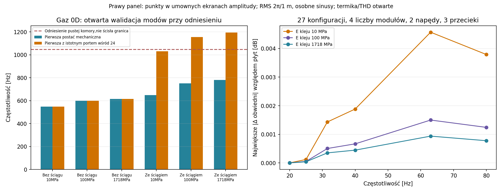

[Raport 044: równania, kontrola hydrostatyczna, osiem flag i dalsze siatki](raporty/044_modul_3D_dwa_porty_i_wymagania_kleju.md)
· [11 664 punkty napędu](wyniki/p20c_naped_27_konfiguracji.csv).

</details>

## Powietrze w skrzyni: moduł, komora i membrana

Dla małego modułu przy równomiernym nacisku korekta gazu 3D względem
0D jest mała w zbadanych punktach 20–80 Hz. Pole z gradientem wymaga
osobnego bilansu pędu i mocowania. Nie przenosimy tego wyniku automatycznie
na większą komorę z lokalnie poruszającą się membraną.

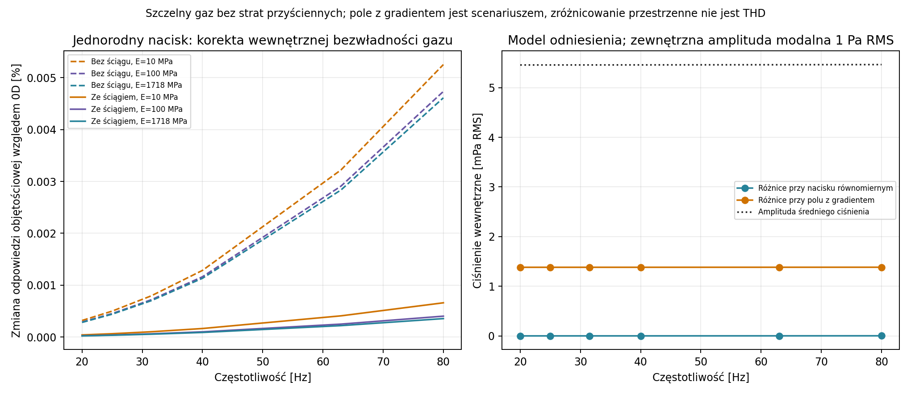


Nowy pilot głównej komory sprawdza głębokości 350/425/500 mm oraz
źródło centralne i przesunięte. Zmiana nacisku zwrotnego przy zadanym
ruchu nie jest zmianą SPL lub THD. Objętości dotyczą pustego wnętrza,
a źródło kwadratowe jest kontrolne, bez przypisania do produktu.


W rzeczywistym głośniku powietrze poruszane jest przez membranę
o skończonej powierzchni. Model P21C1 porównuje kołowe tłoki
o powierzchni odpowiadającej katalogowemu `Sd` oraz różne położenia
źródła. Lokalnej masy akustycznej nie wolno doliczać ponownie do `Mms`.


**P21D uwzględnia wspólną geometrię i port napędu.** Sprawdzono
45 pól, 12 zagęszczeń i 54 odpowiedzi napędu w zdefiniowanych
warunkach modelowych. W sześciu kontrolowanych przypadkach ostatnia
zmiana amplitudy ruchu C02 była nie większa niż 0,00858 dB;
nie jest to dowód dokładności całego pasma ani rzeczywistego THD.


[Raport P21D — wspólna geometria i port napędu](raporty/060_P21D_wspolna_geometria_i_port_napedu.md).

**Czy uginające się ścianki zmieniają pracę membrany?** W modelu P21E
połączono sprężynę powietrzną skrzyni z jednym równoważnym trybem
uginania dwóch paneli. Przy modelowych 120 l dodatkowa podatność paneli
odpowiada około **5,37 l podatności powietrza w granicy statycznej**
— *nie* dodatkowej fizycznej objętości komory. Dla C02 zmiana
amplitudy ruchu w próbie nominalnej 20–80 Hz wyniosła od
**−0,058 do +0,132 dB**.


To symulacja liniowa o **jednorodnym ciśnieniu**, nie połączone
przestrzenne obliczenie FEM–FV z P18E i P21D. Nie wyznaczono
rzeczywistych postaci drgań, promieniowania paneli ani THD.

[Raport 064 — P21E: sprzężenie gazu i podatnych ścian](raporty/064_P21E_gaz_podatne_sciany_i_naped.md)
· [39 punktów kontrolnych](wyniki/p21e_nominal.csv)
· [podsumowanie 9801 przypadków](wyniki/p21e_podsumowanie.json).

**Czy przestrzenne ciśnienie może zmienić napęd mocniej niż same ugięcia ścian?**
Badanie P21F łączy jeden dysk membrany z przestrzennymi modami
akustycznymi i trzema **modelowymi** podatnymi polami ścian.
W przeanalizowanej rodzinie, przy 120 l i przesuniętej membranie C02,
zmiana amplitudy prędkości 20–80 Hz względem sztywnego modelu 0D
wynosi **−0,500 do +0,230 dB**. Dla samego przestrzennego gazu
ze sztywnymi ścianami: **−0,446 do +0,100 dB**.


To **model zastępczy pustego prostopadłościanu**, a nie rozwiązanie
dla rzeczywistego układu wręg, wkładów i maty P20D/P21D. Wpisanie
100/120/150 l do podatności gazu przy niezmienionej geometrii modów
jest jawnym uproszczeniem. Sprawdziliśmy pasywność i bilans energii,
ale nie uzyskaliśmy jeszcze ścisłej zbieżności całego pasma.

[Raport 065 — P21F: mody gazu i podatne pola](raporty/065_P21F_wielomody_gazu_i_scian.md)
· [podsumowanie 52 272 obliczeń](wyniki/p21f_podsumowanie.json)
· [kod odtwarzania](skrypty/p21f_mody_gaz_panele.py).

**P21G — status niepotwierdzony.** Starsze README podawało wyniki przestrzennego modelu FV z podatnymi panelami, jednak obecnie nie ma kompletu plików źródłowych i dowodów: raportu 066, skryptu, wyników i grafiki. **Nie wykorzystujemy tamtych liczb do projektowania, dopóki nie zostaną odzyskane i niezależnie sprawdzone.** [Dostępny model P21D](raporty/060_P21D_wspolna_geometria_i_port_napedu.md) · [P21E](raporty/064_P21E_gaz_podatne_sciany_i_naped.md) · [P21F](raporty/065_P21F_wielomody_gazu_i_scian.md).

[Raport 050 — źródło w komorze](raporty/050_P21C0_plytka_komora_i_polozenie_zrodla.md)
· [raport 051 — kołowa membrana](raporty/051_P21C1_membrana_kolowa_i_bezwladnosc.md)
· [raport 052 — warstwy i wkłady](raporty/052_komora_warstwy_wklady_i_front.md).
Wyniki nie zastępują **pełnego przestrzennego** sprzężenia rzeczywistych podatnych ścian, wręg, wypełnienia i napędu. Status P21G pozostaje otwarty.

<a id="slownik"></a>
## P38 — znamy już rozstaw śrub i błąd układu współrzędnych

### Jak ma wyglądać front z Dayton RSS390HF-4?


*Według rysunku producenta kosz ma Ø388,4mm, wycięcie Ø355,8mm, a osiem otworów **w metalowym koszu** Ø6,5 mm leży na okręgu Ø368 mm. **Tylko jeśli w MDF również wywiercimy otwór Ø6,5 mm**, po odjęciu jego promienia pozostaje **2,85mm MDF**. Otwór Ø6,5 mm w koszu nie narzuca tej średnicy otworu w MDF. To istotny problem dla projektowania mocowania, nie pozwolenie na frezowanie. [Raport 096](raporty/096_P38A_front_Dayton_otwory_i_mocowania.md) · [szkic DXF — NIE CNC](wyniki/p38a_front_NIE_CNC.dxf).*

### W którym miejscu naprawdę jest głośnik we wnętrzu?


*Oś x231/z250mm w P31C jest określona **od zewnętrznych krawędzi obudowy**. Po odjęciu grubości MDF22mm właściwe współrzędne wewnętrzne to **x209/z228mm**. Historyczny model P34B używał x231/z250mm także wewnątrz. W 120l na siatce55mm model RMS przy 80Hz zmienia się z 19,09% do 21,03%. **Oba wyniki to symulacje, nie THD**. [Raport 097](raporty/097_P38B_audyt_wspolrzednych_FV.md).*

## P41 — dwie alternatywy mocowania Dayton zamiast cienkiego pierścienia

### Porównanie nośnika typu A i belek typu B


*Dla tego samego przykładu 15kg / 5g / e120mm, sztywności kotew 300N/mm i mnożnika 3×, wariant A daje **223,4N**, a B **221,6N** maksymalnej reakcji na kotwę przy sile X. Oba układy w tym modelu przyjmują idealnie sztywny element przenoszący siły. Nie jest to badanie nośności śrub ani MDF. [Raport 103](raporty/103_P41A_carrier_kontra_szyny_2592.md).*

### Dlaczego sam wybór metalu nie wystarcza?


*W modelu belki długości 380mm pod siłą środkową 200N, hipotetyczny profil 25×4mm ugina się o **0,627mm** przy E=70GPa, a o **0,219mm** przy E=200GPa. Po połączeniu tej podatności z modelem B jego obliczeniowe ugięcie rośnie: **0,325→0,383mm** w wybranym wariancie. Nie dowodzi to bezpieczeństwa ani możliwości wykonania. [Raport 104](raporty/104_P41B_podatnosc_belek_108.md).*

**[Obie koncepcje w edytowalnym modelu OpenSCAD](dokumentacja/P41C_porownanie_nosne_A_B_NIE_CNC.scad)** — ustaw parametr `concept` na `"A"` lub `"B"`. Oba modele mają niezweryfikowane połączenia i zastępczą bryłę kosza. [Raport 105](raporty/105_P41C_koncepcje_3D_A_B.md).

## P42 — audyt uzupełniający do badań P41: cztery podpory i trasy łączników

### Jak dwa nowe układy czterech punktów przenoszą obciążenia?


*W osobnym eksperymencie zbadano 1458 układów **czterech odległych podpór** w szerokiej ramie A lub dwóch belkach B, plus ośmiopunktowy model referencyjny. Przy 13,61kg, 5g i umownym `k=1000 N/mm` rama A korzystniej od B przenosi moment od poziomej siły. **To inna geometria i liczba podpór niż wcześniej w P41 (osiem punktów)**, dlatego wyniki są uzupełnieniem, a nie zamiennikiem P41 ani pomiarem wytrzymałości. [Raport 106](raporty/106_P42A_podpory_1458.md).*

### Czy podpory mieszczą się w uproszczonych obwiedniach 3D?


*162 próby pokazały brak kolizji niektórych hipotetycznych obwiedni ramy A i sześć odrzuconych przypadków belek B przy **umownym, przesadnie szerokim promieniu silnika 205mm**. Nie sprawdzono jednak całego kosza ani samych połączeń pomiędzy śrubami i podporami. [Raport 107](raporty/107_P42B_obwiednie_3D_dwoch_wariantow.md).*

### Czy najkrótsze łączniki nie przechodzą przez wycięcie?

*48 testów rzutu wykazało, że dwa proste połączenia do belek B przecinają obszar otworu Ø355,8, a w ramie A jeden łącznik o szerokości 10mm ma podobny problem. To **kontrola 2D**, nie gotowy projekt mocowania. [Raport 108](raporty/108_P42C_laczniki_i_koncepcje_3D.md) · [Model OpenSCAD](dokumentacja/P42D_dwie_sciezki_REFERENCYJNE_NIE_CNC.scad).*

> **Uwaga o numeracji:** starsze równoległe badania konstrukcji mają historyczne oznaczenia P43-K/P44-K; odrębny program **P43 (02.11.2026)** dotyczy dwóch głośników 12″ i układu izobarycznego. Numery raportów poniżej skorygowano, aby zachować unikalność.

## P43-K (historyczne oznaczenie konstrukcyjne) — czy łączniki można poprowadzić bezpiecznie wokół wycięcia?

### Dlaczego cienki margines przy śrubach jest ważniejszy niż samo obejście otworu?


*Wykonano **576 analiz par śruba–podpora**, wybierając 144 najkrótsze trasy w uproszczonej płaszczyźnie. Przy 8 mm szerokości i hipotetycznym odstępie 2 mm pozostaje **0,1 mm** radialnego marginesu na osi łącznika; przy 10 mm + 2 mm nie ma już miejsca nawet na jego początek. **To nie jest rzeczywista szerokość drewna przy otworze śruby.** **2,85 mm MDF** wystąpiłoby wyłącznie, gdyby hipotetycznie wywiercono **Ø6,5 mm także w MDF**; fabryczne Ø6,5 mm leży **w metalowym koszu**, a przykładowa śruba M5 z przelotem Ø5,5 mm w MDF pozostawiałaby nominalnie **3,35 mm**. [Raport 110](raporty/110_P43A_trasy_omijajace_wyciecie.md) · [wyniki CSV](wyniki/p43a_trasy_144.csv).*

### Co jeśli jedna z czterech podpór przestaje przenosić obciążenie?


*W **1620 modelowych przypadkach** porównano pełne cztery podpory z wyłączeniem jednej. Przy 13,61 kg, 5g, mimośrodzie 120 mm i poziomej sile X maksymalna obliczona reakcja wzrasta w ramie A z **202,3 do 319,1 N**, a w belkach B z **400,4 do 761,2 N**. Sprężyny mają założoną sztywność, a prawdziwych połączeń nadal nie ma: nie jest to dowód bezpieczeństwa ani ugięcia gotowej konstrukcji. [Raport 111](raporty/111_P43B_awaria_jednej_podpory.md) · [pełne dane CSV](wyniki/p43b_awarie_1620.csv) · [kod odtwarzania](skrypty/p43_trasy_i_awarie_podpor.js).*

**Wniosek:** szeroka rama A pozostaje kandydatem do badań konstrukcyjnych, ale żaden wariant nie jest zatwierdzony do CNC bez rzeczywistych złączy, geometrii kosza oraz weryfikacji kontaktu i materiałów.

## P44-K (historyczne oznaczenie konstrukcyjne) — jednostronny kontakt i warunkowe tarcie mocowania

### Czy rama utrzymuje kontakt po przeciążeniu lub utracie jednej podpory?


*W badaniu P44A sprężyny normalne nie mogą już przenosić rozciągania. Przeprowadzono **5400 analiz** dla trzech kierunków, dwóch mas, trzech przyspieszeń, różnych mimośrodów, stanów utraty podpory i pięciu hipotetycznych docisków. Przy 500 N/punkt pełny kontakt zachowuje model A w **500/540**, a B w **412/540** przypadków. Nie jest to rekomendowany docisk śrub ani ocena nośności. [Raport 112](raporty/112_P44A_jednostronny_kontakt_5400.md) · [CSV](wyniki/p44_kontakt_5400.csv).*

### Dlaczego brak rozwarcia nie oznacza odporności na poślizg?


*P44B sprawdza **16 200 nierówności tarcia** przy μ=0,2/0,4/0,6, zakładając rozdzielenie sił stycznych proporcjonalnie do sztywności hipotetycznych podpór. To badanie przesiewowe, **nie pełny model stick/slip**. Nadal brakuje realnego kosza, podkładek, docisku, złącza, pomiarów MDF i MES kontaktowego 3D. [Raport 113](raporty/113_P44B_tarcie_i_wrazliwosc_16200.md) · [kod](skrypty/p44_kontakt_docisk_tarcie.js) · [agregaty](wyniki/p44_podsumowanie_20261101.json).*

**Wniosek P44:** szeroka rama A pozostaje warunkową ścieżką badań. **Brama CNC pozostaje zamknięta.**

## P40 — czy osiem śrub utrzyma głośnik i czy pierścień daje miejsce na montaż?

### Sam ciężar dzielony przez 8 to za mało


*Dla 15 kg, hipotetycznego obciążenia 5g i środka masy 120mm za frontem w modelu reakcji ośmiu śrub największe obciążenie pojedynczego punktu przy bocznym działaniu siły wynosi **151 N**, a nie **92 N** z uproszczenia F/8. Jeśli część śrub przestaje pracować, obciążenia mogą wzrosnąć kilkukrotnie. **To nie jest pomiar wytrzymałości śrub ani MDF.** [Raport 101](raporty/101_P40A_reakcje_8_mocowan.md).*

### Ile naprawdę miejsca jest w pierścieniu wzmacniającym?


*Wycięcie Ø355,8 mm, osie śrub na Ø368 mm i osobny modelowy otwór **Ø6,5 mm w METALOWYM PIERŚCIENIU** dają tylko **2,85 mm budżetu promieniowego samego pierścienia**, a NIE wymiar wiercenia w MDF. Po korekcie P40B do hipotetycznego **M5/Ø5,5 mm w MDF** zbadano ponownie **675 wariantów**: **126** przechodzi podstawowe warunki, **6** dodatkowy próg 1 mm luzu + 1 mm metalu, zaś **żaden** nie przechodzi progu 1 mm + 2 mm. Fabryczne Ø6,5 mm Daytona jest w KOSZU. Progi są badawcze, nie normowe. [Raport 102](raporty/102_P40B_tolerancje_pierscienia_675.md).*

## Nowe badania P39 — ciśnienie, mocowania i edytowalny model 3D

### Co zmieniło się po przeliczeniu nacisków na ściany?


*W 36 nowych symulacjach powietrza w komorze zastosowano właściwą oś głośnika **x209/z228 mm w układzie wnętrza**, a wyniki porównano z historycznym P35A. Dla 120l / 80Hz, na siatce 36mm średnie ciśnienie względne na lewej ścianie zmieniło się z 0,773 na **0,735**, na prawej z 1,369 na **1,384**. To **względne pole modelowe**, nie fizyczne SPL ani obciążenie zweryfikowanego MDF. [Raport 098](raporty/098_P39A_naciski_scian_korekta_FV.md).*

### Czy pierścień wzmacniający pod Daytonem zmieści się wewnątrz?


*54 zestawienia średnic i grubości pokazują, że pierścień przykładowy Ø400/Ø356/t4mm geometrycznie pozostawia 9mm do lewego boku oraz 17mm do pierwszej wręgi w projekcji X. Ale **luz promieniowy od wycięcia wynosi zaledwie 0,1mm**, a cienki pasek MDF przy śrubie pozostaje. Taki pierścień **nie jest zatwierdzony wytrzymałościowo**. [Raport 099](raporty/099_P39B_geometria_pierscienia_i_glebokosc.md).*

### Jak wygląda obudowa w edytowalnym modelu trójwymiarowym?

[Model 3D OpenSCAD — **REFERENCYJNY, NIE DO CNC**](dokumentacja/P39C_front_korpus_pierscien_REFERENCYJNY_NIE_CNC.scad) jest parametrycznym złożeniem paneli, wręg, frontu z otworem i pierścienia. Umożliwia dalsze opracowywanie pełnego CAD; **nie jest jeszcze dokładną bryłą kosza Dayton z terminalami, zamkami i realnymi łącznikami**. [Raport 100](raporty/100_P39C_edytowalny_model_3D_OpenSCAD.md).

</details>

## DSP: dobry wzór filtru to początek

**P24F — obserwator U/I w pętli zabezpieczenia (raport 071).**
W 192 deterministycznych trajektoriach porównano cztery strategie termiczne
z syntetycznymi pomiarami Z(f) przy 80/150/300 Hz, trzema hipotetycznymi
sieciami cieplnymi, utratą pomiarów i dryftem rezystancji połączeń.
Kontur wzrostu temperatury **+80 K jest tylko punktem diagnostycznym**,
a nie limitem pracy Daytona. Mimo założonego marginesu estymacji 15 K i tempa
5 K/s strategia predykcyjna przekroczyła ten kontur w 7/48 przypadków.
Strategia z wcześniejszym progiem 55 K przekroczyła go w 3/48 przypadków,
co **nie potwierdza jej bezpieczeństwa w rzeczywistym urządzeniu**.
Nie potwierdzono praktycznej dostępności sygnału diagnostycznego, czujników
U/I, API miniDSP ani fizycznej skuteczności toru wyciszenia.

[Raport 071 — P24F](raporty/071_P24F_obserwator_w_petli_i_brak_pobudzenia.md)
· [Kod odtwarzający 192 przebiegi](skrypty/p24f_obserwator_i_ochrona.py)
· [Wyniki CSV](wyniki/p24f_192_przypadkow.csv)
· [Pełne trajektorie JSON](wyniki/p24f_192_trajektorii_20261031.json)
· [Podsumowanie JSON](wyniki/p24f_podsumowanie_20261031.json).


**Czasowe nagrzewanie cewki (P24B) i dwie niezależne ochrony.**
W 729 hipotetycznych trajektoriach sprzęgliśmy zespolone Z(f),
zmienną `Re(T)`, dwie pojemności i opory cieplne, prąd końcówki
oraz ograniczenie szczytowego wychylenia. Zależy to silnie od
częstotliwości i czasu trwania sygnału: ogranicznik Xmax nie
zastępuje temperatury cewki.


[Raport 067 — P24B: cewka, DSP i termika](raporty/067_P24B_czasowa_termika_i_dwie_ochrony.md)
· [729 trajektorii CSV](wyniki/p24b_kampania_729.csv)
· [skrypt odtwarzania](skrypty/p24b_czasowa_termika_cewki.py)
· [założenia cieplne](dane/konfiguracje/p24b_czasowa_termika_20261031.json).

**P24C: obserwowalność temperatury z U/I i audyt miniDSP.** Dla modelu C02
wykonano 50 000 prób Monte Carlo: błąd estymacji zależy silnie od
częstotliwości, błędów fazy i zmian BL. Przy 40 Hz w modelu 80 l
hipotetyczny spadek BL o 3% daje błąd oceny przyrostu T o −53,62 K;
nie jest to pomiar. Instrukcje Flex Eight/HTx potwierdzają zwrotnice,
PEQ i kompresor poziomu sygnału, **ale nie potwierdzają** wbudowanego
pomiaru U/I na zaciskach ani regulacji temperatury cewki.

[Raport 068 — P24C: obserwowalność i wykonalność ochrony](raporty/068_P24C_obserwowalnosc_temperatury_i_wykonalnosc_DSP.md)
· [wyniki 50 000 prób](wyniki/p24c_obserwowalnosc_20261031.json)
· [skrypt](skrypty/p24c_obserwowalnosc_ui.py).

**P24D: opóźnienia i awarie ochrony dwóch subwooferów.** Wykonano
88 modelowych prób (16 scenariuszy podstawowych i 72 kombinacje opóźnienia
oraz błędu obserwacji) przy 20 i 80 Hz. W 36/72 wariantach siatki
naruszono **umowny** kontur +80 K. Przy 80 Hz, błędzie −20 K, progu
testowym 45 K i zwłoce 0,25 s obliczono szczyt +75,095 K; przy zwłoce
5 s +105,630 K. Awaria aktuatora potrafi pozbawić ochronę skuteczności.
**To nie są limity bezpieczne, pomiary ani gwarancja implementacji miniDSP.**

[Raport 069 — P24D: opóźnienia, watchdog i awarie](raporty/069_P24D_opoznienia_ochrony_faulty_dwa_kanaly.md)
· [skrypt odtwarzający](skrypty/p24d_opoznienia_ochrony_dwoch_kanalow.py)
· [wyniki skrótowe](wyniki/p24d_podsumowanie_20261031.json).

**P24E: kilka częstotliwości zamiast jednego odczytu U/I.** W 120 000
prób syntetycznych porównano identyfikację Re(T), BL² i Le. Przy modelowym
spadku BL o 3% pojedynczy pomiar 40 Hz obciążał estymację T błędem
−53,62 K; dopasowanie parametrów z 80/150/300 Hz uzyskało przy przyjętym
szumie RMSE 1,241 K, ale tylko gdy struktura modelu jest prawidłowa.
**Zasadnicza granica:** dodatkowe 0,1 Ω w przewodach jest nieodróżnialne
od przyrostu Re i odpowiada błędowi +8,48 K nawet przy wielu punktach.
Nie jest to walidacja hardware, dostępności pasma ani ochrony DSP.

[Raport 070 — P24E: identyfikowalność Re/BL/Le](raporty/070_P24E_wieloczestotliwosciowa_ident_Re_BL_Le.md)
· [skrypt](skrypty/p24e_wieloczestotliwosciowa_ident.py)
· [wyniki kontrolne](wyniki/p24e_podsumowanie_20261031.json).


**Nie wyznaczono temperatury granicznej prawdziwego głośnika.**
Przyjęte parametry cieplne i kontur przyrostu +80 K to wyłącznie
warianty badawcze; żaden finalny limiter nie został zatwierdzony.


Nowy brief porównuje centralny **Flex Eight (RCA 2 Vrms)**
z **Flex HTx (RCA 2 Vrms, TRS symetryczne 4 Vrms)** oraz
modułami ICEpower/Hypex. Dla NC500MP przy wzmocnieniu
25,5 dB wejście 2 Vrms daje modelowo tylko około **355 W/4 Ω**;
pełne 500 W/4 Ω wymaga około 2,37 Vrms. Ostateczny wzmacniacz
musi być wybrany na podstawie realnego zespolonego obciążenia,
temperatury, prądu, zgodności wejścia i kompletnego kosztorysu.

[Porównanie elektroniki i zabezpieczeń](raporty/BRIEF_2026-10-31_wzmacniacz_DSP_i_9_marek.md)
· [180 kontrolnych obliczeń Dayton](wyniki/brief20261031_180_swiadkow_Dayton.csv)
· [analiza rzeczywistego napędu i DSP](raporty/P22C_2026-10-31_wzmacniacze_impedancja_DSP_Xpeak.md).

**P22C: policzono zespoloną impedancję i ograniczenia rzeczywistego toru DSP–wzmacniacz.**
Dla pięciu kandydatów, pięciu objętości, czterech modułów, trzech
ścieżek DSP i trzech hipotetycznych budżetów strat cewki wykonano
**99 900 obliczeń**, niezależnie odtworzonych w Pythonie.

**Ważna korekta:** katalogowe Xmax to wychylenie **szczytowe**.
W poprzednich tabelach 180 i 274 725 przypadków porównano je
omyłkowo z wychyleniem RMS; oba zbiory **przeliczono ponownie**
(bez przyznawania zmian w THD, których nie mierzono).


W modelu 80l, C02, 40Hz, przy scenariuszu strat miedzianych
250W, NC500MP z RCA 2Vrms osiąga modelowo 112,66dB,
a z TRS 4Vrms 113,90dB (+1,24dB); przy 20Hz **zysk wynosi 0dB**,
ponieważ ogranicza mechanika. To liniowe wyliczenia półprzestrzeni,
nie czysty SPL w pokoju i nie końcowy limiter.

[Raport P22C — impedancja, DSP, wzmacniacze i erratum RMS](raporty/P22C_2026-10-31_wzmacniacze_impedancja_DSP_Xpeak.md)
· [900 grup wyników](wyniki/p22c_napiecie_prad_wychylenie_analiza.json)
· [świadkowie](wyniki/p22c_swiadkowie_36.csv)
· [skrypt](skrypty/p22c_naped_dsp_zespolona_impedancja.py)
· [niezależny audyt](skrypty/p22c_niezalezna_kontrola.py).


Filtr cyfrowy trzeba zaprojektować dla właściwej częstotliwości próbkowania
i zapisać z odpowiednią precyzją. Zaokrąglanie może zmienić bas nawet wtedy,
gdy filtr pozostaje stabilny. W badaniu 27 konfiguracji głośników porównano
972 projekty i 4860 wariantów zapisu współczynników.


To badanie programu, a nie pomiar konkretnego miniDSP. Scenariusze używają
48, 96 i 192 kHz; dokumentacja Flex Eight wymaga projektu dla 96 kHz.
Zaokrąglenie współczynników do `float32` i do sześciu miejsc po kropce
to osobne eksperymenty, nie opis wnętrza tego urządzenia.

**Zapas dla muzyki i impulsów wymaga osobnego rachunku.** W jednym
przykładzie filtr wzmacnia najlepszy znaleziony sinus o około 3,72 dB,
lecz specjalnie skonstruowany sygnał o ograniczonej amplitudzie daje
7,44 dB. Taki sygnał nie reprezentuje typowej muzyki; pokazuje, dlaczego
kontrola samych sinusów nie wystarcza do pełnej ochrony przed przesterowaniem.


<details>
<summary><strong>Rozwiń: jak sprawdzamy bardzo niskie filtry i ich stabilność</strong></summary>

Dodatkowe 300 filtrów kontrolnych obejmuje graniczne częstotliwości
0,5–80 Hz. Decyzję o stabilności oparto na dokładnych ułamkach zapisanych
współczynników. Część hipotetycznych reprezentacji traci ścisłą stabilność.
Nie jest to diagnoza sprzętu, którego arytmetyki nie zidentyfikowaliśmy.


[Raport 046: modele, faza, opóźnienie, sygnały czasowe i ograniczenia](raporty/046_filtry_cyfrowe_stabilnosc_i_zapas.md)
· [Wyprowadzenia: stabilność i zapas poziomu](baza_wiedzy/34_cyfrowe_filtry_stabilnosc_i_normy.md).
Ochrona wychylenia i temperatury oraz integracja z fizycznym modelem
głośnika pozostają kolejnym etapem.

</details>

### Wzmacniacz i przewody też zmieniają wynik

Rezystancja między źródłem a głośnikiem zmniejsza jego elektryczne
tłumienie i zużywa część budżetu napięcia. Dla niskiej impedancji głośnika
ta sama dodatkowa rezystancja ma większe znaczenie względne.
Porównaliśmy 3240 pasywnych obwodów i 19 440 punktów napędu.


To obwody przyjęte do badania. Nie opisują konkretnego wzmacniacza.
Górny wykres upraszcza indukcyjność cewki do zera; dolny zachowuje jej
dane katalogowe. Osobne sinusy i limity 40 V RMS / 12 A RMS oraz
katalogowe Xmax nie określają bezpiecznego czasu pracy.

<details>
<summary><strong>Rozwiń: dlaczego prąd wzmacniacza i cewki mogą być różne</strong></summary>

W modelu z filtrem wyjściowym część prądu płynie przez kondensator.
Prąd źródła może wtedy różnić się od prądu cewki. Sprawdzamy oba porty
oraz bilans energii, żeby poprawnie przypisać ograniczenie prądu.


[Raport 047: równania obwodu, tłumienie, limity i sprawdzenia](raporty/047_port_zrodla_tlumienie_i_bilans.md)
· [Baza wiedzy: port źródła i wykonalność ochrony](baza_wiedzy/35_port_zrodla_i_wykonalnosc_ochrony.md).
Clipping i zachowanie pętli prądowej w czasie opisuje kolejny etap poniżej.

</details>

### Ograniczanie prądu nie zastępuje kontroli ruchu

Przeprowadziliśmy także 648 symulacji w czasie z nasyceniem napięcia
i hipotetyczną pętlą prądową. Zachowaliśmy energię cewki i SEM od ruchu.
W badanych warunkach pętla zmniejsza największe przekroczenie prądu,
lecz nie zapewnia twardego limitu ani samodzielnej ochrony wychylenia.


Wyniki poza katalogowym Xmax są próbami granic matematycznego modelu.
Nie opisują dokładnie fizycznego głośnika po wyjściu poza zakres liniowy.
To argument za ochroną opartą także na ruchu i temperaturze,
a nie ranking zniekształceń produktów.

<details>
<summary><strong>Rozwiń: napięcie, prąd i ruch w jednym przebiegu</strong></summary>

Przykład pokazuje oddzielnie napięcie zadane, napięcie po ograniczeniach,
prąd i wychylenie. Próg pętli prądowej nie jest twardym limitem jej wyniku.


Siedem świadków sprawdzono niezależnymi ciągłymi równaniami i czterema
krokami czasu. [Raport 048](raporty/048_nasycenie_SEM_i_stan_pradu.md)
opisuje też bilans energii, ograniczenie metody przy Le→0 i przypadki,
w których SEM utrudnia jednoczesne dotrzymanie granicy napięcia i prądu.
To badanie hipotetycznego sterownika. Kolejny etap wyznacza wspólny zapas
także dla zmieniającej się temperatury.

</details>

### Ile kosztuje bardzo konserwatywny zapas

Można też postawić mocniejsze pytanie: jaki stały poziom napięcia utrzyma
model w granicach ruchu, prądu i temperatury dla dowolnego sygnału
o ograniczonej amplitudzie? Dla 972 rodzin modeli znaleźliśmy takie
warunki i sprawdziliśmy je dokładnymi nierównościami.


To punkt odniesienia do dalszego projektu. W przykładzie C02 / 100 l
stała granica wynosi około 4,99 V peak; osobny sinus w paśmie może
wykorzystać większą amplitudę. Różnica pokazuje cenę wybranego warunku.
Nie określa nieuniknionej straty każdego innego zabezpieczenia.
Założone chłodzenie i granice temperatury wymagają późniejszej identyfikacji.

<details>
<summary><strong>Rozwiń: co zostało udowodnione w modelu i co pokazują symulacje</strong></summary>

W każdym przypadku znaleziono obszar ruchu i prądu, którego zadany model
nie opuszcza przy ograniczonym napięciu. Warunki obejmują cały przedział
temperatury. Sprawdzono 1944 macierze końców przedziałów, a osobne
36 przebiegów pokazuje przykładowe zachowanie w czasie.


Obwiednia temperatury jest górnym porównaniem dla tego modelu grzania.
Pokazuje także różnicę między oszacowaniem a wybraną krótką symulacją.


Model ma stałe parametry mechaniczne i indukcyjność oraz zmienne Re(T).
Nie obejmuje jeszcze wszystkich nieliniowości, wypełnienia, podatnych ścian
i realnego toru po DSP. Własność matematyczna nie potwierdza przez to
dokładności danych rzeczywistego produktu.

**Nowa kontrola z sygnałami wielotonowymi:** w 216 scenariuszowych
przebiegach P25C sam filtr HP 20 Hz i ograniczanie napięcia nie
utrzymywały zawsze zadanego zapasu ruchu. W jednym teście C02
model wyznaczył ruch 24,427 mm wobec przyjętego progu 8,4 mm —
**nie jest to prognoza rzeczywistego wychylenia lub uszkodzenia**,
gdyż model liniowy opuścił domenę katalogową. Zbadano także
energetyczną barierę ochronną, której gwarancja dotyczy wyłącznie
idealnego modelu z obserwacją stanu, nie gotowego miniDSP.


[Raport 058 — sygnały czasowe i bariera energii](raporty/058_P25C_sygnaly_czasowe_i_bariera_energii.md).

**Co się zmienia, kiedy limiter działa tylko co kilka milisekund?**
Bariera z poprzedniego badania zakładała znajomość ruchu, prądu i
temperatury w każdej chwili. Przy rzeczywistym próbkowaniu napięcie
jest przez pewien czas utrzymywane bez korekty. W modelu 0D
**zwykłe próbkowanie bariery punktowej nie gwarantuje ochrony**.
Nowe wyprowadzenie ogranicza możliwy dopływ energii *między*
próbkami — również w wariancie z jedną opóźnioną próbką stanu.
Ceną jest dużo mniejsza dopuszczalna amplituda.


W 144 symulacjach bezpieczna modelowo granica nie przekroczyła
progu w żadnym z badanych przypadków. Wykres pokazuje maksimum
w grupie 12 trajektorii i ma logarytmiczną oś energii.
**Nie potwierdza to bezpieczeństwa miniDSP ani fizycznego głośnika**:
brak tu błędów czujników, modelu wzmacniacza i rzeczywistych nieliniowości.

[Raport 062 — dowód granicy ZOH i kontrola zagęszczenia](raporty/062_P25D_probkowana_bariera_energetyczna.md)

**A co, jeśli DSP nie zna dokładnie parametrów głośnika ani jego ruchu?**
W badaniu P25E przeprowadzono **288 symulacji** z hipotetycznym
rozrzutem parametrów i ograniczonym błędem odczytu prądu, położenia
i prędkości membrany. Samo wykorzystanie nominalnej energii nie
gwarantuje zachowania przyjętego limitu. Konserwatywne oszacowanie
energii z górnych granic parametrów pozwala wyprowadzić matematyczny
warunek ochrony zarówno dla bieżącego, jak i opóźnionego o próbkę
odczytu.


W obliczonej próbie naiwna strategia przekroczyła przyjęty limit
energii w **72/72** przypadków, natomiast dwie wersje z marginesem
nie przekroczyły go w **0/144**. Nie oznacza to automatycznie
przekroczenia dopuszczalnego wychylenia — granica energii jest
celowo zachowawcza. Kosztem odporności jest mniejszy modelowy RMS
ruchu membrany; nie jest to prognoza utraty głośności w pokoju.

[Raport 063 — model, ścisły warunek ZOH i niepewność](raporty/063_P25E_odporna_bariera_bledy_obserwacji.md)
· [pełne 288 prób](wyniki/p25e_kampania.csv)
· [kod i założenia](skrypty/p25e_robustna_bariera.py).

· [agregaty 144 prób](wyniki/p25d_agregaty.csv)
· [kod odtwarzający eksperyment](skrypty/p25d_probkowana_bariera.py).

[Raport 049: założenia, dowód, koszt i ograniczenia](raporty/049_obszar_niezmienniczy_i_koszt_ochrony.md)
· [Baza wiedzy: wspólny obszar i granica wejścia](baza_wiedzy/37_wspolny_obszar_i_granica_wejscia.md).

</details>

<a id="pokoj"></a>
## Pokój: skąd bierze się dudnienie i nierówny bas

Dla idealnego pokoju 4,6 × 3,7 × 2,5 m pierwsze rezonanse wzdłuż trzech osi
wypadają około 37,3 / 46,4 / 68,6 Hz. Sam wykres częstotliwości nie mówi,
jak mocno będzie słychać każdy z nich. Znaczenie mają pozycje głośników
i słuchacza, drzwi, okna oraz straty w pomieszczeniu.


Badamy dwa subwoofery w realnych miejscach przy monitorach. Dokładne
pozycje nie są jeszcze znane. Wariant rozpatrywany w badaniach zakłada RTV po lewej
i kanapę po prawej oryginalnego rzutu; dawne scenariusze ustawienia pozostają
przykładami obliczeń.

W kolejnym modelu P26D/P27D uwzględniono także rzeczywisty
przesunięty otwór głośnika w dwóch możliwych orientacjach skrzyni
oraz **wspólny budżet obu źródeł**, zamiast przypisywania każdemu
pełnej mocy bez ograniczeń. Dla jednego scenariusza poprawa
nierównomierności w punkcie odsłuchu **33,51 → 31,49 dB** po
dobraniu gain/delay pogorszyła najgorszy wariant niepewności
**36,39 → 43,71 dB**. To ostrzeżenie przed dostrajaniem
do jednego niezmierzonego pokoju, nie prognoza rzeczywistych
głębokich dołków w pomieszczeniu.


[Raport 061 — obudowy, przesunięte źródła i dwa subwoofery](raporty/061_bryly_offset_i_dwa_subwoofery.md)
· [raport 013 — pomieszczenie](raporty/013_pokoj_i_realne_gabaryty.md)
· [raport 019 — orientacja pokoju](raporty/019_zamiana_kanapy_i_RTV.md).

<a id="mechanika"></a>
## Co już wynika z badań

- **Sam rozmiar głośnika nie rozstrzyga wyboru.** Liczy się także możliwy ruch
  membrany oraz dostępne napięcie i prąd wzmacniacza.
- **Włóknina to część projektu.** Jej ilość i położenie zmieniają zachowanie
  powietrza; nie zastępujemy jej jednym stałym „bonusem litrów”.
- **Obudowa też pracuje.** Wzmocnienie może pomóc bardziej niż samo
  pogrubienie płyty. Sposób połączenia i sztywność kleju mają znaczenie.
- **Pokój jest częścią układu.** Wymiary pozwalają obliczyć częstotliwości
  możliwych rezonansów, ale ich poziom zależy też od ustawienia i tłumienia.


<a id="praktyczny-przewodnik"></a>
<a id="badania-alternatywne"></a>
## Badania uzupełniające — dwa STX kontra Dayton, inne warianty i koszt

**To dodatkowe pytania badawcze rozpatrywane po wyłonieniu Daytona i omówieniu jego obudowy.** Sprawdzamy tu, czy dwa tańsze głośniki 12″, układy izobaryczne albo inne konstrukcje mogłyby stanowić alternatywę. Porównania dotyczą określonych założeń i symulacji; nie są pomiarami gotowych urządzeń ani gotowym projektem drugiej obudowy.

### P43 — czy dwa mniejsze głośniki albo izobaryczny mogą zastąpić jednego Daytona? (02.11.2026)

**Badania nadal trwają: nie wybrano ostatecznego głośnika.** Do zbioru dołączyły
SATORI **WO34HC-4 i WO34HC-8**, **SB42FHCL75-6** oraz dwa 10-calowe modele do
testów par: **STX W.25.200.8.MC** i **SB29SWNRX-S75-6**.
Aktualnie **39 modeli i 40 podstawowych konfiguracji elektrycznych**;
dodatkowe układy dwóch identycznych głośników to *scenariusze konstrukcyjne*,
a nie kolejne osobne modele w katalogu.

Sprawdziliśmy **3168 liniowych przypadków** w 80/100/120/150 l, z jedną
membraną, dwoma niezależnie promieniującymi membranami **w jednej skrzyni** i
parą **izobaryczną** (połączenia szeregowe/równoległe).
Pod uwagę wzięliśmy 40 V RMS / 12 A RMS, wychylenie szczytowe, a jako
*hipotetyczny* wariant również 50 W łącznych strat miedzi. To **nie są**
wyniki THD ani symulacja dwóch subwooferów rozmieszczonych w pokoju.


**Praktyczny przykład:** dwa tanie **STX W.32.500.8.MC_v2 (12″)** kosztują według
aktualnego cennika producenta **430 zł za dwa kosze** wobec znalezionej oferty
**1613,33 zł** za jeden Dayton RSS390HF-4. W tym samym modelu 120 l, 20 Hz,
z budżetem 50 W łącznych strat miedzi i pozostałymi limitami, zwykła para STX
uzyskuje **97,30 dB**, a Dayton **99,62 dB** (2π/1 m; tylko pojedynczy sinus).
To zachęca do dalszych badań opłacalności, **nie jest dowodem jednakowej
jakości ani dopuszczalnego ciągłego poziomu dźwięku**. Ceny nie zawierają
budowy dwóch gotowych subwooferów, dodatkowego mocowania i torów mocy.

**Izobaryczny nie daje dwóch promieniujących membran.** Pozwala ograniczyć
ekwiwalentną podatność głośników (Vas pary do połowy Vas jednego głośnika),
przez co podobne strojenie można uzyskać w mniejszej komorze; nie oznacza
podwojenia Sd·Xmax. Potrzebne są szczelna komora sprzęgająca, chłodzenie,
nowa geometria koszy i weryfikacja obciążenia wzmacniacza (w tym 2 Ω).

**Kontrola litrażu:** w idealnym modelu **60 l izobarycznie** daje to samo
małosygnałowe Fc/Qtc/F3 co **jeden taki sam przetwornik w 120 l**;
nie oznacza tego samego zapasu poziomu ani zweryfikowanej geometrii.
[Audyt T/S i sprawdzenie 60/120 l](wyniki/p43_audyt_TS_i_izobaryczne_60_na_120_20261102.json).

[Pełny raport 109, tabela porównawcza i cenniki](raporty/109_P43_nowe_SB_podwojne_10_12_i_izobaryczny.md)
· [karty nowych kandydatów i źródła](dane/przetworniki/rozszerzenie_FB_20261102_i_pary.json)
· [3168 wyników CSV](wyniki/p43_wspolne_scenariusze_3168_20261102.csv)
· [odtwarzalny skrypt](skrypty/p43_dwa_glosniki_i_isobaric.js).

### B12-01 — czy dopłata do dużego przetwornika ma sens przy dwóch tanich 12″?

**Dodatkowa kontrola po P43 i P45:** 3584 obliczenia na gęstszej siatce 20–80 Hz,
w tym porównanie dwóch **STX W.32.500.8.MC_v2** z Daytonem RSS390HF-4,
w dwóch połączeniach cewek, z 70% lub 100% katalogowego Xmax i
budżetami 50/100 W łącznych strat miedzi. Dodano kontrolny 12-calowy
STX W.30.200.8.MC (C32): **40 modeli / 41 konfiguracji podstawowych**.


W 120 l, przy 20 Hz i hipotetycznym 50 W strat: **2× STX 97,30 dB** wobec
**Dayton 99,62 dB** w idealnym modelu półprzestrzeni 2π/1 m. Aby osiągnąć
poziom Daytona, tania para musiałaby osiągnąć około **±9,1 mm** na głośnik,
podczas gdy producent podaje **±7,5 mm** liniowego wychylenia geometrycznego.
Dwa STX kosztują obecnie według wskazanego cennika **430 zł** wobec
**1613,33 zł** za Daytona — bez kosztu obudowy, elektroniki i montażu.
Rzut dwóch koszy na froncie 1020×500 mm jest możliwy, ale kolizje i sztywność
frontu wymagają przeprojektowania. To nie są pomiary THD ani SPL w pokoju.

[Raport B12-01](raporty/B12-01_tanie_dwie_12_przeciw_Daytonowi_20261102.md)
· [3584 scenariusze CSV](wyniki/b12_01_wspolne_scenariusze_3584.csv)
· [kod i test reprodukcji](skrypty/b12_01_dwie_12_ekonomiczne.js).

### B12-02 — sześć częstotliwości jednocześnie: ile naprawdę wymaga korekcja?

Dotychczasowe pułapy SPL liczone dla **osobnych sinusów** nie pokazują, jak
sumuje się chwilowy skok membrany, gdy muzyczny sygnał zawiera kilka składowych.
Nowy etap B12-02 bada jednoczesne **20/25/31,5/40/63/80 Hz** w 100/120/150 l,
trzy zadane widma, dwa przebiegi fazowe, 50/100 W hipotetycznych strat łącznych
oraz 70%/100% Xmax. Zrealizowano **144 nominalne scenariusze i 256 testów
hipotetycznej zmienności parametrów** z zachowaniem pierwotnych nastaw korekcji.


Przy 120 l i sześciu tonach w wariancie o jednakowym ciśnieniu 20–40 Hz
obliczony pułap *samej składowej 40 Hz* to **94,25 dB dla Daytona 15″**
oraz **90,30 dB dla dwóch tanich STX 12″**. Ogranicza go wychylenie;
różnica **3,96 dB** wynika z katalogowego `Sd·Xmax`. Mocne ograniczenie
20 Hz może podnieść te liczby, ale kosztem najniższego basu.
To **idealne wyrównanie sześciu punktów amplitudowo i fazowo**, bez
rzeczywiście obliczonego filtra miniDSP. Nie są to pomiary ani wyniki THD.
Bramka CNC i weryfikacja ochrony DSP pozostają otwarte.

[Raport B12-02 i ograniczenia](raporty/B12-02_szesciotonowy_test_DSP_i_odpornosc.md)
· [pełne wyniki JSON](wyniki/b12_02_multitone_20261102.json)
· [porównanie CSV](wyniki/b12_02_porownanie_120l.csv)
· [skrypt odtwarzający obliczenia](skrypty/b12_02_multitone_eq_6tonow.js).

### B12-03 — dwa tanie 12″ z ograniczoną korekcją DSP i rozrzutem parametrów

Zastąpiliśmy idealną niezależną korekcję sześciu częstotliwości **kaskadą
pięciu rzeczywistych matematycznie filtrów IIR**: HP Butterworth 2 przy
18 lub 25 Hz, LP Linkwitz-Riley 4 przy 80 Hz oraz dwiema korekcjami:
półkową i PEQ. Przebadano **1000 kombinacji nastaw korektora** na
każdą optymalizowaną konfigurację, 12 zestawów filtrów, **144 ograniczone
przypadki sześciotonowe** i **192 próby z rozbieżnymi parametrami obu STX**.


W zamkniętej 120 l, przy profilu z jednakowymi składowymi 20–40 Hz,
limicie 70% katalogowego Xmax i 50 W łącznych strat miedzi:
**Dayton 15″ 93,23 dB**, **para STX 12″ 89,02 dB** dla HP 18 Hz
(modelowa składowa 40 Hz; nie suma SPL ani pomiar w pokoju).
Przy HP 25 Hz odpowiednio **94,59 dB** i **90,41 dB**.
STX wymagają w badaniu większego podbicia EQ (+8,06 dB maksimum,
wobec +5,33 dB Daytona). Przeciwdziałanie przeciążeniom, THD, rzeczywista
termika i kolizje dwóch koszy z wręgami pozostają **niezweryfikowane**.

[Rozszerzony raport B12-03](raporty/B12-03_rzeczywiste_filtry_IIR_i_rozrzut_2x12.md)
· [filtry, współczynniki i 336 scenariuszy JSON](wyniki/b12_03_iir_i_rozrzut_20261102.json)
· [kod kontroli i odtwarzania](skrypty/b12_03_biquad_i_sprzezone_12.js).

### B12-04 — co robią impulsy, twardy clipping i ograniczniki?

Zastąpiliśmy jednoczęstotliwościowe szczyty i obwiednie B12-03
**symulacją czasową ruchu i prądu**: 26 przypadków po 8 sekund
oraz dwie kontrole zagęszczenia kroku całkowania. Model zawiera
dotychczasowe 5 sekcji IIR, wspólne ciśnienie w 120 l, 2 modele
hipotetycznej termiki cewki i jawne, syntetyczne sygnały
wielotonowe oraz paczki impulsowe.


**Wykryto zawodność uproszczonej ochrony**: w teście sustained,
przy arbitralnym celu 70% katalogowego Xmax, obliczony
szczyt dla dwóch STX wyniósł 191% Xmax bez limitera,
96% Xmax ze stałą redukcją −6 dB oraz 99% Xmax z
testowym regulatorem mającym nawet niedostępną w praktyce
idealną znajomość x/v. Dayton odpowiednio: 116%, 59%, 82%.
Wyniki ponad Xmax to ekstrapolacja liniowa poza
wiarygodną dziedzinę modelu, a wartości temperatury
zależą od **niezmierzonych scenariuszy Rth/Cth**.
Nie są to pomiary, zweryfikowane THD ani dowód bezpieczeństwa.

[Raport B12-04 — pełna metodologia i wnioski](raporty/B12-04_dynamika_impulsy_ochrona_termika.md)
· [26+2 scenariusze JSON](wyniki/b12_04_dynamika_termika_20261102.json)
· [odtwarzalny model i bilans energii](skrypty/b12_04_dynamika_limity_i_termika.js).

### B12-05 — dwie dwunastki STX: obudowa i regulacja litrów naprawdę się mieszczą?

Po wcześniejszych badaniach elektroakustycznych przeprowadziliśmy
**20 badań gabarytów** oraz sprawdzenie niekolidujących prostoliniowych
tras wkładania elementów przez **dwa otwory Ø284 mm**. Oceniono
sztywno niezaprojektowane *na razie* wręgi, wkłady i 50-mm tylną matę
wyłącznie geometrycznie. **Nie jest to jeszcze zweryfikowana konstrukcja.**


W modelu nominalnym wyróżniły się **dwa warianty**:
**1020×450×500 mm** oraz **1040×448×500 mm**.
Dla pierwszego wewnętrzna objętość bez wkładów to **159,75 l netto**
przy założonej wyporności po 5 l na kosz, bez potwierdzenia
rzeczywistej objętości silników.


Model pokazuje **16/16** hipotetycznie bezkolizyjnych dróg włożenia
dużych wkładów i **2/2** małych regulatorów. Wariant nominalny można
stroić do **150 l (2 duże wkłady), 120 l (10)** i **100 l (16)**,
dodatkowo regulując małe wkładki. Nie gwarantuje to tych litrów dla
każdej rzeczywistej wyporności głośników. **Zewnętrzna głębokość**
po doliczeniu osłony i wystawania wynosi w scenariuszach
**479,5–499,5 mm**: zapas zaledwie **0,5 mm**.
Front MDF44 i cienka przednia część wręgi nadal wymagają MES,
pomiaru wyparcia koszy, kontroli zacisków i narzędzi, zamków,
wiarygodnego dostępu montażowego i zabezpieczenia wkładów.
**Nie wykonywać CNC.**

[Raport konstrukcyjny B12-05](raporty/B12-05_podwojny_STX_geometry_montaz_netto.md)
· [20 przypadków i komplet obwiedni](wyniki/b12_05_uklad_2x12_20261102.json)
· [skrypt odtwarzający test tras i objętości](skrypty/b12_05_dwa_stx_przestrzen_i_wklady.js).

### B12-06 — czy badania pary tanich 12″ nadal prowadzą do celu z pierwotnego briefu?

**Najpierw punkt odniesienia:** system ma zapewnić neutralny, bardzo czysty,
niskoszumowy bas o dużym zapasie 20–40 Hz w pokoju **4,6×3,7×2,5 m**,
z odsłuchem **2,5–3 m w jednym sweet spocie**. Plan to **dwie niezależne
obudowy subwooferowe** plus dwa aktywne monitory 3-drożne (8 kanałów DSP).
Na dziś W13/W24 wymagają **jednego głośnika na każdą obudowę**.
Dwa STX w jednej skrzyni są tylko porównawczym wariantem ekonomicznym,
**nie zastępują dwóch osobnych subwooferów**.


Wykonano **36 prób modelu mechanicznego Ritz** dwóch frontów (1× Dayton
vs 2× STX) oraz 8 kontroli wrażliwości na bazę i siatkę całkowania.
Przesiew nie jest dopasowanym do otworów MES — **nie przewiduje
naprężeń przy śrubach**, sztywności spoin ani drgań całej obudowy.


W jednym z wariantów (front 44mm, E 2,1GPa, ksprężyny 1MN/m),
przy umownym obciążeniu 100 Pa uzyskano **3,58 µm (Dayton)** i
**3,59 µm (dwa STX)**. Nie oznacza to takiej samej jakości ani
faktycznej sztywności obu konstrukcji. Przy dwóch fizycznych
subwooferach katalogowe Vd wynosi odpowiednio **2323 cm³** dla
dwóch Daytonów i **1473 cm³** dla czterech STX w dwóch skrzyniach,
ale nie jest to pomiar SPL/THD. Należy wyznaczyć rzeczywiste
pozycje przy monitorach, przebadać pobudzenie modów pokoju,
integrację i kompresję w docelowym sweet spocie. **Bez decyzji CNC.**

[Raport B12-06: mechanika i bramka zgodności z briefem](raporty/B12-06_mechanika_frontow_i_weryfikacja_briefu.md)
· [36 modeli i 8 kontroli JSON](wyniki/b12_06_front_ritz_i_brief_20261102.json)
· [kod odtwarzania](skrypty/b12_06_ritz_front_podwojny_i_brief.js).

### B12-07 — dwa gotowe subwoofery przy monitorach, a nie tylko dwie membrany

Powrót do **pierwotnego briefu**: pokój **3,7×4,6×2,5 m**,
jeden sweet spot 2,5–3 m, dwa **osobne subwoofery** i dwa
aktywne monitory trójdrożne (8 kanałów DSP). Porównano
dwie skrzynie po jednym Daytonie RSS390HF-4 z alternatywą
dwóch skrzyń po **dwa** STX W.32.500.8.MC_v2 (czyli 4 STX łącznie).
Wyposażenie jest tylko modelowane. **Nie ma pomiarów w pokoju.**


Wykorzystano wcześniejszy model modalny P26, sześć punktów
diagnostycznych wokół głównego miejsca i rzeczywiste matematycznie
filtry B12-03. **27 wariantów pokojowych** przeszło wstępny
przesiew obrysu obudów dla położeń A/B/D; wariant **C** odpadł,
ponieważ szerokie 1020-mm skrzynie przecinały ściany przy
założonych osiach źródeł. Uproszczone symulacje wskazują
dużą wrażliwość na tłumienie i miejsce odsłuchu, więc nie wolno
poprawiać niezmierzonych dołków ogromnym podbiciem DSP.
Regulację kanałów badano pod warunkiem zachowania w granicy
3 dB poziomu 40 Hz i braku pogorszenia punktów sąsiednich o
więcej niż 3 dB.

**Punkt odniesienia ADAM:** Sub12 22–150 Hz i ≥115 dB
szczytowo/1 m; Sub15 20–150 Hz i ≥120 dB/1 m.
**Nie są to porównywalne wyniki czystego SPL przy 20 Hz**
ani dowód parytetu naszych wariantów. Sub15 ma 525 mm głębokości
i służy jako wzorzec klasy, nie jako projekt obudowy ≤500 mm.
Badanie nie zawiera jeszcze rzeczywistych THD/IMD, maksymalnego
SPL ani integracji z nieznanymi monitorami.

[Raport B12-07 i bramka jakości](raporty/B12-07_dwa_suby_w_pokoju_i_referencje_ADAM.md)
· [pełne scenariusze modalne](wyniki/b12_07_dwa_suby_pokoj_20261102.json)
· [odtwarzalny model](skrypty/b12_07_dwa_suby_brief_pokoj.js).

### B12-08 — wracamy do projektu *pierwszego* prototypu z jednym Daytonem

Przegląd linii P29A–D, P30E/F, P38–P45 i B12-01–07
potwierdził **warunkowy wybór Dayton Audio RSS390HF-4 (C02)**
jako przetwornika pierwszej platformy pomiarowej. Pojedyncza
zamknięta skrzynia z korpusem **1020×425×500 mm**, MDF 22 mm
i klejonym frontem 44 mm, pozostaje punktem konstrukcyjnym.
W modelu P30E zdejmowana mata 50 mm i wkłady dają
**100,119 / 119,919 / 150,159 l netto**; są to wartości
modelowe, **nie wykonany i zmierzony prototyp**.


Nowe B12-08 policzyło **2232 połączenia wymiarów
pierścienia, położenia kosza i hipotetycznych tolerancji**.
Przy przyjętych wymaganiach 1 mm luzu od otworu Ø355,8
i 2 mm materiału między otworem mocującym a wewnętrzną
krawędzią prostego pierścienia **żaden z wariantów otworu
nośnika Ø6,5 mm nie przeszedł**. To nie jest dowód wadliwości
produktu, ale sygnał, że trzeba zdefiniować rzeczywiste
**mocowanie 8 śrub → nośnik → wręgi/MDF**, a nie sam pierścień.
Nowa hipotetyczna oś **X235 mm** zamiast starego X231 mm
lepiej równoważy odstępy w rzucie, lecz **nie jest zatwierdzona**.


W **160 scenariuszach pełnej głębokości** widać, że obietnica
19 mm zapasu z P30E zależy od faktycznej maskownicy i
terminala. Dodatkowe **81 scenariuszy** modelu F3/Qtc pokazuje
dla 120 l orientacyjne **Qtc≈0,714 i F3≈32,15 Hz**,
ale **20 Hz bez EQ jest około −8,94 dB** w małosygnałowym
modelu zamkniętej skrzyni. Kryterium końcowym jest czysty
20–40 Hz w pokoju, nie samo F3, więc potrzebna pozostaje
walidacja wychylenia, THD, termiki i dwóch subwooferów.

**Następny etap: nośna rama kosza A, pełny CAD 3D i sprawdzenie
wkładów dla obu orientacji.** Żaden element nie został
zatwierdzony do CNC; nie zamawiamy głośnika, wzmacniacza
ani osłony na podstawie tych rysunków.

[Raport i mapa dowodów B12-08](raporty/B12-08_audyt_wyboru_i_konstrukcja_pierwszego_C02.md)
· [dane 2232+160+81](wyniki/b12_08_audyt_konstrukcji_pierwszego_prototypu.json)
· [kod odtwarzania](skrypty/b12_08_audyt_rysunku_pierwszego_prototypu.js).


### P45 — czy para tanich 12″ pozostaje opłacalna przy realnych ograniczeniach napędu?

**Kontynuacja P43 (02.11.2026).** Dodatkowa kampania zawiera **12 870** obliczeń modelu liniowego dla 13 układów, pięciu objętości (75–150 l), 11 częstotliwości, trzech budżetów strat miedzi, dwóch progów katalogowego wychylenia i trzech umownych mnożników oporu cewki. Rozróżniono szeregowe, równoległe i dwa niezależne kanały zasilania; izobaryczny pozostał próbą kontrolną.

Przy **120 l, 20 Hz, 50 W łącznych strat w cewkach, 40 V RMS / 12 A RMS i pełnym katalogowym Xmax** para STX W.32.500.8.MC_v2 w połączeniu równoległym uzyskała modelowe **97.30 dB**, a pojedynczy Dayton RSS390HF-4 **99.62 dB**. Różnica wynosi **2.31 dB**. W ostrożniejszym wariancie 0,7× katalogowego Xmax i przy Re×1,4 para STX osiągnęła **94.83 dB** — to nie jest wyznaczony próg niskiego THD ani temperatura cewki.

Koszt samych przetworników: **430 zł za dwa STX** wobec **1613,33 zł za jeden Dayton** (ceny ofertowe, bez reszty urządzenia). Para STX ma nominalnie **4 Ω równolegle** lub **16 Ω szeregowo**; wersja z oddzielnymi wzmacniaczami wymaga dwóch kanałów. Wstępny układ dwóch kołnierzy Ø332 mm na froncie 1020 × 500 mm mieści się w rzucie 2D, ale nie zweryfikowano kolizji wręg, dwóch koszy, połączeń z frontem i montażu.

**Wniosek:** to mocny wariant ekonomiczny, lecz nie ma podstaw do tezy o równoważnych zniekształceniach, niezawodności czy wydajności dwóch osobnych subwooferów w pokoju. [Raport 114](raporty/114_P45_dwa_tanie_12_odpornosc_naped_koszt.md) · [715 porównywalnych punktów CSV](wyniki/p45_dual12_bazowe_715.csv) · [pełne agregaty kampanii](wyniki/p45_dual12_odpornosc_20261102.json) · [kod odtwarzania](skrypty/p45_dwa_tanie_12_robustnosc.js).

**Rozszerzenie warunków badawczych (31.10.2026):** Dayton RSS390HF-4 jest
**wstępnym faworytem, a nie ostatecznym wyborem**. Na tamtym etapie pula liczyła
**34 modele głośników (35 konfiguracji elektrycznych)**. Po wcześniejszym
porównaniu 26 modeli rozszerzyliśmy zestaw i przeprowadziliśmy audyt
dokumentacji dziewięciu kolejnych marek:
GPA, VOLT, SUPRAVOX, EMS, PURIFI, Kartesian, PHL, ETON i Davis.
Modele nie przechodzą automatycznie do rankingu tylko dlatego, że
występują w katalogu: sprawdzamy Xmax, Sd, Vd, zgodność montażu
i kompletność fabrycznych T/S. **EMS B15EX oczekuje na kompletną
kartę producenta.**

[Zweryfikowany rejestr parametrów i źródeł](dane/karty_producentow/2026-10-31_9_marek_weryfikacja.json)
· [pełny raport briefu](raporty/BRIEF_2026-10-31_wzmacniacz_DSP_i_9_marek.md)
· [odtwarzanie dokumentacji i SHA-256](skrypty/odtworz_dokumentacje_producentow.py).
Oryginalnych PDF producentów bez potwierdzonych praw do redystrybucji
nie kopiujemy do repo; zapisujemy weryfikowalne parametry i odnośniki.

**Przeprowadzono 274 725 nowych obliczeń przesiewowych** dla
35 konfiguracji elektrycznych (34 unikalne produkty), z których
33 miały komplet spójnych danych. EMS i SUPRAVOX pozostają
zablokowane z wyjaśnionych w audycie przyczyn.
[Agregaty i świadkowie dla całej puli](wyniki/brief20261031_pelna_pula_35_wstepna_analiza.json).
To liniowa wstępna analiza, nie pełne badania nieliniowości, THD,
termiki i mechaniki gotowej skrzyni dla wszystkich 34 produktów.


Badamy modele firm BMS, Dayton Audio, Eminence, FaitalPRO, LaVoce,
PURIFI, Peerless, SB Acoustics, SEAS, STX i Scan-Speak. W puli są także
mniejsze modele kontrolne — obecność w zestawieniu nie oznacza spełnienia briefu.

Pierwszy wykres obejmuje **pierwotne 24 modele**. Pokazuje granice liniowego
modelu dla osobnych ustalonych sinusów 10–100 Hz, w geometrii 2π / 1 m,
przy wspólnych 100 l i napędzie 40 V RMS / 12 A RMS, oraz katalogowy
zapas ruchu membrany. Warunki poszczególnych porównań są na osiach i w
[raporcie 010](raporty/010_szeroka_pula_i_kwalifikacja.md).
Wyższy słupek nie potwierdza jeszcze mniejszych zniekształceń.


Później dodaliśmy **SB34SWNRX-S75-6** i **SB34SWPL76-3-DV**.
To razem 26 produktów i 27 połączeń elektrycznych: model dwucewkowy
liczymy osobno przy połączeniu szeregowym i równoległym.


Przykład: przy 100 l, 40 V RMS / 12 A RMS i 80 Hz równoległe połączenie
SB ogranicza prąd, a szeregowe — napięcie. To oddzielne ustalone sinusy,
bez kwalifikacji czasu pracy. Nowe modele mają własne dane i obliczenia;
nie przypisujemy im starszych badań nieliniowości i temperatury.

[Raport 038: dane, oryginalne wykresy, opinie i braki](raporty/038_SB_Acoustics_rozszerzenie_i_porownanie.md).

<details>
<summary><strong>Rozwiń: jak niepewność parametrów zmienia porównanie głośników</strong></summary>

Parametry z katalogu nie opisują idealnie każdego egzemplarza. Sprawdzamy,
czy wnioski utrzymają się po zmianie założeń. Przyjęte zakresy są próbą
odporności modelu, a nie zmierzoną statystyką produkcji.


[Raport 015: zakresy, czułość i przykłady zmiany kolejności](raporty/015_niepewnosc_globalna_i_odpornosc.md).

</details>

## Krótki słownik do wykresów

| Skrót lub termin | Co oznacza tutaj |
|---|---|
| SPL | Poziom ciśnienia akustycznego. Zawsze sprawdzaj pasmo, odległość i warunki |
| RMS / szczyt | Wartość skuteczna i maksymalna przebiegu; to różne sposoby podawania poziomu |
| 2π / 4π | Modele promieniowania w półprzestrzeni / przestrzeni swobodnej |
| T/S | Parametry opisujące zachowanie głośnika przy małym sygnale |
| Xmax | Katalogowy zakres ruchu membrany; definicja zależy od producenta |
| THD / IMD | Miary zniekształceń; liniowy wykres T/S ich nie wyznacza |
| DSP | Cyfrowe filtry, korekcja, opóźnienia i ochrona |
| Vb / netto | Objętość powietrza po odjęciu zajętego miejsca |
| Podatność | Łatwość ugięcia lub zmiany objętości; większa oznacza mniejszą sztywność |
| Mod | Jedna z postaci drgań lub rezonansu |
| MES / siatka | Metoda obliczeń, w której konstrukcję dzielimy na małe elementy |

Nie porównuj bezpośrednio poziomów opisanych różną geometrią 2π i 4π
ani wartości RMS ze szczytowymi. Liczby z modeli nie są pomiarami urządzenia.

<a id="dalsze-prace"></a>
## Co zostało do zrobienia

Zbadano już wspólną geometrię z wręgami i wkładami (P20D),
przestrzenne pole gazu i port napędu (P21D), dostępne modele P21E/P21F (P21G pozostaje niepotwierdzony), podatność paneli
(P18E), krótkie sygnały z ochroną (P25C), próbkowaną barierę (P25D), odporność na błędy stanu (P25E) i warianty ustawienia
dwóch źródeł w pokoju (P26D/P27D). **Nie są to jeszcze jeden
sprzężony model wielofizyczny ani zweryfikowany prototyp.**

Brakuje integracji przestrzennego pola gazu z rzeczywistą
podatnością wszystkich ścian, kalibracji materiału i napędu,
wykonalnej ochrony DSP, danych o monitorach, pomiarów
pokoju i oceny kosztów spełniających wymagania wariantów.
Szczegółowy stan i kryteria znajdują się w
[programie 30 pakietów](PROGRAM_30_BADAN.md).

**Końcowy raport PDF powstanie po ukończeniu badań możliwych bez urządzenia.**
Wtedy zostanie opublikowany jako **Release 1**, z raportem w załącznikach.
Obecnie nie jest to zakończony projekt ani oferta gotowego subwoofera.

## Źródła i pełna dokumentacja

Każdy wniosek powinien prowadzić do raportu, wejść i kodu. Źródła producentów,
opinie z forów i własne symulacje są rozdzielone. Opinie nie zastępują
pomiaru, a wyniku innej obudowy nie przenosimy automatycznie na zamkniętą.

<details>
<summary><strong>Zakres modeli, źródeł i założeń porównawczych</strong></summary>

Historyczny etap obejmował **26 produktów / 27 konfiguracji elektrycznych / 11 producentów**, w tym 4 STX i 3 SB Acoustics. **Obecnie w zestawie jest 34 modeli / 35 konfiguracji / 19 producentów**, wliczając przypadki wstrzymane w audycie dokumentacji. Starszych wyników nie należy przypisywać nowym produktom automatycznie.
Modele regulatora i pola gazu umożliwiają ocenę przybliżeń i konstrukcji.
[Raport 044](raporty/044_modul_3D_dwa_porty_i_wymagania_kleju.md) dodaje
18 modeli ścian, naroży i spoin modułu, dalsze siatki do 40 248 DOF,
ciągłe wymaganie sztywności kleju oraz 11 664 punkty napędu 27 konfiguracji.
Model bryłowy koryguje podatność modułu o około 33% względem idealnego
utwierdzenia płyt; wpływ na liniową obwiednię napędu jest mały w badanej dziedzinie.
[Raport 043](raporty/043_przegroda_dwie_komory_i_materialy.md) zachowuje
porównanie z lżejszą przegrodą oraz dane sklejki. Osiem flag siatki przy
rezonansach rozstrzygnięto dalszym zagęszczeniem, z zachowaniem pierwotnych wyników.
Metoda regulacji, rzeczywisty klej i końcowa konstrukcja pozostają otwarte.
Powiązane wyniki obejmują [dodatkowe SB — 038](raporty/038_SB_Acoustics_rozszerzenie_i_porownanie.md),
[wypełnienie — 039](raporty/039_wypelnienie_ilosc_polozenie_i_straty.md),
[listwę stałego frontu — 040](raporty/040_listwa_stalego_frontu_i_droga_sily.md)
i [lokalny podmodel — 041](raporty/041_lokalny_podmodel_i_granice_wiarygodnosci.md).
Poprzednie etapy obejmują [pełną ramę 3D — raport 035](raporty/035_pelna_rama_3D_spoiny_i_podparcie.md),
[screening spoin/odspojenia — raport 036](raporty/036_spoiny_3D_i_wirtualne_odspojenie.md)
i [wymagania modułu spoin stałego frontu — raport 037](raporty/037_staly_front_wymagany_modul_spoin.md).
Trwa program badań przed budową; ostateczny wybór i końcowy PDF są przed nami.
Przedstawione wyniki są obliczeniami i symulacjami, bez pomiarów fizycznego prototypu.

**Zakresy nie są jednakowe:** duże kampanie niepewności, nieliniowości
i termiki wykonano dla pierwotnych 24 baz. Nowe SB mają dane producenta,
ocenę dostępnych opinii i porównanie liniowe; nie przypisujemy im automatycznie
wyników starszych kampanii. C04 jest referencją części modeli mechanicznych,
nie zatwierdzonym docelowym głośnikiem.

| Ustalenie | Obowiązujący kontekst |
|---|---|
| Wymagania | [Brief v0.6](brief_system_audio_DIY_v0.6.md) i [późniejsze decyzje użytkownika](DECYZJE_I_PYTANIA.md) |
| Referencje | ADAM Sub12 i Sub15; progi liczbowe pozostają otwarte |
| Pokój | Około **4,6 × 3,7 × 2,5 m**, 42,55 m³; docelowo **RTV po lewej, kanapa po prawej** oryginalnego rzutu |
| Docelowy system | Dwa subwoofery przy monitorach, jeden sweet spot 2,5–3 m; przyszła architektura co najmniej 8 wyjść DSP |
| Obecny zakres | Nauka, źródła, obliczenia i symulacje do budowy. Zakupy, CAD i dobór aparatury pozostają odłożone |

</details>

<a id="mapa"></a>
<details>
<summary><strong>Mapa: pytanie → raport → dane</strong></summary>
## Mapa badań — pytanie → raport → dane

| Pytanie | Gdzie czytać | Gdzie sprawdzać wejścia lub wyniki |
|---|---|---|
| Jakie głośniki badamy i co wiadomo z opinii? | [010 — pierwotna szeroka pula](raporty/010_szeroka_pula_i_kwalifikacja.md), [012 — identyfikowalność](raporty/012_identyfikowalnosc_i_dane_publikowane.md), [038 — dodatkowe SB](raporty/038_SB_Acoustics_rozszerzenie_i_porownanie.md) | [24 bazy](dane/przetworniki/pula_rozszerzona.json) + [2 produkty SB](dane/przetworniki/rozszerzenie_SB_20261025.json); [opinie puli](dane/zrodla/opinie_puli_ocena.json) i [nowych SB](dane/zrodla/SB_rozszerzenie_pochodzenie.json) |
| Jak dobrać litraż, wychylenie i napęd łącznie? | [011 — granice objętości](raporty/011_granice_globalne_litrazu.md), [028 — wspólne ograniczenia](raporty/028_P17_synteza_napedu_objetosci_i_ciepla.md) | [Wyniki P17](wyniki/p17_podsumowanie.json) |
| Jak niepewność danych zmienia kolejność kandydatów? | [015 — czułość i odporność](raporty/015_niepewnosc_globalna_i_odpornosc.md) | [Baza wiedzy o niepewności](baza_wiedzy/10_niepewnosc_globalna.md) |
| Co robią gaz, wypełnienie i nieszczelności? | [009 — przecieki](raporty/009_N7_straty_nieszczelnosci.md), [016 — gaz i materiały](raporty/016_gaz_wypelnienie_i_granice.md), [039 — ilość i położenie materiału](raporty/039_wypelnienie_ilosc_polozenie_i_straty.md) | [Geometria, masa i podatność](wyniki/p09c_geometria_masa_i_podatnosc.csv), [17 820 punktów napędu](wyniki/p09c_naped_i_wypelnienie.csv), [konfiguracje](dane/konfiguracje/) |
| Skąd biorą się nieliniowości i IMD? | [020 — nieliniowy napęd](raporty/020_nieliniowy_naped_i_sprzezony_gaz.md), [021 — pamięć cewki](raporty/021_pamiec_cewki_i_definicja_Lgen.md), [026 — dwa tony](raporty/026_P14B_pelna_kampania_dwutonowa.md) | [Podsumowanie P14B](wyniki/p14b_podsumowanie.json) |
| Jak prąd, temperatura i chłodzenie wpływają na pracę? | [025 — topologia termiki](raporty/025_P15A_topologia_i_granice_termiki.md), [027 — grzanie i napęd](raporty/027_P15B_sprzezenie_grzania_i_napedu.md) | [Podsumowanie P15B](wyniki/p15b_podsumowanie.json) |
| Jak policzyć panele, usztywnienia i klej? | [029 — płyty](raporty/029_P18A_plyty_sciagi_i_dynamika.md), [030 — spoiny](raporty/030_P19A_obliczenia_spoin_i_material_kleju.md), [035 — pełna rama](raporty/035_pelna_rama_3D_spoiny_i_podparcie.md), [036 — defekt spoiny](raporty/036_spoiny_3D_i_wirtualne_odspojenie.md) | [Materiał MDF i kleje](dane/materialy/), [wyniki 3D](wyniki/manifest_ramy_i_spoin_3D.json) |
| Jak otwór, kosz i uszczelka zmieniają front? | [033 — front i docisk](raporty/033_front_otwor_kosz_i_styk_jednostronny.md), [034 — styk w czasie](raporty/034_czasowy_styk_i_pelny_MES.md) | [Geometria producentów](dane/zrodla/P18B_geometria_i_ograniczenia.json), [przebiegi P19C](wyniki/p19c_podsumowanie.json) |
| Co oznacza stały front i jak dobrać jego połączenie? | [037 — wymagania modułu](raporty/037_staly_front_wymagany_modul_spoin.md), [040 — listwa i droga siły](raporty/040_listwa_stalego_frontu_i_droga_sily.md), [041 — podmodel i dane brzegowe](raporty/041_lokalny_podmodel_i_granice_wiarygodnosci.md), [U-021](DECYZJE_I_PYTANIA.md) | [12 progów](wyniki/p19e_wymagane_moduly_stalego_frontu.csv), [20 wariantów listwy](wyniki/p19f_geometrie_i_podatnosc.csv), [24 lokalne realizacje](wyniki/p19g_ocena_i_roznice.json) |
| Jak zmieniać objętość przy stałym froncie? | [042 — wkłady wypornościowe](raporty/042_regulacja_Vb_i_wklady_wypornosciowe.md), [043 — przegroda i dwie komory](raporty/043_przegroda_dwie_komory_i_materialy.md), [044 — pełny moduł 3D](raporty/044_modul_3D_dwa_porty_i_wymagania_kleju.md) | [Tory montażu modułów](wyniki/p20a_tory_montazu.json), [80 geometrii przegrody](wyniki/p20b_pozycje_i_dostep.csv), [18 brył](wyniki/p20c_modele_3D.csv), [ciągłe wymaganie kleju](wyniki/p20c_wymagany_modul_kleju.csv) |
| Czy sklejka będzie lepsza od MDF? | [043 — pierwotne dane i ograniczenia](raporty/043_przegroda_dwie_komory_i_materialy.md) | [Dane producenta z hashem oryginałów](dane/materialy/sklejka_pierwotne_P20B.json), [masa i kierunkowa sztywność pasa](wyniki/p20b_materialy_masa_i_pas.csv) |
| Jak uwzględniamy pokój i dwie sztuki? | [013 — dwa źródła i gabaryty](raporty/013_pokoj_i_realne_gabaryty.md), [017 — sprzężenie pola](raporty/017_promieniowanie_i_sprzezenie_pokoju.md), [019 — aktualna orientacja](raporty/019_zamiana_kanapy_i_RTV.md) | [Konwencja pokoju](dane/konfiguracje/pokoj_odsluchowy.json), scenariusze opisane w raportach |

| Jak położenie membrany i przestrzenna komora zmieniają obciążenie? | [050 — geometria](raporty/050_P21C0_plytka_komora_i_polozenie_zrodla.md), [051 — membrana](raporty/051_P21C1_membrana_kolowa_i_bezwladnosc.md), [052 — wypełnienie i wkłady](raporty/052_komora_warstwy_wklady_i_front.md) | [Wykres 95](wyniki/95_P21C0_plytka_komora.png), [wykres 96](wyniki/96_P21C1_membrana_i_przesuniecie.png), [wyniki P21C3](wyniki/p21c3_wyniki.json) |
| Które nowe marki mają zweryfikowane T/S i czym różnią się od Dayton? | [nowy brief i audyt dziewięciu marek](raporty/BRIEF_2026-10-31_wzmacniacz_DSP_i_9_marek.md) | [zamrożone karty](dane/karty_producentow/2026-10-31_9_marek_weryfikacja.json), [audyt danych](skrypty/audyt_danych_9_marek.py), [analiza 26+9](skrypty/brief20261031_pomiarowe_bramki_i_porownanie.py) |
| Dlaczego faworytem jest RSS390HF-4 i kiedy inny przetwornik wygrywa? | [053 — porównanie](raporty/053_porownanie_i_odpornosc_rekomendacji.md), [054 — konstrukcja](raporty/054_rekomendowana_konfiguracja_prototypu.md), [055 — wrażliwość](raporty/055_wrazliwosc_wyboru_i_margines_glebokosci.md) | [Wykres 97](wyniki/97_P29_wybor_i_front.png), [podsumowanie P29C](wyniki/p29c_podsumowanie.json) |

| Co pokazują nowe próby dynamicznego ograniczania wychylenia i temperatury? | [058 — sygnały i energetyczna bariera](raporty/058_P25C_sygnaly_czasowe_i_bariera_energii.md) | [216 przebiegów](wyniki/p25c_kampania.csv), [wykresy](wyniki/p25c_przebiegi.png), [kontrole](wyniki/p25c_weryfikacja_przejsciowa.json) |
| Czy próbkowanie i opóźnienie sterownika unieważniają barierę ruchu/prądu? | [062 — P25D: ograniczenie energii między próbkami](raporty/062_P25D_probkowana_bariera_energetyczna.md) | [wykres](wyniki/102_P25D_bariera_probkowana.svg), [dane zbiorcze](wyniki/p25d_podsumowanie.json), [kod](skrypty/p25d_probkowana_bariera.py) |
| Czy błędy pomiaru i niepewność T/S znoszą matematyczny limit ochrony? | [063 — P25E: odporna bariera ZOH](raporty/063_P25E_odporna_bariera_bledy_obserwacji.md) | [wykres](wyniki/103_P25E_odpornosc_obserwacji.svg), [288 przypadków](wyniki/p25e_kampania.csv), [porównanie kroków](wyniki/p25e_zbieznosc_porownanie.json) |
| Czy skrzynia, wkłady i ich prześwity mieszczą się w obrysie? | [057 — geometria P20D](raporty/057_P20D_geometria_dostep_i_pelna_glebokosc.md) | [warianty](wyniki/p20d_warianty.csv), [wykres geometrii](wyniki/100_P20D_geometria.png) |
| Czy wręgi pracują jak idealnie sztywne podpory? | [059 — model podatnych wręg](raporty/059_podatne_wregi_i_panele.md) | [pola ugięcia](wyniki/p18e_pola.png), [kontrole](wyniki/p18e_kontrole.json) |
| Jak wygląda przestrzenne pole gazu w geometrii P20D? | [060 — P21D](raporty/060_P21D_wspolna_geometria_i_port_napedu.md) | [przebiegi napędu](wyniki/p21d_naped.csv), [przestrzenny wykres](wyniki/101_P21D_komora_i_naped.png) |
| Jak zmienia się napęd po uwzględnieniu podatności dwóch ścian? | [064 — P21E: model sprzężony gaz–panel](raporty/064_P21E_gaz_podatne_sciany_i_naped.md) | [wykres](wyniki/104_P21E_podatne_sciany.svg), [podsumowanie](wyniki/p21e_podsumowanie.json), [skrypt](skrypty/p21e_gaz_podatne_sciany.py) |
| Czy przestrzenne mody gazu i podatne pola zmieniają obciążenie membrany? | [065 — P21F: wielomody i podatne pola](raporty/065_P21F_wielomody_gazu_i_scian.md) | [wykres](wyniki/105_P21F_mody_i_panele.svg), [podsumowanie](wyniki/p21f_podsumowanie.json), [skrypt](skrypty/p21f_mody_gaz_panele.py) |
| Jak wręgi i podatne panele współdziałają z powietrzem? | P21G: dokumentacja niedostępna; weryfikacja otwarta | [P21D](raporty/060_P21D_wspolna_geometria_i_port_napedu.md), [P21E](raporty/064_P21E_gaz_podatne_sciany_i_naped.md), [P21F](raporty/065_P21F_wielomody_gazu_i_scian.md) |
| Czy dwa źródła w orientacji pionowej i poziomej są odporne na nieznane straty pokoju? | [061 — P26D/P27D](raporty/061_bryly_offset_i_dwa_subwoofery.md) | [porównanie](wyniki/p26d_porownanie.csv), [wykres](wyniki/p26d_bryly_i_odpowiedz.png) |

Pełny zakres i otwarte bramki są w [programie 30 pakietów](PROGRAM_30_BADAN.md).
Podstawy fizyczne wyjaśnia [baza wiedzy](baza_wiedzy/README.md), a ślad pracy
zapisujemy w [AGENTS.md](AGENTS.md).

</details>

<a id="odtwarzanie"></a>
## Dane, kod i odtwarzanie

| Katalog lub dokument | Zastosowanie |
|---|---|
| [dane/przetworniki](dane/przetworniki/) | Parametry katalogowe, modele, konflikty i luki |
| [dane/konfiguracje](dane/konfiguracje/) | Jawne wejścia, jednostki i scenariusze |
| [dane/zrodla](dane/zrodla/) i [rejestr źródeł](baza_wiedzy/ZRODLA.md) | Pochodzenie danych, oryginały/odczyty, daty i hashe |
| [skrypty](skrypty/) | Modele Python, niezależne kontrole i generowanie wykresów |
| [wyniki](wyniki/) | CSV, JSON, wykresy PNG/SVG i manifesty przebiegów |
| [raporty](raporty/README.md) | Interpretacja, rekomendacje i ograniczenia wyników |
| [baza_wiedzy](baza_wiedzy/README.md) | Wyjaśnienia fizyki i metod obliczeniowych |
| [dane/pomiary](dane/pomiary/README.md) | Miejsce przyszłych pomiarów; obecnie bez wyników urządzenia |

Obliczenia używają Pythona 3.12, NumPy, SciPy, SymPy i Matplotlib.
[Wymagania środowiska](requirements.txt); dokładne wersje i hashe są
zapisywane w manifestach. Skrypty ustalają katalog projektu z własnej ścieżki.

<details>
<summary><strong>Uruchomienie obliczeń i manifesty etapów</strong></summary>

Pełne odtworzenie archiwizuje poprzedni stan wyników:

```bash
OPENBLAS_NUM_THREADS=1 python3 skrypty/odtworz_wszystko.py
```

Można również uruchomić tylko interesujący etap:

```bash
# Panele, spoiny i reakcja powietrza P18A/P19A/P21A
python3 skrypty/odtworz_mechanike_P18_P19_P21.py

# Front i docisk P18B/P19B
OPENBLAS_NUM_THREADS=1 python3 skrypty/odtworz_front_i_styk_P18B_P19B.py

# Czasowa odpowiedź styku P19C
OPENBLAS_NUM_THREADS=1 python3 skrypty/odtworz_styk_czasowy_P19C.py

# Dodatkowe SB i porównanie liniowe całej rozszerzonej puli
OPENBLAS_NUM_THREADS=1 python3 skrypty/analiza_rozszerzenia_SB.py
python3 skrypty/manifest_rozszerzenia_SB.py

# Ilość i rozmieszczenie wypełnienia P09C
OPENBLAS_NUM_THREADS=1 python3 skrypty/analiza_ilosci_i_rozmieszczenia_wypelnienia.py
python3 skrypty/manifest_wypelnienia_P09C.py

# Listwa stałego frontu P19F, niezależne kontrole i zachowanie pola
OPENBLAS_NUM_THREADS=1 python3 skrypty/odtworz_listwe_P19F.py

# Lokalny podmodel P19G i osobne kontrole kierunków siatki
OPENBLAS_NUM_THREADS=1 python3 skrypty/odtworz_podmodel_P19G.py

# Regulacja Vb: wkłady, masa, porty, napęd, kanały i mocowania P20A
OPENBLAS_NUM_THREADS=1 python3 skrypty/odtworz_regulacje_P20A.py

# Przegroda, dwie komory, niezależny pełny układ i dane sklejki P20B
OPENBLAS_NUM_THREADS=1 python3 skrypty/odtworz_przegrode_P20B.py

# Pełna bryła modułu, spoiny, ciągły moduł kleju i rozstrzygnięcia siatki P20C
OPENBLAS_NUM_THREADS=1 python3 skrypty/odtworz_modul_3D_P20C.py

# Filtry cyfrowe, dokładna stabilność, software i zapas sygnału P23A
OPENBLAS_NUM_THREADS=1 python3 skrypty/odtworz_filtry_P23A.py

# Pasywny port wzmacniacza, prądy, energia i obwiednie P22A
OPENBLAS_NUM_THREADS=1 python3 skrypty/odtworz_port_P22A.py

# Nasycenie napięcia, SEM, stan prądu i odrębne ciągłe ODE P22B
OPENBLAS_NUM_THREADS=1 python3 skrypty/odtworz_nasycenie_P22B.py

# Dokładne sprawdzenie zapisanych świadków P24A, bez CVXPY
python3 skrypty/sprawdz_swiadkow_P24A.py

# Tabele, ciągłe ODE, wykresy i raport P24A z zapisanych świadków
OPENBLAS_NUM_THREADS=1 python3 skrypty/odtworz_obszary_P24A.py
```

Podczas aktywnej kampanii nie uruchamiaj pełnego przebiegu archiwizującego
jej wyniki. Zgodne dzienniki i archiwa przywracają wcześniej policzone
przypadki; ich odczyt nie jest nową niezależną replikacją. P19C jawnie
korzysta z zachowanego zimnego pilota i przygotowanych stanów porównawczych.

Etap ramy i spoin 3D można odtworzyć osobno:

    OPENBLAS_NUM_THREADS=1 python3 skrypty/odtworz_rame_i_spoiny_3D.py

Manifesty wykonanych etapów: [P14B/P15B](wyniki/manifest_P14B_P15B.json),
[P17](wyniki/manifest_P17.json), [panele i spoiny](wyniki/manifest_mechaniki_P18_P19_P21.json),
[front i docisk](wyniki/manifest_frontu_P18B_P19B.json),
[styk w czasie](wyniki/manifest_styku_czasowego_P19C.json),
[rama i spoiny 3D](wyniki/manifest_ramy_i_spoin_3D.json),
[rozszerzenie SB](wyniki/manifest_rozszerzenia_SB.json),
[wypełnienie P09C](wyniki/manifest_wypelnienia_P09C.json),
[listwa P19F](wyniki/manifest_listwy_P19F.json),
[podmodel P19G](wyniki/manifest_podmodelu_P19G.json),
[regulacja P20A](wyniki/manifest_regulacji_P20A.json),
[filtry cyfrowe P23A](wyniki/manifest_filtrow_P23A.json),
[port wzmacniacza P22A](wyniki/manifest_portu_P22A.json),
[nasycenie i SEM P22B](wyniki/manifest_nasycenia_P22B.json),
[wspólny obszar P24A](wyniki/manifest_obszarow_P24A.json).

Nowe wyszukiwanie P24A wymaga opcjonalnego `requirements_p24.txt` i flagi
`--search` w skrypcie etapu. Domyślnie odczytujemy zapisane świadki,
sprawdzamy je niezależnie i odtwarzamy ODE. Odczyt nie jest nowym SDP.
[Nowe SB: wejścia, wersje i kontrole](wyniki/sb_rozszerzenie_weryfikacja.json)
opisują osobny etap 5832 punktów. Surowe oryginały nowych PDF i wyciągi
tekstów zachowujemy prywatnie; publiczny [rejestr](dane/zrodla/SB_rozszerzenie_pochodzenie.json)
zawiera URL, rewizje, hashe i zakres odczytu.
Kontrole sprawdzają opisane modele i ich dziedziny; walidacja urządzenia
nastąpi po budowie, zgodnie z [briefem](brief_system_audio_DIY_v0.6.md).

</details>

## Uwagi i dyskusja

Wskazówki, znalezione błędy i źródła pomiarów można zgłaszać przez
[Issues](https://github.com/StrazPrzyszlosci/SUB_prototyp/issues).
Przy danych głośnika podaj dokładny model, wersję, połączenie cewek i warunki
pomiaru — to pomaga porównać wyniki.

[Informacje o udostępnianiu linku i grafice podglądu](dokumentacja/UDOSTEPNIANIE.md).


<details>
<summary><strong>Rozwiń chronologiczne archiwum badań P24G–P42</strong></summary>

> **Historia, nie instrukcja produkcyjna.** Część modeli zastąpiono wynikami późniejszych audytów; P21G nie ma pełnej dokumentacji źródłowej.

## P24G — przedziałowa analiza ograniczenia cewki (31.10.2026)

**72. raport:** wykonano 135 deterministycznych prób numerycznych dla 3 modeli Cauer, 3 częstotliwości, 5 scenariuszy prądu i 3 polityk ochrony. Spośród 108 przebiegów w zadanych granicach błędu czujnika modelowe obwiednie temperatury nie zostały naruszone. Po wymuszeniu −30% błędu kalibracji poza zakresem stwierdzono 3 naruszenia. Warianty przedziałowe są bardzo zachowawcze i nie są gotowym zabezpieczeniem.

[Raport 072](raporty/072_P24G_przedzialowa_ochrona_temperatury.md) · [kod JavaScript bez zależności](skrypty/p24g_przedzialowa_ochrona.js) · [135 pełnych wyników JSON](wyniki/p24g_przedzialowa_ochrona_20261031.json).

**Kontury +35K/+80K i 0,8Xmax są wyłącznie badawcze, NIE zatwierdzone dla rzeczywistego sprzętu.**


## P24H — termika cykliczna i chłodzenie (31.10.2026)

**Raport 073:** rozwiązano 60 stanów okresowych liniowego modelu Cauer dla trzech hipotetycznych parametrów termicznych, wykonano 3 osobne próby chłodzenia po impulsie i 3 porównania z niezależną całką Eulera. Wyniki dotyczą mocy **strat w cewce** i nie są bezpiecznymi nastawami ani mocą wzmacniacza.

[Raport 073](raporty/073_P24H_termika_okresowa_i_recovery.md) · [kod Node.js](skrypty/p24h_cykle_recovery.js) · [pełne 60 wyników](wyniki/p24h_cykle_recovery_20261031.json).


## P24I — rezonans, Re(T) i cykliczna termika (31.10.2026)

**Raport 074:** wykonano 162 modelowe przebiegi sprzężenia termiki cewki z prądem zależnym od częstotliwości i Re(T). Porównano stałą moc zimnej cewki do Pcu(T), w 3 scenariuszach termicznych, na 20/40/80Hz i w trzech poziomach napięcia. Błąd modelu stałej mocy może zmieniać znak: w części punktów przy 40Hz nagrzewanie rośnie, a przy 80Hz maleje. **Wyniki dotyczą nieskalibrowanego modelu; brak limitów bezpiecznej temperatury.**

[Raport 074](raporty/074_P24I_sprzezenie_ReT_i_cykliczne_grzanie.md) · [kod badań](skrypty/p24i_sprzezenie_re_cykle.js) · [162 wyniki JSON](wyniki/p24i_sprzezenie_re_cykle_20261031.json).


## P29D — czy zmienia się rekomendacja głośnika i litrażu? (31.10.2026)

Wykonano 225 nowych warunkowych obliczeń (5 najważniejszych finalistów × 5 pojemności 75–150l × 3 częstotliwości × 3 hipotetyczne budżety strat). **C02 Dayton RSS390HF-4 nadal jest wstępnym faworytem; 120l to punkt startu prototypu, 100l jest atrakcyjnym kompromisem, 80l warunkową opcją wymuszoną gabarytem.** P29C wskazuje praktycznie plateau metryki od około 100l. Nowy model pokazuje mniejsze straty cewki przy osiąganiu Xmax/20Hz w 120l niż w 80l, lecz nie stanowi pomiaru termicznego.

[Raport 075](raporty/075_P29D_rekomendacja_kandydatow_i_objetosc.md) · [kod](skrypty/p29d_5_finalistow_75_150l.js) · [225 obliczeń i F3 JSON](wyniki/p29d_5_finalistow_75_150l_20261031.json).


## P30A–C — konstrukcja prototypu oparta na wielu badaniach (31.10.2026)

**Raport 076:** sprawdzono sześć korpusów 1000–1055 mm szerokości, 420–440 mm głębokości, z 30–50 mm warstwą tylną, 20 wkładami i wariantami objętości około 100/120/150 l. Potwierdzono 20/20 translacyjnych torów wkładania w czterech układach (nie jest to test zamków i narzędzi). Do tego 180 analitycznych testów hipotetycznych płyt SSSS i 486 wariantów małosygnałowej odpowiedzi C02 przy rozrzucie T/S i litrażu.

**Historyczny wariant P30A–C, później zastąpiony przez P30E:** korpus **1040×430×500 mm**, tylna mata **40 mm**, nominalnie **102,47/121,82/151,97 l** z wkładami. Pełny obrys z osłoną ma w rozpatrywanych scenariuszach maks. **486 mm**; nominalna rezerwa 14 mm nie jest fizycznie zweryfikowana. Alternatywa 1050×425×500 mm ma większy zapas głębokości, ale wymaga jeszcze cieńszej maty 35 mm. **Nie zatwierdzono CNC ani granic bezpiecznego wysterowania.** Aktualnym kierunkiem jest P30E: 1020×425×500mm z matą 50mm.

[Raport 076](raporty/076_P30ABC_plytki_korpus_wklady_i_panele.md) · [kod geometrii](skrypty/p30a_robust_geometry.py) · [kod analizy płyt i T/S](skrypty/p30b_struktura_i_akustyka.py) · [warianty geometrii](wyniki/p30a_geometria_przeglad_20261031.json) · [666 wyników](wyniki/p30bc_paneli_ts_20261031.json).


## P30D — stateczność pionowej obudowy (31.10.2026)

**Raport 077:** 324 scenariusze modelu środka masy i quasi-statycznego przewracania: trzy korpusy, trzy układy wkładów, dwie gęstości MDF, trzy hipotetyczne masy i trzy położenia środka masy głośnika, dwie orientacje frontu (głośnik nisko/wysoko). Dla korpusu **1040×430×500 mm** modelowy najmniejszy kąt statycznego wywrócenia w rozważanej rodzinie wynosi **19,68° nisko i 15,39° wysoko**. Analiza pokazuje potrzebę przetestowania stopek i zabezpieczenia przed przewróceniem, **nie stanowi normy bezpieczeństwa ani dopuszczalnej siły pchnięcia**.

[Raport 077](raporty/077_P30D_stabilnosc_pionowa_i_srodek_masy.md) · [kod obliczeń](skrypty/p30d_stabilnosc_pionowa.py) · [324 pełne wyniki](wyniki/p30d_stabilnosc_pionowa_20261031.json).


## P30E — pełna mata 50 mm, roboczy wybór 1020×425×500 mm (31.10.2026)

**Raport 078:** siedem wariantów z matą 50 mm, skróconymi tylnymi wkładami i 9 próbami dodatkowych obwiedni montażowych 3–8 mm. **1020×425×500 mm** uzyskał nominalnie 100,12 / 119,92 / 150,16 l, 19 mm hipotetycznej rezerwy całkowitej głębokości oraz przejście 20/20 dróg wkładania w grafie translacyjnym przy 6 mm. Przy 8 mm występują kolizje. Analizowano masę MDF (ok. 47 kg w stanie 120 l), zakresy niepewności wyporności i wymiarów, idealną pustą komorę oraz analityczny wzorzec jednego pola płyty. Nowe dane nie zastępują P18E (pełniejszy model podatnych wręg) ani P21G (przestrzenna akustyka). **Nie jest to projekt do CNC.**

[Raport 078](raporty/078_P30E_mata50_montaz_robustnosc.md) · [skrypt reprodukcji](skrypty/p30e_mat50_geometria_montaz.py) · [wyniki kontrolne](wyniki/p30e_50mm_weryfikacja_skrot_20261031.json). Skrypt generuje rozszerzony plik wynikowy.


## P30F — stateczność nowego wariantu 1020×425 mm (31.10.2026)

**Raport 079:** 324 hipotetyczne scenariusze quasi-statycznego przewracania wysokiej skrzyni przy faktycznym rozkładzie zmienionych wkładów P30E. Sprawdzono 3 poziomy litrażu, 2 gęstości MDF, 3 masy i 3 położenia środka masy głośnika, dwa ustawienia membrany oraz 3 odległości linii kontaktu stopek od krawędzi. Modelowe minimalne kąty przy stopkach bez cofnięcia: około **19,70° (głośnik nisko)** i **15,27° (wysoko)**. Cofnięcie stopek o 25 mm obniża wynik do około 17,10° i 12,99°. **To nie jest certyfikat bezpieczeństwa ani dopuszczalny kąt/siła użytkowa.**

[Raport 079](raporty/079_P30F_stabilnosc_1020_425.md) · [reprodukcja skryptem](skrypty/p30f_stabilnosc_nowego_korpusu.py) · [wyniki zbiorcze](wyniki/p30f_stabilnosc_podsumowanie_20261031.json).


## P31 — porównanie STX/Dayton i mechanika wręg nowego korpusu (31.10.2026)

**Raport 080 (P31A):** 33 konfiguracje, 1980 wariantów (17 820 punktów częstotliwościowych). Wsparcie decyzji między Dayton RSS390HF-4 (modelowy 20Hz 98,76dB) a STX W.32.800.8.FCX (94,80dB) i W.38.800.8.MC (94,11dB) przy 120l, 0.7Xmax, umownych 50W strat. Modele NIE oceniają rzeczywistego THD/IMD; ceny to weryfikowany snapshot, nie pełny koszt dwóch subwooferów.

**Raport 081 (P31B, sprostowany):** 135 scenariuszy modelu Rayleigha–Ritza panelu i dwóch sprężystych podparć. Po korekcie błędu mm/m przy E=2,1GPa f1≈156–249Hz zależnie od założonej sztywności linii. **Nie jest to MES całej obudowy ani zatwierdzenie projektu.**

[Raport 080](raporty/080_P31A_porownanie_kosztowe_STX_Dayton_33.md) · [skrypt i dane P31A](skrypty/p31a_koszt_i_wspolne_limity_33.js) · [Raport 081](raporty/081_P31B_podatnosc_wreg_obudowy_1020_425.md) · [wyniki P31B](wyniki/p31b_podatnosc_dwoch_linii_135_20261031.json) · [Schemat konstrukcyjny SVG](dokumentacja/P31C_schemat_konstrukcji_1020_425.svg) · [Bramki przed CNC](dokumentacja/P31C_koncepcja_konstrukcyjna_i_bramki.md).


## P32A — dalsze badania drgań (31.10.2026)

Nowy raport 082 zawiera **612 zespolonych obliczeń** wymuszonego ruchu pojedynczej płyty z dwiema sprężystymi liniami podparcia w paśmie 20–180 Hz, w tym kontrolę bilansu mocy i zbieżności bazy. Ważne: to **nie MES całej skrzyni**. Poprawiono również wcześniejszy błąd jednostek w raporcie 081. [Kod i wyniki](skrypty/p32a_dynamika_panelu.js) · [raport 082](raporty/082_P32A_dynamika_panelu_wreg_i_tlumienia.md).


## P33A — pierwsze globalne sprzężenie konstrukcji (31.10.2026)

**Raport 083:** 14 symulacji z sześcioma ścianami, otworem na głośnik, dwoma obwodami wręg, podatnością połączeń oraz hipotetyczną masą kosza i wkładów. Przeprowadzono kontrolę zbieżności siatki (140/105/80 mm) i poprawiono odwzorowanie kołowego otworu frontu za pomocą całkowania na 10×10 podkomórkach. Wyniki wskazują wysoką wrażliwość na sztywność naroży i rozkład masy. **Model jest wstępny i nie jest zwalidowanym MES powłokowym ani dokumentacją wykonawczą.**

[Raport 083](raporty/083_P33A_globalna_siatka_obudowy_i_spoin.md) · [Kod Python](skrypty/p33a_global_shell_network.py) · [Podsumowanie JSON](wyniki/p33a_globalny_model_podsumowanie_20261031.json) · [Model siatki](wyniki/p33a_siatka_calej_skrzyni.svg) · [Wynik zbieżności](wyniki/p33a_zbieznosc_ugiec.svg).


## P33B — globalny model powłokowy z obrotami węzłów (31.10.2026)

**Raport 084:** wykonano 15 scenariuszy **MES Q4 Reissnera–Mindlina** z sześcioma ścianami, podatnymi narożami, uproszczonymi wręgami i masami. Test samej płyty 976×359×22 mm dał f1≈154,0 Hz przy 32×12 elementach wobec wzoru Kirchhoffa 156,24 Hz. Dla całej skrzyni amplitudy zależą silnie od metody modelowania i spoin: P33A i P33B różnią się ok. 4× przy tylko zbliżonych (nie równoważnych!) ustawieniach. **Nie jest to kompletna, pomiarowo zwalidowana analiza wytrzymałości ani zgoda na CNC.**

[Raport 084](raporty/084_P33B_globalny_MES_powlokowy_Q4.md) · [Kod MES](skrypty/p33b_powlokowy_fem.py) · [Test płyty](skrypty/p33b_test_plyty_wzorcowej.py) · [15 wyników](wyniki/p33b_shell_podsumowanie_15_20261031.json) · [Grafika porównawcza](wyniki/p33b_rozbieznosc_modeli.svg).


## P33C — kontrola metody MES, zanim przejdziemy do CNC (31.10.2026)

**Raport 085:** wykonano 8 testów własnych elementu Q4 i 18 testów częstotliwości płyty (łącznie 26) z porównaniem stabilizacji ścinania. Wykryto dwa sztuczne mechanizmy *hourglass* elementu P33B. Pełne całkowanie eliminuje je, ale na grubej siatce zawyża f₁ do 337,5 Hz wobec referencyjnych 156,24 Hz. **Wyniki P33B są wstrzymane jako parametry projektowe** do czasu ponownego testu globalnego modelu. [Raport 085](raporty/085_P33C_audyt_hourglass_elementu_Q4.md) · [skrypt audytu](skrypty/p33c_hourglass_audyt.py) · [dane testów](wyniki/p33c_hourglass_audyt_20261031.json).


## P34A — 90 kontroli przestrzennej akustyki komory (31.10.2026)

**Raport 086:** model Neumanna idealnych sztywnych prostopadłościanów o objętościach 100/120/150 l i źródle na tarczy Ø355,8 mm. Przebadano 6 częstotliwości, 5 obcięć modalnych, łącznie 90 przypadków. Przy 80Hz RMS różnicy modułu ciśnienia względem ciśnienia jednorodnego w **prostopadłościanach zastępczych** to odpowiednio 6,63%, 11,05%, 22,05%. To nie jest model rzeczywistego rozmieszczenia wkładów P30E, nie stanowi wyników pomiarów ani zatwierdzenia jakości basu. Niezbędny P34B ze szczegółową geometrią przeszkód, matą i podatnymi ścianami.

[Raport 086](raporty/086_P34A_gaz_3D_komora_zastepcza_i_niejednorodnosc.md) · [skrypt Python](skrypty/p34a_modalny_gaz_3d.py) · [dane JSON](wyniki/p34a_modalny_gaz_skrot_90_20261031.json) · [wykres](wyniki/p34a_modalny_gaz_100_120_150.svg).


## P34B/C — rzeczywiste przeszkody komory i mocowanie modułów (31.10.2026)

Po badaniu P34A idealnych prostopadłościanów (raport 086) wykonano **P34B, raport 087**: 46 symulacji bezstratnego modelu FV z 11 wręgami i konfiguracjami 20 wkładów z P30E dla 100/120/150 l, trzema gęstościami siatki oraz zmianą położenia źródła. Model 120 l daje odchylenie RMS od średniego ciśnienia 0,98% przy 20 Hz i 19,09% przy 80 Hz (siatka ~55 mm). **Nie utożsamiać tego z THD, realną głośnością ani wynikami przy pochłaniającej macie** — ściany są idealnie sztywne.

**P34C, raport 088:** 324 warianty mas i obciążeń zamkniętych wkładów MDF. Modelowo 20 wkładów w stanie 100 l waży 12,34 kg dla MDF 730 kg/m³ i ścianek 8 mm. Konieczne są blokady i pomiary wytrzymałości połączeń.

**Ważne po audycie P33C:** globalny MES P33B ma niewykluczone mody hourglass. Jego częstotliwości i ugięcia **nie są zatwierdzone do projektowania konstrukcji**. Kolejny mechaniczny krok musi najpierw naprawić i niezależnie zweryfikować element powłokowy, zanim połączy się go z polem gazu.

[Raport 087](raporty/087_P34B_przestrzenne_cisnienie_100_120_150.md) · [Raport 088](raporty/088_P34C_obciazenia_i_blokowanie_wkladow.md) · [kod FV](skrypty/p34b_przestrzenne_pole_p30e.js) · [kod obciążeń](skrypty/p34c_sily_mocowania_wkladow.js) · [dane FV](wyniki/p34b_przestrzenne_pole_p30e_20261031.json) · [dane wkładów](wyniki/p34c_moduly_wklady_324_20261031.json).


## Nowe badania P36 — dlaczego liczymy ściany, a nie tylko litry?

### Czy lepsza jest grubsza płyta MDF, czy poprawnie połączona wręga?


*W modelu analitycznym przy 22 mm MDF dodatkowa podatność ścian odpowiada około 12,26 l gazu bez wręg i 3,59 l przy dwóch idealnych liniach podparcia. **To nie jest dodatkowa wolna objętość skrzyni ani dowód jakości połączeń.** Wykonano 324 scenariusze. [Raport 091](raporty/091_P36A_grubosc_MDF_podatnosc_i_wregi.md).*

### A czy podatność ścian zmieni wybór między Daytonem a STX?


*W obliczeniach małosygnałowych C02 Dayton RSS390HF-4 ma F3 około 32 Hz, STX FCX około 46 Hz, a STX 38.800 MC około 91 Hz przy 120 l bez DSP. **F3 nie jest miarą THD, zniekształceń ani jakości słuchowej.** 972 warianty i właściwe dane T/S z repozytorium. [Raport 092](raporty/092_P36B_podatnosc_i_porownanie_Dayton_STX.md).*

### Czy wszystkie postacie całej skrzyni są tak samo wiarygodne?


*P36C wykazał poprawność algorytmu MAC na pojedynczej płycie. Teraz porównano **18 postaci całego, uproszczonego modelu skrzyni** na wspólnych punktach sześciu ścian. Pierwsze cztery postacie dobrze się dopasowują między siatkami 110 i 85 mm, lecz wiele wyższych postaci ma MAC poniżej 0,90. To **nie jest jeszcze walidacja fizycznego MES**. [Raport 094](raporty/094_P37A_globalny_MAC_18_modow.md).*

### Co naprawdę trzeba zmierzyć w MDF i spoinach?


*Zmiana modułu E wpływa głównie na modelowe ugięcie; gęstość na częstotliwości. Nieznana sztywność naroży może zmienić wyniki nawet kilkakrotnie. To **pochodne modelu**, a nie wyniki pomiarów gotowej skrzyni. Następny krok to pomiary próbek MDF i realnych spoin. [Raport 095](raporty/095_P37B_czulosc_MDF_spoiny.md).*

### Jak sprawdzamy, czy MES rozpoznaje tę samą postać drgań?


*Wykonaliśmy weryfikację metody MAC na niezależnym modelu **jednej** płyty, nie całej skrzyni. 12 modów śledzono przez trzy siatki: zgodność 12/12 i minimalne MAC 0,957 oraz 0,997. **Pierwszy globalny MAC uproszczonej obudowy wykonano w P37A**, ale pełna kwalifikacja MES wymaga jeszcze poprawnej geometrii i weryfikacji eksperymentalnej. [Raport 093](raporty/093_P36C_weryfikacja_MAC_na_plycie.md).*

## P35 — nacisk na ściany i kontrola poprawności MES (31.10.2026)

**Raport 089, P35A:** wykonano 36 analiz rozkładu względnego ciśnienia na powierzchniach sześciu ścian, dla 100/120/150 l, 20/40/60/80 Hz i trzech siatek. W stanie 120 l przy 80 Hz średnie ciśnienie modelowe wynosi względem średniej komory: front 94,6%, tył 109,9%, lewa ściana 77,3%, prawa 136,9%, góra 99,3%, dół 101,8%. **To model bez tłumienia maty i ruchu ścian, nie rzeczywiste siły ani SPL.**

**Raport 090, P35B:** 16 pełnych globalnych przeliczeń Q4 przy stabilizacji gamma=0/0,001/0,01/0,03. Lokalny test elementu dla gamma>0 usuwa 2 sztuczne mody hourglass, ale wyniki globalne wciąż silnie zależą od sztywności spoin i liczby elementów. **MES nie jest jeszcze zatwierdzony do CNC.**

[Raport 089](raporty/089_P35A_rozklad_cisnienia_na_scianach.md) · [36 analiz FV](wyniki/p35a_sily_sciany_36_20261031.json) · [raport 090](raporty/090_P35B_globalna_stabilizacja_hourglass.md) · [16 obliczeń Q4](wyniki/p35b_stabilizacja_globalna_16_20261031.json) · [skrypt numeryczny](skrypty/p35b_globalne_gamma_Q4.py) · [schemat ciśnienia](wyniki/p35a_cisnienie_scian_80hz.svg).

**Następna bramka:** pomiar właściwości MDF i spoin, dokładny CAD kosza/frontu z siatką dopasowaną do obwodu oraz sprzężenie ścian z powietrzem z rzeczywistym tłumieniem maty. Nadal **nie rozpoczynać frezowania na podstawie obecnych modeli**.


## P36 — wyniki wrażliwości MDF i niezależnego testu MAC (31.10.2026)

**Raport 091:** 324 analityczne warianty podatności idealnie podpartych płyt: grubość, E, gęstość, objętość i zero/jedna/dwie *idealne* linie podparcia. Dla 22mm MDF przy 120l: równoważnik podatności 12,26 / 6,29 / 3,59l. Idealne wręgi nie zastępują rzeczywistych spoin; nie ma podstaw, by zmienić grubość na 18mm.

**Raport 092:** 972 małosygnałowe warianty trzech modeli C02/C06/C08. Uwzględnienie podatności P36A pokazuje niewielką zmianę F3 Dayton RSS390HF-4, ale NIE ocenia promieniowania ścian, THD ani odpowiedzi pomieszczenia.

**Raport 093:** 36 rozwiązań 12 postaci pojedynczej płyty w trzech siatkach, dwie macierze MAC i 24 przyporządkowania. Test metody przeszedł kontrolę, **P37A sprawdził wstępny globalny MAC, ale jego kwalifikacja pozostaje otwarta**.

[Raport 091](raporty/091_P36A_grubosc_MDF_podatnosc_i_wregi.md) · [Raport 092](raporty/092_P36B_podatnosc_i_porownanie_Dayton_STX.md) · [Raport 093](raporty/093_P36C_weryfikacja_MAC_na_plycie.md) · [Skrypt analizy MDF](skrypty/p36a_podatnosc_i_grubosc_MDF.js) · [Porównanie Dayton/STX](skrypty/p36b_przetworniki_i_podatnosc.js) · [MAC](skrypty/p36c_test_MAC_plyty.js).

**Bramka przed CNC nadal niezaliczona:** rzeczywista sprężystość i trwałość spoin, pełny CAD frontu i zamków, globalny MAC na zweryfikowanym CAD oraz pomiar po zbudowaniu. Nie zatwierdzono wykonania produkcyjnego.


## P37 — globalne rozpoznawanie drgań i priorytety pomiarów materiałowych (01.11.2026)

**Raport 094:** 6 globalnych przebiegów z 18 postaciami MES oraz 90 przyporządkowań MAC (5 porównań × 18). Między dwiema najdrobniejszymi siatkami pierwsze cztery postacie mają MAC ≥0,9957, ale **5 z 18 dopasowań** ma MAC poniżej 0,90. Przy spoinach dziesięciokrotnie bardziej podatnych aż **15 z 18** spada poniżej 0,90. Mody wyższe mogą mieszać się lub wypadać poza obcięte 18 wartości własnych.

**Raport 095:** 8 dodatkowych wariantów globalnego MES — wpływ E i gęstości MDF (±10%) oraz dwóch składowych sztywności spoin (×0,1–×10). Elastyczności modelowego ugięcia wyniosły: E **−0,774**, gęstość **0**, sprężystość translacyjna spoin **−0,149**, obrotowa **−0,117**. **To nie są mierzone parametry materiału**; wymagane są osobne próby spoin i MDF.

[Raport 094](raporty/094_P37A_globalny_MAC_18_modow.md) · [Raport 095](raporty/095_P37B_czulosc_MDF_spoiny.md) · [Kod odtwarzający 14 modeli](skrypty/p37_mac_globalny_i_wrazliwosc.py) · [Podsumowanie JSON](wyniki/p37_globalny_mac_wrazliwosc_PODSUMOWANIE_20261101.json) · [Wykres MAC](wyniki/p37a_mac_globalny_18_modow.svg) · [Wykres materiałowy](wyniki/p37b_wrazliwosc_material_spoiny.svg).

**Wynik decyzyjny:** aktualny prototyp 1020×425×500mm i 120l pozostaje konstrukcją badawczą. **Nie zatwierdzamy CNC**, dopóki spoiny i MDF nie zostaną zmierzone, front i mocowania dokładnie zamodelowane, a MES powtórnie przetestowany na siatkach dopasowanych do geometrii.


**P38, 1.11.2026 — nowy audyt geometrii przed CNC.** Wykonano pomiary geometryczne z dokumentacji producenta Dayton RSS390HF-4 (osiem śrub, Ø368mm BCD, Ø355,8mm otwór) oraz 15 par obliczeń FV po korekcie zewnętrznego układu współrzędnych do wnętrza. Wykryto bardzo wąski obszar MDF przy śrubach **2,85mm** i potencjalne przesunięcie źródła o **22mm** w P34B/P35A. Zachowano archiwalne wyniki; dalsze obliczenia muszą korzystać ze spójnego układu odniesienia. Dodano parametryczny szkic DXF, **który nie jest jeszcze projektem do CNC**, oraz poprawiono przestarzały test P36 w GitHub Actions.

[Raport 096](raporty/096_P38A_front_Dayton_otwory_i_mocowania.md) · [Raport 097](raporty/097_P38B_audyt_wspolrzednych_FV.md) · [kod frontu](skrypty/p38a_front_Dayton_wymiary.js) · [kod kontroli FV](skrypty/p38b_audyt_ukladu_wspolrzednych.js) · [porównanie 15 par](wyniki/p38b_koordynaty_FV_15_20261101.json).


## P39 — przebudowa modelu po audycie współrzędnych (01.11.2026)

**Raport 098:** 36 nowych obliczeń FV sześciu ścian dla 100/120/150l i 20–80Hz; kompletne porównanie z P35A w archiwalnym układzie odniesienia. Wszystkie naciski to wartości względne w modelu bez strat maty i podatności ścian.

**Raport 099:** 54 warianty pierścienia wzmacniającego i 20 wariantów pełnego obrysu głębokości. **Siedem wariantów z przykładowymi maskownicami/złączami przekracza 500mm**. Wariant Ø400/Ø356/t4 mieści się tylko w modelowej geometrii — nie rozwiązano nośności mocowania ośmiu śrub.

**Raport 100:** plik `.scad` do dalszego modelowania 3D. Kosz i wręgi to wciąż bryły umowne, nie pełny projekt produkcyjny.

[Raport 098](raporty/098_P39A_naciski_scian_korekta_FV.md) · [Raport 099](raporty/099_P39B_geometria_pierscienia_i_glebokosc.md) · [Raport 100](raporty/100_P39C_edytowalny_model_3D_OpenSCAD.md) · [Model OpenSCAD](dokumentacja/P39C_front_korpus_pierscien_REFERENCYJNY_NIE_CNC.scad) · [36 map ciśnienia](wyniki/p39a_pola_na_scianach_36_20261101.json) · [54+20 kontroli geometrii](wyniki/p39b_kolizje_pierscien_glebokosc_20261101.json).

**Bramka CNC pozostaje zamknięta.** Przed budową trzeba sprawdzić rzeczywistą bryłę kosza i narzędzia montażowe, zaprojektować wytrzymałe mocowanie śrub, skontrolować 500mm pełnego obrysu, przeprowadzić próby spoin/MDF i dopiero wtedy walidować siatkę MES oraz sprzężenie akustyczne.


## P40 — rzeczywista bramka doboru mocowania (01.11.2026)

**Raport 101:** wykonano 432 liniowe scenariusze rozkładu sił i momentów na osiem połączeń kosza z frontem, z masami 12/15/18kg, przyspieszeniami 1/3/5/10g, hipotetycznym ramieniem środka masy 60/120/180mm i wzorcami 4/6/8 czynnych połączeń. Analiza nie podaje nośności śrub ani MDF i nie określa wymaganego bezpieczeństwa transportowego. Dla wszystkich 8 śrub w wariancie 15kg/5g/e120mm model maksymalnej reakcji bocznej daje **151,11N**, a zwykłe F/8 tylko 91,94N.

**Raport 102:** wykonano 675 wariantów tolerancji pierścienia metalowego i prowadzenia trzpienia przez dwa otwory. Zwykła współosiowa obręcz ma na promieniu tylko **2,85mm** na sumę luzu od wycięcia i materiału przy otworze. Wymaganie badawcze 1mm+2mm daje **0 przejść** i wykazuje deficyt 0,15mm już w geometrii nominalnej. Nie jest to próg normatywny ani badanie nośności.

[Raport 101](raporty/101_P40A_reakcje_8_mocowan.md) · [432 przypadki reakcji](wyniki/p40a_reakcje_432_20261101.json) · [Raport 102](raporty/102_P40B_tolerancje_pierscienia_675.md) · [675 scenariuszy geometrii](wyniki/p40b_tolerancje_675_20261101.json).

**Następna rekomendacja:** porównać co najmniej dwa alternatywne sposoby przenoszenia sił poza wąską strefę BCD Ø368mm, ustalić geometrię rzeczywistego kosza i połączeń, przeprowadzić wytrzymałościowy FEM kontaktowy oraz próby nośności na prawdziwym MDF 44mm. [Plan badań próbek i dwóch alternatywnych ścieżek sił](dokumentacja/P40_plan_weryfikacji_zlacza_i_dwoch_sciezek_sil.md). **Nie wydawać CNC ani nie dobierać śrub wyłącznie na podstawie tych modeli.**


## P41 — analiza alternatywnych ścieżek sił kosza (01.11.2026)

**P41A (raport 103):** 2592 równowag sił/momentów dla idealnie sztywnego nośnika, 8 podatnych kotew i dwóch układów A/B. Obliczono reakcje i maksymalne ugięcia przy masach 13,6 i 15kg, przyspieszeniach 1/5/10g oraz wielu hipotetycznych sztywnościach złączy. Model nie oblicza rzeczywistych naprężeń MDF ani bezpieczeństwa śrub.

**P41B (raport 104):** 54 analityczne obliczenia belek o 3 przekrojach, 3 długościach, 2 modułach E i 3 siłach oraz 54 ponowne porównania wariantu B z ugięciem belek. Obliczenie pokazuje, że **ranking A/B jest zależny od sztywności**, więc nie można wskazać zwycięzcy bez pomiarów i poprawnego przestrzennego MES.

**P41C (raport 105):** dwa referencyjne zespoły brył w OpenSCAD (carrier i szyny z tabami do pierwszej wręgi), **bez kompletnego kosza i rzeczywistego układu śrub**. Nie zostały zatwierdzone do frezowania ani montażu.

[Raport 103](raporty/103_P41A_carrier_kontra_szyny_2592.md) · [2592 scenariusze](wyniki/p41a_carrier_vs_szyny_2592_20261101.json) · [Raport 104](raporty/104_P41B_podatnosc_belek_108.md) · [108 przypadków](wyniki/p41b_podatnosc_belek_108_20261101.json) · [Raport 105](raporty/105_P41C_koncepcje_3D_A_B.md) · [OpenSCAD A/B](dokumentacja/P41C_porownanie_nosne_A_B_NIE_CNC.scad).

**Bramka CNC: nadal zamknięta.** Konieczne są wymiary prawdziwego kosza, 3D śrub/narzędzi, kontaktowy model mechaniczy ze zweryfikowaną materiałowo sztywnością i testy MDF/spoin; bez tych danych żaden z A/B nie ma udowodnionej wytrzymałości.


## P42 — kontrola niezależna od P41 (01.11.2026)

Repozytorium ma już badania P41A–C dotyczące ośmiu kotew ramy i szyn. **P42 nie zastępuje ich wyników.** Zmieniono rozmieszczenie i liczbę podpór, żeby sprawdzić, jak bardzo geometria i ścieżka od kołnierza do podpór wpływa na wnioski. Obliczenia P42A (**1458** przypadków) pokazują silny wpływ szerokości rozstawu w osi X. P42B (**162** obwiednie 3D z bryłami P34B) potwierdza tylko zgodność wybranych uproszczonych kształtów. P42C (**48** łączników w rzucie) identyfikuje konflikty prostej drogi obciążenia z otworem głośnika.

[Raport 106](raporty/106_P42A_podpory_1458.md) · [Raport 107](raporty/107_P42B_obwiednie_3D_dwoch_wariantow.md) · [Raport 108](raporty/108_P42C_laczniki_i_koncepcje_3D.md) · [Model 3D](dokumentacja/P42D_dwie_sciezki_REFERENCYJNE_NIE_CNC.scad) · [1458 wyników](wyniki/p42a_podpory_1458_20261101.json) · [162 obwiednie](wyniki/p42b_obwiednie_162_20261101.json) · [48 łączników](wyniki/p42c_laczniki_48_20261101.json).

**Nie można jeszcze wybrać fizycznie bezpiecznego rozwiązania A/B ani wydawać CNC**: nieznane są rzeczywiste bryły kosza, przekroje, materiały i nośność łączników. Model sprężynowy nie jest sprawdzonym MES kontaktowym, a modele P41 i P42 stosują różne rozmieszczenia punktów.

</details>

<a id="aneks-mocowania"></a>
## Aneks techniczny — inspiracje montażowe i analizy szczegółowe B12-09–B12-15

Ten dział dokumentuje **jak sprawdzaliśmy poszczególne warianty**, a nie kolejny obowiązkowy krok praktycznego przewodnika. Zachowuje ilustracje, atrybucje autorów z forów i odniesienia do historycznych wyników. Wnioski konstrukcyjne i to, czego jeszcze brakuje do zatwierdzenia, są opisane wcześniej w podręczniku.

<details>
<summary><strong>Rozwiń inspiracje, warianty mocowań i wyniki B12-09–B12-14</strong></summary>

### A1. Inspiracje montażowe RSS390HF-4 od innych konstruktorów — **to nie nasz prototyp**

Poniższe trzy przykłady pochodzą z **cudzych konstrukcji** udokumentowanych na forach i w galerii Parts Express. **Nie są naszym zbudowanym prototypem, pomiarami Fundacji ani zaakceptowaną konstrukcją mocowania.** Podpisujemy autorów, podajemy linki do **oryginalnych zdjęć na ich stronach**, a w README pokazujemy **wyłącznie własne schematy poglądowe**. Zdjęć autorów nie skopiowano do repozytorium; szczególnie AVForums nie dopuszcza takiego wykorzystania ani osadzania bez zgody właściciela praw.

**A. Wkładka gwintowana w przyklejonym klocku drewnianym**


**Autor relacji: Francis**, [Parts Express TechTalk — „Threaded inserts for subs in MDF… from behind or?”](https://techtalk.parts-express.com/forum/tech-talk-forum/1305709-threaded-inserts-for-subs-in-mdf-from-behind-or), **odpowiedź #15 z 7.11.2016**. Autor opisuje przykręcanie swoich **RSS390HF-4** do wkładek gwintowanych osadzonych w oddzielnych klockach przyklejonych za frontem. Przy wejściu do wątku dostępne jest [zdjęcie typu wkładki dodane przez użytkownika **mortron** w poście #1](https://techtalk.parts-express.com/forum/tech-talk-forum/1305709-threaded-inserts-for-subs-in-mdf-from-behind-or). **Nie przypisujemy tej fotografii Francisowi ani nie twierdzimy, że pokazuje ona jego gotowy montaż.** Do zbadania u nas: nośność klocka i spoiny, średnica zewnętrzna wkładki, dostęp przy stałym froncie MDF 44 mm.

**B. Nakrętki pazurkowe T-nut od strony wnętrza frontu**


**Autor relacji i fotografii: „hoppaz”**, [AVForums — „Dual Opposed Dayton RSS390HF-4 15″ Subwoofers Build”](https://www.avforums.com/threads/dual-opposed-dayton-rss390hf-4-15-subwoofers-build.1650437/), lipiec 2012. W [poście #7](https://www.avforums.com/threads/dual-opposed-dayton-rss390hf-4-15-subwoofers-build.1650437/post-17248214) deklaruje zamówienie T-nut. **Oryginalne zdjęcia na forum:** [#8 — `sub_001.jpg` do `sub_008.jpg`, zdjęcia przetwornika](https://www.avforums.com/threads/dual-opposed-dayton-rss390hf-4-15-subwoofers-build.1650437/post-17266993), [#9 — `cab_001.jpg` do `cab_008.jpg`, przygotowane płyty obudowy](https://www.avforums.com/threads/dual-opposed-dayton-rss390hf-4-15-subwoofers-build.1650437/post-17273327) oraz [#15 — `assem_001.jpg` i `assem_002.jpg`, montaż skrzyni](https://www.avforums.com/threads/dual-opposed-dayton-rss390hf-4-15-subwoofers-build.1650437/post-17295905). **Te zdjęcia nie są potwierdzonym zbliżeniem osadzonej T-nut.** Do zbadania u nas: ryzyko obracania się nakrętki przy serwisie i możliwość jej odzyskania po sklejeniu skrzyni.

**C. Nakrętki typu hurricane i równomierne dociąganie kosza**


**Projektant: Warren Hagan**, [Parts Express Project Gallery — „DAYTON SUBWOOFERS”, 30.09.2020](https://projectgallery.parts-express.com/speaker-projects/dayton-subwoofers/). Autor zbudował **obudowy bass-reflex** z RSS390HF-4, stosując zestaw mocowania z gwintem **1/4″-20** (inny niż M6). Opisuje osadzanie nakrętek od tyłu ściskiem stolarskim, ręczne rozpoczęcie wkręcania i naprzemienne dociąganie śrub. **[Zobacz oryginalną galerię zdjęć konstrukcji Warrena Hagana](https://projectgallery.parts-express.com/speaker-projects/dayton-subwoofers/).** Fotografia nie stanowi potwierdzenia każdego etapu mocowania w zbliżeniu. Do zbadania u nas: trwałość osadzenia nakrętki, docisk i kolejność dokręcania; nie mieszać gwintów M6 i 1/4″-20.

**Wniosek dla naszego projektu:** obok szerokiej ramy nośnej powinniśmy ocenić także **osiem lokalnych punktów z wkładkami w dodatkowych klockach**, **T-nut** i **hurricane nuts**. Żaden z tych wariantów nie ma jeszcze wyznaczonej nośności dla naszej geometrii; ich stosowanie przez innych autorów jest inspiracją, nie dowodem bezpieczeństwa.

[Pełne opisy autorów, źródeł fotografii i praw do ich wykorzystania](dokumentacja/inspiracje_zewnetrznych_konstruktorow_mocowanie_RSS390HF4.md) · [Raport konstrukcyjny B12-08](raporty/B12-08_audyt_wyboru_i_konstrukcja_pierwszego_C02.md).

### A2. Nowe badanie B12-09: osiem lokalnych wzmocnień czy duża rama?

Badanie **B12-09** sprawdza wstępną możliwość mocowania Daytona przez osiem oddzielnych klocków przyklejonych od tyłu MDF, a nie automatycznie przez rozbudowaną metalową ramę. Spośród **108 hipotetycznych rzutów 2D** 67 spełniło założone odstępy od paneli i projekcji wręgi. Przy modelowym **15 kg × 5g** największa idealna reakcja na punkt zwiększa się po wyłączeniu jednej z ośmiu śrub z ok. **151 N do 195 N** w porównanych scenariuszach. To obliczenia, **nie pomiary i nie ocena nośności MDF/kleju**.


*Wykres pokazuje warunkową geometrię i hipotetyczne wymagania wobec spoiny, nie zalecany rozmiar śrub ani wytrzymałość kleju. Rzeczywiste żebra kosza, zaciski i dostęp do narzędzi nadal trzeba zbadać w 3D.*

**Wniosek:** proste lokalne wzmocnienia są warte dalszego porównania z ramą A; nie zatwierdzono żadnego wariantu do frezowania. [Raport B12-09](raporty/B12-09_lokalne_mocowania_RSS390HF4_vs_rama_A.md) · [kod Python](skrypty/b12_09_lokalne_mocowania.py).

### A3. B12-10 — jak sprawdzamy prawdziwą przestrzeń na mocowanie za frontem?

W B12-09 było widać jedynie rzut ośmiu klocków. Nowy etap B12-10 policzył **324 modelowe warianty brył 3D** w uproszczonej obudowie oraz **7776 hipotetycznych kombinacji** luzu do kosza, średnicy wkładki i pasa drewna. Spośród 324 wariantów **234 nie przecinały zastępczych ścian i wręg**. Po uwzględnieniu dodatkowych, założonych ograniczeń promieniowych **1716/7776** kombinacji przeszło *przesiew* — nie oznacza to, że mają odpowiednią nośność ani pasują do rzeczywistego kosza.


*Najprościej: średnica śruby i średnica zewnętrzna wkładki to dwie różne rzeczy. Przy wewnętrznej krawędzi modelowego klocka R=178,9 mm wkładka Ø8 mm zostawia **1,1 mm** drewna do tej krawędzi, a Ø10 mm — tylko **0,1 mm**. Nadal nie znamy dokładnego obrysu kosza w miejscu klejenia. To nie są zalecane wymiary otworów ani śrub.*

Dodatkowo **36 hipotetycznych stosów** kołnierz–MDF–klocek pokazało, że długość śruby wymaga kontroli razem z głębokością klocka i minimalnym zazębieniem gwintu. **Rzeczywistej drogi wkrętaka, śruby, połączenia i serwisowania nie zweryfikowano.** Na tym etapie nie wiemy, czy prostsze osiem klocków będzie wystarczające; rama A również nie jest zatwierdzona.

[Raport B12-10 i warunki badań](raporty/B12-10_przestrzenny_przesiew_mocowan_i_stosu_srub.md) · [Python do odtworzenia](skrypty/b12_10_przesiew_3d_mocowan.py).

### A4. B12-11 — najpierw zmierz kosz, dopiero potem dobieraj wkładkę i śrubę

B12-11 sprawdza, **jak nieznany przestrzenny obrys żeber kosza** ogranicza możliwość wykorzystania lokalnych klocków zamiast szerokiej ramy A. To kolejne badanie symulacyjne **przed budową**, a nie model gotowego prototypu. W pełnym sprzężonym przesiewie **2175 z 11 664 hipotetycznych wariantów** spełniło jednocześnie warunki na obrys klocka, kosz, wkładkę i uproszczone przeszkody obudowy. Nie jest to prawdopodobieństwo powodzenia ani potwierdzenie nośności.


*Przykład: jeśli żądamy 1 mm luzu do kosza i 2 mm pasa drewna, wkładka o **zewnętrznej średnicy Ø8 mm** wymaga, aby rzeczywisty kosz na głębokości mocowania miał promień nie większy niż **177 mm** (przed uwzględnieniem dodatkowej niepewności). Rysunek katalogowy podaje Ø355,8 mm **wycięcia**, ale to nie jest pomiar maksymalnego promienia żeber za frontem.*

W osobnym badaniu długości śruby uwzględniono **hipotetyczne przedziały** grubości kołnierza, MDF, uszczelki i podkładki: **62/252** warianty spełniły założone ograniczenia w całym przedziale, wobec 93/252 dla samych wymiarów nominalnych. To nie są długości do zakupu ani zweryfikowana konstrukcja połączenia.

**Praktyczny wniosek:** przygotowaliśmy mierzalny warunek dla rzeczywistego kosza. Zanim wybierzemy wkładkę lub ramę A, potrzebujemy geometrii kosza z zaciskami i prób mechanicznych MDF/kleju. [Pełny raport B12-11](raporty/B12-11_przedzialowa_geometria_mocowan_i_stos_srub.md) · [kod Python](skrypty/b12_11_budzet_mocowan.py).

### A5. B12-12: jak naprawdę wyglądają żebra kosza RSS390HF-4?

**Sprawdziliśmy oficjalny rysunek techniczny Daytona, nie tylko hipotetyczne obwiednie kosza.** Rzut od tyłu pokazuje **cztery szerokie żebra odlewanego kosza**, z którymi w rzucie pokrywają się osie **czterech z ośmiu otworów kołnierza**. Pozostałe cztery otwory są w przestrzeniach między żebrami. Przekrój boczny pokazuje, że **żebra zwężają się w stronę magnesu**.


*Uwaga: zgodność osi w rzucie NIE oznacza, że klocek przyklejony **44 mm za przednią powierzchnią frontu MDF** zderzy się z żebrem. Musimy poznać jego **rzeczywistą obwiednię przestrzenną** na głębokości klocka. Śruby wprowadza się od strony czoła kołnierza — nie ma podstaw, by uznać je za zablokowane przez żebro z tyłu.*

Matematyczna analiza **78 192 scenariuszy kątowych B12-12** wyznacza granice dla hipotetycznych faz, szerokości i zasięgu żeber. **W rzeczywistym koszu faza żeber względem śrub jest fabrycznie stała, na rysunku w przybliżeniu 0°**. Nie da się uzyskać fazy 22,5° przez obrót głośnika. Pozostałe ograniczenia (wymiary i wytrzymałość wkładki, grubość MDF, terminale, dostęp klucza i regulacja 100/120/150 l) nie zostały tym samym rozstrzygnięte.

[Raport B12-12](raporty/B12-12_cztery_zebra_osiem_srub_niepewnosc_fazy.md) · [Weryfikacja rzeczywistej budowy i źródła producenta](dokumentacja/B12-12_weryfikacja_rzeczywistej_budowy_RSS390HF4_producent.md) · [Pełna specyfikacja Daytona (PDF)](https://www.daytonaudio.com/images/resources/295-468-dayton-audio-rss390hf-4-specifications-46176.pdf).

### A6. B12-13 — czy wszystkie osiem mocowań powinno być równie sztywne?

Poprzednie badanie B12-12 rozdzieliło osiem otworów Dayton RSS390HF-4 na cztery położone w rzucie na osiach żeber kosza i cztery pomiędzy nimi. **B12-13 bada skutki tego, że ich rzeczywista sztywność może być różna.**


Na nowej siatce wykonano **2160 obliczeń** z dwiema masami (13,61 kg z karty producenta oraz wcześniejsze 15 kg), przyspieszeniami 1/3/5/10g, umownymi ramionami 80/120/160 mm, pięcioma stosunkami sztywności czterech punktów przy żebrach do czterech pozostałych oraz utratą dowolnego jednego z ośmiu mocowań.

*Prosty przykład:* dla masy katalogowej 13,61 kg, 5g i hipotetycznego ramienia 120 mm, **osiem jednakowo sztywnych mocowań** daje wskaźnik obciążenia najbardziej obciążonego punktu **137 N**. Jeśli cztery mocowania przy żebrach są **cztery razy sztywniejsze**, ten sam wskaźnik wynosi **219 N**; po utracie jednego mocowania nawet **310 N** w najgorszym modelowym przypadku. Są to *wyniki idealizowanego modelu*, a nie siły zmierzone na zbudowanym subwooferze i **nie są to wartości dopuszczalne wytrzymałościowo**.

**Praktyczny sens:** sztywniejsze połączenie może przejmować więcej siły. Dlatego połączeń nie wolno optymalizować tylko przez powiększanie klocków czy dodawanie sztywnej ramy. Trzeba zmierzyć **rzeczywiste sztywności i nośności wszystkich punktów** oraz sprawdzić kontakt kołnierza z frontem MDF. B12-13 nie przesądza, że rozwiązanie lokalne jest lepsze od ramy A.

[Raport B12-13](raporty/B12-13_sztywnosc_4plus4_i_awaria_mocowan_RSS390HF4.md) · [Odtwarzalny skrypt Python](skrypty/b12_13_nierowna_sztywnosc_4plus4.py) · [Podsumowanie liczb i założeń](wyniki/b12_13_podsumowanie.json). **Prototyp i próby mechaniczne: jeszcze nie wykonane; CNC: HOLD.**

### A7. B12-14 — docisk śrub a odrywanie się kołnierza od MDF

W B12-13 poznaliśmy skutki nierównej sztywności ośmiu mocowań Daytona. Teraz rozróżniamy dwa zupełnie inne mechanizmy: **rozciąganie śruby** i **ściskanie MDF przez kołnierz**. Śruba nie przenosi ściskania między elementami, a otwarty styk nie przenosi nacisku. Rozwiązaliśmy **1152 hipotetyczne scenariusze jednostronnego kontaktu** i sprawdziliśmy **4608 globalnych warunków tarcia**. Wykonaliśmy również niezależne kontrole numeryczne.


W przykładzie dla masy katalogowej **13,61 kg** oraz umownego obciążenia **5g z ramieniem 120 mm** przyjmujemy modelowe sztywności śruby i kontaktu **200 i 500 N/mm**:

| Docisk wstępny jednej śruby (założenie) | Liczba otwartych punktów kontaktu | Wymagane µ w globalnej nierówności tarcia |
|---|---:|---:|
| 0 N | 5/8 | 2,362 |
| 100 N | 0/8 | 0,834 |
| 300 N | 0/8 | 0,278 |
| 600 N | 0/8 | 0,139 |

*Prosto mówiąc:* większy docisk może ograniczać odrywanie i zwiększać potencjalny opór tarcia. Ale **zbyt duży docisk może uszkodzić MDF, wkładkę lub śrubę**, a ich wytrzymałości nie znamy. **To nie jest instrukcja dokręcania.** Wartości µ są wynikiem równania dla umownego modelu; bez pomiarów nie wiemy, czy rzeczywista para materiałów ma takie tarcie.

B12-14 wprowadza osobne sprężyny pracujące jednostronnie i kontroluje statyczną równowagę. **Nadal nie wykonuje** rzeczywistego modelu ciągłego kontaktu kołnierza, mikroprzesunięć i uszkodzeń gwintu, kleju i MDF. Nie wybieramy jeszcze pomiędzy ośmioma klockami a ramą A.

[Pełny raport B12-14](raporty/B12-14_jednostronny_kontakt_docisk_tarcie_8_mocowan.md) · [Kod Python](skrypty/b12_14_kontakt_docisk_tarcie.py) · [Protokół potrzebnych pomiarów](dokumentacja/B12-14_protokol_walidacji_docisku_i_zlaczy.md).


</details>

### A8. B12-15 — rozkład nacisku i hipotetyczna utrata wstępnego docisku

Przeliczono **2916 scenariuszy zastępczego nacisku pierścieniowego** przy 8, 16 i 32 obszarach, różnej lokalizacji obciążeń, podatności kontaktu oraz zachowaniu 100%, 75% lub 50% docisku. W przykładzie 5g i ramienia 120 mm redukcja modelowego docisku z 300 do 150 N na śrubę podnosi wymagany globalny próg tarcia z **0,278 do 0,556**. To badanie nie jest pomiarem rzeczywistej relaksacji uszczelki ani MES pola kontaktu — nie wyznacza momentu dokręcenia i nie dopuszcza obudowy do CNC.

[Raport B12-15](raporty/B12-15_rozklad_nacisku_i_relaksacja_docisku.md) · [Python do odtworzenia](skrypty/b12_15_nacisk_rozproszony.py) · [Wyniki zbiorcze](wyniki/b12_15_podsumowanie.json) · [Wykres](wyniki/b12_15_relaksacja_nacisku_NIE_CNC.svg).


### A9. K01 — kandydat konstrukcyjny ośmiu wzmocnień, bilans litrażu i pełnej głębokości

W odróżnieniu od kolejnych analiz samego kontaktu, **K01 wiąże dotychczasowe wyniki z jedną konkretną obudową P30E**: osiem modelowych klocków bez zmian osi głośnika X231, wymiary korpusu 1020×425×500 mm i wymagane 100/120/150 l. Wykonano **480 badań kolizji** oraz **48 bilansów całkowitej głębokości**. Przesiew geometryczny potwierdza przykładowy układ ośmiu klocków (26,1×36×30 mm) z **4 mm** do lewej ściany, ale nie dowodzi braku zderzenia z rzeczywistym koszem. Dodają one modelowo **0,2255 l wyporności**, jeśli nie ujęto ich wcześniej w bilansie P30E.


**Wniosek decyzyjny:** najpierw fizycznie zweryfikować prześwity i połączenia lokalnych wzmocnień; rama A pozostaje alternatywą, jeśli ich nośność, montaż lub serwis nie przejdą prób. **Nie uruchamiać kolejnej serii hipotetycznych sprężyn bez nowych danych.** Zmianę objętości trzeba uzgodnić z końcową listą brył i 20 modułami P30E. [Raport K01](raporty/K01_koncepcja_konstrukcyjna_8_mocowan_i_bilans_gabarytu.md) · [Kod obliczeń](skrypty/k01_mocowanie_bilans.py) · [Dane](wyniki/k01_podsumowanie.json). **CNC HOLD.**

### A10. K02 — weryfikacja montażu 20 wkładów objętości przy ośmiu wzmocnieniach

**K02 weryfikuje rzeczywistą kolejność czynności w zastępczym modelu P30E**, a nie wprowadza kolejnych abstrakcyjnych badań. P30E zaczynał trasy modułów już za frontem. Nowa kontrola rozpoczyna je **przed kołowym otworem Ø355,8 mm**, sprawdza przejście przez front, dotychczas ustawione moduły i nowe wzmocnienia K01.


W pierwszym teście wzmocnienia **30 mm** blokowały wcześniejszą trasę modułu nr 8. Po dopuszczeniu ponownego planowania trasy zdołano wprowadzić 12/12 modułów dla ustawienia 120 l, lecz dla 100 l odtworzona kolejność nadal zatrzymywała się na **16/20**. **Wzmocnienia 20 mm przeszły 20/20, 12/12 i 1/1** we wszystkich odpowiednich próbach z luzami 3 i 6 mm, a 100 l także przy 5 mm. Inna kolejność montażu mogłaby ułatwić wariant 30 mm — nie udowodniono globalnej niemożliwości.

Skrócenie klocków zmniejsza ich zastępczą wyporność z **0,225504 do 0,150336 l**, ale **nie poprawia cienkiego pasa drewna przy wkładce** i może ograniczać długość zakotwienia. Dlatego nie ma decyzji o rodzaju gwintu ani o zatwierdzeniu konstrukcji.

[Pełny raport K02](raporty/K02_przejscie_20_modulow_obok_8_mocowan.md) · [Odtwarzalny Python](skrypty/k02_dostep_modulow_i_klocki.py) · [Makieta parametryczna OpenSCAD (100/120/150 l, 20/30 mm)](dokumentacja/K02_p30e_moduly_8_klockow_REFERENCYJNE_NIE_CNC.scad) · [Karta pomiarów i prób złączy](dokumentacja/K02_protokol_pomiarow_kosza_i_probek_zlacz.md). **Prace nadal przed budową, CNC HOLD.**

### A11. K03 — pas drewna przy śrubie i konkretna droga dalszych prób


Wymiarowa karta Daytona potwierdza **6,1 mm** pomiędzy kołową krawędzią wycięcia Ø355,8 a osią śruby na PCD Ø368. Model K03 obejmuje **162 warunkowe układy** średnicy gniazda, minimalnego pasa MDF, luzu i niepewności położenia. Dla jawnych *hipotetycznych* warunków 1 mm luzu, 2 mm drewna i 0,5 mm tolerancji maksymalna dopuszczalna geometrycznie średnica wybranego materiału to **Ø5,2 mm**. Nie jest to norma i nie dowodzi, że mniejsze gniazdo będzie wytrzymałe. EPF zaleca ostrożność przy wkrętach w powierzchnie MDF blisko krawędzi — ogólna wskazówka nie stanowi certyfikatu połączenia subwoofera.

**Dalszy etap ma być fizycznym porównaniem pełnych dróg sił:** śruba przelotowa z zabezpieczoną nakrętką i rozkładem obciążenia, wkręt w lokalnie wzmocnione MDF oraz rezerwowy nośnik. Trzeba zweryfikować kosz i przestrzeń na tylny osprzęt oraz powtórzyć montaż 20 modułów K02 **z rzeczywistymi narzędziami**. [Raport K03](raporty/K03_wezel_mocowania_waski_pas_MDF_i_sciezka_sily.md) · [Skrypt](skrypty/k03_budzet_lacznika_i_sciezka_sily.py) · [JSON](wyniki/k03_podsumowanie.json). CNC HOLD.

### A12. K04 — gabaryty całego łącznika, a nie tylko klocka


K02 dopuściło w modelu 20 wkładów przy samym drewnianym klocku 20 mm. **K04 dodaje brakujące elementy:** nominalną nakrętkę M5/M6, podkładkę i umowną metalową płytkę. Przy M6 narożnik idealnej nakrętki AF10 może sięgać **0,674 mm poza drewniany klocek**, a standardowa podkładka Ø12 — o **0,9 mm**. Po dodaniu płytki 2 mm, podkładki 1,6 mm i nakrętki 5,2 mm całkowity osprzęt może wystawać na **28,8 mm** za front, więc dawna trasa 20/20 **nie jest automatycznie gwarantowana**. Parametry pochodzą z wymiarów normowych, ale nie są wyborem śruby do zakupu. Wykonana regresja K04 objęła **22 próby tras**. Sam klocek20: 20/20 przy 3 i 6 mm luzu; klocek20+płytka2+nakrętka M5 lub M6: **16/20** w sprawdzonej kolejności dla 100 l. Kontrole 120 l (12/12) i 150 l (1/1) z nakrętką M6 bez dodatkowej podkładki przeszły. **Wszystkie 20 pozycji docelowych jest wolnych od kolizji statycznych.** Planer używa zawyżonej obwiedni osprzętu; nieudana trasa nie dowodzi niemożliwości innego rzeczywistego złącza.

**Przed wykonaniem:** pomiar kosza, zabezpieczonej nakrętki/nośnika i narzędzia w 3D, a potem fizyczna próba łącznika na MDF44 i ponowny suchy montaż 20 modułów. [Raport K04](raporty/K04_pelne_gabaryty_nakretki_podkladki_i_montaz_20_modulow.md) · [Python](skrypty/k04_nakretki_i_przejscie_modulow.py) · [Dane referencyjne](wyniki/k04_podsumowanie.json). CNC HOLD.

### A13. K05 — co się zmienia, jeśli najpierw włożymy wkłady, a dopiero potem łączniki?


W stanie 100 l **wcześniej zamontowany modelowy zestaw M6 daje 16/20 tras** (K04), natomiast **sam klocek 20 mm pozwala wprowadzić 20/20 wkładów** (K02/K04). **Wszystkie 20 pozycji końcowych są niekolidujące** nawet z zastępczym osprzętem wystającym 28,8 mm. Wariant „wkłady pierwsze” **nie ma jednak potwierdzonej drogi wniesienia nakrętek/nośników ani dostępu klucza** po ich wstawieniu. To pomysł do sprawdzenia na makiecie, a nie gotowa sekwencja wykonawcza. Dla elementu Ø12 wprowadzanego na wprost przez otwór, przed dojściem do osi śruby za frontem konieczne jest **co najmniej 12,1 mm** ruchu radialnego w uproszczonym rzucie; nie jest to zweryfikowana trasa 3D.

[Pełny raport K05](raporty/K05_etapowanie_20_modulow_i_dostep_do_mocowan.md) · [Kod](skrypty/k05_kolejnosc_montazu_i_dostep.py) · [JSON](wyniki/k05_podsumowanie.json) · [Regresja](.github/workflows/k05-assembly-order.yml). **Bez pomiaru kosza, dostępu narzędzi i prób mechanicznych nadal CNC HOLD.**

### A14. K06 — czy po zamontowaniu 20 wkładów dotrzemy do wszystkich ośmiu śrub?


W odróżnieniu od K05, które potwierdziło wyłącznie brak kolizji końcowych, **K06 przeprowadza ciągłą, trzyodcinkową trasę** małej *kulistej sondy* przez otwór głośnika i za tylną powierzchnię klocka 20 mm. Sprawdzono obliczeniowo wszystkie 8 osi przy **wszystkich 20 wkładach** w ich docelowych położeniach P30E; wyniki to **8/8 dla sond Ø12, Ø24 i Ø48 mm**. Najciaśniejszy punkt przy lewej ścianie pozostawia sondzie Ø48 tylko **1 mm**. Sonda może swobodnie zmieniać kierunek ruchu, dlatego **nie odpowiada rzeczywistemu sztywnemu kluczowi, nakrętce lub dłoni**. Bez testu rzeczywistego połączenia nie rozstrzygamy typu łącznika ani CNC.

[Raport K06](raporty/K06_dostep_do_8_mocowan_po_20_wkladach.md) · [Odtwarzalny skrypt](skrypty/k06_korytarz_kulisty_8_mocowan.py) · [Zapisane wyniki](wyniki/k06_podsumowanie.json) · [Regresja](.github/workflows/k06-fastener-gauge.yml).

### A15. K08 — główka, podkładka i długość śruby: co już można policzyć?


Oryginalny rysunek producenta Daytona RSS390HF-4 osadzono wcześniej w **praktycznym przewodniku**; [kompletny arkusz producenta](https://www.daytonaudio.com/images/resources/295-468-dayton-audio-rss390hf-4-specifications-46176.pdf) zawiera również rzut kosza od tyłu i osiem otworów mocujących. Rysunek przekroju powyżej jest **opracowaniem własnym**, nie producenta i nie prototypem. Oś każdego otworu w kołnierzu jest oddalona o **6,1 mm** od krawędzi wycięcia i **10,2 mm** od zewnętrznej krawędzi kołnierza. Dla hipotetycznej podkładki M6 Ø12 pozostaje nominalnie tylko **0,1 mm** do wycięcia. Jeśli nakrętka o grubości 5 mm jest **za frontem MDF44 i klockiem20**, a nad kołnierzem 10,5 mm znajduje się podkładka 1,6 mm, to nominalne wymaganie pełnego 5-mm przejścia przez nakrętkę to **81,1 mm pod łbem śruby**. Przykładowa długość **85 mm** daje ok. **28,9 mm** wystawania za MDF44 — nieznaczną różnicę w stosunku do obwiedni K04 (28,8 mm). To hipoteza konkretnej konfiguracji, **nie osprzęt zadeklarowany przez Dayton**. Wymagania na rzeczywiste gwinty, wkładkę, uszczelkę, blokadę nakrętki i nośność pozostają otwarte. **Nie projektować na CNC na podstawie tych liczb.**

[Raport K08](raporty/K08_zlacza_i_rysunki_dayton.md) · [Kod obliczeń](skrypty/k08_nominalne_mocowania_dayton.py) · [JSON](wyniki/k08_nominalne_mocowania_dayton.json) · [CI](.github/workflows/k08-fastener-geometry.yml).

### A16. K10 — z czego wykonać KAŻDĄ część obudowy?

Opracowaliśmy **rejestr 35 pozycji**: front, pięć ścian, wręgi i rygle, osiem klocków pod wkładki gwintowane, trzy rodzaje wkładów regulacji, kleje, rygle, uszczelki, uchwyty, śruby i wkładki metalowe, grill, stopy, terminal, tłumienie, wykończenie i okablowanie. **Każda pozycja ma materiał-kandydata, wymaganą funkcję, istniejące obliczenie (lub jawny jego brak) i kryteria rzeczywistej kwalifikacji.** Rejestr nie jest zamrożonym BOM do zamówienia. **0/35 jest obecnie w pełni zweryfikowanych na fizycznych próbkach**.

W przesiewie porównano MDF22, MDF25 i kierunkowe dane sklejki brzozowej21. Wskaźnik sztywności zginania MDF25 względem MDF22 wynosi modelowo **1,47×** przy wzroście masy powierzchniowej 16,06 → 18,25 kg/m². Sklejka może być znacznie sztywniejsza, ale wymaga **modelu ortotropowego i nowego CAD**; podanych wskaźników z jednego kierunku nie wolno uznać za wyniki pełnego MES. Osobno przeliczono masy skrzynek: w stanie 100 l **20 wkładów MDF8 ≈12,34 kg**, a w wariancie sklejka9 przy tym samym obrysie ≈**12,75 kg**. Należy ponownie sprawdzić ich przejście przez otwór i szczelność.

**Decyzja praktyczna:** na razie zachowujemy bazę MDF22/MDF44/MDF8 wyłącznie jako **referencję badawczą**. Dla frontu, wręg i klocków mocujących porównujemy osobno wymaganą sztywność, pełzanie spoin i wyrywanie. Dla ryglów, EPDM, stopek, osłony i maty dobieramy karty konkretnych produktów i przeliczamy warunki pracy. Dopiero po tych kontrolach wolno zmienić materiał z jednoczesnym przeliczeniem 100/120/150 l i całkowitego limitu 500 mm. **CNC HOLD.**

[Raport z macierzą 35 części](raporty/K10_paszport_materialowy_wszystkich_czesci.md) · [Paszporty materiałowe JSON](dane/k10_rejestr_materialow_czesci_obudowy.json) · [Obliczenia porównawcze](wyniki/k10_wyniki_przesiewu_materialow.json) · [Skrypt](skrypty/k10_audyt_materialow_obudowy.py) · [Wymaganie W38](WYMAGANIA.md).

### A17. K11 — zwymiarowane wkładki i wpływ materiału ścian


W modelu K01 oś śruby leży na promieniu **184 mm**, wewnętrzna krawędź drewnianego klocka — na **178,9 mm**, a krawędź wycięcia głośnika — na **177,9 mm**. Wobec tego dla zewnętrznych średnic wkładek katalogowych RAMPA SKD30: **M4 Ø8 / M5 Ø10 / M6 Ø12** wewnętrzny pas drewna klocka wynosi odpowiednio **1,1 / 0,1 / −0,9 mm**. Ujemna liczba oznacza wychodzenie poza obrys klocka. Źródło rozmiarów: [karta RAMPA do MDF](https://www.rampa.com/media/e2/ed/d4/1699524202/RAMPA_Produktdatenblatt_MDF-EN.pdf). Przed doborem materiału klocków trzeba opracować lepszą drogę sił i geometrię osadzenia; wzmacnianie samego kleju nie rozwiąże konfliktu. Katalogowy moment wkręcenia wkładki **nie jest momentem śruby kosza**.

W osobnym, warunkowym przesiewie pięciu ścian (zachowany front MDF44 i gabaryty 1020×425×500 mm): **MDF25 wobec MDF22 zmniejsza wolną objętość wewnętrzną brutto o 4,381 l i zwiększa masę stałej struktury o 3,198 kg**; dla sklejki brzozowej21 wyniki to **+1,478 l i −2,700 kg** przy masie powierzchniowej WISA. Nie są to nowe objętości użytkowe 100/120/150 l ani certyfikowany wynik ortotropowego MES. Wymagana ponowna weryfikacja połączeń, ułożenia wręg i dróg wyjmowania wkładów. **CNC HOLD**.

[Pełny raport K11](raporty/K11_realne_wkladki_pasy_drewna_i_materialy_scian.md) · [Dane katalogowe i scenariusze](dane/k11_źródłowe_wkładki_i_warianty_skrzyni.json) · [Skrypt](skrypty/k11_realne_wkladki_i_materialy_nosne.py) · [Wyniki](wyniki/k11_przesiew_materialow_i_wkladek.json) · [Paszport K10](dane/k10_rejestr_materialow_czesci_obudowy.json).

### A18. K13 — stalowa płytka M5 schowana w klocku 20 mm: czy to rozwiązuje problem K11?


[Otwórz wersję SVG](wyniki/k13_plytka_M5_w_klocku20_NIE_CNC.svg) · [pełny raport K13](raporty/K13_plytka_stalowa_M5_w_klocku20.md). **Oba formaty obrazują ten sam autorski schemat, nie rysunek fabryczny Dayton i nie wykonany prototyp.**

Wcześniejsza wkładka Ø10 mm w drewnie pozostawiała przy wewnętrznej krawędzi klocka tylko **0,1 mm**. Zamiast niej K13 bada **stalową płytkę z gwintem M5**, zagłębioną w tym samym klocku. Przy wariancie płytki **6 mm**, drewna **14 mm**, umownej uszczelki **1 mm** i śruby **M5×75** zostaje nominalnie **2,1 mm pasa stali**, **5,5 mm zazębienia gwintu** i brak wystawania za klocek 20 mm. Masa ośmiu zespołów rośnie modelowo o **0,302 kg**. Dwa małe wkręty zabezpieczające płytkę nie są automatycznie główną drogą siły osiowej — należy zweryfikować docisk płytki do drewna, kruszenie, wyrwanie, obrót i naprawę po zerwaniu gwintu. Geometria zbliżona do K02 **nie potwierdza jeszcze prawdziwych torów wkładania ani obsługi narzędzi**. Żadnego połączenia ani materiału nie zatwierdzono do wykonania. **CNC HOLD.**

[Założenia K13](dane/k13_plytka_m5_w_klocku20_zalozenia.json) · [45 sprawdzonych kombinacji](wyniki/k13_przesiew_plytki_w_klocku20.json) · [skrypt](skrypty/k13_plytka_stalowa_w_klocku20.py) · [karta materiałowa 35 części](dane/k10_rejestr_materialow_czesci_obudowy.json).


### A19. K14 — czy stalowa płytka M5 naprawdę przeniesie nacisk?


[Ten sam rysunek w SVG](wyniki/k14_pasy_i_docisk_NIE_CNC.svg) · [pełne badania K14](raporty/K14_docisk_tolerancje_plytki_M5_w_klocku20.md).

Dotychczasowa płytka K13 miała **2,1 mm stali** przy gwincie M5 i **tylko 0,5 mm drewna** przy krawędzi kieszeni. K14 wykazał, że w klocku K01 do podziału między te pasy jest **łącznie zaledwie 2,6 mm**, więc samą zmianą kształtu kieszeni nie uzyskamy naraz po hipotetyczne 2 mm w każdej części. To przesiew geometrii, **nie prognoza rzeczywistej nośności**.

Zbadaliśmy też idealizowany mimośrodowy nacisk (przykładowo **4,14 MPa** szczytowego wskaźnika modelu przy **1000 N** osiowo), **12 wariantów wstępnego docisku śruby** i **64 skrajne kombinacje syntetycznych tolerancji**. W tych ostatnich tylko **24/64** spełniły wcześniejszy umowny warunek 5 mm zazębienia M5 bez wystawania śruby; najkrótsze zazębienie wyniosło **3,3 mm**, a wystawanie sięgało **1,5 mm**. Założone zakresy nie są tolerancjami producentów ani wymiarami do wiercenia.

**Wniosek praktyczny:** nie zwiększamy arbitralnie momentu dokręcania ani grubości stali. Trzeba porównać inne **podparcie płytki i klocka**, zweryfikować rzeczywistą wytrzymałość drewna, spoiny, gwintu i retencji oraz dopiero potem odtworzyć dostęp do wszystkich 20 wkładów objętościowych. **Nie określono momentu dokręcania ani zatwierdzonej konstrukcji — CNC HOLD.**

[Założenia K14](dane/k14_scieranie_styku_tolerancje_i_docisk.json) · [64 kombinacje i wyniki](wyniki/k14_docisk_tolerancje_64.json) · [skrypt](skrypty/k14_docisk_plytki_tolerancje.py) · [poprzedni K13](raporty/K13_plytka_stalowa_M5_w_klocku20.md).


### A20. K15 — pierwszy spójny model 3D obudowy i wykaz elementów do przyszłego CNC


[Wersja wektorowa SVG](wyniki/k15_widoki_obudowy_i_wkladow_NIE_CNC.svg) · [edytowalny model OpenSCAD](dokumentacja/K15_p30e_zlozenie_parametryczne_NIE_CNC.scad) · [pełny raport](raporty/K15_parametryczne_zlozenie_i_zestawienie_przed_CNC.md).

**Wreszcie mamy jedno źródło parametrów obudowy, z którego powstaje model 3D i lista płyt.** K15 odtwarza korpus **1020×425×500 mm**, front z dwóch płyt MDF22 (nominalnie 44 mm), **11 elementów usztywnień** oraz **20 wymiennych skrzynek** regulujących objętość. Generator wylicza **138 nominalnych formatek MDF**: 7 płatów obudowy, 11 wręg oraz 120 płatów 20 skrzynek. W każdym wariancie w modelu można pokazać odpowiednie skrzynki: **100 l — 20**, **120 l — 12**, **150 l — 1**.

Przy zachowaniu dawnych założeń P30E obliczenia odtwarzają **100,12 / 119,92 / 150,16 l**. Dodanie ośmiu nowych, modelowych klocków K01, jeśli wcześniej nie zostały odliczone, warunkowo obniża te wartości o **0,150336 l**. Te liczby **nie są realnym pomiarem gotowej obudowy**. W modelu narysowano też **fabryczne otwory Ø6,5 mm wyłącznie jako znaczniki w metalowym koszu** — nie wykonujemy takich otworów w MDF. Średnica otworów pod śruby w MDF wymaga osobnego, zweryfikowanego doboru.

**Co jeszcze przed CNC?** Prawdziwe łączenia i klejenie MDF, poprawa niekwalifikowanego mocowania K14, zamki i uszczelki 20 skrzynek, sprawdzenie montażu narzędziami, obrys maskownicy/terminala oraz tolerancje materiału i frezu. Szczególnie cienkie **10-mm pasy wręg** są tylko elementami modelu, nie zaakceptowanymi częściami do wycięcia.

[Model 3D OpenSCAD](dokumentacja/K15_p30e_zlozenie_parametryczne_NIE_CNC.scad) · [138 elementów CSV — **NIE ZAMAWIAĆ CIĘCIA**](wyniki/k15_p30e_przed_CNC_138_elementow.csv) · [kontrola geometrii i objętości JSON](wyniki/k15_p30e_przed_CNC_zestawienie.json) · [generator](skrypty/k15_pre_cnc_model.js). **CNC HOLD.**


### A21. K16 — moduły litrażu nie mogą wisieć w powietrzu

**Ważna korekta modelu K15:** pokazane tam zamknięte skrzynki regulujące objętość nie mają jeszcze zaprojektowanych mocowań. **Wszystkie 20 wkładów musi mieć rzeczywiste podparcie oraz zabezpieczenie przed przemieszczeniem, stukaniem i wypadnięciem**, również przy obrocie lub przenoszeniu obudowy. Samo umieszczenie brył w modelu 3D nie wystarczy.

W K16 zbadaliśmy modelowy wariant **2 dolnych podpór + 2 górnych zabezpieczeń na wkład**. Powstało **80 referencyjnych elementów**, dołączanych w modelu do przedniej lub tylnej ściany. Obliczenia geometryczne nie wykazały dodatnich kolizji tych brył z 138 dotychczasowymi elementami MDF. Wykazały natomiast **48 przejść podpór tylnych przez matę tłumiącą 50 mm**. Dlatego **nie rekomendujemy tego układu do wykonania** — trzeba zaprojektować mocowania do paneli bocznych lub odpowiednio ukształtowanych wręg, z pominięciem maty.

[Model 3D OpenSCAD z modelowymi podporami](dokumentacja/K16_p30e_z_mocowaniami_modulow_NIE_CNC.scad) · [raport K16](raporty/K16_podparcia_i_zabezpieczenia_20_wkladow.md) · [80 interfejsów CSV](wyniki/k16_80_stykow_modulow_REFERENCYJNE_NIE_CNC.csv) · [obliczenia i kolizje JSON](wyniki/k16_model_podparcia_20_wkladow.json) · [generator](skrypty/k16_podparcie_modulow.js).

**Następne zadanie:** zaprojektować prawdziwe **wyjmowane prowadnice i blokady z torami sił do szkieletu obudowy**, a następnie ponownie sprawdzić możliwość wkładania/wyjmowania modułów, szczelność, obciążenia, stany 100/120/150 l i dostęp narzędzi. **CNC HOLD.**


### A22. K17 — prowadnice podtrzymujące wkłady bez przecinania maty

[K16](raporty/K16_podparcia_i_zabezpieczenia_20_wkladow.md) pokazało, że proste wsporniki do tylnej ściany przecinają tylną matę 50 mm. W kolejnym badaniu [K17](raporty/K17_prowadnice_nośne_bez_kolizji_z_mata.md) zamodelowaliśmy **12 pionowych prowadnic, połączonych geometrycznie z dolną i górną ścianą obudowy**, z **80 integralnymi miejscami podparcia i zabezpieczenia 20 wkładów**. W nominalnym przesiewie te bryły nie przecinają maty ani konserwatywnej obwiedni głośnika P30A.

[**Otwórz model K17 w OpenSCAD**](dokumentacja/K17_p30e_prowadnice_i_zabezpieczenia_NIE_CNC.scad) · [dane geometryczne i obliczenia](wyniki/k17_prowadnice_boczne_wkladow.json) · [generator](skrypty/k17_prowadnice_wkladow.js).

Prowadnice i wszystkie punkty podparcia **pozostają w skrzyni także po wyjęciu modułów**; zmieniają więc rzeczywistą objętość o modelowo około **1,02 l**, czego nie uwzględniało pierwotne P30E. Aby je wykonać, trzeba jeszcze zaprojektować rzeczywiste **połączenia z MDF, demontowalne blokady, luzy montażowe, uszczelki antydrganiowe i dostęp narzędzi**, a następnie ponowić badania K02/K07. To **kierunek dalszej konstrukcji, nie potwierdzony system mocowania. CNC HOLD.**
