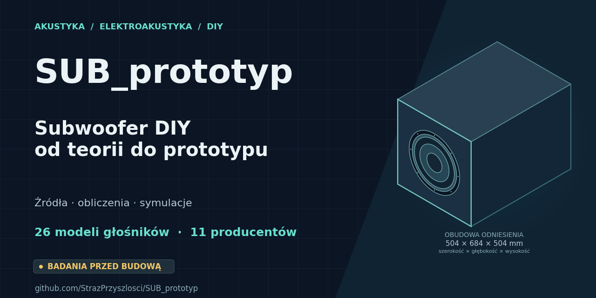

# Udostępnianie projektu i obraz podglądu

Stan sprawdzenia: 2026-10-26.

## Link do udostępnienia

[Główna strona SUB_prototyp](https://github.com/StrazPrzyszlosci/SUB_prototyp).
README prowadzi od krótkich wyjaśnień do wykresów, raportów i kodu.
Opis pola „About” jest także zapisany w [pliku tekstowym](opis_repozytorium.txt).

## Co może pokazać Facebook

Podgląd linku korzysta z metadanych strony, w tym obrazu `og:image`.
To odrębny mechanizm od ilustracji wewnątrz README. Meta opisuje go w
[dokumentacji udostępniania](https://developers.facebook.com/documentation/sharing/webmasters).

GitHub domyślnie udostępnia kartę z informacjami o repozytorium i awatarem
właściciela. Można zastąpić ją własną grafiką w ustawieniu „Social preview”.
[Instrukcja GitHub](https://docs.github.com/en/repositories/managing-your-repositorys-settings-and-features/customizing-your-repository/customizing-your-repositorys-social-media-preview)
zaleca 1280 × 640 px i plik PNG/JPG/GIF poniżej 1 MB.

**Sprawdzony stan repozytorium:** opis „About” został uzupełniony;
API GitHub zwróciło `usesCustomOpenGraphImage: false`, czyli automatyczny obraz.
Własna grafika jest przygotowana w plikach. Nie została ustawiona w panelu:
otwarta sesja przeglądarki nie jest zalogowana na GitHub.
Nie opublikowano posta na Facebooku ani nie sprawdzono podglądu na koncie użytkownika.

## Przygotowana grafika

- [PNG 1280 × 640 px do wgrania](../grafika/social-preview.png).
- [Wersja wektorowa SVG](../grafika/social-preview.svg).
- [Baner README](../grafika/README_baner.svg).
- [Kod generujący grafiki](../skrypty/grafiki_przewodnika.py).

Rysunek zachowuje proporcje obudowy odniesienia: 504 × 684 × 504 mm
(szerokość × głębokość × wysokość), wyprowadzone z założonego wnętrza
460 × 640 × 460 mm i ścianek 22 mm. Są to dane kontrolnego modelu,
nie końcowy wynik optymalizacji wymiarów. Nominalny obrys kosza pochodzi
z referencji C04; nie oznacza to wyboru końcowego głośnika.
Rzut jest izometryczny. [Pochodzenie grafiki i sumy plików](../grafika/pochodzenie.json).

## Ustawienie własnego podglądu

1. Otwórz [Settings repozytorium](https://github.com/StrazPrzyszlosci/SUB_prototyp/settings).
2. W części **Social preview** wybierz **Edit → Upload an image…**.
3. Wgraj `grafika/social-preview.png` i zatwierdź podgląd.
4. Przed udostępnieniem można sprawdzić link w
   [Meta Sharing Debugger](https://developers.facebook.com/tools/debug/).

Facebook zapisuje obrazy i metadane w pamięci podręcznej. Debugger może
ponownie pobrać dane strony; zmieniany obraz powinien otrzymać nowy URL.
Szczegóły opisuje [dokumentacja Meta](https://developers.facebook.com/documentation/sharing/webmasters).
Samo dodanie pliku PNG do repozytorium nie ustawia pola Social preview.

## Pierwszy release

**Release 1 powstanie po ukończeniu programu badań przed budową i końcowego PDF.**
Do wydania trzeba dołączyć raport, opis zakresu, wskazanie głośnika i konstrukcji
oraz sumę SHA-256 pliku PDF. Wydanie należy powiązać ze sprawdzonym commitem.
To przyszły etap; obecnie nie tworzymy pustego wydania ani zastępczego raportu końcowego.

## Redakcja źródeł handlowych

Na polecenie autora usunięto wskazane handlowe odwołania także z publicznych
indeksów archiwalnych. Wyniki liczbowe i brief pozostały bez zmian.
[Rejestr redakcji](redakcja_zrodel_20261026.json) zachowuje stare i nowe sumy plików.
Historyczne manifesty nadal opisują oryginalne przebiegi; redakcja publikacji
nie jest nowym wykonaniem badań. Dokładne oryginały zachowano prywatnie.
