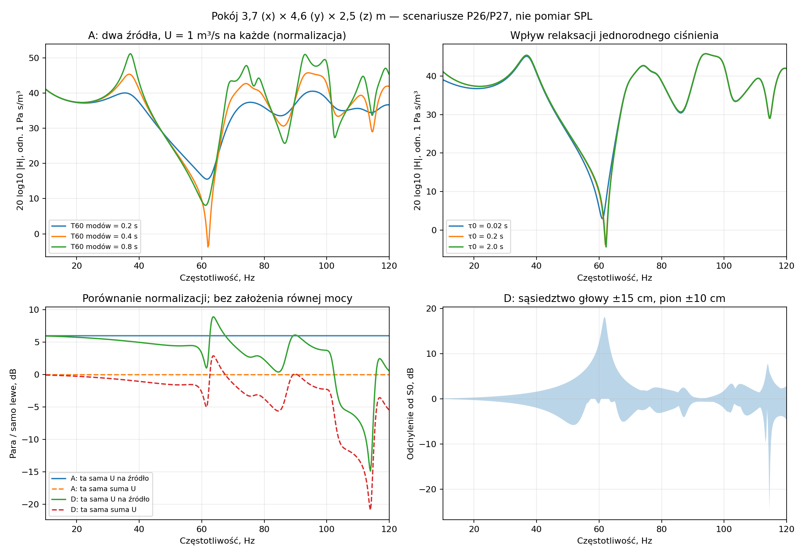

# Raport 013 — pokój, dwa źródła i rzeczywiste gabaryty

Stan: 2026-10-24. Badanie obliczeniowe P26/P27, przed budową. Pokój około
**4,6 × 3,7 × 2,5 m**, 17,02 m² i 42,55 m³. To przybliżone dane briefu;
nie jest to inwentaryzacja. Dokładność częstotliwości rzeczywistego pokoju
jest ograniczona jakością tych danych i idealizacją granic.

## Wynik dla doboru prototypu

Geometria pokoju została włączona do jawnej konfiguracji i kontroli zgodności.
Pierwsze idealne mody osiowe: długość **37,28 Hz**, szerokość **46,35 Hz**,
wysokość **68,60 Hz**. Obudowy i głośnika nie należy dobierać wyłącznie
według nominalnego SPL 20 Hz ani matematycznego optimum nieograniczonego Vb.
Potrzebne są też wykonalne miejsca dwóch skrzyń przy monitorach i kontrola
zespolonej sumy w jednym sweet spocie.

**Nie wskazano rzeczywistego najlepszego ustawienia ani zmierzonego room gain.**
Nie znamy dokładnych pozycji, strat ani impedancji granic. Poniższe liczby
opisują jawne scenariusze i sprawdzenia metody, a nie prognozę odpowiedzi mieszkania.
Końcowy wybór przetwornika i konstrukcji oraz końcowy PDF nadal wymagają
integracji pozostałych pakietów programu.

## Wejścia i eksperyment

Układ osi: x = szerokość 3,7 m, y = odległość od frontu wzdłuż 4,6 m,
z = wysokość 2,5 m. W starszym rozdziale wiedzy nazwy x/y były zamienione;
poprawiono je. Historyczny CSV modów zachowuje opisaną kolejność
długość/szerokość/wysokość. Skrypt bazowy sprawdza zgodność wymiarów z
[konfiguracją pokoju](../dane/konfiguracje/pokoj_odsluchowy.json).

Przyjęto przykładowe monitory `(0.65,0.65,1.1)` i `(3.05,0.65,1.1)` m
oraz głowę `(1.85,3.1,1.1)` m. Odległość głowy od każdego monitora wynosi
**2.728 m** i spełnia zakres briefu 2,5–3 m.
To założenie eksperymentu, nie odczyt rzeczywistego ustawienia. Siedem punktów
odbioru to S0 i sześć sąsiednich przesunięć ±15 cm w poziomie, ±10 cm w pionie.
Sąsiedztwo służy diagnostyce; nie optymalizujemy całej kanapy.

| Wariant | Lewe źródło xyz [m] | Prawe źródło xyz [m] | Status |
|---|---|---|---|
| A | `[0.65, 0.65, 0.3]` | `[3.05, 0.65, 0.3]` | symetrycznie przy założonych monitorach |
| B | `[0.85, 0.35, 0.3]` | `[2.85, 0.35, 0.3]` | bliżej frontu i osi pokoju; wykonalność niepotwierdzona |
| C | `[0.5, 1.0, 0.3]` | `[3.2, 1.0, 0.3]` | dalej od frontu; wykonalność niepotwierdzona |
| D | `[0.65, 0.35, 0.3]` | `[3.05, 1.0, 0.3]` | niesymetryczna głębokość przy monitorach, bez tylnej ściany |

Każdy punkt źródła oznacza okolicę frontu promieniującego, a nie środek bryły
skrzyni. Żaden wariant nie wykorzystuje swobodnie tylnej ściany pokoju.
Wykonalność konkretnych gabarytów badamy osobno; część tych pozycji nie jest
osiągalna dla sprawdzonej sześciennej rodziny obudów.

Policzono **15 876 wierszy transmitancji S0** w 10–120 Hz co 0,25 Hz,
**1 512 wierszy diagnostycznych** przy 20/25/31,5/40/63/80 Hz,
**120 przypadków opóźnienia/polaryzacji** i **48 przypadków gabarytu**.
Trzy modalne czasy spadku obwiedni 0,2/0,4/0,8 s i osobne czasy relaksacji
jednorodnego ciśnienia 0,02/0,2/2 s tworzą dziewięć scenariuszy strat.
Nie są zmierzonym RT60 ani wynikiem przypisania pochłaniania betonowi i wełnie.

## Model i niezależne kontrole

Pełne równania, jednostki i wyprowadzenie są w
[rozdziale 09](../baza_wiedzy/09_zespolony_model_pokoju.md).
Użyto cosinusowej bazy Neumanna, dodatnich diagonalnych strat modalnych,
osobnego członu jednorodnego sprężania i jawnie regularizowanego rozłożonego
źródła/odbioru. Prędkość dźwięku 343 m/s i gęstość 1,204 kg/m³ są założeniami.
Regularizacja jest parametrem modelu, nie wymiarem membrany konkretnego głośnika.

Podstawa literaturowa: [Meissner i Wiśniewski (2020)](https://pmc.ncbi.nlm.nih.gov/articles/PMC7481690/)
oraz [COMSOL — analityczny model sztywnych granic](https://www.comsol.com/model/download/1166101/models.mph.eigenmodes_of_room.pdf).
Nie odtworzono pełnego modelu impedancyjnych granic z artykułu. Nie użyto
częstotliwości ani współczynników obcego pomieszczenia jako danych naszego pokoju.

Kontrola normalizacji kwadraturą Gaussa: maksymalny błąd
**1.78e-15**.
Niezależna zamknięta funkcja Greena 1D względem 40 001 składników szeregu:
maksymalny względny błąd **1.03e-09**.
Sprawdzono wzajemność, dodatnią hermitowską część impedancji portów,
symetrię, granice relaksacji 0/∞ i niskich częstotliwości oraz błędne wejścia.
To weryfikacja modelu i kodu, nie walidacja fizyczna pokoju.

| kmax [1/m] | Liczba modów | Względny błąd zespolony / maksimum odniesienia | Maks. różnica pary [dB] |
|---:|---:|---:|---:|
| 25 | 12185 | 6.28e-05 | 0.0853995 |
| 40 | 48420 | 2.5e-08 | 2.64179e-05 |
| 55 | 124132 | 0 | 0 |

Odniesienie to kmax = 55 1/m. Kontrola obejmuje cztery ustawienia, S0,
całą siatkę 10–120 Hz i scenariusz modalny 0,4 s / relaksacja 0,2 s.
Zgodność dwóch ucięć nie dowodzi zgodności fizycznego pokoju z modelem.
Osobna zmiana szerokości regularizacji źródła 0,10/0,12/0,18 m w sześciu
pasmach daje maksymalnie **0.167 dB** zmiany względem 0,12 m.
To czułość na model źródła, nie tolerancja produkcji głośnika.

## Jeden i dwa subwoofery: co faktycznie wynika

Dla idealnej symetrycznej pary i odbioru na osi oba wkłady są równe.
Przy tej samej prędkości objętościowej U każdej sztuki suma daje 6,0206 dB
względem pojedynczej. **Kształt odpowiedzi w tym punkcie pozostaje taki sam.**
Przy stałej sumie U, czyli U/2 na każdą sztukę, ten sam przypadek daje 0 dB.
Nie jest to porównanie przy stałej mocy elektrycznej. Oddzielne wzmacniacze,
wspólny zasilacz i obciążenie promieniowaniem wymagają dalszych modeli.

Para symetryczna usuwa z pobudzenia nieparzyste mody szerokości, lecz nie
mod długości 37,3 Hz, bo źródła są na tej samej głębokości. Odbiornik dokładnie
na osi sam też nie widzi nieparzystych modów szerokości. Dlatego korzyści
drugiej sztuki w takim punkcie nie wolno utożsamiać z ogólnym wyrównaniem basu.

| Scenariusz 0,4 s / 0,2 s | Min. para / lewe 20–100 Hz [dB] | Maks. para / lewe [dB] | Największa zmiana w sąsiedztwie [dB] |
|---|---:|---:|---:|
| A | 6.02 | 6.02 | 25.77 |
| B | 6.02 | 6.02 | 22.73 |
| C | 6.02 | 6.02 | 11.76 |
| D | 0.40 | 8.93 | 18.13 |

Duże różnice przy ruchu głowy występują przy głębokich modelowych dołkach;
nie są prognozą ich zmierzonej głębokości. Nie przenosić tych liczb do specyfikacji
THD, headroomu ani EQ. Niesymetryczny wariant D z opóźnieniem 2 ms ma w badanej
siatce minimum około −6,52 dB względem samego lewego źródła przy tej samej U.
Druga sztuka może więc osłabiać wynik w części pasma. Opóźnienie 2 ms nie jest
rekomendowanym presetem. W idealnej symetrii odwrócenie polaryzacji daje
analityczne zero w S0; nie raportujemy numerycznego błędu jako fizycznego SPL.

## Gabaryt a ustawienie: konieczny test, jeszcze bez projektu

Badana poglądowa rodzina: komora sześcienna, założone dodatkowe 10 l wyporności,
ściany 22 mm i front 44 mm. To założenia do porównania; ani grubość, ani wyporność
nie są jeszcze rekomendacją. Nie sprawdzono tu otworu, magnesu, wręg, masy,
pozycji monitorów i mebli. Przyjęty prześwit 0,1 m jest parametrem scenariusza.

Dla 100 l netto dostajemy zewnętrznie około **52,3 × 54,5 × 52,3 cm**.
Jeśli front promieniujący stoi 65 cm od przedniej ściany (A), za skrzynią
zostaje około **10,5 cm**. Jeśli front stoi 35 cm od ściany (B oraz lewe D),
taka skrzynia przecina ścianę: wariant wymaga innej geometrii lub pozycji.
Nie rekomendujemy go na podstawie korzystnej krzywej akustycznej.

Dla 379 l netto zewnętrzna głębokość tej rodziny wynosi około 79,6 cm,
a dla 753 l około 98,0 cm. Pierwsza mieści się za frontem oddalonym o 1 m
z prześwitem około 20,4 cm, druga zostawia tylko około 2 cm.
To nie dowód niemożności dowolnej konstrukcji w tym pokoju: inny kształt zmienia
ten wynik. Pokazuje jednak, że matematyczne granice Vb z raportu 011 muszą
przejść ocenę miejsca dwóch egzemplarzy, masy, przejść i ustawienia monitorów.

## Granice wyniku i dalsza praca

Nie ma jeszcze sprzężenia zwrotnego ciśnienia pokoju z ruchem membrany,
rzeczywistej impedancji ścian, drzwi ani modelu mebli. Wyznaczamy H=p/U
dla zadanego U; nie jest to przewidywany SPL konkretnego głośnika przy napięciu.
Jednorodna sztywność pokoju względem gazu skrzyni 100 l wynosi około 0,235%;
ta mała liczba nie rozstrzyga reakcji modalnej przy rezonansie.

Najbliższy krok programu: P06 — globalna niepewność i odporność porównania
24 kandydatów. Dokładne pozycje i przekrój dwóch skrzyń włączymy do P27/P29,
gdy będą znane; obecna siatka nie staje się ukrytym pomiarem geometrii.
Tor pomiarowy nadal jest odłożony do czasu budowy.

Kod: [model](../skrypty/model_pokoju.py), [kontrole](../skrypty/sprawdz_pokoj.py),
[kampania](../skrypty/analiza_pokoju.py). Dane:
[scenariusze](../dane/konfiguracje/p26_scenariusze.json),
[podsumowanie](../wyniki/p26_p27_podsumowanie.json),
[S0](../wyniki/p26_transmitancje_S0.csv),
[sąsiedztwo](../wyniki/p26_punkty_diagnostyczne.csv),
[faza](../wyniki/p27_faza_i_opoznienie.csv),
[gabaryty](../wyniki/p27_konieczne_gabaryty.csv),
[zbieżność](../wyniki/p26_zbieznosc.csv),
[regularizacja](../wyniki/p26_regularizacja_zrodla.csv).
