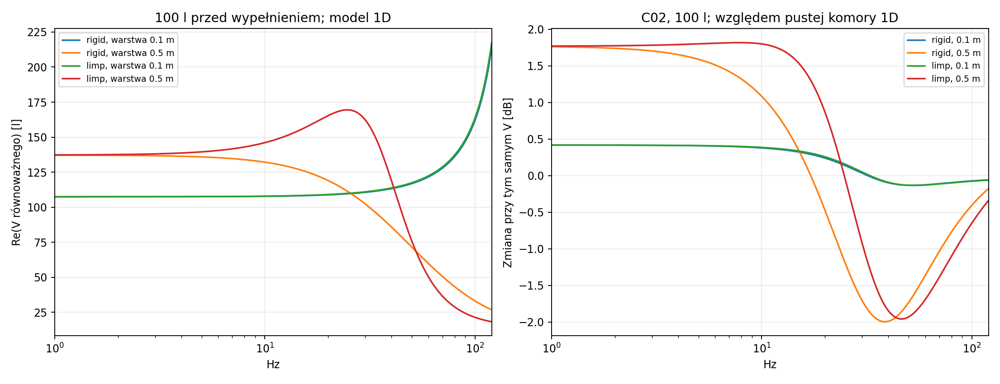
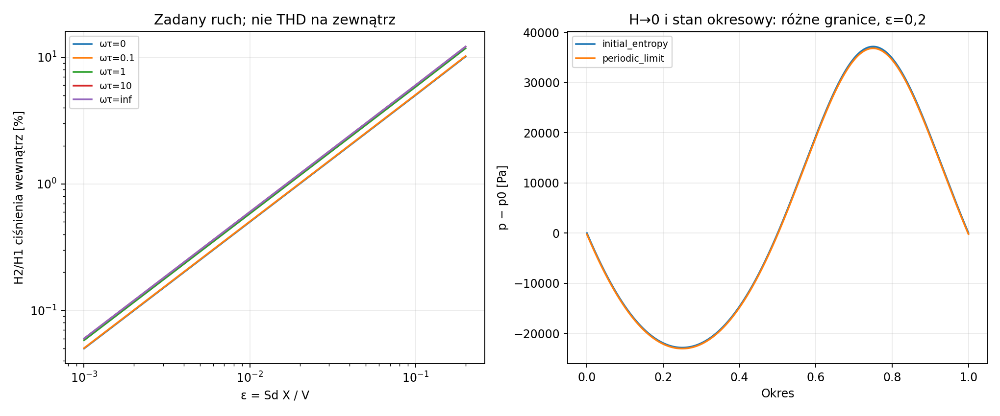
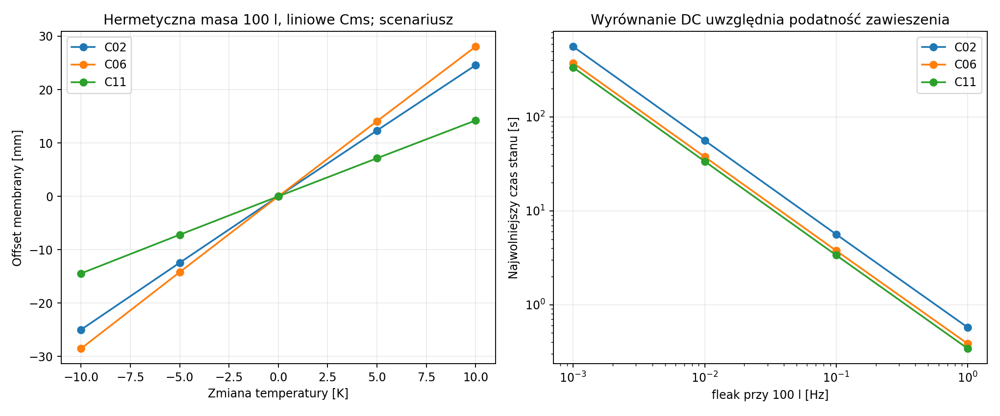

# Raport 016 — gaz, wypełnienie i granice szczelności

Stan: 2026-10-24. Badania P09/P10 przed budową, **24 modele przetworników**.
To raport cząstkowy; pojedynczy wybór głośnika i konstrukcji oraz końcowy
PDF wymagają pozostałych pakietów programu. Dwa modele 10-calowe są kontrolami.

## Wynik wpływający na projekt

Wypełnienie nie ma jednego stałego „bonusu objętości”. Zmienia zespoloną
podatność, straty i niekiedy masę akustyczną. Zmiana sztywności gazu może
pomóc przy tym samym napięciu, a zarazem pogorszyć modelowe F3 przez tłumienie.
Nie zwiększa samego limitu Sd·X, gdy napęd już osiąga przyjęty limit ruchu.

Dla RSS390HF-4, 100 l, szczelnej komory i 20 Hz:

- koniec izotermiczny daje około **+1,06 dB przy tym samym V**;
- relaksacja 5 ms daje około **+0,13 dB**, mimo części rzeczywistej podatności
  odpowiadającej około 122,6 l;
- projekcja F3 bez Le wynosi około **32,30 Hz adiabatycznie**, **32,19 Hz
  izotermicznie**, lecz **34,57 Hz dla 5 ms**;
- przy budżecie 40 Vrms/12 Arms i pełnym katalogowym X wszystkie trzy
  warianty dochodzą do tego samego modelowego limitu ruchu około 101,89 dB
  w normalizacji 2π/1 m/RMS. Mniejsza sztywność nie tworzy dodatkowego Sd·X.

To porównanie modeli, bez deklaracji rzeczywistego THD i room gain.
Nie przypisano podanych czasów relaksacji konkretnej włókninie.

## Wykonany zakres

| Obszar | Wykonane przypadki / wiersze |
|---|---:|
| Termika, napęd, Vb=30/60/100/150 l; 7 profili, 3 przecieki i 6 częstotliwości | 12 096 |
| Projekcja F3 dla Le=0 względem asymptoty modelu | 2 016 |
| Warstwy ZK, szkielet nieruchomy/wiotki, dwa Cp i umowna sorpcja | 17 280 |
| Bezwymiarowe przebiegi nieliniowego gazu i granice cieplne | 56 |
| Odwzorowanie gazu na 24 modele, amplitudy i temperatury | 15 552 |
| Hermetyczne offsety cieplne i barometryczne | 1 440 |
| Wyrównanie DC z kontrolą biegunu pełnego stanu | 384 |
| Nieliniowe bilanse cyklu pracy/ciepła/dostępności | 42 |

Częstotliwości porównawcze: 20/25/31,5/40/63/80 Hz. Dodatkowe gęste siatki
służą badaniu relaksacji i zbieżności. Limity dotyczą osobnych sinusów.
0,7/1,0 katalogowego X nie jest wspólnym progiem THD różnych producentów.

## Równania i zgodność fizyczna

Ośrodek wynika z p0=101325 Pa, T0=293,15 K, gamma=1,4 i R=287,05 J/(kg K):
rho=1.204118 kg/m³, c=343.232 m/s.
Mms/Cms/BL/Rms przetworników zachowano z pierwotnej identyfikacji T/S.
Re pozostaje stałe, aby wydzielić wpływ gazu; nie jest to model grzania cewki.
Nie przeliczano mechaniki po zmianie temperatury gazu. Regresję do dawnego
ośrodka rho=1,2041/c=343 wykonano osobno; drobne różnice ostatnich cyfr
nie są poprawą osiągów.

Z bilansów gazu otrzymano dodatni model relaksacyjny:

```text
K(s)=p0*(1+gamma*s*tau)/(1+s*tau)
Fbox=K0*y+sum[Dk_j*(y-q_j)]
y_dot=v-G*Fbox/Sd²
q_j_dot=(y-q_j)/tau_j
```

Energia elektryki, mechaniki i komory spełnia:

```text
dE/dt=V*i-Re*i²-Rms*v²-G*Fbox²/Sd²
      -sum[Dk_j*(y-q_j)²/tau_j]
```

Przeciek i wymiana ciepła mają oddzielne dodatnie straty. Zachowano stały Ra
przy zmianie Vb, definiując go przez częstotliwość odniesioną do 100 l.
Redukcje tau=0/∞, Ra=0/∞ i Le=0 usuwają zbędne stany. Nie dodano drugi raz
diagnostycznej mocy promieniowania do Rms. Dla przecieku metryka SPL zakłada
wspólną fazę drogi zewnętrznych źródeł; geometria rzeczywistego przecieku jest otwarta.

**F3 w tabeli jest projekcją Le=0**, z pierwszym przejściem w górę przez −3 dB
względem asymptoty matematycznego modelu. Wiele biegunów relaksacji nie daje
jednego bezwarunkowego Fc/Qtc. Nie zastosowano do nich wzoru obudowy 2. rzędu.
Model warstwowy ma własne rezonanse i nie otrzymał fikcyjnego katalogowego F3.

## Podatność, strata i headroom

Przykład 100 l bez przecieku. Kolumny SPL są różnicą względem adiabatycznego
wariantu tego samego głośnika. Maksimum uwzględnia modelowe V/I/X, bez termiki cewki.

| Model / profil | Zmiana przy tym samym V, 20 Hz [dB] | Zmiana limitu40V/12A/1X [dB] |
|---|---:|---:|
| C02 / ISOTHERMAL | +1.062 | +0.000 |
| C02 / T005 | +0.129 | +0.000 |
| C06 / ISOTHERMAL | +0.489 | +0.000 |
| C06 / T005 | -0.032 | +0.000 |
| C11 / ISOTHERMAL | +0.660 | +0.660 |
| C11 / T005 | +0.138 | +0.138 |

T005 oznacza 5 ms. C02 to RSS390HF-4, C06 — STX W.32.800.8.FCX,
C11 — RSS390HE-22. Przy tym samym napięciu różnica nie jest taka sama
jak przy tym samym ograniczeniu wychylenia. Dla C11 napięcie pozostaje
ograniczeniem w tym przykładzie, dlatego podatność może zwiększyć limit modelu.

## Materiał: geometria porów, mocowanie i pojemność cieplna

Model Zwikkera–Kostena obejmuje straty lepkościowe i cieplne w okrągłych
porach. Oryginalne obrazy równań 12/14/19/20/24/25/01 z
[dokumentacji COMSOL](https://doc.comsol.com/6.3/doc/com.comsol.help.aco/aco_ug_pressure.05.182.html)
obejrzano w przeglądarce. Promień poru nie jest średnicą włókna.
Porównano promienie 50/200/1000 µm, phi=0,98, szkielet nieruchomy i wiotki,
tylną warstwę 5/10/50 cm w komorze 1D o głębokości 50 cm.
Gęstość suchego szkieletu 20 kg/m³ jest założeniem, nie kartą produktu.

Porowatość jest już w zespolonej gęstości i module. Tabela zachowuje także
ubytek prawdziwej objętości gazu przez materiał. Pełne wypełnienie phi=0,98
daje geometrycznie 98 l gazu zamiast 100 l; nie odejmowano tego drugi raz.
Porównanie prowadzi do pustej komory1D o tej samej geometrii. Model portu
uśrednionego nie potwierdza dopasowania kosza, przejściówki ani gabarytu w pokoju.
Re(V_equivalent) na wykresie może wzrosnąć powyżej końca izotermicznego
wskutek reaktancji i zbliżania się do rezonansów portu. Nie jest to taki
sam wzrost statycznej podatności ani geometrycznego litrażu.

Dwa bilanse cieplne pokazują znaczenie skończonej pojemności materiału:

```text
Klow=p0*[1+(gamma-1)*Cg/(Cg+Cs)]
tau_eff=Cg*Cs/[Hgs*(Cg+Cs)]
```

Przy izolowanym od otoczenia materiale Cs=Cg dolny moduł wynosi 1,2*p0,
a nie p0. Rezerwuar o nieskończonej pojemności cieplnej jest osobnym końcem
modelu. Nie wyprowadzamy Cs ani Hgs z samej masy upakowanej włókniny.

Odtworzenie cieplnej części ZK dodatnim widmem relaksacji daje dla poru 200 µm:

| Liczba członów | Maks. względna różnica modułu względem ZK |
|---:|---:|
| 1 | 6.706% |
| 4 | 4.924% |
| 16 | 0.299% |

Wagi są nieujemne, a granice izotermiczna i adiabatyczna są zachowane.
Jedna relaksacja nie odtwarza dokładnie rozproszonej dyfuzji. Siatki kilku
czasów nie są zagnieżdżone, więc błąd nie musi monotonicznie maleć przy
każdej zmianie liczby członów. To dopasowanie do modelu porów, nie do pomiaru włókniny.

Karta [ISOVER Aku-Płyta, 2022](https://www.isover.pl/documents/karta-produktu-pds/kt-aku-plyta-aku-plat-202206.pdf)
podaje **AFr≥5 kPa*s/m²**. Ten parametr jest dolną granicą oporności właściwej,
nie oporem konkretnej warstwy ani pełną identyfikacją. W odczytanej dokumentacji
Delany–Bazley ma warunek 0,01≤rho*f/sigma≤1. Przy podanej dolnej granicy sigma
górne ograniczenie tej liczby w 20–40 Hz wypada poniżej 0,01. Nie użyto więc
niezweryfikowanej ekstrapolacji DB/Miki do tego zakresu.
Przewodność cieplna materiału lambda_D=0,037 W/(m K) nie została użyta
jako przewodność gazu. Do wyboru konkretnego wypełnienia nadal brakuje
porowatości, stanu szkieletu, mikrostruktury, Cp i przewodnictwa wymiany ciepła.

## Wyjątek: sorpcja nie jest samą izotermicznością

Oryginał [Venegas et al., Forum Acusticum 2023](https://dael.euracoustics.org/confs/fa2023/data/articles/000280.pdf)
pobrano i obejrzano na stronach 2–5, wraz ze wszystkimi rysunkami.
Równanie 11 zawiera porowatość pozorną Phi, która może przekraczać 1.
Przykład Phi=2,2563 i udziału 0,25 służy tutaj tylko jako statyczny parametr
umownej rodziny. Widmo 0,001/0,01/0,1s jest naszym założeniem.
Zespolona dodatkowa podatność została skonstruowana pasywnie i zbadana
w naszym modelu zamkniętym. Jej parametrów nie zidentyfikowano dla produktu.

Wykresy źródłowe dotyczą **modelu bass-reflex**, r=1 m, e_g=sqrt(8)V,
Rg=0 i zadanych parametrów. Nie przyjęto niepodanej konwencji RMS/peak ani
nie przeniesiono ich SPL do naszego sealed. Transkrypcję tekstu Wright/KEF
także przeczytano, lecz PDF na pierwszym hoście zwracał403. Automatycznych
tablic punktów jego wykresów nie zaakceptowano. Nie jest to rekomendacja
użycia dowolnego węgla aktywnego ani gwarancja stałego bonusu objętości.

## Identyfikowalność materiału i strat

Wykonano **432 lokalne audyty** logarytmicznych parametrów Vb/tau/przecieku/
dodatkowego oporu. Jeden punkt zespolonej impedancji ma dwa rzeczywiste
składniki dla czterech niewiadomych. W sześciu częstotliwościach
288 przypadków miało numerycznie pełny rząd przy
przyjętym progu 1e-8; pozostałe wykazywały dodatkową degenerację lub bardzo
złe uwarunkowanie. Pełny rząd nie oznacza dobrej dokładności estymacji przy szumie.

Dokładna swoboda Rms+Rextra jest odrębnym problemem: zmiana jednego
składnika i przeciwna zmiana drugiego nie zmienia impedancji w tym modelu.
Kontrola 24 głośników daje błąd prądu około 2.96e-16.
Dlatego rozdzielenie strat materiału wymaga niezależnej konfiguracji bazowej
głośnika. Dla znanego Cg i pełnego, dokładnego widma 2T pokazano także
symboliczną możliwość odzyskania Hgs/Cg, Hgs/Cs i Hs0/Cs. To warunkowy
wynik modelowy; rzeczywista identyfikacja pozostaje po budowie.

## Nieliniowy gaz: amplituda, temperatura i niezamienne granice

Rozwiązano gaz z zadanym `V/V0=1+epsilon*sin(omega*t)` i wymianą Newtona.
Nowe wyniki obejmują przebiegi pośrednie, odmienną temperaturę początkową
i stałe H, a nie tylko dotychczasowe adiabatyczne 72 przypadki.
H2/H1 i H3/H1 są harmonicznymi **ciśnienia wewnątrz i siły gazu przy
narzuconym ruchu**, nie rzeczywistym THD akustycznym głośnika.

Transformacja `Z=(T/T0)*(V/V0)^(gamma-1)` daje liniowy filtr dla wymuszenia
`(V/V0)^(gamma-1)`. Rozwiązanie okresowe FFT porównano z niezależnym strzelaniem
ODE/Radau. Sprawdzono też dodatnią dostępność gazu oraz bilans pracy i ciepła.

Istotny przypadek graniczny: H=0 z początkową entropią i granica H→0 po
osiągnięciu stanu okresowego dają inne DC i amplitudę siły. Dla epsilon=0,2:

| Koniec adiabatyczny | Średnie p−p0 [Pa] | Amplituda składowej podstawowej [Pa] | H2/H1 [%] |
|---|---:|---:|---:|
| initial_entropy | 3536.94 | 29576.26 | 12.1109 |
| periodic_limit | 3282.60 | 29504.52 | 12.1109 |

Ten duży epsilon jest testem modelowej granicy; nie jest zadeklarowanym
ruchem prototypu. Same zgodne procenty harmonicznych nie potwierdzają
zgodnego ciśnienia DC ani siły podstawowej.

## Hermetyczna masa a powolne wyrównywanie ciśnienia

Dla idealnie uwięzionej masy 100 l, C02 i powolnego ogrzania o 5 K przy
stałym ciśnieniu na zewnątrz model liniowego zawieszenia daje offset około
**12,34 mm**. To **formalna granica hermetyczności**, nie prognoza dla
rzeczywistej skrzyni mającej mikroprzecieki. Dla części scenariuszy wynik
wykracza poza katalogowy ruch; oznaczono tam granicę modelu Cms, nie położenie
po uderzeniu w ogranicznik. Sprawdzono także zmianę zewnętrznego ciśnienia ±1000 Pa.

Czas wyrównania DC zależy od powietrza i od podatności membrany:

```text
tau_DC = Ra*(V/p0+Sd²*Cms)
```

Dla C02/100l i cieplnego profilu5ms:

| fleak przy 100 l [Hz] | Czas najwolniejszego bieguna [s] | Największa zmiana 20–80 Hz na sprawdzonej siatce [dB] |
|---:|---:|---:|
| 0.001 | 560.699 | 0.000174 |
| 0.01 | 56.081 | 0.001743 |
| 0.1 | 5.619 | 0.017437 |
| 1 | 0.573 | 0.174766 |

To wskazuje możliwość rozdzielenia bardzo wolnego wyrównywania barometrii
od pracy w basie. Liczby nie dobierają geometrii otworu. Nieznane pozostają
bezwładność, przepływ nieliniowy, rzeczywisteRa i jego powtarzalność po montażu.
Są to dane do eksperymentu prototypowego, nie polecenie wywiercenia otworu.

## Weryfikacja niezależna i ograniczenia

- **2016 stabilnych realizacji stanu**; sprawdzono macierz energii i końce.
- Największy względny bilans mocy: **8.62e-16**.
- Niezależny układ 5 równań termodynamiki: błąd ruchu **2.41e-15**.
- Regresja do adiabatycznego N7: **5.58e-16**.
- Radialna dyfuzja pędu/ciepła metodą FV, 36 przypadków i siatki 64–512:
  maksymalna różnica przy 512 komórkach **1.3e-05** względem Bessela.
- ODE vsFFT nieliniowego gazu: maksymalna różnica p/p0 **9.66e-12**.
- Sprawdzono 7 tożsamości symbolicznych, w tym dostępność, identyfikację 2T i pasywność sorpcji.
- Skontrolowano V/I/X dla 117 504 wariantów sinusoidalnych.
  Dla 49 675 przypadków z aktywnym X niezależna granica
  `p=rho*omega²*Sd*Xpeak/(sqrt(2)*2*pi)` zgadza się względnie do
  3.44e-15. Nie jest to limit termiczny.
- Dla 42 cykli maksymalny względny bilans energii wynosi 8.45e-08,
  a bilans dostępności 9.41e-14.

Zgodność matematyki nie identyfikuje materiału ani nie waliduje urządzenia.
Port 1D ma uśrednione ciśnienie; masa powietrza wymaga uzgodnienia z Mmd/Mms
w P11. Pełny nieliniowy napęd, zawieszenie, termika cewki i limitery pozostają
odrębnymi pakietami. Dokładne pozycje w pokoju 4,6 × 3,7 × 2,5 m są nadal nieznane
(U-017). Nie przypisano stałego room gain i nie wybrano toru pomiarowego.

## Rekomendacja dla dalszego projektu

Zachować regulację znanej objętości geometrycznej oraz możliwość demontażu
i odtwarzalnego mocowania wypełnienia. Zapisywać masę, objętość wypartego
powietrza i stan materiału. Weryfikować osobno zmianę podatności, straty
i bardzo wolne wyrównanie ciśnienia. Nie wybierać końcowego litrażu przez
dopisanie stałego procentu do Vb.

Najbliższy krok: **P11 — skończony tłok, obciążenie promieniowaniem i
konwencja Mmd/Mms**, następnie P12/P13 nieliniowy napęd. Końcowy wybór
jednego głośnika i jednej konstrukcji z obliczonym klejem pozostaje P19/P29.






Kod: [gaz](../skrypty/model_gazu.py), [wypełnienie](../skrypty/model_wypelnienia.py),
[nieliniowa termodynamika](../skrypty/termodynamika_nieliniowa.py),
[kontrole](../skrypty/sprawdz_gaz_i_wypelnienie.py),
[tożsamości](../skrypty/audyt_termodynamiki.py),
[kampania](../skrypty/analiza_gazu_i_wypelnienia.py).
Wejścia:[konfiguracja](../dane/konfiguracje/p09_p10_gaz_i_wypelnienie.json),
[źródła](../dane/zrodla/P09_P10_materialy_i_sorpcja.json).
Wyniki:[termika/napęd](../wyniki/p09_relaksacja_i_naped.csv),
[projekcje F3](../wyniki/p09_projekcja_F3.csv),
[wypełnienie](../wyniki/p09_modele_wypelnienia.csv),
[gaz dla 24 modeli](../wyniki/p10_gaz_dla_przetwornikow.csv),
[offsety](../wyniki/p10_offset_cieplny_i_barometryczny.csv),
[DC](../wyniki/p10_wyrownanie_DC.csv),
[identyfikowalność](../wyniki/p09_identyfikowalnosc_wypelnienia.csv),
[weryfikacja](../wyniki/p09_p10_weryfikacja.json),
[podsumowanie](../wyniki/p09_p10_podsumowanie.json).
