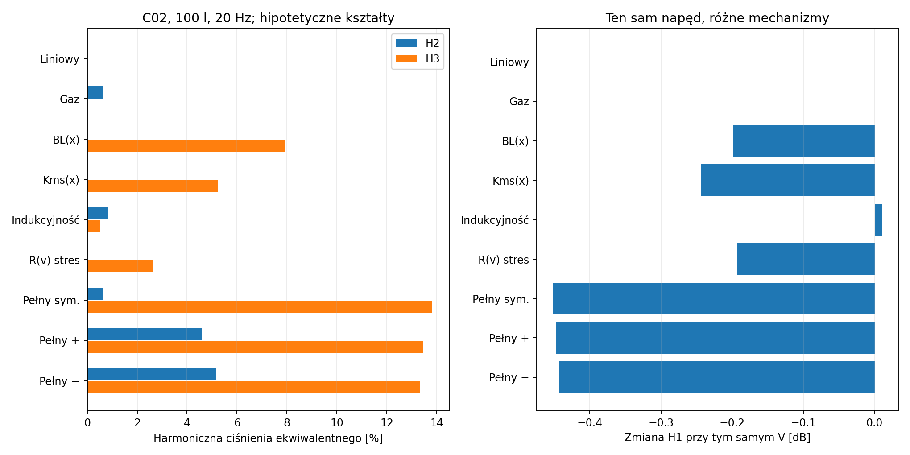
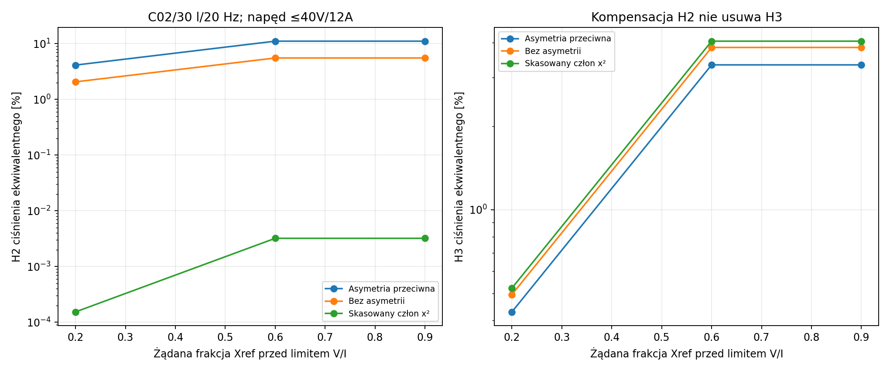
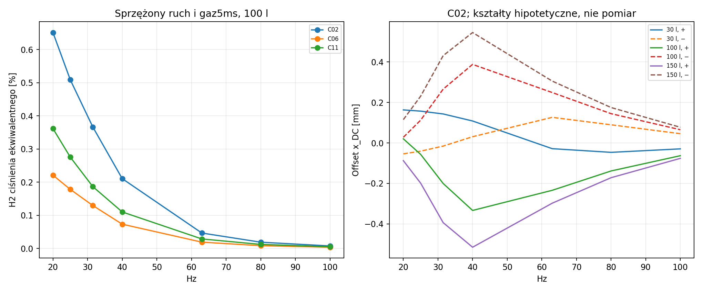

# Raport 020 — nieliniowy napęd i sprzężony gaz

Stan: 2026-10-24. **Obliczenia i symulacje P12/P13 przed budową.**
Wykonano 12 096 przypadków (spacje/komórki poniżej podają dokładny zakres).
Katalogowe bazy24modeli połączono z9jawnymi rodzinami mechanizmów.
Kształty BL/Kms/Le/R(v) są założeniami, **nie pomiarami tych24produktów**.
Nie jest to ranking rzeczywistego THD, raport końcowy ani finalny wybór.
Bramki jakości źródeł puli pozostają aktualne, w tym konflikt4/8Ω C07
i niepotwierdzony aktualny status katalogowy C11.

## Wynik wpływający na projekt

1. Nieliniowości wymagają wspólnego rozwiązania ruchu, prądu i gazu.
   Nie wystarczy dodać procentów harmonicznych niezależnych mechanizmów.
   Wykazano warunkową kompensację H2, z zachowaniem H3 i zależności od Vb.
2. Sygnał sinusoidalny dobrany z liniowej obwiedni V/I/X nie chroni rozruchu:
   **4scenariusze opuściły dziedzinę |x|≤1,25Xref przed pierwszym cyklem**.
   Odrębny solver potwierdził te przekroczenia. Nie są prognozą uszkodzenia
   rzeczywistego C05/C17; dotyczą hipotetycznych krzywych i startu od zera.
3. Katalogowe X nie jest wspólną granicą małego THD. Nieznane kształty
   istotnie zmieniają harmoniczne i DC przy tym samym napędzie.
4. Dane Le@1kHz nie identyfikują cewki w basie. Nowa karta Purifi pokazuje
   wyraźnie różne krzywe indukcyjności L_gen(x,f), nie utożsamione tu z Ld;
   potrzebny jest kolejny model z pamięcią
   prądów wirowych, zanim użyjemy źródłowych krzywych jako realizacji produktu.

## Dziedzina doświadczenia

| Wejście | Zakres / warunek |
|---|---|
| Bazy T/S |24modele,11producentów; C12 i C18 to kontrole10″ |
| Vb netto |30/60/100/150 l |
| Sinusy |20/25/31,5/40/63/80/100 Hz; każdy osobno |
| Napięcie |0,25/0,75 liniowej obwiedni min(40Vrms,12Arms/I1,Xref/X1) |
| Rodziny |Liniowa, gaz, BL, Kms, indukcyjność, stres R(v), pełna symetryczna i dwie asymetryczne |
| Gaz |Szczelny, idealny, tau=5ms; Re/T cewki zamrożone |
| Początek |Wszystkie stany zerowe, sinus od fazy0; brak łagodnego rozruchu |
| Czas |16cykli startowo, wydłużanie do64; osobne badanie nierozstrzygniętego punktu do128 |
| Próbowanie widma |4pełne ostatnie cykle,256próbek/cykl; kontrole do1024 |
| Solver serii |LSODA, rtol2e-8, atol2e-10; czas znormalizowany przez fazę |
| Sprzężenie frontu |Mms/Rms efektywne, bez nowego operatora promieniowania |
| Pole diagnostyczne |Monopol4π/1m/RMS; H2–H10 z przyspieszenia, bez twierdzenia o realnej kierunkowości |

9×24×4×7×2=**12 096**. Zatrzymanie dziedziny i brak wygaszenia nie są
usuwane z liczby przypadków. Wyższe harmoniczne sięgają1kHz; nie zakładamy
automatycznie kompaktowości fizycznej membrany w całym tym zakresie.
Szczyty ruchu/prądu w tabeli są szczytami z siatki. Nie są certyfikatem
ciągłego maksimum ani wynikiem mechanicznego zderzenia z ogranicznikiem.

Stała tau w różnych Vb oznacza różne H=m*cv/tau. Podawane temperatury
dotyczą gazu, nie cewki. Nie przyjęto wspólnej termicznej mocy katalogowej.

## Równania i kontrola energii

Źródło definiuje Kms(x) jako **sztywność sieczną Fs/x**. Jej styczna
wynosi dFs/dx, a energia to całka Fs dx. Wprowadzenie tej samej krzywej
jako pochodnej Fs dałoby inny model. Współczynniki w kodzie są w SI.

```text
Fs = x/Cms*(1+k1*q+k2*q²+k4*q⁴), q=x/Xref
BL = BL0*exp(b1*q-b2*q²-b4*q⁴)
lambda = Lsigma*i+Lp(x)*Is*tanh(i/Is)
Wco = integral_0^i lambda(x,j)dj
Frel = partial(Wco)/partial(x)
Ld = partial(lambda)/partial(i)>0
V = Re*i+Ld*di/dt+[BL+partial(lambda)/partial(x)]*v
M*dv/dt = BL*i+Frel-Fs-R(v)*v+Sd*(p-p0)
```

Dodatnie Lsigma i odpowiednie ograniczenia wielomianu zapewniają
dodatnią indukcyjność różniczkową oraz dodatnią styczną zawieszenia
w zadanej rodzinie. Nie są katalogowymi tolerancjami żadnego modelu.
Granica Is→∞ daje liniowy strumień w prądzie. Le=0 ma dokładną redukcję
algebraiczną prądu. Nie pomylono Le siecznego z różniczkowym Ld.

```text
Vgas=V0+Sd*x
p=p0*(T/T0)/(Vgas/V0)
Tdot=-(gamma-1)*T*Sd*v/Vgas-(T-T0)/tau
E=0.5*M*v²+Us+i*lambda-Wco+Agas
Edot=V*i-Re*i²-R(v)*v²-Dheat
```

Agas jest dostępnością gazu względem p0/T0, a Dheat≥0. Cztery tożsamości
sprawdzono symbolicznie; niezależny gradient energii w12punktach daje
maksymalny względny defekt 2.82e-09.
W bezstratnym teście dryf energii wynosi 2.7e-11.
Celowe pominięcie Frel zwiększa go do 0.000534.
To wykrycie błędnej implementacji mechanizmu, nie pomiar strat materiału.

## Przykład wspólnego napędu

C02/RSS390HF-4,100l,20Hz,0,75liniowej obwiedni. Każdy wiersz ma to samo
napięcie **21.626Vrms**. H2/H3 są procentami
ekwiwalentnego ciśnienia monopola, a nie pomiarem głośnika. Kształty z
konfiguracji pozostają umowne; nie przypisujemy tym wartościom popularności
ani prawdopodobieństwa dla C02.

| Rodzina | H2 [%] | H3 [%] | Zmiana H1 [dB] | x_DC [mm] |
|---|---:|---:|---:|---:|
| Liniowy | 3.9238e-07 | 4.2358e-06 | -0.0000 | +0.00000 |
| Gaz | 0.65146 | 0.0048721 | -0.0001 | +0.03193 |
| BL(x) | 2.9453e-07 | 7.9259 | -0.1984 | +0.00000 |
| Kms(x) | 1.7055e-07 | 5.2319 | -0.2438 | -0.00000 |
| Indukcyjność | 0.85247 | 0.49745 | +0.0106 | +0.01166 |
| R(v) stres | 1.5366e-07 | 2.6113 | -0.1924 | -0.00000 |
| Pełny sym. | 0.62362 | 13.814 | -0.4515 | +0.02397 |
| Pełny + | 4.5725 | 13.471 | -0.4470 | +0.02042 |
| Pełny − | 5.1511 | 13.315 | -0.4433 | +0.02791 |

Współczynniki R(v) w osobnym stresie nie dowodzą, że straty prędkościowe
dominują w silnym wooferze. Instrukcja producenta podkreśla ich odmienną
rolę w mikrogłośnikach. Nie przeniesiono tamtej krzywej na naszych kandydatów.

## Kompensacja gazu i zawieszenia —72odrębne pełne ODE

Dla adiabatycznej siły gazu współczynnik x² jest dodatni. Asymetria
zawieszenia o wartości

```text
k1_cancel=gamma*(gamma+1)/2*p0*Sd³*Cms*Xref/V0²
```

kasuje **człon kwadratowy rozwinięcia przy x=0**. Sprawdzono C02/C06,
30/100l,20/40Hz,3poziomy i znaki −/0/+ tego k1. BL/Le liniowe, gaz
adiabatyczny z ustaloną entropią początkową. Każda trójka ma stałe napięcie
i ten sam dodatni k2. To rodziny hipotetyczne, nie pomiary asymetrii tych modeli.

Przykład C02/30l/20Hz, żądane0,6Xref przed limitemV/I, faktyczne napięcie
**38.390Vrms**:

| Mnożnik k1_cancel | k1 | H2 ciśnienia [%] | H3 ciśnienia [%] |
|---:|---:|---:|---:|
| -1 | -0.328750 | 11.07522 | 3.327549 |
| +0 | +0.000000 | 5.531959 | 3.844416 |
| +1 | +0.328750 | 0.003214711 | 4.05042 |

H2 może się silnie zmniejszyć, podczas gdy H3 pozostaje. Nie oznacza to
zerowego THD ani rekomendacji wyboru asymetrycznego zawieszenia.
W pokazanym wykresie żądane poziomy0,6/0,9są ograniczone tym samym V/I;
płaski odcinek nie jest dowodem nasycenia akustycznego.
Warunek skaluje się z1/Vb² i zależy od założenia gazu; przy skończonej
wymianie ciepła pojawia się pamięć i faza. Celem prototypu jest zbadanie
takich interakcji, nie strojenie do jednej hipotetycznej kompensacji.
Odrębny DOP853 potwierdził H2 przykładu do różnicy
1.67e-12punktu procentowego.
Sprawdzono też najsłabszy znaleziony ślad H2; różnica dwóch solverów nie
jest certyfikowanym przedziałem błędu ani walidacją fizyczną.

## Przypadki graniczne i rzeczywista precyzja serii

- Pierwszy przebieg: **12 091**przypadków spełniało zadane próbkowane
  kryterium cyklu; **4**zatrzymały się na granicy i **1**pozostał nierozstrzygnięty.
- Cztery przekroczenia dotyczą C05/C17,150l,63/40Hz,rodzinBL_ONLY i
  FULL_ASYM_MINUS. Granica została osiągnięta około0,50–0,52cyklu rozruchu.
  DOP853 potwierdził czasy względemLSODA do maksymalnie
  1.34e-08cyklu.
- Nierozstrzygnięty C17/150l/80Hz/BL_ONLY po64cyklach miał błąd
  2.5e-07. Radau po **88cyklach**
  uzyskał 2.02e-09, spełniając ostrzejszy próg1e-8.
  Nie ma z tego dowodu trwałej niestabilności, ani dowodu braku innych gałęzi.
- Największy względny bilans energii pierwszej serii:
  1.81e-06; wybrane świadki sprawdzono
  odrębnym solverem, mniejszymi tolerancjami i1024próbkami/cykl.
- W liniowym modelu serii pozorne THD sięgało
  **0.004037%**. Ten sam znaleziony świadek po dokładniejszym
  obliczeniu daje **2.08002e-06%**. To liczbowy poziom
  resztkowy, nie fizyczne THD. Nie interpretować harmonicznych poniżej
  rozdzielczości danego przebiegu jako efektu konstrukcji.
- NiezależneLSODA/Radau/DOP853 w kontrolnym przypadku zgadzają się
  w amplitudzie podstawowej do około1e-10względnie. Nie jest to globalny
  certyfikat błędu wszystkich12096punktów.
- Przypadki okresowe nie przekroczyły odniesionego X/prądu na siatce
  ostatnich4cykli. Nie zapisano pełnych szczytów rozruchu pozostałych
  przypadków: brak zatrzymania na1,25Xref nie dowodzi, że nie przekroczono
  1,0Xref. Cztery wyjścia z dziedziny są odrębnym wynikiem. Nie jest to
  dowód bezpieczeństwa dla dowolnego sygnału; limitery pozostająP24.

Zbadano dokładne redukcje Le=0,Vb→∞,tau=0/∞,dodatniość parametrów oraz
brak strat. Nie symulowano zderzeń, tarcia cewki, wilgotności, starzenia,
rozwarstwienia kleju, prądów wirowych/histerezy magnetycznej ani wszystkich
możliwych nieliniowości. Te wyniki nie zamykają programu30pakietów.

## Dane rzeczywiste i otwarte bramki identyfikacji

SRC31: oryginalne równania i rysunki KLIPPEL potwierdzają strukturę modelu,
ale nie określają naszych współczynników. SRC32 zawiera przykładowe krzywe
instrukcji; nie są to krzywe C01–C24. Automatycznych tabel wykresów nie użyto.

**Nowy test C18/Purifi NAB-01**, dokładna wersja, PatrickTurnmire/Redrock:
drukowane XBl82%=11,9mm i XC75%=10,2mm używają kryterium10%źródła;
przy kryterium20% oba wynoszą co najmniej13,4mm. Nie są wspólnym progiem
z katalogowym Xlin14,75mm ani z wcześniejszym Scan32/70%BL/50%Cms.
Nie wyprowadzono z tego20HzTHD gotowego sealed. C18 pozostaje kontrolą10″.

Oryginalny wykres Kms testu ma w x≈0 orientacyjnie1,4–1,7N/mm, podczas
gdy odwrotność katalogowego Cms0,44mm/N wynosi2,273N/mm. To ostrzeżenie
o identyfikacji/warunkach/historii, nie rozpoznanie błędu producenta.
Nie połączono bez uzgodnienia absolutnej krzywej z inną baząT/S.
Karta producenta0.95/June2024 ma moceTBD; nowsza strona ma osobne
deklaracje mocy. Historyczny test nie unieważnia automatycznie nowszej strony.

**Kolejny domyślny eksperyment: P12C — pasywna pamięć indukcyjności**
oraz niezależne odczyty źródłowych krzywych z niepewnością i warunkami.
Rozdzielić pozorne Le(x,f) od lambda(x,i), Kms od stycznej i zgodność
zestawów pomiarowych. PotemP14:IMD, większa analiza amplitudy/gałęzi
i rzeczywisty operator promieniowania harmonicznych; dalej termika,
mechanika/klej i ochrona. Ostateczna rekomendacja jednego głośnika i jednej
konstrukcji oraz końcowyPDF pozostają otwarte.

## Wykresy, wejścia i odtwarzanie





Wejścia:[konfiguracja](../dane/konfiguracje/p12_p13_naped_i_gaz.json),
[stan źródeł24modeli](../dane/przetworniki/dostepnosc_nieliniowych_P12.json),
[SRC31–34](../dane/zrodla/P12_P13_nieliniowosci_i_luki.json).
Kod:[model](../skrypty/model_nieliniowy.py),
[kontrole](../skrypty/sprawdz_naped_nieliniowy.py),
[kampania](../skrypty/analiza_napedu_nieliniowego.py),
[kompensacja](../skrypty/analiza_kompensacji_gazu.py),
[kontrola tabel i wyjątków](../skrypty/sprawdz_pakiet_nieliniowy.py),
[baza wiedzy14](../baza_wiedzy/14_nieliniowy_naped_i_gaz.md).
Wyniki:[główna tabela](../wyniki/p12_p13_naped_i_gaz.csv),
[podsumowanie](../wyniki/p12_p13_podsumowanie.json),
[kontrola](../wyniki/p12_p13_kontrola_pakietu.json),
[72przypadki kompensacji](../wyniki/p13_kompensacja_gazu.csv),
[odrębna kontrola kompensacji](../wyniki/p13_kompensacja_weryfikacja.json).

Dziennik ma hash wejść, kopia kodu/wejść jest w archiwum startu.
Domyślny przebieg wznawia zgodne przypadki z dziennika; ponowne użycie
dziennika nie jest niezależną replikacją ODE. Aby wymusić nowy rachunek,
najpierw zachować dotychczasowy dziennik w osobnym archiwum, następnie
uruchomić kampanię bez niego. Nowy rachunek nie był potrzebny dla całej
siatki po kontroli; niezależne przeliczenia wykonano dla jawnych świadków.

Aktualny docelowy pokój: [U-020/raport019](019_zamiana_kanapy_i_RTV.md),
RTV po lewej i kanapa po prawej oryginalnego rzutu. Obecne równania napędu
nie zależą od orientacji pokoju; nie użyto dawnych S0 jako nowych pomiarów.
