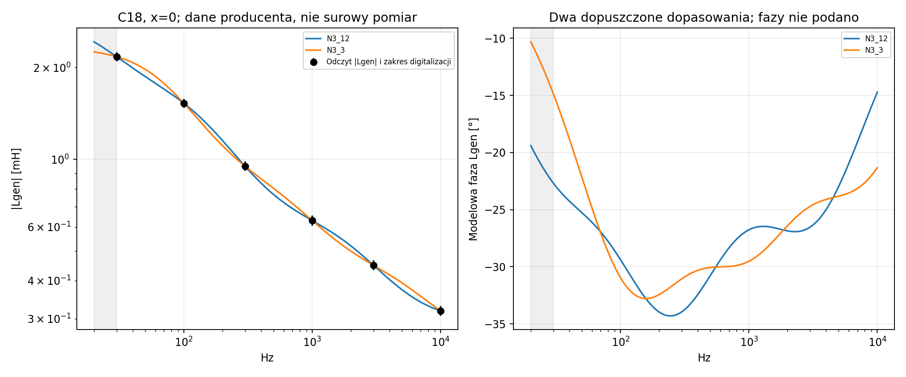
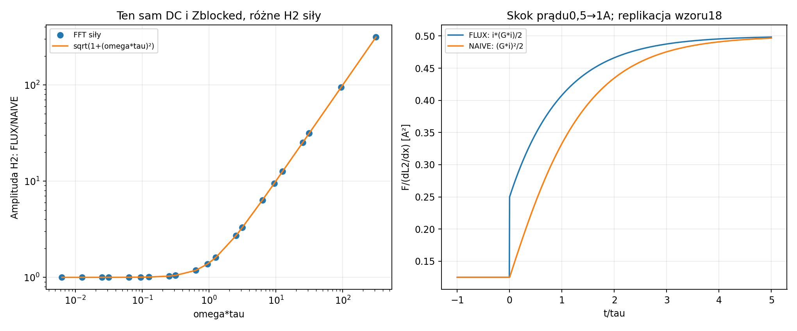
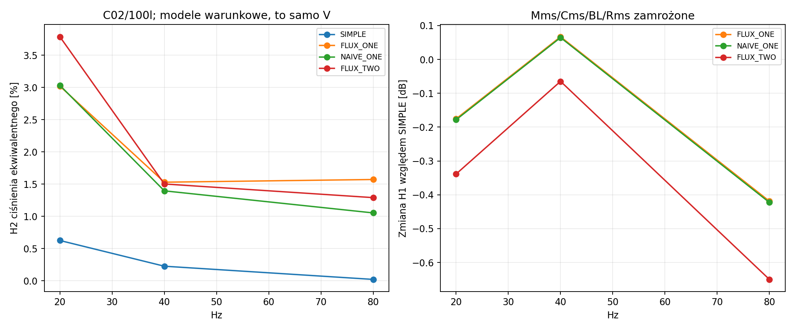
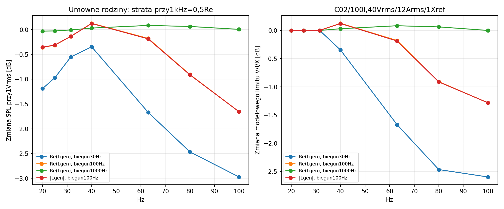

# Raport 021 — pamięć cewki, definicja L_gen i siła

Stan: **2026-10-25**; źródła zebrano24października. Badania P12C przed
budową, kontynuacja raportu020. To wyniki obliczeń i warunkowych symulacji,
bez pomiaru własnego urządzenia i bez końcowej rekomendacji głośnika/skrzyni.
Obowiązują wcześniejsze bramki danych: C07 ma konflikt oznaczenia4/8Ω,
C11 niepotwierdzony aktualny status katalogowy, a C12/C18 są kontrolami10″.
Samo obliczenie przypadku nie potwierdza spełnienia briefu przez model.

## Wynik i zalecenie inżynierskie

**Do dalszych symulacji przyjąć dodatnią realizację pamięci FLUX**, z siłą
zgodną ze wzorem18 źródła w zablokowanej pozycji. KontrolaNAIVE ma taką
samą impedancję i również przechodzi bilans energii, ale interpretuje
pomocniczy prąd obwodu jako podstawę niewłaściwej siły mechanicznej.
Sam poprawny wykresZ i dodatnie straty nie walidują tego sprzężenia.

Z jednej liczby Le nie da się wyznaczyć pełnych strat/fazy i napędu w basie.
Nie wolno na tej podstawie rozstrzygnąć rzeczywistego THD24kandydatów.
Istnieją dopasowania modułu wykresu producenta, które przewidują różne fazy
20Hz. Nie są one zidentyfikowanym modelem produktu. C18 pozostaje kontrolą10″.

## Wykonany zakres i warunki

| Obszar | Wynik |
|---|---:|
| Kalibracje jednej liczby;24bazy×2definicje×5biegunów×3straty | 720 |
| Dodatnie kalibracje / odrzucone konstrukcje parametrów | 643 / 77 |
| Liniowe wiersze:667sieci×4Vb×7częstotliwości | 18676 |
| PełneODE:24bazy×3Vb×3częstotliwości×2poziomy×4realizacje | 1728 |
| Przypadki rozstrzygnięte po dokładniejszej kontroli | 20 |
| ParyFLUX_ONE/NAIVE_ONE z tą samą Zblocked | 432 |
| Replikacja wzoru18:tau/f/prąd/pozycja | 216 |
| Odczyt wykresu producenta |30punktów,6częstotliwości,5pozycji |
| Dopasowania o1/2/3gałęziach | 76 |

Liniowo Vb=30/60/100/150l, f=20/25/31,5/40/63/80/100Hz.
PełneODE Vb=30/100/150l i f=20/40/80Hz. Gaz szczelny, tau=5ms,
Re i termika cewki zamrożone. Mms/Cms/BL/Rms to efektywne, zamrożone
parametry katalogowego zestawuT/S. Dopasowanie skalaru nie zachowuje
automatycznie całej identyfikacjiT/S ani Qes.

Każdy sinus osobno, od stanu zerowego, faza0. Napęd to0,25/0,75 obwiedni
prostego modelu przy40Vrms/12Arms/Xref; napięcie jest wspólne dla porównania.
Obserwowane SPL/H2/H3 to ekwiwalentny monopol4π/1m/RMS, nie realna
kierunkowość membrany. Wyższe harmoniczne wykraczają poza sam bas.
Nie dodano ponownie frontowej masy/promieniowania ani pokoju.
Szczyty w tabeli są próbkowane; bez certyfikatu maksimum ciągłego rozruchu.

## Oryginalna definicja i digitalizacja

[Risbo et al., AES141/2016](https://purifi-audio.com/documents/content/WT1Pkt9-SxijAvNyifNN4Ao2a2)
podaje `Lgen=(Zblocked-Re)/s`. Jest to wielkość **zespolona**.
Jej część rzeczywista to Im(Zblocked)/omega, a część urojona zawiera stratę
Re(Zblocked)-Re. Na oryginalnej osi Fig4 karty NAB-01 widnieje **|Lgen|[mH]**.
Wcześniejszej niejednoznaczności nie zastąpiono domysłem; sprawdzono obraz.

Wykres producenta odczytano z oryginalnegoPDF o zachowanymSHA, render300dpi,
z jawną kalibracją osi liniowejx i logarytmicznejy. Czarną linię oddzielono
od cienkiej siatki. Nie użyto automatycznych tabel punktów Firecrawl.
Poniżej x=0; przedziały są **wyłącznie niepewnością digitalizacji**, nie
deklarowaną niepewnością producenta ani tolerancją populacji.

| Hz | Moduł L_gen [mH] | Przedział digitalizacji [mH] |
|---:|---:|---:|
| 30 | 2.1718 | 2.0982–2.2480 |
| 100 | 1.5280 | 1.4763–1.5816 |
| 300 | 0.9496 | 0.9174–0.9829 |
| 1000 | 0.6301 | 0.6066–0.6544 |
| 3000 | 0.4495 | 0.4327–0.4668 |
| 10000 | 0.3184 | 0.3066–0.3307 |

Le0,62mH@1kHz z tabeli jest zgodne z odczytem modułu w granicach tej
digitalizacji. Nie ustalono jednak identycznej definicji i częstotliwości Le
dla wszystkich pozostałych katalogów. W porównaniu1kHz jest jawnym
wspólnym punktem kalibracji; REAL_LGEN i ABS_LGEN to różne hipotezy.
W tym raporcie x oznacza lokalne wychylenie cewki, nie współrzędną x pokoju.
Wobec tego wykresu C18 interpretacja REAL_LGEN jest kontrolą, nie odczytem osi.
„TypicalPerformance” nie rozstrzyga tu jednoznacznie pomiaru/symulacji.

## Dokładne wykluczenie jednej gałęzi i pozostała niejednoznaczność

Dla jednej gałęziR–L `|Lgen|²=A+B/(1+(f/fc)²)`. Iloraz różnic trzech
kwadratów modułu eliminuje A/B. Wyprowadzoną tożsamość sprawdzono
symbolicznie; przedziały nierówności policzono na liczbach wymiernych.
Jedne trójki wymagają fc≥**1376.50Hz**, inne fc≤**94.47Hz**.
To sprzeczność dla **wszystkich dodatnich fc** tej jednogałęziowej rodziny
w zapisanych, zewnętrznie zaokrąglonych przedziałach, nie tylko dla siatki.

Wykluczenie utrzymuje się także dla dodatkowych umownych poszerzeń:
0.0%, 1.0%, 2.0%, 5.0%, 10.0%. To stres odczytów,
nie przyjęcie tych wartości jako tolerancji producenta. Brak wykluczenia
innym testem nie dowodzi istnienia dopasowania. Nie oceniono nieznanej
pełnej niepewności źródła ani wszystkich innych klas obwodów.

Wykonano76wielostartowych dopasowań. N=1/N=2 nie dały rozwiązania
w przyjętym pudełku; dla N=3 znaleziono **36**.
Wykluczenie N=1 jest dokładne w opisanej dziedzinie; **nie udowodniono
niemożliwości N=2**. N=3 jest najmniejszym z uzyskanych dopasowań tej
kampanii, nie dowodem trzech fizycznych elementów w motorze.

Z danych tabeli C18 wynika nominalny konieczny warunek
Re(Zblocked156Hz)≤4,7Ω dla pasywnej mechaniki przy tych samych warunkach.
Nie jest tolerancją produkcji. Wszystkie znalezione modeleN3 go spełniają;
w porównaniu ogólnych rodzin **7**scenariuszy C18 go narusza.
Odrzuca się taką interpretację parametrów, a nie przetwornik.

Dwa znalezione świadki spełniają odczyty i warunek nominalny, lecz mają:

| Świadek | FazaLgen20Hz [°] | Re(Zblocked20Hz) [Ω] | Re(Zblocked156Hz) [Ω] |
|---|---:|---:|---:|
| N3_12 | -19.394 | 4.00139 | 4.58429 |
| N3_3 | -10.313 | 3.95063 | 4.55750 |

Są to świadki niejednoznaczności, **nie globalne obwiednie** fazy/parametrów.
20Hz jest ekstrapolacją poniżej najniższych30Hz wykresu. Sama płaskość
modułu nie oznacza zerowej pochodnej zespolonej: gdy Lgen=M*exp(jphi),
`|dLgen/dx|²=(dM/dx)²+(M*dphi/dx)²`. Osobna dodatnia konstrukcjaR–L
ma stały moduł przy100Hz i niezerowy człon fazy; nie przypisano jej Purifi.

## Impedancja i energia nie wystarczają do identyfikacji siły

Wzór18 przy zablokowanej pozycji zawiera `i*(G*i)`, nie `(G*i)²`.
W naszym216przypadkowym doświadczeniu izolowano sam składnik jednej gałęzi
pamięci. Obie wersje mają wtedy ten sam DC, a iloraz amplitud H2 wynosi
dokładnie `sqrt(1+(omega*tau)²)`.
Przy omega*tau=1 to+3,0103dB oraz45°różnicy fazy. Odtworzono też
bezwymiarowy skok0,5→1A. Nie odtworzono pomiarów4″DUT i MagNet źródła.
Prądy sinusoidy mają amplitudy1/4/12A_peak. Skok jest idealizacją narzuconego
prądu, nie odtworzeniem osiągalnego impulsu napięciowego wzmacniacza.

Własne rozszerzenie z ruchem ma stany pamięci j:

```text
Lj=Lj0*a(x)²; jdot=(a*i-j)/tau
lambda_total=lambda0+sum(Lj0*a*j)
Frel=Frel0+sum(Lj0*a_x*i*j)
Efield=Efield0+sum(Lj0*j²/2)
Deddy=sum[Lj0/tau*(a*i-j)²]
```

Napięcie wynika z pochodnej całego lambda_total. Realizacja ma dodatnią
energię i dodatnie straty, a przy zablokowanej pozycji spełnia źródłowe
równanie18. Sprawdzono ją też niezależną macierzą sprzężonych induktorów.
Tau jest stałe po x; nie jest to uniwersalna identyfikacja dowolnej
zmiennej geometrii i nieliniowego materiału. W tej kampanii materiał
magnetyczny jest liniowy w prądzie; nie symulowano histerezy magnetycznej.

## Pełny ruch: ten sam napęd, różne mechanizmy

FLUX_ONE/NAIVE_ONE mają ten sam Zblocked dla zamrożonej pozycji.
FLUX_ONE/FLUX_TWO mają ten sam **pełny zespolony Zblocked@1kHz** w x=0,
co sprawdzono dla24baz z błędem względnym 1.44e-16.
Zmiana modelu wewnętrznego pozostaje widoczna w ruchu i harmonicznych.

Przykład C02/100l/20Hz/0,75obwiedni, wspólne napięcie
21.626Vrms. To zadane hipotetyczne kształty, nie pomiar C02:

| Model | H2 ekwiwalentnego ciśnienia [%] | H3 [%] | Strata pamięci [W] | Strata efektywnego Rms [W] |
|---|---:|---:|---:|---:|
| SIMPLE | 0.62432 | 12.93099 | 0.00000 | 9.73894 |
| FLUX_ONE | 3.02075 | 12.31587 | 0.60632 | 9.35369 |
| NAIVE_ONE | 3.03330 | 12.37150 | 0.64631 | 9.34786 |
| FLUX_TWO | 3.78771 | 11.99614 | 2.26604 | 9.00936 |

W432parach FLUX/NAIVE największa różnica H2 wynosi
**1.1918punktu procentowego**. Największa różnica H1
wynosi **0.03146dB**; są to osobno wybrane
maksima po zadanej siatce. Obie realizacje są pasywne. NAIVE pozostaje
kontrolą nieprawidłowego przypisania siły do pomocniczego prądu, nie finalistą.

W ogólnej siatce nieznanych strat/biegunów zmiana SPL przy1V wynosi
od-5.642do+0.733dB względem prostegoLe. To umowne rodziny, nie
tolerancja tych produktów. Ich tłumienie elektryczne wFs też się zmienia:
nie udajemy pełnego dopasowaniaT/S przez zachowanie jednego skalaru.

Deddy nie należy dodawać do I²Re jako ciepła samej cewki. Pomocnicze
gałęzie nie identyfikują miejsca emisji ciepła w silniku. P15/P16 nadal
wymagają danych lub jawnych scenariuszy podziału strat.
Pole mean_structural_loss_w oznacza Rms_effective*v², nie niezależny
pomiar strat strukturalnych. W liniowych sinusach przy jednocześnie
aktywnym X dla obu porównywanych sieci pamięć nie zwiększa pułapu
od Sd·X; zmienia potrzebne napięcie i prąd, nie geometryczne wyparcie.
W5974takich liniowych porównaniach zmiana pułapu wyniosła najwyżej
7.71e-15dB. Nie przenosić tej tożsamości pojedynczego sinusa
na dowolne przebiegi nieliniowe i wielotonowe.

## Kontrole, granice i ograniczenia

Pierwszy przebieg:1711okresowych punktów i17flag domknięcia cyklu.
Wszystkie flagi oraz3wybrane świadki przeliczonoRadau3e-11/3e-13,
1024próbkami/cykl, do256cykli. Wystarczyło maksymalnie
80cykli; końcowa tabela ma1728punktów spełniających zadane
kryterium. Nie jest to dowód jedynej orbity, stabilnościFloqueta ani
braku wszystkich innych gałęzi. Stany mają jawne odniesienia; pamięć j
ma jednostkę odniesienia1A, nie zmierzony prąd w metalu.

| Kontrola | Największy błąd / wynik |
|---|---:|
| Energia gradientem,8punktów i obie realizacje | 1.53e-09 względnie |
|160porównań macierz stanu vs niezależny obwód częstotliwościowy | 8.77e-12 względnie |
| Redukcja N=0 do wcześniejszego modelu | 0 względnie |
| Bilans pełnej serii po kontroli | 7.1e-08 względnie |
| Replikacja zespolonego H2 wzoru18 | 4.88e-16 względnie |
| Odrębne ODE filtra vs rozwiązanie okresowe | 1.03e-14 bezwzględnie |
| Bezstratna granica z niezerową zamrożoną pamięcią | 9.06e-12 dryfu energii |

Sprawdzono N=0, Linstant=0 (redukcja algebraiczna), tau→0, tau→∞,
f=0 i formalnie f→∞. Przy skończonymtau limitf→0 dajeLinstant+sumLj;
przy tau→∞ wziętym najpierw i zerowej pamięci zostajeLinstant. Niezerowy
stan zamrożony zachowuje energię/siłę i nie może zostać automatycznie usunięty.
Nie modelowano ponownie przecieku, frontowej reakcji ani termiki cewki.
Końcowy wybór jednego głośnika/skrzyni i końcowyPDF wymagają reszty programu.

**Następny domyślny krok: P14 — IMD i sygnały wielotonowe**, następnie
operator promieniowania harmonicznych, dalsza analiza amplitud/gałęzi,
termika i mechanika/klej. UżywaćFLUX, zachowując niepewność pamięci i
nie utożsamiać wyników umownych rodzin z THD konkretnego produktu.

## Artefakty






Kod:[model](../skrypty/model_cewki_z_pamiecia.py),
[kontrole](../skrypty/sprawdz_pamiec_cewki.py),
[kampania](../skrypty/analiza_cewki_z_pamiecia.py),
[replikacja siły](../skrypty/replikacja_sily_L2R2.py),
[dokładne wykluczenie/dopasowania](../skrypty/analiza_ident_Le_i_dopasowania.py),
[audyt wykluczenia](../skrypty/audyt_wykluczenia_1_bieguna.py),
[rozstrzygnięcia Radau](../skrypty/sprawdz_pakiet_pamieci.py).
Wejścia:[konfiguracja](../dane/konfiguracje/p12c_pamiec_cewki.json),
[kalibracja digitalizacji](../dane/konfiguracje/p12c_digitalizacja_Lgen.json),
[pochodzenie źródeł](../dane/zrodla/P12C_definicja_Lgen_i_sila.json).
Wyniki:[kalibracje](../wyniki/p12c_kalibracje_i_odrzucenia.csv),
[linia napędu](../wyniki/p12c_liniowy_naped.csv),
[pełny ruch po kontroli](../wyniki/p12c_nieliniowa_pamiec_zweryfikowana.csv),
[dowód i świadkowie](../wyniki/p12c_ident_Le.json),
[dane odczytu](../dane/zrodla/digitalizacja/Purifi_NAB01_Lgen_fig4.csv).

Dziennik ma hash wejść/kodu i kopię startową. Wznowienie zgodnych
przypadków nie jest świeżą niezależną replikacją. Digitalizacja jest
oddzielnym etapem pozyskania źródła, wymagającym oryginalnegoPDF oSHA
i PyMuPDF1.28.0; zwykłe obliczenia używają zapisanych30odczytów.
Docelowy pokój nadal opisujeU-020/raport019: RTV po lewej, kanapa po prawej
oryginalnego rzutu; dokładnych pozycji nie zastąpiono pomiarem z pikseli.
