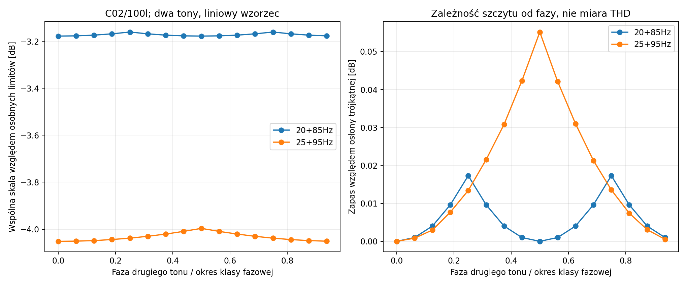
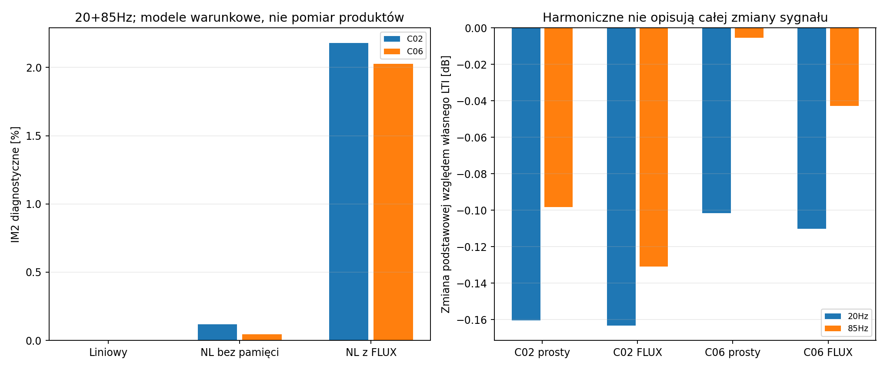

# Raport 023 — P14A: wspólny limit sygnału i pilot dwutonowy

Stan:2026-10-25. **Częściowy etap P14**, nie zamknięcie badań IMD,
multitonów, sygnałów realistycznych ani całego programu. Wykonano
9216odniesień liniowych dla24baz i12pełnych przypadkówODE
dla C02/RSS390HF-4 i C06/STXW.32.800.8.FCX. Kształty nieliniowe są umowne,
nie charakterystykami tych produktów. Ocena postępu jest osobno w
[raporcie022](022_stan_badan_i_zakres_pozostaly.md).

## Wynik wpływający na projekt

**Osobnych limitów sinusoidalnych nie wolno sumować jako dostępnego
poziomu dla dwóch tonów.** W zadanych przypadkach wspólna skala napięcia
jest od-6.021do-0.246dB niższa od dopuszczonej
przez samą niezależną kontrolę składników. To porównanie obliczeniowych
budżetów, nie pomiar SPL urządzenia ani porównanie jednego/dwóch subwooferów.

Wspólna kontrola uwzględnia RMS całego napięcia i prądu, szczyt napięcia
i wychylenie sumy. Warunki:40Vrms/12Arms oraz jawny szczyt napięcia
sqrt(2)*40V wyprowadzony z budżetu sinusoidalnego. Nie jest specyfikacją
wybranego wzmacniacza. Rzeczywista ochrona i clipping pozostają P22/P24.

## Koherencja, fazy i kolizje widma

Wybrano20+85Hz i25+95Hz; podstawowa częstotliwość okresu wynosi5Hz.
Nie ma kolizji linii różnych kombinacji do3rzędu. Para20+80Hz jest
kontrolą przeciwną: linia60Hz może pochodzić z3f1 lubf2-f1, a40Hz
z2f1 lubf2-2f1. Nie należy dwukrotnie liczyć tej samej linii ani przypisywać
jej jednoznacznej przyczyny bez dodatkowej metody.

Fazy nie są wszystkie niezależnymi eksperymentami. Przy zablokowanej
fazie pierwszego tonu równoważność przesunięcia czasu daje okres fazy
drugiego tonu2pi/n1, gdzie n1=f1/gcd(f1,f2). Dla20+85Hz fazy0 i pi/2
są równoważne przesunięciu czasu. W pilocie użyto0 i pi/8, a nie dwóch
takich samych klas. Nie jest to twierdzenie o jednakowym rozruchu lub
braku wielu atraktorów dowolnego układu nieliniowego.

## Osłona błędu próbkowania szczytu

Dla ustalonych współczynników sygnału trygonometrycznego i Npróbek:

```text
M_sample <= M_true <= M_sample+0.5*sqrt(2)*sum(n²*|a_n|)*(pi/N)²
M_true <= sqrt(2)*sum(|a_n|)
```

W maksimum pochodna znika, więc rozwinięcie do drugiego rzędu ogranicza
błąd najbliższej próbki. Stosujemy minimum obu górnych osłon; przy fazach
wyrównanych sama próbka może już osiągać osłonę trójkątną. Obliczenia
wykorzystują4096próbek/okres. To matematyczna osłona próbkowania dla
ustalonych współczynnikówLTI, nie certyfikat pełnej niepewności modelu
fizycznego ani stałych zmiennoprzecinkowych. Osłona trójkątna daje również
osobny, niezależny od fazy wzorzec wspólnego ograniczenia.

## Pilot nieliniowy

W12przypadkach użyto20+85Hz, Vb100l, dwóch faz i trzech modeli: liniowy,
nieliniowy bez pamięci oraz nieliniowyFLUX. Napięcie w porównaniu profili
jest wspólne, ustalone na0,75konserwatywnego wzorca niezależnego od fazy.
Port napięciowy przyjmuje rzeczywistą w modelu sumę kosinusów; nie narzuca
się ruchu ani nie dodaje procentów zniekształceń z dwóch osobnych sinusów.

Gaz jest szczelny, tau5ms; termika cewki, clipping, rzeczywiste krzywe
przetworników i pełna emisja nie są zidentyfikowane. Pole diagnostyczne
to monopol4pi/1m/RMS z przyspieszenia. Nie jest to rzeczywisty THD produktów.
Diagnostyka ma mianownik RSS dwóch składowych podstawowych ciśnienia:

- IM2: RSS linii f2-f1 oraz f2+f1.
- IM3difference: RSS linii|2f1-f2| oraz|2f2-f1|.
- Pasmo5–1000Hz poza dwiema liniami wejściowymi: łącznie harmoniczne,
  intermodulacja i resztkowy błąd numeryczny; nie nazwano tego THD.

Nie deklarujemy zgodności tych definicji z konkretną normą. Zmianę samych
składowych podstawowych policzono oddzielnie względem dopasowanego
modelu liniowego każdej sieci, aby nie pomylić liniowych strat pamięci
z kompresją nieliniową. Faza sygnału wyjściowego i szersza analiza
amplitud pozostają dalszą pracą P14.

Wyniki dla fazy0, procenty diagnostyczne modeli:

| Baza | Model | IM2 [%] | IM3difference [%] |
|---|---|---:|---:|
| C02 | LINEAR | 5.34392e-09 | 1.42681e-08 |
| C02 | NL_SIMPLE | 0.119249 | 1.07087 |
| C02 | NL_FLUX_ONE | 2.18092 | 1.12372 |
| C06 | LINEAR | 6.92649e-09 | 2.34375e-08 |
| C06 | NL_SIMPLE | 0.0450055 | 0.855162 |
| C06 | NL_FLUX_ONE | 2.02765 | 0.900197 |

W wybranym pilocie zmiana fazy nie dała istotnej zmiany amplitud niskich
produktów względem precyzji przebiegu. Nie dowodzi to braku wpływu fazy
w szerszych sygnałach, przy kolizjach, clippingu lub innych gałęziach.
Nie jest to ranking dwóch producentów: identycznie zadane współczynniki
względne nie są pomiarem właściwości każdego głośnika.

Wszystkie12przypadków spełniło zadane próbkowane kryterium cyklu.
Niezależny wzorzec odpowiedzi liniowej zgadza się względnie do
4.14e-10; odrębnyRadau daje różnicę IM2/IM3 do
1.46e-08punktu procentowego.
Poziom resztkowy liniowego modelu wynosi maksymalnie
4.46e-07% w paśmie diagnostyki.
Szczyty i okresowość nie są globalnym certyfikatem rozruchu/gałęzi.

**Następny krok P14B:** szersze obliczenia nieliniowe dla puli, poziomów
i sygnałów, pełne fazory/widma oraz operator promieniowania harmonicznych.
Następnie termika i konstrukcja obudowy. P14/P25 nie są zamknięte.




Wejścia:[konfiguracja](../dane/konfiguracje/p14a_sygnaly_i_pilot.json).
Kod:[sygnały](../skrypty/sygnaly_P14.py), [analiza](../skrypty/analiza_P14A_sygnaly.py),
[kontrole](../skrypty/sprawdz_P14A.py).
Wyniki:[9216odniesień](../wyniki/p14a_wspolne_ograniczenia.csv),
[12ODE](../wyniki/p14a_pilot_IMD.csv), [podstawowe](../wyniki/p14a_skladowe_podstawowe.csv),
[weryfikacja](../wyniki/p14a_weryfikacja.json).
