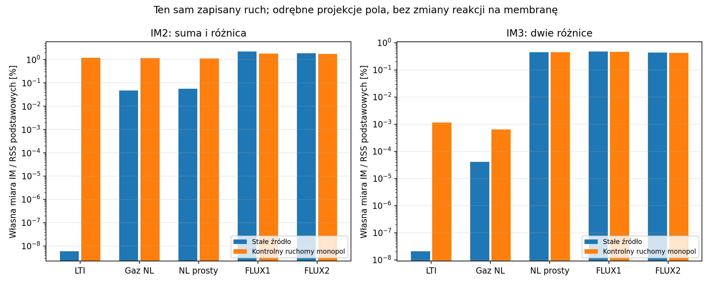
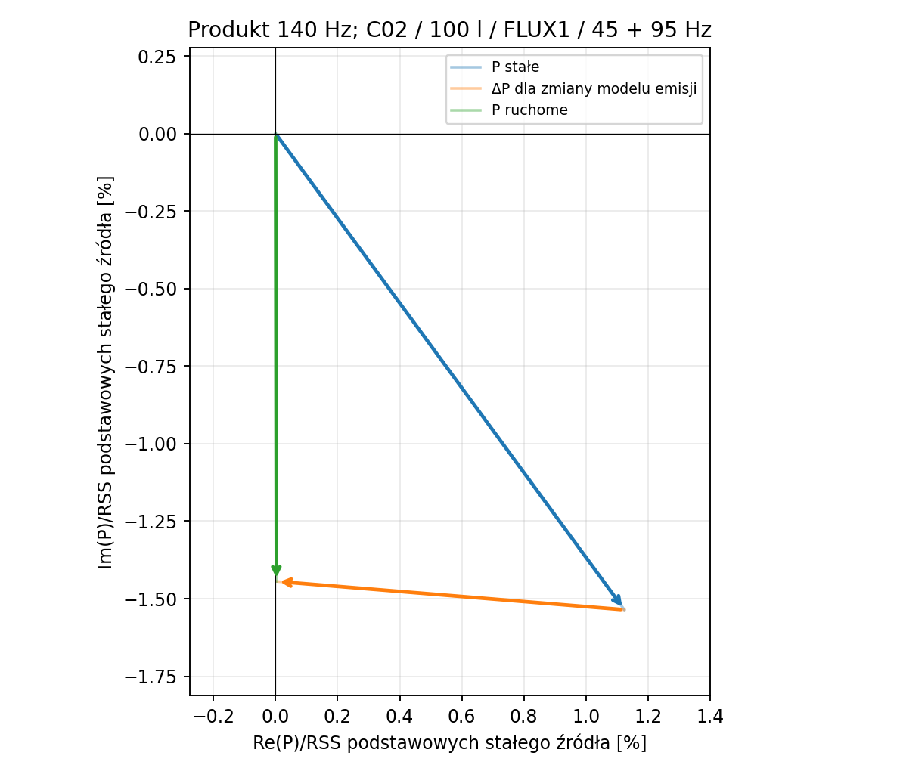

# Raport 024 — P14B: fazory, emisja i składowa 5 Hz

Stan: 2026-10-25. **Raport częściowy**, oparty na zapisanych, zamrożonych
świadkach i jawnych migawkach kampanii. Nie zamyka P14/P25 ani wyboru
przetwornika. Nie zawiera pomiarów urządzenia. Kształty BL/Kms/pamięci są
założeniami; symbole produktów określają bazy T/S, nie zmierzone THD produktów.

## Co zmienia się w projekcie

**Rekomendacja wynikająca z obliczeń:** kontrolować pełny ruch x(t), w tym
produkty poniżej pasma wejściowego, a zniekształcenia porównywać przez
zespolone fazory. Filtr wejściowy nie usuwa bezpośrednio składowej
wytworzonej później w przetworniku. Nie dodawać skalarnie udziałów różnych
mechanizmów ani nie utożsamiać niewielkiego ciśnienia z niewielkim wychyleniem.

Przykład **obliczeniowy** C02/RSS390HF-4, 100 l netto powietrza,
45+95 Hz, po 20 Vrms na ton, wspólnie 28,284 Vrms, fazy zerowe,
rodzina NL_FLUX_ONE, gaz hermetyczny z tau=5 ms i stałe Re:

- X przy |2×45−95|=5 Hz: **0,081921 mm RMS**.
- Stanowi to **2,1681% RSS wychyleń dwóch składowych podstawowych**.
- Cały ruch ma szczyt próbkowany **6,58559 mm**, prąd **6,47144 A RMS**.
- Nie oznacza to przekroczenia limitu ani uszkodzenia. To świadek
  obecności produktu i ograniczeń kontroli tylko dwóch wejściowych tonów.

Ciśnienie diagnostycznego monopola 4pi/1 m jest proporcjonalne do f²X.
Dlatego procentu ruchu przy 5 Hz nie wolno nazwać procentem akustycznego IMD.
Wykres pokazuje dyskretne linie siatki 5 Hz do 300 Hz, z progiem rysowania
1e−7 mm lub Pa; pełne zapisane widmo ma krok 1,25 Hz i pasmo 0–1000 Hz.


## Wykonane rozszerzenie metod

**Założenia eksperymentu:** 24 bazy, Vb=30/100/150 l, pary
20+85/25+95/45+95 Hz, poziomy 0,1/0,5/1 względem wspólnej osłony
liniowej. Pięć profili: LINEAR, GAS_ONLY, NL_SIMPLE, NL_FLUX_ONE,
NL_FLUX_TWO. Dodatkowe klasy fazy, małe amplitudy i preload dają
**3312 zaplanowanych przypadków**. Nie jest to liczba ukończonych wyników.
Napięcie wspólne dla profili pochodzi z prostego LTI, bez dynamicznego
ogranicznika. Ochrona pozostaje P24.

Każdy ukończony rachunek zapisuje atomowo JSON i zespolone fazory RMS X/I
w SQLite, z SHA-256 nieskompresowanych bajtów. Osobno rejestrowane są
DC, rozruch, niedomknięcie cyklu, prąd, energia, bilans średniego napięcia,
ogon i linie poza siatką wymuszenia. Surowy status jest zachowywany także
po osobnym dokładniejszym przeliczeniu.

**Migawka emisji 1334 przypadków:** 6670 wierszy pięciu geometrii oraz
16008 wierszy fazorów produktów dla stałego i ruchomego monopola:
[metadane](../wyniki/archiwum/P14B_migawka_1334_2bb23348fb8a/p14b_projekcja.json),
[miary](../wyniki/archiwum/P14B_migawka_1334_2bb23348fb8a/p14b_emisja.csv),
[fazory](../wyniki/archiwum/P14B_migawka_1334_2bb23348fb8a/p14b_fazory_produktow.csv).
Jej 16 pierwotnych flag NOT_SETTLED są oznaczone; nie wolno ich przemilczeć
ani traktować migawki jako końcowego rankingu. Rozstrzygnięcia powstały
później, w odrębnej warstwie, bez zmieniania tej tabeli.

**Kontrola przebiegu:** po potwierdzonym zakończeniu procesu kodem143
sprawdzono wszystkie24bazy SQLite i12zamrożonych plików wejściowych.
Zachowane1599przypadków wznowiono, pozostawiając1713do obliczenia.
To wznowienie zgodnych checkpointów, nie niezależna nowa replikacja
1599ODE. Przyczyny zewnętrznego zakończenia procesu nie ustalono.
Blokada koordynatora nie pozwala uruchomić dwóch kopii tego samego przebiegu.

## Emisja: cztery stałe geometrie i oddzielny ruchomy monopol

**Obliczenia projekcji tego samego ruchu:** monopol 4pi/1 m, dokładny
tłok na osi nieskończonej odgrody, przybliżenie dalekiego pola pod 60°
oraz radialna czasza na sferze. Dla sfery obserwator leży 1 m od frontu,
Rbody=(3V/4pi)^(1/3)+22 mm; parametr22mm nie jest doborem płyty MDF.
Nie dodano ponownie ich obciążenia do efektywnej Mms/Rms w ODE.
To geometrie kontrolne, bez pola pokoju i bez rozwiązania finalnej skrzyni.

**Odrębny model źródła:** Q=Sd dx/dtau porusza się po zdefiniowanym torze
x(tau). Rozwiązano t=tau+R(tau)/c i potencjał
Psi=Q(tau)/(4pi R(tau)[1−Mr(tau)]), a następnie p=rho dPsi/dt.
Wzór oparto na funkcji Greena, sprawdzonej w oryginale SRC39.
Wynik uwzględnia amplitudę, czas opóźniony i czynnik 1−Mr; nie jest tylko
przesunięciem fazy. **Nie jest rozwiązaniem ruchomej granicy rzeczywistego
tłoka** i nie należy nakładać go na odgrodę jako kolejnego niezależnego zysku.

Własne miary: IM2 jest RSS linii fH−fL i fH+fL; IM3difference — RSS
|2fL−fH| i |2fH−fL|; mianownik jest RSS dwóch podstawowych ciśnień.
Pasmo diagnostyczne5–1000Hz nie jest całym nieskończonym widmem THD.

Przykład C02/100l/45+95Hz, po20Vrms; wszystkie liczby są **symulacją**:

| Rodzina | IM2: stały monopol [%] | IM2: ruchomy model źródła [%] |
|---|---:|---:|
| LINEAR | 6,04e−9 | 1,17671 |
| GAS_ONLY | 0,04647 | 1,14854 |
| NL_SIMPLE | 0,05604 | 1,13264 |
| NL_FLUX_ONE | 2,20244 | 1,79523 |
| NL_FLUX_TWO | 1,86565 | 1,72079 |

W pierwszym wierszu ruch jest liniowy, lecz ruchomy operator emisji jest
nieliniowy: jego produkty nie są poziomem błędu numerycznego LTI. Zmniejszenie
IM2 w dwóch ostatnich wierszach nie dowodzi poprawy fizycznego głośnika;
pokazuje możliwość fazowego znoszenia w tych zdefiniowanych modelach.





## Niezależne sprawdzenia i granice

**Kontrola analityczna/numeryczna** — w następujących dziedzinach:

| Wzorzec | Wynik / znaczenie |
|---|---|
| Parseval, DC i Nyquist | Zgodny z bezpośrednią sumą kwadratów |
| x²/x³, pary i fazy, także ujemna podpisana częstotliwość | Maksymalny względny błąd zespolony 3,51e−14 |
| Źródło w ruchu jednostajnym | Błąd jawnego tau poniżej1,64e−14s |
| Zamrożony tor przy oscylującym Q | Względny błąd stacjonarnego p poniżej1,34e−8 |
| Harmoniczna2f, A=1e−5…1e−4m | Niezależne rozwinięcie drugiego rzędu; błąd zespolony poniżej7,87e−8 |
| Dwukrotnie gęstsza siatka emisji | Względna zmiana w tych małoamplitudowych kontrolach poniżej1,99e−10 |
| Zerowy ruch i wyjście poza Mach0,2 | Wynik zerowy oraz jawne odrzucenie dziedziny |
| Czysta para AM / PM | Odtworzono odpowiednie zespolone sumy i różnice |

Przyjęta dziedzina ruchomego źródła Mach<0,2 jest ograniczeniem tego
badania, nie granicą bezpieczeństwa urządzenia. Obecny kod wyznacza
ekstrema pochodnej splajnu zamiast kontrolować wyłącznie próbki.
Nie deklarujemy certyfikacji przedziałowej ani kontroli wszystkich
możliwych zjawisk. W szczególności zbieżność dla małych amplitud nie
zastępuje przyszłej kontroli wybranych dużych odpowiedzi całej puli.

**Odrębny audyt1403zapisanych przypadków:** sprawdzono hashe1403widm;
281liniowych punktów porównano z algebrą częstotliwościową. Maksymalne
błędy względne fazorów: X3,19e−9, I3,94e−9. Reszta średniego równania
napięcia1,17e−9V, błąd Parsevala prądu7,61e−16.
[Audyt](../wyniki/archiwum/P14B_audyt_1403_8a0088ea29d5/p14b_audyt.json).

**Rozstrzygnięcia17flag:** wszystkie17pierwotnych NOT_SETTLED po1599
punktach przeliczono od zera DOP853 z ostrzejszymi tolerancjami i gęstszym
widmem. Wszystkie spełniły kryterium, maksymalne niedomknięcie poniżej3,33e−11.
Zachowano surowe wyniki LSODA i osobne widma/JSON; to nie dowód globalnej
jednoznaczności gałęzi odpowiedzi ani własności rzeczywistych produktów.

## Źródła i normalizacja AM/FM

Oryginały SRC38/AN10 strony2/3/5/6 oraz SRC39 strony30/32 obejrzano,
łącznie z rysunkami i wykresami. Szczegóły, URL, daty, osie, warunki,
hashe i ograniczenia zapisano w
[rejestrze P14B](../dane/zrodla/P14B_IMD_AM_FM_i_emisja.json).

**Dane źródłowe:** AN10 wymaga stosunku częstotliwości>8:1 i napięć
voice:bass=1:4. Nasze próby tego nie realizują. Na stronie3 wzór d_AMD
zawiera sqrt(2/K), zatem dla tej samej obwiedni jest sqrt(2) razy
nasze100std(E)/mean(E). Miary klastrowej nie nazywamy normowym d_AMD.
Nie przenosimy przykładowego6/1600Hz ani wykresów słyszalności na nasze bazy.

**Wyprowadzenie:** przy stałym Re, BL(x), okresowym strumieniu i zerowej
średniej napięcia średni prąd musi być zerowy. Nie wynika z tego zerowa
średnia pozycja membrany. Tożsamość sprawdzono z członami brzegowymi;
nie przenosi się jej bez zmian do Re(T) i BL(x,T).

## Odtwarzanie i następny krok

Samodzielnie wersjonowano15świadków, bez kopiowania aktywnych baz:
[NPZ](../wyniki/p14b_swiadkowie_emisji.npz),
[pochodzenie](../wyniki/p14b_swiadkowie_emisji.json),
[wyniki](../wyniki/p14b_swiadkowie_wyniki.json).

```bash
python3 skrypty/sprawdz_emisje_P14B.py
python3 skrypty/raportuj_P14B_swiadkow.py
```

Główna kampania `analiza_P14B.py` wznawia zgodne przypadki i ma blokadę
równoległego koordynatora. Nie uruchamiać jej drugi raz, gdy trwa. Migawkę
emisji odtwarza `projekcja_P14B.py`; bieżąca wersja uwzględnia jawne,
zgodne rozstrzygnięcia. Wcześniejsza migawka1334ma zachowany własny kod
i hashe, zatem jej historycznych statusów nie zmienia się wstecz.

**Najbliższy krok:** ukończyć tę samą kampanię P14B, rozstrzygnąć nowe
flagi, sprawdzić duże odpowiedzi i pełne studia fazy/amplitudy/preload;
następnie P15/P16 — termika. Wielotony>2, czasowa reakcja pola, clipping,
termika cewki i fizyczne krzywe produktów pozostają otwarte. Ostateczny
głośnik, konstrukcja z klejem i końcowy PDF nadal przed nami.
