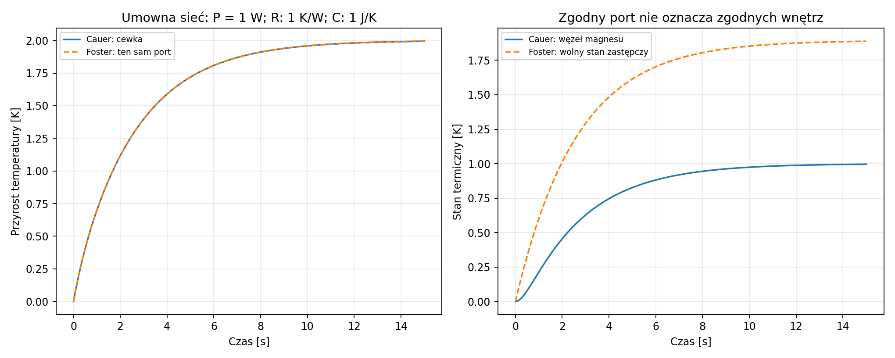
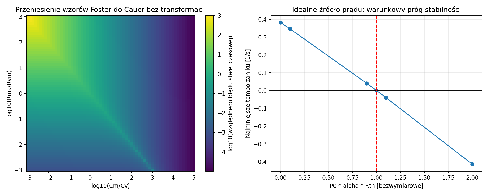

# Raport 025 — P15A: topologia i granice modelu cieplnego

Stan: 2026-10-25. **Wykonany pierwszy etap P15**, nie zakończenie termiki
P15/P16. Wyniki obejmują teorię, sieci kontrolne i warunkowe wymagania.
Nie znamy Rth/Cth ani rozkładu temperatur naszych24produktów. Żadna
temperatura w tym raporcie nie jest prognozą fizycznego egzemplarza.

## Wniosek projektowy

**Rekomendacja:** w ochronie prototypu należy modelować pamięć grzania
i określić, do których węzłów trafiają straty. Stałe podniesienie Re
o25/50% nie zastępuje termiki w czasie. Samo dopasowanie temperatury
cewki nie upoważnia do podania temperatury magnesu, masy miedzi ani
udziału chłodzenia bezpośredniego.

Wykazano także **dokładną ciągłą niejednoznaczność** sieci z dodatkową
konwekcją: nawet idealna znajomość pełnej transmitancji grzanie-cewka
nie identyfikuje wszystkich jej elementów. To ograniczenie danych,
a nie problem do usunięcia większą liczbą punktów tej samej krzywej.

## Oryginalne schematy — dwie topologie

**Źródło SRC40:** w AN18 s.2 Ctv jest połączone pomiędzy Tv i TM,
równolegle do Rtv. Ctm jest pomiędzy TM i otoczeniem, równolegle do Rtm.
Szereg gałęzi R||C daje opis Foster. W tej topologii wzory tau=R*C na
s.3 są właściwe. Nie wolno przenieść ich bez transformacji do innego schematu.

**Źródło SRC41:** oryginalny rysunek heat_flow.jpg ma własne pojemności
węzłów względem odniesienia, dodatkową konwekcję oraz osobne źródło
grzania metalu. Taki dwuwęzłowy model skupionych mas oznaczamy Cauer.
Obejrzano także przykład wpływu kanału powietrznego na chłodzenie;
nie przeniesiono jego procentów ani nie zaleca się zatykania kanału głośnika.
[Oryginały, hashe, osie i ograniczenia](../dane/zrodla/P15A_topologie_i_cieplo.json).

## Równania i jednostki

**Model warunkowy Cauer:** theta_v,theta_m są przyrostami temperatury[K]
wobec stałego otoczenia, Cv,Cm[J/K], Rvm,Rma,Rva[K/W].

```text
Cv * theta_v_dot = Pcu + Pextra_v - (theta_v-theta_m)/Rvm - theta_v/Rva
Cm * theta_m_dot = Pextra_m + (theta_v-theta_m)/Rvm - theta_m/Rma
C theta_dot = P - G theta
```

Rva=inf wyłącza bezpośrednią ścieżkę chłodzenia. Stałe parametry są
uproszczeniem; brak gradientów i lokalnych hot spotów. Pojemności
przy węzłach odpowiadają skupionym masom tylko w granicach tego modelu.

**Dokładne wyprowadzenie:** transmitancja portu cewki przy grzaniu
wyłącznie w tym węźle jest

```text
Zth(s) = (Cm*s+gvm+gma) /
         [(Cv*s+gvm+gva)*(Cm*s+gvm+gma)-gvm²]
gvm=1/Rvm; gma=1/Rma; gva=1/Rva
```

Symetryczna diagonalizacja C^(-1/2) G C^(-1/2) daje dodatnie bieguny
lambda_k oraz wagi A_k, a więc **dokładną równoważność portu**
Zth(s)=sum A_k/(s+lambda_k)=sum Rk/(1+s*tauk), Rk=A_k/lambda_k.
Nie oznacza to równości stanów wewnętrznych obu reprezentacji.

### Przykład rozróżniający temperatury wewnętrzne

**Sieć kontrolna, nie dane produktu:** Cv=Cm=1J/K,
Rvm=Rma=1K/W, Rva=inf, Pcu=1W. Cauer ma w stanie ustalonym
theta_v=2K, theta_m=1K. Równoważny Foster:

| Gałąź | R[K/W] | tau[s] | C_zastępcze[J/K] |
|---|---:|---:|---:|
| Wolna | 1,894427 | 2,618034 | 1,381966 |
| Szybka | 0,105573 | 0,381966 | 3,618034 |

Suma stanów Foster dokładnie odtwarza theta_v. Wolny stan Foster
dąży jednak do1,894427K, podczas gdy fizyczny węzeł magnesu Cauer do1K.
To kontrprzykład utożsamienia stanu zastępczego z temperaturą części,
nie podważenie wzorów AN18 w ich własnym schemacie.



## Ciągła nieidentyfikowalność z bezpośrednim chłodzeniem

**Dowód algebraiczny:** zapisz a=gvm+gva, D=(gvm+gma)/Cm,
E=gvm²/Cm. Wówczas

```text
Zth(s) = (s+D)/(Cv*s²+(a+Cv*D)*s+a*D-E)
```

Przy ustalonych Cv,a,D,E dowolne b z otwartego przedziału E/D<b<a daje:

```text
gvm=b; Cm=b²/E; gma=D*b²/E-b; gva=a-b
```

Wszystkie elementy są dodatnie i **cała funkcja Zth(s) jest identyczna**.
Nie zmienia tego gęstszy pomiar tego samego portu. Potrzebne są dodatkowe
dane lub ograniczenia topologii. Bez dodatkowej ścieżki i przy z góry
zadanej klasycznej strukturze Cauer ta konkretna swoboda znika;
nie twierdzimy, że każdy możliwy model termiczny jest nieidentyfikowalny.

**Świadki liczbowe:** Cv=1,a=2,D=2,E=1 w odpowiednich jednostkach,
Pcu=1W. Dla b=0,6/0,75/1/1,5/1,9 każdy port daje theta_v=2/3K,
a theta_m od0,55556do0,17544K. Zmienia się również odpowiedź cewki na
ciepło wprowadzone bezpośrednio do magnesu. Dlatego strat pamięci/prądów
wirowych z P12C/P14 nie wolno po prostu nazwać ciepłem cewki.

## Granice i niezależne kontrole

**Badanie numeryczne:**4225sieci Cauer, Rma/Rvm=1e−3…1e3,
Cm/Cv=1e−3…1e5,65×65punktów. To stres parametrów, nie tolerancje produktów.
Porównano pełne zespolone Zth w DC i81częstotliwościach oraz rozkład Foster.
Maksymalny względny błąd portu wyniósł2,52e−13. W przykładzie skokowym
macierz wykładnicza i suma gałęzi różnią się o2,67e−15K; niezależny
DOP853 zgadza się do1,58e−13K.

**Dokładne tożsamości SymPy:** port, suma i iloczyn stałych czasowych,
próg sprzężenia prądowego, rozdział mocy na węzły, bilans energii i
ciągła rodzina nieidentyfikowalności. Dla Cauer bez Rva:

```text
tau_fast + tau_slow = Cm*Rma + Cv*(Rvm+Rma)
tau_fast * tau_slow = Cv*Cm*Rvm*Rma
```

To inne wielkości niż indywidualne RvmCv i RmaCm przypisane bez zmiany
topologii. Lewy wykres poniżej przedstawia błąd takiego pomieszania modeli.

**Cztery granice redukcji,25kontroli:** Rvm→0 daje wspólną pojemność Cv+Cm;
Rvm→inf przy skończonym Rva izoluje węzeł cewki; Cm→inf zamraża magnes
w skończonym czasie; Cv→0 daje algebraiczny skok temperatury cewki dla t>0.
W ostatniej granicy t→0 i Cv→0 są niezamienne. Porównania wykonano
z odrębnymi wzorami jedno- lub bezinercyjnego węzła, dla t=0,1/1/10s.
Przypadek pełnej izolacji zachowuje sumę C*theta równą całce mocy i
nie ma skończonego stanu ustalonego przy dodatnim grzaniu.

## Warunkowa granica idealnego źródła prądu

**Wyprowadzenie:** przy idealnie utrzymanym prądzie, Re=Re0(1+alpha*theta_v)
i P0=I_rms²Re0, grzanie ma dodatnie sprzężenie Pcu=P0(1+alpha*theta_v).
Po podstawieniu kryterium stabilności jest dokładnie

```text
P0 * alpha * Rth_port < 1
Rth_port = 1 / [1/Rva + 1/(Rvm+Rma)]
```

Na granicy najmniejsze tempo zaniku jest zerowe; powyżej model traci
stabilność. Sprawdzono8punktów po obu stronach progu i sam próg oraz
dokładny wyznacznik macierzy. **To nie próg uszkodzenia rzeczywistego
głośnika ani wzmacniacza klasy D**: rzeczywiste ograniczenia napięcia,
temperatury, Re/BL i chłodzenia wymagają P16/P22/P24. Nie podstawiono
domniemanej wartości alpha materiału drutu naszych produktów.



## Pierwsze wymagania chłodzenia pod prototyp

**Obliczenie warunkowe:** z15zamrożonych świadków P14 i3umownych
przyrostów40/80/120K utworzono45wymagań
Rth_port<=DeltaT/Pcu. Są to progi konieczne przy pominięciu pozostałych
źródeł grzania, nie potwierdzenie wystarczającego chłodzenia.
Przyrosty nie są zatwierdzonymi limitami cewki ani temperaturami
bezpiecznymi dla jej kleju. Klej obudowy MDF pozostaje osobnym P19.

Dla C02/100l/45+95Hz/FLUX1/po20Vrms zamrożony model P14 daje
Pcu=125,639W. Gdyby przyjąć umowny przyrost80K i stale zadane takie
grzanie, potrzebne byłoby Rth_port<=0,63675K/W. **Nie wiemy, czy ten
głośnik spełnia warunek.** Nie jest to jego temperatura przy tym napięciu:
po grzaniu zmieni się prąd, Re, odpowiedź i samo Pcu. Oddzielnie trzeba
uwzględnić ciepło w metalu i jego drogę do cewki.

## Artefakty i kolejny krok

- [4225sieci i błędy](../wyniki/p15a_sieci_termiczne.csv).
- [45warunkowych wymagań Rth](../wyniki/p15a_wymagania_Rth.csv).
- [Podsumowanie i hashe](../wyniki/p15a_topologia_podsumowanie.json).
- [Tożsamości dokładne](../wyniki/p15a_tozsamosci_symboliczne.json),
  [granice redukcji](../wyniki/p15a_granice.json).

```bash
python3 skrypty/analiza_topologii_termicznej_P15A.py
python3 skrypty/audyt_symboliczny_P15A.py
python3 skrypty/sprawdz_granice_termiczne_P15A.py
```

**Następny krok P15B/P16:** rozwijać czasowe sprzężenie napędu z Re(T),
oddzielny przydział strat i zależne od ruchu chłodzenie, z jawnym zakresem
niezidentyfikowanych parametrów i scenariuszami sygnałów. Poszukiwać
parametrów pierwotnych finalistów; brak danych pozostawia warunkowe
wymagania, a nie fikcyjne prognozy temperatur24produktów. Domknięcie
równoległego P14B pozostaje otwarte. Cały program, klej i końcowy PDF
nadal wymagają dalszych badań.
