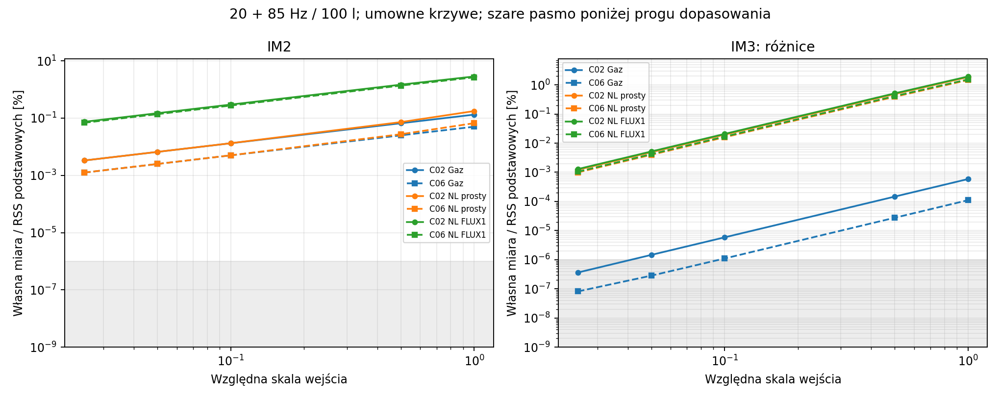
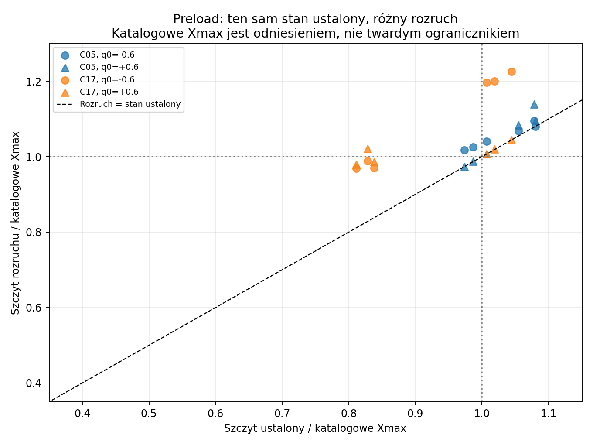

# Raport 026 — wykonana kampania dwutonowa P14B

Stan: 2026-10-25. Wykonano **3312 przypadków w zadanej rodzinie**,
16560 projekcji emisji i39744rekordy fazorów produktów. Domknięto
zakres P14B opisany poniżej. Nie jest to zakończenie całego P14/P25,
identyfikacja THD produktów ani badanie fizycznego prototypu.
[Raport024](024_P14B_emisja_i_swiadkowie.md) pozostaje historycznym
raportem częściowym; jego migawek nie zmieniono wstecz.

## Wnioski dla prototypu

**Rekomendacja na podstawie symulacji:** ochrona i wymagania napędu
muszą obejmować sumę sygnałów, produkty wytwarzane wewnątrz przetwornika
oraz rozruch. Liniowa osłona wejścia nie gwarantuje tej samej osłony
w modelu nieliniowym. Katalogowe Xmax traktujemy jako odniesienie
przemieszczenia, bez przypisywania mu granicy uszkodzenia albo gwarancji THD.

W tej rodzinie maksymalne próbkowane wychylenie ustalone wyniosło
1,08032katalogowego Xmax, a największy zaobserwowany szczyt rozruchu
1,22514Xmax. Te wartości nie dowodzą ani awarii, ani bezpieczeństwa.
Rozruch i ustalone odpowiedzi należy badać oddzielnie przy projektowaniu P24.

Poprzedni przykład produktu5Hz dla45+95Hz pozostaje aktualny:
wychylenie i ciśnienie mają różne wagi częstotliwościowe. Wektorowe
sumowanie mechanizmów może zmniejszyć albo zwiększyć dany produkt;
nie dodaje się bezwarunkowo ich procentów.

## Wykonany zakres i stan danych

**Założenia:**24bazyT/S,30/100/150l netto powietrza,
20+85/25+95/45+95Hz, poziomy0,1/0,5/1 wspólnego zimnego wejścia,
5profili: LINEAR,GAS_ONLY,NL_SIMPLE,NL_FLUX_ONE,NL_FLUX_TWO.
Kształty BL/Kms i pamięci są umowne; identyczne względne kształty
nie identyfikują zachowania różnych produktów.

| Grupa | Liczba | Dziedzina |
|---|---:|---|
| MAIN |3240|24×3Vb×3pary×3poziomy×5profili|
| PHASE |36|4bazy,3profile,3dodatkowe klasy fazy|
| SMALL_SIGNAL |12|C02/C06,3profile,2niższe poziomy|
| PRELOAD |24|C05/C17,2pary,3profile,q0=−0,6/+0,6|

Pierwotny LSODA dał3289statusów okresowych oraz23NOT_SETTLED.
Wszystkie23przeliczono oddzielnie od stanu początkowego DOP853,
z ostrzejszymi tolerancjami i gęstszym widmem. Warstwa wynikowa spełnia
zadane kryterium okresowości we wszystkich3312punktach. Zachowano
oryginalneSQLite z ich flagami i osobne rozstrzygnięcia; nie nadpisano
niewygodnych wyników. To kryterium numeryczne, nie dowód globalnego
istnienia lub jednoznaczności wszystkich atraktorów.

W bazach są atomowe wiersze i pasmowe fazory X/I z hashami. Przechowano
0–1000Hz, krok1,25Hz, RMS dla f>0 i osobno DC. Dziedzina modelu ruchu
|q|<1,25 jest arbitralną granicą analizy, nie mechanicznego uszkodzenia.
Żaden z tych3312przypadków nie zakończył się przekroczeniem tej dziedziny.

## Mały sygnał: zgodność potęg i próg dopasowania

**Teoria:** względne IM2 jest pierwszego rzędu amplitudy, a względne
IM3 drugiego, jeżeli odpowiednie współczynniki nie znikają. Fit wykonano
dla skal0,025/0,05/0,1, z umownym progiem kwalifikacji1e−6%.
Nie jest to uniwersalna granica błędu ani rozdzielczość pomiarowa urządzenia.
Odpowiadające liniowe kontrole IM3 C02/C06 w100l/20+85Hz miały
wartości rzędu1,5e−8…4,2e−8%.

W rozdzielonych fitach uzyskano wykładniki:

- IM2:0,999833…1,002702.
- IM3difference:1,998815…1,999679.

GAS_ONLY/C06/IM3 miał tylko jeden punkt powyżej progu, więc **nie
podano jego wykładnika**. Dla GAS_ONLY/C02 fitIM3 opiera się na dwóch
punktach. Nie interpretować ich jako precyzyjnych wykładników produktu
w dowolnym zakresie amplitudy; przy większym sygnale pojawiają się dalsze rzędy.



## Faza i preload

**Wynik ograniczonego studium fazy:**216porównań produktów powyżej
zadanej bramki fazy. Po odniesieniu do m*phi1+n*phi2 największa
zaobserwowana zmiana amplitudy wyniosła6,72e−6dB, fazy2,63e−5stopnia.
Tak małych różnic nie przypisujemy automatycznie fizycznemu wpływowi
fazy. Wynik nie dowodzi jej nieistotności przy kolizjach linii,
clippingu, innych sygnałach lub dowolnych wyższych rzędach.

**Wynik24przypadków preload:** w porównaniu ze startem zerowym
ustalone zespolone widma różniły się względnie najwyżej6,46e−10dlaX
i4,66e−10dlaI. Nie znaleziono innej odpowiedzi ustalonej w tych
wybranych stanach początkowych. Szczyty rozruchu zależały jednak od
preload, jego znaku i rodziny. Nie jest to globalny dowód braku wielu gałęzi.

Największy rozruch wystąpił w003300/C17/NL_SIMPLE,20+85Hz,
150l,q0=−0,6. Nie utożsamiać tej umownej siatki z rozrzutem populacji
rzeczywistych głośników ani z zalecanym sposobem ich użytkowania.



## Emisja i weryfikacja

**Projekcje tego samego X:** stacjonarny monopol4pi, odgroda na osi,
dalekie pole pod60°, radialna czasza na sferze i odrębny kontrolny
monopol ruchomy. Zastosowano warunki i odległości z raportu024.
Nie dodano ich reakcji z powrotem do napędu i nie rozwiązano finalnej
skrzyni MDF. Ruchomy monopol jest zadanym źródłem fali, nie pełną
ruchomą granicą rzeczywistego tłoka. Nie nakładać go na inne geometrie
jako dodatkowego niezależnego zysku.

**Kontrole całego zapisanego zbioru:**3312hashe widm;
648liniowych przypadków porównano z odrębną algebrą harmoniczną.
Maksymalne względne błędy zespolone wyniosły3,19e−9dlaX oraz
1,10e−8dlaI. Kontrole analityczne widma i czasu opóźnionego z raportu024
pozostają częścią podstawy; nie przedstawiamy ich jako pomiarów.

**Niezależny Radau:** ponownie rozwiązano cztery świadki największego
ustalonego ruchu, rozruchu, błędu bilansu oraz produktu5Hz:
003263,001886,003300,000223. Maksymalna względna różnica całego
pasmaX wyniosła9,84e−10, I2,29e−9; różnica miarIM do8,37e−8punktu
procentowego. Weryfikator zapisuje checkpoint każdego świadka;
przerwany przebieg nie wymaga powtarzania ukończonych punktów.

Dla tych samych dużych odpowiedzi zagęszczono rekonstrukcję emisji
2→4→8. Maksymalne względne różnice ciśnienia w zapisanym paśmie:
3,61e−8i7,86e−9; zmianaIM między4i8 do3,57e−8punktu procentowego.
Nie jest to globalna osłona każdej geometrii i wszystkich3312punktów.

**Bilans:** maksymalna względna reszta energii wynosi3,93e−9,
reszta równania średniego napięcia1,05e−9V, średni prąd do2,38e−10A.
Przy stałym Re,BL(x),okresowym strumieniu i zerowej średniej napięcia
średni prąd powinien być zerowy. Nie wynika z tego zerowy offsetX.
Wyniku nie przenosimy bez zmian do sprzężonego Re(T).

Największa miara nieliniowych linii w modeluLINEAR/stacjonarnej emisji
wyniosła1,215e−6% — to poziom numeryczny w tej siatce. Dla operatora
ruchomego źródła nawet liniowy X może generować produkty geometryczne,
więc nie nazywamy ich takim samym poziomem błędu.
Ogon RMSX powyżej1kHz dochodził do5,59e−11; nie ogranicza to
automatycznie ogona ciśnienia ważonego przez f² ani całego THD.

## Artefakty i odtwarzanie

- [Surowe przypadki](../wyniki/p14b_przypadki.csv),
  [pochodzenie](../wyniki/p14b_podsumowanie.json).
- [Miary po jawnych rozstrzygnięciach](../wyniki/p14b_miary_stacjonarne.csv),
  [fazy](../wyniki/p14b_studium_fazy.csv),
  [mały sygnał](../wyniki/p14b_studium_malego_sygnalu.csv),
  [preload](../wyniki/p14b_studium_preload.csv).
- [16560projekcji](../wyniki/p14b_emisja.csv),
  [39744fazory](../wyniki/p14b_fazory_produktow.csv),
  [metadane projekcji](../wyniki/p14b_projekcja.json).
- [Niezależne kontrole](../wyniki/p14b_weryfikacja_wybranych.json),
  [podsumowanie studiów](../wyniki/p14b_studia_podsumowanie.json).
- [Manifest wykonanego etapu P14B/P15B](../wyniki/manifest_P14B_P15B.json).

```bash
python3 skrypty/analiza_P14B.py
python3 skrypty/rozstrzygnij_P14B.py
python3 skrypty/audyt_dynamiki_P14B.py
python3 skrypty/podsumuj_studia_P14B.py
python3 skrypty/projekcja_P14B.py
python3 skrypty/sprawdz_kampanie_P14B.py
python3 skrypty/raportuj_pelne_P14B.py
```

Koordynator i zgodne checkpointy odtwarzają artefakty, nie są nowymi
niezależnymi3312ODE. Procedury trzeba uruchamiać sekwencyjnie, po
potwierdzonym zakończeniu poprzedniej. Świeże przeliczenie wykonuje się
w oddzielnej kopii bez jej cache; nie kasować istniejących wyników.

**Dalszy zakres:** P14B jest wykonany w określonej dziedzinie.
Pozostają sygnały>2tonów, realistyczne widma, clipping/ochrona,
pełne sprzężenia termiczne i pola oraz identyfikacja krzywych produktów.
Wykonane P15B opisuje[raport027](027_P15B_sprzezenie_grzania_i_napedu.md).
Następna syntezaP17 ma prowadzić do wymagań napędu i obudowy, po czym
P18/P19 obejmą panele, usztywnienia i obliczeniowy dobór kleju.
