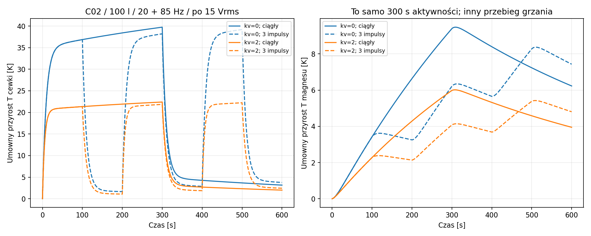
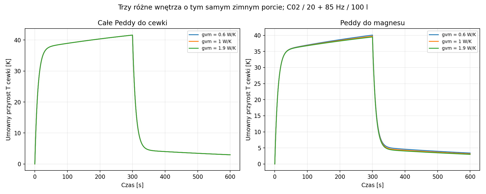

# Raport 027 — P15B/P16: sprzężenie grzania, prądu i ruchu

Stan: 2026-10-25. **Wykonano 2304 przebiegi warunkowe** dla 24 baz T/S.
Rozwinięto termikę w czasie z aktualizowanym Re(T), prądem, prędkością
i stratami. Wszystkie R/C, alpha i chłodzenie są scenariuszami; nie
uzyskano temperatur fizycznych produktów ani rankingu ich jakości.
Wynik rozwija P15/P16, ale ich całego zakresu jeszcze nie zamyka.

## Co wynika dla prototypu

**Rekomendacja:** ochrona cieplna powinna śledzić historię strat i stan
cieplny, uwzględniając impedancję i obwiednię. Stała moc katalogowa ani
stały mnożnik Re nie opisują grzania w czasie. Przy stałym napięciu prąd
maleje ze wzrostem Re, lecz grzanie I²Re może początkowo rosnąć.
Rozdział ciepła między cewką i metalem także zmienia wynik.

W 96 różnych punktach baza/częstotliwość **58 miało dodatnią początkową
pochodną Pcu względem temperatury**. Nie jest to 58% populacji głośników
ani informacja o prawdopodobieństwie awarii; to licznik wskazanej siatki
z umowną pamięcią elektromagnetyczną i stałym BL/Cms/Mms/Rms.

## Dziedzina i metoda

**Założenia:** Vb=100l netto powietrza;20/40/80Hz lub20+85Hz;
sieć FLUX_ONE zamrożona w x=0; wejście0,75zimnej osłony prostegoLTI
40Vrms/12Arms/Xmax. Nie jest to charakterystyka wybranego wzmacniacza
ani dynamiczny ogranicznik. Dla każdego punktu zastosowano3równoważne
zimne sieci cieplne,2skrajne przydziały Peddy,2hipotezy dodatkowego
chłodzenia i2obwiednie.24×4×3×2×2×2=2304.

Prawo Re=Re0(1+alpha*theta_v), alpha=0,004K^-1, jest **założeniem**.
Nie potwierdza materiału, temperatury katalogowego pomiaru Re ani
temperatury dopuszczalnej dla cewek. Cv=20J/K i pozostałe elementy
sieci są kontrolami z jawnej konfiguracji, nie estymatami produktów.

**Model wolny:** w każdym kroku termiki liczono harmoniczny prąd
I_k=V_k/[Re(theta_v)+Zother_k], prędkość, Pcu oraz straty pamięci.
Tło Zother jest bierne i stałe; zawiera indukcyjność, pamięć oraz
impedancję ruchową. Odpowiedź gazu jest liniowa z tau=5ms.

```text
Pcu = Re * sum(|I_k|²)
Peddy = sum(Re(Zmemory_k) * |I_k|²)
Pv = Pcu + eta*Peddy
Pm = (1-eta)*Peddy
gva_extra = kv * v_RMS
```

Przyjęto eta=0/1 oraz kv=0/2W*s/(K*m). v_RMS jest **proxy** chłodzenia,
nie obliczoną prędkością powietrza w szczelinie. Model nie zawiera
osobnej pojemności powietrza ani pełnej drogi zależnej od wychylenia.
Granica przyrostu250K ogranicza analizę tego prawa; nie jest limitem
temperatury bezpiecznym dla głośnika, kleju ani wzmacniacza.

## Prąd maleje, moc cewki może rosnąć

**Wyprowadzenie dokładne dla zamrożonego biernego tła:** dla jednego
tonu, R=Re, Zother=a+ib, a>=0:

```text
|I| = V / sqrt((R+a)²+b²)
Pcu = V²*R / ((R+a)²+b²)
dPcu/dR = V²*(a²+b²-R²) / ((R+a)²+b²)²
```

Prąd maleje dla R>0, ale znak pochodnej Pcu zależy od impedancji.
Dla wielu niezależnych tonów sumuje się ich moce. Nie wolno zastąpić
tego samej sumą procentowych spadków odpowiedzi.


**Dalszy wynik teoretyczny:** dla stałych dodatnich oporów cieplnych,
stałego napięcia, stałego biernego Zother, alpha>0 i stałego przydziału
Peddy model ma jeden dodatni stan równowagi. Po wyeliminowaniu magnesu
równanie ma postać theta=H(theta). Każdy składnik H/theta jest
proporcjonalny do

```text
(A*R+B) / [(R-R0)*((R+a)²+b²)],  R>R0>0,A>0,B>=0
```

Jego pochodna jest ściśle ujemna. H/theta przechodzi od nieskończoności
do zera, więc przecina1dokładnie raz. To inna dziedzina niż idealne
utrzymywanie prądu z progiem P0*alpha*Rth=1 w P15A. Nie przenosimy
twierdzenia bez zmian na dowolne BL(T), clipping, zanik chłodzenia,
zależne od temperatury pozostałe parametry i fizyczne zniszczenie.
Warianty kv=2 policzono numerycznie; powyższy dowód dotyczy stałych
oporów, nie dowodzi globalnej jednoznaczności każdej funkcji chłodzenia.

## Obwiednia i pamięć cieplna

**Eksperyment obliczeniowy:** ciągłe włączenie0–300s i chłodzenie do600s
porównano z impulsami0–100/200–300/400–500s, także do600s. Obie obwiednie
mają300s aktywności. Ostatni impuls kończy się później: porównanie stanu
w600s nie jest porównaniem po jednakowym czasie chłodzenia od wyłączenia.
Nie utożsamiamy tego samego czasu włączenia z tą samą energią ciepła.

W1152parach tej siatki maksymalny próbkowany przyrost cewki dla impulsów
był niższy o0,00094–1,20216K. Wspólny horyzont600s dawał jednocześnie
wyższy stan resztkowy o0,00324–1,73330K. To wynik konkretnych obwiedni,
nie ogólna zasada, że dowolne impulsy grzeją mniej lub bardziej.

**Przykład umowny C02/100l/20+85Hz/po15Vrms**, b=1W/K, eta=0:

| Chłodzenie | Obwiednia | Maksimum cewki[K] | Cewka w600s[K] |
|---|---|---:|---:|
| kv=0 | Ciągła |39,73435|3,16180|
| kv=0 | Trzy impulsy |39,19455|3,77317|
| kv=2 | Ciągła |22,40247|2,00340|
| kv=2 | Trzy impulsy |22,23111|2,43943|

To przyrosty **w hipotetycznej sieci**, nie prognoza temperatur RSS390HF-4.
Różnica między kv=0/2 pokazuje znaczenie nieznanego chłodzenia, nie
potwierdza konkretnej korzyści wentylacji rzeczywistej skrzyni.



## Nieidentyfikowalność pozostaje po sprzężeniu

Rodzina zP15A ma b=gvm,E=b²/Cm,D=(gvm+gma)/Cm,a=gvm+gva.
**Dokładna transformacja** z=b*theta_m daje

```text
Cv*theta_v_dot = Pv - (a+kv*v_RMS)*theta_v + z
z_dot = E*theta_v - D*z + (E/b)*Pm
```

Dla Pm=0 równania portu nie zależą od b także po dołączeniu naszego
Re(T) i tego samego chłodzenia zależnego od v_RMS. Różne wnętrza dają
więc tę samą temperaturę cewki w tym zamkniętym sprzężeniu. Maksymalny
rozrzut jej próbkowanych maksimów w porównanych rodzinach wyniósł
2,55e−12K. Temperatury magnesu pozostają różne.

Gdy Peddy trafia do magnesu, człon(E/b)*Pm zmienia temperaturę cewki.
Dlatego parametry portu nie wystarczają do arbitralnego przypisania
strat elektromagnetycznej pamięci do części cieplnych.



## Weryfikacja i granice uśredniania

- 2304 przebiegi zakończone w zadanej dziedzinie. Bilans
  Cv*theta_v+Cm*theta_m=całka(Pv+Pm−Pdo_otoczenia) zachowano do
  względnej reszty1,58e−15. To kontrola tego modelu, nie walidacja urządzeń.
- 12 odrębnych kontroli pochodnej Pcu i dokładne tożsamości SymPy.
- 4 pełne ODE audio dla C02: 40 Hz / 20 + 85 Hz, dwie fazy. Jawnie rozwiązano
  x,v,i,temperaturę liniowego gazu, pamięć cewki i dwie temperatury.
  Re(T) oraz I²Re działają w czasie; kv=0. Start to przygotowany zimny
  stan okresowy audio, nie rozruch fizycznego urządzenia.
- W oknie ostatniego okresu po5s błąd średniego przyrostu cewki modelu
  wolnego wyniósł0,000655–0,007352K, względnie do0,05136%.
  Nie jest to gwarancja całych2304trajektorii ani dowolnego sygnału.

Najmniejszy **zimny** stosunek szybkiej stałej cieplnej do okresu
wymuszenia wyniósł49,7475. Nie zakładamy, że ten stosunek pozostaje
niezmieniony po zmianie chłodzenia. Model wolny pomija rozruch i ringdown
audio. BL(T),duży sygnał, gradienty temperatury i sprzężenie z nagrzewaniem
powietrza w skrzyni pozostają otwarte.

Zmiana RSSprędkości przy najgorętszym aktywnym stanie mieściła się
w tej rodzinie od−2,46717do−0,000524dB. Dla pojedynczego tonu odpowiada
zmianie poziomu stałej geometrii; dla pary RSSprędkości nie jest
automatycznie RSSciśnienia ani SPL w pokoju.

## Audyt źródeł i współczynnika temperaturowego

Oryginalny manuskrypt Klippela podaje na s.6 liczbę0,0393K^-1dla miedzi.
Oględziny potwierdziły zapis w PDF. Tabele pierwotnego badaniaNBS
odnoszone do20°C zawierają wartości rzędu0,0039K^-1. Zapiszmy tę
rozbieżność: **nie przyjęto0,0393do obliczeń**. Użyte0,004pozostaje
jawnym scenariuszem, nie identyfikacją drutu naszych produktów.

Przeczytano wybrane sekcje i obejrzano odpowiednie schematy/wykresy:
[SRC42–44,oryginały,hashe i warunki](../dane/zrodla/P15B_sprzezenie_i_konflikt_alpha.json).
Nie przeniesiono temperatur z opublikowanych testów nieznanych głośników.

## Artefakty i odtwarzanie

- [Wyniki2304przebiegów](../wyniki/p15b_sprzezenie_i_obwiednie.csv).
- [Pełne przebiegi24wariantówC02](../wyniki/p15b_przebiegi_C02.csv).
- [1152porównania obwiedni](../wyniki/p15b_porownanie_obwiedni.csv).
- [Dane przebiegu i hashe](../wyniki/p15b_podsumowanie.json),
  [interpretacja](../wyniki/p15b_interpretacja.json),
  [niezależny audyt](../wyniki/p15b_audyt_sprzezenia.json).
- [Archiwum checkpointów](../wyniki/p15b_checkpoint_7f860ae1b6821ef3.zip)
  i[manifest archiwum](../wyniki/p15b_checkpoint_archiwum.json).
- [Manifest wykonanego etapu P14B/P15B](../wyniki/manifest_P14B_P15B.json).

```bash
python3 skrypty/archiwum_P15B.py restore
python3 skrypty/analiza_sprzezenia_Re_T_P15B.py
python3 skrypty/audyt_sprzezenia_Re_T_P15B.py
python3 skrypty/raportuj_sprzezenie_Re_T_P15B.py
```

Zgodne checkpointy odtwarzają artefakty; nie są2304nowymi niezależnymi
integracjami. Świeży rachunek wymaga pustego zgodnego katalogu cache
w oddzielnej kopii projektu. Nie kasować istniejących wyników użytkownika.
Kolejność grup wCSVprzebiegów może zależeć od kolejności ukończenia
procesów; tożsamość rekordów należy porównywać po case/time/on.

**Kolejny krok:** po zamknięciu tego zakresu połączyć wP17 wymagania
prądu/napięcia/wychylenia i warunkowego chłodzenia, a następnie rozpocząć
P18/P19 — panele, usztywnienia i klej. Pozostałe zjawiska cieplne mają
jawne bramki danych; nie zamieniamy braku R/C/BL(T) w ranking produktów.
Końcowy wybór jednego głośnika/skrzyni oraz PDF są nadal przed nami.
