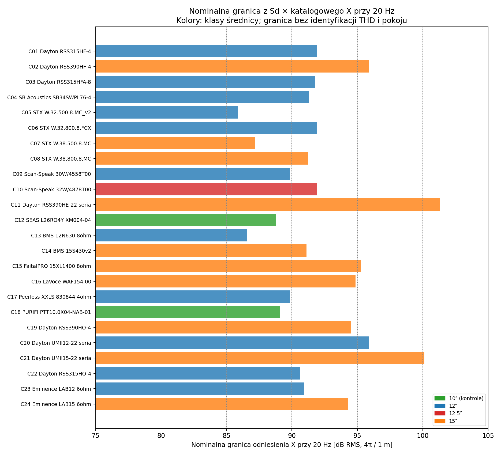

# Raport 028 — P17: wspólne ograniczenia napędu, objętości i chłodzenia

Stan: 2026-10-25. **Wykonano 5184 warunkowe testy sześciu pasm**,
31 104 punkty wymagań i ciągłe rozwiązanie po wszystkich Vb>0.
To synteza koniecznych warunków modelowych, nie końcowy wybór głośnika,
zatwierdzenie progów briefu ani zmierzony użyteczny SPL.

## Wniosek projektowy

**Rekomendacja:** dobierać przetwornik, litraż i napęd łącznie.
Większy wzmacniacz może pomóc przy aktywnym ograniczeniu napięcia,
ale nie usuwa granicy Sd*X ani warunku chłodzenia. Większy katalogowy
skok także nie gwarantuje, że przyjęty wzmacniacz wykorzysta go
w praktycznej skrzyni. Katalogowe X nie jest dowodem niskiego THD.

W przykładzie diagnostycznym opisanym niżej RSS390HF-4 ma taki sam
modelowy dolny litraż przy40V/12A i60V/20A, ponieważ ogranicza go
założony warunek cieplny. Dla RSS390HE-22 zwiększenie napięcia pozwala
zmniejszyć dolny litraż; następnie również pojawia się ograniczenie
cieplne. Nie jest to ranking rzeczywistego chłodzenia tych produktów.

## Dziedzina: co oznaczają poziomy

**Założenia:**24bazy,3rodziny elektryczne SIMPLE/FLUX_ONE/FLUX_TWO,
20/25/31,5/40/63/80Hz, poziomy85/90/95/100dB RMS, budżety40V/12A
lub60V/20A RMS, przyrosty40/80/120K i testowe Rth0,3/0,6/1,2K/W.
Wartości są osiami eksperymentu obliczeniowego, **nie wymaganiami
zaakceptowanymi przez użytkownika** i nie katalogowym maxSPL referencjiADAM.

Każdy punkt jest osobnym długotrwałym sinusem i diagnostycznym
monopolem4pi/1m. Wspólny przedział Vb oznacza jedną objętość spełniającą
warunki dla sześciu **oddzielnych** sinusów. Nie wolno zsumować ich jako
poziomu muzyki ani uznać testu6f za certyfikat całego ciągłego pasma.

Gaz ma zadaną liniową relaksację tau=5ms. **Przy zmianach Vb utrzymano
tau, nie stałe H wymiany ciepła.** To rodzina kontrolna; nie ten sam
fizyczny materiał i geometria wymiany ciepła w każdej objętości.
Nie przenosić analitycznych przedziałów bez zmian na dowolne tau(Vb),
wypełnienie, przeciek, BL(T) lub rzeczywistą dyfrakcję skrzyni.

## Stały poziom wyjściowy wymaga innego testu cieplnego

**Wyprowadzenie:** dla wymaganego pRMS i stacjonarnego monopola
prędkość i ruch są zadane. W zamrożonym liniowym napędzie wymagany
prąd zależy od obciążenia mechanicznego, nie od Re. Wzrost Re wymaga
natomiast wyższego napięcia, jeżeli chcemy utrzymać ten sam poziom.
Nie oznacza to, że miniDSP lub wzmacniacz automatycznie taką kompensację realizuje.

```text
Hpv = rho*s*Sd*exp(-s*r/c)/(4pi*r)
v_required = p_required / Hpv
I_required = Zm(Vb)*v_required/BL
V_required = Zblocked(T)*I_required + BL*v_required
```

Przy stałym prądzie zimna strataP0=I²Re0, a po grzaniu
Pcu=P0(1+alpha*theta). Warunek stabilności portu to
1−alpha*Rth*P0>0. Dla ustalonego przydziału ciepła metalu:

```text
theta_coil = Rth*(P0+zeta*Peddy)/(1-alpha*Rth*P0)
zeta = eta + (1-eta)*(R12/R11)
```

W dodatniej dwuwęzłowej sieci zP15A/P15B zachodzi0<=R12/R11<=1.
Przyjęto najgorszą granicę zeta=1. Wymagany warunek przyrostu ma postać

```text
Rth <= theta_limit /
       [|I_required|²*(Re0*(1+alpha*theta_limit)+Reddy)]
```

Warunek ten pozostawia dodatni margines stabilności. Rth_test jest
testowym górnym ograniczeniem portu przy danej prędkości, nie pomiarem
kandydata. Nie obejmuje nieznanego grzania od innych części, gradientów
i wzrostu temperatury powietrza skrzyni. Przyrosty nie są dopuszczalnymi
temperaturami cewki lub kleju. Pojemności cieplne i czas burstu nie
zostały zastąpione fikcyjnymi wartościami.

## Objętość ciągła i rozwiązanie analityczne

**Matematyka:** przy ustalonym f i zadanego rodzaju gazu, u=1/Vb,
Vb w m³. Impedancja mechaniczna jest afiniczna względem u:

```text
Zm = z0 + z1*u
z0 = Rms+s*Mms+1/(s*Cms)
z1 = Sd²*Kgas(s)/s
I_required = i0+i1*u
V_required = v0+v1*u
```

Ograniczenia napięcia, prądu i grzania dają nierówności
|a+b*u|<=L, których rozwiązanie jest przedziałem z wypukłego trójmianu.
Przecięto je dla6częstotliwości oraz u>0, bez narzucania maksymalnej
objętości. Puste pole Vb_max przy statusie dopuszczonym oznacza brak
skończonej górnej granicy w modelu; przy statusie pustym nie ma rozwiązania.
Sam punkt u=0 odpowiada Vb→infinity i nie jest skończoną skrzynią.

Warunek katalogowego wychylenia sprawdza się osobno: przy zadanym
ciśnieniu monopola X_required nie zależy od Vb. Jeżeli przekracza
przyjęte odniesienieX, zmiana litrażu i mocy nie usuwa tego faktu.
Nie jest to kryterium faktycznego uszkodzenia lub pomiarowego THD.



## Wynik siatki i ograniczenia

| Stan dla6punktów | Liczba zestawów |
|---|---:|
| Wspólny warunkowy przedział Vb |2424|
| Katalogowe odniesienieX przekroczone w co najmniej jednymf |2592|
| Brak rozwiązaniaV/I/grzanie dla co najmniej jednegof, mimo warunkuX |168|

W tej siatce nie znaleziono zestawu, w którym wszystkie pojedyncze
częstotliwości miałyby rozwiązanie, lecz ich przecięcie byłoby puste.
To wynik tej siatki, nie ogólne twierdzenie o optymalizacji pasma.
Liczniki nie są prawdopodobieństwami przewagi produktów i nie oznaczają
liczby kandydatów spełniających cały brief.

**Przykład95dB RMS/4pi/1m**, sześć osobnych sinusów, FLUX_ONE,
umowny przyrost80K i Rth_test=0,6K/W:

| Baza | BudżetV/I | Dolna Vb[l] |
|---|---|---:|
| C02 RSS390HF-4 |40Vrms/12Arms|82,43|
| C02 RSS390HF-4 |60Vrms/20Arms|82,43|
| C11 RSS390HE-22 |40Vrms/12Arms|272,53|
| C11 RSS390HE-22 |60Vrms/20Arms|149,05|

Wskazane liczby są granicami **warunkowego modelu**, nie litrażem
do zamówieniaCNC. C11 nadal ma otwartą bramkę aktualnej rewizji/statusu.
DefinicjeXmax różnych producentów nie stały się jednolitym pomiarem.
C07 zachowuje konflikt4/8ohm, C12/C18 są10calowymi kontrolami.

Przykład pokazuje, dlaczego sam największy katalogowy skok nie zamyka
doboru. WariantC02/100l w tym scenariuszu wymaga najwyżej30,32Vrms
i4,80Arms w sześciu punktach, a najmniejsza z sześciu górnych granicRth
wynosi0,87155K/W. **Nie znamy rzeczywistego Rth tego produktu**, jego
THD przy tym poziomie ani wpływu nagrzewania BL/Cms. Nie ogłaszamy
spełnienia briefu ani ostatecznego zwycięzcy.


## Niezależna kontrola i granice formalne

**Weryfikacja:** 3 dokładne tożsamości SymPy, 12 472 704 sprawdzenia
nierówności w odrębnej siatce u oraz 26 246 odrębnych obliczeń brzegów
układem3równań prąd/prędkość/ciśnienie gazu. W nim Kgas policzono
z jawnego równania relaksacji zamiast funkcji użytej przez model główny.
Największy względny błąd ciśnienia wyniósł1,09e−15, prądu1,32e−15.
Dodatnie reszty budżetów były rzędu2,23e−15, ograniczenia temperatury
3,11e−15. To kontrola zmiennoprzecinkowego modelu, nie certyfikat IV.

Odrębny steady solver dwóch węzłów sprawdził oba skrajne przydziały
ciepła Peddy. Kontrole obejmują zerowy współczynnik nachylenia,
styczność przedziału, punkt wyłącznie u=0, nieograniczony wzmacniacz,
zerowy sygnał/zerowe grzanie, zerowy budżet przyrostu temperatury,
Rth→infinity, Rth→0 oraz formalną bezstratną cewkę. Dziedziny i oczekiwane
wyniki są zapisane w skrypcie; nie deklarujemy wszystkich możliwych wyjątków.

## Pokój i następna decyzja konstrukcyjna

**Wymagania z briefu:**4,6×3,7×2,5m,17,02m²/42,55m³,
przednia ściana3,7m, dwie skrzynie przy monitorach. Aktualny układU-020:
RTV po lewej i kanapa po prawej rzutu. Dane te zachowano jako wejścia.

Nie zastosowano stałego roomgain ani prostego dodania dwóch subwooferów.
Wynik4pi/1m nie jest poziomem w sweetspocie2,5–3m. Przedział z górną
granicą infinity nie jest zgodą na dowolnie wielką obudowę: trzeba
zmieścić dwa egzemplarze i prześwity w realnym pokoju. Dokładnych
pozycji nadal nie przyjęto jako zmierzonych danych użytkownika.

**Kolejny krok:P18/P19.** Porównać panele, usztywnienia, połączenia,
regulację objętości i klej dla sensownych geometrii, a następnie połączyć
wyniki z niepewnością i ochroną. Ostatecznie wybrać jeden głośnik
i jedną regulowaną konstrukcję. Nie powstaje jeszcze końcowyPDF.

## Odtworzenie

- [31104punkty](../wyniki/p17_punkty_i_wymagania.csv),
  [5184przedziały wspólne](../wyniki/p17_wspolny_przedzial_Vb.csv).
- [GraniceSdX](../wyniki/p17_nominalna_granica_SdX.csv),
  [aktywne ograniczenia przykładów](../wyniki/p17_przyklady_aktywnych_ograniczen.csv).
- [Wejścia i zakres](../wyniki/p17_podsumowanie.json),
  [weryfikacja](../wyniki/p17_weryfikacja.json),
  [interpretacja](../wyniki/p17_interpretacja.json).
- [Manifest etapu](../wyniki/manifest_P17.json).

```bash
python3 skrypty/analiza_syntezy_P17.py
python3 skrypty/sprawdz_synteze_P17.py
python3 skrypty/raportuj_synteze_P17.py
```

Wejścia zachowano w migawce zSHA-256. Przebieg został policzony bez
zmieniania briefu lub danych producentów. Parametry cen i narzędziaCAD
pozostają poza aktualnym zakresem.
