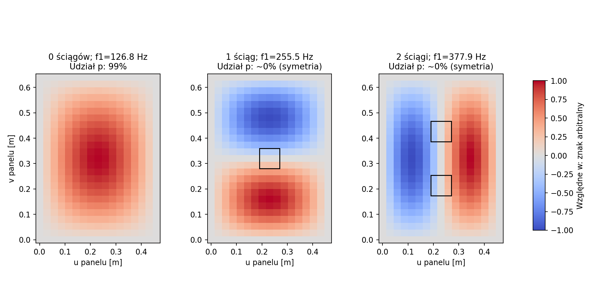
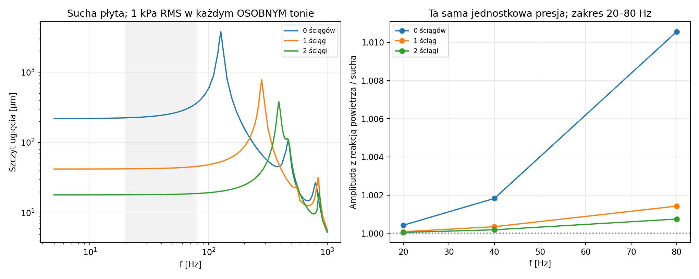

# Raport 029 — P18A: panele MDF, ściągi i postacie drgań

Stan: 2026-10-25. Wykonano **172 warianty MES płyt i par ścian** oraz
1996 punktów odpowiedzi harmonicznej. Wyniki są symulacjami modeli
kontrolnych. Nie zamykają P18: front z otworem, koszem i mocowaniem,
rzeczywiste naroża oraz pełna skrzynia pozostają do wykonania.

## Wniosek wpływający na konstrukcję

**Rekomendacja robocza:** rozwijać konstrukcję z połączeniem przeciwległych
ścian, porównując ją z samym zwiększaniem grubości. Sprawdzać jednocześnie
nakładki rozprowadzające siłę, masę i nośność połączeń. W modelowanej parze
jedno usztywnienie silnie zmniejsza ugięcie przy niewielkiej dodatkowej
masie. Nie unieruchamia jednak każdego możliwego ruchu ścian.

**Przykład obliczeniowy:** panel 460 × 640 × 22 mm, materiał referencyjny,
brzegi SSSS, symetryczne rozsuwanie identycznej pary, 1 kPa statyczne:

| Ściągi | Maksymalne ugięcie węzłowe [µm] | Pierwsza częstotliwość [Hz] |
|---|---:|---:|
| 0 |154,73|126,78|
| 1 |29,71|255,51|
| 2 |12,75|377,91|

Masa jednego pręta i dwóch nakładek w tej hipotezie wynosi **0,464 kg**.
Zwiększenie obu ścian z 22 do 25 mm dodałoby około 1,29 kg, bez takiego
samego efektu jak jeden ściąg. To porównanie konkretnego modelu, nie
uniwersalna przewaga dowolnej wręgi nad dowolnie grubszą płytą.


## Materiał i geometria są jawnie warunkowe

**Dane producenta SRC45:** referencją jest Kronospan Luxembourg,
Kronogen+UM, DoP1607101012 z 2016 r. Dla 18 mm odczytano moduł zginania
2200 MPa, MOR20 MPa i internal bond0,55 MPa; dla 22/25 mm odpowiednio
2100 MPa, 18 MPa i 0,55 MPa. Obejrzano obie oryginalne strony.
To referencja innego, określonego produktu, **nie pomiar materiału
wykonawcy** i nie dynamiczne parametry jego konkretnej partii.

730 kg/m³ to wartość średnia podana w karcie przy właściwościach cieplnych
i przenikalności. Do obliczeń przyjęto ją jako hipotezę masy. Nu=0,3,
moduł ścinania z izotropii i tłumienie nie są danymi tej karty.

Zbadano trzy profile: referencyjny, E×0,65/rho800/nu0,35 oraz
E×1,5/rho650/nu0,25. To zakresy stresowe, nie tolerancje producenta.
W profilu E płyty i pręta zmieniają się wspólnie; nie obejmuje to
wszystkich niezależnych par modułów. Osobno badano podatność końców.

Geometrie paneli: 400×450,460×640 i550×620 mm. Pierwsze dwie pochodzą
z dawnych poglądowych K1/K2; trzecia odpowiada kontrolnemu wnętrzu
500×550×620 mm,170,5 l brutto. Nie są to gotowe skrzynie netto ani
projekty CNC. Grubości18/22/25 mm odpowiadają wskazanej ofercie materiałowej.

## Metoda MES i jej granice

**Model:** małe odkształcenia izotropowej płyty Reissnera–Mindlina,
cztery węzły, w/theta_u/theta_v, spójna masa i bezpośrednie macierze
rzadkie SciPy. Interpolację ścinania oparto na wzorcu MITC4 z sekcji2
SRC46. Nie implementowano pełnej powłoki MITC4+, membran i geometrii3D.

SSSS oznacza zadane w=0 i odpowiednie obroty styczne; CCCC — zadane
w i oba obroty. Zbadano też sprężyny kątowe ktheta. **Nie uznajemy
SSSS/CCCC za bezwarunkowe granice każdej realnej skrzyni:** położenia
krawędzi są tutaj zadane, a sąsiednie ściany rzeczywistej skrzyni mogą
się przemieszczać. Pełna rama musi to później uwzględnić.

Ściąg jest prętem osiowym z EA/L i zgodną masą1D, z rozprowadzaniem
siły na skończonej łacie80×80 mm. Nakładkom doliczono masę, bez ich
lokalnego usztywnienia; dokładniejszy model połączenia jest w raporcie030.
E pręta jest proxy modułu osiowego z referencyjnego modułu zginania.

Dla identycznych płyt:

```text
K_symmetric = Kplate + 2*k*b*bT
M_symmetric = Mplate + (mrod/6 + mpad)*b*bT
K_antisymmetric = Kplate
M_antisymmetric = Mplate + (mrod/2 + mpad)*b*bT
```

Ruch antysymetryczny nie wydłuża pręta. Jego masa może obniżyć
częstotliwość: w odrębnej kontroli pierwsza spadła z126,88 do117,33 Hz.
Nie należy mówić, że ściąg podnosi wszystkie częstotliwości.

**Postacie trzeba śledzić, nie tylko sortować f1.** Po dołożeniu ściągów
na pierwszych miejscach mogą pozostać postacie praktycznie niepobudzane
jednorodnym ciśnieniem. Siły od rzeczywistego kosza mogą pobudzać je inaczej.



## Dynamika i zakres ważności

Ciśnienie harmoniczne1 kPa RMS przykładano osobno przy każdej f5–1000 Hz.
**To obciążenie diagnostyczne, nie widmo muzyki i nie rzeczywiste
ciśnienie w subwooferze przy każdej częstotliwości.** Nie sumujemy tych testów.

Tłumienie Rayleigha ma zadaną zeta przy f1 i5f1. Nie jest to zmierzone
tłumienie MDF ani spoiny. Zbadano także0,01/0,03/0,1. Jeden przypadek,
0078, przekroczył zadany wskaźnik małych ugięć w/h=0,2 pod sztucznym
obciążeniem. Nie kwalifikujemy na tej podstawie jego dużych ugięć
ani naprężeń bez modelu geometrycznie nieliniowego.

Pręty osobno porównano z idealnym odniesieniem Eulera. Część sztucznych
sił rezonansowych przekracza to odniesienie; nie jest to potwierdzenie
awarii realnego subwoofera. Wymagania i zakresy są w raporcie030.



## Weryfikacja niezależna

- Element ma trzy mody sztywne; przesunięcie i pochylenia nie tworzą energii.
- Rozwiązanie SSSS porównano z odrębnym szeregiem Naviera–Mindlina.
  Dla najdrobniejszej siatki błąd f1 wyniósł0,141%, środka poniżej0,2%,
  podatności poniżej0,5%.
- CCCC porównano w cienkiej granicy z niezależnym Ritzem Kirchhoffa
  na wielomianach. Ostatnia różnica f1 wyniosła0,257%, podatności0,386%.
  Teorie przy skończonej grubości nie są identyczne.
- Kontrola cienkiej płyty pokazała blokadę zwykłego Q4: przy1 mm
  podatność Q4 wynosiła0,00268odniesienia, a MITC0,97613 na tej siatce.
- Sprawdzono bilans sił, energię, dokładną aktualizację Sherman–Morrison
  dla pręta i ciągłą zmianę sprężyny kątowej.
- Swobodnej płycie pod niezrównoważonym ciśnieniem nie przypisano
  fikcyjnego jednoznacznego rozwiązania statycznego.

Moment normalny na idealnym brzegu SSSS powinien być zerowy. Jego
pozostałość z grubszego MES jest błędem dyskretyzacji, nie rzeczywistym
odrywaniem kleju. Do wymagań krawędziowych użyto drobniejszej siatki.

## Wyniki i następny krok

- [172 warianty](../wyniki/p18a_plyty_i_sciagi.csv),
  [odpowiedzi harmoniczne](../wyniki/p18a_dynamika.csv),
  [wejścia i hashe](../wyniki/p18a_podsumowanie.json).
- [Navier/MITC i granice](../wyniki/p18_kontrole_MITC.json),
  [niezależny Ritz i brzegi](../wyniki/p18_niezalezny_Ritz_i_brzegi.json).
- [Archiwum checkpointów](../wyniki/p18a_checkpoint_9c48ac00bedf6a1b.zip)
  i[manifest archiwum](../wyniki/p18a_archiwum.json).
- [Źródła i obrazy](../dane/zrodla/P18_P19_materialy_i_metoda.json).

```bash
python3 skrypty/archiwum_mechaniki_P18_P19.py restore p18a
python3 skrypty/analiza_plyt_i_sciagow_P18A.py
python3 skrypty/sprawdz_MITC_P18.py
python3 skrypty/niezalezny_Ritz_P18.py
```

Zgodny cache odtwarza artefakty; nie jest nowym niezależnym172MES.
**Najbliższa geometria do wykonania:** front z rzeczywistym otworem,
obciążeniem kosza i mocowaniem, następnie pełna skrzynia. Objętość,
masa i miejsce dwóch egzemplarzy w pokoju4,6×3,7×2,5 m pozostają
warunkami konstrukcji. Narzędzia CAD i zakupy nie były wykonywane.
