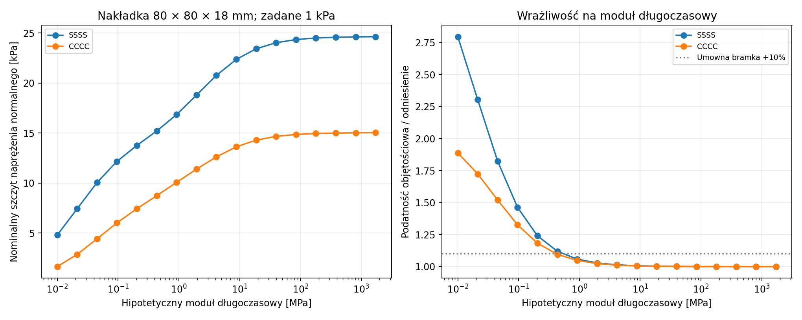
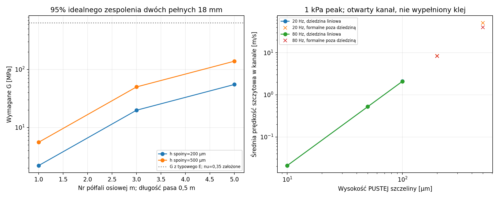

# Raport 030 — P19A: obliczenia spoin, nakładek i materiału kleju

Stan: 2026-10-25. Wykonano **656 statycznych podmodeli połączenia**,
57 punktów dynamiki, obliczenia ścinania laminatu i otwartych szczelin.
To rzeczywiste obliczenia wymagań, nie kwalifikacja trwałości gotowego
połączenia. P19 pozostaje częściowy: pełne złącza3D, ścinanie interfejsu
nakładki, mocowanie wymiennego frontu oraz rzeczywiste S–N/J(t) są otwarte.

## Robocza rekomendacja dotycząca kleju

**Do dalszych ilościowych prób materiałowych przyjęto jako referencję
epoksyd2K LOCTITE EA9466**, z modułem z aktualnej karty producenta.
Pozwala to policzyć sztywność warstwy i sprawdzić jej udział w podatności.
Nie oznacza to zatwierdzenia kleju do całej skrzyni lub wyższej jakości
dźwięku niż przy PVAc. Nie wybrano produktu na podstawie samej klasy wodnej.

KLEIBERIT303.0 pozostaje alternatywą technologiczną dla dobrze dopasowanych
połączeń, lecz jego TDS nie podaje modułów utwardzonej spoiny, pełzania
i S–N połączeniaMDF. Nie uzupełniono tych danych domysłem. Końcowy dobór
ma uwzględnić rzeczywistą geometrię, szczelinę, docisk i zachowanieMDF.
Nie dokonano zakupów ani kontaktu z wykonawcą.

Najważniejszy wynik mechaniczny: **geometria rozprowadzenia siły i podatność
MDF są w tym modelu istotniejsze niż dalsze zwiększanie sztywności już
sztywnej warstwy kleju**. Mocniejszy klej nie usuwa odrywania włókien podłoża.

## Co sprawdzono w oryginalnych kartach

**SRC48, Henkel, March2025:** typowy moduł rozciągania1718 MPa,
wolna folia1,2 mm po7 dniach w22°C. To nie zmierzony moduł normalny
spoinyMDF. Użyto go jawnie jako przybliżenia efektywnego modułu warstwy.
Skrępowanie poprzeczne i nu mogą zmienić tę wartość.

Podana wytrzymałość11,3 MPa dotyczy lap-shear na drewnie jodłowym;
**nie przepisano jej jako dopuszczalnego naprężeniaMDF lub peel**.
Krzywe temperatury i starzenia ze stali nie stały się prawem E(T),
J(t) lub S–N dla naszego połączenia. Starszy PDF2014 zachowano jako
kontekst; preferowane źródło jest bezpośrednio u producenta.

**SRC47, KLEIBERIT, wersja08:05:2026:** D3 jako1K, D4 z odpowiednim
utwardzaczem. Końcowa klasa według karty po7 dniach; czas docisku
nie jest tożsamy z osiągnięciem pełnej klasy. Odczytano100–130 g/m²
dla powierzchni i0,7–1 N/mm² dla lameli/drewna klejonego.

Nie zastosowano tej ostatniej wartości bezwarunkowo do frontuMDF.
Gdyby ją zastosować do pełnej powierzchni500×500 mm, wyniknąłby docisk
175–250 kN. To **obliczenie warunkowe procesu**, nie instrukcja producenta
dla takiego frontu. Wet spread i gęstość dają około91–118 µm mokrej
warstwy; absorpcja, odparowanie i wyciskanie nie pozwalają nazwać tego
grubością utwardzonej spoiny.

Wszystkie URL, rewizje, hashe i obejrzane obrazy są w
[rejestrze materiałów](../dane/zrodla/P18_P19_materialy_i_metoda.json).

## Połączenie panel–nakładka–ściąg: model MES

**Model kontrolny:** panel460×640×22 mm, nakładka60–120 mm,
grubość12/18/22 mm. Obie części są podatnymi płytamiMindlina,
połączonymi normalną warstwąWinklera. Parametry przez grubośćMDF
są nieznane; badano E_z/E_bending=0,05/0,15/0,4 jako stresy.
Nie są to dane producenta ani tolerancje partii.

```text
1/kn = tg/Eglue + tpanel/(2*Ez_panel) + tpad/(2*Ez_pad)
traction = kn*(wpanel-wpad)
```

Klej, obie połowy grubościMDF oraz nakładka uczestniczą w podatności.
Nakładka nie jest sztywna. Płyta jest podparta według SSSS/CCCC,
a ściąg osiowy domyka parę identycznych ścian. Ciśnienie obciąża
odsłoniętą płytę i nakładkę; zasłoniętej powierzchni nie obciążono podwójnie.

Podział całkowania po liniach obu siatek i granicach zadanych wad
zapewnia zgodność obszaru połączenia. Zbadano warstwę50/200/500 µm,
podane moduły efektywne10/100/1718 MPa, mimośrody5/10 mm oraz
brak5 mm przy krawędzi i centralny niepołączony obszar30%.
Te dwa niższe moduły są hipotezami, **nie parametrami PVAc**.

To normalny submodel. Nie obejmuje pełnej ortotropii3D, pękania,
ścinania spoiny, kontaktu po odspojeniu ani przepływu przez wadę.
Nie zamodelowano jeszcze spoiny pręt–nakładka; pominięto masę cienkiej
warstwy kleju. Nie kwalifikujemy więc całej ścieżki siły jednym wynikiem.
Nominalna trakcja jest polem zregularizowanej warstwy, nie dowodem
maksymalnego naprężenia osobliwego naroża realnego interfejsu3D.

Dla grubych nakładek przybliżenie płytowe jest dodatkową bramką:
w referencji18/80 stosunek grubości do boku wynosi0,225. Ścinanie
poprzeczne ujęto, ale pełny rozkład3D nie został zweryfikowany.

## Wyniki i koncentracja naprężeń

Przy kontrolnym1 kPa statycznym zakres nominalnych szczytów wyniósł
7,25–57,79 kPa. Maksimum/średnia mieściło się od1,05do10,13.
**Średnia F/A nie wystarcza do oceny połączenia.** Zwiększanie pola
nakładki bez wystarczającej sztywności nie musi proporcjonalnie zmniejszać szczytu.


Przykład nakładki80×80×18 mm, szczelina200 µm, E_z/E_bending=0,15,
SSSS, brak mimośrodu i wady, ciśnienie1 kPa:

| Hipoteza modułu | Siła ściągu[N] | Szczyt normalny[kPa] |
|---|---:|---:|
| Generic10 MPa |95,30|22,58|
| Generic100 MPa |95,45|24,39|
| Typowy moduł foliiEA9466 |95,47|24,63|

W tej ostatniej konfiguracji normalna warstwa kleju stanowi około0,187%
szeregowej podatności przez grubość; reszta przypada na przyjęteMDF.
Nie jest to uniwersalny wynik dla innych spoin. Większa sztywność może
podnieść lokalny szczyt, mimo małej zmiany siły całkowitej.

## Pełzanie i zmęczenie: wymagania zamiast fikcyjnej trwałości

Policzono dodatni **moduł długoczasowy**, który w modelu utrzymuje podatność
objętościową do10% ponad odniesienie. To umowne kryterium badawcze,
nie zaakceptowany próg briefu. W czterech wariantach otrzymano około
0,412–1,309 MPa. Przy tych modułach nominalne odkształcenie warstwy
w1 kPa wynosiło0,84–2,98%; liniowy submodel ma więc ograniczony zakres.

Nie wyprowadzono z tego czasu pełzania ani J(t). MDF też może pełzać.
Film ISO527,7 dni utwardzania i test po starzeniu na stali nie dowodzą
trwałości połączeniaMDF w zadanej temperaturze i wilgotności.



**Dynamiczny przykład referencyjny:** źródło stożkowe95 dB RMS/4pi/1m,
20 Hz, komora kontrolna100 l, para elastycznych ścian i inne cztery
sztywne. W normalnym modelu SSSS otrzymano ciśnienie840,4 Pa RMS,
siłę ściągu114,1 N peak i normalny szczyt29,44 kPa. Wartości są
symulacją, nie wynikami prototypu ani zatwierdzonym poziomem klienta.
Tłumienie w tym teście jest założeniem Rayleigha; nie wyprowadzono
go z danych reologicznych kleju.

Przy mnożniku wymagań3 potrzeba byłoby odpowiedniej wytrzymałości
zmęczeniowej dla amplitudy co najmniej88,32 kPa na72 miliony cykli
dla1000 h ciągłego20 Hz, R=−1 w tym teście bez składowej stałej.
Mnożnik3 jest jawnym scenariuszem, nie normą.
**Nie wiemy, czy konkretne połączenieMDF–klej spełnia ten warunek.**
Referencyjny internal bond0,55 MPa jest wartością statyczną; nie
zastępuje S–N lub prób gotowego złącza. Temperatury spoiny obudowy
nie utożsamiono z temperaturą cewki.

## Ścinanie laminatu, brzegi i wyboczenie

**Odrębny model belkowy dwóch pełnych warstw:** przy współdzielonym
ugięciu i podatnym poślizgu, k_s=G/tg, otrzymano

```text
D(k) = D0 + (Dfull-D0)/(1+E*h*k²/(2*k_s))
```

Wyprowadzono to z minimum energii osiowej i ścinania; sprawdzono
symbolicznie. W granicy zerowej grubości kleju pełne zespolenie
dwóch jednakowych warstw daje4razy sztywność i2razy częstotliwość
względem dwóch niezwiązanych warstw o tej samej masie. Nie jest to
wynik frontu z dużym otworem lub dowolnego grubego filmu.

Policzono wymagane G dla95% idealnego zespolenia oraz nominalne
ścinanie interfejsu. G wyprowadzone z typowego E i założonego nu=0,35
nie jest daną producenta o G'(f,T,RH). Mnożniki retencji1/0,1/0,01
nie są prawem starzenia w czasie.



Do krawędzi płyty wrócono na drobniejszej siatce40×56. Reakcje
uśredniono na jawnych długościach22/50/100 mm; nierozdzielone skale
są oznaczone. To nie maksymalny lokalny shear w narożu3D.
Z idealnego M_n=0 dla SSSS nie wyprowadzono fikcyjnego peel z reszty MES.

Przy CCCC,1 kPa i szerokości22 mm nominalny peel z momentu krawędziowego
wynosił około173,2 kPa bez ściągu,89,6 kPa przy jednym i65,1 kPa przy dwóch.
To zapotrzebowanie modelu sprężystego paska, nie gotowa nośność złącza.
Pręty porównano z odniesieniem Eulera i dwiema efektywnymi długościami.
17 rekordów sztucznego testu rezonansowego przekroczyło to odniesienie:
tam model prostego pręta nie kwalifikuje rzeczywistych dużych amplitud.

## Szczelność jest osobnym zagadnieniem

Policzono270geometrii **pustego otwartego kanału** z odpowiedzią
liniowego Stokesa między szerokimi równoległymi ścianami:

```text
Z = j*omega*rho*L /
    [width*gap*(1-tanh(y)/y)]
y = (gap/2)*sqrt(j*omega*rho/mu)
Rdc = 12*mu*L/(width*gap³)
```

Granica małej częstotliwości ma efektywną inertancję **6/5 wartości
tłokowej rho*L/(width*gap)**. To inertancja przepływu, nie mechaniczna
masa w kilogramach. Sprawdzono ją symbolicznie i liczbowo.
Małe y obliczano szeregiem, unikając utraty cyfr przez odejmowanie.

114rekordów wyszło poza przyjętą konserwatywną dziedzinę geometryczną,
Re/Mach/liniowości. Nie oznacza to wyznaczonego progu turbulencji;
nie przedstawiamy formalnych wielkich prędkości Poiseuille'a jako
realnego przepływu ani prognozy szumu strugi. Model nie uwzględnia
wejścia, chropowatości, nieliniowego przepływu i radiacji samego kanału.

**Grubość ciągłej spoiny i jej rozciągnięcie nie są wysokością pustej
nieszczeliny.** Do powstania kanału potrzeba wady lub uszkodzenia, którego
nie wyznaczono z samego modułu. D3/D4 nie dowodzi szczelności powietrznej.
MDF ma w referencyjnej karcie przepuszczalność NPD, nie potwierdzone zero.

## Weryfikacja, artefakty i dalszy krok

Sprawdzono dokładną granicę sztywnej nakładki, pola i momenty obszarów
wadliwych, bilans sił i momentów oraz aktualizację Sherman–Morrison.
Ostatnia zmiana szczytu normalnego po zagęszczeniu wyniosła0,676%.
To zbieżność podmodelu, nie niezależna walidacja materiału.

- [656 podmodeli](../wyniki/p19a_normalne_naprezenia.csv),
  [dynamika i wymagania cykli](../wyniki/p19a_dynamika_i_wymagania_SN.csv).
- [Brzegi](../wyniki/p19a_krawedzie_scinanie_odrywanie.csv),
  [pręty](../wyniki/p19a_pret_sily_i_odniesienie_Eulera.csv).
- [Zespolenie](../wyniki/p19a_zespolenie_i_wymagane_G.csv),
  [ścinanie](../wyniki/p19a_wymagania_scinania_i_cykli.csv),
  [moduł długoczasowy](../wyniki/p19a_relaksacja_progi.json).
- [Kanały i dziedzina](../wyniki/p19a_otwarte_szczeliny_i_dziedzina.csv),
  [kontrole](../wyniki/p19a_niezalezne_kontrole.json),
  [wejścia i hashe](../wyniki/p19a_podsumowanie.json).

```bash
python3 skrypty/archiwum_mechaniki_P18_P19.py restore p19a
python3 skrypty/analiza_polaczen_normalnych_P19A.py
python3 skrypty/sprawdz_polaczenie_normalne_P19.py
python3 skrypty/analiza_scinania_i_szczelnosci_P19.py
python3 skrypty/wymagania_zlaczy_i_pretow_P19.py
python3 skrypty/wymagany_modul_relaksacji_P19.py
```

**Do zamknięcia doboru:** rzeczywiste połączenia narożne, wręgi,
ścinanie pod nakładką, kosz/śruby/uszczelka frontu, proces grubości
i docisku oraz wymagania reologii i zmęczenia. Brak danych pozostaje
bramką kwalifikacji, nie pozwoleniem na wymyślenie trwałości.
