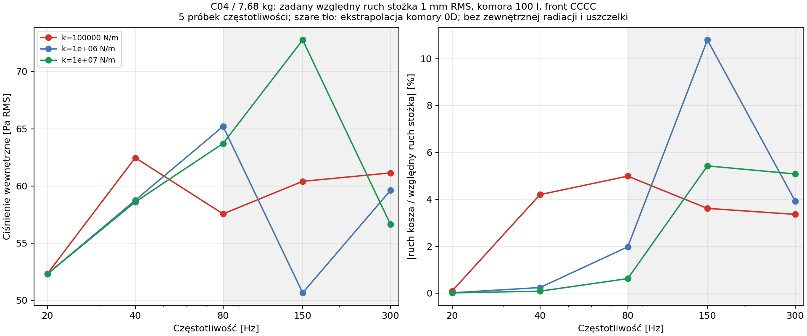

# Raport 033 — P18B/P19B: front z otworem, kosz i jednostronny styk

Stan: 2026-10-25. **Wykonano 136 wariantów frontu**, 1088 zapisów modów,
90 punktów sprzężenia z komorą oraz **12 stanów docisku i 72 diagnostyki
dynamiki styku**. To wyniki modeli naukowych przed budową. Nie zamykają
pełnej konstrukcji, trwałości mocowania ani wyboru głośnika.

## Wniosek projektowy

**Rekomendacja z symulacji:** grubość frontu, masa głośnika i podatność
mocowania wymagają wspólnego doboru. Przy miękkim zamocowaniu sam grubszy
MDF niewiele przesuwa niskie rezonanse układu. Docisku uszczelki nie można
uzasadnić nominalną klasą kleju, momentem dokręcania bez danych o tarciu
ani samym statycznym utrzymaniem ciężaru.

W części scenariuszy liniowa odpowiedź przewiduje utratę styku lub zmianę
liczby napiętych śrub. **Takich odpowiedzi nie uznajemy za obliczoną
nieliniową trajektorię**. Wymagają czasowego modelu zmiennego styku.

## Sprawdzone dane producentów

Oryginały rysunków obejrzano, a liczby sprawdzono z tekstem; źródła,
prywatne ścieżki i SHA-256 są w
[rejestrze geometrii](../dane/zrodla/P18B_geometria_i_ograniczenia.json).

| Model | Średnica użyta w modelu otworu | Okrąg śrub | Śruby | Masa netto |
|---|---:|---:|---:|---:|
| RSS390HF-4 / C02 | 355,8 mm | 368 mm | 8 × Ø6,5 mm | Niezidentyfikowana |
| SB34SWPL76-4 / C04 | 305,2 mm | 324,2 mm | 8 × Ø5,5 mm | 7,68 kg |
| STX W.32.800.8.FCX / C06 | 288 mm | 310 mm | 8 × Ø6 mm | Pole producenta puste |

**Dane producentów:** [Dayton, rysunek](https://www.daytonaudio.com/images/resources/295-468-dayton-audio-rss390hf-4-specifications-46176.pdf),
[SB, REV2 17.02.2022](https://sbacoustics.com/wp-content/uploads/2022/03/12in-SB34SWPL76-4.pdf),
[STX, strona i oryginalny rysunek](https://stx.pl/pl/w-32-800-8-fcx.html).
W SB 305,2 mm jest średnicą korpusu na rysunku; model nie dodaje jeszcze
luzu montażowego. To nie średnica gotowa do zlecenia CNC. Dla STX
166 mm za kołnierzem + 8 mm kołnierza wyjaśnia 174 mm głębokości
całkowitej na stronie. WWW Dayton podaje „Weight 30 lbs.” bez niezależnego
potwierdzenia masy netto; nie wstawiono tej liczby jako Mnet do modelu.

Średnice otworów śrubowych zapisano jako dane, lecz lokalnych otworów,
podfrezowania i gwintów nie ma w siatce płyty. Analizujemy montaż
nawierzchniowy i rozpiętość między zadanymi podporami, nie finalną formatkę.

## Metoda frontu P18B

**Model:** izoparametryczna płyta Reissnera–Mindlina, MITC4 ze ścinaniem
wiązanym w składowych kowariantnych. Rozszerzono prostokątny model P18A
na czworokąty o zmiennym jakobianie. Otwór jest regularnie przybliżanym
wielokątem; nie ma schodkowej krawędzi i sztucznych wklęsłych naroży.

Rozpiętości podpór 460 × 460 i 500 × 550 mm, grubości 18/22/25 mm,
E=2,2 GPa dla 18 mm i 2,1 GPa dla 22/25 mm według wcześniejszej
referencji MDF. Rho=730 kg/m³, nu=0,3, tłumienie i bezwładność kosza
pozostają hipotezami. Porównano CCCC i SSSS_HARD; zadane brzegi nie
są dowodem ograniczenia odpowiedzi dowolnej rzeczywistej skrzyni.

Kosz jest sztywnym ciałem o trzech normalnych DOF: przesunięcie i dwa
przechyły. Osiem mocowań przenosi siłę przez skończone dyski Ø8 mm.
To regularizacja drogi siły, nie odwzorowanie podkładki ani gwintu 3D.

```text
d_i = B_i^T q_plate - [1,x_i,y_i] q_basket
Kjoint = sum(k_i * d_operator_i^T * d_operator_i)
M_basket = diag(m, Jx, Jy), Jx=Jy=m*(rg²+zcg²)
```

W głównym porównaniu geometrie mają wspólny **umowny ładunek 10 kg**,
rg=100 mm, zcg=80 mm i k=10^5/10^6/10^7 N/m na mocowanie. Nie są to
masy trzech produktów ani pomiary uszczelek. Osobno badano 5/7,68/15 kg,
zmianę orientacji śrub, promienia łaty i skrajne sztywności. Katalogowe
7,68 kg dotyczy wyłącznie C04; ta sama liczba dla innych geometrii
jest kontrolą czułości. Wszystkie wejścia są w
[konfiguracji](../dane/konfiguracje/p18b_front_z_otworem.json).

**Osobne wymuszenia:** statyczne 1 kPa na front i zamknięcie otworu,
100 N osiowo na kosz oraz 1 Nm momentu. Nie sumowano tych liczb jako
widma muzyki. Naprężenia to zginanie płyty w punktach Gaussa; nie lokalna
nośność otworów, kontaktu, śrub ani MDF przez grubość.


## Wyniki frontu istotne dla decyzji

**Wynik obliczeniowy, C04, CCCC, 460 × 460 mm, umowne 10 kg:**

| Grubość | k na mocowanie | Pierwsza częstotliwość |
|---|---:|---:|
| 18 mm | 10^5 N/m | 38,52 Hz |
| 22 mm | 10^5 N/m | 39,20 Hz |
| 25 mm | 10^5 N/m | 39,51 Hz |
| 22 mm | 10^6 N/m | 101,87 Hz |
| 22 mm | 10^7 N/m | 157,02 Hz |

Miękkie zamocowanie ogranicza efekt zwiększania grubości. Dla osiowego
100 N przy 22 mm ruch kosza wynosi 133,07 µm przy k=10^5 oraz 9,02 µm
przy k=10^7 N/m. Są to przemieszczenia kontrolne, bez kryterium słyszalności.

**Wyprowadzenie kontrolne:** dla równomiernie rozmieszczonych ośmiu
mocowań ich średnia względna deformacja pod osiowym F wynosi F/(8k).
Przy 100 N i k=10^5 jest to 125 µm, nawet bez podatności płyty.
Próba Rayleigha z nieruchomą płytą i przesuwanym koszem daje
f1 ≤ sqrt(8k/m)/(2pi). To wyjaśnia mechanizm, nie zastępuje pełnego MES.

Przy 22 mm i k=10^6 zmiana ładunku 5 → 7,68 → 15 kg daje
f1 około 143,71 → 116,16 → 83,25 Hz. Bezwładność obrotowa jest w tej
rodzinie zmieniana proporcjonalnie z masą. Najniższy mod może być
przechyłem o bardzo małym udziale w odpowiedzi na jednorodne ciśnienie;
tabela zapisuje osobno udziały i najsilniejszy z pierwszych ośmiu modów.
Nie nazywamy f1 automatycznie dominującym rezonansem akustycznym.


Nie wynika stąd przewaga głośnika C02 nad C04/C06: w głównym porównaniu
ustalono tę samą sztuczną masę, a zmieniano otwór i okrąg mocowań.
Mniejszy uginający się obszar nie rozstrzyga osiągów elektroakustycznych.

## Stożek, siły i komora — spójność bez podwójnej masy

**Odniesienie P18B:** zadano względny ruch stożka C04 1 mm RMS,
komorę 100 l, gaz z relaksacją tau=5 ms i sztywne pozostałe ściany.
Nie ma zewnętrznej radiacji, napięcia wzmacniacza ani własnego zawieszenia
stożka. Wyznaczana siła jest siłą netto potrzebną do narzucenia ruchu,
nie samą siłą elektromagnetyczną.

Nacisk na materialną część frontu oraz zamknięcie otworu tworzą razem
całą powierzchnię czołową. Nie dodajemy ponownie Sd*p do kosza po
zastosowaniu tego zamknięcia. Kinematyczny port stożka zmienia objętość
względem poruszającego się kosza. Przy exp(+jwt):

```text
H^T q = zmiana objętości przez ruch frontu i sztywne zamknięcie otworu
p = -(Sd*x_relative + H^T*Zstruct^-1*F_inertia)
    / (Cab + H^T*Zstruct^-1*H)
F_inertia = e_basket*Mmoving*omega²*x_relative
F_required = -Mmoving*omega²*(x_relative+q_basket) - Sd*p
```

Masa całego głośnika jest już w M. Dodatkowy człon wynika z ruchu
względnego; nie jest ponownym dodaniem Mms. Mmoving pochodzi z trzech
jawnych referencji P11: n=0 to kontrola Mms, a n=1/2 to odjęcie masy
tłoka w Fs. Nie są to niezależnie zmierzone Mmd. Nie dodano potem nowego
obciążenia powietrzem do stożka. f>80 Hz oznaczono jako ekstrapolację
komory 0D, nie pełne pole przestrzenne.

W 90 punktach reszta bilansu mocy źródło = struktura + relaksacja gazu
nie przekroczyła 9,41e−13. Bilans sprawdza spójność modelu, nie jego
pełną identyfikację fizyczną.



## Uszczelka i śruby P19B: kontakt jednostronny

**Hipoteza geometryczna:** C04, front 460 × 460 × 22 mm,
idealny pierścień uszczelki r=153,6–172,1 mm. Nie jest to konkretny
produkt. Efektywne kn=10^8/10^9 Pa/m, brak tarcia i histerezy.
Grubość 3 mm służy wyłącznie do diagnostyki odkształcenia, nie do
wyprowadzenia rzeczywistego prawa materiałowego.

Energię dyskretną zminimalizowano metodą stycznej i kontroli spadku
energii. **Uszczelka nie przenosi rozciągania, śruba nie przenosi
ściskania w tej drodze mocowania:**

```text
U = 1/2*q^T*Kplate*q
  + 1/2*sum(kn*area_j * max(Dg_j*q,0)²)
  + 1/2*sum(kbolt * max(delta0_i-Db_i*q,0)²) - Fexternal^T*q
T0 = kbolt*delta0,      Tretained_i = kbolt*max(delta0_i-Db_i*q,0)
```

T0=25/100/400 N jest parametrem skrócenia sprężyny, **nie końcową
siłą śruby i nie momentem dokręcania**. Dla pionowego frontu uwzględniono
moment 7,68*g*0,08 = około 6,03 Nm, z założonego położenia CG.
Ciężar około 75,3 N równoległy do płyty wymaga osobnej analizy ścinania,
otworów i tarcia; model normalny nie kwalifikuje tej nośności.

Pierwsza wersja dwustronnych sprężyn przypisała niektórym śrubom ujemne
siły. Zamiast ukryć wynik, zachowano
[pierwszą iterację](../wyniki/archiwum/P19B_pierwsza_iteracja_bolty_dwustronne/p19b_podsumowanie.json)
i rozszerzono energię o jednostronność śrub. W nowym modelu przy T0=25 N,
kn=10^8 i uwzględnionym momencie **trzy śruby tracą napięcie** w obu
badanych warunkach brzegowych. Nie wymusza się w nich sztucznego ściskania.

Przykład CCCC, kn=10^9: T0=25 N daje zachowane siły około 13,95–20,03 N,
a T0=100 N około 64,93–71,00 N. Podatność i geometria decydują o rzeczywistym
docisku; samo zadanie skrócenia nie ustala identycznej siły każdej śruby.

## Kiedy liniowanie styku przestaje wystarczać

Po znalezieniu stanu docisku obliczono małosygnałową odpowiedź wokół
tego stanu. Dla każdego punktu uszczelki i każdej śruby sprawdzono całe
sinusoidalne maksimum/minimum: stała deformacja ± sqrt(2)*|deformacja RMS|.
To kontrola całego cyklu sinusoidy w punktach kwadratury, nie tylko kilku
wybranych faz i nie certyfikat ciągłego pola kontaktu.

**Wynik:** 20 z 72 przypadków ma możliwą zmianę styku/napięcia śruby;
52 zachowuje założony stan w tym kryterium dyskretnym. W wariantach
T0=400 N nie znaleziono zmiany, lecz to **nie zalecenie dokręcania**:
nie zidentyfikowano uszczelki, wytrzymałości gwintu/MDF ani pełzania.
Wysoki docisk może wywołać odkształcenia materiału poza przyjętym prawem.

Flagi pozostają w tabeli i wykluczają deklarowanie policzonej trajektorii
po otwarciu. Sam poprawny bilans liniowego modelu (do 4,16e−13) nie usuwa
tej nieadekwatności. Najbliższa analiza czasowa powinna objąć konkretny
przypadek z flagą, nie kolejną siatkę identycznych liniowych odpowiedzi.


## Niezależne odniesienia i granice numeryczne

- Prostokątny element wraca do P18A z błędem względnym K około 4,90e−16;
  kontrola obrotu współrzędnych 5,18e−16. Sprawdzono trzy ruchy sztywne,
  dodatnią pozostałą część energii oraz odtworzenie stałej krzywizny.
- Niezależne rozwiązanie osiowosymetrycznego pierścienia Kirchhoffa
  używa r^4, r²log(r), r², log(r), 1 i równań sił na ruchomym sztywnym
  środku. Dla p i osobnej siły, dwóch brzegów i trzech siatek błąd
  najgęstszej siatki był poniżej 0,4%. To cienka granica h=1 mm,
  a nie walidacja płyty 22 mm przeciwko sprężystości 3D.
- Siatka rzeczywistego otworu C04: ostatnie zagęszczenie zmieniło ruch
  kosza o 0,304%, maksymalną siłę mocowania o 0,051% i f1 o 0,177%.
  Osobne zagęszczenie kwadratury łaty zmieniło ruch o 0,00764%.
- Bezpośredni MES porównano z osobnym układem zgodności sił mocowań
  i trzema równaniami równowagi kosza; względne różnice do 2,42e−12.
  Sprawdzono wzajemność i dokładne zamknięcie pola płyta+otwór.
- Kontakt sprawdzono z dokładnym rozwiązaniem 1DOF oraz odrębną
  enumeracją stanów 2DOF, także z offsetem skrócenia śruby.
  Podwojenie kwadratury pierścienia zmieniło kontrolne przemieszczenie
  o około 0,00072%. Nie jest to kontrola naprężeń kontaktowych 3D.

## Artefakty, odtwarzanie i otwarte bramki

- [136 frontów](../wyniki/p18b_fronty_i_mocowania.csv),
  [mody i udziały](../wyniki/p18b_mody_i_udzialy.csv),
  [stożek i gaz](../wyniki/p18b_ruch_zadany_i_komora.csv).
- [Kontrole frontu](../wyniki/p18b_weryfikacja.json),
  [podsumowanie P18B](../wyniki/p18b_podsumowanie.json).
- [Docisk i styk](../wyniki/p19b_docisk_i_styk.csv),
  [dynamika i jawne flagi](../wyniki/p19b_dynamika_i_bramki_styku.csv),
  [podsumowanie P19B](../wyniki/p19b_podsumowanie.json).

```bash
OPENBLAS_NUM_THREADS=1 python3 skrypty/odtworz_front_i_styk_P18B_P19B.py
```

Nadal otwarte: pełna rama/skrzynia i jej podparcie, frez, śruby i MDF3D,
sprężystość realnego kosza, właściwości konkretnej uszczelki, rozkład CG,
cieplne/wilgotnościowe osiadanie docisku, trwałość spoin, regulacja Vb,
przestrzenne pole i reakcja zewnętrzna. Dwie skrzynie nadal muszą zmieścić
się w pokoju 4,6 × 3,7 × 2,5 m, RTV po lewej/kanapa po prawej rzutu.

**Jeden najbliższy krok: P19C — rozstrzygnąć czasowo przypadek zmiennego
styku przy 80 Hz, ze sprawdzeniem zbieżności redukcji i bilansu energii.**
Domyślne wejście: C04, SSSS_HARD, kn=10^9 Pa/m, T0=100 N,
kbolt=10^6 N/m, ruch 1 mm RMS, referencja masy n=2, pozostałe wejścia
z obecnego P19B. Ten przypadek ma dodatnie napięcie śrub w stanie
statycznym, ale flagę dynamicznej zmiany styku. Należy porównać czasową
trajektorię ze wzorcem liniowym, zbadać zbieżność wymiaru redukcji,
okresowość i bilans, zachowując również brak zbieżności lub odpowiedź
nieokresową. Sama zgodność z liniowaniem w niższej amplitudzie nie
rozstrzyga odpowiedzi po otwarciu przy zadanym 1 mm RMS.
Następnie pełna rama, regulacja P20 i pole P21; napęd/ochrona oraz synteza
P22–P30 pozostają wymagane. Nie ma końcowej rekomendacji ani końcowego PDF.
