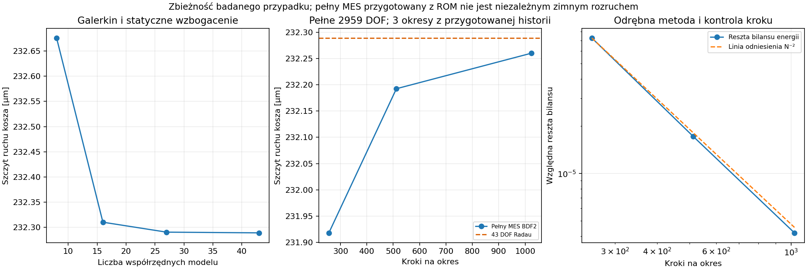

# Raport 034 — P19C: czasowy styk i porównanie z pełnym MES

Stan: 2026-10-25. Rozstrzygnięto **jeden wskazany przypadek warunkowy**
z raportu033: C04, front460×460×22mm, SSSS_HARD,80Hz, względny ruch
stożka1mm RMS, T0=100N i kn=10^9Pa/m. Policzone odpowiedzi czasowe
potwierdzają okresowe odrywanie modelowej uszczelki. Nie jest to wynik
pomiaru C04 ani zamknięcie pozostałych19flag lub całej konstrukcji.

## Wynik wpływający na prototyp

**Rekomendacja na podstawie symulacji:** zamknięcie docisku samym
modelem liniowym jest niewystarczające, gdy prognozuje on zmianę styku.
W rozpatrzonym przypadku należy albo zwiększyć uzasadniony docisk,
albo zmienić geometrię/podatność połączenia i ponownie sprawdzić obciążenia.
T0nie jest siłą zachowaną ani momentem dokręcania; nie zalecamy100/400N
jako nastawy montażowej bez danych o uszczelce,gwincie i MDF.

**Wynik głównego modelu43DOF:** szczyt ruchu kosza232,289µm,
ciśnienie komory36,032Pa RMS, maksymalnie około26,33% umownego pola
uszczelki bez kontaktu w punktach kwadratury. Żadna śruba nie utraciła
napięcia w tej trajektorii. Szczyt ruchu jest około2,73% mniejszy od
zamrożonego liniowania; samo otwarcie nie musi zwiększać każdej amplitudy.


## Dziedzina modelu i źródła parametrów

Geometria i7,68kg netto pochodzą z oryginalnej karty SB34SWPL76-4
(SRC03), jak w raporcie033. Środek ciężkości80mm za płaszczyzną,
promień bezwładności100mm, kn,8sprężyn10^6N/m, materiał i tłumienie
pozostają hipotezami. Masa poruszająca0,252630448kg to referencyjne
odjęcie dwóch stron tłoka w Fs z P11, **nie niezależnie zmierzone Mmd**.

Komora100l, p0=101325Pa,gamma1,4,tau5ms; gaz0D z liniową relaksacją,
pozostałe ściany sztywne. Stożek ma zadany ruch względem kosza.
Nie modelujemy elektrycznego napędu, własnego zawieszenia stożka,
zewnętrznej radiacji, tarcia ani zniszczenia materiału. Normalny model
nie kwalifikuje ścinania pod ciężarem, gwintów i lokalnych naprężeń3D.

Wejścia: [konfiguracja P19C](../dane/konfiguracje/p19c_styk_czasowy.json).

## Równania i energia

q=q0+V*u, gdzie q0 jest nieliniowym stanem docisku z ciężarem,
a V jest bazą Galerkina ortonormalną względem pełnej macierzy masy.
Sprężyny mają tę samą jednostronną energię co P19B:

```text
z = z0 + D*V*u
fcontact_increment = D^T diag(k) [max(z,0)-max(z0,0)]
Mred*u'' + Cred*u' + Ksred*u + V^T*fcontact_increment
    = h*p - e*Mmoving*xrelative''

xi = Sd*xrelative + h*u
lag' = (xi-lag)/tau
p = -(p0/Vb)*[gamma*xi-(gamma-1)*lag]
```

H i h=H^T*V są używane zarówno do siły ciśnienia,jak i zmiany objętości.
M zawiera już cały głośnik. Człon Mmoving*xrelative'' jest sprzężeniem
kinetycznym,a nie drugą masą dodaną do kosza. Nie doliczamy ponownie Sd*p
do ciśnieniowego zamknięcia otworu.

Energia zawiera kinetyczne sprzężenie kosza i stożka, przyrost wypukłej
energii sprężyn po odjęciu stycznej w q0 oraz pamięć gazu:

```text
T = 1/2*u'^T*Mred*u' + Mmoving*xrelative'*(e*u')
    + 1/2*Mmoving*xrelative'^2
Ugas = 1/2*(p0/Vb)*[xi²+(gamma-1)*(xi-lag)²]
Pgas = (p0/Vb)*(gamma-1)/tau*(xi-lag)² >= 0
Frequired = Mmoving*(xrelative''+e*u'') - Sd*p
dE/dt = Frequired*xrelative' - u'^T*Cred*u' - Pgas
```

SymPy niezależnie redukuje bilans całkowity i gazowy do0 oraz sprawdza
dodatnią postać energii kinetycznej. W macierzy sprawdzono dodatniość
Mred−Mmoving*e^T*e. Wymuszenie narasta przez4okresy wielomianemC2,
z zerowymi pierwszymi dwiema pochodnymi na końcach rampy.
Nie wprowadzamy impulsu prędkości przy starcie.

## Przebiegi i zbieżność redukcji

Radau integruje rzeczywiste równania czasowe z analitycznym jakobianem.
Kryterium to względna odległość stanów w normie energii, ponownie
spełniona w3kolejnych okresach; granica1e−6, maksymalnie160okresów.
Nie jest to twierdzenie o jedynym globalnym atraktorze.

| Przebieg | Współrzędne | Szczyt kosza[µm] | Komora[Pa RMS] | Maks.pole bez styku |
|---|---:|---:|---:|---:|
| Pilot,zimny start |8|232,676|35,9979|25,31%|
| Więcej modów |16|232,310|36,0306|26,33%|
|16modów+statyczne kierunki |27|232,291|36,0321|26,33%|
|32mody+statyczne kierunki |43|232,289|36,0323|26,33%|

Kierunki statyczne wynikają z portów ciśnienia,siły i przestrzennych
harmonicznych pierścienia; nie dobierano ich z oczekiwanej amplitudy
wyniku. Różnica27→43wynosi około0,00062% w szczycie kosza i0,00041%
w ciśnieniu. Pełna reszta MES oceniona w dualnej normie Kt to około0,158%
normy przemieszczenia w43DOF. Jest diagnostyką,nie ścisłą górną granicą
błędu po utracie sztywności styku.

Pilot8DOF rozpoczął od zerowego zaburzenia i osiągnął kryterium po78
cyklach. Dalsze zmiany bazy przygotowano rzutem poprzedniego stanu:
43/27/17dodatkowych okresów dla kolejnych modeli. Archiwum pilota
zawiera jego kod,konfigurację i hashe; odczyt archiwum nie jest nowym
zimnym rozruchem. Nie wyciągamy z tych przygotowanych stanów wniosku
o niezależnym przeszukaniu wszystkich gałęzi.

Mikrometrowy ruch1µm RMS wraca do liniowania bez otwierania uszczelki.
Osobny BDF w43DOF,przy ostrzejszych tolerancjach, daje zgodne amplitudy;
to kontrola innego algorytmu czasu,nie innej hipotezy fizycznej.

## Odrębna integracja pełnych2959DOF

Bez redukcji przestrzeni policzono3okresy pełnego MES metodąBDF2,
osobno dla256/512/1024kroków na okres. Historie początkowe pochodzą
z ukończonego ROM. To porównanie propagacji pełnego pola, **nie niezależny
zimny start ani deklaracja pełnej okresowości całego MES**.

| Kroki/okres | Szczyt kosza[µm] | Względna reszta całki energii |
|---:|---:|---:|
|256|231,918|7,27e−5|
|512|232,193|1,72e−5|
|1024|232,260|4,19e−6|

Ostatni wynik szczytu różni się od43DOF Radau o około0,0124%.
Reszta bilansu maleje w przybliżeniu jak kwadrat kroku. Odległość
mechaniczna między dwoma ostatnimi okresami pełnego MES wynosi6,47e−5:
nie spełnia ostrego kryterium1e−6 dla ROM i pozostaje jawna.
Nie zastępujemy tego wyniku etykietą „w pełni ustalone”.

W ROM reszty całki energii są około7,5e−7. Kontrole różnic skończonych
energii mają jawny zakres kroków: przy bardzo małym kroku pojawia się
odejmowanie niemal równych liczb. Osobno sprawdzono algebraiczny bilans,
numeryczną pochodną z analitycznego gradientu oraz jakobian ODE.



## Czy wynik zależy od założenia tłumienia

Wariant bazowy używa zamrożonego C=alpha*M+beta*Kt,które powtarza
hipotezęP19B. Nie przypisujemy go jako lepkości realnej uszczelki:
zamrożona macierz może zawierać kierunki sprężyn,które później tracą styk.

Dlatego wykonano drugi przebieg C=alpha*M+beta*Ks,bez części beta*Kjoint.
Osiągnął kryterium po49dodatkowych okresach; szczyt232,781µm,
komora35,870Pa RMS,maksymalnie26,83% pola bez styku,bez luźnych śrub.
Obie hipotezy przewidują otwieranie w tym przypadku; nie identyfikuje
to tłumienia konkretnego produktu. Trwałość i uderzenia materiału
lepkosprężystego pozostają poza przyjętym modelem sprężystym.

## Otwarcie mechaniczne a szczelność gazowa

W punktach kwadratury największe odseparowanie wyniosło około27,1µm.
Wierzchołki komórek obejmujących pierścień ograniczają przestrzennie
wysokość przy zapisanych stanach przez60,4µm. To ograniczenie jest
celowo luźne i nie jest certyfikatem wszystkich chwil między próbkami.

W modelu smarowania cały stale otwarty pierścień o tej wysokości ma
konduktancję G=pi*h³/[6*mu*ln(rout/rin)]. Jej stosunek do |s*Cab| przy80Hz
wynosi około0,000153. To screening ciśnieniowego przepływu w idealnym
kanale,nie dowód rzeczywistej szczelności lub braku hałasu.

Ruchomy styk może również zmieniać objętość szczeliny. Kwadratura daje
maksymalną objętość około0,10% objętościowego ruchu stożka RMS,a luźne
ograniczenie komórkowe około2,50%. **Nie ogłaszamy zatem udowodnionego
błędu ciśnienia poniżej1%** ani kompletnego modelu przepływu. Pole
szczeliny,squeeze flow i rzeczywisty materiał wymagają integracji przy
pełnej geometrii P21. Sam procent pola bez kontaktu nie identyfikuje
ciągłego kanału od wnętrza do otoczenia.

Harmoniczne H2–H10 kosza wynoszą w tej rodzinie około0,116% podstawowej,
a gazu około0,18%. To diagnostyka idealizowanego kontaktu i komory,
**nie THD rzeczywistego głośnika ani promieniowanego dźwięku**.

## Artefakty i dalsza decyzja

- [Wyniki wszystkich przebiegów](../wyniki/p19c_podsumowanie.json).
- [Przebieg43DOF](../wyniki/p19c_E32_przebieg.csv),
  [pełny MES1024kroki](../wyniki/p19c_FULL_BDF2_1024_przebieg.csv).
- [Kontrole](../wyniki/p19c_kontrole.json),
  [energia,szczelina i tłumienie](../wyniki/p19c_audyt_fizyki.json).

Najbliższy krok: **pełna rama i połączenia obudowy**, z zachowaniem
normalnej i stycznej drogi siły, masy dwóch przyszłych egzemplarzy
oraz późniejszej regulacjiVb. PrzypadekP19C nie uzasadnia powtarzania
całej siatki24głośników dla tego samego hipotetycznego materiału.
Do celu pozostają takżeP20–P30,jeden przetwornik,jedna konstrukcja
i końcowyPDF. Pokój i docelowy układ RTVlewo/kanapaprawo są aktualne.
