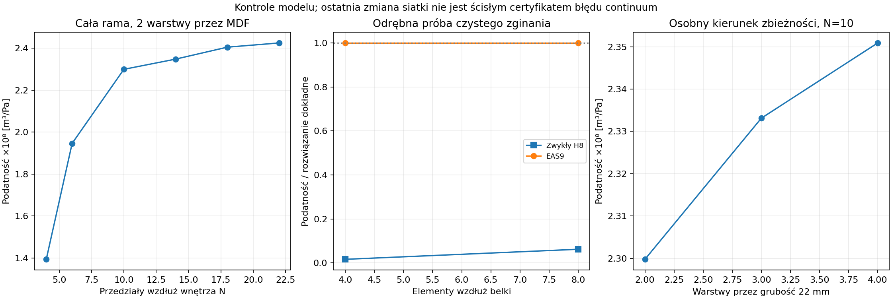

# Raport 035 — P18C: pełna rama 3D, spoiny i podparcie

Stan: 2026-10-25. Wykonano model referencyjny całej ramy: **sześć osobnych
brył MDF, dwanaście połączeń, otwór frontu, sztywny model głośnika,
ściągi i cztery podpory**. Najgęstsza siatka ma **36 771 współrzędnych**.
To symulacje w jawnej rodzinie, bez pomiaru fizycznej obudowy.

**Aktualizacja U-021:** użytkownik ustalił front stały, niedemontowalny,
pod jeden docelowo wybrany przetwornik. Model klejonego frontu pozostaje
odniesieniem dla dalszego doboru jego geometrii i kleju. C04 jest modelem
referencyjnym tej analizy, nie zatwierdzonym docelowym głośnikiem.

## Co wynika dla konstrukcji

**Rekomendacja z obliczeń:** zachować ściągi jako kandydatów do usztywnienia,
dobierać je wraz z masą i rzeczywistą drogą siły. Nie zastępować połączeń
narzuconym unieruchomieniem krawędzi ani nie wybierać konstrukcji wyłącznie
według najniższej częstotliwości własnej.

W geometrii kontrolnej wariant z jednym ściągiem obniżył podatność
objętościową o około 18,1% przy dodatkowych 0,464 kg; wariant z dwoma
o 20,7% przy dodatkowych 0,927 kg. Mają różne położenia ściągów.
To wyniki wspólnej siatki N=10, a nie gwarantowane korzyści gotowej skrzyni.

## Geometria, materiał i obciążenia

**Założenie geometryczne:** wnętrze 460 × 640 × 460 mm, płyty 22 mm,
wymiary zewnętrzne modelu 504 × 684 × 504 mm. Front ma nominalny otwór
305,2 mm, z danych SRC03/SB34SWPL76-4. Masa netto 7,68 kg jest katalogowa;
CG 80 mm za płaszczyzną frontu i JCG=m·(0,1 m)² są hipotezami.

Osie są lokalne: x=szerokość, y=od frontu w głąb skrzyni, z=wysokość.
Nie są to współrzędne ustawienia w pokoju; ich transformacja do konwencji
pomieszczenia wymaga osobnego ustalenia.

Model głośnika ma sześć współrzędnych sztywnej bryły. **Stożek jest tu
unieruchomiony względem kosza**: częstotliwości tej rodziny nie są Fs,
pasem przenoszenia lub częstotliwościami całego subwoofera z ruchomą membraną.
Siła na kosz 1 N RMS jest osobnym eksperymentem mechanicznym, nie rzeczywistą
siłą napędu elektroakustycznego.

Referencja materiałowa: E=2,1 GPa, nu=0,3, rho=730 kg/m³. Przyjęcie
izotropowego Younga z wcześniejszego modułu zginania jest przybliżeniem.
Nie zidentyfikowano przestrzennych modułów i partii MDF wykonawcy.
Osobno wykonano stres ortotropowy En/E=0,15, Gnt/G=0,2 oraz miększy
materiał E×0,65/rho800. To hipotezy, nie tolerancje producenta.

Spoiny mają efektywne kn=Eglue/t i ks=Eglue/[2(1+nu_glue)t], t=0,2 mm,
Eglue=1718 MPa z referencji wolnej folii EA9466, nu_glue=0,35 jako założenie.
Nie jest to zmierzona sztywność spoiny MDF, pozwolenie na naprężenia
z katalogu folii ani końcowe zatwierdzenie kleju.

**Osobne obciążenia:** jednorodne 1 Pa RMS ciśnienia wewnętrznego, 1 N RMS
siły na kosz, ciężar własny. Harmoniczne przykłady obejmują siedem punktów
20/40/80/125/200/315/500 Hz; nie stanowią maksimum ciągłego pasma.
Geometria, masa kleju i osprzętu oraz wyporność rzeczywistego głośnika
pozostają do bilansu finalnego netto. Dwa egzemplarze i prześwity w pokoju
4,6 × 3,7 × 2,5 m nadal są warunkiem wyboru.

## Metoda bryłowa i połączenia

Użyto małych odkształceń 3D, H8 i dziewięciu dodatkowych modów
odkształcenia o zerowej średniej objętościowej. Parametry wewnętrzne
kondensuje się statycznie:

    Kcond = Kqq - Kqa * Kaa^-1 * Kaq

Masa pozostaje zgodna, nodalna, z interpolacji przemieszczeń. Nie dodano
bezwładności parametrom odkształcenia. **To własna rodzina EAS9, nie
implementacja C3D8I z 13 modami.** Pierwotna dokumentacja wyjaśnia ryzyko
pasożytniczego ścinania oraz wpływ zniekształceń elementu; własny element
wymagał odrębnych kontroli. [Dokumentacja Abaqus 2025](https://docs.software.vt.edu/abaqusv2025/English/SIMACAETHERefMap/simathe-c-incompatible.htm).

Nie uruchamiano narzędzi CAD. Sześć siatek opisuje rozłączne objętości;
na wspólnych powierzchniach są liniowe sprężyny normalne i styczne.
Niezgodne siatki frontu i korpusu łączy całkowanie po ich faktycznych
przecięciach. Kwadratury mają dodatnie wagi; skok przemieszczenia przenosi
siły i momenty bez sztucznego usztywniania ruchu całej bryły.

Ciśnienie działa tylko na odsłonięte powierzchnie. Odejmujemy zakryte
obszary spoin; uwzględniamy bok otworu i jego ciśnieniowe zamknięcie.
Wektor H służy jednocześnie do obciążenia i zmiany objętości Hᵀq.
Sprawdzono:

    R^T H = 0                           — siły i momenty zamkniętej powierzchni
    H^T q_dilation = 3*V_geometry       — kontrola objętości przez dylatację
    K R = 0                            — sześć ruchów sztywnej całej ramy

Swobodnych modów nie zastąpiono przypięciem skrzyni do przypadkowego punktu.
W statyce niezrównoważonego obciążenia stosuje się odciążenie inercyjne
Frel=F−MR(RᵀMR)^−1RᵀF, a potem wybiera reprezentanta bez ruchu sztywnego.
Własne częstotliwości obliczono ze stałym ujemnym przesunięciem, zachowując
sześć modów zerowych. Reakcje podparcia liczymy dopiero w scenariuszu
sprężystych stóp.

## Niezależne kontrole i zbieżność

Patch stałego odkształcenia dla regularnego i zniekształconego elementu
dał błędy sił/naprężeń rzędu 10^-15. Odrębne rozwiązanie czystego zginania
regularnej belki pokazało przy 4/8 elementach podatność zwykłego H8
odpowiednio około 1,63%/6,20% wartości dokładnej. EAS9 odtworzył tę
wartość do około 10^-9 względnie. Nie jest to dowód dokładności każdej
zniekształconej siatki lub materiału prawie nieściśliwego.

| N wzdłuż wnętrza | Współrzędne | Podatność [10^-8 m³/Pa] | Pierwszy mod sprężysty [Hz] |
|---:|---:|---:|---:|
|4|2571|1,39378|104,243|
|6|4227|1,94671|99,647|
|10|9339|2,29977|93,880|
|14|16467|2,34836|93,717|
|18|25611|2,40541|92,658|
|22|36771|2,42549|92,246|

Ostatnia zmiana wyniosła 0,835% podatności i 0,444% częstotliwości.
**Nie jest to ścisły błąd względem continuum.** Dla osobnego N=10 zmiana
trzech na cztery warstwy przez grubość dała 0,762%/0,146%. Nie wykonano
połączonej siatki N=22 z czterema warstwami; nie ogłaszamy zatem jednolitej
gwarancji błędu poniżej 1% wszystkich wyników.

Rodziny porównawcze są na N=10; ich referencyjna podatność jest o około
5,18% niższa niż referencja N=22. Dodatkowe całkowanie spoin 3→4 zmieniło
podobne C o 1,32e−8 względnie. Są to osobne źródła błędu.

Masa, geometryczna objętość, mieszany normalno-styczny patch spoiny,
wzajemność i równowaga ciężaru przeszły kontrole. Przy zerowej sztywności
spoin wskazano 36 niezależnych ruchów sztywnych osobnych paneli/grupy frontu
z koszem; taki stan nie ma wymuszonej jednoznacznej statyki ciśnieniowej.

## Usztywnienia, materiał i spoiny

Wspólna siatka N=10:

| Wariant | Masa [kg] | Podatność [10^-8 m³/Pa] | Pierwszy mod [Hz] |
|---|---:|---:|---:|
|Bez ściągu|34,486|2,29977|93,880|
|Jeden ściąg, y=0,55D|34,949|1,88323|93,552|
|Dwa, y=0,4D/0,7D|35,413|1,82366|93,201|

Ściągi mają osiową sztywność, zgodną masę i skończone łaty 80 mm.
Pominięto ich zginanie, lokalną podatność nakładek i bezpośrednie ciśnienie
na objętość ściągu. To model porównawczy; pełny bilans netto i połączenia
wręg pozostają do dopracowania.

Pierwszy mod ma mały udział w odpowiedzi ciśnieniowej. Najsilniejsza
postać z pierwszych dwunastu zmienia się między wariantami; nie
interpretujemy zmiany jej numeru jako prostego przesunięcia tego samego
rezonansu. Dwanaście modów przechwytuje około 69–95% statycznej podatności
w tych trzech wariantach, nie całą odpowiedź.

Obniżenie kn/ks spoin do 0,01 referencji podnosi C o 29%, a do 0,0001
o 416%. Stres ortotropowy podnosi C o 45%, a miększy izotropowy o 51%.
Nie są to dane innych klejów, prawo pełzania ani częstości takich zmian
w produkcji. Potrzebna jest identyfikacja właściwych parametrów.

Eksperyment z osobnym sprężystym zamocowaniem obu stron każdej spoiny
dał podatność około 5,1% mniejszą od pełnej ramy. To **inny układ
podparcia**, nie uniwersalna dolna lub górna granica prawdziwej obudowy.

## Podłoże i kierunek sił

Porównano swobodną ramę i cztery stopy o kn=10^4/10^5/10^6 N/m,
kt=0,1kn na stopę. Najniższe częstotliwości całego podpartego modelu
wynoszą około 1,44/4,54/14,07 Hz; obejmują ruchy przestrzenne, nie tylko
pionowe odbicie. Nie są parametrami zmierzonych izolatorów lub podłogi.

W 168 punktach małego wymuszenia bilans mocy miał względną resztę
poniżej 7,9e−10. W badanych punktach wszystkie stopy zachowały dodatni
zapas nacisku. Największy wymagany współczynnik tarcia z konserwatywnej
osłony siły stycznej wyniósł około 0,0083 dla tych **jednostkowych**
obciążeń. Nie skalować tego wniosku do dowolnej amplitudy muzyki:
utrata docisku lub poślizg zmieniają model.

Straty konstrukcji η=0,04 i podpór η=0,1 są hipotezami harmonicznymi.
Brak zewnętrznego promieniowania, ruchu względnego stożka i elektroniki
nie pozwala nazwać tych krzywych odpowiedzią subwoofera lub jego SPL.

## Artefakty i kolejny krok

- [12 bloków badań głównych](../wyniki/p18c_rama.csv) — jeden stan referencyjny
  występuje w dwóch rolach; nie są to 12 niezależnych produktów.
- [Mody](../wyniki/p18c_mody.csv), [168 punktów harmonicznych](../wyniki/p18c_harmoniczne.csv),
  [spoiny](../wyniki/p18c_spoiny.csv), [podparcie](../wyniki/p18c_podparcie.csv).
- [Kontrole](../wyniki/p18c_kontrole.json),
  [adaptacja](../wyniki/p18c_adaptacja_i_granice.json),
  [warstwy](../wyniki/p18c_zbieznosc_grubosci.json),
  [źródło metody](../dane/zrodla/P18C_teoria_3D_i_metoda.json).

**Następny krok zgodnie z U-021: wymagania sztywności i geometrii stałego
połączenia front–korpus.** Następnie regulacja Vb i pole przestrzenne.
Klej, nośność MDF, zmęczenie i pełzanie nadal mają bramki danych;
[raport 036](036_spoiny_3D_i_wirtualne_odspojenie.md) opisuje dodatkowy
screening obciążeń i wirtualnego odspojenia klejonego odniesienia.

Dalsze porównanie powinno wyznaczyć efektywne moduły spoin wymagane
dla zadanych zmian podatności, a osobno zbadać nośność i geometrię stref
odrywanych. Progu sztywności nie utożsamiamy z wytrzymałością lub trwałością.
Wcześniejszy plan frontu demontowalnego został zastąpiony decyzją U-021.

Progi sztywności wykonano następnie w [raporcie 037](037_staly_front_wymagany_modul_spoin.md).
Aktualnym kolejnym krokiem jest lokalna geometria stałego połączenia.
