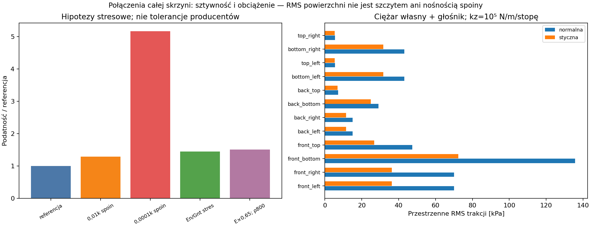

# Raport 036 — P19D: spoiny 3D i wirtualne odspojenie

Stan: 2026-10-25. Wykonano rozdzielenie rozciągania/ściskania w spoinach
pełnej ramy oraz **sześć kontrolnych stanów odspojenia**. Dwa stany
porównano z gęstszą siatką. To screening obliczeniowy, nie pomiar energii
pękania, inicjacji uszkodzeń lub życia zmęczeniowego kleju.

## Wniosek dla budowy

**Rekomendacja:** do dalszego doboru połączenia potrzebne są właściwości
spoiny na MDF, geometria stref obciążonych odrywaniem i sposób przekazania
ciężaru głośnika. Typowy moduł lub wytrzymałość wolnej folii epoksydu
nie daje samodzielnie nośności takiego połączenia.

Model klejonego frontu służy jako odniesienie. Decyzja U-021 ustala
front stały, niedemontowalny, pod jeden docelowy przetwornik.
Kontynuujemy badanie tej drogi sił, jej geometrii i wymagań materiałowych.

## Rozciąganie nie jest tym samym co RMS bez znaku

Użyto geometrii i materiałów [P18C](035_pelna_rama_3D_spoiny_i_podparcie.md),
N=10, podpór 10^5/10^4 N/m. Wspólne powierzchnie spoin są całkowane
po rzeczywistych przecięciach siatek. Oprócz analitycznej całki kwadratu
trakcji policzono dodatnią część rozciągającą i ujemną ściskającą.

Przykład połączenia front–dno:

| Obciążenie | Przestrzenne RMS rozciągania [kPa] | RMS ściskania [kPa] | Próbkowane maksimum rozciągania [MPa] |
|---|---:|---:|---:|
|Ciężar własny z głośnikiem|88,1|103,2|0,457|
|Ciężar + 1 kPa statycznego ciśnienia|129,3|99,0|1,474|

To pola modelu, nie dopuszczalne naprężenia. Maksimum w punktach
kwadratury zależy od dyskretyzacji i geometrii naroży; nie jest
udowodnionym szczytem 3D. Nie porównujemy go bezwarunkowo z IB płyty,
danymi lap-shear na innym drewnie lub wytrzymałością folii.
Duża różnica między RMS a maksimum wskazuje potrzebę kontroli lokalnej
drogi siły, nie pewną awarię urządzenia.

## Eksperyment wirtualnego odspojenia

Z połączenia front–dno usuwano pas od wewnętrznej krawędzi o szerokości
5/10/15 mm i pełnej długości 504 mm. Pozostaje odpowiednio 17/12/7 mm
początkowej szerokości spoiny 22 mm. Pole usunięte wynosi 0,00252 /
0,00504 / 0,00756 m². Nie jest to opis zmierzonej wady lub jej propagacji.

Po odspojeniu usunięto rozciąganie i ścinanie, ale **zachowano jednostronny
kontakt przy ściskaniu**. Pominięto tarcie. Normalna sztywność kontaktu
jest parametrem tego modelu; nie identyfikuje uszkodzonego MDF.

Dla stałego obciążenia i tej sprężystej, jednorodnej energii:

    Pi_equilibrium = -1/2 F^T q
    release(0→a) = 1/2 F^T (q_a-q_0)
    Gdelta(a0→a1) = [release(a1)-release(a0)] / [A(a1)-A(a0)]

Jest to zmiana minimalnego potencjału dla skończonego ubytku w zadanym
modelu. Nie jest automatycznie pochodną continuum G, jej składowymi
GI/GII lub materiałowym kryterium Gc.

| Pas [mm] | GΔ kolejnego przyrostu: ciężar [J/m²] | GΔ: ciężar + 1 kPa [J/m²] |
|---:|---:|---:|
|0→5|0,00324|0,01085|
|5→10|0,00626|0,03473|
|10→15|0,00643|0,01718|

Około 14–39% usuniętej powierzchni nadal przenosi ściskanie, zależnie
od przypadku. Usunięcie również tego kontaktu dałoby inny eksperyment.
Wszystkie podpory zachowały dodatnie reakcje normalne.

## Ograniczenie ilościowe: wynik pękania nie jest jeszcze zbieżny

Średnia zmiana potencjału dla ubytku 0→10 mm:

| Siatka | Ciężar [J/m²] | Ciężar + 1 kPa [J/m²] |
|---|---:|---:|
|N=10|0,00475|0,02279|
|N=14|0,00604|0,03207|

Różnice wynoszą około **27% i 41%**. Nie nazywamy tych wartości zbieżną
prognozą pękania ani podstawą zatwierdzenia kleju. Jest to wynik
negatywny kontroli ilościowej, zachowany w tabelach i na wykresie.

Ponieważ U-021 utrzymuje front stały, zbieżność lokalna i właściwe dane
Gc/kohezji/MDF pozostają wymaganiami dalszej oceny tej topologii.
Najpierw rozdzielamy zapotrzebowanie na sztywność od nośności i badamy,
czy geometria stałego połączenia odpowiednio rozprowadza obciążenie.
Wyników GΔ nie wolno użyć do zatwierdzenia kleju przed domknięciem tych bramek.

## Solver i kontrole

Rozwiązano wypukły problem z dodatnimi częściami odkształceń. Pierwsze
próby wyszukiwania kroku przez odejmowanie dużych całkowitych energii
zatrzymywały się blisko minimum. Nie zmniejszono wymagań reszty, aby
oznaczyć te próby jako zakończone.

Zastosowano równoważenie stycznej, poprawianie kroku liniowego, sumowanie
reszty w np.longdouble oraz dokładny przyrost energii na każdej gałęzi
sprężyny. Przyrost nie odejmuje dwóch dużych qᵀKq. Na tym hoście
longdouble ma 63 bity mantysy; nie jest arytmetyką o nieograniczonej
precyzji. Uzyskano reszty poniżej 3,6e−11 przy kryterium 1e−9.

Odrębna enumeracja ośmiu stanów małego układu dała zgodność rozwiązań
do około 4,4e−16; sprawdzono też 25 przypadków tożsamości przyrostu
wypukłej energii i nieujemność zmian uwolnionego potencjału. Te kontrole
sprawdzają metodę, nie własności spoiny rzeczywistego prototypu.

## Dane i otwarte bramki

- [Rozciąganie i ściskanie](../wyniki/p19d_naprezenia_rozciagajace.csv).
- [Sześć przypadków wirtualnego ubytku](../wyniki/p19d_wirtualne_rozwarstwienie.csv).
- [Kontrole i porównanie siatek](../wyniki/p19d_weryfikacja.json),
  [pochodzenie i ograniczenia](../wyniki/p19d_podsumowanie.json).

Brak Gc, SN, J(t), wpływu wilgotności i właściwości konkretnego MDF
pozostaje jawny. Statyczne 1 kPa jest osobnym obciążeniem kontrolnym;
nie jest widmem muzyki, wynikiem urządzenia ani limitem pracy.
Obliczono wymagania i wrażliwość, nie potwierdzono trwałości kleju.
