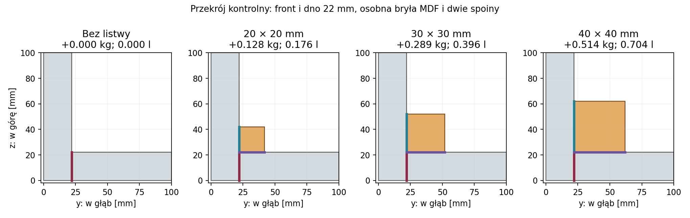

# Raport 040 — P19F: listwa stałego frontu i droga siły

Stan: 2026-10-26. **Symulacja statyczna pełnej ramy 3D**, z dodatkowymi
listwami MDF klejonymi do frontu i dna. Wykonano 20 wariantów, 40 stanów
obciążenia i 548 wierszy oceny spoin. U-021 pozostaje aktualne: jeden
stały front pod docelowo wybrany przetwornik. C04 służy jako referencja.

## Co wnosi badanie do projektu

**Wynik modelu:** listwa zmniejsza obciążenie pierwotnej spoiny, ale
tworzy dwie nowe drogi przenoszenia sił. Większy przekrój i większy moduł
nowych spoin mogą zwiększyć lokalną koncentrację. Sam spadek podatności
całej ramy nie dowodzi poprawy trwałości połączenia.

**Rekomendacja badawcza:** listwa 30 × 30 mm jest wybranym przypadkiem
do dalszego podmodelu, z porównaniem wariantu 20 mm. Nie zatwierdzono
jej jako rozwiązania wykonawczego ani nie odrzucono innych przekrojów.
Wariant 40 mm nie otrzymuje pierwszeństwa na podstawie większej sztywności.
Potrzebne są lokalna dyskretyzacja frontu/dna i właściwości spoiny na MDF.

## Geometria i bilans materiału

Wykorzystano model [P18C](035_pelna_rama_3D_spoiny_i_podparcie.md):
wnętrze 460 × 640 × 460 mm, ściany 22 mm, osiem mocowań sztywnego kosza,
cztery podatne stopy. Nowa listwa jest **osobną bryłą EAS9**, z dwiema
sprężystymi powierzchniami klejonymi. Długość 440 mm pozostawia po 10 mm
odstępu do boków; końce nie są dodatkowo podparte ani sklejone z bokami.

| Kwadratowy przekrój | Masa dodatkowego MDF przy 730 kg/m³ | Wyparte powietrze | Pole każdej nowej spoiny |
|---|---:|---:|---:|
|20 × 20 mm|0,12848 kg|0,176 l|0,0088 m²|
|30 × 30 mm|0,28908 kg|0,396 l|0,0132 m²|
|40 × 40 mm|0,51392 kg|0,704 l|0,0176 m²|

To dane geometryczne i założenie gęstości, bez masy kleju/osprzętu.
Sprawdzono brak przecięcia z nominalnym głównym otworem frontu; kształt
rzeczywistego kosza, wentylacja, śruby i materiał tłumiący wymagają
osobnego sprawdzenia. Rysunek nie jest dokumentacją CNC.

Czerwony odcinek oznacza pierwotną spoinę, turkusowy/purpurowy — nowe
połączenia. Rysunek jest przekrojem, a nie widokiem całej długości listwy.

## Model i obciążenia

Referencyjny MDF: E=2,1 GPa, nu=0,3, rho=730 kg/m³, izotropowy model
z ograniczeniami P18C. Nowe spoiny: t=0,2 mm, nu=0,35 jako założenie,
Eeff=1718 MPa jako referencja efektywnego odwzorowania folii EA9466.
Osobno przeliczono **10 i 100 MPa** dla samych dwóch nowych spoin.
Nie są to zidentyfikowane moduły PVAc, tolerancje lub zatwierdzenie kleju.

Ciężar obejmuje także listwę. Drugi stan dodaje **statyczne 1 kPa**
ciśnienia wewnętrznego; nie jest to przebieg audio, RMS, SPL lub muzyka.
Sztywności stóp: normalnie 10^5 N/m, stycznie 10^4 N/m na stopę.
We wszystkich badanych stanach reakcje normalne pozostały dodatnie,
minimum około 66,34 N. Tarcie i zachowanie dynamiczne są odrębnym zagadnieniem.

Ciśnienie usunięto z zakrytych fragmentów frontu/dna i dodano na cztery
odsłonięte ściany listwy. Nowa bryła zajmuje objętość gazu. Sprawdzono
zachowanie bilansu sił/momentów oraz zmianę pracy przy rozszerzaniu geometrii:

    delta(H^T q_dilation) = -3*Vcleat
    delta(sum F_i*r_j) = -Vcleat*delta_ij

Masa głośnika i położenie jego środka ciężkości zachowują założenia P18C;
nie dodano drugiej membrany, Mmd lub reakcji promieniowania. Wynik nie jest
odpowiedzią elektroakustyczną ruchomego stożka.

## Sztywność: niewielka poprawa globalna nie opisuje lokalnej nośności

Zapisano dwie podatności: dla nowego rzeczywistego portu ciśnienia oraz
kontrolnego **tego samego H** sprzed dodania listwy. Druga izoluje zmianę
sztywności od zmiany powierzchni działania ciśnienia; nie opisuje rzeczywistego
ciśnienia działającego na odsłoniętą listwę. Wszystkie porównania niżej mają
te same podpory i tę samą siatkę ramy.

| Przekrój | Spadek C przy zamrożonym H, N=14 | N=18 |
|---|---:|---:|
|20 mm|1,87%|1,92%|
|30 mm|2,61%|2,56%|
|40 mm|3,12%|3,40%|

Dla 30 mm stosunek C/Cbare zmienia się o około 0,054% między N=14 i 18.
Nie oznacza to błędu continuum poniżej tej wartości; bezwzględne C nadal
zależy od siatki. Jest to inny eksperyment niż wcześniejsza para ścian SSSS.

Dla N=18/40 mm pierwotna spoina ma RMS rozciągania około 41,9 kPa,
lecz nowa dno–listwa około 145,6 kPa. Bez listwy pierwotna spoina ma
około 63,6 kPa. Pola poszczególnych spoin różnią się; nie są to siły
podzielone przez wspólne pole lub dopuszczalne naprężenia materiału.

## Lokalna zbieżność pozostaje otwarta

Badano N=10/14/18 całej ramy, a osobno 2/4/8 podziały przez przekrój
listwy 30 mm przy N=14. Dla ciężaru z 1 kPa, Eeff nowych spoin 1718 MPa:

| Przestrzenne RMS rozciągania | N=14 | N=18 | Zmiana |
|---|---:|---:|---:|
|Pierwotna front–dno|57,68 kPa|47,79 kPa|−17,2%|
|Nowa front–listwa|89,78 kPa|65,16 kPa|−27,4%|
|Nowa dno–listwa|94,69 kPa|69,63 kPa|−26,5%|

**Wniosek negatywny:** globalna podatność jest znacznie mniej wrażliwa
niż lokalne naprężenia. Nie uzyskano zbieżnego lokalnego kryterium nośności.
Zagęszczenie samej listwy nie zastępuje zagęszczenia sąsiedniego MDF
i kontroli zgodności interpolacji powierzchni w bardzo sztywnej spoinie.
Próbkowane maksima także zmieniają się z siatką; nie nazwano ich pikiem
continuum ani nie porównano bezwarunkowo z IB płyty.

Dla 30 mm/N14 obniżenie Eeff nowych spoin z 1718 do 100/10 MPa zmienia
obciążenie nowych połączeń znacznie silniej niż podatność całej ramy.
To wrażliwość na założoną podatność, a nie zalecenie użycia dowolnego
miękkiego kleju: adhezja, pełzanie, szczelność i zmęczenie pozostają nieznane.
Brak Gc/S–N/J(t) nie został zastąpiony statycznym modułem.

## Kontrole niezależne i odtwarzalność

- Analityczny tensor masy sztywnej bryły 6 × 6, z momentami bezwładności
  prostopadłościanu: względna różnica około 8,1e−15.
- Dziewięć momentów pracy ciśnienia przy odkształceniach afinicznych:
  względna różnica około 2,7e−13.
- Osobna redukcja Schura eliminuje 135 współrzędnych listwy w modelu
  kontrolnym 2706 DOF; względem pełnego rozwiązania różnica przemieszczeń
  około 9,0e−10, RMS badanych spoin około 5,2e−11.
- Macierze i masa zachowują sześć ruchów sztywnych. Dodatnie energie nowych
  połączeń nie zwiększyły kontrolnej podatności przy tym samym H.
- Diagonalne równoważenie, LU i poprawianie reszty longdouble dały największą
  względną resztę układu około 5,4e−10. Nie jest to dokładność fizyczna MDF.

Kontrole Schura i momentów sprawdzają rozbudowę modelu, nie właściwości
przetwornika lub materiału. Cache z hashem pozwala wznowić zgodne przypadki;
odczyt cache nie jest świeżą niezależną replikacją.

## Artefakty i jeden następny krok

**Następny krok:** zgodny lokalny podmodel front–dno–listwa dla 30 mm,
z porównaniem 20 mm, zagęszczeniem sąsiedniego MDF i warunkami brzegowymi
z zachowanego pola globalnego. Sprawdzić wpływ odległości granicy podmodelu
oraz sztywności spoin, zanim porównamy z warunkowym kryterium trwałości.
Samo ponowienie całej globalnej siatki nie rozstrzygnie tej bramki.
Regulacja Vb, wypełnienie i pełne pole P20/P21 pozostają kolejnymi etapami.

[Wejścia](../dane/konfiguracje/p19f_listwa_stalego_frontu.json),
[20 wariantów](../wyniki/p19f_geometrie_i_podatnosc.csv),
[548 ocen spoin](../wyniki/p19f_spoiny_i_przeniesienie_obciazen.csv),
[reakcje podpór](../wyniki/p19f_obciazenia_i_podpory.csv),
[kontrole niezależne](../wyniki/p19f_kontrola_niezalezna.json),
[ocena siatek](../wyniki/p19f_ocena_zbieznosci.json),
[pochodzenie](../wyniki/p19f_podsumowanie.json).

Zachowano [pełne pole N14/B30](../wyniki/p19f_pole_referencyjne_N14_B30.npz)
i [opis jednostek/hash](../wyniki/p19f_pole_referencyjne.json): współrzędne,
przemieszczenia ciężaru/ciśnienia, port, ruchy sztywne i indeksy paneli.
Osobny zapis pola odtworzył C z kampanii bez zmiany liczby; to ten sam
model, nie niezależna walidacja.
