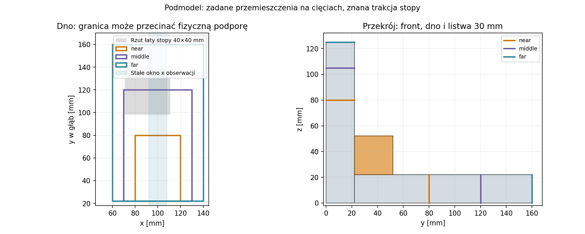

# Raport 041 — P19G: lokalny podmodel i granice wiarygodności

Stan: 2026-10-26. **Symulacje statyczne**, bez pomiaru urządzenia i bez
kwalifikacji materiału. Wykonano **24 podmodele**: 22 przypadki podstawowe
i dwa dalsze zagęszczenia, do **102 033 współrzędnych**. Zapisano 144 oceny
spoin w jawnych oknach obserwacji oraz dwa dodatkowe pola całej ramy.

## Wynik dla decyzji projektowej

**Wynik modelu:** dla wskazanego okna pierwotnej spoiny front–dno dalsza
zmiana kroku przekroju 2,5→1,25 mm zmienia RMS rozciągania o około
−0,45%, a ścinania o −0,10%. Osobna zmiana liczby przedziałów wzdłuż
listwy 16→32 daje odpowiednio około −0,043% i +0,081%.

Jednocześnie zmiana globalnego pola N14→N18 przy tej samej lokalnej
siatce daje około **+19,4% rozciągania i +14,6% ścinania**. Przeniesienie
granicy middle→far daje około +4,9/+3,1%. W tym porównaniu dane brzegowe
mają większy wpływ od ostatnich osobnych zagęszczeń. Nie jest to certyfikat
błędu continuum, tolerancja produktu lub dowód nośności.

**Rekomendacja:** zachować warunkowe wyniki P19 i otwarte dane materiałowe,
a następny etap skierować na **P20: regulację Vb, bilans netto i mocowanie
sztywnych wkładów przy stałym froncie**. Nie mnożyć samych lokalnych siatek
w celu uzyskania pozornego potwierdzenia kleju. Dalsza korekta modelu
całej ramy ma sens przy konkretnej hipotezie zmieniającej decyzję.

## Co modelujemy i skąd biorą się warunki brzegowe

Rozwinięto [P19F](040_listwa_stalego_frontu_i_droga_sily.md). Lokalne osie
x/y/z są osiami skrzyni, nie pokoju. C04 pozostaje kontrolną geometrią
kosza i obciążenia, a nie wybranym przetwornikiem.

Wykorzystano zapisane pole **N14/B30** oraz odtworzono dodatkowo pola
**N14/B20 i N18/B30**. Ich kontrolna podatność zgadza się z odpowiednimi
liczbami kampanii P19F bez zmiany wartości. Są to te same modele globalne,
nie niezależne pomiary lub zewnętrzna walidacja.

Podmodel obejmuje fragment frontu, dna i listwy 20 lub 30 mm. Każda część
jest osobną bryłą MDF z elementami H8/EAS9. Na każdej spoinie siatki
mają zgodne współrzędne i interpolację, ale **osobne węzły**: zachowano
skończone sztywności normalne/styczne i możliwość liniowego skoku.
Nie zastąpiono kleju scaleniem węzłów.

Przyjęto parametry P19F: MDF E=2,1 GPa, nu=0,3, rho=730 kg/m³;
efektywne E spoin=1718 MPa, nu=0,35, t=0,2 mm. To referencje modelowe,
bez identyfikacji partii MDF lub spoiny. Warstwa jest interfejsem:
t służy do kn/ks, nie dodaje tutaj osobnej masy i objętości filmu.

## Położenie granicy i rzeczywiste obciążenia wycinka

Środek wycinka x=100 mm, grubość ścian 22 mm. Granice:

| Domena | Zakres x [mm] | Cięcie dna y [mm] | Cięcie frontu z [mm] |
|---|---|---:|---:|
|near|80–120|80|80|
|middle|70–130|120|105|
|far|60–140|160|125|

Sprawdzono, że domeny omijają nominalny otwór i osiem modelowych łat
mocowania kosza. Użyto **ciężaru własnego oraz statycznego 1 kPa**
ciśnienia na odsłoniętych powierzchniach. Nie jest to RMS, SPL lub muzyka.
Na sztucznych cięciach zadano przemieszczenia z odpowiedniego pola
globalnego; pola wewnętrzne nie są odsyłane do całej ramy.

Wycinek dna może obejmować część fizycznej stopy. Jej reakcję przeniesiono
jako znaną trakcję globalną na rzeczywiście wycięty fragment łaty.
Nie dodano nowej sprężyny i tej samej siły drugi raz.

Przykład pola N14/B30: near nie zawiera stopy, middle przyjmuje około
57,195 N jej pionowej siły, far około 103,991 N. Te różnice są
konsekwencją wycięcia różnych fragmentów, nie dowodem błędnego bilansu.
Uwzględniono też składowe styczne. Zmiana reakcji sprężyny wynikająca
z nowego lokalnego przemieszczenia nie jest automatycznie sprzęgana zwrotnie.

## Transfer przemieszczeń i ruch sztywny

Front interpolowano izoparametrycznie w jego źródłowych czworokątach
i przez trzy warstwy grubości. Dno i listwę interpolowano trójliniowo
w źródłowych siatkach prostokątnych. Użyto zgodności z faktycznym porządkiem
zapisanych węzłów, zamiast przypisywać najbliższy węzeł do każdego punktu.

Od pola usunięto wspólny ruch sztywny dla lepszego uwarunkowania.
**Siły stóp obliczono przed tym odjęciem**, względem nieruchomej podłogi.
Usunięcie przesunięcia przed obliczeniem reakcji zafałszowałoby obciążenia.
Źródłowy EAS9 ma nodalne pole przemieszczeń Q1; transfer nie jest
niezależnym odtworzeniem jego dodatkowych wewnętrznych parametrów odkształcenia.

## Co oznaczają wartości naprężeń

Stałe okno wzdłuż listwy: **x=92–108 mm**. Zapisano pełny pas spoiny
i okno diagnostyczne odcinające po 5 mm od końców jej szerokości.
Odcięcie 5 mm nie jest materiałową strefą kohezji, metodą wytrzymałościową
lub uzasadnieniem pominięcia krawędzi przy ocenie nośności.

Wyniki poniżej dotyczą **TRIM5MM, B30, middle**. Pełne pasy także pozostają
w CSV. Obszar jest fragmentem jednej części ramy: nie porównujemy jego
RMS bezpośrednio z RMS całych spoin z raportu 040.

| Miara pierwotnej spoiny front–dno | Zmiana realizacji | Wartość pierwsza → druga |
|---|---|---:|
|RMS rozciągania|h_yz 2,5→1,25 mm, nx=8|2,661→2,649 kPa|
|RMS ścinania|h_yz 2,5→1,25 mm, nx=8|9,903→9,893 kPa|
|RMS rozciągania|nx 16→32, h_yz=2,5 mm|2,746→2,745 kPa|
|RMS ścinania|nx 16→32, h_yz=2,5 mm|9,898→9,906 kPa|
|RMS rozciągania|pole globalne N14→N18, nx=8/h_yz=2,5 mm|2,661→3,176 kPa|
|RMS ścinania|pole globalne N14→N18, nx=8/h_yz=2,5 mm|9,903→11,345 kPa|

Podziały w dwóch kierunkach zagęszczono **osobno**. Nie wykonano najdrobniejszej
siatki jednocześnie we wszystkich kierunkach i nie przypisano takiego dowodu.
W części nowych spoin dodatnia składowa rozciągająca znika w wybranej
siatce lub oknie. To klasyfikacja danego pola numerycznego; **nie dowód
bezpieczeństwa, braku odrywania na całej spoinie lub odporności zmęczeniowej**.
Dla małych/zerowych wartości podajemy także bezwzględne zmiany, bez dzielenia przez zero.

Wariant B20 ma własne pole globalne N14. W tym samym oknie pierwotnej
spoiny jego RMS rozciągania wynosi około 3,086 kPa wobec 2,661 kPa B30
przy nx=8/h=2,5 mm. Nie jest to ostateczny ranking konstrukcji.
Nowe spoiny B20/B30 mają różne szerokości i pola okien po odcięciu 5 mm;
ich średnich nie traktujemy jako pomiarów z identycznej powierzchni.

## Kontrole niezależne

- Interpolacja znanego pola afinicznego: największa różnica około
  2,8e−17 m; to kontrola metody, nie dokładność odtworzenia urządzenia.
- Sumy reakcji czterech stóp zgadzają się z ciężarem globalnym z różnicą
  względną poniżej 3,1e−10. Ciśnienie zamkniętej komory nie tworzy dodatkowej
  globalnej siły pionowej.
- Analityczne całki sił/momentów grawitacji, ciśnienia i wyciętej łaty
  sprawdzono dla trzech domen: różnice sił poniżej 1,5e−11, momentów poniżej
  6,1e−12 w użytych normalizacjach.
- Dodanie z powrotem wspólnego ruchu sztywnego zmienia obserwacje naprężeń
  do około 4,1e−9 względnie. Sprawdza to także kolejność przenoszenia stóp.
- Największa reszta zredukowanego układu liniowego: 1,8e−14;
  znormalizowany bilans sił/momentów z reakcjami cięć: 8,3e−11;
  praca/energia: 3,7e−12. Są to kontrole algebraiczne modeli.

Dodatkowo dla zachowanego B30/middle/nx8/h2,5 mm przeliczono, jak
zmieniłaby się reakcja całej stopy po podstawieniu lokalnego przemieszczenia
w 55% jej pola i pozostawieniu globalnego pola na reszcie. Przyrost siły
pionowej wynosi około **0,00446 N** wobec 103,99 N; norma względna około
4,3e−5. To wskaźnik pominiętego sprzężenia dla **jednego pola**,
nie rozwiązanie sprzężone lub gwarancja dla pozostałych 23 przypadków.

## Zakres zakończony i dalsza praca

Wykonano zaplanowaną rodzinę lokalną z kontrolą kierunków siatki,
odległości granicy, interpolacji i fizycznych obciążeń. Nadal nie znamy
Gc/S–N/J(t), wpływu wilgotności i właściwości konkretnej spoiny MDF.
Nie zatwierdzono kleju ani zbieżnego maksimum naprężeń całej skrzyni.
Próbkowane maksimum i lokalne okno nie zastępują kryterium materiałowego.

**Jeden następny krok: P20** — porównać sztywne wkłady wypornościowe
do regulacji Vb: dostęp przy stałym froncie, objętość netto, masa,
podatność ścian wkładów i obciążenia ich mocowania. Materiał porowaty
z raportu 039 ma pozostać osobnym bilansem włókien/gazu i strat.
Do wspólnego porównania i końcowego PDF wrócą wszystkie otwarte bramki.

[Wejścia](../dane/konfiguracje/p19g_podmodel_lokalny.json),
[22 przypadki](../wyniki/p19g_przypadki_i_bilans.csv),
[132 oceny okien](../wyniki/p19g_lokalne_pola_spoin.csv),
[dwa dalsze zagęszczenia](../wyniki/p19g_dodatkowe_przypadki.csv),
[12 dodatkowych ocen](../wyniki/p19g_dodatkowe_okna.csv),
[różnice i ograniczenia](../wyniki/p19g_ocena_i_roznice.json),
[kontrole transferu](../wyniki/p19g_transfer_i_obciazenia_kontrola.json),
[audyt stopy](../wyniki/p19g_zamrozona_stopa_audyt.json).

Zachowano [pole lokalne](../wyniki/p19g_pole_lokalne_B30_middle.npz)
i [opis dodatkowych pól globalnych](../wyniki/p19g_pola_globalne.json).
Odczyt zgodnego cache 22 przypadków nie jest świeżą niezależną replikacją.
Największy odnotowany RSS procesu dwóch dalszych zagęszczeń wynosił około
5375 MiB; wykonywano je kolejno przy jednym wątku BLAS.

Odtworzenie etapu:

    OPENBLAS_NUM_THREADS=1 python3 skrypty/odtworz_podmodel_P19G.py

Procedura sprawdza hashe pól rodzica, może wznowić zgodne 22 przypadki,
a dwa duże kierunkowe zagęszczenia wykonuje kolejno. Kontrole i wykresy
są częścią przebiegu; [manifest etapu](../wyniki/manifest_podmodelu_P19G.json)
zapisuje pochodzenie oraz ograniczenia.
