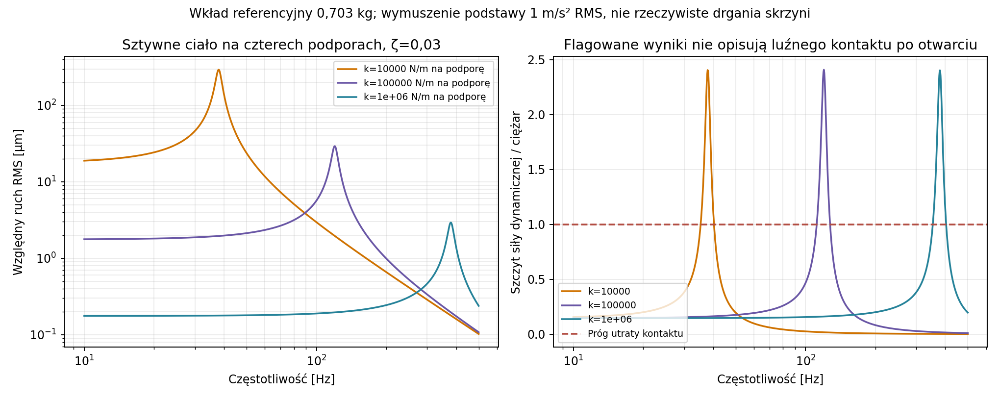

# Raport 042 — P20A: regulacja Vb i wkłady wypornościowe

Stan: 2026-10-26. **Obliczenia geometryczne, mechaniczne i elektroakustyczne**,
bez pomiarów gotowej skrzyni. Porównano wkłady masywne i zamknięte moduły
z powietrzem, ich dostęp, podatność, szczelność i mocowanie.

## Rekomendacja do następnego eksperymentu obliczeniowego

**Rekomendacja warunkowa:** do dalszego porównania metod regulacji przyjąć moduł
**180 × 100 × 170 mm, MDF 8 mm, szczelny, z wewnętrznym ściągiem**.
To element regulacji objętości, nie końcowy wybór całego subwoofera.
C04 i dotychczasowa skrzynia pozostają kontrolnymi odniesieniami.
Zgodnie z R3 do porównania pozostaje szczelna przegroda w kilku pozycjach;
pełna analiza 3D dotyczy następnie wybranej metody i jej otwartych bramek.

W zbadanej klasie ruchów można włożyć i wyjąć 16 takich modułów przez
nominalny otwór po zdjęciu głośnika. Front pozostaje stały zgodnie z U-021.
Zajmują geometrycznie **48,96 l**, co daje kroki 3,06 l. Obliczona masa
suchego zestawu ze ściągami wynosi **11,21 kg**, wobec **35,74 kg** dla
tej samej objętości z masywnego MDF przy założonej gęstości 730 kg/m³.

Szczelność jest częścią działania regulatora. Podatność ścian przywraca
część podatności gazowej, a przeciek może znacząco zmniejszyć skuteczną
regulację. Kanał z masą powietrza może dodatkowo tworzyć rezonator.
Nie wolno traktować każdej lekkiej zamkniętej bryły jak idealnie sztywnego
wypornika ani luźno układać jej na włókninie jako gotowego mocowania.

## Co wykonano

| Rodzina | Wykonany zakres |
|---|---:|
| Dostęp i układ: 12 geometrii × 3 otwory × 0/1/2 ściągi | 108 konfiguracji |
| Odcinki translacji osiowych, z kontrolą odwracania kolejności | 1344 odcinki, w tym 1272 niezerowe |
| Ściany: 12 geometrii × 3 grubości × 2 rodziny krawędzi + 6 ze ściągiem | 78 modeli |
| Porty modułów: 6 częstotliwości × 2 końce gazu × 6 przecieków | 5616 wierszy |
| Hermetyczny moduł: zadane temperatury i ciśnienia otoczenia | 702 stany |
| Mocowania: masywne i puste wkłady, siły statyczne/dynamiczne | 450 / 1890 wierszy |
| Sprzężenie z 27 konfiguracjami głośników | 40 068 punktów |
| Przeciek z lepką bezwładnością: 3 promienie × 3 masy końców | 9 rodzin, 7209 punktów częstotliwościowych i 36 ekranów amplitudy |

To liczby realizacji modeli, nie liczba przebadanych produktów lub stopień
gotowości całego projektu. Dawnych kampanii 24 baz nie powtarzano.

## Dostęp przy stałym froncie

Wymiary kontrolnego wnętrza: **460 × 640 × 460 mm**. Rezerwujemy 25 mm
na wyklejenie i 5 mm luzu geometrycznego. Moduły mają przekroje
180 × 170, 200 × 200 lub 220 × 220 mm oraz długości 100/125/200/400 mm.
Są to scenariusze, nie zaakceptowane gabaryty docelowej skrzyni.

Badano nominalne otwory 288/305,2/355,8 mm z
[wcześniej sprawdzonych rysunków](../dane/zrodla/P18B_geometria_i_ograniczenia.json).
305,2 mm dla SB jest wymiarem korpusu w źródle, nie zwolnieniem otworu CNC.
Warunek przekątnej prostokąta dotyczy przejścia w ustalonej orientacji.

Przy otworze 305,2 mm, jednym ściągu i przekroju modułu 180 × 170 mm:

| Długość | Pozycje po samej geometrii | Zweryfikowana sekwencja wsuwania |
|---:|---:|---:|
|100 mm|16|16|
|125 mm|12|12|
|200 mm|8|5|
|400 mm|4|0|

To **nie dowód niemożliwości innego montażu**. Nie badano dowolnych obrotów,
tymczasowego przestawiania całego zestawu lub dostępu od tyłu. Dla przyjętych
ruchów sprawdzono całe objętości zamiatania, a osobno niezależny przedział
czasu kolizji. Odwrócenie kolejności daje sprawdzony demontaż brył po zwolnieniu
mocowań. Dostęp narzędzia, uchwyty, przewody i faktyczne tolerancje są otwarte.

Tor biegnie najpierw przez środek otworu, potem przez wolny przedni obszar,
a następnie do kolejnych miejsc, zaczynając od tylnego rzędu. Długie elementy
mogą zawadzać o ściąg albo wcześniej włożony element, mimo zgodnej przekątnej.
Nie znaleziono globalnego optimum pakowania.

## Bilans netto i materiał tłumiący

Osobno liczymy: obrys modułu, jego ciało stałe, gaz wewnętrzny,
objętość powietrza głównej komory i podatności dynamiczne.
Moduł referencyjny ze ściągiem ma 3,06 l obrysu, około 2,1003 l gazu
i 0,7006 kg suchej masy. Gaz modułu nie jest od razu częścią głównej komory.

Nowy bilans używa jawnej geometrii ściągu głównego z prętem kończącym się
na nakładkach, bez nakładania się ich objętości. Nie przepisano wprost masy
starszego pręta i nakładek z modelu skupionego P18. Dla jednego ściągu
i listwy P19F stałe bryły zajmują 0,99952 l. Wyklejenie pięciu ścian
po odjęciu tych przecięć ma obrys 31,46528 l. Przy phi=0,98 wypiera
0,6293056 l gazu; rho_dry=20 kg/m³ daje 0,6293056 kg jako scenariusz.

**Przykład, nie estymacja produktu:** jeżeli nieznana wyporność głośnika
wynosiłaby 4 l, rzeczywisty gaz głównej komory zmieniałby się z około
129,795 do 80,835 l przy 0→16 modułów i geometrii włókniny. Osie 2/4/6 l
w obliczeniach nie są tolerancjami producentów. Nie wyprowadzono wyporności
z walcowego obrysu montażowego. Masa/objętość przyszłych szyn i osprzętu
wymaga osobnego dodania.

W tym nominalnym bilansie kontrolnego C04 całość ze wzmocnionymi pustymi
modułami wynosi około 47,1 kg, a z masywnymi około 71,6 kg, bez osprzętu.
To suma założeń geometrycznych i gęstości, nie masa zważonego urządzenia
lub gwarantowana granica. Dwie docelowe sztuki w pokoju 4,6 × 3,7 × 2,5 m
wymagają dalszego sprawdzenia gabarytów i rzeczywistych miejsc P27.

## Ściany wkładu i gaz: wyprowadzenie

Każdą parę przeciwległych aktywnych ścian opisano pełnym zestawem modów
zadanej siatki MITC. SSSS/CCCC są **dwoma założeniami krawędzi**,
a nie udowodnionymi granicami każdej klejonej skrzynki.

    chi(s) = sum a_j² / (k_j + s*c_j + s²*m_j)
    Ci = Vi / (kappa_i*p0)
    Cmodule,sealed = Ci*chi / (Ci+chi)
    Ymodule = (G+s*chi)*s*Ci / [G+s*(chi+Ci)]
    Ctotal = Cmain + N*Ymodule/s

Przy idealnie sztywnych ścianach chi→0 szczelny moduł wyłącza swój obrys.
Przy ścianach bardzo podatnych lub otwarciu kanału wnętrze może oddać
znaczną podatność. Dla każdego G>0 granica f→0 daje Ci. Najpierw G→0,
potem f→0 daje Ci*chi0/(Ci+chi0): kolejność granic ma znaczenie.

W modelu przecieku oporowego G=2*pi*fc_ref*Ci. Stałe fc_ref przy innej
objętości/Ci nie oznacza tego samego rzeczywistego pęknięcia. Końce gazu
kappa=1 i 1,4 nie identyfikują wymiany ciepła konkretnego modułu.

Wkład 8 mm, 180 × 100 × 170 mm, szczelny, 20 Hz, kappa=1,4:

| Model krawędzi | Bez ściągu: odzyskana podatność jako litry | Ze ściągiem |
|---|---:|---:|
|SSSS|0,09033 l|0,02836 l|
|CCCC|0,02206 l|0,00882 l|

Wewnętrzny ściąg ma skończoną sztywność około 3,01 MN/m,
z uwzględnieniem przyjętych podatności pręta, nakładek i filmu kleju.
Dodaje około 15,5 g i zabiera 0,0212 l gazu. Nie zidentyfikowano jego
rzeczywistego połączenia na podstawie samej klasy D3/D4 lub modułu folii.

## Szczelność i wyjątek kanału z masą

Szczelność obejmuje powierzchnie ścian i ich połączenia. Przepuszczalność
wykonawczej płyty/powłoki pozostaje nieznana; nie zastąpiono jej klasą
kleju. Rodziny G(s) są scenariuszami, nie identyfikacją rzeczywistego MDF.

Dla 16 wzmocnionych modułów, 20 Hz, tej samej geometrii i scenariusza
4 l wyporności, dynamiczna objętość równoważna wynosi około 80,976 l
w wariancie szczelnym i 113,143 l przy fc_ref=100 Hz. Rzeczywisty gaz
głównej komory pozostaje 80,835 l. Nie jest to fizyczny przyrost litrów.

Przeciek czysto oporowy nie obejmuje wszystkich dróg. Dodano kołowe
kanały z lepką gęstością Stokesa/ZK i osobno masą końców 0/1/2r jako
założeniami, bez przypisywania im zidentyfikowanej poprawki otworu:

    Zneck(s) = s*rho_viscous(s)*L/A + s*rho0*Lend/A
    G(s) = 1/Zneck(s)

Formalne maksima Re(Y) w tych rodzinach wypadają około 9,7–43,7 Hz.
W pobliżu nich umowny ekran małej amplitudy wymaga ciśnienia otoczenia
modułu rzędu 0,01–0,02 Pa RMS. Przy większych amplitudach nie wolno
przenosić odpowiedzi liniowej na rzeczywisty przepływ, hałas lub SPL.
Reynolds jest zapisany; nie użyto progu przejścia z przepływu ustalonego
jako gwarancji dla oscylującego krótkiego kanalika.

To modele wad/przecieków, nie otwory do wywiercenia. Długość/r, końce,
straty wejściowe i rzeczywiste szczeliny kleju pozostają nieznane.
Ekrany ξpeak/r≤0,1 i Machpeak≤0,03 są założeniami diagnostycznymi,
nie normą bezpieczeństwa ani pełnym dowodem laminarności.

## Temperatura, stateczność i mocowanie

Dla hermetycznego modułu zadano rzeczywistą temperaturę jego gazu
T0±20 K i zmianę ciśnienia otoczenia modułu ±1000 Pa. To nie wynik
ogrzewania od cewki. Rozwiązano gaz stałej masy i liniową podatność ścian:

    epsilon² + (1+lambda*b)*epsilon + lambda*(b-t) = 0
    lambda=chi0*p0/Vi, b=pext/p0, t=Ti/T0

Sprawdzono fizyczną gałąź Vi>0 oraz końce chi→0/∞. W 702 stanach
największe próbkowane w/t wynosi około 0,147, przy umownym ekranie 0,2.
Nie jest to dowód nośności lub pełzania. Zapisano także naprężenia zginania
i momenty modelu płyt, bez przypisywania im wytrzymałości konkretnego MDF.

Osobny wskaźnik stateczności zakłada Nx=Ny=p*normal_span/2 i używa
pcr=2D*pi²*(1/a²+1/b²)/normal_span dla panelu SSSS. Maksymalny stosunek
|dp| do tego wskaźnika wyniósł około 0,032. **Nie jest to nośność zamkniętej
skrzynki ani ścisła dolna granica jej wyboczenia**; podział sił między
ściany, złącza i naroża wymaga pełnej konstrukcji 3D.

Jednorodne ciśnienia wewnętrzne/zewnętrzne dają zerową wypadkową na całej
zamkniętej bryle. Siły p*A poszczególnych paneli obciążają ich złącza;
nie dodano sześciu p*A do masowej siły mocowania całego wkładu.
Wyznaczono wymagania czterech podpór dla zadanych przyspieszeń i wysokości
CG. Ujemna reakcja ściskająca oznacza potrzebę utrzymania na rozciąganie,
a nie dopuszczalny nacisk luźnego kontaktu. F/A jest średnią, nie szczytem 3D.

Przykład sztywnej bryły 0,703 kg, cztery podpory po 10^4 N/m:
rezonans mocowania leży około 38 Hz. Przy zadanym 1 m/s² RMS i zeta=0,03
model wskazuje możliwą utratę docisku, jeżeli mocowanie nie przenosi
rozciągania. Nie jest to prognoza realnej amplitudy skrzyni lub zmierzony
hałas. Lokalne siły od uginania ścian i faktyczna nośność mocowania
wymagają dalszego modelu. Włóknina nie została uznana za sztywną podporę.

## Sprzężenie z pulą głośników

Policzono **40 068 porównywalnych punktów** dla 27 konfiguracji/26 produktów,
osobnych sinusów 20/25/31,5/40/63/80 Hz, budżetów 40 V RMS/12 A RMS
i 60 V RMS/20 A RMS. Monopol 2pi/1 m, ciśnienie RMS, ruch peak.
Ograniczenie katalogowego X nie jest wspólnym progiem THD.

Przykład C04, 16 modułów 8 mm/CCCC/ściąg, geometria włókniny,
wyporność 4 l jako scenariusz, 40 V/12 A: przy 20 Hz wiąże X,
więc duża zmiana podatności nie zwiększa samego Sd*X. Przy 40/80 Hz
wiąże V, a przeciek wpływa także na straty i odpowiedź. Nie wynika z tego
ranking całego briefu lub SPL w pokoju. Nie uwzględniono grzania cewek,
rzeczywistego THD, wzmacniacza, room gain i dopuszczalnego czasu pracy.

Poza geometrią włókniny dodano osobno cieplną podatność porów ZK,
zgodnie z zakresem raportu 039. Nie przeniesiono tłumienia warstwy przez
cały przekrój na wyklejenie boków. Analiza 27 modeli nie potwierdza,
że każdy mieści się w tym samym froncie lub ma wyporność 2–6 l.

## Kontrole i ograniczenie modelu modów

- Dziewięć porównań MITC/Navier z dodatnim analitycznym ogonem szeregu.
  Dla siatki 10 różnice statycznej podatności wynoszą około 2,4–2,7%,
  dla 14 około 1,2–1,4%. Ogon oceniono liczbowo; nie jest to certyfikat
  interwałowy wszystkich współczynników lub fizycznego wyrobu.
- 36 pełnych układów nodalnych MES + gaz + przeciek sprawdza redukcję
  do portu; największa względna różnica około 1,5e−12. Dodatkowo cztery
  porównania częstotliwości portu z pełnym sprzężonym problemem własnym.
- Bilans ścian/przecieku, dodatnia rzeczywista część admittancji,
  granice hermetyczna/otwarta i niezamienność DC sprawdzone algebraicznie.
- Przypadek bez wkładów zgadza się ze wcześniejszym modelem gazu do
  około 1,5e−15 względnie. Bilans napędu i rozdział strat portu poniżej 9e−16.
- Dla wybranego modułu ze ściągiem/CCCC odzyskana podatność 20 Hz
  zmienia się z 0,00882 do 0,00927 l między siatką 10 i 14. To około
  5,1% portu modułu, ale około 0,0072 l dla zestawu 16 — należy podawać obie skale.

**Ważna granica:** 27 z 78 formalnych modów ciśnieniowych modelu z jednolitym
gazem leży na/powyżej pierwszej częstotliwości pustej sztywnej komory
wewnętrznej. Nie interpretujemy tych liczb jako zidentyfikowanych rezonansów
rzeczywistego wkładu. Zachowane pole `lowest_active_panel_hz` opisuje
wybrane symetryczne przestrzenie par paneli, nie komplet modów pudełka.
Porównania elektroakustyczne dotyczą 20–80 Hz; ich błąd przestrzenny
wymaga P21, niezależnie od poprawnego bilansu modelu skupionego.

## Jeden następny krok i artefakty

**P20B:** porównać szczelną przegrodę w kilku pozycjach z referencyjnymi
modułami pod względem netto, masy, podatności, przecieków, dostępu i sił
mocowania. Następnie wykonać pełne 3D wybranej metody. Dla wkładu
potrzebne są rzeczywiste ściany/złącza/ściąg i **osobne porty ciśnienia
zewnętrznego oraz wewnętrznego**, a nie tylko narzucone krawędzie płyt.
Sprawdzić drogi sił i włączyć do pola przestrzennego P21.
Brak Gc/S–N/J(t), szczelności wykonanej spoiny i parametrów wykonawczego MDF
pozostaje otwarty. Finalny głośnik, skrzynia i PDF wymagają reszty programu.

[Założenia](../dane/konfiguracje/p20a_regulacja_objetosci.json),
[dostęp i układ](../wyniki/p20a_dostep_i_uklad.csv),
[tory montażu](../wyniki/p20a_tory_montazu.json),
[modele ścian](../wyniki/p20a_moduly_i_sciany.csv),
[porty](../wyniki/p20a_porty_modulow.csv),
[40 068 punktów napędu](../wyniki/p20a_naped_objetosc_i_wklady.csv),
[kontrole](../wyniki/p20a_kontrole_niezalezne.json),
[ekrany kanału](../wyniki/p20a_kanaliki_amplituda.csv),
[ocena i masy](../wyniki/p20a_ocena_projektowa.json).

Odtworzenie wyłącznie tego etapu:

    OPENBLAS_NUM_THREADS=1 python3 skrypty/odtworz_regulacje_P20A.py

[Manifest P20A](../wyniki/manifest_regulacji_P20A.json) zawiera hashe wejść,
kodu, tabel, wykresów i dokumentacji. Kontrole dotyczą jawnych modeli,
nie kwalifikacji gotowego produktu.
