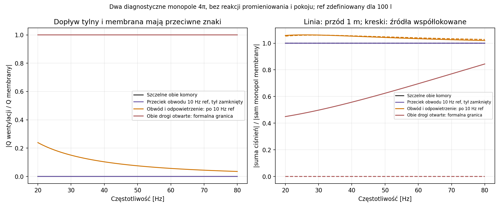

# Raport 043 — P20B: przegroda, dwie komory i porównanie materiałów

Stan: 2026-10-26. **Obliczenia i symulacje do budowy**, bez urządzenia.
Kontynuacja [P20A](042_regulacja_Vb_i_wklady_wypornosciowe.md) i porównania
metod regulacji wymaganego przez R3. Obowiązuje stały front U-021.

## Wniosek projektowy

**Rekomendacja warunkowa:** zachować moduły wypornościowe jako rozwiązanie
referencyjne do następnego badania pełnego 3D, a sztywno blokowaną przegrodę
jako alternatywę wymagającą kwalifikacji mechanizmu. Przegrody nie odrzucono:
jest znacznie lżejsza, lecz jej skuteczność zależy od podparcia i szczelności.
Nie wybrano jeszcze finalnej metody, głośnika lub litrażu prototypu.

Miękko zamocowana przegroda jest dodatkowym oscylatorem, który może mieć
silną odpowiedź w paśmie subwoofera. Nie wystarczy odsunąć jej o odległość
wynikającą z geometrii i uznać tylnego gazu za całkowicie wyłączony.
Jednoczęściowa sztywna płyta nie przejdzie przez żaden z badanych otworów
frontu; trzeba ją zainstalować przed zamknięciem korpusu albo zapewnić inny
dostęp. Regulację już zainstalowanej płyty można badać przy stałym froncie.

**Dane producenta / obliczenie przybliżone:** sklejka brzozowa daje obiecujący
kompromis masy i sztywności pasa. Nie jest to jeszcze dowód przewagi całej
płyty lub obudowy. Sklejka świerkowa ma w źródle dużo większą anizotropię;
pominięcie słabszego kierunku prowadziłoby do błędnego doboru.

## Wykonany zakres i dowody

| Rodzina | Zakres |
|---|---:|
| Pozycja, bilans gazu, grubość i wariant głębokości korpusu | 80 wierszy; 8 niewykonalnych przy zerowej redukcji w stałym korpusie |
| Mechanika: 4 grubości, 2 rodziny obwodu, 4 sztywności i 4 łaty | 56 modeli |
| Porty mechaniczne, osobne sinusy 20/25/31,5/40/63/80 Hz | 336 wierszy |
| Dwie komory, wypełnienie, przeciek obwodu i odpowietrzenie tyłu | 13 836 wierszy |
| Ekrany amplitudy przy zadanym ciśnieniu 1/100/1000 Pa RMS z przodu | 27 216 wierszy |
| Napęd: 27 konfiguracji elektrycznych, wspólne osie V/I/X | 72 432 punkty |
| Wybrane krzywe 20–80 Hz co 0,05 Hz | 6005 punktów; nie certyfikat ekstremów ciągłych |
| Pełne rozwiązania nodalne mechanika + dwa ciśnienia | 64 porównania |
| Bezpośrednia mechanika / statyczny gaz hermetyczny | 16 / 72 przypadki |
| Niezależny bilans geometrii / wybrane siatki / Navier | 72 / 12 / 3 realizacje |
| Pierwotne dane sklejki, masa i sztywność pasa | 9 wariantów grubości/produktu |

Wejścia: [konfiguracja P20B](../dane/konfiguracje/p20b_przegroda_vs_moduly.json),
[źródła i fakty materiałowe](../dane/materialy/sklejka_pierwotne_P20B.json).
Wyniki: [studium komór](../wyniki/p20b_dwie_komory_i_nieszczelnosc.csv),
[napęd](../wyniki/p20b_naped_i_porownanie_regulatorow.csv),
[kontrole](../wyniki/p20b_kontrole_niezalezne.json),
[manifest](../wyniki/manifest_przegrody_P20B.json).

## Geometria: identyczny gaz, odrębne ciało stałe

**Założenia kontrolne:** wnętrze 460 × 640 × 460 mm; ściany 22 mm;
przegroda 458 × 458 mm, promieniowy luz 1 mm, płyta 12/18/22/25 mm.
Luz jest idealnie wypełniony uszczelnieniem, a nie otwartą szczeliną 1 mm.
Stały ściąg i listwa są tymi samymi rozłącznymi bryłami co w P20A.
Objętość głośnika 2/4/6 l pozostaje umowną osią stresową, nie daną SB/Dayton.

Rozwiązano pozycję przegrody tak, aby uzyskać tę samą objętość gazu z przodu
co po włożeniu 4/8/12/16 modułów o obrysie 3,06 l. Przy osi wyporności 4 l,
geometrycznym wyklejeniu pięciu ścian i płycie 18 mm:

| Równoważna liczba modułów | Pozycja od wewnętrznego frontu | Gaz z przodu | Gaz z tyłu |
|---:|---:|---:|---:|
|4|581,92 mm|117,555 l|8,482 l|
|8|523,83 mm|105,315 l|20,772 l|
|12|465,75 mm|93,075 l|33,063 l|
|16|407,66 mm|80,835 l|45,353 l|

Wyklejenie przodu jest przeliczane dla nowej długości; mata kończy się
przy przegrodzie. Jej masa/obrys nie są identyczne z pełnym wyklejeniem
wariantu modułowego. Przy dodaniu termiki porów porównujemy więc całe
konfiguracje z tą samą ilością gazu, a nie izolowany wpływ mechanizmu.
Tył jest w tym etapie bez włókniny. Pełna warstwowa propagacja 3D jest otwarta.

Przy zerowej redukcji pozycja wyniosłaby 640 mm: przegroda i 5 mm tylnego
luzu nie mieszczą się w dotychczasowym korpusie. Osobny wariant wydłuża go
o grubość przegrody + 5 mm, licząc dodatkową masę bocznych ścian. Nie uznano
go za równoważny gabarytowo. Osprzęt ma założoną masę dynamiczną 0,25 kg,
ale nie ma jeszcze kompletnej geometrii; jego wyporność musi wejść do
ostatecznego bilansu. Obecne liczby nie są wymiarami do zamówienia CNC.

**Obliczenie geometryczne:** środkowy wpisany dysk płyty ma średnicę 458 mm.
W dowolnym ciągłym przejściu sztywnej płyty przez płaszczyznę otworu środek
dysku musi przeciąć tę płaszczyznę. Przekrój zawiera wtedy średnicę dysku,
zatem otwór kołowy musi mieć co najmniej 458 mm. Największy badany otwór ma
355,8 mm. To warunek konieczny także przy obrotach, bez tezy o gięciu,
segmentacji lub rozbieraniu płyty. Dla czterech osi prostego narzędzia
o promieniu 5 mm sprawdzono otwór i obwiednię mijającą stały ściąg/listwę.
Wymagany zasięg wynosi około 430–604 mm; rękojeść, ręka, przewody, kosz,
gwinty i uszczelnienie przejść nie są objęte tym dowodem.

## Mechanika i dwa ciśnienia

**Symulacja:** MITC, izotropowe założenie MDF E=2,1 GPa, nu=0,3,
rho=730 kg/m³. Obwód SSSS/CCCC jest idealizowany. Dwie odrębne rodziny:
sztywna lub przesuwna rama obwodowa oraz cztery łaty 30 × 30 mm,
oddalone od środka o ±80 mm w obu kierunkach. Sztywność każdej podpory:
10⁴/10⁵/10⁶/10⁷ N/m. Brak kwalifikacji rzeczywistych prowadnic i tylnej ściany.

Ruch ramy i ugięcie płyty mają wspólną macierz masy z członami krzyżowymi.
Nie dodano dwóch niezależnych mas tej samej przegrody. W rodzinie czterech
łat sprawdzono masę ruchu sztywnego, w tym masę uszczelnienia i założonego
wózka. Tłumienie C=beta·K_płyty + gamma_support·K_podpór jest nieujemne.
beta odpowiada zeta=0,02 przy 200 Hz, a podpory mają założone zeta=0,03.
To inna rodzina niż stałe modalne zeta w P20A; dawnych wyników nie nadpisano.
Moduł referencyjny w bieżącym porównaniu również używa wspólnego beta·K.

Dla s=jω i fazorów RMS podatność przegrody ma postać
chi(s)=Hᵀ(K+sC+s²M)⁻¹H. Przewodność między komorami to B=G_seal+s·chi.
Y_a=sC_a, Y_r=sC_b+G_vent, a dopływ do przedniej komory jest równy
minus zewnętrzna prędkość objętościowa membrany. Otrzymujemy:

    det = Y_a*Y_r + B*(Y_a+Y_r)
    p_a/Q_a = (Y_r+B)/det
    p_b/Q_a = B/det
    (p_a-p_b)/Q_a = Y_r/det

Ostatnią różnicę liczymy bez odejmowania dwóch niemal równych ciśnień.
Energia dzieli się na straty materiału/podpór, gazu/maty, przecieku i
odpowietrzenia. Podatność całej skrzyni, promieniowanie i pokój nie są tu
ponownie dodawane jako niezależny „zysk”. Pozostaje kontrolny port 0D.

## Ile podatności powraca przez przegrodę?

Dla N=16, szczelnego obwodu, zamkniętego tyłu i geometrii powyżej:

| Rodzina kontrolna | Re(dodatkowej podatności)·gamma·p0: 20 / 40 / 80 Hz |
|---|---|
|16 modułów MDF8 ze ściągami, wspólne beta·K|0,141 / 0,141 / 0,141 l|
|Przegroda18, nieruchomy obwód CCCC|0,456 / 0,464 / 0,501 l|
|Przegroda18, rama po 10⁶ N/m na podporę|1,987 / 2,081 / 2,569 l|
|Przegroda18, cztery łaty po 10⁶ N/m|3,434 / 3,792 / 6,619 l|
|Przegroda25, cztery łaty po 10⁷ N/m|0,911 / 0,953 / 1,166 l|
|Przegroda18, miękka rama po 10⁴ N/m|48,152 / −434,651 / −10,769 l|

**Obliczenie:** ujemna wartość w ostatnim wierszu opisuje część reaktywną
dynamicznego portu, nie ujemny gaz. Przy 40 Hz odpowiada jej około 184 l
składowej stratnej. Model pozostaje pasywny; rzeczywisty poziom trzeba
ograniczyć do dziedziny małego ugięcia, ciśnienia i prześwitów.

**Obliczenie masy przy założonej gęstości:** płyta MDF18 waży 2,756 kg;
z modelowym uszczelnieniem 2,796 kg, a z założonym wózkiem 3,046 kg.
MDF25 z uszczelnieniem i wózkiem to około 4,133 kg. Same 16 modułów MDF8
ze ściągami ma 11,209 kg. Nie są to kompletne masy mechanizmów: brak
prowadnic, blokad, przejść, mocowań modułów i części kleju. Wielkość
`regulator_component_mass_kg` w tabeli napędu nie zawiera wózka przegrody;
do porównania mas całych konstrukcji trzeba użyć pełnego bilansu.

## Przeciek, odpowietrzenie i niezamienne granice

G_seal i G_vent są określane przez stałą odniesienia 100 l, a nie zmieniane
z pozycją przegrody. Etykieta 10 Hz ref nie jest rzeczywistym biegunem każdej
konfiguracji ani opisem szczeliny o ustalonej szerokości.

Sprawdzono: sztywną szczelną przegrodę, C_b→0, całkowite otwarcie obwodu,
idealnie otwarty tył oraz oba otwarcia naraz. Przy zamkniętym tyle i
quasistatycznej chi=h dodatni przeciek w DC udostępnia C_a+C_b; przy
G_seal=0 granica wynosi C_a+C_b·h/(C_b+h). Kolejność DC i G_seal→0 ma
znaczenie. Niezerowy biegun swobodnej różnicy ciśnień wynosi:

    s_p = -G_seal*(C_a+C_b)/(C_a*C_b+h*(C_a+C_b))

To biegun odpowiedzi ciśnień/impedancji przy zamkniętym tyle, nie automatycznie
biegun każdej gałęzi admitancji ani pełnego układu z bezwładnością przegrody.

Tylny wypływ ma znak przeciwny do Q_mem. Dwa diagnostyczne monopole mają
dlatego sumę Q_mem·(G_front−T_vent·G_rear). Gdy oba idealne otwarcia
przechodzą w nieskończoną przewodność, T_vent=1. Źródła współlokowane
znoszą się dokładnie; rozdzielone o głębokość obudowy dają inny wynik.
Nie wpisano sztucznego skończonego SPL zamiast dokładnego zera.

To diagnostyka zewnętrzna bez reakcji promieniowania, fizycznego kanału i
pokoju. SPL frontu 2π/1 m i suma dwóch monopoli 4π/1 m są osobnymi polami
tabeli; nie porównujemy ich bez korekty geometrii. Brak podstaw do nazywania
tej idealnej granicy gotową obudową otwartą lub projektem bass-reflex.

## Dziedzina amplitudy, napęd i statyka

**Założone ekrany modelu:** szczyt ugięcia / grubość ≤0,2; szczyt ciśnienia
gazu / p0 ≤0,01; ruch osiowy mniejszy od prześwitu do tyłu i stałego ściągu.
Są to kryteria pracy modelu, nie THD, nośność, norma lub bezpieczna moc.

| Ciśnienie przednie RMS | Wiersze | Poza ekranem gazu | Poza ekranem ugięcia | Poza prześwitem |
|---:|---:|---:|---:|---:|
|1 Pa|9072|0|0|0|
|100 Pa|9072|144|0|0|
|1000 Pa|9072|9072|81|21|

Liczniki częściowo się nakładają. Już samo przednie 1000 Pa RMS przekracza
umowny 1% szczytu; tych 9072 rekordów nie interpretuje się jako zniszczeń.
Przy 100 Pa część tylnych ciśnień zostaje wzmocniona dynamicznie.

72 432 punkty napędu zawierają 20 027 flag poza co najmniej jednym ekranem.
Zachowano formalny limit V/I/katalogowego X oraz osobne napięcie ograniczone
ekranami dziedziny. To nie gwarantowana obwiednia niskiego THD.
Przykładowy C04, N=16, 40 V/12 A, 40 Hz z miękką ramą 10⁴ N/m ma
formalną zmianę frontowej obwiedni około −0,385 dB, ale przekracza ekran
ciśnienia gazu — nie wykorzystujemy go jako wyniku fizycznego prototypu.
W tych samych warunkach sztywne/stabilniejsze warianty pozostają w ekranach,
a różnice frontowej obwiedni przy 40 Hz są małe. Nie oznacza to identycznej
skuteczności regulacji przy innych częstotliwościach, wymuszeniach lub Vb.

Osobno sprawdzono 72 statyczne stany czterech rodzin na siatce kontrolnej
z 4 podziałami na bok, z zadanym przednim offsetem −1000/0/+1000 Pa i końcowym ogrzaniem
hermetycznej masy tylnego gazu o −20/0/+20 K. Rozwiązano dokładne prawo
gazu idealnego w zmiennej objętości, przy liniowej mechanice. Rachunek
analityczny porównano z niezależnym brentq, objętość z pełnym polem nodalnym.
Symbolicznie sprawdzono równowagę i granice zerowej/nieskończonej podatności.
To zadane stany końcowe, nie wynik grzania cewki. Zachowano również stany
poza ekranem małych zmian gazu: 44 z 72 stanów ma flagę przynajmniej jednego
ekranu. Nie przenosi się ich do małosygnałowego napędu.

## MDF i sklejka: czego dowodzą źródła

**SRC54, dane producenta:** [Metsä Wood — technical data for concrete formwork](https://www.metsagroup.com/contentassets/695a3e3833774e30bcc964c0bbea34a9/metsa_wood_plywood_for_concrete_formwork_technical_data.pdf),
odczyt oryginalnych tabel str.3 i 10, 2026-10-26. Form/FormPLUS standard lay-up:
Em,a/Em,b dla 12 mm =6781/10719 MPa, przybliżona masa 8,2 kg/m²,
wilgotność materiału 12%, wartości opisane jako EN789. Dla Spruce12:
8237/1363 MPa, 5,5 kg/m², wilgotność 10%. Kierunek a jest wzdłuż płyty,
b w poprzek. Nie połączono tych danych z oddzielnym układem fornirów S2.

**Obliczenie przybliżone:** dla pasa o jednostkowej szerokości B=Em·t³/12,
przy nominalnej grubości i porównaniu z przyjętym MDF18:

| Materiał / grubość | Masa kwadratu 458 mm | B_a / B_MDF18 | B_b / B_MDF18 |
|---|---:|---:|---:|
|MDF18, założenie E=2,1 GPa, rho730|2,756 kg|1|1|
|Form/FormPLUS12, dane producenta|około1,720 kg|0,957|1,512|
|Spruce12, dane producenta|około1,154 kg|1,162|0,192|

Wynik Form12 uzasadnia dalszą analizę: około 38% mniej masy samej płyty
niż kontrolne MDF18, przy zbliżonym słabszym kierunku pasa. To nie wynik
pełnego MES sklejki ani porównanie w tej samej zmierzonej wilgotności.
Brakuje skręcania/nu/Gxy, identyfikacji tłumienia, grubościowego prawa
materiałowego oraz adhezji do konkretnej powierzchni. Modułu „planar shear”
Gr nie podstawiono automatycznie za Gxy. Wytrzymałość charakterystyczna
na zginanie nie jest dopuszczalnym zmęczeniem akustycznym.

**SRC55:** [Metsä Wood Birch — datasheet](https://www.metsagroup.com/contentassets/42b1c1d79c43410c8762dcd1c6cc31e1/metsa-wood-birch-product-datasheet-en.pdf),
oryginał str.2: średnia gęstość 680 kg/m³ przy RH65%. Nie jest to wilgotność
materiału 65% ani automatyczna gęstość powlekanego Form/FormPLUS. Tego
przeniesienia nie użyto w rachunku. Powlekaną i surową powierzchnię trzeba
rozróżnić także przy doborze kleju. Nie zmieniono wcześniejszej kwalifikacji P19.

Oryginały i pełne ekstrakcje pozostają prywatne w .firecrawl; publiczne są
fakty, hashe i własne rachunki. Odrzucono automatyczne tablice krzywych
Firecrawl oraz przenoszenie nomogramów ciśnienia betonu na subwoofer.
Odrębny PDF Spruce-manual nie został pobrany do końca; jego ekstrakcji nie
przyjęto jako zweryfikowanych danych. Dane Spruce powyżej pochodzą z SRC54.

## Weryfikacja i ograniczenia praktyczne

64 porównania pełnego układu dały maksymalną względną różnicę impedancji
około 2,13·10⁻¹². Reszta mocy całego dużego studium nie przekracza
1,81·10⁻¹¹ w użytej normalizacji. To dokładność rozwiązywania tego modelu.
Przejście siatki 10→14 zmienia wybrane zespolone podatności o do 3,50%;
odniesienie SSSS/Navier na siatce14 różni się o około 1,22%. Ograniczono
ogon dodatniego szeregu analitycznego, ale nie całe błędy materiału, MES i
ciągłych ekstremów. Nie ma nowego pomiaru fizycznego materiału lub urządzenia.

Nie kwalifikowano utrzymania docisku/uszczelnienia, tarcia i histerezy,
wyrywania śrub, zamków regulacji, pełzania i S–N, reakcji tylnej ściany,
ruchu całego korpusu oraz rzeczywistych przecieków z bezwładnością.
Moduły mają samorównoważące obciążenie od jednorodnego ciśnienia, ale ich
lokalne spoiny i mocowania nadal wymagają osobnego sprawdzenia. Reakcje
czterech łat różnią się zakresem dowodu od średniej reakcji idealnego obwodu.
Dwie sztuki muszą zmieścić się w pokoju 4,6×3,7×2,5 m, RTV po lewej /
kanapa po prawej rzutu. Żadna pozycja uszu/głośników nie została tu potwierdzona.

## Jeden następny eksperyment: P20C

Pełna mechanika 3D modułu 180×100×170 mm/MDF8 ze ściągiem: osobne porty
ciśnienia wewnętrznego i zewnętrznego, geometria ścian/naroży/spoin,
bezwładność, masa oraz porównanie z modelem sześciu płyt. Zachować kontrolny
port sztywno blokowanej przegrody, aby nie zamknąć porównania metod z góry.

Sprawdzić pracę wirtualną obu portów, wzajemność, pasywność, zerową
wypadkową jednorodnego ciśnienia na zamkniętej bryle i ruchy sztywne.
Na trzech siatkach porównać porty przy 20/40/80 Hz i blisko pierwszej
postaci, z jawną granicą modelu gazu0D. Roboczy próg 5% między dwoma
ostatnimi zagęszczeniami jest kryterium tego eksperymentu, nie briefu lub
błędu fizycznego. Gdy przekroczony, najpierw rozstrzygnąć przyczynę; bez
nowego skutku decyzyjnego nie ponawiać całych kampanii 27 konfiguracji.
Następnie pole przestrzenne P21, ochrona/DSP i synteza wyboru.

Odtworzenie samego etapu:

    OPENBLAS_NUM_THREADS=1 python3 skrypty/odtworz_przegrode_P20B.py

Kod [kontroli](../skrypty/sprawdz_przegrode_P20B.py) nie korzysta z chi ani
Woodbury przy pełnym rozwiązywaniu równań. Samo odtworzenie zapisanych
liczb nie zastępuje niezależnej walidacji fizycznej. Końcowy PDF pozostaje
odłożony do ukończenia programu badań przed budową.
