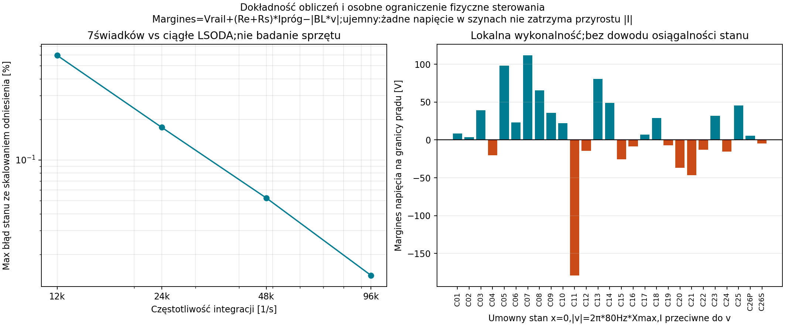

# Raport 048 — P22B: nasycenie, SEM i zachowany stan prądu

Stan: 2026-10-27. **Symulacje warunkowych rodzin**, bez fizycznego wzmacniacza.
Pętla prądowa i szyny napięcia są założeniami. Nie jest to gotowa ochrona.

## Co wynika dla prototypu

**Wynik negatywny:** hipotetyczny feedback prądu o skończonym wzmocnieniu
zmniejsza przekroczenie prądu, ale nie zapewnia twardego limitu i nie chroni
samodzielnie wychylenia. W 648 trajektoriach zachowano 82 przypadki powyżej
umownego progu prądu: 41 dla G=0 i 41 dla G=10 Ω. Maksimum Ipeak/Ipróg spada
z 2,89127 do
1,48647.
208 trajektorii przekracza katalogowe odniesienie Xmax: 104 w każdej grupie G.
Nie oznacza to 208 potwierdzonych przeciążeń fizycznego urządzenia.

Największy ruch matematycznej rodziny ma STX W.32.500.8.MC_v2 przy 100 l,
sinusie 20 Hz i silnym zadaniu. Prąd nie uruchamia tu pętli; sam feedback I
pozostawia ruch około 3,353Xmax odniesienia. To kontrprzykład dla tezy,
że kontrola samego prądu zawsze wystarcza do kontroli ruchu. Ilościowy ruch
poza domeną liniowych T/S nie jest prognozą rzeczywistego STX ani jego THD.

**Rekomendacja:** P24 ma kontrolować model ruchu i historię cieplną
oprócz napięcia/prądu. Należy zachować energię indukcyjności i SEM od ruchu,
zamiast wstawiać arbitralne clip(I) do równania siły. Potrzebny będzie
również opis, co rzeczywisty wzmacniacz robi z energią zwracaną.

## Wykonany eksperyment

27 konfiguracji ×60/100 l ×2 poziomy ×3 sygnały ×G=0/10 Ω =648 trajektorii.
Sygnały: sinus 20, sinus 80 i suma 20+85 Hz. Skala 0,5/1,5 mnoży odniesienie
40 V RMS; w sumie tonów to RMS całej sumy bez rampy. Rozruch ma gładką
rampę 40 ms. Szyny±56,5685 V i próg 16,9706 A peak są założeniami; próg pętli
nie jest gwarantowanym ogranicznikiem. Rs=0,1 Ω, brak zewnętrznego LC.

Czas 0,6 s, ostatnie okno 0,2 s, stany początkowe zero. Krok 1/48000 s
oznacza rozdzielczość integracji, nie PWM lub Fs wybranego miniDSP.
Nie użyto tu LT ani realnej muzyki: zadanie oznacza hipotetyczne napięcie
po DAC. Wyniki nie potwierdzają stanu okresowego, czasu bezpiecznej pracy,
kompresji, THD lub charakterystyki w pokoju 42,55 m³.

[Konfiguracja](../dane/konfiguracje/p22b_nasycenie_i_prad.json),
[648trajektorii i flagi domeny](../wyniki/p22b_trajektorie.csv),
[trzy pełne przebiegi](../wyniki/p22b_przebiegi_reference.npz).
Zapis zawiera środki kroków; kolumna energii jest jawnie energią końca kroku.
Licznik przekroczenia jest odsetkiem kroków z przekroczeniem w odczycie,
nie dokładnym czasem fizycznego przeciążenia.

## Równania i źródło nieliniowości

W tym etapie głośnik ma liniowe, stałe T/S i Le>0. Nieliniowy jest port źródła:

    dx/dt = v
    M*dv/dt = BL*i-Rms*v-K*x
    Le*di/dt = u-(Re+Rs)*i-BL*v
    u = clip(cmd-G*sign(i)*max(|i|-Ipróg,0),-Vrail,+Vrail)

To pętla statyczna o skończonym wzmocnieniu G w Ω, bez pamięci. Nie określa
pasma ani topologii rzeczywistej elektroniki. Dodatni/ujemny port napięcia
może przyjmować energię zwrotną; to ważne założenie tego modelu.
Nie przypisano mu układu zasilania, modułu klasyD lub określonego produktu.

## Energia i metoda numeryczna

    E=(K*x²+M*v²+Le*i²)/2
    dE/dt=u*i-(Re+Rs)*i²-Rms*v²

Zastosowano implicit midpoint. Nie opóźnia się prawa sprzężenia o pełny
krok: wewnątrz kroku rozwiązano monotoniczne równanie skalarne dla u.
Stan indukcyjności i ruch nie są obcinane.

    zmid = inv(I-h*A/2)*zold + h/2*inv(I-h*A/2)*B*u_mid
    znew = 2*zmid-zold
    Enew-Eold = h*(u_mid*i_mid-(Re+Rs)*i_mid²-Rms*v_mid²)

Współczynnik i_mid przy u jest dodatni. Prawo sprzężenia jest ciągłe i
nierosnące w i; wynikowe równanie ma jedno rozwiązanie.100 osobnych brentq
potwierdza zamknięty wzór do 2,27374e-13 V.
Największy względny residual energii wszystkich 648 trajektorii to
1,81946e-13.
To kontrola równań i integratora, nie fizyczna dokładność modelu.

## Niezależna kontrola i granice

Siedem świadków obejmuje duże ruchy, prądy, dwa tony i obie wartości G.
Oddzielny solver LSODA rozwiązał ciągłe równania z własnymi bilansami energii.
28 porównań ma kroki 1/12000,1/24000,1/48000 i 1/96000 s. Przy podstawowym
kroku największy błąd stanu, skalowany katalogowym X, odpowiadającą mu
prędkością 80 Hz i progiem I, wynosi 0,0523133% w tych 7 przebiegach.
Nie certyfikuje to automatycznie wszystkich 648 przypadków lub każdej fazy.

Implicit midpoint zachowuje tu dyskretną energię, ale **nie jest L-stabilny**.
Dla silnie tłumionego skalarnego modu jego współczynnik kroku dąży do−1,
nie do 0. Dlatego nie deklarujemy jednostajnie poprawnej granicy Le→0
przy stałym kroku. To jawna granica metody, nie ukryta walidacja DAE.

## Wykonalność jednoczesnego ograniczenia napięcia i prądu

Na dodatniej granicy i=Ipróg trzeba zapewnić di/dt≤0. Przy źródle±Vrail
istnieje odpowiednie napięcie tylko jeśli

    -Vrail <= (Re+Rs)*Ipróg+BL*v

Na ujemnej granicy analogicznie BL*v≤Vrail+(Re+Rs)*Ipróg.
Duża SEM może uniemożliwić dotrzymanie obu ograniczeń w danym stanie.
27 osobnych świadków przyjmuje x=0, |v|=2π*80 Hz*Xmax i prąd przeciwny
do prędkości.11 ma ujemny margines napięcia.
**Nie dowiedziono osiągalności tych stanów** przez użyty sterownik.
To lokalny test fizycznej wykonalności; dane zawierają także energię stanu
i krytyczną częstotliwość kinematyczną. Nie jest to diagnoza wzmacniacza.

## Następny krok

    OPENBLAS_NUM_THREADS=1 python3 skrypty/odtworz_nasycenie_P22B.py

[Kontrole](../wyniki/p22b_kontrole_niezalezne.json),
[ocena projektowa](../wyniki/p22b_ocena_projektowa.json).
Następne P24/P25 powinny połączyć rzeczywistą korekcję P23, model ruchu,
ograniczenia źródła, pamięć cieplną i sygnały z odpowiednim zapasem.
Wyniki P22B nie są gotową ochroną. P21B nadal ma osobny przebieg;
główna komora P21C i końcowa synteza pozostają wymagane.
Nie wybrano jeszcze finalnego głośnika/skrzyni, nie utworzono końcowego PDF
ani Release 1. Podsumowania opinii czekają zgodnie z kolejnością użytkownika.
