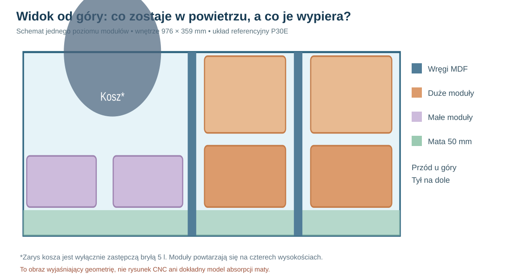
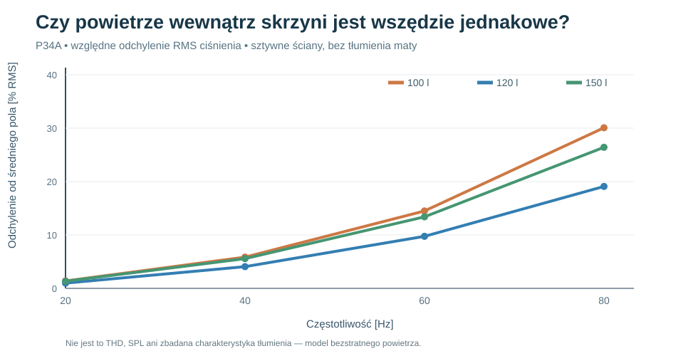
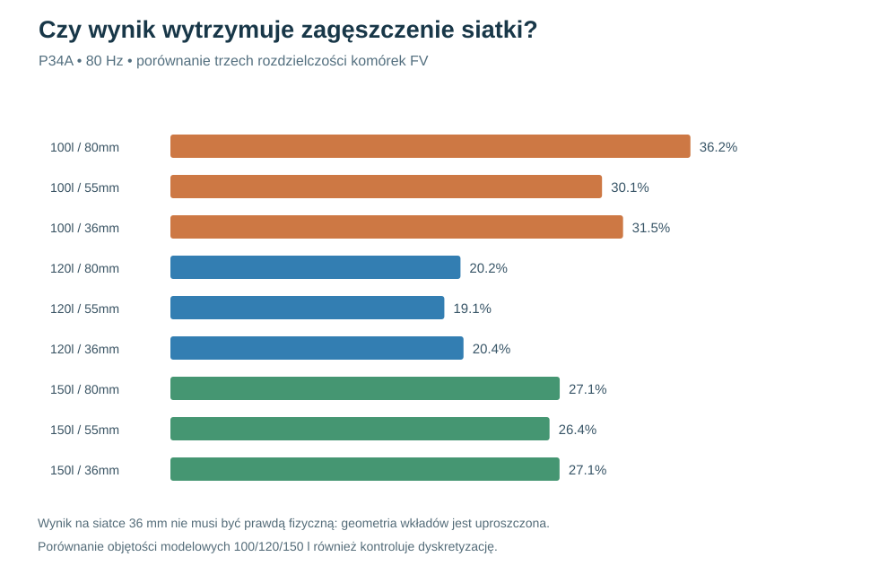

# Raport 085 — P34A: ciśnienie przestrzenne w nowej obudowie 1020×425×500 mm

**31.10.2026 · Wykonano 46 symulacji przestrzennego pola ciśnienia.** Stan: weryfikacja numeryczna modelu uproszczonego, **nie** sprzężone MES/FV ścian i gazu, pomiar akustyczny ani projekt CNC.

## Po co ta symulacja?

W klasycznym obliczeniu subwoofera zakłada się, że całe powietrze w zamkniętej komorze spręża się tak samo. To dobre przy bardzo niskich częstotliwościach, ale przy wyższych przeszkody, wręgi i moduły wypornościowe mogą powodować lokalne różnice. Chcemy sprawdzić, na jakim poziomie może to wystąpić w **aktualnym P30E**, zamiast przenosić wyniki starej skrzyni.

## Zastosowany model — jawne ograniczenia

Siatka objętościowego grafu FV w prostopadłościanie **976×359×456 mm**, 11 prostokątnych elementów wręg P30E i zestawy 20 modułów: dla 100 l 16 dużych +4 małe, dla 120 l 12 dużych, dla 150 l 1 duży. Przyjęto sztywne powierzchnie (Neumanna), c=343 m/s, powietrze bez strat, źródło objętościowe na froncie w pobliżu x=231 mm, z=250 mm. Nie użyto żadnego arbitralnego modelu promieniowania zewnętrznego.

Szczelne wkłady **wypierają powietrze**, natomiast tylna mata 50 mm jest **porowata**, dlatego pozostaje częścią dziedziny gazowej. **Nie przypisano jej tłumienia, oporu przepływu ani pozornego zmniejszenia prędkości dźwięku.** Zastępczy kosz głośnika to *hipotetyczny* walec r=130 mm, głęb.94 mm (około 5 l) — nie prawdziwa bryła kosza.

Rozwiązano dyskretyzację równania Helmholtza w postaci `(K−k²M)p=Q`, ze źródłem dopływu na froncie i izolacją ścian. Mod jednorodny wyodrębniono algebraicznie: średnie ciśnienie `p0=−sum(Q)/(k² V)`; pozostałe pole obliczono metodą gradientów sprzężonych w podprzestrzeni bez modu stałego. Parametrem wykresów jest **RMS względnego odchylenia przestrzennego `p/p0−1`**, nie bezwzględne ciśnienie, SPL ani THD. Zastosowano częściowe wypełnienie komórek (27 próbek na komórkę), a przepływ pomiędzy komórkami ograniczono heurystycznie przez najmniejszy udział powietrza: **to nie jest dokładny cut-cell FV** i nie zastępuje sprzężonego P21G.

## Obliczenia

4 stany geometryczne: pusta komora z wręgami oraz 100/120/150 l; siatki 80 i 55 mm; f=20,40,60,80 Hz = 32 przypadki. Dodatkowo 6 prób 36 mm (f=40 i80 Hz, trzy objętości), cztery próby przesunięcia źródła i cztery scenariusze c=330/355 m/s. **Razem 46 rozwiązań.**

| Stan | Obliczona objętość gazowa przy siatce ~36 mm | RMS odchylenia ciśnienia 40 Hz | RMS przy 80 Hz |
|---|---:|---:|---:|
| 100 l | **100,52 l** | **6,11%** | **31,54%** |
| 120 l | **120,07 l** | **4,33%** | **20,42%** |
| 150 l | **150,21 l** | **5,70%** | **27,12%** |

*Wartości są względne do średniej w obrębie własnej komory, nie porównywalną miarą głośności. Każdy układ różni się położeniem i liczbą sztywnych wkładów. Nie wolno przenosić tej tabeli jako realnego ograniczenia DSP bez pomiaru.*

### Wpływ częstotliwości dla 120 l, siatka ~55 mm

| Częstotliwość | Odchylenie RMS | Największe bezwzględne odchylenie lokalne |
|---:|---:|---:|
| 20 Hz | 0,98% | 3,52% |
| 40 Hz | 4,07% | 14,28% |
| 60 Hz | 9,74% | 32,88% |
| 80 Hz | 19,09% | 60,67% |

Ostatnia wartość to ekstremum lokalnej komórki modelu, a nie maksimum ciśnienia na fizycznym panelu, gwarantowana amplituda ani procent THD. **Wniosek:** rozkład przestrzenny warto uwzględniać bliżej 80 Hz; założenie jednorodnego ciśnienia jest znacznie lepiej uzasadnione przy 20 Hz.

## Weryfikacja i istotne ryzyka

- Siatki 80→55→36 mm przy 80 Hz: dla 100 l odpowiednio 36,23%→30,07%→31,54%; 120 l: 20,21%→19,09%→20,42%; 150 l: 27,13%→26,42%→27,12%. **Nie mamy ścisłej ekstrapolacji błędu**, a 100 l jest bardziej czułe na reprezentację przeszkód.
- Przy 120 l i 80 Hz zmiana źródła z przesuniętego na środkowe zmienia RMS z **19,09% do 12,56%**; to pokazuje zależność od lokalnego źródła, nie rekomenduje przesuwania głośnika.
- Przy 80 Hz i 120 l hipotetyczny parametr c=330/343/355 m/s zmienia modelowy RMS odchylenia odpowiednio **21,02% / 19,09% / 17,54%**.
- Testy w `skrypty/p34a_test_geometrii_i_modow.js` kontrolują bilans objętości i stabilność rozdzielczości, a także porównanie ze znanym wzorem pustego prostopadłościanu; **nie zastępują prób eksperymentalnych ani pełnego testu błędu dyskretyzacji**.
- Przypadki dużego odchylenia mogą zostać mocno zmienione przez faktyczne tłumienie porowate i ruch ścian. Nie obliczono absorpcji ani strat w materiale.

## Konsekwencje konstrukcyjne i następny etap

Nie zmieniać jeszcze deklaracji **120 l nominalnie i regulacji 100/120/150 l**. Wynik nie dowodzi, że 120 l brzmi lepiej, ponieważ nie bada SPL/THD ani rzeczywistych strat. Przed frezowaniem potrzebne są model **P21G dla nowej geometrii z rzeczywistą porowatością**, sprzężone ciśnienie na panelach P33B oraz pomiary po zbudowaniu pierwszej sztuki. Przede wszystkim trzeba znać oporność przepływową maty i rzeczywisty kształt kosza.

**Reprodukcja:** `node skrypty/p34a_przestrzenne_pole_p30e.js` (Node.js ≥18, bez bibliotek), generuje `wyniki/p34a_przestrzenne_pole_p30e_20261031.json`.
