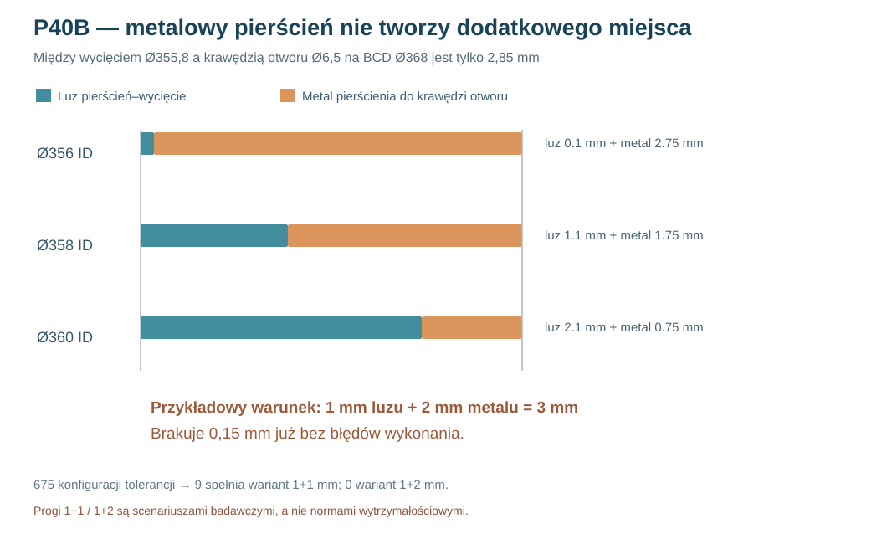

# Raport 102 — P40B: 675 kontroli tolerancji i budżetu materiału pierścienia

**1 listopada 2026 — wykonano 675 kombinacji geometrycznych; 4 listopada skorygowano niezależny otwór pod śrubę w MDF z hipotetycznego Ø6,5 na przykładowy Ø5,5 pod M5 i powtórzono 675 obliczeń.** referencyjnego pierścienia pod Dayton RSS390HF-4. Sprawdzono otwór pod kosz, osiem miejsc śrub, mimośrody osi ring–kołnierz oraz geometryczną możliwość przeprowadzenia trzpienia przez dwa otwory. **To badanie tolerancji płaskiego pierścienia, nie model 3D rzeczywistego kosza ani ocena wytrzymałości połączenia.**

## Podstawy ze specyfikacji producenta

Średnica wycięcia **355,8 mm**, okrąg śrub **368 mm**, średnica otworu w kołnierzu **6,5 mm**. Źródło: https://www.daytonaudio.com/images/resources/295-468-dayton-audio-rss390hf-4-specifications-46176.pdf. **Ø6,5 mm to otwór fabryczny METALOWEGO KOSZA, NIE otwór MDF.** W tym teście w hipotetycznym metalowym PIERŚCIENIU osobno przyjęto Ø6,5 mm, a w hipotetycznym FRONCIE MDF przelot Ø5,5 mm pod śrubę M5. Ten ostatni nie jest jeszcze doborem CNC.

Nominalny *budżet promieniowy* METALOWEGO PIERŚCIENIA z osobnym hipotetycznym otworem Ø6,5 między jego krawędzią wewnętrzną i osią mocowania (liczbowo taki sam jak projekcja kosza):

\[
B=\frac{368}{2}-\frac{6{,}5}{2}-\frac{355{,}8}{2}
=\mathbf{2{,}85\ mm}.
\]

Dla pierścienia o ID, przy współosiowym montażu:
- **luz do wycięcia** = ID/2 − 177,9 mm;
- **pas metalu w obszarze otworu** = 184 − 3,25 − ID/2 mm.

Ich **suma musi zawsze wynosić 2,85 mm**. Zwiększenie ID poprawia luz montażowy, ale osłabia wąski lokalny pas metalu. Zwiększenie średnicy *zewnętrznej* OD lub grubości pierścienia nie zwiększa tego lokalnego budżetu promieniowego.

## Pełna seria tolerancji

Siatka scenariuszy: **OD=392/400/408mm × ID=356/358/360mm × dx∈{−1,5;−0,75;0;0,75;1,5}mm × dz z tego samego zbioru × referencyjna średnica trzpienia 4/5/6mm = 675 wariantów.**

Użyto dwóch jednakowych otworów Ø6,5mm i idealnie prostego, sztywnego trzpienia. Przy rozbieżności ich osi o δ dopuszczalna geometryczna różnica \`δ≤(6,5−d)\` wynika z nachodzenia dysków możliwych środków trzpienia. Ten test **nie uwzględnia skosu śruby, uszkodzeń gwintu, główki, tolerancji przylegania i montażu**.

Przy przesunięciu środka pierścienia o δ:
- minimalny luz do otworu kosza maleje o δ;
- w przyjętym wariancie otwory pierścienia przesuwają się razem z nim, więc pas metalu względem własnych otworów pozostaje taki sam;
- sprawdzono również odległości do lewego panelu i pierwszej wręgi *wyłącznie w płaskich projekcjach*.

### Liczba wariantów przechodzących poszczególne filtry

| Warunek geometryczny / hipotetyczny próg | Wynik |
|---|---:|
| Brak nominalnego przecięcia wycięcia, panelu, wręgi i dostępnego trzpienia | **126 / 675** |
| Powyższe + próg badawczy **1 mm luzu i 1 mm metalu** | **6 / 675** |
| Powyższe + próg badawczy **1 mm luzu i 2 mm metalu** | **0 / 675** |

**Uwaga:** progi 1+1 i 1+2 to arbitralne scenariusze porównawcze, **nie obowiązujące normy, nie minimalne grubości bezpieczne i nie dane o wytrzymałości stali czy aluminium**. Matematyczna niemożliwość 1+2 przy tych wymiarach jest jednak bezwarunkowa *w ramach zwykłego współosiowego pierścienia z otworami na BCD368*, ponieważ 1+2=3,00 >2,85 mm — brakuje **0,15 mm już nominalnie**.

### Gdy rozpatrujemy ID=358mm i Ø5mm trzpienia

Przy nominalnym zerowym przesunięciu luz do wycięcia = **1,1 mm**, a pas metalu przy otworze = **1,75 mm**. Przy przesunięciu o 0,75 mm w jednym kierunku minimalny luz spada do **0,35 mm**, a po przekątnej ±0,75 mm do **około 0,039 mm**. Konfiguracja z samym przesunięciem 0,75 mm w jednym kierunku może nominalnie spełnić dopasowanie trzpienia M5 do przykładowych Ø6,5/Ø5,5, ale przy przesunięciu po przekątnej ±0,75 mm (δ≈1,061 mm) **nie przechodzi** już ograniczenia δ≤1,0 mm. Dawny filtr używający Ø6,5 również we froncie sztucznie powiększał zakres dopuszczalnych mimośrodów; zaktualizowane wyniki 126/675 zastępują 171/675. Wartości lokalnych rezerw geometrycznych same nie przesądzają o możliwości montażu. — **to nie oznacza, że nadają się do wykonania**.

**Najważniejszy wniosek:** prosty cienki pierścień z otworami w tej samej osi co kołnierz nie rozwiązuje samodzielnie problemu prowadzenia sił z wąskiego obszaru MDF ani kwestii powtarzalnego montażu. Przed zamówieniem pierścienia należy zaprojektować alternatywną ścieżkę sił, np. szerszy zespół mocujący połączony z frontem poza krytycznym obwodem, albo inny wieloelementowy układ docisku. Żadna alternatywa nie została jeszcze zwalidowana.

## Następne badanie

Konstrukcyjne porównanie **co najmniej dwóch alternatywnych ścieżek przenoszenia sił** z rzeczywistym koszem i pozycją zacisków; 3D CAD z geometrią otworu i obrysem główek; model kontaktowy z parametrami materiału, a następnie próby *wyrywania/ścinania/odrywania* na rzeczywistym MDF 44 mm i opcjonalnym metalowym łączniku.

**Korekta metodologiczna:** pierwotne 171/675 i 9/675 były policzone dla dwóch hipotetycznych otworów Ø6,5 mm i NIE stanowią doboru otworu w MDF. Po zastąpieniu otworu MDF przez przelot Ø5,5 mm pod hipotetyczną M5 i po sprawdzeniu, że trzpień mieści się w KAŻDYM otworze z osobna, wyniki spadły do **126/675 i 6/675**; żadna konfiguracja nie spełnia progu 1 mm luzu i 2 mm metalu. Nie zmieniono wymiarów fabrycznego kosza ani geometrycznej wielkości budżetu pierścienia.

**Reprodukcja:** [kod 675 przypadków](../skrypty/p40b_tolerancje_pierscieni.js) · [pełne wyniki JSON](../wyniki/p40b_tolerancje_675_20261101.json).

**Werdykt:** żadna konfiguracja nie jest jeszcze produkcyjnie zatwierdzona. **Bramka CNC nadal zamknięta.**