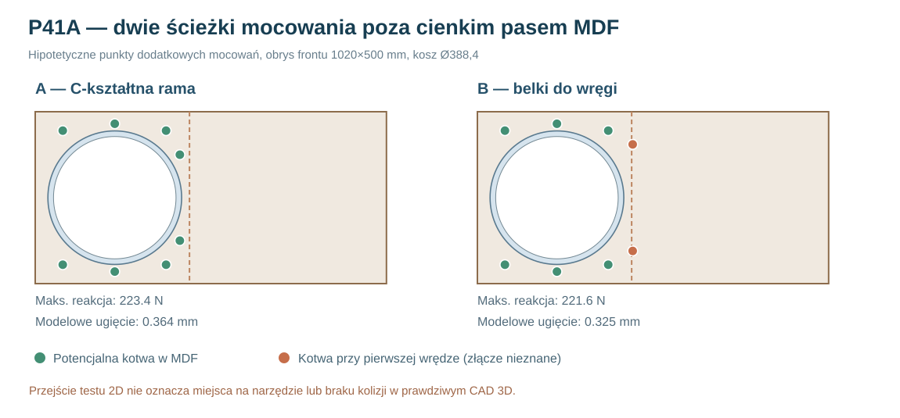

# Raport 103 — P41A: porównanie sztywnej ramy nośnej i dwóch szyn do wręgi (2592 obliczenia)

**1 listopada 2026.** Wykonano **2592 rozwiązania równowagi 3-DOF** sztywnego nośnika kosza opierającego się na ośmiu sprężystych punktach. Zbadano dwie konstrukcje A/B, 16 kandydatów pozycji kotwienia w 2D, siły i momenty oraz wrażliwość na nieznaną sztywność. **Badanie dotyczy rozkładu reakcji i podatności zastępczego układu; NIE jest to kontaktowy MES ani walidacja nośności MDF i śrub.**

## Badane drogi przenoszenia sił

**A: ramowy nośnik „carrier”** — osiem hipotetycznych kotew za frontem, poza obrysem kołnierza Ø388,4 mm, łącznie ze strefą obok pierwszej wręgi. Model zakłada idealną sztywność elementu rozdzielającego i kotwy do MDF, lecz NIE wyznacza wytrzymałości ich połączeń.

**B: szyny do wręgi** — podobny zestaw ośmiu punktów, ale dwa punkty \`x451/z95\` i \`x451/z405\` leżą **w rzucie pierwszej wręgi x448–470**. Model zakłada możliwość podparcia tam z większą sztywnością — rzeczywiste połączenie w kierunku Y, kolizja z koszem i sposób przenoszenia sił muszą dopiero zostać zaprojektowane. Samo nakładanie się w rzucie nie jest dowodem skutecznego połączenia.

**Układ globalny:** zewnętrzny front x=0..1020 mm, z=0..500 mm; środek kosza x231/z250 mm. Wszystkie 16 kandydatów pozycji kotew przeszło test 2D, z **hipotetycznym promieniem dostępu 8 mm**. Pozycje przy z35/z465 mają tylko **5 mm rezerwy** względem granic obrysu panelu wewnętrznego przy takim promieniu. Dostęp klucza, łbów, uszczelek i faktycznego kosza wymaga modelu 3D i pomiaru.

## Model równowagi

Dla punktu i w pozycji (xᵢ,zᵢ) względem osi kosza zadano sztywność normalną kᵢ i idealnie sztywny element rozdzielający z trzema współrzędnymi uogólnionymi q=(w,α,β). Normalna reakcja jest równa:

\[
N_i=k_i[w+\alpha(x_i-x_c)+\beta(z_i-z_c)].
\]

Macierz sztywności \(\mathbf K=\sum_i k_i\mathbf h_i\mathbf h_i^\top\), gdzie \(\mathbf h_i=(1,x_i-x_c,z_i-z_c)\). Rozwiązano \(\mathbf Kq=(F_y,-eF_x,-eF_z)\). Siłę styczną podzielono **proporcjonalnie do kᵢ**, bez uwzględniania tarcia, momentu skręcającego i różnej podatności kierunkowej. W każdym przebiegu sprawdzono trzy równania równowagi sił/momentów.

Otrzymane reakcje mogą być dodatnie lub ujemne. Model ma **dwustronne sprężyny** i pozwala na hipotetyczne rozciąganie oraz ściskanie; rzeczywiste połączenia z otwierającym się kontaktem będą zachowywać się inaczej.

Zmieniano: masę 13,6/15kg × przyspieszenie 1/5/10g × mimośród e60/120/180mm × kierunek X/Y/Z × nominalne k=100/300/1000N/mm × współczynnik sztywności wskazanych dwóch podpór 0,5/1/3/10 × dwa stany (osiem podpór lub brak jednej). Łącznie **2×2×3×3×3×3×4×2 = 2592** przypadki. Współczynniki k są **wyłącznie parametrami analizy wrażliwości**, nie właściwościami przebadanego MDF lub wręg.

## Reprezentatywny wariant obliczeniowy

m=15kg, a=5g, e=120mm, k=300N/mm, współczynnik dwóch specjalnych punktów ×3, komplet kotew:

| Miara | A — carrier | B — szyny |
|---|---:|---:|
| Maksymalna wypadkowa reakcji, siła X | **223,395 N** | **221,636 N** |
| Maksymalna wypadkowa, siła Z | 208,282 N | 212,033 N |
| Maksymalna wypadkowa, siła Y | 147,084 N | 150,351 N |
| Maksymalne bezwzględne ugięcie normalne kotwy, siła X | 0,364427 mm | 0,324835 mm |
| Maksymalne bezwzględne ugięcie normalne kotwy, siła Z | 0,186973 mm | 0,162729 mm |

**Nie ma wiarygodnego zwycięzcy.** Podano wyniki jednego założonego modelu k. Wydłużenie ścieżki do nowych punktów nie gwarantuje mniejszej siły w każdym punkcie. Dla porównania poprzedni idealizowany P40A z ośmioma mocowaniami na BCD368 mm dawał w przykładzie X około 151 N — różne umowne rozkłady sztywności i położenia punktów prowadzą do różnych pików; nie wolno traktować prostego porównania pików jako rankingu wytrzymałości konstrukcji.

## Główne ograniczenia

Model nie liczy wyginania ramy A ani szyn B, lokalnego zgniatania MDF, naprężeń przy otworach, zniszczenia kleju, otwierania kontaktu czy przenoszenia przez wybrany pierścień pod kosz. **P41B** osobno pokazuje wpływ podatności szyn. Brakuje pełnego CAD kosza i modułów, prawdziwego rozstawu narzędzi i pomiarów sztywności MDF/wręg.

[Reprodukowalny kod](../skrypty/p41a_carrier_vs_szyny.js) · [2592 rozwiązania w macierzy JSON](../wyniki/p41a_carrier_vs_szyny_2592_20261101.json). Kolumny wyników są jawnie opisane w \`results_columns\`, a pełne reakcje ośmiu kotew zachowano dla sześciu wariantów referencyjnych.

**Decyzja:** oba warianty pozostają kandydatami do dalszego CAD. **Nie zatwierdzono mocowania ani CNC.**