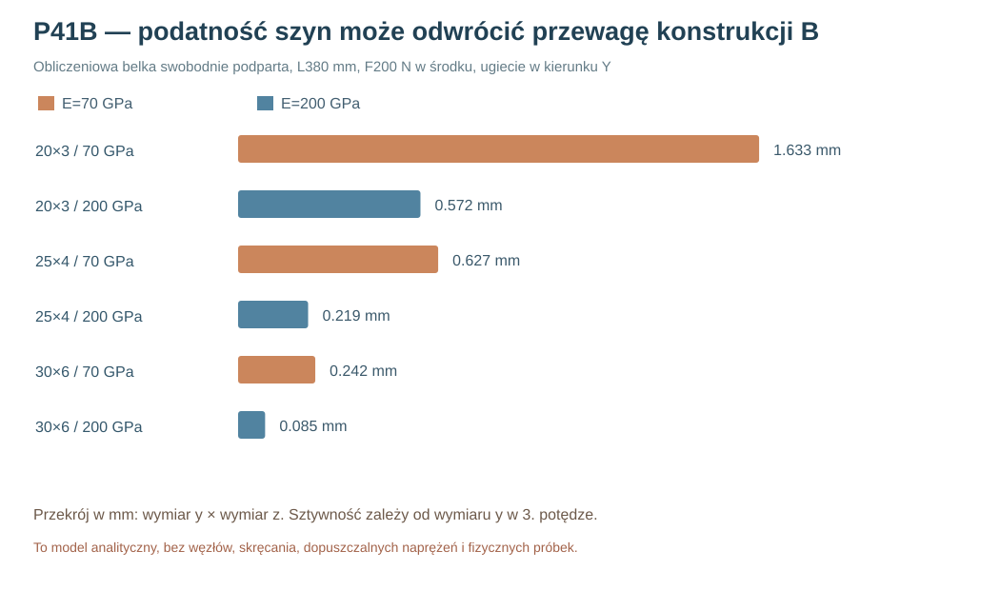

# Raport 104 — P41B: rzeczywisty wpływ hipotetycznej podatności belek na ranking koncepcji

**1 listopada 2026.** Wykonano **54 analityczne przypadki belki swobodnie podpartej** i **54 powtórne przypadki P41A z dodatkową podatnością sprężystą szyny w połączeniu do wręgi**. To analiza liniowej sztywności idealnej belki, nie symulacja zamkniętej ramy, węzłów śrubowych ani wymiarowo zwalidowanej konstrukcji.

## Metoda

Rozpatrzono belkę o osi wzdłuż X, zginaną normalnie do frontu (Y), z przekrojem prostokątnym \`d_y × h_z\`. Dla *swobodnego podparcia obu końców* i siły F w środku:

\[
I_z=\frac{h_z d_y^3}{12},\quad
k_{\mathrm{belki}}=\frac{48E I_z}{L^3},\quad
u=\frac{F}{k_{\mathrm{belki}}},\quad
\sigma_{\mathrm{max}}=\frac{FLd_y}{8I_z}.
\]

Przekroje 20×3, 25×4, 30×6 mm; długości 300/380/440 mm; hipotetyczne moduły Younga **70/200 GPa**; siły punktowe 100/200/400 N. **3×3×2×3 = 54** testy. Wielkości E należy traktować jako zakresy materiałowe orientacyjne, nie przyjęte właściwości zakupionego stopu. Nie przyjęto dopuszczalnych naprężeń, obciążenia normatywnego ani założonego współczynnika bezpieczeństwa.

## Przykładowe ugięcia u przy L=380 mm, F=200 N

| Profil d_y×h_z | 70 GPa | 200 GPa |
|---|---:|---:|
| 20 × 3 mm | 1,633 mm | 0,572 mm |
| 25 × 4 mm | 0,627 mm | 0,219 mm |
| 30 × 6 mm | 0,242 mm | 0,085 mm |

Dla 25×4 mm maksymalne obliczone sprężyste naprężenie zginające przy F200N i L380mm wynosi **45,6 MPa**. Nie można z tego wywnioskować bezpieczeństwa jakiegokolwiek gotowego elementu, bo nie określono granicy plastyczności, skręcania, osłabień otworów i warunków podparcia.

## Sprężyny w szeregu — 54 dalsze porównania A/B

Dla dwóch punktów B przypisanych do wręgi przyjęto umownie \`k_wspornika=900N/mm\` i dla każdej z 18 kombinacji profilu, długości oraz E obliczono sztywność:

\[
k_{\mathrm{ef}}=\left(\frac{1}{900}+\frac{1}{k_{\mathrm{belki}}}\right)^{-1}.
\]

Następnie obliczono trzy kierunki obciążenia dla identycznej masy 15kg, przyspieszenia 5g i e120mm (18×3 = **54**). Wykorzystano ponownie P41A, zachowując jego ograniczenia dotyczące idealnie sztywnego rozdzielacza sił i dwustronnych sprężyn. Modelowanie obu podatności jako dwóch elementów w szeregu **nie jest równoważne przestrzennemu MES konstrukcji**.

Przykład dla profilu 25×4mm, L380mm, E70GPa, siła w kierunku X:

| Model | Max wypadkowa reakcji | Max normalne przemieszczenie podpory |
|---|---:|---:|
| Rama A (idealnie sztywna) | 223,395 N | **0,364427 mm** |
| B z bezwzględnie sztywną szyną | 221,636 N | **0,324835 mm** |
| B po uwzględnieniu podatności szyny | 150,497 N | **0,383099 mm** |

**Uwaga:** mniejsza maksymalna reakcja w B wynika z redystrybucji obciążeń po podatnej ścieżce, a nie ze zwiększenia nośności. Równocześnie przemieszczenie wzrosło, więc żadna z wartości nie dowodzi lepszego brzmienia, szczelności ani trwałości. Własne rezonanse belek i paneli, złącza z wręgą, skręcanie i zmęczenie pozostają niewyznaczone.

## Decyzja badawcza

Szyny B mogą być konkurencyjne, lecz sztywność ich przekroju i połączenia z wręgą jest jednym z kluczowych parametrów. **Nie ma obecnie racjonalnej podstawy do wyboru A lub B wyłącznie na podstawie P41A/B**. Kolejny etap powinien obejmować reprezentatywne 3D CAD obu układów z prawdziwym koszem oraz osobne próby belki, złącza i MDF.

[Kod P41B](../skrypty/p41b_belki_podatnosc.js) · [108 wyników JSON](../wyniki/p41b_podatnosc_belek_108_20261101.json). **Nie zwolniono CNC.**