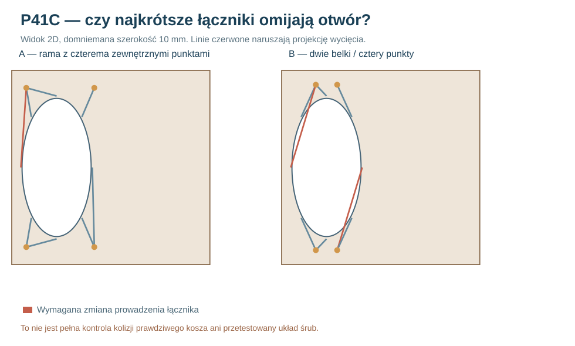

# Raport 105 — P41C/D: przegląd 48 prostych łączników i wariantów 3D OpenSCAD

**1 listopada 2026 — 48 badań geometrycznych w rzucie frontu.** Zamknięto pierwszy etap porównania dwóch alternatywnych koncepcji: ramy z szerokim rozstawem punktów A oraz dwóch belek głębokich B. **Nie wykonano pełnego MES kontaktowego ani prób fizycznej wytrzymałości**, ponieważ nadal nie ma dokładnej bryły kosza, wybranego złącza i zmierzonych parametrów MDF.

## Pytanie badawcze

Czy wystarczy przesunąć podparcie dalej od kołnierza Dayton RSS390HF-4, aby uzyskać wolną i skuteczną ścieżkę obciążenia?

**Nie.** Zewnętrzne punkty podparcia mogą być wolne od uproszczonych kolizji (P41B), lecz **same połączenia pomiędzy ośmioma śrubami kosza a tymi punktami** mogą przechodzić przez obszar wycięcia i hipotetyczny kosz.

### Metoda

Osiem środków otworów przyjęto co 45° na promieniu 184 mm od osi głośnika (231,250)mm. Każdemu przypisano **najbliższy** punkt podparcia w rzucie XZ, a połączenie przybliżono prostym odcinkiem o szerokości 4, 8 lub 10 mm. Obliczono dokładną minimalną odległość osi odcinka od środka wycięcia i odjęto jego półszerokość oraz promień **177,9 mm**.

Wynik ujemny oznacza tylko, że ta **prosta** linia w założonej płaszczyźnie narusza **rzut** otworu. Połączenie przestrzenne może biec inną drogą, ale może wówczas kolidować z rzeczywistym koszem, jego wentylacją albo narzędziem. Rzut nie zastępuje pełnego CAD.

## Wyniki

| Hipotetyczna szerokość łącznika | Rama A: naruszone linie / 8 | Belki B: naruszone linie / 8 |
|---|---:|---:|
| 4 mm | **0** | **2** |
| 8 mm | **0** | **2** |
| 10 mm | **1** | **2** |

W A najtrudniejszy jest łącznik od lewego skrajnego otworu (punkt 5); przy 10mm naruszenie ma około **0,59 mm**. W B skrajne otwory po lewej i prawej stronie (punkty 1 i 5) mają już przy 4mm naruszenie rzutu około **22,5 mm**. To wskazuje na potrzebę obejścia przestrzennego albo zmiany lokalizacji końców belek, **nie automatyczne odrzucenie wszystkich belek**.

## Wynik zbiorczy P41A/B/C

- W modelu podpór sprężystych A ma znacznie korzystniejszy rozstaw w osi X niż wariant B przy obciążeniu poziomym; to nie jest jeszcze rzeczywista sztywność i nośność.
- Obwiednie 3D P34B nie wykazują kolizji A z istniejącymi prostymi bryłami, jednak nie obejmują połączeń od kosza do podpór.
- P41C wykazuje właśnie, że część **prostych** łączników musi zostać przeprojektowana.
- **Warunkowy faworyt dalszego projektowania: szeroka rama A**, ponieważ wymaga mniej konfliktowych obejść geometrycznych i nie ma tak wąskiego rozstawu podpór X. **Nie jest to rekomendacja wykonania, zakupu ani bezpieczeństwa konstrukcji.**

## Plik 3D

[Otwórz parametryczny OpenSCAD — P41D (NIE CNC)](../dokumentacja/P41D_dwie_sciezki_REFERENCYJNE_NIE_CNC.scad). Parametr \`variant="carrier4"\` lub \`variant="rails4"\` pokazuje dwie *referencyjne* geometrie. Domyślnie \`show_straight_links=false\`, ponieważ część takich odcinków narusza rzut wycięcia. Włączenie ich pokazuje **koncepcję do dyskusji**, nie zatwierdzony element obudowy.

## Następny krytyczny etap

1. Pozyskać pełną **rzeczywistą geometrię kosza** (STEP/szablon lub fizyczny pomiar) i pozycję zacisków oraz przewodów.
2. Zaprojektować w CAD co najmniej jedną pełną drogę obciążenia **8 rzeczywistych otworów → łączniki → zewnętrzne podpory → MDF / wręgi**, z dodatnim luzem na narzędzie i montaż.
3. Ustalić materiał, przekrój, gwinty, sztywność i mierzalne warunki docisku/odrywania złączy.
4. Wykonać **kontaktowy MES 3D z możliwością rozwarcia złączy**, stopniową zbieżnością siatki i zmianą orientacji skrzyni.
5. Zweryfikować wyniki na próbkach docelowego MDF 44 mm i pojedynczym przedprodukcyjnym mocowaniu. Dopiero potem decydować o plikach CNC i zakupach.

**Reprodukcja:** [kod P41C](../skrypty/p41c_laczniki_w_projekcji.js) · [48 scenariuszy](../wyniki/p41c_proste_laczniki_48_20261101.json) · [referencyjny plik 3D](../dokumentacja/P41D_dwie_sciezki_REFERENCYJNE_NIE_CNC.scad).

**Werdykt:** **szeroka rama A pozostaje wariantem do dalszego zbadania, CNC zablokowane.**