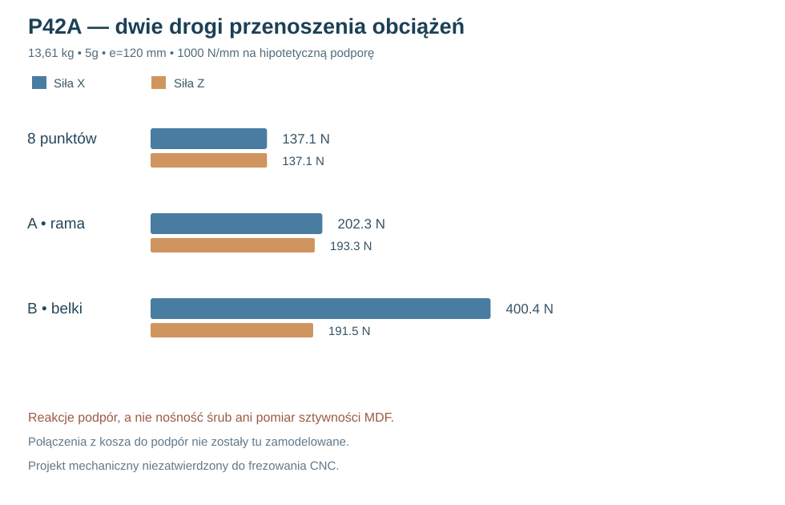

# Raport 106 — P42A: dwa alternatywne tory przenoszenia obciążeń kosza

**1 listopada 2026 — wykonano 1458 wariantów. Status: hipotetyczny model zredukowany, nie zwalidowany MES kontaktowy ani nośność konstrukcji.**

## Cel i trzy topologie porównawcze

Poprzednie P40 wykazało, że podzielenie siły przez osiem śrub nie odtwarza momentu od przesunięcia środka masy. W P42A przeanalizowano **dwie inne, celowo kontrastujące topologie przenoszenia obciążeń** z hipotetycznego sztywnego interfejsu kosza na podporę obudowy:

- **A — szeroka rama nośna**, cztery zewnętrzne punkty o współrzędnych (X,Z) [75,45], [425,45], [75,455], [425,455] mm w systemie zewnętrznym frontu 1020×500 mm.
- **B — dwie belki w głąb obudowy**, cztery punkty przy (176,37), (286,37), (176,463), (286,463) mm; zakładane belki w osi Y podpierają układ przy ściankach górnej/dolnej.
- **D — osiem punktów na BCD Ø368 mm**, wyłącznie odniesienie matematyczne P40, a **nie osiem niezależnie przytwierdzonych do obudowy podpór**.

Dane kosza: Dayton Audio RSS390HF-4, osiem otworów w kołnierzu oraz front Ø388,4/wycięcie Ø355,8: [strona producenta](https://daytonaudio.com/product/126/rss390hf-4-15-reference-hf-subwoofer-4-ohm). Masa katalogowa **30 lb ≈13,61 kg**. Rozpatrzono też 15 kg jako stresowy wariant z dodatkowym osprzętem.

**Punkty A i B są tylko kandydatami lokalizacji podpór. W tej kampanii nie ma fizycznych łączników, profili, śrub ani zmierzonych parametrów MDF, które przenoszą obciążenie z ośmiu otworów kosza do tych punktów.**

## Model rachunkowy

W osi Y normalne przemieszczenie hipotetycznie sztywnego interfejsu opisano trzema stopniami swobody:

\[
w_i=w_0+\theta_x (X_i-X_c)+\theta_z (Z_i-Z_c),
\qquad N_i=k_i w_i .
\]

Dla wektora \(\mathbf{v}_i=[1,X_i-X_c,Z_i-Z_c]^T\) budowano:

\[
K=\sum_i k_i\mathbf v_i\mathbf v_i^T,\quad
K\mathbf u=[F_y,-eF_x,eF_z]^T.
\]

Przyjęto liniowe **dwustronne** sprężyny normalne (mogą ściskać i rozciągać), bez tarcia i kontaktu kołnierza. Obciążenie ścinające X/Z rozdzielono proporcjonalnie do hipotetycznych \(k_i\). Wypadkowa \(\sqrt{N_i^2+T_i^2}\) jest **reakcją podpory w tym matematycznym modelu**, nie siłą w konkretnej śrubie i nie dopuszczalną wytrzymałością MDF.

Skrypt sprawdza wszystkie trzy równania równowagi (jedna siła normalna i dwa momenty), z tolerancją numeryczną <1e−7 w zastosowanych jednostkach.

## Zakres badania

- Topologie D/A/B (3), kierunki siły X/Z/Y (3), przyspieszenia 1/5/10g (3).
- Masy 13,61/15 kg (2); ramiona e=90/120/180 mm (3).
- **Założone**, niezmierzone sztywności pojedynczych podpór \(k=300/1000/3000\ \mathrm{N/mm}\) (3).
- Trzy rozkłady sztywności: równa, połowa sztywności podpór po lewej, jedna podpora o 1/4 sztywności.

Liczba prób to \(3×3×3×2×3×3×3 = \mathbf{1458}\). Zmiana sztywności służy kontroli wrażliwości modelu, **nie określa rzeczywistej niepewności MDF ani złączy**.

### Wariant porównawczy: 13,61 kg, 5g, e=120 mm, k=1000 N/mm na podporę

| Kierunek siły | Osiem punktów D, max R [N] | Szeroka rama A, max R [N] | Dwie belki B, max R [N] |
|---|---:|---:|---:|
| **X — poziomy** | 137,10 | **202,29** | **400,42** |
| **Z — pionowy** | 137,10 | **193,32** | **191,49** |
| **Y — normalny** | 83,42 | **184,95** | **166,84** |

Największa modelowa normalna wartość przemieszczenia na obwodzie kosza przy obciążeniu w X: D **0,115 mm**, A **0,139 mm**, B **1,285 mm**. Jest to wynik sztucznego parametru sprężystości \(k=1000\ \mathrm{N/mm}\), więc **nie stanowi prognozy rzeczywistego ugięcia**. Ilustracja pokazuje jedynie efekt znacznie mniejszego rozstawu podpór B w osi X.

## Ocena naukowa

**Szeroka rama A lepiej znosi w tym konkretnym modelu moment od poziomego obciążenia** niż rozważane dwie belki B. Nie dowodzi to, że będzie lżejsza, cichsza, trwalsza lub bezpieczniejsza; musi jeszcze przejść kontrolę realnych łączników i ścieżek sił. W wariantach e, k i różnych pozycjach obciążenia różnice mogą się zmieniać.

Warunki przejścia do MES:
1. Geometria łącznika z **ośmiu rzeczywistych otworów kołnierza** do każdej ze wskazanych podpór — bez przecięcia otworu, kosza, wentylacji i toru narzędzia.
2. Materiał i przekrój każdej podpory, sposób połączenia z frontem i wręgami, rzeczywiste warunki kontaktu i wstępnego docisku.
3. Pomiar podatności i nośności MDF/spoin/prototypowego łącznika, a następnie identyfikacja \(k_i\) — nie odwrotnie.
4. Statyczny i dynamiczny MES bryłowy/kontaktowy z analizą zbieżności, po uwzględnieniu odrywania i utraty kontaktu.

**Reprodukcja:** [skrypt](../skrypty/p42a_model_czterech_podpor.js) · [1458 wyników JSON](../wyniki/p42a_podpory_1458_20261101.json). **Bramka CNC: zamknięta.**