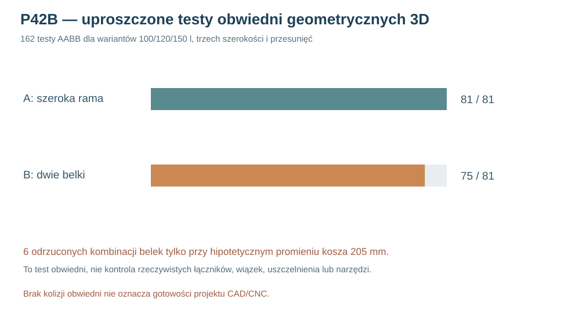

# Raport 107 — P42B: kontrola miejsca dla dwóch alternatywnych torów sił

**1 listopada 2026 — wykonano 162 kontrole obwiedni 3D (AABB)** z istniejącymi, uproszczonymi wręgami i modułami komory z P34B. To kontrola **ograniczonego zestawu brył**, nie kompletna weryfikacja kolizji rzeczywistego Dayton RSS390HF-4.

## Uzgodniony układ współrzędnych

P39 naprawił błąd mieszania osi. Użyto jednego układu **zewnętrznego obudowy** X=0..1020mm, Y=0..425mm, Z=0..500mm. Obiekty modułów i wręg z [kodu P34B](../skrypty/p34b_przestrzenne_pole_p30e.js), zapisane w osi lokalnej komory, przekształcono **X_ext=X_local+22, Y_ext=Y_local+44, Z_ext=Z_local+22 mm**. Dzięki temu dane porównawcze P41 są zgodne z P31C/P39.

## Które bryły zostały faktycznie przetestowane?

- **A**: 4 hipotetyczne podkładki/nośne punkty ramy o środkach z raportu 106; obwiednia w osi Y od 44 do 74 mm za frontem.
- **B**: 4 obwiednie belek o środkach z raportu 106; przebieg w osi Y od 44 do 403 mm, przy dolnej i górnej ścianie.
- Przekrój prostopadły kwadratowy: półszerokość **6, 9 lub 12 mm**, trzy przesunięcia zbiorowe obu osi (0,0), (−2,−2), (+2,+2) mm.
- Trzy hipotetyczne największe promienie zastępczego korpusu kosza/silnika: **130, 170, 205 mm**. **205 mm nie jest rzeczywistym wymiarem katalogowym Dayton**; to umowna próba stresowa.
- Konfiguracje wkładów P34B: **100 / 120 / 150 l**.

Wykonano \(2×3×3×3×3=\mathbf{162}\) testów. Dla rozmiarów prostokątnych obliczono ścisłą w geometrii AABB kolizję z prostopadłościanami reprezentującymi wręgi/moduły, minimalny odstęp od uproszczonego walca kosza oraz marginesy do wewnętrznych ścian.

## Wyniki

| Wynik kontroli | Rama A | Belki B |
|---|---:|---:|
| Zestawienia | 81 | 81 |
| Przechodzi wszystkie *modelowane obwiednie* | **81** | **75** |
| Kolizje AABB z istniejącymi wręgami i modułami P34B | 0 przypadków | 0 przypadków |
| Nieprzechodzące hipotetycznej obwiedni silnika | 0 | **6** |

Sześć przypadków B odpada dopiero dla **umownego promienia 205 mm**, niebędącego pomiarem producenta. Wynik nie dowodzi, że B fizycznie nie wejdzie do obudowy, ani że A zapewnia miejsce na wszystkie połączenia. W szczególności tu **nie zamodelowano** samych łączników od kołnierza kosza do punktów nośnych, rzeczywistego kosza i zacisków, śrub ani toru montażowego z narzędziem.

## Konsekwencje

Samo rozmieszczenie punktów A wygląda na łatwiejsze w zdefiniowanych obwiedniach, ale różnica względem B jest niewielka i może zniknąć po wprowadzeniu dokładnego CAD. Największe ryzyko to **brak zamkniętej, nośnej drogi z kołnierza do podpór**, a nie sama odległość od ścianki. P42C sprawdza to dodatkowo w rzucie 2D.

**Reprodukcja:** [kod P42B](../skrypty/p42b_obwiednie_podpor_3d.js) · [162 scenariusze JSON](../wyniki/p42b_obwiednie_162_20261101.json).

**Wymagane przed CNC:** fizyczna geometria kosza, łączniki, wręgi i moduły w jednym zestawie brył 3D, kontrola wyjmowania kosza/narzędzi, ścieżka sił do elementów drewnianych i badania złączy. Żadnego z tych warunków nie zastępuje wynik „0 kolizji AABB”.