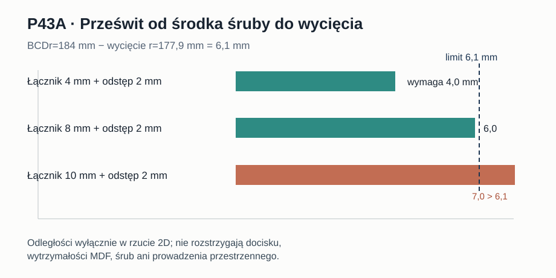

# Raport 109 — P43A: trasy omijające wycięcie przy ośmiu mocowaniach

**Data:** 2026-11-01. **Rodzaj dowodu:** geometryczne obliczenie analityczne 2D na hipotetycznych podparciach P42. **Nie jest to projekt złącza ani CAD do CNC.**

## Pytanie
P42C pokazał kolizję prostych połączeń w rzucie XZ. Czy jest możliwe połączenie od środków ośmiu otworów Ø6,5 mm do czterech podpór A lub B łamaną/łukiem bez wejścia w wycięcie Ø355,8 mm?

## Źródła i założenia
- **Dane producenta:** Dayton Audio RSS390HF-4: wycięcie Ø355,8 mm, BCD Ø368 mm, otwory Ø6,5 mm, obwód kołnierza Ø388,4 mm. Źródło pierwotne: https://www.daytonaudio.com/images/resources/295-468-dayton-audio-rss390hf-4-specifications-46176.pdf (odczyt rysunku, 2026-11-01).
- **Geometria modelowa:** centrum w (231,250) mm, front zewnętrzny 1020×500 mm. Podpory A: (75,45), (425,45), (75,455), (425,455); B: (176,37), (286,37), (176,463), (286,463) mm, jak P42.
- **Przypadki badawcze:** szerokości umownych łączników 4/8/10 mm; odstęp od wycięcia 0/1/2 mm. Są to parametry testu, **nie normy ani tolerancje wykonawcze**.
- W płaszczyźnie frontu środek łącznika musi pozostawać poza dyskiem promienia `R=177.9 + width/2 + margin` mm. Sprawdzono też pozostawanie całej szerokości wewnątrz prostokąta frontu.

## Metoda
Dla każdej pary środek śruby–podpora porównano odcinek prosty z najkrótszą trasą omijającą dysk. Jeżeli odcinek przechodzi przez niedozwolony dysk, użyto dwóch stycznych i łuku koła po jednej z dwóch stron. Przy odległościach `d1,d2>=R` długość trasy to:

`L = sqrt(d1²-R²) + R*delta + sqrt(d2²-R²)`,

gdzie `delta` to dodatni kąt łuku zgodny z kierunkiem obejścia. Sprawdzono oba kierunki, próbkowanie łuku co maksymalnie 1,5 mm dla granicy prostokątnej oraz wszystkie cztery podpory. Wybór najkrótszej dopuszczalnej trasy *nie jest* optymalizacją sił ani dostępności narzędzi. Przestrzeń przeszukiwana: **2 układy × 3 szerokości × 3 odstępy × 8 śrub × 4 podpory = 576 par**; z nich 144 optymalne trasy przypisane do każdej kombinacji układ/szerokość/odstęp/śruba.

## Wyniki

| Szerokość / odstęp | Rama A: dostępne śruby | Belki B: dostępne śruby | Największe wydłużenie trasy B względem odcinka do wybranej podpory |
|---|---:|---:|---:|
| 4 mm / 0 mm | 8/8 | 8/8 | 4,9705 mm |
| 4 mm / 2 mm | 8/8 | 8/8 | 6,0301 mm |
| 8 mm / 1 mm | 8/8 | 8/8 | 6,6235 mm |
| 8 mm / 2 mm | 8/8 | 8/8 | 7,2786 mm |
| 10 mm / 1 mm | 8/8 | 8/8 | 7,2786 mm |
| **10 mm / 2 mm** | **0/8** | **0/8** | brak możliwego początku w zadanej płaszczyźnie |

Prześwit promieniowy od środka śruby do krawędzi wycięcia to `184 - 177,9 = 6,1 mm`. Dla 10 mm/2 mm wymagamy `5+2 = 7 mm`; zatem **już sam środek początkowy nie spełnia warunku**. Dla 8 mm/2 mm wymagana odległość to 6 mm, czyli *tylko 0,1 mm geometrycznego zapasu* na poziomie abstrakcyjnej linii. To nie jest realny zapas dla śruby Ø6,5 mm: od zewnętrznego obrysu otworu śruby do wycięcia pozostaje zaledwie **2,85 mm MDF**, jak w P38/P40.

Przy 8 mm/2 mm oba układy znajdują trasę dla wszystkich śrub, lecz B wymaga dwóch obejść łukowych, A jednego. **Łuk zwiększa długość niewiele**, ale to nie rozwiązuje sposobu mocowania, nośności ani kolizji przestrzennej.

## Krytyczna granica wnioskowania
Każdy punkt początkowy ma promień 184 mm, a kołnierz głośnika zajmuje w rzucie promień 194,2 mm. **Zatem już w punkcie startowym płaska trasa jest w rzucie kołnierza.** Nie ma w tym modelu połączenia do śruby, nakrętki/insertu, przestrzeni na narzędzie, podkładki i naprężeń w materiale. Rezultat 8/8 znaczy wyłącznie „istnieje geometryczna linia środka łącznika w uproszczonej płaszczyźnie”. Nie dowodzi wykonalności w 3D, a 0/8 odrzuca wyłącznie tę konkretną płaską geometrię z wybranym odstępem.

**Decyzja:** zachować A jako pierwszą drogę do dalszych badań, ale nie odrzucać B na podstawie P42C. **CNC: zablokowane.**

**Odtwarzanie:** `node skrypty/p43_trasy_i_awarie_podpor.js` · [144 wybrane trasy](../wyniki/p43a_trasy_144.csv) · [konfiguracja i pełne agregaty](../wyniki/p43_podsumowanie_20261101.json). Schemat analityczny, brak pomiarów.
