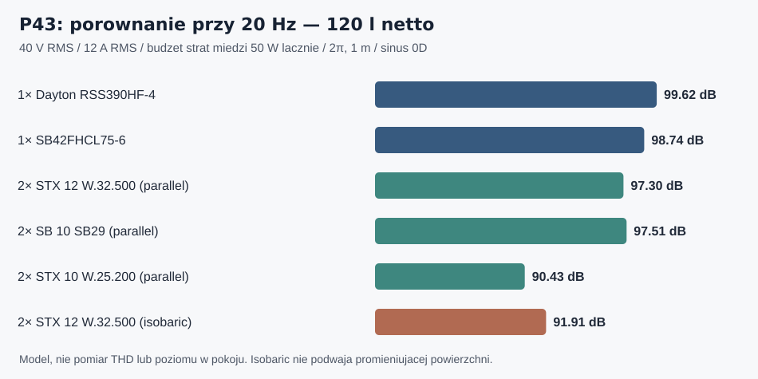

# Raport 109 — P43: SB WO34HC i SB42 oraz dwie membrany kontra para izobaryczna

**Data:** 2026-11-02. **Status:** przeprowadzone obliczenia przesiewowe (model liniowy 0D, bez pomiarów), nie ostateczna konstrukcja.

## 1. Pytanie praktyczne i wniosek

Czy wobec ceny **Dayton RSS390HF-4** bardziej opłaca się w tej samej pojedynczej skrzyni zamkniętej zastosować: (A) jeden większy przetwornik, (B) **dwa 10- lub 12-calowe z dwiema membranami promieniującymi**, czy (C) **dwa identyczne przetworniki w parze izobarycznej**?

**Wstępny wynik:** komentarz o dwóch tańszych przetwornikach ma sens. Para **STX W.32.500.8.MC_v2** kosztuje według jednej oferty **430 zł**, wobec **1613,33 zł** za pojedynczy Dayton. Przy 120 l, 20 Hz, 40 V RMS / 12 A RMS i wspólnym *hipotetycznym* pułapie strat miedzi 50 W, model dwuprzetwornikowy STX (równoległy, nominalnie 4 Ω) daje **97,30 dB**, a Dayton **99,62 dB** — różnica **−2,31 dB**. To nie znaczy, że STX ma porównywalne THD lub trwałość, a 430 zł to wyłącznie koszt głośników, bez elektryki, obudowy i montażu.

**Izobaryczny STX W.32.500** przy tej samej objętości 120 l i identycznym limicie napędu daje **91,91 dB przy 20 Hz**. Para izobaryczna **zmniejsza ekwiwalentną podatność/objętość Vas do połowy**, ale **nie podwaja promieniującej powierzchni**. Korzyścią jest przede wszystkim możliwość uzyskania podobnego strojenia w mniejszej komorze, za cenę drugiego kosza, złożoności i chłodzenia. Niska dobroć danych STX oznacza, że samo obniżenie Fc *nie gwarantuje* lepszego F3.

## 2. Nowi kandydaci i provenance

Dane wpisano addytywnie do [nowego rejestru](../dane/przetworniki/rozszerzenie_FB_20261102_i_pary.json), **bez modyfikowania historycznej puli 24 ani 34 modeli**. Do stanu 34 modeli / 35 elektrycznych konfiguracji dodano **5 osobnych produktów** (warianty WO34HC-4/-8 mają różne T/S), co daje **39 produktów / 40 konfiguracji podstawowych**. Konfiguracje *par* są dodatkowymi architekturami, nie nowymi produktami. Producent WO34HC oznacza kartę **Preliminary Data**.

| ID | Model | Fs [Hz] | Qes/Qms | Vas [l] | Sd [cm²] | Re [Ω] | Le [mH] | jednostronny katalogowy Xmax [mm] |
|---|---|---:|---:|---:|---:|---:|---:|---:|
| C27 | SATORI WO34HC-4 | 20,0 | 0,25/5,53 | 233 | 585 | 3,5 | 0,70 | 8,30 |
| C28 | SATORI WO34HC-8 | 20,2 | 0,30/5,37 | 238 | 585 | 6,8 | 1,00 | 8,30 |
| C29 | SB42FHCL75-6 | 18,4 | 0,32/7,40 | 462 | 850 | 4,6 | 2,10 | 11,50 |
| C30 | STX W.25.200.8.MC (10″) | 28,0 | 0,41/3,27 | 95 | 345 | 5,3 | 1,90 | 4,50 |
| C31 | SB29SWNRX-S75-6 (10″) | 20,0 | 0,31/4,50 | 66 | 312 | 4,5 | 3,00 | 11,25 |

Źródła pierwotne: [WO34HC-4 PDF](https://sbacoustics.com/wp-content/uploads/2026/03/13.5-inch-SATORI-WO34HC-4.pdf), [WO34HC-8 PDF](https://sbacoustics.com/wp-content/uploads/2026/03/13.5-inch-SATORI-WO34HC-8.pdf), [SB42 PDF](https://sbacoustics.com/wp-content/uploads/2020/03/15in-SB42FHCL75-6.pdf), [STX 10 karta](https://stx.pl/w-25-200-8-mc.html) oraz [SB29 PDF](https://sbacoustics.com/wp-content/uploads/2020/11/10in-SB29SWNRX-S75-6.pdf).

**Uwaga:** SB42 ma katalogowe Vas **462 l**, dlatego nie nazywać go „idealnie dopasowanym” do 120 l bez analizy wymaganej charakterystyki, DSP i podparcia termicznego. Jego modelowe Qtc = **0,675**, F3 (wzorzec Le=0) = **42,5 Hz**. Dla Daytona Qtc = **0,714**, F3 = **32,1 Hz**. To charakterystyki *bez korekcji*.

## 3. Metodologia — co policzono, a czego nie

- **3168 przypadków:** 44 architektury (12 pojedynczych, 8 modeli × 2 topologie × 2 połączenia), 4 objętości **80/100/120/150 l**, 6 częstotliwości **20/25/31,5/40/63/80 Hz**, 3 budżety strat miedzi **brak/50/100 W**. Dodatkowo 176 wyrównań Fc/Qtc/F3 dla tych objętości.
- Zastosowano w pełni przeliczaną impedancję: `Zm = Rms + j(ωMms−K/ω)`, `K = 1/Cms + ρc²Sd²/Vb`; `Z = Re + jωLe + BL²/Zm`; `I=U/Z`, `v=BL I/Zm`, `Xpk=√2·|v|/ω`. Ciśnienie RMS idealnego monopola 2π w 1 m: `p=ρ ω Sd |v|/(2π)`. T/S pochodne (Mms/Cms/BL/Rms) są wyprowadzone ze spójnej bazy Fs/Qes/Qms/Vas/Sd/Re; nie miesza się z zaokrąglonymi danymi dodatkowych kolumn.
- Przy **2 zwykłych głośnikach** o wspólnym skoku w tej samej zamkniętej komorze: efektywne `Sd=2Sd`, `Vas=2Vas`, `Vd=2Sd·Xmax`. Przy **idealnej parze izobarycznej**: `Sd=Sd`, `Vas=Vas/2`, `Vd=Sd·Xmax`. W obu parach zastępcze `Mms=2Mms`, `Cms=Cms/2`, `Rms=2Rms`. Dla połączenia szeregowego `Re/Le=2×`, `BL=2×`; dla równoległego `Re/Le=0,5×`, `BL=1×` w odniesieniu do prądu całkowitego.
- Wszystkie warianty korzystają z **jednego hipotetycznego kanału mocy**: maks. **40 V RMS**, **12 A RMS**, `Xpk≤Xmax` każdego kosza. Termiczny test 50 W to **łączne I²Re dwóch cewek**, nie 50 W na każdą cewkę. Limity katalogowe mocy IEC/AES nie są stosowane jako równe dopuszczalnemu I²Re.
- Dla każdej próby sprawdzono dokładnie ograniczenia V/I/X/Pcu oraz bilans mocy elektrycznej i mechanicznej. Kontrola 16 konfiguracji izobarycznych: `Vas/2` i `Vd` bez wzrostu. To kontrola równoważności modelu, **nie walidacja fizycznego sprzężenia**.

## 4. Wyniki: 120 l netto, hipotetyczny pułap Pcu 50 W łącznie

Kolumny SPL to oddzielne sinusy **20 / 40 / 80 Hz**, w dB RMS, 2π/1 m, *nie prognoza SPL w pokoju*. F3 to liniowy wzorzec ze stałą Le=0.

| Wariant | Nom. Ω | Qtc | F3 [Hz] | Vd [l] | SPL 20 / 40 / 80 Hz [dB] | Cena głośnika/ów [zł] |
|---|---:|---:|---:|---:|---|---:|
| Dayton RSS390HF-4 (referencja) | 4 | 0,714 | 32,1 | 1,161 | 99,62 / 112,46 / 105,55 | 1 613,33 |
| SB42FHCL75-6 | 6 | 0,675 | 42,5 | 0,978 | 98,74 / 112,43 / 111,16 | brak ceny |
| SATORI WO34HC-4 | 4 | 0,410 | 70,1 | 0,486 | 94,31 / 106,35 / 109,53 | brak ceny |
| SATORI WO34HC-8 | 8 | 0,491 | 55,7 | 0,486 | 94,31 / 106,35 / 109,02 | brak ceny |
| 2 × STX W.25.200.8.MC 10″ | 4 | 0,586 | 56,2 | 0,310 | 90,43 / 102,47 / 112,33 | 240,00 |
| 2 × SB29SWNRX-S75-6 10″ | 12 | 0,420 | 57,4 | 0,702 | 97,51 / 105,19 / 105,58 | 1 772,80 |
| 2 × STX W.32.500.8.MC_v2 12″ | 4 | 0,556 | 66,8 | 0,737 | 97,30 / 109,97 / 115,79 | 430,00 |
| 2 × STX W.32.800.8.FCX 12″ | 4 | 0,639 | 43,2 | 1,473 | 97,92 / 113,92 / 109,02 | 1 980,00 |
| 2 × SB34SWPL76-4 12″ (szeregowo) | 8 | 0,482 | 47,4 | 1,374 | 100,23 / 107,82 / 105,43 | 2 393,16 |
| 2 × SB34SWPL76-4 12″ (równolegle, 2 Ω!) | 2 | 0,482 | 47,4 | 1,374 | 103,35 / 110,57 / 105,43 | 2 393,16 |
| 2 × STX W.32.500.8.MC_v2 12″ izobarycznie | 4 | 0,362 | 78,2 | 0,368 | 91,91 / 103,95 / 107,14 | 430,00 |
| 2 × SB29SWNRX-S75-6 10″ izobarycznie | 12 | 0,328 | 61,7 | 0,351 | 91,49 / 98,98 / 99,06 | 1 772,80 |
| 2 × STX W.25.200.8.MC 10″ izobarycznie | 4 | 0,430 | 63,4 | 0,155 | 84,41 / 96,45 / 104,66 | 240,00 |

**Ważne pułapki interpretacyjne:**
1. **2 Ω nominalnie** dla połączenia równoległego dwóch 4-omowych C04 (albo C01/C12/C18) — brak kwalifikacji jakiejkolwiek fizycznej końcówki mocy do 2 Ω. Ich korzystne liczby to **wyłącznie możliwości modelu prądowego**, nie wariant gotowy do podłączenia.
2. Izobaryczny nie oznacza dwóch akustycznych źródeł. Duży głośnik może mieć większe `Sd·Xmax` niż dwa małe i przy najniższych częstotliwościach wygrywać mimo ceny.
3. 50 W `I²Re` to **celowe obciążenie modelu**, a nie ograniczenie bezpieczne: bez Rth/Cth, Re(T), BL(x), Cms(x), Le(x,f), ruchu chłodzącego i protokołu THD nie wiemy, ile dB czystego długotrwałego basu uzyskamy.
4. Przy 120 l i 20 Hz para tanich STX 12″ w równoległym połączeniu ma nominalnie 4 Ω. Przy 40 Hz jej modelowy poziom **109,97 dB**, a Dayton **112,46 dB**. Nie porównuj tych liczb jak krzywej tonalnej: limit jest inny dla różnych częstotliwości.
5. Zwiększenie Vd nie mówi nic o liniowości przy dużym skoku. Dla par należy ocenić wzajemny rozrzut parametrów egzemplarzy i deformacje obudowy.

## 5. Cena: komentarz o równym budżecie pod lupą

Jedyny tymczasowy punkt odniesienia: [Dayton RSS390HF-4 — 1613,33 zł](https://loudspeakershop.eu/glosnik-dayton-audio-rss390hf-4-15-reference-sub-p-7660.html), ogłoszenie z niejednoznacznymi komunikatami stanów magazynowych. Zakres cen nie jest wiążącą ofertą ani pełnym badaniem polskiego rynku.

- **2× STX 10″ C30: 240 zł**, [producent 120 zł/szt.](https://stx.pl/w-25-200-8-mc.html); niski limit przemieszczenia **0,311 l** dla pary normalnej, znacząco mniejszy potencjał najniższego basu.
- **2× STX 12″ C05: 430 zł**, [producent 215 zł/szt.](https://stx.pl/w-32-500-8-mc.html). Oszczędność części „same kosze” około **1183,33 zł**, zanim doliczymy mocowanie, drugi otwór, potencjalną zmianę wzmacniacza, koszty dwóch prototypów i pomiary.
- **2× SB29 10″ C31: 1772,80 zł**, [oferta 886,40 zł/szt.](https://www.poweraudio.pl/subniskotonowe-c-8_177_200.html) — para przekracza tę pojedynczą ofertę Daytona o **159,47 zł**.
- **2× STX 12″ C06: 1980 zł**, [producent 990 zł/szt.](https://stx.pl/manufacturer/stx/w-32-800-8-fcx.html); przekracza 1613,33 zł o 366,67 zł.
- **2× SB34SWPL76-4 12″ C04: 2393,16 zł**, [oferta 1196,58 zł/szt.](https://zap-audio.pl/glosnik-sb-acoustics-sb34swpl76-4-p-507.html), wskazana jako **niedostępna**. Cena SATORI i SB42 pozostaje niezweryfikowana; nie przypisano im zerowych kosztów.

Ceny nie obejmują porównywalnego bill of materials obudowy, elektroniki/DSP, straty sprawności przy impedancjach i bezpiecznej integracji. **Nie wyznaczono minimum kosztu dwóch gotowych subwooferów w pokoju**.

## 6. Konstrukcja 500 mm i dwa fizyczne subwoofery w pokoju

Obecny referencyjny korpus **1020×425×500 mm**, front MDF 44 mm, ściany 22 mm, otwór Ø355,8 i pozycja kosza pod Daytonem **nie stanowią konstrukcji uniwersalnej**. Dla C27/C28 wymagany nowy otwór około Ø311,3 i 9 śrub; dla C29 około Ø377 i BCD Ø395; SB42 ma Ø417 zewnętrznie i głębokość 188,7 mm. Wszystkie alternatywy wymagają nowego frontu i obliczenia wręg.

Dla par normalnych konieczne są **dwa otwory**, odległości śrub i koszy, sumaryczne zajęcie litrażu i zmiana naprężeń frontu. Para izobaryczna wymaga **fizycznej szczelnej komory między membranami**, dwóch silników, właściwej orientacji elektrycznej, chłodzenia i drogi montażu; nawet 2×174 mm głębokości C06 przed doliczeniem komory i przewodów może kolidować z wnętrzem głębokim około **359 mm** w referencyjnej skrzyni. **Żaden układ dwóch głośników nie ma zatwierdzonej geometrii ani CNC**.

Powyższe dwa głośniki pracują w **jednej obudowie**. To nie jest to samo co planowane **dwa osobne subwoofery w pokoju** 4,6×3,7×2,5 m, które mają osobne wyjścia DSP i których rozmieszczenie ma zmniejszać nierówności modalne. Porównanie pełnej instalacji wymaga konsekwentnego liczenia *jednego vs dwóch fizycznych urządzeń* oraz kosztów par przetworników mnożonych przez liczbę obudów.

## 6a. Dodatkowa kontrola 60 l izobarycznie vs 120 l pojedynczo

**Przeliczono analitycznie** pięć modeli (STX 10″, SB29 10″, STX 12″ C05/C06 oraz SB34SWPL76-4): idealna para izobaryczna o **60 l** daje **identyczne Fc, Qtc i F3 w przyjętym wzorcu T/S bez Le** jak **jeden taki sam głośnik w 120 l**; największa reszta liczbowa równa **0**. To dokładna konsekwencja `Vas_iso=Vas/2`, a nie osobny pomiar ani dowód takiego samego SPL przy wspólnych ograniczeniach elektrycznych. Celem jest **oszczędność objętości**, ale szczelna komora między koszami i same przetworniki odbierają realny litraż.

Audyt spójności T/S pięciu nowo wpisanych modeli porównał wartości wyprowadzone `Mms/Cms/BL/Qts` z dodatkowymi wartościami z kart. Największa odchyłka to **+6,193% dla wyprowadzonego Mms STX W.25.200.8.MC** względem 54 g w tabeli producenta. Liczb tych nie poprawiono arbitralnie, a wyniki przeliczeń z wejściowych Fs/Qes/Qms/Vas/Sd/Re pozostają jednoznaczne. Pozostałe nowe modele nie przekroczyły 5% w tym audycie.

[Wyniki audytu i równoważności objętości 60/120 l](../wyniki/p43_audyt_TS_i_izobaryczne_60_na_120_20261102.json).

## 7. Decyzje i kolejne bramki

**Pozostawić Daytona C02 jako wstępny faworyt**, jednocześnie przeznaczyć do pełniejszego badania nową gałąź:
- **SB42 C29** jako alternatywa 15″ (niższy modelowy Vd, różnice Qtc i zasilania), **WO34HC-4/-8 C27/C28** jako warianty wymagające korekcji i analizy THD / niskiego Q.
- **2× STX W.32.500.8.MC_v2** jako bardzo tani, *mierzalnie słabszy w 20 Hz* wariant dwóch 12″; nie odrzucać go tylko dlatego, że jest tani. Bramka: jak uzyskać podobną krzywą z DSP i jaka jest cena wzmocnienia/temperatury.
- **Izobaryczny** wyłącznie jako osobna eksperymentalna linia **oszczędności objętości**, m.in. 60 l izobarycznie przeciw 120 l pojedynczo tego samego modelu oraz 120 l izobarycznie przeciw 120 l pary normalnej. Konieczne: modele szczelin/komory i realnej geometrii.
- Audyt ofert i dostępności, pełny BOM (2 finalne suby), realny port końcówki mocy (zwłaszcza 2/3 Ω), identyfikacja Re(T), BL(x), Cms(x), Le(x,f), THD/IMD oraz testy pomieszczenia i wytrzymałości frontu.

**Odtwarzanie:** `node skrypty/p43_dwa_glosniki_i_isobaric.js`. Generuje i sprawdza zgodność [3168 punktów](../wyniki/p43_wspolne_scenariusze_3168_20261102.csv) z [opublikowanym JSON](../wyniki/p43_duze_vs_para_i_isobaric_20261102.json). Wszystkie dane są wejściami katalogowymi i założeniami modelu, a nie pomiarami prototypu.
