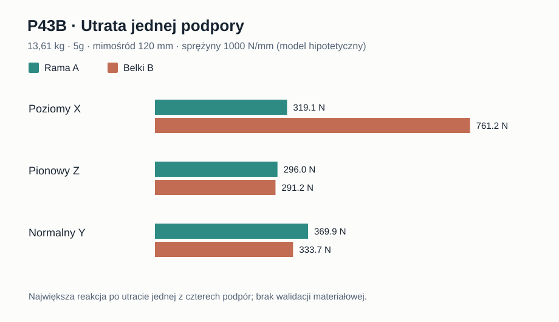

# Raport 110 — P43B: utrata jednej z czterech podpór i granice docisku

**Data:** 2026-11-01. **Rodzaj dowodu:** model 3DOF sztywnego interfejsu na liniowych dwustronnych sprężynach normalnych; kontynuacja P42A. **Nie jest to MES, ocena nośności ani bezpieczny limit obciążeń.**

## Hipoteza badawcza
Model P42A zakładał pracę wszystkich czterech sprężyn. Czy wniosek o przewadze ramy A jest odporny na utratę jednej z nich i jaki pojawia się koszt w reakcji, deformacji modelowej i wymaganiu utrzymania kontaktu?

## Metoda i równowaga
Dla topologii A/B i trzech kierunków X/Z/Y powtórzono równania P42A:
`w_i=w0+theta_x*dx_i+theta_z*dz_i`, `N_i=k_i*w_i`, `K=sum(k_i*v_i*v_i^T)`, `K*u=[F_y,-e*F_x,e*F_z]`.
Utrata punktu oznacza jego usunięcie z macierzy, **nie symulację pęknięcia**. Pozostałe trzy podpory są niekollinearne, stąd w każdym przypadku macierz jest odwracalna. Ścinanie X/Z rozdzielono sztucznie proporcjonalnie do `k_i`, a „reakcja” to `sqrt(N_i²+T_i²)`. Bezwzględna sztywność nominalna każdego punktu = *hipotetyczne* 1000 N/mm.

Badano: 2 topologie × 3 kierunki × 3 poziomy przyspieszenia (1/5/10g) × 3 mimośrody (90/120/180 mm) × 2 masy (13,61/15 kg) × 3 rozkłady k (równe / pół lewych / 1/4 pierwszej) × 5 stanów (4 aktywne lub wyłączenie jednej z 4 podpór) = **1620 przypadków**. Dla 324 zestawów bazowych zestawiono najgorsze wyłączenie podpory. Kontrola `sum N`, `sum(N*dx)`, `sum(N*dz)` wobec wymuszenia ma błąd poniżej 10⁻⁶ w odpowiednich jednostkach N/N·mm; nie jest to sprawdzian zachowania układu rzeczywistego.

## Wynik: 13,61 kg, 5g, e=120 mm, k=1000 N/mm, rozkład równy

| Kierunek | A: cztery aktywne [N] | A: po utracie punktu, najgorzej [N] | B: cztery aktywne [N] | B: po utracie punktu, najgorzej [N] |
|---|---:|---:|---:|---:|
| X (poziom) | 202,29 | **319,11** | 400,42 | **761,24** |
| Z (pion) | 193,32 | 296,03 | 191,49 | 291,24 |
| Y (normalny) | 184,95 | 369,90 | 166,84 | 333,67 |

W tych założeniach dla X obciążenie maksymalne podpory A rośnie 1,58×, B 1,90×. Dla Y w obu wariantach 2,0×. **To wzrost wyliczonej reakcji, nie przewidywany współczynnik uszkodzeń ani zmiana SPL.**

## Sprawdzenie znaków — kontakt nie jest dwustronny
Dwustronna sprężyna może w modelu przenosić znak dodatni i ujemny. W połączeniu mechanicznym ujemna normalna oznacza tendencję do rozwarcia przy przyjętej konwencji i wymaga np. docisku gwintowego. Policzono matematyczną dolną granicę *jednolitego, lokalnego wstępnego docisku* potrzebnego do utrzymania nieujemnej normalnej w modelu: `max_i max(0, -N_i)` (na punkt). Dla X w powyższym wariancie:
- A: 114,40 N przy czterech podporach; **228,80 N** w najgorszym stanie awaryjnym;
- B: 364,01 N przy czterech podporach; **728,01 N** w najgorszym stanie awaryjnym.

**To nie jest rekomendowany moment dokręcenia ani potwierdzona siła wstępnego docisku.** Utrata docisku, relaksacja spoin, praca kołnierza, tarcie, wyrywanie insertów i sztywność rzeczywistych belek nie są zidentyfikowane. Aby przewidywać kontakt, należy modelować jednostronne prawo kontaktowe i sprzęgnięcie śrub–MDF, zamiast po prostu dodawać powyższy docisk do sił.

## Weryfikacja i niepewność
- Weryfikacja analityczna: pełna równowaga zewnętrznych sił i momentów w przyjętej klasie modeli; ten test nie identyfikuje prawdziwych warunków brzegowych.
- Parametry 5g/10g oraz mimośrody 90/120/180 mm są **scenariuszami stresowymi**, nie normą transportową ani odczytem z pomiaru.
- Podane ugięcia mają jednostki mm i zależą bezpośrednio od *niezmierzonego* k; nie przenosić ich na wymiarowanie MDF.
- Najtrudniejsze otwarte dane: rzeczywisty k i tłumienie łączników, rozkład siły 8 śrub → 4 podpory, kontakt i sprężenie, wytrzymałość śrub/inserta na wyrwanie, zmęczenie oraz kolizje w osi Y.

**Decyzja:** szeroka rama A pozostaje warunkowym kandydatem przy obciążeniu X; nie ma podstaw do zwolnienia CNC ani przypisania żadnemu wariantowi wytrzymałości.

**Odtwarzanie:** `node skrypty/p43_trasy_i_awarie_podpor.js` · [1620 przypadków CSV](../wyniki/p43b_awarie_1620.csv) · [podsumowanie](../wyniki/p43_podsumowanie_20261101.json). **Następny krok:** model łączników i rzeczywistych śrub z jednostronnym kontaktem po pozyskaniu prawdziwej geometrii kosza, wstępnego docisku i danych materiałów.
