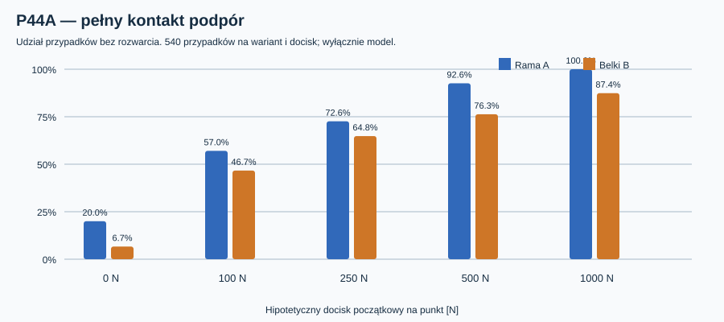

# Raport 111 — P44A: jednostronny kontakt i utrata docisku podpór

**Data:** 1 listopada 2026 r. · **Status:** obliczenia numeryczne, model koncepcyjny 3DOF · **CNC: NIE**.

## Cel i hipoteza

P43B opisywał mocowanie za pomocą *dwustronnych* sprężyn; dopuszczało to siły rozciągające w umownym punkcie styku. W P44A kontakt można rozewrzeć. Sprawdzamy, czy kierunek przewagi szerokiej ramy A nad belkami B utrzyma się przy jednostronnym kontakcie, hipotetycznym docisku i usunięciu jednego z czterech punktów. Nie zidentyfikowano rzeczywistej geometrii złączy, sztywności ani zdolności przenoszenia sił przez MDF.

## Definicja modelu

Dla podpory i: `v_i=[1,x_i-231,z_i-250]`, wektor nieznanych `u=[w0,theta_x,theta_z]`, sztywność `k_i`, zadany idealny docisk początkowy `P_i`. Dopuszczamy **wyłącznie dodatnią normalną (ściskanie)**:

`n_i=max(0,P_i+k_i*(v_i·u))`.

Idealna siła początkowego zacisku działająca przeciwnie do normalnej daje równowagę przyrostową:

`sum_i((n_i-P_i)*v_i)=[F_y,-e*F_x,e*F_z]`.

Nie twierdzimy, że docisk śrub rzeczywistych jest stałą siłą niezależną od rozwarcia. To **świadome uproszczenie teoretyczne**; fizyczne sprzężenie śruba–styk może prowadzić do innego wyniku. Dla utraconej podpory usuwamy jej sztywność i hipotetyczny docisk.

Rozwiązanie uzyskujemy przez wyczerpujące przeszukanie zbiorów aktywnych (trzy albo cztery punkty). W każdym układzie rozwiązujemy liniowy model 3×3, sprawdzamy znaki sił normalnych, względne residua równowagi i liczbę aktywnych kontaktów. Układ o niewystarczającym rzędzie oznaczamy jako **nierozstrzygnięty**, a nie „zniszczony”. Modele nie są MES 3D.

## Macierz 5400 scenariuszy

2 warianty A/B × 3 kierunki X/Z/Y × 3 poziomy 1/5/10g × 3 mimośrody 90/120/180 mm × 2 masy 13,61/15 kg × 2 rozkłady sztywności (jednorodny / lewa połowa 50%) × 5 stanów (wszystkie albo utrata jednej podpory) × 5 hipotetycznych docisków 0/100/250/500/1000 N na czynny punkt.

| Początkowy docisk na punkt | Rama A: pełny kontakt | Belki B: pełny kontakt |
|---|---:|---:|
| 0 N | 108/540 | 36/540 |
| 100 N | 308/540 | 252/540 |
| 250 N | 392/540 | 350/540 |
| 500 N | 500/540 | 412/540 |
| 1000 N | 540/540 | 472/540 |

Wynik z **500 N na punkt** to 500/540 dla A i 412/540 dla B. Nie jest to obciążenie dopuszczalne, dobór śrub ani polecenie wykonania w praktyce. Gdy model nie znajduje pełnorzędowego rozwiązania, może chodzić o mechanizm lub brak odpowiedniej ścieżki siły w tym modelu, nie o wykazane zniszczenie fizyczne.

## Testy niezależności i kontrola P43

Dla 13,61 kg, 5g, mimośrodu 120 mm, osi X, równych `k_i=1000 N/mm` otrzymano progi zachowania **wszystkich** kontaktów: A (4 punkty) = **114,4016 N**, A po utracie jednego = **228,8032 N**, B (4 punkty) = **364,0050 N**, B po utracie jednego = **728,0100 N**. Odtwarza to wartości progowe z raportu 110. Maksymalne względne residuum równowagi modelu (skalowanie składników przez `1+|Q_i|`) w rozwiązanych scenariuszach = **1.164e-10**.

Jest to **weryfikacja implementacji na przyjętym modelu**, nie walidacja wytrzymałości mechanicznej.

## Ograniczenia

Nie znamy: rzeczywistego połączenia ośmiu śrub kołnierza z czterema umownymi podporami; sztywności podkładek, śrub, ramy i spoin; sprężenia kołnierza, rzeczywistej siły docisku i jej relaksacji; parametrów MDF i wyrywania insertów; rzeczywistej geometrii kosza, wentylacji i obwiedni narzędzi. Stanów 10g i 1000 N/punkt nie należy traktować jako wymagań normowych ani zaleceń projektowych.

**Decyzja:** szeroka rama A pozostaje warunkowym kierunkiem dalszej analizy, ale nie jest zatwierdzonym mocowaniem.

**Reprodukcja:** `node skrypty/p44_kontakt_docisk_tarcie.js` uruchamiany z katalogu repozytorium · [CSV 5400](../wyniki/p44_kontakt_5400.csv) · [JSON i testy](../wyniki/p44_podsumowanie_20261101.json) · [wykres SVG](../wyniki/p44a_pelny_kontakt.svg).
