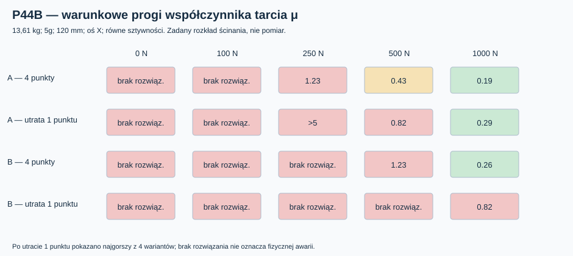

# Raport 112 — P44B: warunkowa nierówność tarcia i ryzyko poślizgu

**Data:** 1 listopada 2026 r. · **Status:** przesiewowe obliczenia 16 200 nierówności Coulomba dla przypadków P44A · **CNC: NIE**.

## Pytanie badawcze

Czy model utrzymujący dodatnią normalną w punkcie mocowania może jednocześnie wykazać niedostateczną hipotetyczną rezerwę tarcia dla przeniesienia siły w płaszczyźnie frontu? Wynik nie odpowiada na pytanie o rzeczywisty poślizg, wytrzymałość śrub ani uszkodzenie materiału.

## Metoda i ograniczenie interpretacji

Dla scenariuszy X i Z: `F_t=m*a*g0`. Zakładamy (nie wyprowadzamy z podatności stycznej) rozdział siły `T_i=F_t*k_i/sum_active(k_j)` tylko na punkty z dodatnią normalną `n_i>0`. Sprawdzamy `|T_i| <= μ*n_i`, a minimalną wartość `μ_req=max_i(|T_i|/n_i)`. Gdy P44A nie daje pełnorzędowego stanu równowagi, próg tarcia **nie jest wyznaczany**. W kierunku Y nie ma przyjętej składowej stycznej.

W całej siatce 5400 analiz sprawdzono **μ=0,2; 0,4; 0,6**: razem **16 200 warunków**. To liczby scenariuszowe, **nie pomiary** tarcia par materiałowych. Rzeczywiste tarcie zależy od powierzchni, nacisku, wilgotności, mikropoślizgu, łącznika i przebiegu obciążenia. Nie rozwiązaliśmy sprzężonego kontaktu normalnego i stycznego, czyli pełnego problemu *stick/slip*.

## Wyniki przesiewowe

Każda komórka: liczba scenariuszy spełniających sprawdzaną nierówność spośród **540** w danej topologii i docisku. Brak rozwiązania kontaktu nie jest zaliczany do przypadków pozytywnych.

| Wariant / hipotetyczny docisk | μ=0,2 | μ=0,4 | μ=0,6 |
|---|---:|---:|---:|
| A, 250 N/punkt | 196/540 | 298/540 | 300/540 |
| A, 500 N/punkt | 300/540 | 301/540 | 315/540 |
| A, 1000 N/punkt | 305/540 | 403/540 | 435/540 |
| B, 250 N/punkt | 191/540 | 262/540 | 278/540 |
| B, 500 N/punkt | 292/540 | 301/540 | 308/540 |
| B, 1000 N/punkt | 304/540 | 367/540 | 385/540 |

Przykład przy 500 N/punkt: dla hipotetycznego μ=0,4 nierówność spełnia 301/540 w modelu A oraz 301/540 w modelu B. Nie jest to procent prawdopodobieństwa sukcesu, ponieważ siatka stanów została wybrana arbitralnie, a nie zgodnie z rozkładem użytkowania.

Wykres pokazuje progi μ dla 13,61 kg / 5g / 120 mm / osi X; stan „utrata jednej podpory” przedstawia najtrudniejszy z czterech wariantów awarii. Wykres nie pozwala porównać **wytrzymałości** A/B, ponieważ samo przeniesienie zadanego ścinania przez tarcie nie oznacza nośności materiału.

## Bramka kolejnych badań

1. Ustalić rzeczywistą geometrię kosza Dayton RSS390HF-4 (najlepiej STEP) wraz z wyprowadzeniem przewodów, wentylacją, śrubami, podkładkami i narzędziem.
2. Opracować pełną trasę 8 otworów BCD Ø368 → rzeczywisty nośnik → rzeczywiste połączenia z MDF i sprawdzić limit 500 mm głębokości.
3. Dobrać i **zmierzyć** połączenie i jego sztywność, docisk, podatność, tarcie, relaksację oraz nośność w próbach wyrywania i cyklicznych.
4. Dopiero wtedy wykonać kontaktowy MES 3D z siłą w śrubie, rozwarciem, poślizgiem i obciążeniami dynamicznymi, wraz z testem zbieżności siatki.

## Literatura metodologiczna (nie normy akceptacyjne dla subwoofera)

- NASA-STD-5020B, *Requirements for Threaded Fastening Systems in Spaceflight Hardware*: https://standards.nasa.gov/sites/default/files/standards/NASA/B/0/2021-08-06-nasa-std-5020b_final.pdf. Dokument opisuje niepewność docisku, wpływ sposobu montażu i utratę naprężenia; tutaj używany **wyłącznie jako źródło metodologiczne**.
- Abide et al. (2022), *Unified primal-dual active set method for dynamic frictional contact problems*: https://doi.org/10.1186/s13663-022-00729-4. Odniesienie do metod kontaktowych; P44 **nie** realizuje ich pełnego algorytmu tarciowego.

**Decyzja:** wariant A pozostaje warunkowym kandydatem; **nie ma podstaw do CNC, zakupu łączników lub nadawania momentu dokręcania** na podstawie P44.

**Reprodukcja:** [kod](../skrypty/p44_kontakt_docisk_tarcie.js) · [5400 przypadków kontaktu](../wyniki/p44_kontakt_5400.csv) · [agregaty](../wyniki/p44_podsumowanie_20261101.json) · [wykres](../wyniki/p44b_wymagany_wspolczynnik_tarcia.svg).
