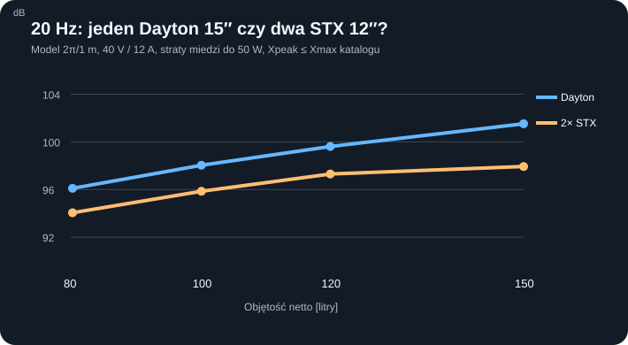

# B12-01 — Czy dwa tanie głośniki 12″ mogą zastąpić Dayton RSS390HF-4?

**Stan:** 2 listopada 2026 r. Przeprowadzono **3584 obliczenia** małosygnałowego modelu liniowego, 112 agregacji, niezależne kontrole ograniczeń i bilansu mocy. **Badania przed budową; brak pomiarów urządzenia, THD i identyfikacji termiki.** Jest to addytywne rozszerzenie [P43](109_P43_nowe_SB_podwojne_10_12_i_izobaryczny.md), nie zastąpienie jego danych. Para normalna to **dwie membrany promieniujące w tej samej skrzyni** — nie para izobaryczna, nie dwa oddzielne subwoofery w pomieszczeniu.

## Po co badać parę tańszych 12-calowych?

Na podstawie jednego cennika [STX W.32.500.8.MC_v2](https://stx.pl/w-32-500-8-mc.html) kosztuje 215 zł/szt., czyli **430 zł za parę**. Dla [Daytona RSS390HF-4](https://loudspeakershop.eu/glosnik-dayton-audio-rss390hf-4-15-reference-sub-p-7660.html) odnotowano **1613,33 zł** (sklep pokazuje niespójne komunikaty o dostępności). Wyłącznie na koszach różnica to **1183,33 zł na pojedynczy subwoofer**, a przy dwóch gotowych subwooferach w pokoju **2366,66 zł**. Nie jest to oszczędność na kompletnych urządzeniach: drugi otwór/front, montaż, wzmocnienia, okablowanie, wzmacniacz i zabezpieczenia muszą zmieścić się w tej kwocie. Oferty mogą się zmieniać.

Dodatkowy negatywny wariant kontrolny: STX **W.30.200.8.MC** (12″, po 140 zł/szt. w [katalogu producenta](https://stx.pl/category/glosniki-niskotonowe)). Jego Xmax katalogowy jest tylko **±4 mm** z 8 mm p-p, nie 34 mm mechanicznego p-p; źródło [karta modelu](https://stx.pl/w-30-200-8-mc.html). Dodany jako **C32** (nowa pula 40 modeli i 41 konfiguracji podstawowych), z wynikiem przesiewowym, nie finalistą. Wariant STX W.32.800.8.FCX po 990 zł/szt. jest kontrolą elektroakustyczną, lecz **jego para 1980 zł nie jest tańsza od Daytona** ([cennik](https://stx.pl/manufacturer/stx/w-32-800-8-fcx.html)).

## Wspólny eksperyment

- Jedna sztywna obudowa zamknięta netto **80/100/120/150 l**. W tej samej obudowie 1× Dayton C02 albo 2× identyczne 12″ C05/C06/C32. Obie membrany pary są sterowane koherentnie. Łączne **Sd=2 Sd_jednego**, **Vas=2 Vas_jednego**, a w idealnym modelu wspólnego ruchu **X każdej membrany** pozostaje takie samo; nie sumować dwóch głośników jako dwóch lokalizacji w pomieszczeniu.
- Para 8 Ω: **równolegle 4 Ω**, **szeregowo 16 Ω**. Jeden kanał o maks. **40 V RMS i 12 A RMS**. Dla par w szeregu zakres napięciowy często staje się bardziej restrykcyjny; nie wolno utożsamiać tych połączeń.
- Częstotliwości: **20–80 Hz co 2 Hz + 31,5 Hz** (32 wartości), limit strat w miedzi `I²Re` **50 albo 100 W łącznie** dla wszystkich cewek, użyteczny skok katalogowy **70% albo 100% Xmax**. 7 konfiguracji × 4 litraże × 32 częstotliwości × 2 budżety × 2 limity X = **3584 odrębne sinusy**.
- `Cms=Vas/(ρc²Sd²)`, `Mms=1/((2πFs)²Cms)`, `BL=sqrt(2πFs*Mms*Re/Qes)`, `Rms=2πFs*Mms/Qms`; `Zm=Rms+j(ωMms−K/ω)`, `K=1/Cms+ρc²Sd²/Vb`; `Z=Re+jωLe+BL²/Zm`; `I=U/Z`, `v=BL I/Zm`, `Xpeak=√2|v|/ω`, `pRMS=ρ ω Sd |v|/(2πr)`. Pole 2π/1 m oznacza idealną półprzestrzeń, nie odsłuch w rzeczywistym pokoju.
- **Pcu to umowny limit przesiewowy, nie limit cieplny producentów**; katalogowy Xmax nie gwarantuje niskiego THD. Nie podwajamy mocy bezkarnie dlatego, że są dwie cewki. Model liczy ich łączne straty i wymaga dotrzymania każdego z ograniczeń.

## Wyniki — 120 l, 20/40/80 Hz, Pcu≤50 W łącznie, Xpeak≤100% katalogu

| Układ | Nom. Ω | Qtc | F3 bez DSP | 20 Hz | 40 Hz | 80 Hz | Kosz/kosze |
|---|---:|---:|---:|---:|---:|---:|---:|
| 1× Dayton C02 | 4 | 0,71 | 32,15 Hz | **99,62** dB | 112,46 | 105,55 | 1613,33 zł |
| 2× STX C05 równolegle | 4 | 0,56 | 66,76 Hz | **97,30** dB | 109,97 | 115,79 | 430 zł |
| 2× STX C05 szeregowo | 16 | 0,56 | 66,76 Hz | 97,30 dB | 108,87 | 114,50 | 430 zł |
| 2× STX C32 równolegle | 4 | 1,08 | 42,90 Hz | 92,80 dB | 104,84 | 115,88 | 280 zł |
| 2× STX C06 równolegle | 4 | 0,64 | 43,22 Hz | 97,92 dB | 113,92 | 109,01 | 1980 zł |

Wszystkie wartości SPL = **oddzielne ograniczone sinusy**. Nie jest to krzywa częstotliwościowa DSP przy jednej stałej głośności źródła; maksima w osobnych częstotliwościach mogą korzystać z innych ograniczeń. `F3` jest referencją obudowy przy `Le=0`, nie rzeczywistym `F3` po korekcji.

## Dlaczego samo podkręcenie wzmacniacza nie rozwiązuje problemu?

W 120 l przy 20 Hz wariant C05 osiąga **97,30 dB** wobec Daytona **99,62 dB**, czyli **2,31 dB mniej**. Dla uzyskania pułapu Daytona model C05 wymagałby **20,54 V RMS, 5,52 A RMS, 85,18 W łącznych strat miedzi i ±9,11 mm** na membranę. To **przekracza ±7,5 mm katalogu o 21,40%**, a także umowny budżet 50 W. Gdy C05 połączymy szeregowo, do podobnej pracy trzeba około **41,07 V RMS**, czyli powyżej założonych 40 V. Zwiększenie budżetu do 100 W przy 120 l daje C05 najwyżej **97,93 dB**, gdy działa już limit X; Dayton osiąga wtedy **101,89 dB** w tym samym modelu.

Przy zachowawczym ekranie **0,7 Xmax** i 50 W, C05 ma przy 120 l/20 Hz **94,83 dB**, a Dayton **98,79 dB**. Jest to test wrażliwości na definicję granicy liniowości, **nie wyznaczony poziom THD**.

**DSP:** dwa STX mają modelowe **Qtc=0,56 i F3≈66,76 Hz bez korekcji** wobec Dayton **0,71 i 32,15 Hz**. Korekcja może wyrównać poziom *małosygnałowo*, ale nie odzyska brakującego maksymalnego `Sd·Xmax`. Po wyrównaniu 20–80 Hz górną granicą poziomu jest najniższy dopuszczalny pułap w którymś z punktów. W przebadanych siatkach tym punktem była **20 Hz**; to tylko idealny pułap EQ, a nie zaprogramowany preset miniDSP. Przed implementacją potrzebna jest analiza gain stagingu, filtra subsonicznego, clippingu i napięcia rzeczywistego wzmacniacza.

## Wpływ litrażu

| Vb netto | Dayton 20 Hz | Para tanich STX C05 20 Hz | Różnica |
|---:|---:|---:|---:|
| 80 l | 96,10 dB | 94,05 dB | 2,05 dB |
| 100 l | 98,04 dB | 95,85 dB | 2,19 dB |
| 120 l | 99,62 dB | 97,30 dB | 2,31 dB |
| 150 l | 101,52 dB | 97,93 dB | 3,59 dB |

Wynik 150 l dla C05 zostaje ograniczony katalogowym wychyleniem. Dlatego bezcelowe jest sugerowanie, że sam większy litraż lub moc pozwoli automatycznie osiągnąć pułap Daytona.

## Dwie dziury w froncie: geometrycznie możliwe, konstrukcyjnie niewykazane

Źródło STX C05: **średnica zewnętrzna 332 mm, otwór montażowy 284 mm, rozstaw otworów mocujących 316 mm, głębokość 133 mm, masa 4 kg na kosz** ([producent](https://stx.pl/w-32-500-8-mc.html)). W aktualnym frontowym **prostokącie 1020 × 500 mm** można matematycznie rozmieścić dwa zewnętrzne okręgi Ø332 o środkach (260,250) i (760,250) mm. Otrzymujemy **94 mm od lewego/prawego boku**, **84 mm od góry/dołu** i **168 mm między kołnierzami**. Otwory Ø284 nie kolidują w 2D. Jednak ich **łączna powierzchnia wycięcia jest o około 27,4% większa** niż przy jednym otworze Ø355,8 Daytona. Nie dowodzi to mniejszej sztywności o 27,4% — zależy ona od położenia, wręg i materiału.

**Nie zatwierdzać CNC:** obecne wręgi i moduły objętości P20D opracowano dla innego położenia kosza. Dwa przetworniki mogą kolidować z wręgami, matą, zaciskami i torami wkładania modułów. Strefy śrub, wielkość narzędzia, prześwity wentylacji i ugięcie frontu MDF 44 mm wymagają nowych modeli 3D/FEM oraz kontroli dla obu orientacji skrzyni. Model nie oblicza kompresji w wspólnej komorze, asymetrii obu egzemplarzy ani fazy promieniowania dwóch odległych membran przy 80 Hz.

## Koszt: próg opłacalności, nie gotowy kosztorys

- Jeden fizyczny subwoofer: **430 zł para C05** wobec **1613,33 zł C02**. Można dodać maksymalnie **1183,33 zł *ponad koszt wspólnego wyposażenia*** na dodatkowe mocowanie, wzmocnienia, drugi otwór i ewentualne różnice wzmacniacza, zanim oszczędność zakupowa na samych przetwornikach zniknie.
- Dwa fizyczne subwoofery w pokoju: potrzebne **cztery sztuki STX (860 zł)** lub **dwa Daytony (3226,66 zł)**, różnica koszów **2366,66 zł**. Nie ma tu żadnego założenia, że dwa przetworniki w jednej skrzyni zastępują dwa rozstawione subwoofery.
- Taka sama kwota nie oznacza takiej samej jakości: niezidentyfikowane są THD/IMD 20–40 Hz, kompresja termiczna, szumy przepływu, zachowanie przy impulsach oraz tłumienie modalne pomieszczenia 4,6 × 3,7 × 2,5 m.

## Weryfikacja, pliki i dalsze bramki

Wygenerowano **3584 scenariusze** i **112 agregacji**. Dla każdego scenariusza weryfikowane są `U≤40 V RMS`, `I≤12 A RMS`, `Xpeak≤zadany ułamek Xmax`, `Pcu≤50/100 W` oraz bilans `Pwe=Pcu+Rms·vRMS²`. Wyniki są odtwarzalne z rejestrów T/S w repo: [nowy C32 i provenance](../dane/przetworniki/b12_01_rozszerzenie_20261102.json), [kod Node](../skrypty/b12_01_dwie_12_ekonomiczne.js), [pełne scenariusze CSV](../wyniki/b12_01_wspolne_scenariusze_3584.csv) i [agregaty, limity, próba wyrównania do 20 Hz Daytona](../wyniki/b12_01_podsumowanie_20261102.json).

**Kolejny eksperyment powinien rozdzielić:** (1) fizycznie zrealizowany 2× C05 w nowym układzie wręg i potwierdzenie obudowy w 100/120/150 l; (2) identyfikację `BL(x)`, `Cms(x)`, `Le(x,f)` oraz `Re(T)`, z analizą niepewności Xmax; (3) model rzeczywistego DSP+wzmacniacza i limitery; (4) pełną symulację obu oddzielnych subwooferów w pokoju; (5) BOM i koszty prototypu. Bez tego wynik C05 jest **ekonomicznie interesującą alternatywą, ale nie równoważnym jakościowo zamiennikiem Daytona**.
