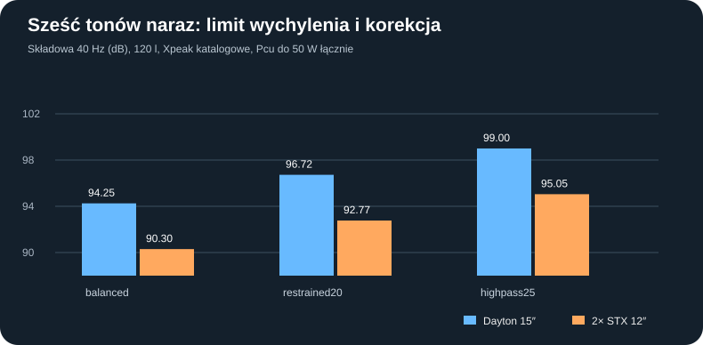

# B12-02 — dwa tanie STX 12″ kontra Dayton: sześć tonów, idealna korekcja, granice X i odporność

**2 listopada 2026 · rzeczywiście wykonany model liniowy, nie pomiar.** Kontynuacja [P45](114_P45_dwa_tanie_12_odpornosc_naped_koszt.md) oraz [B12-01](B12-01_tanie_dwie_12_przeciw_Daytonowi_20261102.md). Pula modeli i historyczne wyniki nie zostały zmienione.

## Po co jeszcze jedno badanie?

P43/P45/B12-01 ograniczały osobne sinusoidy, co **nie wystarcza do sprawdzenia sumowania chwilowych wychyleń przy wielu częstotliwościach**. Tutaj w każdej próbie jednocześnie występuje sześć tonów: **20/25/31,5/40/63/80 Hz**. Wybieramy identyczną, zadaną charakterystykę *ciśnienia akustycznego w idealnej półprzestrzeni 2π/1 m*, następnie analizujemy wymagane prądy, napięcia, straty w miedzi i szczyty wspólnego przebiegu. To próba obliczenia **górnej, idealizowanej granicy** po korekcji, nie gotowy filtr DSP.

## Warunki i rzeczywiste obliczenia

- Porównano **C02 pojedynczy Dayton RSS390HF-4** z **C05 dwa STX W.32.500.8.MC_v2 równolegle, nominalnie 4 Ω** w jednej szczelnej komorze. Dane T/S z obecnego rejestru producentów. Zamknięte Vb netto **100, 120, 150 l**; oba STX przyjęte jako idealnie zgodne i zasilone w fazie.
- Dla każdego wariantu obliczono zespoloną impedancję elektryczną, prędkość i przemieszczenie membrany, ciśnienie na 1 V RMS, a następnie **idealne zespolone napięcie osobno na każdym z sześciu tonów**, aby uzyskać założone docelowe amplitudy ciśnienia (punkt odniesienia: 90 dB RMS dla składowej 40 Hz przy skali 1). Jest to optymistyczne wyrównanie sześciu punktów, **nie rzeczywiście zaimplementowana korekcja w miniDSP**.
- Trzy docelowe widma amplitud względem 40 Hz: `balanced = [1,1,1,1,0.8,0.55]`, `restrained20 = [0.5,0.85,1,1,0.8,0.55]`, `highpass25 = [0.25,0.65,0.9,1,0.8,0.55]`. To **sztuczne sygnały testowe**, nie charakterystyki gotowych filtrów HP ani spektrum muzyki.
- Dwa syntetyczne układy faz ciśnienia: wszystkie zgodne oraz fazy kwadratowe. Zsumowano rzeczywiste przebiegi prądu/napięcia/wychylenia: **2 s, 2000 próbek/s, 4000 próbek**; źródła mają zadane częstotliwości, próbki nie są pomiarami. Bezpieczeństwo ciągłego sygnału i maksimum między próbkami pozostają niezweryfikowane.
- Jedną wspólną skalę sygnału powiększano do pierwszego limitu: **40 V RMS, 12 A RMS, √2×40 V szczyt, √2×12 A szczyt, Xpk każdej membrany 70%/100% katalogowego Xmax oraz I²Re≤50/100 W łącznie**. Obliczona moc cieplna to hipotetyczny pułap strat, nie producentowa dopuszczalna ciągła moc.
- **144 nominalne scenariusze** (2 typy ×3 litraże ×3 widma ×2 fazy ×2 budżety cieplne ×2 progi X), plus **16 kombinacji testowych po 16 skrajnych przypadków parametrów = 256 ocen zaburzonego modelu** dla 120 l i profilu `balanced`. Tam idealną korekcję ustalono na danych nominalnych i **nie dostrajano jej ponownie** po zmianach parametrów.

## Najważniejsze wyniki (120 l, fazy ciśnienia zgodne, limit strat 50 W łącznie)

| Widmo docelowe | Dayton: poziom składowej 40 Hz | 2× STX: poziom składowej 40 Hz | Różnica | Ograniczenie obu |
|---|---:|---:|---:|---|
| balanced | 94,25 dB | 90,30 dB | 3,96 dB | excursion / excursion |
| restrained20 | 96,72 dB | 92,77 dB | 3,96 dB | excursion / excursion |
| highpass25 | 99,00 dB | 95,05 dB | 3,96 dB | excursion / excursion |

Te liczby to **RMS tylko składowej 40 Hz** w sygnale sześciotonowym, nie suma SPL wielotonowego, nie SPL pokoju, nie ciągła moc i nie przewidywana wartość THD. Nie należy bezpośrednio zestawiać 94 dB tu z 99,62 dB z testu pojedynczego sinusa: wszystkie sześć membranowych ruchów sumuje się w czasie.

### Dlaczego przy tych testach różnica jest zbliżona do 3,96 dB?

Dla takiego samego pola ciśnienia w modelu idealnego monopola wymagany wydatek objętościowy jest identyczny. Przy spójnym zadanym widmie wychylenie jest odwrotnie proporcjonalne do `Sd`. Stąd ograniczenie katalogowym `Sd·Xmax` daje teoretyczną przewagę **20log10[(829,6×14)/(2×491×7,5)] = 3,96 dB**. To nie jest stała przewaga w każdym rzeczywistym sygnale — poniższe wyniki ograniczają również napięcie, prąd, stratę miedzi, nieliniowości i obudowa.

W `balanced` przy obcięciu wychylenia do **70% Xmax** poziom składowej 40 Hz spada z **94,25 / 90,30 dB** do **91,16 / 87,20 dB**. Większy hipotetyczny limit strat 100 W nie rozwiązuje ograniczenia wychylenia w tym konkretnym zestawie sygnałów.

## Test odporności ustawień (bez retuningu)

Zastosowano **16 kombinacji hipotetycznych zmian**: Fs ×0,92/1,08, Vas ×0,88/1,12, Qes ×0,90/1,10, Re ×1/1,4. Najpierw ustawiono idealny korektor na wartości nominalne; następnie ten sam zestaw napięć podano do modeli zaburzonych. Nie są to znane tolerancje STX ani Daytona, ani probabilistyczna ocena produkcji. Część zmian Fs/Vas/Qes oznacza inną mechanikę i ponownie wyprowadzony BL; mnożnik Re jest osobną analogią do stanu cieplnego, **bez modelu temperatury**.

| Ograniczenie nominalne, 120 l, balanced | Dayton | 2× STX |
|---|---:|---:|
| aligned_pressure: najniższa dopuszczalna składowa 40 Hz z 16 prób | 93,90 dB | 90,09 dB |
| quadratic_pressure: najniższa dopuszczalna składowa 40 Hz z 16 prób | 94,50 dB | 90,69 dB |

Dodatkowo, przy tym samym korektorze, skrajny błąd amplitudy pojedynczego tonu względem nominalnego celu wyniósł w przyjętych kombinacjach **4,65 dB (Dayton)** oraz **2,91 dB (para STX)**. To **nieweryfikowane scenariusze**, nie prognoza odchyłek rzeczywistych egzemplarzy.

## Wniosek praktyczny i dalsze bramki

**Nie odkryto sposobu DSP na odzyskanie brakującego katalogowego przemieszczenia powietrza.** Mocne obcięcie 20 Hz zwiększa modelowy zapas poziomu składowej 40 Hz, ale **traci się najniższy bas**. Dwa STX nadal mogą być racjonalną tańszą konfiguracją, jeżeli pomiarowo akceptowalny poziom 20–25 Hz okaże się niższy niż wymagany od Daytona; nie ma dowodu porównywalnego THD, IMD ani kompresji.

Następne badania: rzeczywista, stabilna i ograniczona liczba filtrów DSP (np. miniDSP) zamiast arbitralnego korektora zespolonego; analiza temperatury i limiterów czasowych po zidentyfikowaniu cieplnych parametrów cewek; odrębna analiza rozrzutu i różnic dwóch egzemplarzy STX; nowy front 3D i sprawdzenie netto 100/120/150 l oraz fizyczna walidacja zasilacza i stopnia mocy. **Brama CNC i deklaracja bezpieczeństwa pozostają zamknięte.**

## Odtwarzanie

Źródło [skrypt B12-02](../skrypty/b12_02_multitone_eq_6tonow.js), [pełny JSON](../wyniki/b12_02_multitone_20261102.json), [porównanie CSV](../wyniki/b12_02_porownanie_120l.csv). Samodzielny skrypt Node nie potrzebuje dodatkowych bibliotek i sprawdza zgodność wszystkich opublikowanych wyników. Wymagane kontrolne uruchomienie workflow GitHub Actions.
