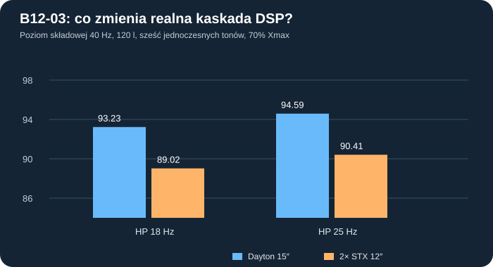

# B12-03 — ograniczona korekcja IIR i dwa nierówne przetworniki 12″

**Data:** 2026-11-02. **Status:** badanie numeryczne wykonane i zapisane; model przed prototypem, bez pomiarów oraz bez zatwierdzonego presetu DSP. Wcześniejsze wyniki P43/P45/B12-01/B12-02 zachowane.

## Problem praktyczny

Poprzedni B12-02 stosował *idealną* niezależną korekcję zespoloną w każdym punkcie, czyli rozwiązanie niedające bezpośrednio nastaw rzeczywistego DSP. Teraz zastosowano zrealizowaną matematycznie kaskadę **pięciu sekcji cyfrowego IIR (biquad)**: drugi rząd HP Butterworth, dwa drugiego rzędu LP Butterworth składające się na **LP Linkwitz-Riley 4 / 80 Hz**, filtr półkowy i filtr PEQ. Częstotliwość obliczeniowa **96 kHz** jest zgodna z podstawowym trybem miniDSP Flex Eight; faktyczną wersję procesora należy potwierdzić. Dokumentacja producenta: https://docs.minidsp.com/product-manuals/flex-eight/index.html oraz https://docs.minidsp.com/product-manuals/flex/dsp-reference/peq.html.

Uwaga: w JSON zapisano **kanoniczne znormalizowane współczynniki biquad RBJ z mianownikiem 1+a1z⁻¹+a2z⁻²**. **Nie są to pliki do bezpośredniego importu do miniDSP**, którego interfejs może stosować inną konwencję znaków i osobny blok zwrotnicy. Zapis nie oznacza przetestowania procesora ani wzmacniacza.

## Metoda i odtwarzalność

- **C02 Dayton RSS390HF-4** w pojedynczej obudowie vs **C05 para STX W.32.500.8.MC_v2** w jednej komorze, połączenie równoległe dwóch 8 Ω (nominalnie 4 Ω).
- **100/120/150 l netto** i HP **18/25 Hz**, z **trzema testowymi rozkładami składowych 20/25/31,5/40/63/80 Hz**: bazowym, mocniej obciążonym niskim basem i ograniczonym 20 Hz. Dwie konfiguracje fazy wejścia, nie fazy dowolnie ustawionego ciśnienia.
- Wygenerowano i porównano **1000 kombinacji** półki/PEQ w każdym optymalizowanym przypadku. Siatka: shelf 25/35/45/55/70 Hz i 0/3/6/9/12 dB; PEQ 28/40/55/70 Hz, −6/−3/0/+3/+6 dB, Q=0,7/1,2. Zdefiniowana funkcja celu minimalizuje rozrzut poziomu 20–80 Hz z karą za duże podbicie. **Nie jest to globalna optymalizacja**, a obie obudowy mają wstępnie wspólne warunki i własne nastawy.
- **12 zestawów filtrów**, **144 scenariusze nominalne** i **192 warianty różnic między dwiema membranami STX**. Równania dwóch niezależnych obwodów mechaniczno-elektrycznych sprzężonych wspólnym ciśnieniem komory, a nie dwa niezależne subwoofery z korekcją pokojową.
- Limity: maks. **12 A RMS** dla jednego kanału, napięcie ograniczone do min(40 V RMS, 2 V RMS × 10^(25,5/20)) = **37,67 V RMS** w hipotetycznym torze. Dwa badane warunki X/Pcu: **70% Xmax i 50 W** sumarycznego I²Re lub **100% katalogowego Xmax i 100 W**. Te 50/100 W nie są limitami bezpiecznego grzania cewek. Dla szczytów napięcia, prądu i wychylenia użyto matematycznej **nierówności trójkąta**, która nie zaniża wyników w przyjętym liniowym modelu sześciu tonów. Daje ona *ostrożną obwiednię*, a nie wynik z działającego limitera.
- Równania obwodu dla każdego głośnika: `Ii=(U−BLi·vi)/(Rei+jωLei)`, `Zmi·vi + (ρc²/(jωVb))·Sdi·Σ(Sdj·vj)=BLi·Ii`. Wypadkowe `p=jρ ω Σ(Sdj·vj)/(2πr)`. To model jednorodnego ciśnienia w komorze, idealnej półprzestrzeni i zgodnych kierunków montażu obu membran. Każdą częstotliwość sprawdzono na bilansie elektrycznych strat w miedzi i mechanicznych, bez przypisania tych strat temperaturze.

## Wybrane filtry — Vb=120 l, przykładowy HP 18 Hz

| Model | HP | LP | Półka (f, gain) | PEQ (f, gain, Q) | Maksymalne wzmocnienie EQ |
|---|---:|---:|---|---|---:|
| Dayton 15″ | 18 Hz | 80 Hz LR4 | 35 Hz, +6 dB | 55 Hz, -3 dB, 0.7 | +5,33 dB |
| Dwa STX 12″ | 18 Hz | 80 Hz LR4 | 35 Hz, +9 dB | 70 Hz, -6 dB, 0.7 | +8,06 dB |

Przy sygnale wejściowym o takim samym poziomie składowych 20–40 Hz:

| HP | Dayton: poziom tonu 40 Hz | 2× STX: poziom tonu 40 Hz | Różnica | Względny ton 20 Hz: Dayton / STX |
|---|---:|---:|---:|---:|
| 18 Hz | 93,23 dB | 89,02 dB | **4,20 dB** | -4,43 / -3,89 dB |
| 25 Hz | 94,59 dB | 90,41 dB | **4,18 dB** | -7,17 / -6,62 dB |

**Interpretacja:** powyższe poziomy oznaczają wyłącznie *składową 40 Hz* w sygnale sześciotonowym, modelowanym w 2π / 1 m. Nie są sumarycznym SPL, prognozą w pokoju ani wynikiem THD. To obwiednia konserwatywna z zastosowaniem szczytu *sumy modułów* składowych; normalny sygnał może dać niższy szczyt niż obwiednia.

**Praktyczny koszt podbicia:** w 120 l maksymalny dodatni zysk EQ osiąga w modelu **+5,33 dB** dla Daytona i **+8,06 dB** dla STX. Wstępny *warunek* zapasu preampu to co najmniej odpowiednio **−8,33 dB i −11,06 dB** (z dodatkowym umownym zapasem 3 dB). Nie jest to ocena rzeczywistego poziomu przetwornika cyfrowo-analogowego, charakterystyki konkretnej końcówki mocy ani finalny limiter.

## Dwie membrany nie są identyczne

Wykonano **16 jawnych, hipotetycznych kombinacji** dla dwóch koszy (Fs ±4%, Vas ±8%, Qes ±7%, Re jednego kosza ×1 lub ×1,2). Pierwszy i drugi głośnik mają przeciwstawne zmiany; ten sam obliczony preset DSP pozostaje bez retuningu. Zmiany nie oznaczają potwierdzonych tolerancji producenta i nie są rozkładem prawdopodobieństwa.

Dla 120 l, HP 18 Hz, profilu bazowego: obwiednia modelowa pary STX wynosi nominalnie **89,02 dB**, a najgorsza z przyjętych kombinacji **88,32 dB** dla tonu 40 Hz. Największa bezwzględna różnica faz wychyleń przy 40 Hz wyniosła **9,62°**; amplituda emisji zmieniała się maksymalnie o **0,69 dB przy 20 Hz** i **0,17 dB przy 40 Hz** w ramach tych scenariuszy.

Model pokazuje, dlaczego rozrzut par powinien zostać uwzględniony, ale **nie dowodzi, że rzeczywiste STX będą miały taki rozrzut**. Wymaga to pomiarów impedancji i T/S obu egzemplarzy.

## Rzeczywiste ograniczenia i następny etap

**Niewykonane nadal:** identyfikacja BL(x), Cms(x), Le(x,f), Re(T), rzeczywistego chłodzenia i kompresji oraz pomiary THD/IMD przy wyrównanym SPL; pomiar wzmacniacza przy 20 Hz i sprawdzenie układu zasilania; rzeczywisty czas i charakter pracy limitera; konstrukcja frontu dla dwóch koszy i kolizje 3D z wręgami; pokojowe DSP dwóch **oddzielnych subwooferów**.

Wynik **nie zamyka wyboru przetwornika**. Dayton w tej klasie testów utrzymuje większy zapas najniższego basu; dwa STX pozostają interesującą ekonomicznie alternatywą (430 zł za parę tylko za przetworniki, według wcześniej zidentyfikowanej oferty). Aktualne szczegóły ceny sprawdzić przed zakupem. **Wstrzymać wykonanie CNC.**

[Pełny rejestr filtrów, współczynników, 144 prób nominalnych i 192 wariantów rozrzutu](../wyniki/b12_03_iir_i_rozrzut_20261102.json) · [skrypt reprodukcyjny Node](../skrypty/b12_03_biquad_i_sprzezone_12.js) · [tabela CSV](../wyniki/b12_03_porownanie_120l.csv).
