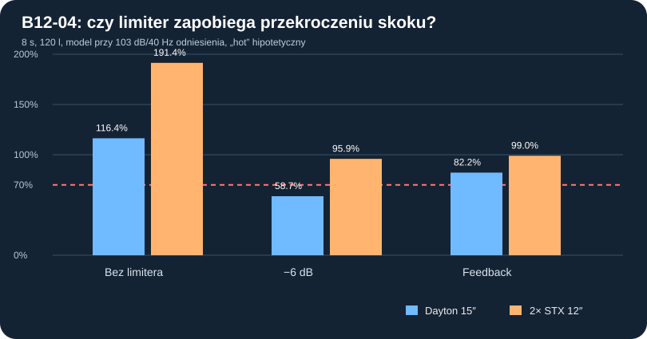

# B12-04 — impulsy, przesterowanie, model termiczny i test zawodności zabezpieczeń

**Stan 2 listopada 2026 r.** Badanie obliczeniowe wykonane i zapisane. Kontynuacja [B12-03](B12-03_rzeczywiste_filtry_IIR_i_rozrzut_2x12.md), bez ingerencji w starsze wyniki. **Brak pomiarów THD, temperatury, zdolności chłodzenia, maksymalnego bezpiecznego wychylenia i zatwierdzonego limitera.**

## Po co ta kampania?

Wcześniejsze obliczenia pojedynczych sinusów i sześciu równoczesnych tonów wyznaczały pułapy, ale nie pokazywały **rzeczywistej w modelu kolejności narastania wychylenia, pracy ogranicznika, napięciowego clippingu i ogrzewania cewek**. Badamy dwa warianty jednej skrzyni zamkniętej **120 l netto**: jeden **Dayton RSS390HF-4** C02 i dwa równolegle połączone **STX W.32.500.8.MC_v2** C05 (nominalnie 4 Ω para).

## Model i wiarygodność

- Model rozwiązany w czasie metodą RK2 (*explicit midpoint*) dla każdego rzeczywistego w modelu kosza: prąd cewki, przemieszczenie membrany, prędkość, hipotetyczna temperatura. Dwa STX mają niezależne stany elektromotoryczne i są sprzężone przez wspólną ściśliwość gazu w 120 l; nie symulowano dwóch oddzielnych skrzyń ani promieniowania wzajemnego w pokoju.
- Wprowadzono istniejące z B12-03 **pięć filtrów biquad IIR w ich częstotliwości projektowej 96 kHz**: HP Butterworth 2 / 18 Hz, LP LR4 / 80 Hz, półka i PEQ. Przetworzenie DSP odbywa się co 1/96000 s, krok całkowania mechaniki to 1/9600 s; filtr dolnoprzepustowy 80 Hz sprawia, że komponenty znacznie powyżej Nyquista mechanicznego nie są celem modelu. **Nie jest to sprzętowy preset ani emulacja konkretnego procesora.**
- Równania: `dx_i/dt=v_i`; `M_i dv_i/dt=B_iL_i I_i−R_{ms,i}v_i−x_i/C_{ms,i}−S_{d,i}(ρc²/V_b)Σ S_{d,j}x_j`; `L_{e,i} dI_i/dt=U−R_{e,i}(T_i)I_i−B_iL_i v_i`; `C_{th,i}dT_i/dt=I_i²R_{e,i}(T_i)−(T_i−T_a)/R_{th,i}`. Wszystkie T/S wzięto z rejestru repo; pochodne Mms/Cms/BL/Rms wyznaczono spójnie z Fs/Qes/Qms/Vas/Sd/Re. Przyjęto `R_e(T)=R_{e,0}×[1+0,0039(T−25°C)]` **tylko jako scenariusz miedzi**, bez potwierdzenia składu cewki.
- Hipotezy termiczne **„cool”: Rth=1,2 K/W i Cth=35 J/K na kosz; „hot”: Rth=2,4 K/W i Cth=15 J/K na kosz**. Nie pochodzą z pomiarów ani danych katalogowych i nie wyznaczają autentycznej temperatury cewek. Czas każdej symulacji 8 s, temperatura początkowa i otoczenia 25°C. Nie ekstrapolować ośmiu sekund do limitów pracy ciągłej.
- Dwa deterministyczne testy: cztery nakładające się składowe `20/25/40/63 Hz` (sygnał nazwany *sustained*, nie utwór muzyczny) oraz krótkie paczki `25/40/63 Hz` (*bursts*). Tor obu projektów znormalizowano do identycznego czysto modelowego odniesienia: **103 dB dla osobnego sinusa 40 Hz RMS przy 1 m / 2π**, przed testowym ogranicznikiem. Nie jest to standard odsłuchu ani cel docelowego użytkowania.
- Wyjście wzmacniacza odwzorowano jako natychmiastowe twarde obcięcie przy `±53,28 V` — hipotetyczny DAC 2 Vrms × 25,5 dB wzmocnienia i maksymalnie 40 Vrms. **Nie modelowano limitera prądowego końcówki, zapadów szyn zasilania, reakcji zabezpieczeń, sprzężeń wewnętrznych ani przesterowania ADC/DAC.** Próg `12 A RMS` przedstawiono tylko jako ekran, a nie egzekwowany ogranicznik prądu.
- Porównano trzy rodzaje napędu: `none` bez ochrony poza obcięciem napięcia; `derate` stała amplituda ×0,5 (−6,02 dB); `feedback` **eksperymentalny regulator z idealną wiedzą o x i v** i projekcją x na 6 ms, atakiem 1 ms, zwolnieniem 180 ms oraz 50-ms przeciętną I²Re. **Nie istnieje w dotychczasowym projekcie czujnik x/v! Regulator nie nadaje się do wdrożenia.**
- Dodatkowe dwa testy dla pary STX z przeciwstawnym, hipotetycznym rozrzutem: Fs +4%/−4%, Vas +8%/−8%, Qes +7%/−7%, Re jednego kosza ×1,2. To **scenariusz wrażliwości**, nie tolerancja producenta.

Łącznie **26 porównawczych symulacji po 8 sekund** (2 konstrukcje ×2 sygnały ×3 strategie ×2 hipotezy termiczne =24 oraz 2 próby rozrzutu pary STX); **2 dodatkowe porównania zagęszczenia kroku 9600→19200 Hz**, wszystkie dla sygnału syntetycznego.

## Wynik: test wielotonowy 8 s, 120 l, scenariusz cieplny „hot”

| Strategia | Dayton: max | Dayton: % czasu >0,7 Xmax | STX para: max | STX: % czasu >0,7 Xmax |
|---|---:|---:|---:|---:|
| none | 116.4% Xmax | 18,88% | 191.4% Xmax | 39,91% |
| derate | 58.7% Xmax | 0,00% | 95.9% Xmax | 11,09% |
| feedback | 82.2% Xmax | 4,36% | 99.0% Xmax | 15,19% |

**Ważne:** wyniki `none` wykraczające poza 100% katalogowego Xmax są **matematyczną ekstrapolacją liniowego modelu poza obszar, w którym może być wiarygodny**. Nie są przewidywanym faktycznym wychyleniem ani zachowaniem cewki lub zawieszenia. Wartości nie dowodzą uszkodzenia, a wartości poniżej 70% nie gwarantują niskiego THD.

**Praktyczny wynik negatywny:** regulator z „idealną znajomością” aktualnego x/v nie utrzymał limitu 0,7 Xmax. Dla pary STX ma maksimum **98,97% Xmax** (próg 70%), przy hipotetycznej parze o różniących się parametrach **101,83% Xmax**. Powód: opóźnienie reakcji i energia już zakumulowana w układzie elektromechanicznym. Nawet ×0,5 amplitudy nie gwarantuje utrzymania celu 70% dla STX w sygnale sustained.

## Test krótkich paczek (hipoteza „hot”)

| Strategia | Dayton: max X/Xmax | Dwa STX: max X/Xmax |
|---|---:|---:|
| none | 84,66% | 135,43% |
| derate | 42,33% | 67,73% |
| feedback | 63,16% | 79,69% |

Dla krótkich paczek wartości temperatury prawie nie rosną względem testu ciągłego, ale szczytowe wychylenie pozostaje odrębnym problemem. Nie wolno zastępować wykrywania X pomiarem średniej mocy cewki.

## Termika — tylko czułość na hipotetyczne Rth/Cth, nie bezpieczna temperatura

Dla przebiegu sustained bez kontroli model liczy po 8 s:

| Wariant | „cool” | „hot” |
|---|---:|---:|
| 1× Dayton | 32,07°C | 41,34°C |
| 2× STX | 31,92°C | 40,89°C |

**Nie są to rzeczywiste temperatury cewki.** Przykładowo brak wartości Rth/Cth z pomiaru, odwzorowania ruchu powietrza, kompresji, zmian mocy w zależności od Re(T), przewodzenia ciepła przez magnes i reszty sprawia, że liczbom nie wolno przypisać statusu użytkowego. W obu przypadkach jednak nie można uznać, że moc katalogowa `Pe` jest równoważna dopuszczalnemu ciągłemu `I²Re`.

## Kontrola numeryczna

- Wektor stanów obejmuje `x,v,i,T` dla każdego kosza, bez przeliczania identycznej pary na jeden nieruchomy ekwiwalent.
- Bilans `∫U·ΣIdt = straty mechaniczne + chłodzenie + przyrost energii termicznej + zmiana energii w membranach/cewkach/powietrzu`; maksimum bezwzględnej reszty względnej w 26 przypadkach wyniosło **0,85%**, czyli błąd numeryczny nie jest utożsamiany z parametrami rzeczywistymi.
- Dodatkowe przeliczenie tych samych nominalnych przypadków z krokiem mechanicznym `1/19200 s` wobec `1/9600 s`: różnica szczytowego X/Xmax wyniosła **0,01% dla Daytona i 0,01% dla pary STX**. Nie waliduje to fizycznego modelu ani temperatur.
- Wspólną kontrolę elektrycznego limitu prądu pokazano jako **ekran ponad progami**, bez modelu automatycznego wyłączenia lub ograniczenia tego stopnia mocy.

## Decyzja i bramki kolejnego etapu

**Wstrzymać rekomendację implementacji któregokolwiek limitera.** Sam filtr subsoniczny, clipping wzmacniacza lub redukcja mocy do połowy nie dowodzą ochrony przed skokiem. Obliczenia potwierdzają potrzebę **modelu nadzorowanego**, testów różnych attack/lookahead/release, limitera prądowego i termicznego oraz konserwatywnego zasilania opartego na zmierzonych parametrach przetworników. Testowa regulacja na prawdziwym x/v nie jest realizowalna bez obserwatora lub czujnika.

Następna równoległa bramka: parametryczny model dwóch koszy STX w pełnym froncie (wręgi, śruby, terminal, przewody, przednie i tylne oddechy, prześwity, wkłady objętości i 500 mm całkowitej głębokości). Dotychczas test 2D wykazał jedynie miejsce na kołnierze, nie pełną spójność konstrukcyjną. **Brak zwolnienia do CNC, brak decyzji o ostatecznym zakupie i brak pomiarowego porównania THD.**

Odtwarzanie: [kod z testami](../skrypty/b12_04_dynamika_limity_i_termika.js), [pełne wyniki 26+2 i scenariusze termiczne](../wyniki/b12_04_dynamika_termika_20261102.json).
