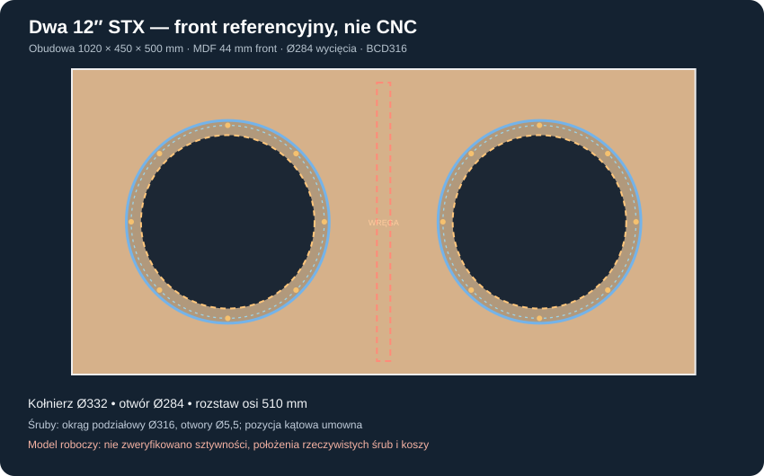
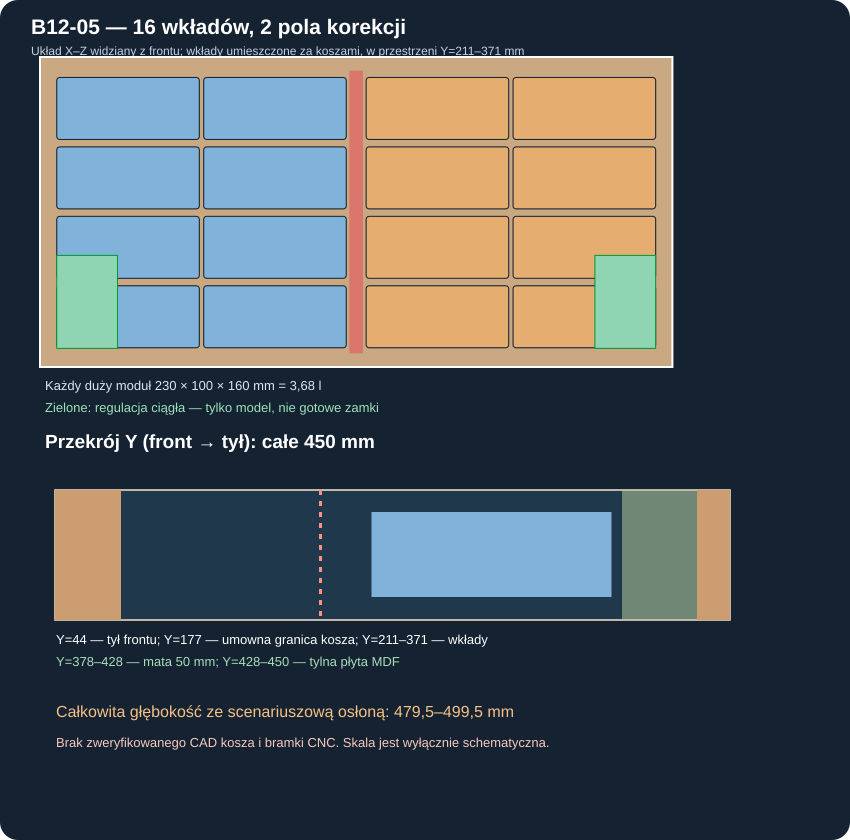

# B12-05 — pełna geometria badawcza dwóch STX 12″ i regulacja objętości

**Data: 2 listopada 2026.** **Etap badań konstrukcyjnych, bez akceptacji CNC i bez fizycznej walidacji.** Kontynuacja [B12-01](B12-01_tanie_dwie_12_przeciw_Daytonowi_20261102.md) i [B12-04](B12-04_dynamika_impulsy_ochrona_termika.md). Cel: sprawdzić, czy ekonomiczna para STX W.32.500.8.MC_v2 daje się połączyć ze skrzynią zamkniętą, regulacją 100/120/150 l i limitem **500 mm głębokości całego urządzenia, nie tylko korpusu**.

## Dane wiarygodne i przyjęte

Producent [STX — W.32.500.8.MC_v2](https://stx.pl/w-32-500-8-mc.html): **średnica całkowita 332 mm, wycięcie 284 mm, BCD 316 mm, otwory 5,5 mm, całkowita głębokość 133 mm, masa 4 kg/szt., katalogowy Xmax ±7,5 mm**. Dane mechaniczne pozostają do potwierdzenia na *rzeczywistych koszach* oraz rysunkach otworów przed trasowaniem MDF. Nie znamy obrysu silnika na każdej głębokości, zacisków, położenia otworów w fazie ani rzeczywistego wyparcia objętości. Sprawdzany walec o promieniu **142 mm** i długości **133 mm** jest *obwiednią konserwatywną* do części testów kolizji, nie CAD producenta.

Wszystko poniższe jest **nową geometrią badawczą**, nie wcześniej zatwierdzonym P20D/P39C. Wykorzystano wnioski z [raportu P20D](057_P20D_geometria_dostep_i_pelna_glebokosc.md), ale **nie przeniesiono** jego 20 innych wkładów, otworów Ø355,8 ani układu wręg wyznaczonego pod jeden kosz.

## Model i macierz badawcza

Przebadano **20 obudów**: W 980/1000/1020/1040 mm × D 440/445/448/450/455 mm, wysokość 500 mm, front MDF44 mm, pozostałe płyty MDF22 mm. Układ współrzędnych: X szerokość, Y od zewnętrznej płaszczyzny frontu w stronę tylnej ściany, Z od dołu, jednostki mm.

Dwa centra koszy: (W/4, Z250) i (3W/4, Z250). **Wariant referencyjny: 1020×450×500 mm**, osie koszy X=255 i 765 mm, Z=250 mm. Różnica między obwiedniami kołnierzy wynosi **178 mm**, odstęp od bocznej krawędzi kołnierza do krawędzi płyty **89 mm**, a do góry/dołu **84 mm**. Minimalna czysto geometryczna szerokość drewna między krawędzią otworu kosza i krawędzią otworu śruby (z wymiarów producenta) to **13,25 mm**. To **nie jest** analiza wyrwania śruby ani pierścienia.

### Wewnętrzny wariant geometrii

W 1020×450×500 mm wolne wnętrze przed wkładami i wręgami ma **976×384×456 mm**, czyli **170,90 l brutto wewnątrz paneli**. Centralną **wręgę okienną o grubości22 mm**, pasach górnym/dolnym22 mm, tylnym22 mm i **przednim jedynie 10 mm** umieszczono między koszami. Jej objętość to **0,66 l**. Tak cienki frontowy pas byłby osobnym problemem wytrzymałościowym i jeszcze nie ma wiarygodnego MES tego wariantu.

- Model nowych **16 dużych wkładów** o wymiarach **230×100×160 mm**, każdy **3,68 l**, w dwóch kolumnach na każdą stronę centralnej wręgi i czterech poziomach Z; wszystkie na jednej warstwie głębokości Y=211–371 mm.
- Dwie niezależne wkładki dokładnej regulacji, maksymalnie **98×150×120 mm**, z łączną maksymalną objętością **3,53 l**. W raportowanej symulacji dobiera się ich głębokość. Ich kształt, zamknięcie, zabezpieczenie przed przesunięciem, tolerancje i ścieżki narzędzi **nie są zatwierdzone**.
- Za tylnią krawędzią dużych modułów pozostaje **7 mm** do obwiedni maty poliestrowej grubości50 mm (Y=378–428 mm), a od modelowego końca obwiedni kosza w głąb skrzyni do modułów **34 mm**. Możliwość wentylacji silnika nie została przez to potwierdzona.
- Centralna wręga nie jest pełną przegrodą szczelną: ma otwarte okno, więc wariant zachowuje **wspólną objętość akustyczną** dwóch głośników, tak jak przyjęto w B12-01…B12-04. Nie badano lokalnych rezonansów powietrza ani przepływu przez okno.

### Co przetestowano dla montażu?

Każdy klocek opisano bryłą AABB, a każdy prostoliniowy ruch sprawdzono analitycznie jako obwiednię objętości omiatanej (swept AABB). Procedura: **wstawianie wkładów przy *wyjętych obu głośnikach***, przejście przez odpowiedni otwór Ø284 mm, dojście do początkowego punktu za frontem, przesunięcie X, następnie Z i wreszcie Y do gniazda. Przy każdym kroku sprawdzono styki z panelami, pasami wręgi, matą i wcześniej umieszczonymi klockami. Margines kolizji przy dwóch bryłach to 2 mm na każdą; przekrój 230×100 mm mieści się w otworze Ø284 mm także z 3 mm umownym zapasem na narożniki. Szereg wejść był badany z wcześniej wstawionymi elementami.

**Wynik nominalny:** uzyskano **16/16** ścieżek dla dużych modułów i **2/2** dla wkładek strojących, w tej **konkretnej klasie czystych translacji i idealnych prostopadłościanów**. Nie sprawdzono obecności ręki, uchwytów, śrub, uszczelek, przewodów, konkretnych zamków, rzeczywistego silnika ani obciążenia po obrocie skrzyni. To **nie jest dowód, że montaż w praktyce będzie łatwy lub możliwy**.

Dodatkowo sprawdzono analitycznie, że skrajne wkładki korekcyjne nie przecinają konserwatywnej obwiedni silnika Ø284 mm na pełnym odcinku za frontem. Po tej kontroli ich szerokość została zwiększona ze wstępnej wartości 85 mm do **98 mm**, przy przesunięciu ich w naroża daleko od silników. Wyniki i test regresji opierają się na poprawionym wariancie.

### Litry rzeczywiste i regulacja — scenariusze, nie pomiar

Objętość netto obliczono jako:
`V_net = V_wewnętrzne − V_więźby − 2·V_eff_głośnika − V_osprzętu − V_stałej_części_maty − N·3,680 l − V_drobnej_regulacji`.

Zastosowano w nominale **5 l efektywnego wyparcia na głośnik**, **0,175 l osprzętu**, matę o frakcji masy stałej `ρ_sucha/ρ_włókna=20/1380` (wyłączono miejsca zajęte przez wręgę); akustyczna podatność i porowatość nie są fizycznie wyznaczone. Daje to **159,75 l netto bez wkładów**. Przy wyparciu każdego kosza 2–8 l i pozostałych wybranych zmianach parametrycznych otrzymano **153,40–166,07 l**, nie przedział ufności.

| Cel nominalny | Duże wkłady | Łączna objętość dodatkowej wkładki korekcyjnej |
|---|---:|---:|
| 150 l | **2 × 3,68 l** | **2,39 l** |
| 120 l | **10 × 3,68 l** | **2,95 l** |
| 100 l | **16 × 3,68 l** | **0,87 l** |

**Ograniczenie:** powyższe trzy poziomy są możliwe nominalnie. Nie można zagwarantować **100 l przy każdej możliwej wyporności koszy**: przy najszerszym stresie objętość pustego wnętrza sięga 166,07 l, podczas gdy cały zestaw 16 dużych i 2 maksymalnych drobnych wkładek zajmuje tylko 62,41 l. Minimalne netto w tym skrajnym założeniu wynosi wtedy **103,66 l**, powyżej 100. Należy przewidzieć zmianę wymiarów lub dodatkowe pozycje wkładów po rzeczywistym pomiarze.

### Pełna głębokość i dwie alternatywy

Wzorując się na P20D przyjęto `D_total = D_korpusu + wystawanie_spoczynkowe(10–22) + Xmax(7,5) + szczelina_maskownicy(5) + ugięcie(2) + grubość(3) + tył(0–8) + tolerancja(2)` [mm]. Te liczby poza katalogowym Xmax **są scenariuszem**, nie danymi konkretnej maskownicy.

| Wariant | Nominalnie bez wkładów | Szkicowy zakres pełnej głębokości | Ocena |
|---|---:|---:|---|
| **1020×450×500 mm** | **159,75 l** | **479,50–499,50 mm** | wszystkie trzy cele nominalne; **tylko 0,5 mm marginesu** |
| **1040×448×500 mm** | **162,33 l** | **477,5–497,5 mm** | również możliwe nominalnie; większy zapas z tyłu, większa wymagana wkładka do 100 l |

Łącznie z 20 rozpatrywanych wariantów **2 przeszły jednocześnie** uproszczone testy dróg wstawiania, regulacji nominalnej i pełnej głębokości. Nie oznacza to kwalifikacji do produkcji.

## Wymagane następne badania: dokładnie czego brak

1. **Geometria rzeczywistego kosza:** obrys silnika, zacisków, chłodzenia, śrub i fazowanie otworów, uszczelka, pełny dostęp narzędzi oraz szablon 3D pod dwa egzemplarze.
2. **MES konstrukcji:** sztywność dwóch wycięć Ø284, centralna wręga z 10-mm przednim pasem, reakcje dynamiczne, śruby, klejenie i drgania paneli dla obu orientacji ustawienia.
3. **Potwierdzenie 100/120/150 l:** fizyczna wyporność dwóch egzemplarzy, rezerwa dodatkowych wkładek >3,53 l przy dużej niepewności oraz prawdziwe mocowania i szczelność.
4. **Obrys 500 mm i wydechy:** dokładny model maskownicy/terminala z obwiednią wychylenia i ruchem/ugięciem, bo zapas **0,5 mm** nie może stanowić tolerancji wykonawczej.
5. **Akustyka zamkniętej komory:** centralna otwarta wręga, lokalne mody powietrza, mata i skompresowane objętości w porównaniu z Daytonem i dwiema **osobnymi skrzyniami** w pokoju.

**Decyzja B12-05:** wykryto geometrycznie **wykonalne szkice**, ale **nie zamykamy projektu konstrukcyjnego**, nie rozpoczynamy CNC i nie zamawiamy koszy na tej podstawie. Centralna wręga, montaż oraz objętość wymagają kolejnej kontroli numerycznej i pomiarowej.

## Powtarzalność

[Skrypt 20 przypadków oraz 18 tras montażowych](../skrypty/b12_05_dwa_stx_przestrzen_i_wklady.js) · [Pełne dane i obwiednie ruchu, objętości, alternatywy](../wyniki/b12_05_uklad_2x12_20261102.json) · [schemat frontu](../wyniki/b12_05_dwa_stx_front.svg) · [schemat wkładów i przekroju](../wyniki/b12_05_wklady_przekroj.svg).

Wyniki nie są zwalidowanym CAD producenta, modelem MES ani produkcyjną specyfikacją wykonawczą.
