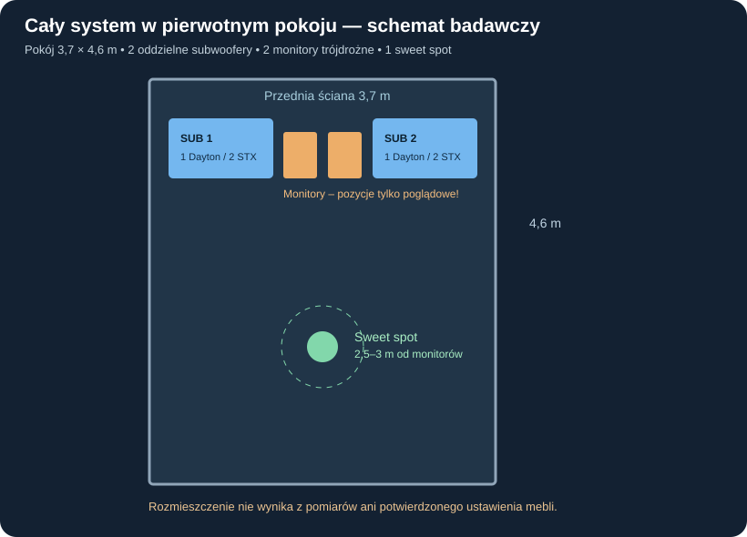
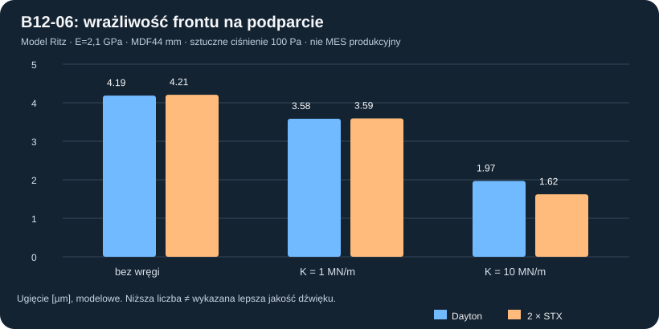

# B12-06 — mechaniczne porównanie frontów i powrót do pierwotnego briefu

**2 listopada 2026 · status: model badawczy, nie kwalifikacja do CNC, nie wynik pomiarów.** Ta kampania wynika z [B12-05](B12-05_podwojny_STX_geometry_montaz_netto.md), ale **weryfikuje jej sens w ramach [pierwotnego briefu](../brief_system_audio_DIY_v0.6.md), nie optymalizuje wyłącznie taniej pary STX**. Istotne wymagania W13/W24: **pierwszy prototyp i docelowe subwoofery mają po jednym wybranym przetworniku w każdej skrzyni; para STX w jednej skrzyni pozostaje porównawczym eksperymentem**. W przypadku zmiany tej zasady trzeba osobno wykazać przewagę jakościowo-kosztową oraz zaakceptować zmianę założeń.

## Najważniejsze kryterium: konkretne pomieszczenie i jakość

Pomieszczenie ok. **4,6 × 3,7 × 2,5 m = 42,55 m³**, betonowe ściany, częściowo perforowany sufit z wełną, jeden najważniejszy *sweet spot* z odległości **2,5–3 m**. Planowany zestaw: **dwie niezależne skrzynie subwooferowe przy monitorach**, dwa aktywne monitory 3-drożne (6 kanałów) i **co najmniej 8 wyjść DSP**, osobne kanały 7 i 8 dla subwooferów. Cel jakościowy: klasa zbliżona do studia masteringowego; neutralność, niski szum, niskie THD/IMD, czysty headroom i użyteczny **20–40 Hz**, nie nominalna moc, tani kosz ani płaska wykresowa odpowiedź bez marginesu wychylenia. Referencje ADAM Audio Sub12/Sub15 są zatwierdzone jako punkty odniesienia, ale **progi liczbowe wciąż są otwarte**. Akustyczna adaptacja i DSP oparte na pomiarach końcowych mają umożliwiać stosowanie w innych pokojach ok. 17–20 m².

### Dlaczego nie mylić 2× STX z docelowymi 2 subwooferami

| Cecha | 2 docelowe obudowy z pojedynczym Daytonem C02 | 2 obudowy z dwoma STX C05 każda |
|---|---:|---:|
| Fizyczne obudowy i kanały subwooferowe DSP | 2 i 2 | 2 i 2 |
| Łączna liczba przetworników | 2 | **4** |
| Katalogowa suma Sd×Xmax całego układu (bez strat i pokoju) | **2322,880 cm³** | **1473,000 cm³** |
| Długość zajęta przy dwóch nominalnych frontach 1020 mm wzdłuż jednej ściany | 2,04 m | 2,04 m |
| Pozostała szerokość ściany 3,7 m przed dodaniem monitorów, mebli i odstępów | 1,66 m | 1,66 m |
| Weryfikacja THD, kompresji i rzeczywistej odpowiedzi w sweet spocie | **NIE** | **NIE** |
| Pełna kwalifikacja mechaniczna/kosztowa/instalacyjna | **NIE** | **NIE** |

**Sumaryczne katalogowe Vd (2 skrzynie)** daje Daytonom około **3,956 dB przewagi geometrycznej przy identycznym poziomie wykorzystania Xmax**. To nie jest przewidywanie różnicy głośności ucha w docelowym pokoju, nie porównanie THD ani pomiar SPL.

Geometria pokojowa daje *idealne* pierwsze częstotliwości osiowe: długość **37,28 Hz**, szerokość **46,35 Hz**, wysokość **68,60 Hz** przy c=343 m/s. Są to tylko częstotliwości geometryczne; brak danych o położeniu głowy, dokładnym ustawieniu monitorów/subwooferów i tłumieniu nie pozwala rzetelnie orzekać, jak subwoofery pobudzą mody. Nie używać stałego „room gain” ani wyprowadzać z tego automatycznego zwycięstwa.

## Badanie mechaniczne frontu — co zostało rzeczywiście obliczone

Wykonano **36 prób przekrojowych modelu Ritz płyty Kirchoffa–Love** plus **8 niezależnych kontroli bazy/kwadratury** (po cztery na każdy typ frontu). Ten model służy *jedynie przesiewowi wrażliwości konstrukcyjnej*, a nie kwalifikacji frontu lub wręgi. Rozdzielamy obudowę, otwór i naciski modelowo:

- W obu wariantach przyjęto **ten sam format samego frontu: 1020×500 mm** (poza rozróżnieniem głębokości korpusu w źródłowych B12-05/P39). **Jeden Dayton**: otwór Ø355,8 na X231/Z250 mm, 8 hipotetycznych równomiernych punktów obciążenia na BCD368. **Dwa STX**: otwory Ø284 na X255 i X765/Z250 mm, hipotetyczne 8 równomiernie rozmieszczonych punktów na BCD316 dla każdego kosza. Liczba i kąt śrub STX w tym uproszczeniu **nie są zmierzone**.
- Użyto stałego ν=0,30, ρ_MDF=730 kg/m³ i **hipotetycznego** modułu E=**1,5 / 2,1 / 3,0 GPa**; grubości frontu 22/44 mm; dodatkowa **umowna** centralna linia podparcia o łącznej sztywności K=0, 1 MN/m lub 10 MN/m. Ten sam zastępczy typ podparcia przypisano obu frontom **tylko dla porównania**, nie jako odtworzenie istniejących wręg Daytona lub centralnej wręgi STX.
- Oryginalny prostokąt ma zewnętrzne krawędzie **przegubowo podparte w modelu**, zaś otwory odejmowane są z całkowania energii zginania i masy. Funkcje próbne to **5×4 globalne gładkie sinusy**; **nie potrafią odwzorować rzeczywistych wolnych krawędzi otworów**, lokalnego skupienia naprężeń i oderwania śrub. Model pomija spoiny, inne ścianki, grawitację w ustawieniu pionowym i promieniowanie paneli.
- Trzy jawne obciążenia kontrolne: (a) sztuczne ciśnienie **100 Pa** równomierne na płycie, (b) ciężar kosza normalny do frontu przy poziomej orientacji — **4 kg STX z katalogu**, **13,61 kg Dayton jako niezweryfikowany zamiennik masy na podstawie podanych przez producenta 30 lb „weight”**; (c) identyczna **łączna siła 100 N** na śrubach każdego *całego frontu* dla normalizacji wpływu geometrii.
- Zdefiniowano energię `D/2 ∫[wxx²+wzz²+2ν wxx·wzz+2(1−ν) wxz²]dA`, `D=E t³/[12(1−ν²)]`, linię podparcia o energii `K/2 <w²>_line`, a także masę panelu i hipotetyczną masę kosza obwodowo w punktach śrub. Wyznaczono ugięcie statyczne i **pierwszą częstotliwość funkcji próbnych** poprzez inwersję `K x=λ M x`. Późniejszy MES należy dopasować do kół i zweryfikować stabilizację elementów (poprzedni P33B miał problem hourglass!).

### Wyniki nominalne — E=2,1 GPa, front 44 mm, linia podparcia K=1 MN/m

| Wskaźnik frontu w tym uproszczonym modelu | 1× Dayton | 2× STX |
|---|---:|---:|
| Obliczone ugięcie przy sztucznym ciśnieniu 100 Pa | 3,584 µm | 3,593 µm |
| Obliczone ugięcie przy **wyrównanej łącznej** sile mocowań 100 N | 16,919 µm | 14,789 µm |
| Ugięcie pod hipotetyczną masą głośników normalną do frontu | 22,585 µm | 11,607 µm |
| Pierwsza **próbna częstotliwość tej izolowanej płyty** | 108,709 Hz | 129,493 Hz |

**Tych mikrometrów ani częstotliwości nie można uznać za prognozę gotowej obudowy.** Ugięcia w rzeczywistej konstrukcji mogą być dużo większe w pobliżu otworów, śrub i podatnych spoin, a globalna obudowa może mieć niższe częstotliwości własne. Sam wynik wyższej częstotliwości „2× STX” w uproszczeniu **nie dowodzi jego lepszej sztywności lub jakości akustycznej**.

### Kontrola metody i najważniejsze ograniczenie

Dla dwóch siatek kwadratury przy tej samej bazie 5×4 otrzymano ugięcia przy 100 Pa: Dayton **3,584 vs 3,571 µm**, STX **3,593 vs 3,600 µm**. Ta zgodność całkowania **nie jest jednak testem zbieżności prawidłowego MES**. Zwiększanie liczby funkcji 3×3 → 5×4 zmienia wynik, a wszystkie warianty stosują gładką bazę niezgodną z warunkami lokalnymi. **Nie interpretować wyniku jako obliczonego dopuszczalnego naprężenia lub gotowych wymiarów wręgi.**

Szczególnie ważny jest **10-mm przedni pas centralnej wręgi STX**. Uproszczona sprężyna K w analizie NIE jest obliczonym `EI` tego pasa ani jego złącza z frontem — nie można z niej wyprowadzić wartości momentów zginających, trwałości kleju ani nośności na obie orientacje. Trzeba zbudować zgodny geometrycznie MES 3D oraz weryfikować zbieżność przy otworach. **Nie zwalniać do CNC.**

## Wniosek decyzyjny z briefu

1. **Nie rozstrzygamy „najlepszości” na podstawie ugięcia pojedynczej płyty.** Mechanika jest bramką dopuszczającą, nie główną funkcją celu. Dwa STX są tańsze, ale mają w modelu **mniejsze katalogowe Vd na jedną skrzynię** i wymagają większego korekcyjnego podbicia, co w badaniach B12-01…04 było istotnym ograniczeniem 20 Hz.
2. Pierwotny brief nakazuje porównywać **pełne dwa subwoofery plus oba monitory w realnym pomieszczeniu**. Dwie 1,02-metrowe skrzynie zajmują razem 2,04 m szerokości przedniej ściany, pozostawiając **1,66 m na oba monitory, meble, prześwity i inne potrzebne elementy**. Sama ta liczba nie dowodzi, że ustawienie jest możliwe; potrzebny rzeczywisty plan mebli. Skrzynie można potencjalnie orientować odmiennie, lecz muszą zachować 500 mm całkowitej głębokości i dostęp.
3. Wymaga się **dobrego niskoszumowego wzmacniacza klasy D na płytce poza obudową subwoofera**, dwóch niezależnych kanałów DSP i zapasu dynamicznego, a nie przypadkowego wzmacniacza 500 W. Cena dwóch lub czterech głośników nie może zastąpić kosztorysu całego systemu.
4. **Ostateczna rekomendacja jest nadal warunkowa:** Dayton RSS390HF-4 jako wstępny faworyt wydajnościowy, STX w podwójnej skrzyni jako alternatywa kosztowa *po* badaniach mechaniki i jakości. Wymagane będą porównania z ADAM Sub12/Sub15 (kryteria liczbowe nieustalone), THD/IMD/kompresja, integracja sweet spot z monitorami oraz możliwe warianty położenia dwóch *fizycznie osobnych* skrzyń.
5. Użytkownik wymaga **braku zamówień sprzętu i brak projektu produkcyjnego CNC** do czasu zamknięcia bramek.

## Odtwarzanie

[Obliczenia 36 modeli i 8 kontroli](../wyniki/b12_06_front_ritz_i_brief_20261102.json) · [skrypt JavaScript](../skrypty/b12_06_ritz_front_podwojny_i_brief.js). Dane źródłowe briefu: [brief 0.6](../brief_system_audio_DIY_v0.6.md), [WYMAGANIA](../WYMAGANIA.md), [pokój](../dane/konfiguracje/pokoj_odsluchowy.json), [przesiew geometryczny B12-05](B12-05_podwojny_STX_geometry_montaz_netto.md).

**Bramka mechaniczna/akustyczna: OTWARTA. Dobór przetwornika i realizacja obudowy: NIEZATWIERDZONE.**
