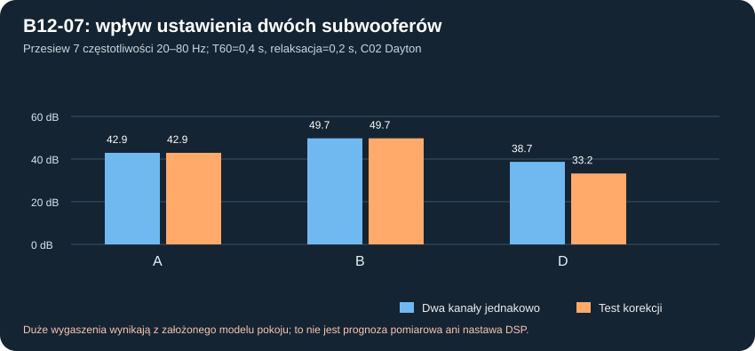

# B12-07 — dwa osobne subwoofery w założonym pokoju: pozycje, mody, opóźnienia i bramka ADAM

**Data 2.11.2026. Status: wykonana porównawcza analiza liniowa, nie rekomendacja zakupu, ustawienia ani gotowa korekcja DSP.**

## Cel wynika z pierwotnego briefu

Wymagana jest neutralność, niski szum i niski THD/IMD, użyteczny czysty headroom 20–40 Hz, jeden najważniejszy sweet spot 2,5–3 m w pokoju **4,6×3,7×2,5 m (42,55 m³)**, dwa **niezależnie sterowane** subwoofery i dwa aktywne monitory 3-drożne przy **8 wyjściach DSP**. Koszt jest wtórny wobec spełnienia kryteriów. **W13/W24: jeden głośnik w jednej obudowie pozostaje bazą projektu.** Ta kampania porównuje też **dwie obudowy, z których każda zawiera *parę* STX**, czyli w sumie **cztery przetworniki STX**. Nie są to dwa STX jako „dwa niezależne subwoofery”.

## Co rzeczywiście policzono

Wykorzystano potwierdzone **wymiary, lecz niepoświadczone pozycje** z plików `dane/konfiguracje/pokoj_odsluchowy.json`, `p26_scenariusze.json` oraz orientację z `pokoj_rzut_scenariusze_v2.json` (RTV po zamianie po stronie nowej ściany przedniej). Punkty źródeł reprezentują promieniujące czoła w uproszczeniu, nie zweryfikowany środek fizycznej skrzyni. Ściany betonowe, otwory, wełna sufitu i meble nie mają pomierzonej impedancji akustycznej.

- Matematyka: **modalny model prostokątnego pokoju** z warunkami Neumanna i wygładzeniem rozłożonego punktu źródła/odbiornika (`sigma_s=0,12 m`, `sigma_r=0,03 m`). Użyto **1471 modów** do liczby falowej 12 m⁻¹. Dla niezerowych modów amplitudowe wygaszanie `gamma=3ln(10)/T60` z **T60=0,2/0,4/0,8 s**, a człon zerowy ma osobną niewiadomą relaksacji **0,02/0,2/2 s**. Ta diagonalna stratość jest idealizacją, a nie pomiarem pogłosu/absorpcji.
- Źródło: policzono małosygnałowe zespolone **wydatki objętościowe Q(f)/1 Vrms** przy 120 l netto dla C02 Dayton RSS390HF-4 i C05 dwóch STX W.32.500.8.MC_v2 we wspólnej komorze, z wcześniej policzonym **pięciosekcyjnym IIR B12-03 / HP18 Hz / 96 kHz**. Każdy model osobno *znormalizowano do zespolonego Q(40 Hz)*, aby porównać *kształt widma* przy identycznym potencjale źródłowym w 40 Hz. Ta normalizacja **wyłącza możliwość wnioskowania o absolutnej głośności, mocy, bezpieczeństwie termicznym, THD i headroomie**; te wymagania pozostają osobnymi bramkami.
- Dwa źródła w pokojowych pozycjach A/B/C/D z P26. **Test obrysu obudowy 1,02 m szerokości i 0,45 m głębokości** przy punktach będących *hipotetycznymi środkami* konstrukcyjnymi: A/B/D przechodzą przesiew prostokątny; **C odpada**, ponieważ planowane środki X=0,50 i 3,20 m powodują wyjście boków obudów poza ściany X=0 i 3,70 m. To *przesiew*, nie gwarancja dostępu mebli, przejść, monitorów, kabli, masy i pełnej głębokości z maskownicą.
- Przegląd **8 próbek częstotliwości 20/25/31,5/40/50/63/80/100 Hz**, 7 odbiorników (sweet spot + 6 punktów diagnostycznych ±15 cm, ±10 cm wysokości), 3 scenariusze T60, 3 relaksacje zerowe. Z 28 pozycji/warunków **27 zestawów pokojowych przechodzi bramkę obrysu** (3 zestawy położeń ×9 hipotez), każdy dla C02 i C05: **54 pary porównań**. Nie wnioskować o rzeczywistej płaskości z 8 częstotliwości; głębokie wąskie dołki wymagają gęstszego skanu.
- W każdym przebiegu zasymulowano wpływ **drugiego kanału**: względny zysk 0,8/1,0/1,2 i opóźnienie 0/2/5/10 ms. Minimalizowano rozpiętość dB poziomów 20–80 Hz *w jednym założonym sweet spocie*, ale **tylko wtedy**, gdy składowa 40 Hz nie spada o ponad 3 dB względem dwóch identycznych, równocześnie sterowanych źródeł, a maksymalna odchyłka sąsiednich punktów nie pogarsza się o więcej niż 3 dB. To ekran przeciw „poprawie wykresu przez wygaszenie całego basu”, a nie realny optymalizator pokoju.
- Sprawdzono lustrzaną symetrię źródeł A na osi X=1,85 m: względny błąd numeryczny **7.987725054246257e-15**. Skrypt odtwarza pełny plik JSON. Nie liczono wpływu wzmacniacza na impedancję akustyczną skrzyni w pokoju ani ruchu membrany pod obciążeniem pokoju.

## Wyniki — warunek środkowy, nominalny P26: T60 0,4 s i relaksacja 0,2 s

**Poniższa rozpiętość nie jest zmierzoną nierównomiernością pomieszczenia.** To maks.-min. wartości **siedmiu** próbek 20–80 Hz, znormalizowanych do poziomu 40 Hz; bardzo duża rozpiętość to przede wszystkim wrażliwość hipotetycznych modów i idealnych znoszeń.

| Położenie | Dayton, bez zmian kanałów | Dayton, ograniczone strojenie | 2×STX/skrzynia bez zmian | 2×STX/skrzynia po strojeníu |
|---|---:|---:|---:|---:|
| A | 42,92 dB | 42,92 dB | 43,00 dB | 43,00 dB |
| B | 49,73 dB | 49,73 dB | 49,80 dB | 49,80 dB |
| D | 38,69 dB | 33,24 dB | 38,77 dB | 33,32 dB |

- **A i B:** przy tej klasie symetrycznych źródeł i jednym środku pokoju zysk/opóźnienie nie dają istotnego usprawnienia w przyjętej funkcji celu bez dodatkowych negatywnych skutków. Nie zakładać, że ustawienie „symetryczne” zapewni dobre 50–65 Hz.
- **D:** scenariusz z asymetryczną głębokością daje ilustracyjną poprawę dla obu typów subów. Dla Daytona rozpiętość przesiewowa spadła z **38,69** do **33,24 dB**, przy **opóźnieniu 5 ms, głośności prawego kanału ×1,2**, zmianie 40 Hz o **-0,98 dB** i maksymalnej diagnostycznej zmianie w sąsiednich punktach **9,29 dB**. **Nie jest to ustawienie do wgrania do DSP.**
- Pełna analiza 9 hipotetycznych zestawów T60/relaksacji wskazuje rozpiętości dla A **30,94–43,75 dB**, B **29,32–49,97 dB** i D **32,77–39,14 dB** (Dayton bez strojenia, siatka próbek). Z tych *skrajnych wyników modelu* nie wynika, że taki zakres będzie mierzony w rzeczywistym pokoju ani że możliwe jest odtwarzanie czystego basu przy 40 dB podbicia.

**Wniosek ze względnych charakterystyk:** przy takim samym ustawieniu i wyrównanym akustycznym Q(40), pokój działa w dużej mierze podobnie na oba warianty. Nie wybiera przetwornika. **Różnicę jakościową, zapas dźwięku i koszt trzeba rozstrzygać osobno w B12-01–B12-06 i pomiarowo THD/kompresji, nie w rankingu pokojowych dołków.**

## ADAM Audio Sub12 / Sub15 jako punkty odniesienia — porównanie uczciwe

Dane producenta (stan weryfikacji 2026-11-02):
- [Sub12](https://www.adam-audio.com/en/subwoofers/sub12/): zakres częstotliwości **22–150 Hz**, `−3 dB` przy 22 Hz według opisu, maksymalny SPL **≥115 dB szczytowo w 1 m** (bez wykresu czystej mocy przy 20 Hz), THD **≤1% dla >60 Hz**, obudowa **600×360×450 mm** (H×W×D).
- [Sub15](https://www.adam-audio.com/en/subwoofers/sub15/): **20–150 Hz**, maksymalny SPL **≥120 dB w 1 m** z odrębną procedurą podaną na stronie (nie pełna specyfikacja osiągów 20 Hz); THD **≤1% przy >60 Hz**, **635×470×525 mm** (H×W×D). Głębokość **525 mm przekracza limit 500 mm** prototypu DIY, lecz Sub15 jest wzorcem referencyjnym, nie wariantem do skopiowania.
- Nie wolno porównywać 115/120 dB producenta z maksymalnym SPL modelowanym dla jednej składowej 20 Hz, a tym bardziej z wynikiem w konkretnym pokoju 2,5–3 m. Obydwie referencje są **bass-reflex**, nasz referencyjny prototyp jest *sealed*; to inne metody osiągania niskiego zejścia i inne kompromisy przy kompresji/porcie.

| Kryterium odbioru dla prototypu DIY | Ostateczne wymaganie? | Brakujące dowody |
|---|---|---|
| Czyste 20/25/31,5/40 Hz w docelowym sweet spocie | **NIE — progi SPL/THD niezatwierdzone** | Pomiar z limitem THD/IMD i mocy/kompresji przy znanej pozycji mikrofonu |
| THD i kompresja 60–100 Hz | **NIE — ADAM publikuje tylko część referencji** | Dopasowana procedura testów przy kilku poziomach |
| Integracja w 8 kanałach DSP z aktywnymi monitorami | **NIE — brak monitorów i ich fazy** | Rzeczywiste zwrotnice, opóźnienia, pomiary mikrofonem w sweet spocie |
| Dwa duże subwoofery przy monitorach i głębokość ≤500 mm | **NIE — geometria miejsca niepotwierdzona** | Prześwity, front+maskownice, meble, zasilanie na zewnątrz |
| Przewidywalność w innych 17–20 m² pokojach | **NIE** | Replikacja kalibracji w kilku pomieszczeniach |

## Co teraz rekomendować

1. **Następna kampania B12-08:** niezależnie sprawdzić 20–100 Hz gęstszą siatką, porównać z P26/P27, wykluczyć fałszywe zera od doboru bazy/wygładzania i przetestować zmiany słuchacza i pozycji obudów wraz z oszacowaniem zajęcia miejsca przez monitory.
2. Przyjąć *realny* docelowy układ dwóch skrzyń (dokładne współrzędne, wymiary monitora, przejścia/meble i maskownice) zamiast uznawać konfigurację D za zatwierdzoną.
3. Zbudować **przejrzystą macierz odbiorową**: THD/IMD, kompresja, poziom pasm 20–40 Hz, hałas i pomiary integracji. Liczbowych progów nie wymyślać bez porównywalnych pomiarów referencji ADAM i akceptacji.
4. Utrzymać Daytona jako wstępnego kandydata wysokiej wydajności. Dwa tanie STX pozostają alternatywą kosztową; konieczność *czterech* koszy dla docelowych dwóch obudów i mniejsza suma Vd to ważny koszt jakościowy, którego nie „naprawia” sama korekcja w pokoju.
5. **Nie zatwierdzać konstrukcji CNC**, wzmacniacza, DSP presetu ani zamówień bez domknięcia mechaniki, ochrony i rzeczywistych pomiarów.

## Reprodukcja

[Model B12-07](../skrypty/b12_07_dwa_suby_brief_pokoj.js) · [pełne 27 scenariuszy ×2 warianty i dane odtwarzalne](../wyniki/b12_07_dwa_suby_pokoj_20261102.json) · [wykres przesiewu A/B/D](../wyniki/b12_07_rozpietosc_pokoju.svg).

**Status bramki zgodności z briefem: otwarta.** Wyniki są analizą wrażliwości idealizowanego pokoju, nie przewidywaniem realnych parametrów użytkowych ani dowodem parytetu z ADAM.
