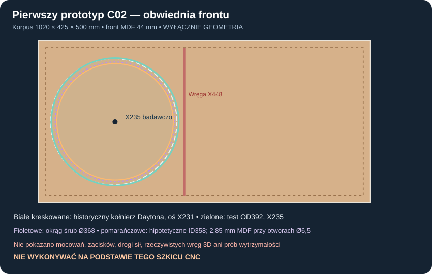
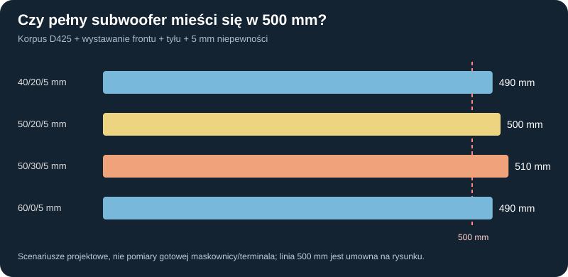

# B12-08 — krytyczny audyt linii wyboru C02 i projektowanie pierwszej skrzyni

**02.11.2026 · etap badawczy konstrukcji · NIE DLA CNC · niczego nie kupowano.**

## 1. Zakres audytu i przejrzystość dowodów

Sprawdzono kompletny indeks aktualnego `main` (commit `d973ad187dbc3cb11dbdba91aac5e5f60a429328`): **3791 plików**, w tym **124 pliki raportów** pod `raporty/` (łącznie z nienumerowanymi, ale bez indeksu README); 3110 plików wynikowych, 323 skrypty, 134 pliki `dane/`, 25 plików `.github/`. To **inwentaryzacja całego drzewa, nie osobne ręczne odtworzenie wszystkich 3791 artefaktów**. Szczegółowo przeanalizowano dokumenty będące węzłami decyzyjnymi i konfliktami: brief v0.6; WYMAGANIA; raporty 053–055, 056, 075–079, 096, 099–101, 104–108, 113–114, B12-01…B12-07. Nie zmieniano historycznych wyników ani parametrów katalogowych.

Istniejąca informacja README **40 modeli/41 konfiguracji/19 marek/114 raportów numerowanych** nie jest sprzeczna z 124 plikami raportów: są też późniejsze raporty B12, indeks i dokumenty nieobjęte historycznym licznikiem. Nie używać liczby plików jako liczby niezależnie zweryfikowanych dowodów fizycznych.

### Ścieżka wyboru i jej słabe punkty

| Rodzina | Mocny wynik matematyczny | Ograniczenie i konsekwencja projektowa |
|---|---|---|
| [P29A/B – 053](053_porownanie_i_odpornosc_rekomendacji.md) | 26 produktów/27 elektrycznych wariantów, limitowanie prądu/napięcia/ruchu i hipotetycznego ciepła; C02 najwyższe obserwowane minimum przy wybranym 50 W Pcu | Nieprerejestrowana funkcja celu, sinusy ustalone, scenariusze Sobola nie są populacją produkcji, brak THD |
| [P29C – 055](055_wrazliwosc_wyboru_i_margines_glebokosci.md) | Przy 120 l modelowy C02 liderem 27–86 W, C11 RSS390HE-22 liderem 87–200 W (próg przecięcia 86,813 W) | Nie znamy rzeczywistych dopuszczalnych strat cewki; **to nie termiczny limit 86,8 W** |
| [P29D – 075](075_P29D_rekomendacja_kandydatow_i_objetosc.md) | Rozszerzenie 34 modeli i 35 konfiguracji nie dało uzasadnionej zmiany wyboru; przy 120 l C02 idealne Qtc~0,714/F3~32,15 Hz | Wpływ geometrii, rzeczywisty THD/IMD i gorąca cewka niepotwierdzone |
| [P43/P45/B12-01…04](114_P45_dwa_tanie_12_odpornosc_naped_koszt.md) | 2× STX W.32.500.8.MC_v2 ekonomiczne; przy 20 Hz/120 l model 50 W: 97,30 vs 99,62 dB C02; Vd STX para~736,5cm³ vs C02~1161,4cm³ | Tylko liniowe i hipotetyczne limity; isobaric nie podwaja Sd; 2 osobne suby z parami STX oznaczają 4 głośniki |
| [P30E/F – 078/079](078_P30E_mata50_montaz_robustnosc.md) | C02: kandydat skrzyni **1020×425×500 mm**, 50 mm maty, 100,12/119,92/150,16 l netto modelowo, obudowa z marginesem 19 mm przy scenariuszu wystawania 56 mm | Masa MDF ~40,2/47,2/51,9 kg; przejścia wkładów tylko AABB, nie narzędzia, zamki i klej; obie orientacje niezatwierdzone |
| [P38–P42 – 096/099/108](096_P38A_front_Dayton_otwory_i_mocowania.md) | Zweryfikowano katalogowy obrys C02 Ø388,4/wycięcie Ø355,8, BCD Ø368 i 8 otworów Ø6,5; rama A jako najlepszy wariant *do dalszych badań* | **2,85 mm MDF pomiędzy wycięciem a otworem Ø6,5**; proste pierścienie i łączniki mają nierozwiązane zadania nośności, tarcia i montażu |
| [P44 – 113](113_P44B_tarcie_i_wrazliwosc_16200.md) | Jawna wrażliwość na hipotetyczne tarcie i utratę podpory | Brak zmierzonego docisku, pre-load, dynamicznego stick-slip i trwałości złącza |
| [B12-05–07](B12-07_dwa_suby_w_pokoju_i_referencje_ADAM.md) | Sprawdzono alternatywny korpus dla dwóch STX oraz 2 źródła osobne w hipotetycznym pokoju | Model w pokoju nie mierzy akustyki rzeczywistej i nie zmienia faworyta przy kryterium czystego basu |

**Ocena merytoryczna:** C02 to **kandydat do zbudowania pierwszej platformy pomiarowej**, nie udowodniony najczystszy subwoofer. Kontrfaktyczne pozycje to **C11 RSS390HE-22** (duży skok przy innym termicznym reżimie), **C06 STX W.32.800.8.FCX** (mniejszy kosz) oraz **para tanich C05** (oszczędności, ale słabszy limit geometryczny najniższego basu). Kryterium nadrzędne: pierwotny brief mastering-class, jeden sweet spot w pokoju ~4,6×3,7×2,5 m i finalnie 2 niezależne subwoofery + 2 monitory aktywne trójdrożne / 8 kanałów DSP. STX nie powinny odciągać głównej ścieżki konstrukcji C02 bez dowodu jakości.

## 2. Nowe badanie B12-08-A: czy prosty pierścień naprawdę ma miejsce?

Punktem wejściowym jest zweryfikowany referencyjny front C02 w korpusie **1020×425×500 mm**, MDF 44/22 mm, początkowa oś głośnika X=231/Z=250 mm, pierwsza wręga na X=448 mm (współrzędne zewnętrzne). Kołnierz C02 Ø388,4 mm, otwór Ø355,8 mm, okrąg śrub Ø368 mm, 8 otworów Ø6,5 mm. Dane i ostrzeżenia [P38A](096_P38A_front_Dayton_otwory_i_mocowania.md) i [strona producenta](https://daytonaudio.com/product/126/rss390hf-4-15-reference-hf-subwoofer-4-ohm).

Wykonano **2232 przesiewy geometryczne**: środek osi X=225…255 mm krok1 × OD pierścienia 392/400/408 × ID 356/357,8/358/360 × średnica hipotetycznego otworu w *nośniku* 5,5 lub 6,5 × niepewność osi/położenia 0/1/2 mm. Warunki przesiewowe przyjęte *tylko do tego badania*: 10 mm odstępu od wewnętrznej krawędzi lewego panelu i projekcji pierwszej wręgi (po uwzględnieniu niepewności), 1 mm radialnego luzu ID pierścienia względem wycięcia, 2 mm minimalnej szerokości metalu pomiędzy ID a krawędzią otworu w pierścieniu oraz 2 mm przy zewnętrznej krawędzi. Nie są to kryteria normatywne, wytrzymałościowe ani montażowe.

**Wynik negatywny dla 6,5-mm otworu pierścienia:** przy R_BCD=184 mm, R_wycięcia=177,9 mm:

`ID >= 355,8+2×1 = 357,8 mm` dla hipotetycznego luzu 1 mm; `ID <= 2×(184−6,5/2−2) = 357,5 mm` dla hipotetycznego mostka materiału 2 mm. **Nie ma przecięcia przedziałów: 0/2232 scenariuszy z otworem nośnika Ø6,5 mm spełnia wszystkie warunki (łącznie w tej podgrupie 1116 scenariuszy).** Nie oznacza to, że żadne mocowanie nie zadziała — oznacza, że cienki jednorodny pierścień z takim otworem nie przechodzi tych **arbitralnych, jawnych** warunków. Wariant z otworem **5,5 mm w hipotetycznym *niezależnym* nośniku** dał 108 przejść geometrii; to **nie jest zezwolenie na śrubę M5**, projekt wytrzymałościowy ani założenie o otworze w kołnierzu. Średnica otworu kołnierza Ø6,5 mm **nie oznacza automatycznie** tej samej średnicy otworu przelotowego w drugim materiale ani zalecanego wkrętu do MDF.

Przykładowo: przy X235 / pierścień OD392 ID358 / otwór nośnika Ø5,5 / niepewność ±2 mm, marginesy w projekcji do ściany i wręgi **17 mm nominalnie / 15 mm przy przesunięciu**, luz radialny 1,1 mm i mostek przy otworze 2,25 mm. To pokazuje *możliwą drogę projektową*, nie rozwiązanie. Przy starej osi X231 / pierścień OD400 ID356 / hipotetyczny otwór Ø6,5: 9 mm od wewnętrznej ściany, 17 mm do wręgi, **tylko 0,1 mm luzu ID**, mostek metalu 2,75 mm. Przeniesienie osi na X235 wymaga **pełnego ponownego sprawdzenia P30E/P38–P44**, w szczególności łączników, śrub, okien wręg, zacisków i gazu; nie zmieniono więc finalnego projektu frontu.

**Rozstrzygnięcie konstrukcyjne:** badać **szerszą ramę/nośnik A** z pełną ścieżką 8 rzeczywistych punktów → element rozkładający siłę → rzeczywiste wręgi i MDF, zamiast uznawać sam pierścień za bezpieczne mocowanie. Otwory z prób bez materiału, realnych łączników, kontaktu i obciążenia są tylko obwiednią geometryczną. P38/P42 ostrzegały o przecinaniu rzutu wycięcia przez część prostych łączników.

## 3. B12-08-B: zamknięty budżet pełnych 500 mm

Wykonano **160 jawnych zestawień**: D korpusu 420/425/430/435/440 mm × całe wystawanie z przodu 30/40/50/60 mm × wystawanie tylne 0/10/20/30 mm × dodatkowa niepewność 0/5 mm. Porównano granicę rzeczywistą 500 mm oraz osobny **projektowy ekran rezerwy 10 mm**. Front 30 mm *nie przechodzi* nawet wstępnej sumy 10,5-mm kołnierza +14-mm skoku Xmax +5-mm odstępu od osłony +2-mm osłony = **31,5 mm** (to celowo pesymistyczny zapis, bez rzeczywistej kinematyki maskownicy).

| Korpus i hipotetyczne elementy | Obrys włącznie z niepewnością | Rezerwa do 500 mm | Ekran 10 mm |
|---|---:|---:|---|
| 425 +40 przód +20 tył +5 mm | **490 mm** | 10 mm | TAK, warunkowo |
| 425 +50 przód +20 tył +5 mm | **500 mm** | 0 mm | NIE |
| 425 +50 przód +30 tył +5 mm | **510 mm** | −10 mm | NIE |
| 425 +60 przód +0 tył +5 mm | **490 mm** | 10 mm | TAK, warunkowo |

Teza z P30E „481 mm maksymalnego obrysu i 19 mm rezerwy” **pozostaje prawdziwa tylko dla tamtej sumy założeń**. Nowy rachunek pokazuje, jak jeden niestandardowy terminal lub inna maskownica może całkowicie skonsumować margines. **Nie należy dodawać starych 56 mm po raz drugi**: zestawienia są alternatywnymi budżetami całkowitymi, nie warstwami do zsumowania.

## 4. B12-08-C: odporność regulowanego litrażu i podstawa akustyczna

Wykorzystano **rzeczywiście opublikowane wyniki P30E** dla korpusu 1020×425×500 mm z matą 50mm i modułami (nie podmieniano ich własnym przybliżeniem). Nowe obliczenia małosygnałowego wyrównania: `Qtc=Qts·sqrt(1+Vas/Vb)`, `fc=Fs·sqrt(1+Vas/Vb)`, z **Fs=19,5 Hz**, producentowym Vas=212 l, Qts wyprowadzonym z Qes=0,5 i Qms=3,02, a F3 rozwiązanym analitycznie ze standardowego filtru drugiego rzędu. Na 3 nominalne objętości dodano **81 osiowych prób wrażliwości**: skrajne Vb P30E, Vas 190/212/234 l i Qts 0,38/0,43/0,48. **Nie są to tolerancje fabryczne.**

| Wkłady P30E | Vb nominalnie | Qtc nominalnie | F3 nominalnie | 20 Hz względem poziomu asymptotycznego |
|---|---:|---:|---:|---:|
| 16 dużych +4 małe | 100,119 l | 0,757 | 32,29 Hz | −9,55 dB |
| **12 dużych** | **119,919 l** | **0,714** | **32,15 Hz** | **−8,94 dB** |
| 1 duży | 150,159 l | 0,666 | 32,26 Hz | −8,35 dB |

Przykładowy scenariusz 120 l rozciąga się w przyjętej siatce zmian na **F3 od 28,88 do 37,18 Hz**. To czułość matematyczna, a nie rzeczywisty rozrzut egzemplarzy. **Brak korekcji nie daje płaskiego 20 Hz**: dla wariantu 120 l idealny układ drugiego rzędu ma około −8,94 dB przy 20 Hz względem wysokoczęstotliwościowej asymptoty. Wyrównanie DSP wymaga zapasu napięcia, prądu, ruchu i *czystego* SPL, a więc nie może wynikać z samego F3.

Ważne: nazwa „netto” w P30E oznacza modele gazu i wyparcia, a nie dokonany pomiar. Nie można frezować 12 wkładów na podstawie założonych 5 l wyparcia bez kalibracji rzeczywistego kosza, wręg, uszczelnień i maty. W stanach nominalnych MDF bez kosza i osprzętu miał masę orientacyjną **51,9/47,2/40,2 kg** (100/120/150 l); wymaga to odrębnej decyzji o przenoszeniu i położeniu pionowym.

## 5. Dokumentacja projektu pierwszego prototypu — stan i decyzja

| Podzespół | Obecna rekomendacja projektu badawczego | Bramka do zamknięcia |
|---|---|---|
| Jeden przetwornik | **Dayton RSS390HF-4 C02**, zachować C11 i C06 jako porównania; STX 2×C05 w jednej skrzyni jako linia ekonomiczna | BL(x), Cms(x), Le(x,f), Re(T), THD, IMD, kompresja i kwalifikacja termiczna |
| Obudowa | **1020×425×500 mm** korpus, sealed, MDF 22/44 mm; front stały, głośnik demontowany przez otwór | Skręcanie, klejenie, panele, przewody, spoiny, akceptowalność przy monitorach |
| Litraż | **119,919 l** nominalnie, moduły 12 dużych; wariant 100,119 z 16+4 i 150,159 z 1 dużym | Zmierzone objętości, zamki wkładów dla pionu i poziomu, ich drogi montażu z narzędziem |
| Kosz i mocowanie | Nominalne X231/Z250; **rozważyć X235 wyłącznie w CAD jako dodatkowy wariant**; nośnik A bardziej uzasadniony niż cienki pierścień | Prawdziwy skan/STEP, pełne połączenie 8 śrub do wręg, tolerancje, poślizg, odrywanie, zmęczenie |
| Przód/tył | 50-mm zdejmowana mata przy tyle, maskownica, terminal i zewnętrzny wzmacniacz klasy D | Całe urządzenie ≤500 mm ze skokiem membrany, wystawaniem osłony i przewodami |
| Elektronika | DSP minimum 8 wyjść; Flex Eight 2→8/96kHz jako tor badawczy, nie gotowa ochrona; zewnętrzna płytka wzmacniacza | Zabezpieczenie prądowe, temperaturowe, clipping/fault, limiter używający mierzalnych sygnałów |
| Pokój | 2 oddzielne subwoofery, 2 aktywne monitory trójdrożne, jeden sweet spot 2,5–3 m | Pozycje w istniejącym rzucie, prześwity, pomiar 20–100 Hz i integracja DSP |
| Benchmark | ADAM Sub12/Sub15 referencyjnie; nie utożsamiać max. SPL katalogowego z 20-Hz THD | Wspólna metodologia i zaakceptowane progi, bez deklarowania klasy masteringowej z samego F3 |

### Najważniejsza zmiana priorytetu badań

Po przejściu przez luki w P18–P45 oraz B12-01…07 następnym rzeczywistym krokiem w stronę *konstrukcji* nie jest kolejny ranking dwóch tanich 12-calówek. **Krytyczną ścieżką jest mocowanie i kompletna geometria jednego C02 oraz rzeczywisty litraż i prześwity**. Dopiero po zamknięciu tej ścieżki można powtórzyć zintegrowany MES/CFD oraz port modelu z mechaniką i przygotować zwalidowane pliki CNC.

**Priorytet następnego badania B12-09:** parametryczny alternatywny nośnik/rama A od 8 rzeczywistych otworów kosza do MDF/wręgi w pełnym obrysie 3D, z dwoma ustawieniami X231/X235 i trasą montażową; obliczenia złączy jako badanie niepewności, nie wybór śrub. Pozyskać obrys kosza i pozycję zacisków, inaczej utrzymać status HOLD.

**CNC:** BLOKADA. **Zamówienia:** BRAK. **Zwycięzca akustyczny:** WSTĘPNY C02, NIEFINALNY.

## Reprodukcja

[Skrypt B12-08](../skrypty/b12_08_audyt_rysunku_pierwszego_prototypu.js) · [2232 przesiewy pierścienia (agregaty), 160 pełnych głębokości i 81 wariantów akustycznych](../wyniki/b12_08_audyt_konstrukcji_pierwszego_prototypu.json) · [rysunek frontu, NIE CNC](../wyniki/b12_08_front_i_pierscien_NIE_CNC.svg).

Wszystkie nowe progi geometrii i wydajności są oznaczone jako scenariuszowe, a nie dane producenta, pomiar ani przepis.
