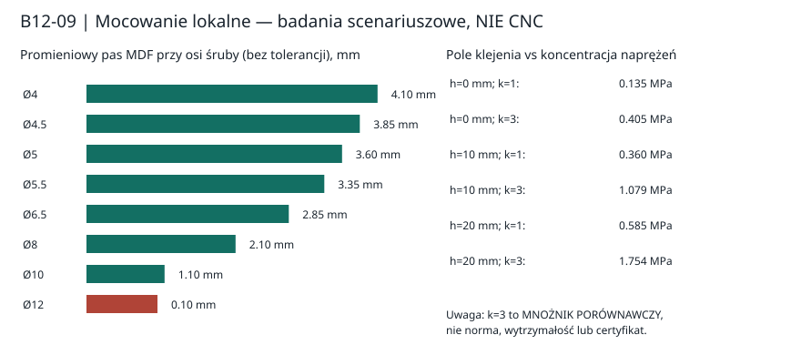

# B12-09 — Dayton RSS390HF-4: osiem lokalnych mocowań kontra rama A

**02.11.2026 · badanie geometryczno-mechaniczne przed budową · NIE CNC · brak pomiarów materiałów.**

## Pytanie badawcze i wejścia

Czy zamiast rozbudowanej metalowej ramy A można użyć ośmiu lokalnych wzmocnień z tyłu stałego frontu MDF 44 mm (np. przyklejonych klocków z wkładkami), zachowując przestrzeń na kosz i adekwatną ścieżkę sił? [Inspiracje od innych konstruktorów](../dokumentacja/inspiracje_zewnetrznych_konstruktorow_mocowanie_RSS390HF4.md) nie stanowią prototypu Fundacji ani dowodu nośności złączy.

Dane wejściowe z [oficjalnego rysunku Daytona](https://www.daytonaudio.com/images/resources/295-468-dayton-audio-rss390hf-4-specifications-46176.pdf), [P38A](096_P38A_front_Dayton_otwory_i_mocowania.md), [P40A](101_P40A_reakcje_8_mocowan.md) i [B12-08](B12-08_audyt_wyboru_i_konstrukcja_pierwszego_C02.md): obudowa modelowa **1020×425×500 mm**, wycięcie Ø355,8 mm, kołnierz Ø388,4 mm, osiem otworów kosza Ø6,5 mm na osi Ø368 mm. Oś kosza X=231/235 mm, Z=250 mm. Nie znamy fazy pierwszego otworu, żebrowania kosza od tyłu, zacisków i położenia narzędzia montażowego.

## 1. Wąski pas MDF — 32 testy średnicy i błędu

Promień osi śrub to **184 mm**, promień wycięcia **177,9 mm**. Przy hipotetycznym otworze lub wkładce o średnicy d i przesunięciu ku wycięciu Δr:

\[
g=184-177{,}9-d/2-\Delta r=6{,}1-d/2-\Delta r\quad[\mathrm{mm}].
\]

Policzono d=4/4,5/5/5,5/6,5/8/10/12 mm przy Δr=0/0,5/1/2 mm, razem **32 kombinacje**. Przykłady:

| Hipotetyczna średnica | Pas przy Δr=0 | Pas przy Δr=1 mm |
|---|---:|---:|
| 4,5 mm | 3,85 mm | 2,85 mm |
| 6,5 mm | 2,85 mm | 1,85 mm |
| 8 mm | 2,10 mm | 1,10 mm |
| 10 mm | 1,10 mm | 0,10 mm |
| 12 mm | 0,10 mm | −0,90 mm |

**Wniosek:** 2,85 mm MDF z wcześniejszej analizy występuje, jeśli również w MDF wykonany zostanie otwór Ø6,5 mm, a nie automatycznie dlatego, że Ø6,5 mm ma otwór w aluminiowym kołnierzu. Średnice d i błędy Δr są *scenariuszami*, nie zatwierdzonym doborem wkręta, tulei ani tolerancją produktu. Wkładka osadzona tylko w tylnym klocku nie jest równoważna pełnemu przewiertowi przez MDF; jej przestrzenny kontakt z koszem pozostaje nieustalony.

## 2. Geometria lokalnych klocków — 108 przesiewów 2D

Model: osiem prostokątnych klocków w rzucie od promienia **178,9 mm** (1 mm hipotetycznego luzu do otworu) do promienia **205/211/217 mm**, o szerokościach stycznych **24/36/48 mm**. Dwie osie X=231/235, faza pierwszego otworu 0/22,5° i błędy obrysu 0/1/2 mm. Warunek przesiewowy: co najmniej **2 mm** odstępu od wewnętrznej lewej ścianki X=22, *projekcji* pierwszej wręgi X=448 oraz od dołu/góry wnętrza Z=22/478 mm.

| Zewnętrzny promień klocka | Przejścia | Liczba |
|---|---:|---:|
| 205 mm | **36** | 36 |
| 211 mm | **21** | 36 |
| 217 mm | **10** | 36 |
| Razem | **67** | **108** |

Przykład: X231, faza 0°, r=205 mm, szerokość 36 mm, błąd 2 mm: modelowe marginesy **2 mm do lewego panelu**, **10 mm do projekcji wręgi**, **po 21 mm góra/dół**. **To nie jest zatwierdzony prześwit 3D.** Płaszczyzna wręgi służy jako granica rzutu, mimo że rzeczywista wręga jest w określonej głębokości za frontem. Brak geometrii tylnych żeber kosza, zacisków, nakrętek, połączeń klejonych, klucza i drogi wymiany klocka. Wynik 67/108 to licznik siatki, nie prawdopodobieństwo.

## 3. Statyczna idealna grupa śrub — 144 scenariusze

Zadana masa **15 kg**, odsadzenie środka masy **120 mm** i przyspieszenia **1/3/5/10 g** są umownymi obciążeniami; nie są normą, pomiarem ani specyfikacją bezpieczeństwa. Analizowano dwie fazy otworów, dwa kierunki siły w płaszczyźnie frontu (X/Z), osiem aktywnych albo utratę dowolnego jednego punktu: **4×2×2×9 = 144 stany**.

W modelu o jednakowych sztywnościach przyjęto rozkład ścinania \(T_i=F/n\) i normalny \(N_i=a+bx_i+cz_i\) spełniający trzy równania równowagi (suma normalnych i dwa momenty); dla grupy po awarii jednego punktu obliczono rozwiązanie minimalnonormowe.

| Model przy 5g | Maksymalna dodatnia normalna | Ścinanie/punkt | Maks. wypadkowa |
|---|---:|---:|---:|
| Osiem punktów, faza 0°, X | **119,92 N** | **91,94 N** | **151,11 N** |
| Najgorszy przypadek spośród siedmiu czynnych | **164,28 N** | **105,07 N** | **195,01 N** |

Różnica maksymalnej wypadkowej wynosi **+29,1%** w odniesieniu do stanu ośmiopunktowego z tabeli. Ten model **nie** obejmuje rzeczywistego docisku, odkształcenia kołnierza, tarcia, poślizgu, odrywania, różnych sztywności ani zmęczenia. Nie określa nośności pojedynczej śruby, MDF ani ramy A.

## 4. Odwrotne wymagania wobec spoiny, a nie „wytrzymałość kleju”

Dla przykładowego klocka 178,9–205 mm × 36 mm, z odjętą powierzchnią hipotetycznego otworu Ø8 mm, **A=889,335 mm²**. Przy ośmiu punktach, 5g: modelowa średnia wartość ścinania \(T/A=0,1034\) MPa; modelowy naprężeniowy składnik normalny \(N/A=0,1348\) MPa.

Sprawdzono hipotetyczne odsadzenie ścinania od płaszczyzny spoiny h=0/10/20 mm. Dla *idealnie prostokątnej*, liniowo sprężystej spoiny przyjęto wyłącznie proxy skrajnego naprężenia:
\[
\sigma_{\mathrm{proxy}}=N_{\max}/A+6Th/(wL^2),\quad L=26{,}1\ \mathrm{mm},\quad w=36\ \mathrm{mm}.
\]

| Hipotetyczne h | Proxy rozciągania | Proxy ×3 |
|---|---:|---:|
| 0 mm | **0,135 MPa** | 0,405 MPa |
| 10 mm | **0,360 MPa** | 1,079 MPa |
| 20 mm | **0,585 MPa** | 1,754 MPa |

Mnożnik ×3 jest **tylko parametrem porównania**, nie normowym współczynnikiem bezpieczeństwa. Model nie opisuje rzeczywistej koncentracji naprężeń przy krawędzi kleju, wyrywania, szczelinowania, pełzania, wilgotności ani cykli demontażu. Nie znamy nawet rzeczywistego ramienia h. Wartości MPa są *hipotetycznym zapotrzebowaniem*, nie wytrzymałością MDF lub kleju.

## 5. Decyzja: konstrukcji nadal nie wolno zatwierdzić do CNC

| Wariant | Powód dalszego badania | Ryzyko niewyjaśnione |
|---|---|---|
| 8 lokalnych wzmocnień z wkładką | Część obrysów nie koliduje z uproszczonymi granicami; prostsze niż rama | Kosz i narzędzie 3D, siła wyrywająca, naprężenia odrywające spoiny, trwałość |
| T-nut i hurricane nuts od tyłu | Inspiracje z dokumentowanych cudzych konstrukcji | Wymiana nakrętki, obrót w drewnie, prawdziwa kinematyka montażu |
| Rozbudowana rama A | Potencjalna droga sił do wręg | Brak pomierzonej sztywności i geometrii złączy 8→rama→wręgi; brak kwalifikacji kolizji |
| Cienki pierścień | Proste rozwiązanie planarne | Konflikt przyjętych luzów i mostków w B12-08; nie dowodzi niemożliwości każdego pierścienia |

**Rekomendacja:** utrzymać **lokalne klocki oraz ramę A** jako dwa równorzędne warianty *do walidacji*. Pierwszy krok to rysunek/obrys realnego kosza i zacisków, pomiar dostępu narzędzia oraz próbki MDF 44 mm z prawdziwymi złączami: ścinanie, odrywanie, wyrywanie, moment montażu, powtarzalność po demontażu. Dopiero po tych danych wolno użyć kontaktowego MES do kwalifikacji złączy. Wymóg **pełnych 500 mm głębokości**, regulacji 100/120/150 l i pracy poziomej/pionowej pozostaje otwarty.

**Następny etap B12-10:** połączenie rzeczywistego kosza, trasy 8 śrub i dostępu narzędzia w 3D z wynikami prób złączy. **Bramka CNC: HOLD**. Nie zakładamy, że rozwiązanie pokazane przez konstruktora na forum jest naszym prototypem.

## Reprodukcja i manifest

- [Python — obliczenia 32+108+144 przypadków](../skrypty/b12_09_lokalne_mocowania.py): uruchom z głównego katalogu repozytorium poleceniem python3 skrypty/b12_09_lokalne_mocowania.py. Zapisuje pełny JSON i generuje SVG; wymaga wyłącznie standardowej biblioteki Python 3.
- [Wyniki sumaryczne i manifest](../wyniki/b12_09_podsumowanie_i_manifest.json) · [diagram — NIE CNC](../wyniki/b12_09_geometria_i_naprezenia_NIE_CNC.svg).
- Podstawa wyników: commit main **72e0b6593f224ff148375675ea9982446ccb6487**; Git blob briefu v0.6 **443538178949f0ed396d6fa748525b2e23c13dc6** i B12-08 **31248b4d07c7901f93ab384ade3fa17628a04f22**.
- Pełny plik wynikowy wyniki/b12_09_wyniki.json powstaje z kodu przy odtwarzaniu i nie jest pomiarem fizycznego urządzenia. Pomiary kosza i MDF **nie zostały wykonane**.
