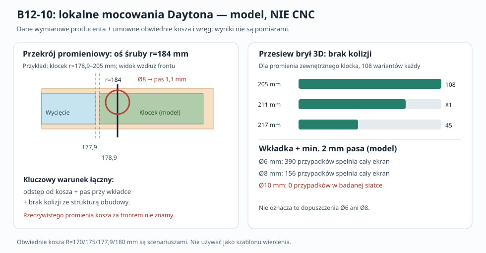

# B12-10 — przestrzenne ograniczenia montażu RSS390HF-4: osiem lokalnych wzmocnień, kosz, wręgi i długości śrub

**02.11.2026 · wykonana kampania 324 + 7776 + 36 przypadków · etap przed budową, NIE CNC.**

## 1. Po co wykonano nowe badanie

[B12-09](B12-09_lokalne_mocowania_RSS390HF4_vs_rama_A.md) wykazał potencjał ośmiu lokalnych wzmocnień, lecz jego 108 rzutów 2D nie wykazywało faktycznych prześwitów na głębokości obudowy i nie kontrolowało **pełnego obrysu zewnętrznego wkładki** w samym klocku. B12-10 przelicza zderzenia brył i napięty budżet promieniowy dla śruby/wkładki oraz sprawdza wstępny budżet długości śruby.

**Rozróżnienia dowodowe:** wymiary główne głośnika pochodzą z [karty Dayton/Parts Express](https://www.parts-express.com/pedocs/specs/295-468-dayton-audio-rss390hf-4-specifications-46176.pdf); bryły wręg i ścian z [P39C — model zastępczy, NIE CNC](../dokumentacja/P39C_front_korpus_pierscien_REFERENCYJNY_NIE_CNC.scad); gęstość siatki oraz promienie obwiedni są **nowymi założeniami eksperymentu**. Karta pokazuje żebra kosza i terminale, ale **nie daje ich pełnej bryły 3D ani zweryfikowanej funkcji promienia kosza r(y) za frontem**. Żadnego z testowanych promieni nie należy przypisywać producentowi.

## 2. Co dokładnie sprawdzono w 3D

Układ współrzędnych [P39C](../dokumentacja/P39C_front_korpus_pierscien_REFERENCYJNY_NIE_CNC.scad): **X** wzdłuż szerokości 1020 mm, **Y** w głąb obudowy 425 mm, **Z** wzdłuż wysokości 500 mm. Stały front zajmuje Y=0–44 mm. Osiem klocków *w modelu* jest przyklejonych od strony wnętrza, Y=44–54/64/74 mm, na osiach śrub R=184 mm co 45°. Badano X osi głośnika **231 i 235 mm**, fazę otworów **0° lub 22,5°**, promień wewnętrzny klocka **178/178,9/180 mm**, zewnętrzny **205/211/217 mm**, szerokość w kierunku stycznym **24/36/48 mm**, głębokość klocka **10/20/30 mm**. Razem: **2×2×3×3×3×3 = 324 konfiguracje**, z ośmioma klockami na konfigurację.

Każdy klocek jest *bryłą o przekroju prostokąta obróconego do osi promieniowej*; test przecięcia z prostokątnymi bryłami ścian i wręg wykonano metodą osi rozdzielających (SAT) i kontroli wspólnego zakresu Y. Bryły zastępcze z P39C: lewy panel X=0–22, górny/dolny panel Z=478–500/0–22; pionowa część pierwszej wręgi X=448–470, Y=44–54, Z=44–456 oraz jej górna/dolna listwa w Z=456–478/22–44. Nie przedstawia to pełnego fizycznego CAD wręgi, połączeń, uszczelek i elementów dodatkowych.

| Ekran kolizji z zastępczą obudową | Wyniki |
|---|---:|
| Wszystkie konfiguracje | 324 |
| Bez penetracji uproszczonych brył | **234** |
| Oś X=231 mm: bez kolizji | **99/162** |
| Oś X=235 mm: bez kolizji | **135/162** |
| Promień klocka do 205 mm: bez kolizji | **108/108** |
| Promień do 211 mm: bez kolizji | **81/108** |
| Promień do 217 mm: bez kolizji | **45/108** |

Wybór X235 poprawia wynik **tej geometrycznej siatki** — nie zmieniamy przez to osi przetwornika w projekcie! Oś X235 pozostaje wariantem do walidacji innych zjawisk: basu, objętości netto, pozycji wręg i prowadzenia przewodów. **234/324 nie jest prawdopodobieństwem bezkolizyjności.** Wynik zerowej penetracji nie oznacza jeszcze dowolnego luzu montażowego; granice zostały policzone na nominalnych bryłach.

## 3. Kluczowy wynik: wkładka musi jednocześnie ominąć kosz i pozostawić materiał

Z karty producenta: nominalny otwór w froncie Ø355,8 (promień **177,9 mm**), osie ośmiu otworów kołnierza Ø368 (promień **184 mm**), kołnierz Ø388,4 (promień **194,2 mm**), średnica otworu **w koszu** Ø6,5 mm. **Nie przenosić tej ostatniej liczby automatycznie na średnicę pilota w MDF ani średnicę wkładki.**

Gdy wewnętrzna powierzchnia klocka rozpoczyna się na promieniu R_in, a pełny zewnętrzny obrys wkładki ma średnicę d, hipotetyczny pas samego klocka po stronie otworu wynosi:

\[
g_{\mathrm{klocek}}=184-\frac{d}{2}-R_{\mathrm{in}}\quad[\mathrm{mm}].
\]

Dla R_in=178,9 mm:
- wkładka Ø6 mm → **2,1 mm** drewna;
- wkładka Ø8 mm → **1,1 mm**;
- wkładka Ø10 mm → **0,1 mm**.

Do tej wartości należy doliczyć kontrolę kolizji z samym **koszem** (nie tylko wycięciem): w dalszej części modelu wymagano **1 mm warunkowego luzu** pomiędzy wewnętrzną krawędzią klocka a *hipotetycznym cylindrycznym promieniem kosza* R_b=170/175/177,9/180 mm. Wymagany pas drewna wynosił osobno **1 albo 2 mm**; oba progi są eksperymentalnymi ekranami, **nie normą nośności**.

Przebadano **324 układy × 4 promienie R_b × 3 średnice wkładki × 2 wymagane pasy = 7776 warunkowych kombinacji**. Ekran dodatni wymagał jednocześnie: wolnej bryły obudowy, luzu 1 mm i warunkowego pasa drewna.

| Wkładka zewnętrzna (model) | Min. pas 1 mm | Min. pas 2 mm |
|---|---:|---:|
| Ø6 mm | **624** | **390** |
| Ø8 mm | **390** | **156** |
| Ø10 mm | **156** | **0** |

Podział według założonego promienia zastępczej obwiedni kosza: R_b=170 mm → **702** przejścia, R_b=175 mm → **702**, R_b=177,9 mm → **312**, R_b=180 mm → **0**. Wszystkie podgrupy liczą po 1944 scenariusze. **Wynik 0 przy R_b=180 mm wynika z najmniejszej badanej krawędzi klocka R_in=178 mm i wymogu luzu 1 mm; nie dowodzi, że rzeczywisty kosz ma 180 mm na tej głębokości.**

W szczególności zerowy wynik Ø10 mm przy wymaganym pasie 2 mm jest **twierdzeniem o zadanej siatce** i współosiowym umieszczeniu wkładki, nie niemożliwością zastosowania Ø10 mm w jakimkolwiek mocowaniu. Inna technologia (klocek zachodzący w otwór, wkładka przesunięta poprzez adapter, nośnik metalowy) wymaga oddzielnej analizy wpływu na kontakt i ścieżkę sił. Rysunek producenta przedstawia zwężające się żebra kosza, ale ich promienie na Y=44–74 mm nie zostały tu precyzyjnie zweryfikowane; **nie interpolujemy wymiarów z niskorozdzielczego rysunku jako faktów**.

## 4. Test osiowy łącznika i pierwsze ograniczenie dostępu narzędzia

Model śruby z łbem opartym na przedniej powierzchni kołnierza zakłada (tylko geometrycznie): kołnierz **10,5 mm** + front MDF **44 mm** = **54,5 mm** od spodu łba do tylnej powierzchni MDF. Dla długości trzpienia L w scenariuszu **60/65/70/75 mm**, głębokości klocka **10/20/30 mm**, minimalnego zazębienia gwintu **6/10/14 mm** i zapasu do tylnej krawędzi klocka **3 mm**: zazębienie w klocku **e=L−54,5**, a test przedziału wymaga **e≥min_zazębienia** i **e≤grubość_klocka−3**.

Wykonano **36 kombinacji**. **13** spełniło przyjęty ekran. Długości, dla których istnieje *przynajmniej jeden* dodatni wariant wymogu zazębienia:

| Głębokość klocka | Modelowo dopuszczone długości L |
|---|---|
| 10 mm | brak spośród 60/65/70/75 mm |
| 20 mm | 65, 70 mm |
| 30 mm | 65, 70, 75 mm |

**Nie są to zalecenia zakupowe**: długość rzeczywistej śruby należy zdefiniować według typu łba i normy gwintu, po doliczeniu uszczelki, podkładki, zagłębienia łba oraz kontrolowanego momentu docisku; wytrzymałość połączenia i dopuszczalne zazębienie nie są ustalone.

Promień osi śruby R=184 mm do zewnętrznej krawędzi kołnierza R=194,2 mm daje **10,2 mm promieniowego marginesu dla całkowicie podpartego łba na stronie zewnętrznej** (nie jest to dozwolony promień łba ani narzędzia). Przejście wkrętaka od frontu jest możliwe do zweryfikowania dopiero po znajomości łba, osłony, ewentualnego zagłębienia, fazy otworów i drogi narzędzia. **Nie wykonano rzeczywistej analizy swept-volume wkrętaka ani dłoni; nie można potwierdzić serwisowalności**. W przypadku obrócenia się wkładki po sklejeniu skrzyni demontaż może być utrudniony.

## 5. Jaki jest faktyczny postęp względem B12-09?

Wynik B12-09 „67/108 rzutów” jest **punktem wyjścia**, ale nie może służyć za rekomendację konkretnego klocka. B12-10 wykazał trzy niezależne bariery:

1. **Promień zewnętrzny klocka** wpływa na zderzenia z wręgą i panelami; większa powierzchnia nie daje automatycznie lepszej geometrii.
2. **Promień wewnętrzny klocka i średnica wkładki** określają cienki pas materiału; sama powierzchnia spoiny nie zapewnia grubości drewna wokół wkładki.
3. **Głębokość klocka i długość śruby** tworzą oddzielne ograniczenie; nawet geometrycznie niekolidujący klocek może nie mieć sensownego składu osiowego.

**Werdykt:** lokalne wzmocnienia nadal zasługują na badanie obok ramy A, lecz **nie zostały zakwalifikowane ani jako geometrycznie pewne, ani wytrzymałe, ani serwisowalne**. W szczególności nie uznawać Ø8/Ø10 za wybraną wkładkę. Brak dowodów również, że konstrukcja ramowa A wygrywa pod względem łatwości wykonania. Żadne obliczenia z tej sesji nie zmieniają badań akustycznych C02, objętości ani limitu pełnej głębokości 500 mm.

## 6. Rzeczywiste bramki przed CNC i kolejny eksperyment

**B12-11 (rekomendacja):** pozyskać z producenta kompletny STEP/skan kosza lub zmierzyć egzemplarz i zapisać R_b(Y,θ), fazę otworów, orientację terminali, przestrzeń na przewody i wentylację; sprawdzić rzeczywiste trasy śrub, wkrętaka i montażu każdego klocka po sklejeniu frontu. Wykonać na identycznych próbkach MDF 44 mm badania wyrywania, ścinania, odrywania spoiny, obrotu wkładki, cykli demontażu i wilgotności oraz porównać co najmniej dwa rozwiązania lokalne z ramą A. Dopiero na tej podstawie kontaktowy MES 3D z walidacją siatki i złącza. Dodatkowo sprawdzić zgodność z systemem regulacji 100/120/150 l i poziomą/pionową pracą.

**Status:** CNC = **HOLD**; zakupy = **BRAK**; rzeczywisty prototyp = **NIEZBUDOWANY**. **Nie deklarowano pomiarów.**

## 7. Reprodukcja i źródła

- [Python 3, stdlib](../skrypty/b12_10_przesiew_3d_mocowan.py): uruchomić poleceniem `python3 skrypty/b12_10_przesiew_3d_mocowan.py`; generuje JSON z 324 bryłami, 7776 kombinacjami i 36 stosami śrub oraz manifest.
- [JSON z agregatami i założeniami](../wyniki/b12_10_podsumowanie.json).
- [Oryginalny schemat SVG](../wyniki/b12_10_lokalne_mocowania_przesiew_NIE_CNC.svg).
- Zależny raport [B12-09](B12-09_lokalne_mocowania_RSS390HF4_vs_rama_A.md); jego gałąź/PR #57 nie była scalona do `main` w momencie rozpoczęcia B12-10.
- Karta wymiarowa [Dayton RSS390HF-4](https://www.parts-express.com/pedocs/specs/295-468-dayton-audio-rss390hf-4-specifications-46176.pdf) i [informacje producenta](https://daytonaudio.com/product/126/rss390hf-4-15-reference-hf-subwoofer-4-ohm). Materiały fotograficzne z forów opisano i przypisano autorom w osobnej dokumentacji; **nie przedstawiamy ich jako naszego prototypu**.
