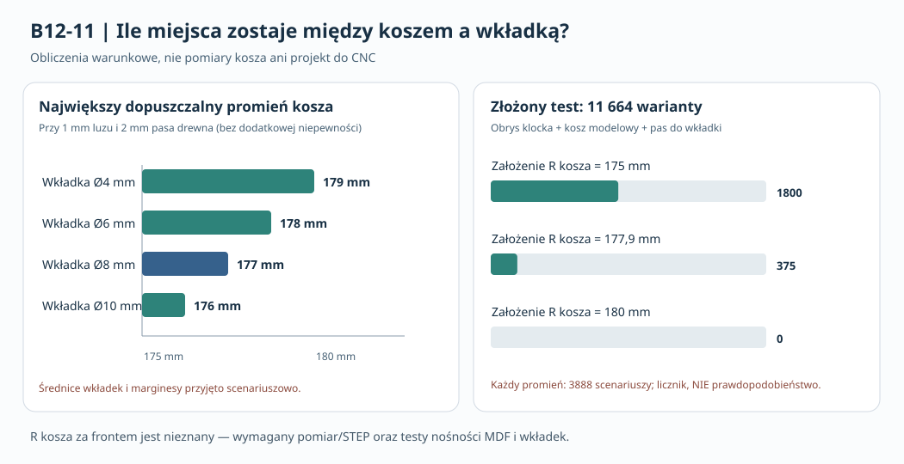

# B12-11 — niepewność przestrzeni na mocowanie, pas MDF i tolerancje stosu śruby

**Data 2026-11-02. Status: wykonano obliczenia warunkowe, bez pomiarów, bez kwalifikacji do CNC.**

## Cel i charakter badania

B12-09 oraz B12-10 wykazały, że **osiem lokalnych klocków z gwintowanymi wkładkami** jest potencjalną alternatywą dla szerokiej ramy A, ale nie daje podstaw do ustalenia średnicy wkładki i długości śruby. W B12-11 przeprowadzono niezależnie powtarzalne: (a) przesiew kolizji z narastającym umownym luzem względem uproszczonych brył obudowy, (b) analizę **koniecznego geometrycznego warunku** współistnienia kosza i wkładki, (c) ich sprzężoną kampanię, (d) przedziałowy test stosu śruby. Użyto wyłącznie biblioteki standardowej Python 3. Skrypt zapisuje wszystkie scenariusze do JSON i ma asercje liczności i agregatów.

**Wymiary nominalne z [aktualnej karty Dayton RSS390HF-4](https://www.daytonaudio.com/images/resources/295-468-dayton-audio-rss390hf-4-specifications-46176.pdf):** wycięcie Ø355,8 mm (R=177,9); oś 8 otworów Ø368 mm (R=184); otwór w kołnierzu Ø6,5; kołnierz Ø388,4, grubość 10,5 mm; głębokość 178 mm. Po obejrzeniu rysunku producenta potwierdzono widoczne żebra kosza i zaciski, **bez ilościowego ustalania ich zmiennego promienia R_b(y,θ)**. Dane wymiarowe nie są modelem STEP kosza. Nie utożsamiać średnicy otworu w kołnierzu z zewnętrzną średnicą wkładki, średnicą pilota w MDF ani średnicą łba.

**Model pomocniczy:** [P39C, uproszczona obudowa — NIE CNC](../dokumentacja/P39C_front_korpus_pierscien_REFERENCYJNY_NIE_CNC.scad): X=0..1020, Y=0..425, Z=0..500 mm; front 44 mm, pozostałe płyty 22 mm, pierwsza wręga zastępcza X448..470, w tym przedni fragment Y44..54. Wszystkie nowe wartości luzów, promieni obwiedni kosza, pasów drewna, grubości podkładek, tolerancji i minimalnego zazębienia są **założeniami eksperymentu**, nie tolerancjami producenta ani kryteriami wytrzymałości.

## 1. Warunek geometryczny: co trzeba zmierzyć w koszu

Osiowo położona wkładka o **zewnętrznej** średnicy d w lokalnym klocku, którego wewnętrzna krawędź ma promień R_i, może geometrycznie spełnić zarazem:

\[
R_i \ge R_{b,\max}+\delta+c,\qquad
R_i \le 184-\frac d2-w,
\]

gdzie \(R_{b,\max}\) oznacza **maksymalną radialną obwiednię rzeczywistego kosza** na całej objętej przez klocek głębokości, \(\delta\) to hipotetyczny wzrost promienia z powodu błędu/niepewności, \(c\) to modelowy wymagany luz, a \(w\) to modelowa minimalna grubość drewna od brzegu klocka do wkładki. Istnienie jakiegokolwiek \(R_i\) wymaga:

\[
\boxed{R_{b,\max}+\delta\le184-d/2-w-c.}
\]

To **warunek konieczny w takim modelu radialnym**, a nie wystarczający do bezpiecznego lub szczelnego montażu. Nie uwzględnia pochylenia rzeczywistego mocowania, kosza, gwintu, rozciągania kleju ani narzędzia. Jest szczególnie użyteczny do określenia zakresu danych potrzebnych od producenta.

Dla przykładowego **c=1 mm, w=2 mm, δ=0**:

| Zewnętrzna Ø wkładki — tylko scenariusz | Największy dopuszczalny promień obwiedni kosza |
|---|---:|
| 4 mm | 179 mm |
| 6 mm | 178 mm |
| 8 mm | **177 mm** |
| 10 mm | 176 mm |

Wymagane jest zmierzenie **maksimum R_b(y,θ)** w obszarze klocka, a nie tylko znanej średnicy wycięcia 355,8 mm. Na przykład nie wolno utożsamiać 177,9 mm (promień **otworu we froncie**) z promieniem **żeber za frontem**. Jeśli w badanej lokalizacji okaże się, że R_b=177,9 mm lub więcej, wariant z Ø8 mm i pasem 2 mm przy c=1 mm nie spełnia warunku nawet bez dodatkowej niepewności. Nie oznacza to, że wszystkie możliwe mocowania z Ø8 są wykluczone.

Wykonano **576 kombinacji** średnicy 4/6/8/10 mm, pasa 1/2/3 mm, luzu 0,5/1/2 mm, czterech hipotetycznych promieni kosza 170/175/177,9/180 mm i niepewności 0/0,5/1/2 mm. **303/576** spełniło tak zdefiniowany przedziałowy warunek; proporcja nie jest prawdopodobieństwem przejścia.

## 2. Niewielkie odstępy w obudowie: porównanie z B12-10

Powtórzono **324 bryły** z B12-10 (2 pozycje X, 2 fazy, 3 promienie wewnętrzne, 3 zewnętrzne, 3 szerokości i 3 głębokości). Każda konfiguracja zawiera 8 klocków. Wykonano weryfikację przecięć SAT w rzucie X–Z, ale tylko wtedy, gdy bryła klocka zachodzi w Y na zastępcze przeszkody P39C. Przeszkody powiększono w rzucie X–Z o umowny wymagany margines 0/1/2 mm.

| Modelowy margines względem ścian i wręg | Układy bez kolizji wszystkich 8 klocków |
|---|---:|
| 0 mm | **234/324** |
| 1 mm | **234/324** |
| 2 mm | **225/324** |

Powtórzenie 234/324 dla zerowego marginesu potwierdza spójność nowego przesiewu z wcześniejszym B12-10, ale **nie waliduje brył P39C względem rzeczywistej obudowy**. Przy marginesie 2 mm odrzucono dodatkowe 9 układów.

## 3. Sprzężona kampania 11 664 konfiguracji

W przeciwieństwie do dwóch niezależnych liczników geometrycznych połączono *każdy* z 324 układów lokalnych klocków z:

- promieniem hipotetycznego kosza 175/177,9/180 mm;
- dodatkową niepewnością radialną 0/1/2 mm;
- zewnętrzną średnicą wkładki 6/8 mm i wymaganym pasem drewna 1/2 mm.

Łącznie **324×3×3×2×2 = 11 664** przypadków. Przejście wymagało równocześnie braku przecięcia ośmiu klocków z **powiększonymi o 2 mm** przeszkodami zastępczymi, **co najmniej 1 mm** luzu kosz–klocek i wybranego pasa drewna do otworu wkładki.

| Hipotetyczna maksymalna obwiednia kosza | Liczba przejść |
|---|---:|
| R_b = 175 mm | **1800/3888** |
| R_b = 177,9 mm | **375/3888** |
| R_b = 180 mm | **0/3888** |
| **Razem** | **2175/11664** |

Dla każdej konfiguracji kosza **nieznanej w rzeczywistości**, wzrost założonej niepewności 0→1→2 mm dał odpowiednio **900 / 675 / 600** przejść. **Te częstości nie są prawdopodobieństwami** i nie dowodzą, że R_b=180 mm występuje w głośniku. Są analizą wrażliwości dla zadanych obwiedni.

Dwa jawne scenariusze porównawcze: przy R_b=175 mm, dodatkowej niepewności 1 mm, Ø6 mm, w=1 mm i 1 mm luzu wszystkie **225/324** kształtów, które przechodzą ekran przeszkód, także przechodzą ekran radialny. Przy R_b=177,9 mm, niepewności 1 mm, Ø8 mm, w=2 mm jest **0/324**, niezależnie od geometrii wręg. Stąd w tej modelowej rodzinie **głównym czynnikiem decyzji jest nieznane r(y,θ) kosza**, a nie kolejny ranking hipotetycznych szerokości klocka.

## 4. Przedziałowy budżet długości śruby — 252 scenariusze

W odróżnieniu od sztywnej sumy B12-10 wprowadzono jawne hipotetyczne przedziały geometrii, mierzone od odpowiednio zdefiniowanego punktu pod łbem (to nie jest jeszcze wybrany typ śruby):

- grubość kołnierza w osi śruby: 10,0–11,0 mm;
- grubość MDF: 43,5–44,5 mm;
- uszczelka: 0–1,5 mm;
- podkładka i przekładka: 0–1 mm.

**Suma S: 53,5–58,0 mm**, przy wartości nominalnej 55,75 mm. Zazębienie e=L−S, zatem dla długości L rzeczywisty zakres wynosi \([L-58,\;L-53,5]\). Sprawdzono L=60…80 mm (krok 1), grubość klocka 10/20/30 mm, minimalne *hipotetyczne* zazębienie 6/8/10/14 mm, niepewność głębokości klocka 1 mm i modelowy pozostawiony materiał przy jego tylnej ściance 3 mm.

Warunek odporny na wszystkie krańce tych przedziałów:

\[
L-58\ge e_{\min},\qquad L-53,5\le t_{\rm klocek}-1-3.
\]

**93/252** nominalnych, a **62/252** odpornych kombinacji spełniło ekran. Dla przykładowego minimalnego zazębienia 8 mm:

| Nominalna głębokość klocka | Długości L, które przechodzą te hipotetyczne przedziały |
|---|---|
| 10 mm | brak |
| 20 mm | 66–69 mm |
| 30 mm | 66–79 mm |

Nie jest to wykaz śrub do zakupu ani stwierdzenie dopuszczalnej długości gwintu: brak geometrii faktycznego łba, grubości uszczelnienia po dociśnięciu, specyfikacji wkładki, siły docisku, powierzchni bazowania, konstrukcji uszczelnienia, swobody wentylacji magnesu i kontroli odrywania.

## 5. Wnioski oraz ograniczenia metrologiczne

**Wniosek mechaniczny:** B12-11 redukuje niepewność *sformułowania problemu*, ale nie usuwa braku danych. Dopóki nie znamy przestrzennej obwiedni kosza względem realnej fazy 8 otworów, nie można uczciwie dobrać zewnętrznej średnicy wkładki ani porównywać jej nośności z ramą A. Jednocześnie wybór głębokości klocka musi uwzględniać wszystkie elementy stosu śruby. Obliczenia nie uzasadniają automatycznie kosztowniejszej ramy A i nie dowodzą bezpieczeństwa rozwiązania lokalnego.

**Kolejny krok B12-12:** pozyskać i udokumentować *rzeczywiste* R_b(y,θ), zaciski, rowki i żebra, ewentualnie plik STEP i specyfikację dostępnych wkładek; wykonać kontrolę położenia śrub, narzędzia i uszczelnienia. Do oceny nośności potrzebne są próbki MDF44 i kleju oraz rzeczywiste badania wyrywania, ścinania, odrywania, pełzania, wilgotności i demontażu. Po ich wykonaniu dopiero zwalidowany kontaktowy MES. Przy braku sprzętu można przygotować dokumentację prób i dalsze symulacje zakresowe, **nie udawać wyników laboratoryjnych**.

**Status:** model kosza rzeczywisty — **BRAK**; próby mechaniczne — **BRAK**; fizyczny prototyp — **NIE ZBUDOWANY**; zgoda na CNC — **NIE**. Żadnego elementu nie zamawiano. Głębokość całego urządzenia nadal ograniczona do 500 mm, zasilanie i DSP bez zmiany.

## 6. Kod, dane i odtwarzanie

- [Program obliczeń Python 3](../skrypty/b12_11_budzet_mocowan.py) — uruchom z katalogu repo: `python3 skrypty/b12_11_budzet_mocowan.py`. Wytwarza `wyniki/b12_11_pelne_obliczenia.json` i odtwarzalny SHA-256, sprawdza asercjami najważniejsze liczniki.
- [Zapis podsumowania (repo)](../wyniki/b12_11_podsumowanie.json) — manifest i scenariusze, oznaczone jako założenia. Pełny JSON jest **generowany przez skrypt**, nie stanowi pomiarów rzeczywistego urządzenia.
- [Rysunek własny](../wyniki/b12_11_budzet_geometryczny_NIE_CNC.svg).
- Podstawa: `main@c1932840d3b2ea02a5cb599593e9854bd6118975` (po scaleniu PR #57/#58). Brak modyfikacji historycznych raportów i danych źródłowych.
