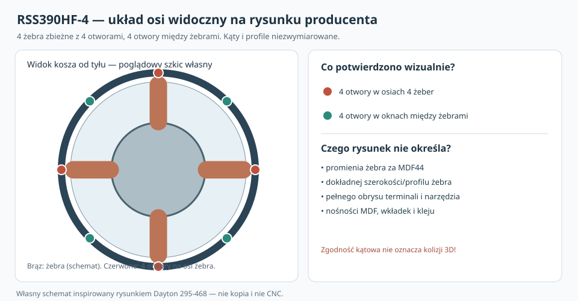
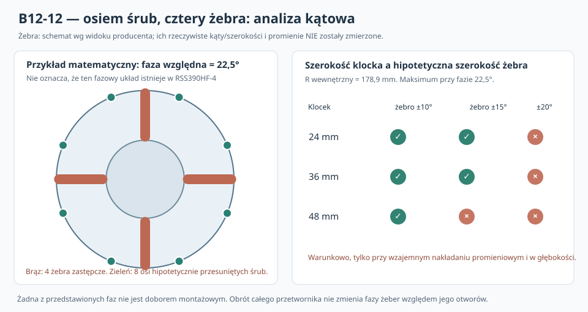

# B12-12 — cztery żebra kosza Dayton RSS390HF-4 wobec ośmiu punktów mocowania

**2 listopada 2026 · badanie teoretyczno-numeryczne · 78 192 przesiewy kątowe · bez pomiarów, NIE CNC.**

## Weryfikacja rysunku producenta — ważna korekta fazy (B12-12W)

Po bezpośrednim obejrzeniu oficjalnego rzutu od tyłu i przekroju bocznego Daytona stwierdzono, że **cztery z ośmiu otworów mocujących leżą wizualnie na osiach czterech głównych żeber kosza**, a cztery pozostałe **w przerwach między nimi**. Realna względna faza osi otworów i żeber na rysunku jest więc **w przybliżeniu 0°**, nie 22,5°. Odczyt dotyczy nominalnej geometrii wizualnej — producent nie podaje tolerancji fazy ani ilościowych profili żeber.

**Następstwo:** najlepsza faza 22,5° z analizy matematycznej jest wyłącznie kontrfaktycznym przypadkiem porównawczym, niedostępnym przez obrót tego głośnika. Gdy żebro znajduje się w tej samej płaszczyźnie głębokości i zachodzi promieniowo na klocek, cztery lokalizacje śrub przy osiach żeber wymagają osobnego rozpatrzenia. **Nie ma jednak dowodu, że żebra sięgają do wnętrza klocków w Y=44–74 mm**: boczny rysunek pokazuje zwężanie żebra do środka ku magnesowi. Zatem wyrównanie osi **nie jest równoznaczne z kolizją 3D ani z utrudnieniem prowadzenia śruby od przodu.**

[Pełna weryfikacja rzeczywistej budowy z dokumentów Dayton Audio](../dokumentacja/B12-12_weryfikacja_rzeczywistej_budowy_RSS390HF4_producent.md). W pierwotnym B12-12 wszystkie liczby dotyczą **modelowych alternatywnych faz**, nie pomierzonej konstrukcji kosza.

## Dlaczego to nowe badanie?

Oficjalny [rysunek Dayton RSS390HF-4](https://www.daytonaudio.com/images/resources/295-468-dayton-audio-rss390hf-4-specifications-46176.pdf) zawiera osiem otworów montażowych na okręgu Ø368 mm (Ø6,5 mm w kołnierzu); od tyłu widoczne są **cztery główne promieniowe żebra kosza**. Pozostałe źródłowe wymiary: kołnierz Ø388,4 mm, wycięcie Ø355,8 mm, głębokość całkowita 178 mm. Producent nie podaje w tym PDF kompletnej powierzchni R_b(Y,θ), szerokości sektorów żeber, ich obwiedni na każdej głębokości ani zmierzonej fazy żeber względem osi śrub.

Poprzednie B12-09–11 kontrolowały powierzchnię klocka, śruby, wręgi i hipotetyczny promień kosza, ale nie rozwiązywały **czterokrotnej i ośmiokrotnej symetrii**. B12-12 jest warunkową analizą wykluczania geometrycznego — nie zastępuje rzeczywistego modelu 3D ani pomiaru.

## Ścisły wynik geometrii kątowej

W modelu **czterech równomiernie położonych żeber co 90°** i **ośmiu osi śrub co 45°** minimalna odległość dowolnej osi śruby od osi najbliższego żebra jest, w przedziale fazy φ od 0 do 45°:

\[
d_{\min}(\varphi)=\min(\varphi,45^\circ-\varphi).
\]

Dlatego największy możliwy minimalny odstęp wynosi **22,5°** (dla fazy teoretycznej 22,5°). To **twierdzenie dla modelu symetrycznego**, nie zmierzony prześwit prawdziwego kosza. Nominalny rysunek producenta wskazuje **fazę bliską 0° i cztery osie otworów współliniowe z żebrami**; matematyczne maksimum 22,5° nie jest fizycznie regulowane.

**Uwaga zasadnicza:** faza żeber *względem otworów tego samego kosza* jest fabrycznie stała. Obrócenie całego przetwornika **NIE zmienia** jej. Analiza faz φ stanowi matematyczne porównanie scenariuszy, NIE propozycję regulacji kosza podczas montażu. Na rysunku producenta widać wizualnie układ żeber i otworów, ale nie wolno przypisywać mu fazy z dokładnością wymaganą do wykonania połączenia.

Dla lokalnego klocka o szerokości stycznej w i wewnętrznym promieniu R_i przyjęto konserwatywną półszerokość kątową jego narożników:

\[
\alpha=\arctan\!\left(\frac{w}{2R_i}\right).
\]

Jeżeli hipotetyczne żebro ma półkąt β, zaś u oznacza hipotetyczną niepewność orientacji, warunkowy test uniknięcia sektorów wymaga:

\[
d_{\min}(\varphi)>\alpha+\beta+u.
\]

Wobec tego aby **jakakolwiek teoretyczna faza** mogła przejść taki ekran, musi zachodzić:

\[
\boxed{\alpha+\beta+u<22{,}5^\circ.}
\]

Jednak nawet naruszenie tej nierówności **nie dowodzi kolizji 3D**: żebro może kończyć się radialnie przed klockiem lub nie sięgać jego zakresu Y. Warunek kątowy jest aktywny TYLKO tam, gdzie hipotetyczne bryły żeber i klocków zachodzą jednocześnie w promieniu oraz głębokości.

## Wykonane testy: 432 konfiguracje, 78 192 oceny faz

Parametry: R_i = 178 / 178,9 / 180 mm; szerokość klocka 24 / 36 / 48 mm; hipotetyczny półkąt żebra β = 5 / 10 / 15 / 20°; hipotetyczny promieniowy zasięg żebra 175 / 178 / 180 / 184 mm; u = 0 / 2 / 5°. Dla każdej kombinacji 181 faz od 0 do 45° co 0,25°. Program realizuje dodatkowo niezależny test kątów każdego z ośmiu otworów względem każdego z czterech żeber, z kontrolą krańców i punktów załamania.

Przykładowe wyniki **dla R_i=178,9 mm i promieniowego sięgania żebra do 184 mm**, z jednoczesnym zachodzeniem w Y:

| Szerokość klocka | β=10°, u=0° | β=15°, u=0° | β=15°, u=2° | β=20°, u=0° |
|---|---:|---:|---:|---:|
| 24 mm | 69/181 | 29/181 | 13/181 | 0/181 |
| 36 mm | 55/181 | 15/181 | **0/181** | 0/181 |
| 48 mm | 39/181 | **0/181** | 0/181 | 0/181 |

Dodatkowo: przy u=0 i R_i=178,9 mm krytyczna teoretyczna szerokość klocka wynosi **47,11 mm dla β=15°** oraz **15,62 mm dla β=20°**. Przy β=10° i klocku 48 mm hipotetyczne u=5° likwiduje wszystkie dopuszczalne fazy.

**To nie są szanse statystyczne ani badania gotowego głośnika.** W 180 z 432 zestawów parametrów przyjęty radialny zasięg żebra jest mniejszy niż wewnętrzny promień klocka — wtedy model nie narzuca wykluczeń kątowych. O rzeczywistym przebiegu kontaktu może więc rozstrzygać przede wszystkim nieznana geometria R_b(Y,θ), a nie liczba scenariuszy dodatnich.

## Dostęp narzędzia z tyłu a dostęp do śruby z przodu

Gdyby potrzebne było tylne narzędzie/uchwyt o promieniu t wokół osi R=184 mm, to jego modelowa półszerokość kątowa wynosi γ=arcsin(t/184). Dla t=3/5/8/10 mm otrzymujemy γ=0,934/1,557/2,492/3,115°. Nie jest to rzeczywista symulacja ścieżki narzędzia: wkrętak prowadzony **od przodu** ma odmienną drogę i nie musi w ogóle napotykać żeber za kołnierzem. Natomiast odzyskanie obracającej się T-nut z tyłu po sklejeniu skrzyni to osobne zagadnienie serwisowe.

## Wnioski i bramki

- **Nie wybierać fazy 22,5° jako rozwiązania montażowego:** nie można zmieniać wzajemnej fazy żeber i otworów obrotem całego kosza.
- **Nie odrzucać lokalnych klocków na podstawie ujemnego testu sektorów:** potrzebny jest równoczesny pomiar radialnego zasięgu, głębokości Y i rzeczywistej fazy.
- **Nie kwalifikować wkładki ani MDF:** brak zweryfikowanych parametrów wyrywania, rozwarcia, wytrzymałości spoin i sił montażowych.
- Zarówno osiem lokalnych punktów, jak i rama A **pozostają kandydatami**. Wstępny wybór głośnika C02 i wymagania 100/120/150 l oraz maksymalnej głębokości 500 mm nie zmieniają się.

**Rekomendowany etap B12-13:** na prawdziwym koszu lub zweryfikowanym STEP wyznaczyć fazę i pełny profil R_b(Y,θ), szczególnie na Y=44–74 mm za frontem; zmierzyć wystawanie zacisków, dostęp do mocowań i narzędzi. Następnie przeprowadzić próby wyrywania, ścinania, odrywania i cykli serwisowych MDF/kleju/wkładki, porównując wariant lokalny z ramą A. [Protokół pomiaru kosza](../dokumentacja/B12-12_protokol_pomiaru_kosza_i_mocowan.md).

**CNC: ZABLOKOWANE. Prototyp: NIE ZBUDOWANY. Pomiary własne: NIE WYKONANO.**

## Kod i źródła

- [Odtwarzalny Python 3, ze sprawdzaniem matematycznej tożsamości i niezależnymi testami](../skrypty/b12_12_katy_zeber_i_mocowan.py).
- [Wyniki zbiorcze JSON](../wyniki/b12_12_podsumowanie.json); skrypt generuje również pełny JSON scenariuszy.
- [Własny diagram orientacyjny](../wyniki/b12_12_cztery_zebra_osiem_srub_NIE_CNC.svg) — nie jest zdjęciem z forum ani rysunkiem CNC.
- [Producent: arkusz techniczny i wymiary](https://www.daytonaudio.com/images/resources/295-468-dayton-audio-rss390hf-4-specifications-46176.pdf), oględziny rysunku 02.11.2026.
- Podstawa: gałąź main, commit 008e4911706c9bd134258256beda91ac78dbb5bd. Nie zmieniano historycznych raportów.
