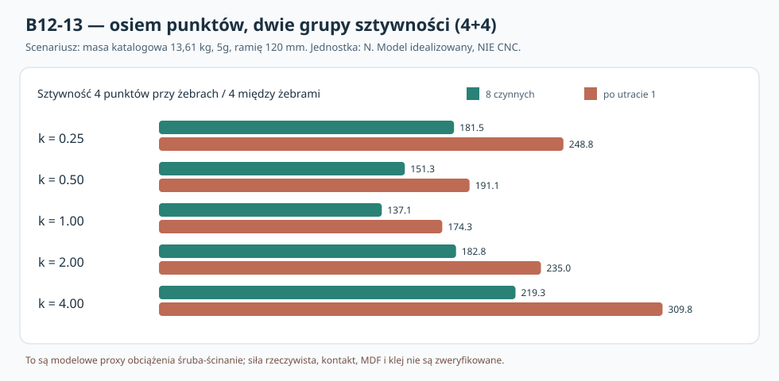

# B12-13 — Dayton RSS390HF-4: wpływ nierównej sztywności czterech mocowań przy żebrach i czterech między żebrami

**2 listopada 2026 · wykonane badania statyczne układu sprężyn zastępczych · 2160 scenariuszy · NIE pomiar ani MES kontaktowy · NIE CNC.**

## 1. Co wnoszą dane producenta?

Rysunek [Dayton RSS390HF-4 (295-468)](https://www.daytonaudio.com/images/resources/295-468-dayton-audio-rss390hf-4-specifications-46176.pdf) pokazuje cztery główne promieniowe żebra odlanego kosza i osiem otworów. **Cztery otwory leżą wizualnie na osiach żeber, a cztery między żebrami** (B12-12W), czego nie można zmieniać obrotem całego głośnika. Osie otworów znajdują się na okręgu Ø368 mm, czyli R=184 mm. Kątowa zbieżność nie dowodzi kolizji żebra z klockiem MDF w przestrzeni trójwymiarowej.

[Strona producenta](https://www.daytonaudio.com/product/126/rss390hf-4-15-reference-hf-subwoofer-4-ohm) podaje masę **30 lb = 13,6077711 kg**. W poprzednim B12-09 zastosowano scenariusz **15 kg**. Nowe wyniki pokazują oba przypadki, a **13,61 kg jest katalogową wartością, nie masą zważonego egzemplarza**.

**Nowe pytanie:** co się stanie, jeśli sztywność połączeń pod czterema osiami żeber będzie inna niż pod czterema osiami międzyżebrowymi? Nawet jeżeli nie występuje kolizja geometrii, osiem punktów może w rzeczywistości dzielić obciążenie nierówno.

## 2. Model i granice jego fizycznej ważności

Kierunek X to poziom w płaszczyźnie frontu, Z pion. Oś Y jest prostopadła do frontu. Przyjęto **sztywną zastępczą płytę kołnierza** i po jednym *liniowym sprężystym podparciu normalnym* na każdą czynną oś śruby. Nominalne kąty śrub są 0°, 45°, …, 315°; indeksy 0/2/4/6 stanowią cztery punkty **na kierunkach żeber** (w sensie rzutu producenta), indeksy nieparzyste — cztery pozostałe. Nie wynika stąd, że wiemy, jaką sztywność mają rzeczywiste mocowania.

Niech k_i oznacza względną sztywność normalną punktu, przyjmując dla czterech międzyżebrowych k=1 i dla czterech na osiach żeber k=ρ. W modelu podpisana (*signed*) reakcja normalna jest

\[
N_i=k_i(a+b x_i+c z_i).
\]

Współczynniki a,b,c wyznacza się z trzech równań równowagi:

\[
\sum N_i=0,\quad \sum x_i N_i=M_z,\quad \sum z_i N_i=M_x.
\]

Siłę poprzeczną F dzieli się proporcjonalnie do k_i:

\[
T_i=F\frac{k_i}{\sum_j k_j},\qquad F=m\,g\,n,\qquad |M|=F\,e.
\]

To **umowny rozkład ścinania**, a nie rozwiązanie rzeczywistej macierzy sztywności ścinającej. Wartości ujemne N_i są modelowymi reakcjami ściskającymi; w prawdziwym układzie ściskanie przenosi **kontakt kołnierza z MDF/uszczelką**, którego *nie rozwiązano*. Nie wolno interpretować ich jako „ujemnego rozciągania śruby”. Do wskaźnika obciążenia śruby wzięto wyłącznie dodatnią część N_i oraz T_i:

\[
Q_i^{\rm proxy}=\sqrt{\max(N_i,0)^2+T_i^2}.
\]

**To nie jest siła niszcząca, wytrzymałość śruby ani normowy warunek doboru.** Przy rzeczywistym docisku lub lokalnym odrywaniu kołnierza obciążenia mogą być inne. Brak nieliniowego kontaktu, tarcia, luzów, rzeczywistych sztywności żeber, śrub i MDF, zmęczenia oraz odpowiedzi dynamicznej.

## 3. Zakres wykonanych badań

Wykonano **2160 przypadków**, jako iloczyn:
- masa katalogowa 13,6078 kg albo wcześniejszy scenariusz 15 kg;
- przyspieszenie porównawcze 1/3/5/10g;
- hipotetyczny mimośród środka masy 80/120/160 mm;
- ρ=0,25/0,5/1/2/4;
- dwa kierunki poprzecznej siły X/Z;
- osiem czynnych punktów albo wyłączenie dowolnego z ośmiu mocowań.

Równowagę sumy reakcji normalnych, dwóch momentów i poprzecznych sił sprawdzono numerycznie dla wszystkich 2160 przypadków w **niezależnej implementacji NumPy**, oddzielnie od repozytoryjnego skryptu standardowej biblioteki Python. Program w repo ma własne asercje oraz sprawdzenie B12-09 dla 15 kg. Zastosowane poziomy przyspieszenia i mimośrody **nie są danymi normowymi ani pomiarami eksploatacyjnymi**.

## 4. Wyniki ilościowe — przykład 5g i 120 mm

Przy masie katalogowej **F=667,23 N**, w przykładzie ośmiu równych sztywności (ρ=1) uzyskano **108,79 N** maksymalnej dodatniej reakcji normalnej, **83,40 N** ścinania na punkt, **137,08 N** maksymalnego wskaźnika Q.

| Stosunek sztywności ρ (przy żebrach / między żebrami) | Maks. Q, wszystkie 8 czynne | Najgorsze Q po utracie jednego punktu | Wzrost względem 8 czynnych |
|---:|---:|---:|---:|
| 0,25 | **181,54 N** | 248,82 N | +37,06% |
| 0,50 | **151,28 N** | 191,08 N | +26,30% |
| **1,00** | **137,08 N** | 174,30 N | +27,15% |
| 2,00 | **182,77 N** | 234,97 N | +28,56% |
| 4,00 | **219,33 N** | 309,83 N | +41,26% |

Wartości to maksima z obliczonego modelu zastępczego, a **nie normatywne dopuszczalne siły**. W tym przykładzie **ρ=4** podnosi maksymalny wskaźnik dla ośmiu mocowań o **59,99%** wobec ρ=1; po utracie punktu maksymalna wartość 309,83 N jest o **77,75%** wyższa niż 174,30 N w wariancie równomiernym po analogicznej awarii (ale mogą wypadać inne najgorsze punkty). Zwiększanie sztywności tylko wybranej grupy **nie jest automatycznie poprawą nośności całego połączenia**.

**Istotna ostrożność:** wskaźnik Q nie uwzględnia tego, że fizyczne punkty 4+4 mogą mieć *różną wytrzymałość* i rozkład naprężeń w drewnie. Połączenie sztywniejsze i zarazem mocniejsze może pracować poprawnie, podczas gdy wiotkie i słabe ulegnie zerwaniu, ale ocena wymaga równocześnie obu rzeczywistych charakterystyk. Tabela nie stawia tezy „nigdy nie usztywniać”.

## 5. Próba po utracie śruby

Przy ρ=1 utrata jednego punktu zwiększa wskaźnik Q z 137,08 do 174,30 N (**+27,15%**) w przypadku najgorszym spośród ośmiu uszkodzeń. Przy ρ=4 rośnie z 219,33 do 309,83 N (**+41,26%**). Oznacza to w prostym modelu większą wrażliwość na utratę mocowania przy znacznym zróżnicowaniu podparć.

**Brak dowodu**, że realny układ zniesie takie obciążenie: model liniowy nie rozwiązuje propagacji uszkodzenia, zmiany położenia kołnierza, utraty docisku ani dystrybucji ścinania przez tarcie. Utrata śruby jest scenariuszem diagnostycznym, nie planowanym trybem pracy.

## 6. Co mówi model o klejonym klocku?

Dla klocka tylko modelowego o zasięgu promieniowym 178,9–205 mm, szerokości 36 mm i odjętej powierzchni hipotetycznej wkładki Ø8 mm pole spoiny wynosi **889,34 mm²** (jak w B12-09). Dzielenie siły na punkt przez to pole daje wyłącznie **średnie modelowe zapotrzebowanie na naprężenie**, nie wytrzymałość kleju czy MDF; efekty odrywania przy krawędzi, zginania i pełzania **nie są policzone w B12-13**. Nie wolno z tego wyprowadzać bezpiecznego współczynnika bezpieczeństwa.

Ponadto w B12-11 i B12-12 nadal nie rozstrzygnięto, czy rzeczywiste żebra kosza i terminale w ogóle pozostawiają potrzebną przestrzeń dla takich klocków przy Y=44–74 mm. **Ten raport nie jest potwierdzeniem wykonalności lokalnych mocowań ani przewagi ramy A.**

## 7. Kierunek konstrukcyjny i test wymagany do rozstrzygnięcia

**Wstępna rekomendacja badań:** nie optymalizować geometrii mocowania wyłącznie pod maksymalną sztywność lub najgrubszy klocek. Należy docelowo mierzyć **rzeczywistą sztywność translacyjną i rotacyjną oraz nośność każdego z ośmiu połączeń**; oddzielnie kontrolować cztery punkty na osiach żeber i cztery między nimi, a także rzeczywisty docisk kołnierza z MDF.

**Następny etap B12-14:** opracować macierz próbek MDF44 i autentycznych łączników, z kontrolą geometrii kosza, siły docisku, ścinania, odrywania, wyrywania gwintu, momentu obrotowego i cykli demontażu. Przy braku fizycznego sprzętu wykonać dodatkowe niezależne badanie **kontaktowego modelu sprężyn jednostronnych** (tylko ściskanie kontaktu) i sprawdzić wrażliwość na różne warunki wstępnego docisku, bez nazywania ich pomiarami. Dopiero eksperymentalnie zwalidowany model może służyć do decyzji o złączach i porównania z ramą A.

## Reprodukcja, pochodzenie i status

- [Skrypt Python 3 (stdlib, z asercjami równowagi)](../skrypty/b12_13_nierowna_sztywnosc_4plus4.py), polecenie: `python3 skrypty/b12_13_nierowna_sztywnosc_4plus4.py`.
- [Wyniki zagregowane i parametry scenariuszy JSON](../wyniki/b12_13_podsumowanie.json).
- [Własny wykres B12-13, NIE CNC](../wyniki/b12_13_sily_4plus4_NIE_CNC.svg).
- Pełny JSON z 2160 stanami jest generowany przez skrypt w pliku `wyniki/b12_13_scenariusze_4plus4.json`, a nie jest kopią pomiarów.
- Katalogowy [rysunek producenta](https://www.parts-express.com/pedocs/specs/295-468-dayton-audio-rss390hf-4-specifications-46176.pdf) i [strona produktu](https://www.daytonaudio.com/product/126/rss390hf-4-15-reference-hf-subwoofer-4-ohm).
- Stan bazowy `main@057f302ed504aab752394ba4368bfc8abc2a6838`. Żadne raporty historyczne ani parametry głośników nie zostały zmienione.
- **Pomiary złączy: NIE; zwalidowany kontaktowy MES: NIE; zgoda na CNC: NIE; zakup materiałów: NIE.**
