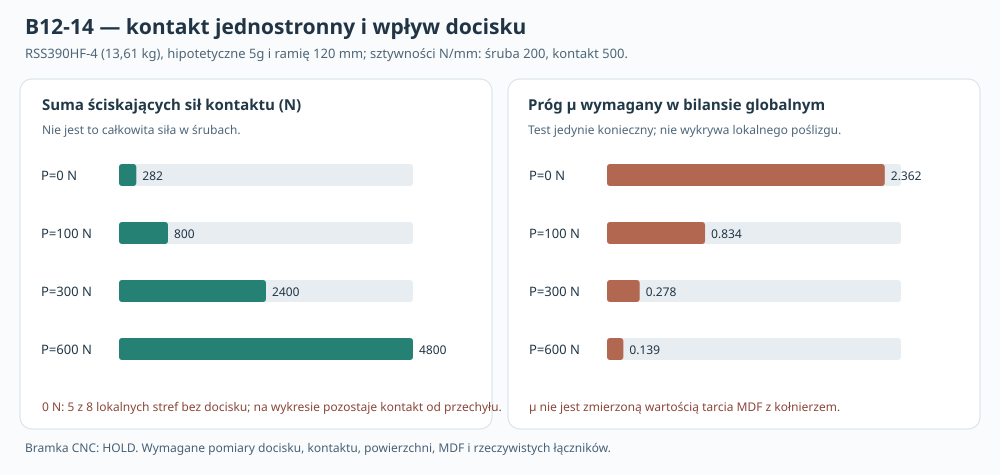

# B12-14 — kontakt jednostronny, docisk, śruby i warunek tarcia pod kołnierzem RSS390HF-4

**02.11.2026 · badanie numeryczne przed budową · 1152 przypadki normalne + 4608 testów tarcia · NIE MES 3D · NIE pomiar · NIE CNC.**

## 1. Dlaczego nowe badanie?

[B12-13](B12-13_sztywnosc_4plus4_i_awaria_mocowan_RSS390HF4.md) analizował osiem *podpisanych* sprężyn normalnych o różnej sztywności, ale nie odróżniał wyraźnie sprężyny śruby (tylko rozciąganie) od kołnierza dociskającego MDF (tylko ściskanie). [Raport P44B](113_P44B_tarcie_i_wrazliwosc_16200.md) miał już **16 200 prób globalnej nierówności tarcia** po wcześniejszych modelach jednostronnego kontaktu, lecz nie rozwiązywał wspólnie sił w śrubach, kontaktu i pozostającego docisku w jednym modelu stanu sprężystego. B12-14 uzupełnia te braki w **ośmiopunktowym modelu zastępczym**, nie w zwalidowanym rozkładzie ciągłego nacisku kołnierza.

Źródło danych produktu: [oficjalny Dayton RSS390HF-4](https://www.daytonaudio.com/product/126/rss390hf-4-15-reference-hf-subwoofer-4-ohm), masa katalogowa **30 lb = 13,6077711 kg**; [rysunek producenta](https://www.daytonaudio.com/images/resources/295-468-dayton-audio-rss390hf-4-specifications-46176.pdf), osiem osi montażowych na PCD Ø368, stąd **R=184 mm**. Obserwowany wcześniej układ cztery osie przy żebrach i cztery między nimi pochodzi z [B12-12W](../dokumentacja/B12-12_weryfikacja_rzeczywistej_budowy_RSS390HF4_producent.md). **Producent nie podaje w tych źródłach ani siły wstępnego docisku, ani sztywności MDF, gwintu, śrub i powierzchni kołnierza, ani współczynnika tarcia.**

## 2. Model fizyczno-matematyczny

Rozpatrujemy sztywną *zastępczą* płytę kołnierza w trzech uogólnionych stopniach swobody: przesunięcie osiowe w kierunku Y i dwa przechyły. W punktach mocowania i=0..7, na promieniu R=184 mm, współrzędne znormalizowane to q_i=(1,cosθ_i,sinθ_i), θ_i=45°i. Zmiana wzajemnego rozwarcia w punkcie i ma postać **u_i = q_i ⋅ (a,b,c)**, wyrażona w mm. W każdym punkcie są dwa różne, jednostronne elementy:

\[
B_i=\max(0,P_i+k_{b,i}u_i) \qquad \text{(śruba, siła rozciągająca)}
\]

\[
C_i=\max(0,P_i-k_{c,i}u_i) \qquad \text{(ściskanie powierzchni kontaktu)}.
\]

Przy u_i=0 i bez obciążenia zewnętrznego B_i=C_i=P_i — stan równowagi od hipotetycznego **docisku wstępnego P_i**. Jeżeli śruba traci rozciąganie, B_i=0; gdy powierzchnia się rozchodzi, C_i=0. Dla „utraconej śruby” przyjęto **P_i=0, k_b=0**, ale ściskający kontakt może wciąż działać przy przechyleniu kołnierza. To jawne, uproszczone założenie, nie model gwintu po awarii.

W trzech równaniach równowagi użyto reakcji r_i=B_i−C_i. Przy poziomej sile w płaszczyźnie frontu F=m·g·n, przyłożonej z hipotetycznym ramieniem e względem frontu:

\[
\sum_i r_i=0,\qquad
\sum_i (x_i/R)r_i=F e/R \quad\text{(dla F wzdłuż X)},
\]

a analogicznie \(\sum(z_i/R)r_i=F e/R\) dla siły wzdłuż Z. Równania momentu przyjęto z konsekwentną konwencją znaków; nie wylicza się przy tym rzeczywistego ramienia środka masy przetwornika. Problem rozwiązano iteracyjnie, metodą Newtona z jednostronnymi pochodnymi i tłumieniem kroku (line search), kontrolując **trzy równania równowagi** oraz wszystkie nierówności B_i,C_i≥0.

**Ograniczenie metody:** osiem *skupionych* obszarów docisku NIE odpowiada pełnej powierzchni uszczelki i kołnierza. Nie ma zweryfikowanej sztywności ich materiałów, deformacji rzeczywistego kosza, podatności otworów ani kontaktowego MES 3D. Dla prawdziwego jointu trzeba ponownie zdefiniować powierzchnię kontaktu i nośniki sił.

## 3. Jakie wejścia przebadano?

| Wielkość | Scenariusze (nie parametry produktu) |
|---|---|
| Początkowy docisk na czynną śrubę P | **0, 100, 300, 600 N** |
| Względna sztywność śrub na osiach żeber | **0,5, 1, 2, 4** względem międzyżebrowych |
| Sztywność jednej śruby między żebrami | **200 N/mm** (model) |
| Sztywność jednego obszaru kontaktu | **500 N/mm** (model) |
| Obciążenie poprzeczne (scenariusz) | **1, 3, 5, 10g** |
| Ramię przechyłu | **80, 120, 160 mm** |
| Kierunek siły | **X albo Z** |
| Utrata mocowania | **żadne albo punkt 0/1** (reprezentatywny przy żebrach / pomiędzy żebrami) |
| Badane µ tarcia | **0,15, 0,30, 0,50, 0,70** |

Iloczyn daje **4×4×4×3×2×3 = 1152** rozwiązań normalnego kontaktu. Każde rozwiązanie sprawdzono z czterema µ — razem **4608 nierówności tarcia**. Nie badano awarii wszystkich ośmiu śrub z osobna; indeksy 0 i 1 reprezentują dwie klasy w idealizowanym wzorze 4+4. Nie przyjęto żadnych normowych współczynników bezpieczeństwa ani realnych obciążeń eksploatacyjnych.

## 4. Co oznacza sprawdzanie tarcia?

Wyliczamy tylko **globalną górną zdolność tarcia** \(T_{\rm cap}=\mu\sum_i C_i\), czyli przyjętą idealną granicę przeniesienia **samej translacyjnej siły F** przez wszystkie strefy kontaktu bez poślizgu:

\[
F\le \mu\sum_i C_i.
\]

To **warunek konieczny** dla rozpatrywanego wyłącznie tarciowego przenoszenia F, a nie gwarancja rzeczywistego „stick”. Nie rozwiązujemy przemieszczeń stycznych, lokalnego Coulomba, momentu skręcającego w płaszczyźnie, zmiany oporu na kolejnych plamach styku ani ścinania trzpieni śrub po poślizgu. Jeśli warunek nie jest spełniony, idealny model nie dysponuje dostateczną sumą tarcia; **co najmniej F−µΣC** pozostaje do przeniesienia inną ścieżką, jeśli tarcie wykorzysta pełną hipotetyczną zdolność. Nie jest to wyznaczona rzeczywista siła ścinająca pojedynczą śrubę.

## 5. Wykonane obliczenia — masa 13,6078 kg, 5g, e=120 mm, sztywności 1:1

Siła poprzeczna wynosi **667,23 N**. Ramię 120 mm jest założeniem, a nie położeniem zweryfikowanego środka masy. **Wszystkie osiem śrub jest obecnych**.

| Hipotetyczny docisk P na śrubę | Suma sił kontaktu ΣC | Kontakt otwarty (punkty) | Maks. całkowita siła rozciągania śruby | Wymagane µ_req = 667,23/ΣC |
|---:|---:|---:|---:|---:|
| 0 N | 282,46 N | **5/8** | 94,31 N | **2,362** |
| 100 N | 800,00 N | 0/8 | 131,08 N | 0,834 |
| 300 N | 2400,00 N | 0/8 | 331,08 N | **0,278** |
| 600 N | 4800,00 N | 0/8 | 631,08 N | 0,139 |

**Interpretacja:** bez wstępnego docisku moment w tym *modelu* wywołuje kontakt na ściskanej stronie, a jednocześnie otwiera część punktów. Nie oznacza to, że fizyczny subwoofer można montować bez dociągania śrub. Przy P≥100 N dla tego przykładu styki pozostają zamknięte, a zwiększanie P zwiększa sumę modelowych nacisków i możliwą zdolność przeniesienia siły przez tarcie. **Nie można z tego wyprowadzić zalecanego momentu dokręcania**, ponieważ nie znamy wytrzymałości MDF, gwintu, wkładki, uszczelki, pełzania ani relaksacji.

Dla P=100 N oraz µ=0,50 hipotetyczne **T_cap=400 N**, zatem F przewyższa ten globalny limit o **267,23 N**. Dla P=300 N i µ=0,30 **T_cap=720 N** przewyższa 667,23 N, ale **nadal nie potwierdza to braku lokalnego poślizgu**. µ=0,30 nie jest pomiarem tarcia aluminium/uszczelki/MDF; jest wartością z siatki.

W reżimie bez otwierania styku, przy identycznych wszystkich ośmiu sprężynach, można **analitycznie** sprawdzić wynik:
- suma sił ściskających ΣC=8P;
- maksymalny *przyrost* siły w śrubie wynosi \(\Delta B_{\max}=[k_b/(k_b+k_c)]F e/(4R)\);
- dla k_b=200 N/mm, k_c=500 N/mm, 5g, e=120 mm daje **31,08 N** przyrostu ponad zadany P;
- dla P=300 N maksymalny sumaryczny odczyt śruby to **331,08 N**.

To istotne rozróżnienie wobec B12-13: tam 108,79 N było modelową *podpisaną reakcją sprężyny netto* przy zewnętrznym momencie, NIE wartością całkowitego napięcia śruby w połączeniu z dociskiem. Wyniki 108,79 N i 331,08 N nie są bezpośrednio porównywalnymi miarami tego samego fizycznego elementu.

## 6. Kontrole numeryczne i zbieżność

Na pełnej siatce otrzymano:
- **1152/1152** przypadków z poprawną równowagą sił i momentów, dodatniością B_i/C_i oraz przeszłą kontrolą równania sumy rozciągania i ściskania;
- **886** przypadków z co najmniej jednym otwartym punktem kontaktu;
- **876** z co najmniej jedną śrubą bez rozciągania (również scenariusze celowo usuniętej śruby);
- maksymalnie **4 iteracje** w badanym zestawie Newtona.

Powyższe liczby są wynikami zadanej **siatki dyskretnych scenariuszy**, nie prawdopodobieństwami awarii. Zależność zamkniętego styku została dodatkowo porównana z rozwiązaniem analitycznym. W lokalnym niezależnym badaniu **100 pseudolosowo wybranych scenariuszy** potwierdzono osobnym solverem `scipy.optimize.root`, z równowagą lepszą niż 10⁻⁶ N. Nie jest to walidacja eksperymentalna, a jedynie niezależna kontrola numeryczna.

Odpowiada to duchowi metodologii badań złączy z Sandia National Laboratories, [*Guideline for Bolted Joint Design and Analysis*](https://www.sandia.gov/research/publications/details/guideline-for-bolted-joint-design-and-analysis-version-1-0-2008-01-01/), gdzie oddzielnie traktuje się niepewność docisku, ścinanie, obciążenie osiowe i zniszczenie gwintu. **Nie stosujemy standardów lotniczych jako norm dopuszczenia MDF do subwoofera.**

## 7. Co jeszcze nie zostało rozstrzygnięte?

**Nie mamy wystarczających danych o realnej konstrukcji.** Nominalna masa i układ osi śrub pochodzą z producenta, ale rzeczywistego docisku, sztywności elementów, fazy zacisków, pełnego profilu żeber R_b(Y,θ), wentylacji magnesu, połączenia klocków z MDF ani możliwości dostępu narzędziowego nie zmierzono.

Badanie B12-14 **nie dowodzi** większej trwałości osiem lokalnych klocków względem ramy A. Żaden wariant nie jest zatwierdzony do CNC, zamawiania części ani montażu.

### B12-15 — zalecany etap

Opracować próbki porównawcze A (lokalne klocki/wkładki) oraz B (rzeczywista rama A, ze wszystkimi mocowaniami wręg). Dla każdej grupy:
1. udokumentować rzeczywistą siłę w śrubie po montażu (nie wnioskować jej wyłącznie z nominalnego momentu dokręcania), ubytek po czasie i powtarzalność;
2. zmierzyć sztywność osiową sprężyny śruby i lokalnego kontaktu, rozwarcie obszarów kołnierza, a następnie rozkład pola kontaktu;
3. badać poślizg i siły tarcia *z rzeczywistymi materiałami i uszczelką* oraz równocześnie rozkład obciążenia w osiach śrub;
4. udokumentować wyrywanie wkładki, ścinanie, odrywanie kleju, spękania MDF, wilgoć i cykle serwisowe;
5. na podstawie prawdziwych wyników odtworzyć kontaktowy **MES z polem nacisku** i kalibracją parametrów. Brak próbek = brak walidacji rzeczywistego materiału.

Protokół badań przygotowawczych: [B12-14 — złącza i pomiar przed CNC](../dokumentacja/B12-14_protokol_walidacji_docisku_i_zlaczy.md).

## 8. Reprodukcja i niezmienność źródeł

[Python 3, tylko biblioteka standardowa](../skrypty/b12_14_kontakt_docisk_tarcie.py) · [podsumowanie JSON](../wyniki/b12_14_podsumowanie.json) · [rysunek SVG](../wyniki/b12_14_docisk_kontakt_tarcie_NIE_CNC.svg) · [workflow GitHub Actions](../.github/workflows/b12-14-regression.yml).

Uruchomienie: `python3 skrypty/b12_14_kontakt_docisk_tarcie.py`. Generuje pełny zbiór `wyniki/b12_14_contact_full.json` oraz `wyniki/b12_14_manifest_odtworzony.json`, w którym zapisany jest SHA-256 pełnych wyników. W repo pozostaje odrębny, niewymazywany zapis podsumowania. Wyniki nie są pomiarami.

**Podstawa:** commit `69c64ab6617dda3ad2d94f4ec55cc027ca47c2dd`. Wszystkie wcześniejsze raporty, dane producenta i scenariusze B12-13 pozostają bez modyfikacji. **CNC HOLD.**
